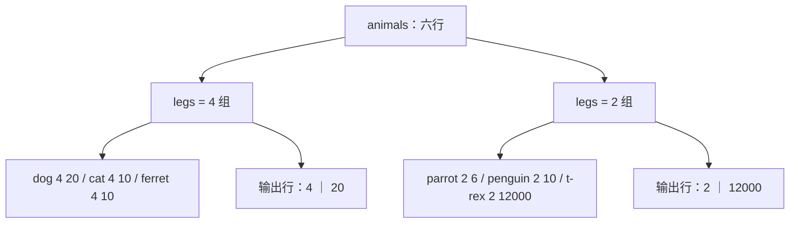
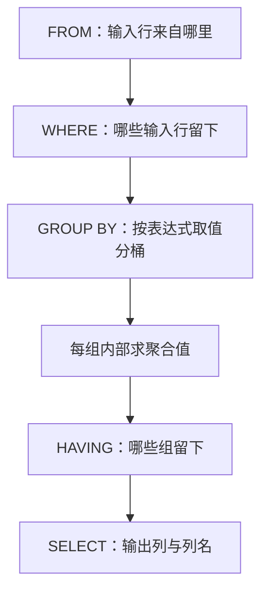

> **课程**：UC Berkeley CS61A · Structure and Interpretation of Computer Programs（Fall 2024）
> **本讲**：Lecture 37 ｜ 17:30 ｜ B 站分 P 35 ｜ [原视频](https://www.bilibili.com/video/BV1sy411z7nA?p=35)
> **课件**：`35-Aggregation_1pp.pdf`（13 页，官方 PDF，逐页渲染图见正文插图）
> **字幕**：B 站英文原声字幕；本笔记是中文书面化重构，非逐句翻译
> **版权**：课程与课件版权归 UC Berkeley CS61A 教学团队；本文为学习用途的二次整理

## 本讲速览

*(参考时间: 00:00:01 – 00:00:11｜Lecture 37)*


- **已掌握**：`SELECT` 语句由列描述、`FROM`、`WHERE`、`ORDER BY` 几部分构成；`WHERE` 里的表达式逐行求值，决定一行留下还是丢弃；多表查询用逗号把两张表拼在一起，再用 `WHERE` 写出连接条件。
- **本讲主线**：
    - 聚合函数（aggregate function）出现在列描述里，把某一列上的多个值压成一个值：`MIN`、`MAX`、`SUM`、`AVG`、`COUNT`。
    - 不带 `GROUP BY` 时，通过 `WHERE` 过滤的所有行属于同一个组，聚合查询的结果只有一行。
    - `GROUP BY` 按某个表达式的不同取值把行切成若干个组，组的数量等于该表达式不同取值的数量。
    - `HAVING` 在分组之后按组过滤，组级条件里可以写聚合函数；`WHERE` 在分组之前按行过滤，两者作用于不同的层级。
    - 聚合值与单值列混写在同一个列描述里时，单值列给出的是「被聚合选中的那一行」，只有聚合值唯一确定该行时这个答案才有意义。
- **关键结论**：分组是在行集合上定义等价类，聚合是在每个等价类上求值，`HAVING` 是对等价类求解布尔表达式——三者合起来，SQL 才从「查一行」升级为「查一张表的统计规律」。

## 1. 聚合函数的登场：从「一行一个值」到「一列一个值」

*(参考时间: 00:00:13 – 00:01:46｜Lecture 37)*


到目前为止，SQL 里出现的每一个表达式都只在**一行之内**取值。这个说法值得拆开来看：`SELECT` 语句中的表达式分别出现在三处——列描述（column description，即 `SELECT` 与 `FROM` 之间那份「要输出哪些列」的清单）、`WHERE` 子句与 `ORDER BY` 子句。这三处写的都是列名，但列名本身没有值，它指的是「某一行在这一列上的值」。

于是 `WHERE latitude > 38` 这样的过滤，执行方式是逐行扫描：取出当前这一行的 `latitude`，与 38 比较，成立就保留这一行，不成立就丢弃这一行。表达式本身是**按行求值**的，一个表达式只看得见当前这一行。这是此前所有查询的共同形式，也是理解聚合的参照系。

聚合函数打破的正是这个参照系。它可以出现在列描述里的表达式中，但它看的不是一行，而是某个列（或某个表达式）在**多行**上的全部取值，例如把这些取值加起来、取最大、取最小。换句话说：标量表达式的作用范围是一行，聚合表达式的作用范围是一组行。

| 判据 | 标量表达式 | 聚合表达式 |
| :--- | :--- | :--- |
| 求值单位 | 一行 | 一组行（默认整张表） |
| 典型写法 | `weight`、`latitude > 38`、`legs - weight` | `MAX(weight)`、`SUM(weight)`、`COUNT(*)` |
| 输出粒度 | 输入几行就输出几行 | 一组只输出一个值 |
| 直觉 | 「这一行怎么样」 | 「这一列整体怎么样」 |

本讲余下的所有内容，都是在这个新参照系上做加法：先看单个聚合函数怎么用，再看一行里的聚合值与单值列如何互相干涉，最后看分组——把「一组」从「整张表」细化为「按某个表达式切出来的桶」。

## 2. animals 表：一个专门为聚合准备的数据集

*(参考时间: 00:01:46 – 00:03:16｜Lecture 37)*

为了研究聚合，课堂换掉此前的数据集，引入一张只有三列、六行的小表 `animals`：`kind`（种类）、`legs`（腿数）、`weight`（体重，单位是磅）。

| kind | legs | weight |
| :--- | ---: | ---: |
| dog | 4 | 20 |
| cat | 4 | 10 |
| ferret | 4 | 10 |
| parrot | 2 | 6 |
| penguin | 2 | 10 |
| t-rex | 2 | 12000 |

六行的来历讲得很随意，但每一行都在为后面的例子埋伏笔。狗是四腿动物，二十磅；猫四腿十磅；雪貂四腿十磅——讲师顺口吐槽说，十磅对一只雪貂来说实在偏胖，但先按这个数算。鹦鹉是鸟，两腿六磅；更大的鸟是企鹅，两腿十磅。最后一行是讲师特意挑的：他当时在想「什么东西只有两条腿、又特别重」，本来可以举鸵鸟，最终选了暴龙（T-Rex），体重约六吨，也就是 12000 磅。

这张表的设计意图很清楚：`legs` 只有 4 和 2 两种取值，天然适合演示分组；`weight` 有重复值（猫、雪貂、企鹅都是 10），会在「按体重分组」时被合并；而 12000 这个离群值保证了「最大值」与「平均值」给出截然不同的答案。后面每一处反直觉的输出，都能在这六行里找到原因。

第一个聚合查询只有一句：

```sql
SELECT MAX(legs) FROM animals;
```

注意它**没有任何 `WHERE`**，也就是说没有任何过滤。按照以往的经验，`SELECT` 一个列名应该输出六行；但这里只输出了一行，值为 4，即 `legs` 列在六行上的最大值。这是本讲的第一个反直觉点：聚合函数把「多行输入」压成了「一行输出」，而这个压缩与 `WHERE` 无关，是聚合本身带来的。

## 3. 五个聚合函数：MIN、MAX、SUM、AVG、COUNT

*(参考时间: 00:03:16 – 00:07:10｜Lecture 37)*

课堂演示先重新载入同一张 `animals` 表，再逐条试。最基础的两个是最大值与求和：

```sql
SELECT MAX(legs) FROM animals;      -- 4
SELECT SUM(weight) FROM animals;    -- 12056
```

`12056` 就是六个体重相加：20 + 10 + 10 + 6 + 10 + 12000。到此为止，聚合函数还是「对一整列做一件事」的直觉版本，真正的灵活性来自它的参数。

### 3.1 参数可以是任意表达式

聚合函数的参数不必是裸列名，可以是任何逐行可求值的表达式，聚合发生在**表达式的结果**上，而不是发生在原始列上：

```sql
SELECT MAX(legs - weight) + 5 FROM animals;   -- 1
```

这个 1 值得手算一遍，它是理解「聚合作用在表达式上」的最好例子。逐行计算 `legs - weight`：

| kind | legs | weight | legs - weight |
| :--- | ---: | ---: | ---: |
| dog | 4 | 20 | -16 |
| cat | 4 | 10 | -6 |
| ferret | 4 | 10 | -6 |
| parrot | 2 | 6 | -4 |
| penguin | 2 | 10 | -8 |
| t-rex | 2 | 12000 | -11998 |

最大值出现在鹦鹉这一行：两条腿六磅，差为 -4，是所有行里最大的一个（最接近零）。再在聚合结果上加 5，得到 1。注意加 5 这一步发生在聚合**之后**，它是对「一个数」做的算术，不是对每一行做的算术；如果写成 `MAX(legs - weight + 5)`，结果同样是 1，因为常数加法不改变谁最大，但两者的求值顺序并不相同。

多个聚合可以并排出现在同一份列描述里，各自独立计算：

```sql
SELECT MAX(legs), MIN(weight) FROM animals;        -- 4 | 6
SELECT MAX(legs) - MIN(weight) FROM animals;       -- -2
```

第一句输出的是 `4` 和 `6`。这两个数字放在同一行里，很容易被误读成「有一只动物四条腿、六磅重」，但表里并没有这样一只动物：六磅的是鹦鹉，它只有两条腿。讲师特意点明这一点——**两个聚合是彼此独立计算的**，它们的值来自不同的行，SQL 只是把它们拼进同一个输出行。第二句把两个聚合值相减，得到 -2，同样与任何单一动物无关。

聚合也可以与 `WHERE` 组合，此时过滤先发生，聚合在剩下的行上做：

```sql
SELECT MIN(legs), MAX(weight) FROM animals WHERE kind <> 't-rex';   -- 2 | 20
```

去掉暴龙之后，`legs` 列的最小值仍是 2（鹦鹉与企鹅都是两条腿），而 `weight` 列的最大值从 12000 落到狗身上的 20。这个对比说明：`WHERE` 改变的是「参与聚合的行集合」，聚合函数本身的语义没变。

### 3.2 COUNT 与 DISTINCT

`AVG` 与 `COUNT` 是两个语义上略有不同的函数。平均值的计算方式是把总和除以行数：

```sql
SELECT AVG(weight) FROM animals;   -- 2009.3
SELECT COUNT(legs) FROM animals;   -- 6
SELECT COUNT(kind) FROM animals;   -- 6
SELECT COUNT(*) FROM animals;      -- 6
```

`AVG(weight)` 等于 12056 除以 6，约 2009.3（课堂演示时口头记作 2009）。`COUNT` 则只回答一个问题：有多少行。它与参数是哪一列无关——数腿、数种类、数体重，得到的都是 6，因为这张表就是六行。既然与列无关，惯用的写法是用星号代替列名，`COUNT(*)` 更直白地表达「数行」的意思。

真正需要写列名的地方是配合 `DISTINCT`（去重）使用：

```sql
SELECT COUNT(DISTINCT legs) FROM animals;     -- 2
SELECT COUNT(DISTINCT weight) FROM animals;   -- 4
SELECT SUM(DISTINCT weight) FROM animals;     -- 12036
```

`legs` 只有 4 与 2 两种取值，所以去重计数是 2。`weight` 去重后是 20、10、6、12000 四个值，去重计数是 4。`DISTINCT` 也可以修饰求和：`SUM(DISTINCT weight)` 先把重复的 10 合并成一个再去加，得到 12036，比不去重的 12056 少了 20——正好是被去掉的那两个 10。这说明 `DISTINCT` 修饰的是**聚合的输入**，它在聚合之前把重复值去掉，而不是在结果上去重。

| 函数 | 语义 | 在 `animals` 上的取值 | 常见误用 |
| :--- | :--- | :--- | :--- |
| `MIN` | 一组中的最小值 | `MIN(legs)` 为 2 | 以为它返回整行 |
| `MAX` | 一组中的最大值 | `MAX(legs)` 为 4，`MAX(weight)` 为 12000 | 与并列值一起用时以为答案唯一 |
| `SUM` | 求和 | `SUM(weight)` 为 12056 | 忘记 `DISTINCT` 会改变输入 |
| `AVG` | 平均值（总和除以行数） | `AVG(weight)` 约 2009.3 | 以为结果对应某一只动物 |
| `COUNT` | 计数 | `COUNT(*)` 为 6 | 以为 `COUNT(列)` 会跳过某些行 |

> **编者说明**：上表最后一行提到的「跳过」指的是 `NULL` 的处理：多数 SQL 实现里 `COUNT(列名)` 只数该列非空的行，而 `COUNT(*)` 数所有行。本讲的数据没有空值，六行全都非空，所以两个写法结果一致；空值与聚合的关系不在本节课件范围内，这里只作提示。

### 3.3 空值：聚合函数的例外（编者补充）

> **编者说明**：本讲的 `animals` 表没有空值，字幕也没有讨论 `NULL`；但真实数据几乎总有缺失，而聚合函数对空值的处理与直觉有出入。以下内容是 SQL 的通用规则，不属于本讲课件。

`NULL` 表示「这个格子没有值」，它既不是 0，也不是空字符串。聚合函数在计算时会**跳过** `NULL`：

| 情形 | 结果 |
| :--- | :--- |
| `COUNT(*)` | 数所有行，包含含空值的行 |
| `COUNT(列)` | 只数该列非空的行 |
| `SUM`、`AVG`、`MIN`、`MAX` | 忽略空值，`AVG` 的分母是非空行数 |
| 整列都为空 | `COUNT` 返回 0，其余四个返回 `NULL` |

后果之一是 `AVG(weight)` 与 `SUM(weight) / COUNT(*)` 在存在空值时不再相等：前者跳过缺失的体重，后者把缺失行也算进分母。判断是否为空要用 `IS NULL` 与 `IS NOT NULL`，不能写 `= NULL`——与空值做比较得到的是「未知」，`WHERE` 不会保留这样的行。

## 4. 聚合与单值列混用：那个「被选中的行」

*(参考时间: 00:07:09 – 00:10:55｜Lecture 37)*

课件允许在同一个列描述里混写聚合函数和不带聚合的列名，例如：

```sql
SELECT MAX(weight), kind FROM animals;   -- 12000 | t-rex
```

输出是一行：最大体重 12000，以及 `kind` 列的值 `t-rex`。这就是本节要解释的现象——**聚合函数除了算出一个值，还顺带选中了某一行**。当它取最大体重时，那一行是暴龙，于是同一行的 `kind`、`legs` 等列也就有了值。所以这个查询可以读成一个问句：「谁有 12000 磅？」答案是暴龙，这个答案有意义，因为六行里最大体重是唯一的。

同样的机制在另外两种情形下也给出有意义的答案：

```sql
SELECT MIN(weight), kind FROM animals;   -- 6 | parrot
SELECT MIN(kind), kind FROM animals;     -- cat | cat
```

第一句取最小体重，六磅只有鹦鹉，所以 `kind` 是 `parrot`，答案唯一。第二句更微妙：`MIN(kind)` 在**字符串**上取最小值，比较依据是字典序（lexicographic order），`cat < dog < ferret < parrot < penguin < t-rex`，所以最小的种类是 `cat`。这一行整行被选中，于是第二个 `kind` 也是 `cat`。把它们竖着排开，还能读到更多：这只动物的 `legs` 是 4，`weight` 是 10。

但机制并不保证答案有意义。下面两个查询就露馅了：

```sql
SELECT MAX(legs), kind FROM animals;      -- 4 | cat
SELECT AVG(weight), kind FROM animals;    -- 2009.3 | t-rex
```

第一句里，四条腿的动物有三只（狗、猫、雪貂），最大腿数 4 无法唯一确定一行，因此 `kind` 取哪一个都是「合法的」——SQLite 恰好给了 `cat`，但 `dog` 与 `ferret` 同样说得通。第二句更彻底：平均值 2009.3 不对应任何一行，它不是某只动物的体重，暴龙也完全不平均。可查询照样输出了一行，而且把暴龙的名字写在平均值旁边，看上去像是「平均体重的那只动物是暴龙」，这是**纯粹的误导**。

| 查询 | 输出 | 单值列的含义 |
| :--- | :--- | :--- |
| `SELECT MAX(weight), kind` | 12000、t-rex | 有意义：最大值唯一，行被唯一确定 |
| `SELECT MIN(weight), kind` | 6、parrot | 有意义：最小值唯一 |
| `SELECT MIN(kind), kind` | cat、cat | 有意义：字典序最小者唯一 |
| `SELECT MAX(legs), kind` | 4、cat | 任意：三只动物并列最大，结果不可依赖 |
| `SELECT AVG(weight), kind` | 2009.3、t-rex | 无意义：平均值不属于任何一行 |

结论可以写得很短：`MIN` 与 `MAX` 这类「挑出一行」的聚合，配合单值列有可能得到有意义的答案；`AVG`、`SUM`、`COUNT` 这类「造出一个新数」的聚合，永远无法指出是哪一行，此时输出里的单值列只是实现顺手带出来的副产品。讲师给出的提醒是：把单值列和聚合写在同一份列描述里时要格外小心。

> **编者说明**：至于「顺手带出来」的到底是哪一行，SQL 标准没有规定，不同实现、不同执行计划可能给出不同结果；SQLite 在本次演示里返回了扫描过程中最后被聚合的那一行。可依赖的做法是不写这种查询，而是显式地用子查询或分组把「哪一行」这件事说清楚——本讲第 6 节与第 11 节各给了一条路子。

## 5. 默认分组：整张表就是一个组

*(参考时间: 00:10:49 – 00:11:38｜Lecture 37)*

到这里可以给聚合函数一个完整定义：它取出某个表达式（例如某个列名）在**一个组的所有行**上的全部取值，然后对这些取值做一件事——取最大、取和、取平均、计数。

这个定义里有一个此前一直被忽略的词：组。默认情况下，参与计算最终表的那些行——也就是通过了 `WHERE` 过滤的行——全部属于同一个组，一个巨大的组。所以不带 `GROUP BY` 时，任何聚合查询的结果都只有一行；前面所有例子里「输出只有一行」的现象，根子都在这里，而不是在聚合函数身上。

`SELECT` 语句允许把这个默认设定改掉：不是所有行一组，而是按某种规则把行分成多个组，每组各自聚合一次。这就是 `GROUP BY` 的入口。

## 6. GROUP BY：按表达式的取值把行分桶

*(参考时间: 00:11:38 – 00:13:30｜Lecture 37)*


加上了分组与组过滤之后，`SELECT` 语句的完整形式是：

```sql
SELECT [columns] FROM [table] GROUP BY [expression] HAVING [expression];
```

其中 `GROUP BY` 与 `HAVING` 都是新面孔，本节先讲 `GROUP BY`。它的一句话语义是：**组的数量等于该表达式不同取值的数量**。表达式在每一行上求值，取值相同的行落进同一个桶，每个桶就是一组；随后聚合在每个桶里各做一次，一个桶产出一行。

课件上的例子是：

```sql
SELECT legs, MAX(weight) FROM animals GROUP BY legs;
```

`legs` 只有 4 与 2 两种取值，于是六行被切成两个桶：`legs=4` 的桶里是狗、猫、雪貂，`legs=2` 的桶里是鹦鹉、企鹅、暴龙。每个桶算一次 `MAX(weight)`，四腿桶的最大体重是 20（狗），两腿桶的最大体重是 12000（暴龙）。输出两行。



### 6.1 为什么未聚合的 `legs` 可以出现在输出里

第二个反直觉点在这里：`MAX(weight)` 是聚合，但 `legs` 不是，它凭什么出现在列描述里？

答案藏在分组的定义里。既然分组依据就是 `legs`，那么同一组内所有行的 `legs` 必然相等——`legs=4` 的桶里三行都是 4，`legs=2` 的桶里三行都是 2。此时「取哪一行的 `legs`」这个问题失去了意义，因为取哪一行都一样。讲师的说法是：它其实给的是某个任意行的 `legs` 值，但组内每一行都相同，所以结果确定。这与第 4 节 `MAX(legs), kind` 的困境正好相反——那里并列导致不确定，这里分组保证了一致。

> **编者说明**：「组内取值必然相同」这条性质，正是标准 SQL 限制分组查询投影的来源：`SELECT` 里不带聚合的列必须出现在 `GROUP BY` 中，否则在标准里就是非法查询。SQLite 比标准宽松，允许 `SELECT MAX(weight), kind` 这类写法并返回任意一行——第 4 节踩的正是这个宽松带来的坑。按标准写（非聚合列一律进 `GROUP BY`），输出才不会随实现变化。

### 6.2 分组前后，行集发生了什么

把「行集」当作主角，可以更清楚地看到每一步在做什么。以 `SELECT legs, MAX(weight) FROM animals GROUP BY legs;` 为例，逐阶段记录行集形态：

| 阶段 | 行集 | 行数 |
| :--- | :--- | ---: |
| ① `FROM animals` | dog、cat、ferret、parrot、penguin、t-rex 六行原封不动 | 6 |
| ② `WHERE` 过滤 | 本查询没有 `WHERE`，六行全部留下 | 6 |
| ③ `GROUP BY legs` 分桶 | `legs=4` 桶：dog、cat、ferret；`legs=2` 桶：parrot、penguin、t-rex | 2 组 |
| ④ 组内聚合 `MAX(weight)` | 四腿桶得 20，两腿桶得 12000 | 2 |
| ⑤ `SELECT` 输出 | 两行：`4 ｜ 20` 与 `2 ｜ 12000` | 2 |

这张表要读出的信息是：**行数在聚合这一步发生跳变，而且跳变的幅度由组的数量决定，不由行的数量决定**。六行可能压成一行（不分组），也可能压成两行（按 `legs` 分成两组），还可能压成五行（按 `legs` 与 `weight` 分成五组，见下一节）。输出行数与被聚合的行数之间没有固定比例，这正是聚合查询与普通查询最大的差别。

## 7. 分组形态：多列、计数与任意表达式

*(参考时间: 00:13:30 – 00:15:47｜Lecture 37)*

分组之后能做的事不止取最大值。最常用的组合是分组计数：

```sql
SELECT legs FROM animals GROUP BY legs;             -- 4 / 2
SELECT legs, COUNT(*) FROM animals GROUP BY legs;   -- 4 ｜ 3 / 2 ｜ 3
SELECT legs, MAX(weight) FROM animals GROUP BY legs; -- 4 ｜ 20 / 2 ｜ 12000
```

第一句只输出分组键本身，得到 4 与 2，也就是 `legs` 的不同取值；它在语义上等价于「这张表里腿数有哪几种」。第二句在每个组里数行：两只腿的动物有三只，四条腿的动物也有三只。第三句回到最大体重，四腿组 20 磅，两腿组 12000 磅。

`GROUP BY` 可以同时按多列（准确说是多个表达式）分组：

```sql
SELECT legs, weight FROM animals GROUP BY legs, weight;
```

此时「组」由取值组合决定，输出的是 `legs` 与 `weight` 的所有不同组合，共五行：

| legs | weight | 组内成员 |
| ---: | ---: | :--- |
| 4 | 20 | dog |
| 4 | 10 | cat、ferret |
| 2 | 6 | parrot |
| 2 | 10 | penguin |
| 2 | 12000 | t-rex |

六行变成五行，唯一被合并的是猫与雪貂——它们在这两列上完全相同。这是一个值得记住的判据：**分组的粒度越细，被合并的行越少，输出行数越接近原表行数**。

分组依据还可以是任意表达式，包括算术式：

```sql
SELECT weight / legs, MAX(kind) FROM animals GROUP BY weight / legs;
```

这里先逐行算 `weight / legs`，再按这个比值分组，最后在每组里取 `kind` 的字典序最大者。要留意 SQL 的除法规则：两个整数相除时按整数除法处理，20 除以 4 得 5，10 除以 4 得 2（小数部分被截断），六行算下来分别是 5、2、2、3、5、6000。

| weight / legs | 组内 kind | `MAX(kind)` |
| ---: | :--- | :--- |
| 2 | cat、ferret | ferret |
| 3 | parrot | parrot |
| 5 | dog、penguin | penguin |
| 6000 | t-rex | t-rex |

注意比值 5 这一组跨了腿数：狗是 20 除以 4，企鹅是 10 除以 2，两者腿数不同，却因为比值相同被分进同一个桶。这再次说明分组的依据是**表达式的计算结果**，而不是某一列的原始值。

> **编者说明**：上面的分组结果表是根据课件 `animals` 表的六行数据、整数除法规则与「字典序最大」的语义逐行推算的；课堂演示只在屏幕上展示了查询结果，字幕没有逐行念出这四个值。输出行的顺序同样不在字幕里，表中按比值升序排列只为便于阅读。

## 8. HAVING：在分组之后按组过滤

*(参考时间: 00:15:47 – 00:17:27｜Lecture 37)*


有时分组之后还想只留下一部分组：例如只关心「行数超过一的组」。`HAVING` 子句做的就是这件事——它过滤的是组的集合，决定哪些组还能参与聚合、出现在最终结果里。与之相对，`WHERE` 过滤的是单个输入行，决定哪些行进得来。`HAVING` 里还可以写聚合函数，这是它与 `WHERE` 最关键的区别。

课件把写 `SELECT` 语句的过程压成三步，这三步恰好对应三组子句：

1. 确定表达结果需要哪些已有的行（`FROM` 与 `WHERE`）。
2. 形成分组，并确定哪些组应该成为输出行（`GROUP BY` 与 `HAVING`）。
3. 格式化输出行（`SELECT`）。

每个子句负责回答一个问题：

| 子句 | 回答的问题 |
| :--- | :--- |
| `SELECT` | 每个输出行包含哪些值（以及列名） |
| `FROM` | 输入行来自哪里 |
| `WHERE` | 哪些输入行 |
| `GROUP BY` | 形成输出行（怎么分组） |
| `HAVING` | 哪些输出行（哪些组留下） |



### 8.1 逐组求值的演示

最后一个演示是：按「体重除以腿数」分组，只保留行数大于一的组。

```sql
SELECT weight / legs, COUNT(*)
  FROM animals
 GROUP BY weight / legs
HAVING COUNT(*) > 1;
```

执行过程可以拆成三层。第一层逐行求值，每行得到一个比值：狗 5、猫 2、雪貂 2、鹦鹉 3、企鹅 5、暴龙 6000。第二层按比值分桶，得到四个组：比值 5 的组有两只（狗与企鹅），比值 2 的组有两只（猫与雪貂），比值 3 的组只有鹦鹉，比值 6000 的组只有暴龙。第三层对每个组求 `COUNT(*)`，并用 `HAVING` 判断：

| weight / legs | 组内成员 | `COUNT(*)` | `HAVING COUNT(*) > 1` |
| ---: | :--- | ---: | :--- |
| 5 | dog、penguin | 2 | 保留 |
| 2 | cat、ferret | 2 | 保留 |
| 3 | parrot | 1 | 丢弃 |
| 6000 | t-rex | 1 | 丢弃 |

输出两行：`5 ｜ 2` 与 `2 ｜ 2`。这里最关键的一点是 `HAVING` 里的 `COUNT(*)`：它是一个聚合值，只有在组已经形成之后才算得出来，所以它不可能写在 `WHERE` 里。`WHERE` 执行时行还没分组，逐行求值的表达式里没有组的概念。

> **编者说明**：录像的最后一句话是「这两组都被丢弃了」，指代的应是 `COUNT(*)` 为 1 的那两组（比值 3 与 6000）被丢弃；按 `HAVING COUNT(*) > 1` 的字面语义，保留的是比值 5 与 2 两组。字幕末尾的指代不够清楚，这里按子句语义还原。

### 8.2 WHERE 与 HAVING 的分工

两者都是过滤器，但作用在不同的层级上。把它们并排放，判据是「作用对象」：

| 判据 | `WHERE` | `HAVING` |
| :--- | :--- | :--- |
| 作用对象 | 单个输入行 | 已经形成的组 |
| 执行时机 | 分组之前 | 分组之后 |
| 能否含聚合函数 | 不能 | 能，例如 `HAVING COUNT(*) > 1` |
| 典型问题 | 「哪些行参与计算」 | 「哪些组出现在结果里」 |
| 引用的值 | 行内的列 | 分组表达式与聚合值 |

「不能」这一条在课件练习里有一个现成的证据（第 11 节会详细展开）：直接写 `WHERE legs = MAX(legs)`，SQLite 会在解析阶段就报错。

```sql
sqlite> SELECT * FROM animals WHERE legs = MAX(legs);
Parse error: misuse of aggregate function MAX()
```

报错信息用的是 `misuse`（误用）而不是「找不到值」，因为在解析器看来，把聚合函数放进 `WHERE` 在语法层面就是矛盾的：`WHERE` 的逻辑是先于分组执行的，而聚合函数要求分组已经存在。这个顺序约束不是实现细节，而是查询语言的语义结构。

## 9. 课件案例：cal 表中的员工人数变化

*(参考时间: 00:16:20 – 00:16:43｜Lecture 37)*

> **编者说明**：录像在第 8 节的 `HAVING` 演示后就结束了（全长 17:30），课件第 6 至 13 页没有对应的讲解段落。以下四节依据课件画面与文本整理，补全课件余下的内容：一个真实的聚合案例、一张说明案例动机的背景图，以及两组练习。为满足时间锚点的格式要求，这几节的锚点取录像末段的真实起止，不代表这些内容在录像中的位置。


课件第 6、7 页是一个完整的例子，表名 `cal`，记录加州大学伯克利分校历年的人数统计，列为 `source`（员工还是学生）、`type`（类别）、`role`（具体职位或身份）以及四个学年的数字：`fa08`、`fa13`、`fa18`、`fa23`。

| source | type | role | fa08 | fa13 | fa18 | fa23 |
| :--- | :--- | :--- | ---: | ---: | ---: | ---: |
| employee | Grad Student Titles | Grad St. Instructor（GSI） | 1943 | 1925 | 2202 | 2248 |
| student | Grad Student | Grad Student | 10258 | 10253 | 11666 | 12621 |
| student | Undergrad | Undergrad | 25151 | 25951 | 30853 | 33078 |


题目的要求分两半：对每一种**员工**类别，算出 `fa23` 与 `fa18` 的总人数之差；只保留人数增加的那几类。注意「总人数」这个词——同一类别下有多个 `role` 行，必须先按类别把行聚起来再相减。

```sql
SELECT type, SUM(fa23) - SUM(fa18) AS increase
  FROM cal
 WHERE source = "employee"
 GROUP BY type
HAVING SUM(fa23) > SUM(fa18);
```

把子句与三步法对齐之后，每一行的作用都很清楚：

| 子句 | 在这一句里做什么 |
| :--- | :--- |
| `SELECT` | 输出类别，以及 `fa23` 总数与 `fa18` 总数的差，列名取 `increase` |
| `FROM` | 唯一的输入表 `cal` |
| `WHERE` | 只留下 `source` 为 `employee` 的行，学生行被排除 |
| `GROUP BY` | 按 `type` 分桶，同一类别的多个 `role` 行落进同一桶 |
| `HAVING` | 只保留 `fa23` 总数大于 `fa18` 总数的桶，人数下降的类别不出现在结果里 |

输出四行：

| type | increase |
| :--- | ---: |
| Grad Student Titles | 327 |
| Other Faculty | 352 |
| Regular Faculty | 48 |
| Staff | 454 |

这个例子把本讲的三个新工具串成了一条线：`SUM` 负责把同一类别下多行的数字合起来，`GROUP BY` 负责把行按类别切桶，`HAVING` 负责按聚合后的结果筛掉不符合条件的桶。缺任何一环都写不出这个查询——只用 `WHERE` 无法比较「总数」，只用 `GROUP BY` 无法排除下降的类别，而不分组则只能得到全校一个总差值。

> **编者说明**：`SUM(fa23) - SUM(fa18)` 与 `SUM(fa23 - fa18)` 在无空值的前提下等价（求和是线性的），但前者更贴近题面「两个总数的差」的表述，也与 `HAVING` 里重复使用的两个 `SUM` 保持一致。这里选前者是写法上的选择，不是语义上的必需。

## 10. 案例背后的动机：州政府拨款与每位学生的成本

*(参考时间: 00:16:43 – 00:17:02｜Lecture 37)*


课件在第 8 页放了一张背景图，解释为什么值得用 SQL 去分析 `cal` 这张表。伯克利是公立大学，经费的一部分来自加州纳税人经由州政府的拨款；过去这笔支持相当慷慨，让学校能在压低学费的同时维持运转，但它所占的份额持续下降——三十年前州政府提供学校收入的 50%，如今只有 14%。

图表的标题是「州教育拨款（百万美元）」，横轴从 FY01 到 FY21，纵轴从 0 到 600。柱子的高度起起落落：FY01 是 500，FY02 升到 520，之后几年连续下降（497、451、421、438、475），FY08 回到 506，FY09 跌到 319，FY12 只剩 269，此后缓慢回升，FY20 是 411，FY21 是 354。图的上方还标出了 2001 年衰退、2008 年衰退与新冠疫情（COVID-19）三个时点，对应的几根柱子（FY01、FY02、FY08、FY12、FY21）被涂成黑色，与蓝色柱子区分开。

但名义金额会骗人，图上的两个浮动标注正是在纠正这个直觉。第一个标注：2001 年的 1 美元，购买力相当于 2021 年的 1.53 美元；按不变价折算，州政府的支持从 2001 年以来实际下降了 46%。第二个标注把拨款摊到学生头上：2001 年秋季有 32128 名学生，折算成 2021 年美元是每人 23811 美元；2021 年秋季有 45057 名学生，每人只剩 7857 美元。

| 指标 | Fall 2001 | Fall 2021 |
| :--- | ---: | ---: |
| 学生人数 | 32128 | 45057 |
| 州拨款折算后的每生经费（2021 年美元） | 23811 | 7857 |

这张图和 SQL 的关系，在于「每生经费」这个数的算法：它需要把一年的拨款总额除以同一年的人数，而拨款与人数是两张表、两组行。聚合正是做这件事的工具——先按年份把行聚成一组，再在组内做除法。前面 `cal` 表的例子做的是同一类工作，只不过它比的是两个年份的人数差，而这张图比的是二十年里「钱」与「人」两条曲线的相对速度。

> **编者说明**：这一页是课件的背景材料，画面上的文字与数字如上所述，但讲座录像没有讲到它，图中各年份的具体数值也只在柱顶标注，正文按画面转录并归纳，未引入课件之外的统计口径。

## 11. 练习：分组与自连接的两条路

*(参考时间: 00:17:02 – 00:17:12｜Lecture 37)*


课件后半段是两组练习，都用 `animals` 表。第一组的关键词是「连接」：同一个问题既可以用自连接枚举所有配对，也可以用分组在每组内做比较。

### 11.1 同体重两只动物的最大腿数差

题目：体重相同的两只动物之间，腿数的最大差值是多少？


第一种解法把 `animals` 与它自己连接，别名 `a` 与 `b`，用体重相等作为连接条件，于是每一对同体重的动物都成为一行，再对这些行取腿数差的最大值：

```sql
SELECT MAX(a.legs - b.legs) AS difference
  FROM animals AS a, animals AS b
 WHERE a.weight = b.weight;
```

输出 `2`。第二种解法换一个角度：既然要比的是「同体重内部」的差异，那就按体重分组，在每组内取最大腿数减最小腿数，再把所有组的结果排序取第一个：

```sql
SELECT MAX(legs) - MIN(legs) AS difference
  FROM animals
 GROUP BY weight
 ORDER BY difference DESC
 LIMIT 1;
```

输出同样是 `2`。两种解法的思路差异值得对照：

| 判据 | 自连接 | 分组 |
| :--- | :--- | :--- |
| 处理单位 | 一对行 | 一个组 |
| 连接条件 | `a.weight = b.weight` | 分组表达式 `GROUP BY weight` |
| 计算量 | 行数的平方级配对 | 行数级分组 |
| 是否需要排序取首 | 否，聚合直接给出最大值 | 是，`ORDER BY` 加 `LIMIT 1` |
| 结果 | 2 | 2 |

验算一下结果：体重 10 磅的三只动物里，猫与雪貂都是四条腿，企鹅是两条腿，最大差是 4 减 2 等于 2；其余体重的组（20、6、12000）都只有一只动物，组内差为 0。所以答案是 2，两种解法一致。

### 11.2 腿数最多的所有动物

题目：腿数最多的动物都有哪些？这是一个「输出所有并列者」的问题，与第 4 节 `MAX(legs), kind` 只输出一个任意行形成对照。


最自然的写法是把最大值直接当条件，但这行不通：

```sql
sqlite> SELECT * FROM animals WHERE legs = MAX(legs);
Parse error: misuse of aggregate function MAX()
```

原因是第 8 节讲过的层级问题：`WHERE` 逐行求值，`MAX(legs)` 需要对整组求值，两者不在同一个阶段。课件给了两条绕开的路。

第一条路把最大值先物化成一个命名的值。先用聚合把最大值存进一张只有一行的临时表，再把这张表与 `animals` 连接，用「腿数等于最大值」做过滤：

```sql
CREATE TABLE m AS SELECT MAX(legs) AS max_legs FROM animals;
SELECT kind FROM animals, m WHERE legs = max_legs;
```

第二条路用两次绑定同一张表，再借分组把「每只动物」变成一个组，然后在 `HAVING` 里比较：

```sql
SELECT a.kind
  FROM animals AS a, animals AS b
 GROUP BY a.kind
HAVING a.legs = MAX(b.legs);
```

两条路都输出三行：`dog`、`cat`、`ferret`。第二条路的巧妙之处在于分组的粒度被选成了「种类」——每种动物自成一个组，组内只有一行，于是 `a.legs` 就是这个组的腿数，而 `MAX(b.legs)` 因为 `b` 没有跟着分组，仍然在整张表上取最大值。一个查询里同时出现了「按组取值」与「跨组取值」，正是 `HAVING` 能访问聚合值这一特性的直接应用。

## 12. 练习：分组与期末真题

*(参考时间: 00:17:12 – 00:17:27｜Lecture 37)*


最后一页是 2023 年春季期末的第 7 题，把多表连接、分组与组过滤三件事压进一道题里。


题目给了两张表。`finals` 记录每门课的期末考试在哪些考场举行，列为 `hall`（考场名，字符串）与 `course`（课程名，字符串），一门课用几个考场就有几行；`sizes` 记录校园里每个房间的座位数，列为 `room`（房间名）与 `seats`（座位数），每个房间一行，所有考场都是房间。

| hall | course |
| :--- | :--- |
| RSF | 61A |
| Wheeler | 61A |
| RSF | 61B |

| room | seats |
| :--- | ---: |
| RSF | 900 |
| Wheeler | 700 |
| 310 Soda | 40 |

要求建一张两列的表：`course` 与 `seats`，每行是一门课的名字，以及这门课所有期末考场的座位总数；只保留用了至少两个考场的课程。

```sql
SELECT course, SUM(seats) AS seats
  FROM finals, sizes
 WHERE hall=room
 GROUP BY course
HAVING COUNT(*) > 1;
```

逐步拆开：

1. `FROM finals, sizes` 先把两张表做笛卡尔积，每门课与每个房间都配成一行。
2. `WHERE hall=room` 只留下「考场就是该房间」的配对，于是每门课的每一行都带上了对应房间的座位数。
3. `GROUP BY course` 按课程分桶，61A 的两行落进同一个桶，61B 只有一行。
4. `HAVING COUNT(*) > 1` 只保留桶内行数大于一的课程，61B 因为只有一个考场被丢掉。
5. `SELECT course, SUM(seats)` 把桶内座位数相加，得到 61A 的 900 加 700 等于 1600。

结果是一行：`61A ｜ 1600`。`310 Soda` 虽然出现在 `sizes` 里，却没有任何考试安排在那里，因此连接之后就没有它的行，自然不会影响任何一门课的总数。

这道题的最后一行是 `HAVING COUNT(*) > 1`，而题面说的是「至少使用两个考场」。二者能对上的原因在于连接之后每一行恰好对应「一门课的一个考场」：桶内行数就是考场数，数行等价于数考场。如果 `finals` 表允许同一门课在同一个考场出现多行，这个等价关系就不成立了，那时应当写成 `HAVING COUNT(DISTINCT hall) > 1`。

> **编者说明**：最后这段关于「同一课程同一考场出现多行」的讨论是对题面条件的一点推敲，课件与字幕都没有涉及，题面数据也不存在重复行。它的用处是提醒：`COUNT(*)` 数的是行，题目问的常常是「多少个不同的东西」，两者只有在数据满足唯一性时才等价。

## 小结

*(参考时间: 00:00:13 – 00:17:27｜Lecture 37)*

- **聚合改变的是粒度，不是过滤**：`WHERE` 决定哪些行参与，聚合决定这些行压成几个值。不带 `GROUP BY` 时，通过过滤的所有行同属一组，输出恒为一行。
- **聚合作用在表达式的值上**：`MAX(legs - weight)` 先逐行算差再取最大，`MAX(legs - weight) + 5` 再在结果上做一次普通算术。看懂这个分层，就不会误以为常数能「跟着每一行」。
- **分组就是按表达式取值做等价类**：组的数量等于表达式不同取值的数量；组内被分组的列取值必然相同，所以它能与聚合并列出现在输出里，而不会产生并列歧义。
- **分组粒度决定输出行数**：按一列分组，行数等于该列不同取值数；按多列分组，行数等于取值组合数；按表达式分组，等价于先增加一列再按它分组。
- **单值列与聚合混写要能说清「哪一行」**：`MIN` 与 `MAX` 可能唯一确定一行，`AVG`、`SUM`、`COUNT` 则永远不能。说不清就别写，改用子查询或分组。
- **`WHERE` 管行，`HAVING` 管组**：`HAVING` 可以写聚合，`WHERE` 不行；`WHERE legs = MAX(legs)` 的解析错误正是这条分工的语法证据。

## 附：本讲幻灯片索引

*(参考时间: 00:00:01 – 00:17:27｜Lecture 37)*

| 页 | 内容 | 出现位置 |
| :--- | :--- | :--- |
| 1 | 标题页：Aggregation | 本讲速览 |
| 2 | Announcements 分节页 | 本讲速览 |
| 3 | 分节页：Select Statements | §1 |
| 4 | Grouping Rows：`GROUP BY legs` 的分组示意 | §6 |
| 5 | 写 SELECT 的三步法与五种子句分工 | §8 |
| 6 | 分节页：UC Berkeley 员工人数案例 | §9 |
| 7 | cal 表查询：`SUM` 差值、`GROUP BY type` 与 `HAVING` | §9 |
| 8 | 州政府拨款趋势与每生经费背景图 | §10 |
| 9 | 分节页：Joins Practice | §11 |
| 10 | 同体重动物的最大腿数差：自连接与分组两解 | §11 |
| 11 | 腿数最多的动物：`WHERE` 误用写法与两种替代 | §11 |
| 12 | 分节页：Group By Practice | §12 |
| 13 | 2023 春季期末第 7 题：按课程汇总座位数 | §12 |
