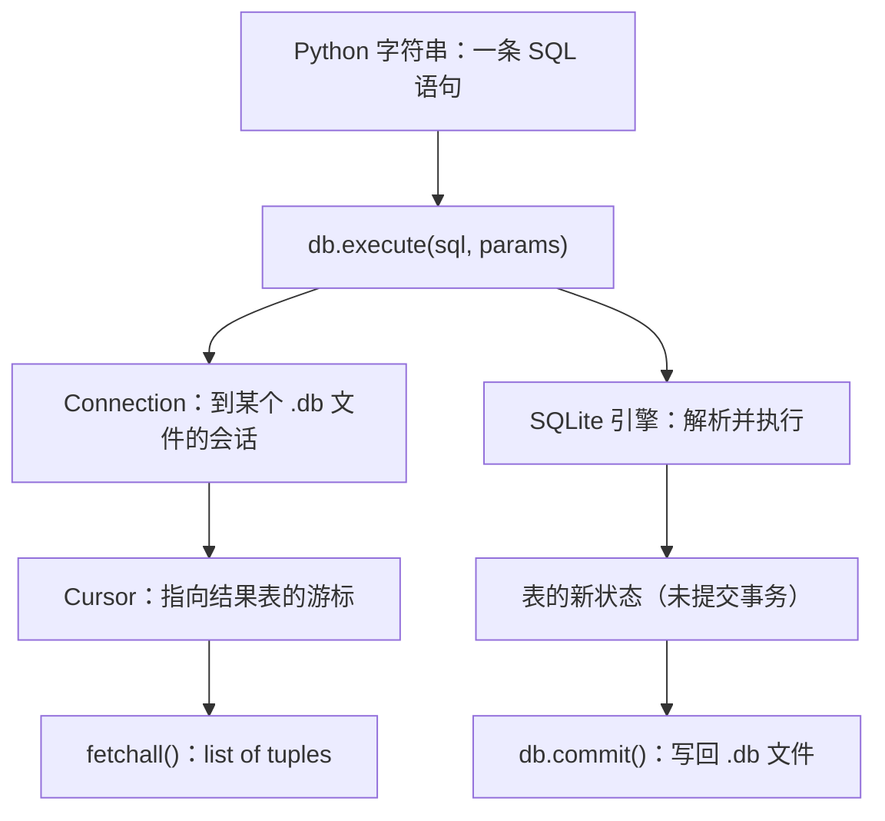
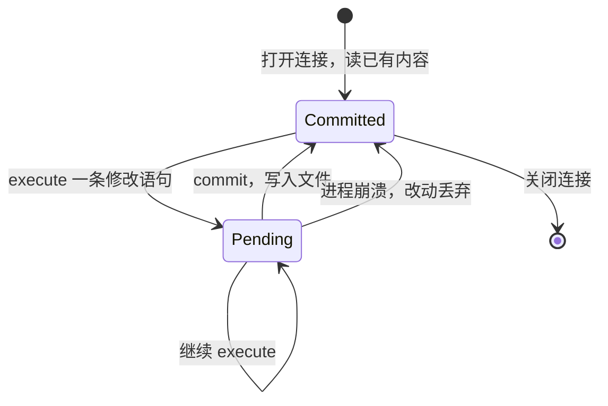
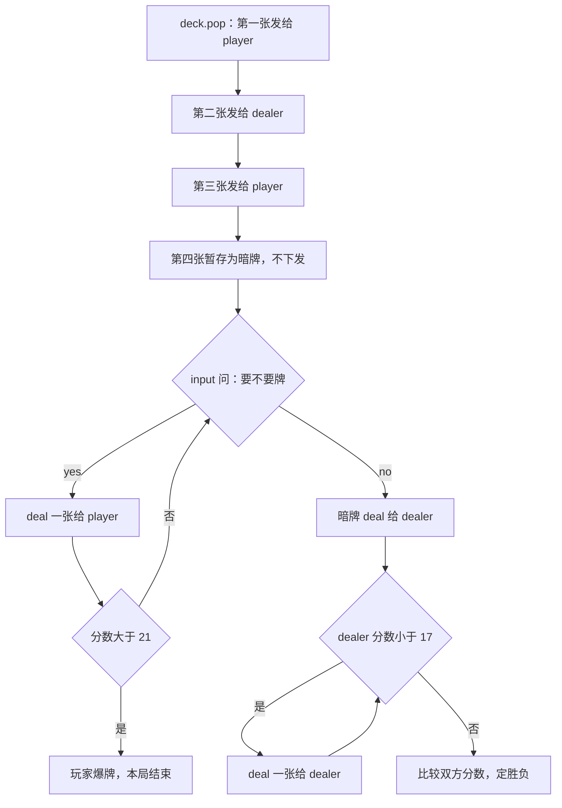

> **课程**：UC Berkeley CS61A · Structure and Interpretation of Computer Programs（Fall 2024）
> **本讲**：Lecture 38 ｜ 26:22 ｜ B 站分 P 36 ｜ [原视频](https://www.bilibili.com/video/BV1sy411z7nA?p=36)
> **课件**：`36-Databases_1pp.pdf`（13 页，官方 PDF，逐页渲染图见正文插图）
> **字幕**：B 站英文原声字幕；本笔记是中文书面化重构，非逐句翻译
> **版权**：课程与课件版权归 UC Berkeley CS61A 教学团队；本文为学习用途的二次整理

## 本讲速览

*(参考时间: 00:00:01 – 00:00:21｜Lecture 38)*


- **已掌握**：`SELECT` 语句的五个子句（`SELECT`、`FROM`、`WHERE`、`GROUP BY`、`HAVING`）与 `ORDER BY` 排序；多表查询用逗号拼表、用 `WHERE` 写连接条件；`CREATE TABLE ... AS SELECT ...` 可以把一条查询的结果直接命名成表。
- **本讲主线**：
    - 表可以被命名，也可以被遗忘：`CREATE TABLE` 给一张表起名字，`DROP TABLE` 把名字连同表一起移除。
    - 建表时可以挂列约束（column constraint）：`UNIQUE` 拒绝重复值，`DEFAULT` 在插入时补上缺失的值。
    - 表建好之后能改：`INSERT` 加行、`UPDATE` 改行、`DELETE` 删行，`WHERE` 决定哪些行被波及。
    - Python 的标准库 `sqlite3` 让程序可以构造 SQL 字符串并在数据库上执行，结果以 `list` of `tuple` 的形式读回。
    - 改完必须 `commit`，改动才写进磁盘上的 `.db` 文件；这是事务的边界。
    - 多个程序可以同时连同一个数据库，本讲用「Python 写的黑杰克模拟器 + `sqlite3` 命令行」演示两个客户端共享一张 `cards` 表。
- **关键结论**：此前几讲里的表都在一次性的会话中构造，会话一关就什么也不剩；数据库把表搬到磁盘上，于是它成为进程之间共享、断电之后仍在的**持久状态**。SQL 是操作这份状态的语言，Python 是生成 SQL、消费结果的语言，`commit` 是两者之间那条必须跨过的界线。

## 1. 建表：从 SQLite 的完整语法到课堂子集

*(参考时间: 00:00:01 – 00:03:03｜Lecture 38)*


一张表可以被赋予名字，用的语句是 `CREATE TABLE`；这个名字也可以被忘记，用的语句是 `DROP TABLE`。这两件事听起来平淡，但它们共同定义了「表」在数据库里的身份：一个由名字指称、可以被反复找到的对象。前面写过的所有查询都只在一次会话里存在，查询结束、结果打印出来，那张表就没有名字了，也没有地方可以再找到它。

课件把创建表这件事拆成两部分：一部分是完整的语法，另一部分是本课程真正会用到的那一小块。完整语法取自 SQLite 官方文档——一张铁路图（railroad diagram），把 `CREATE TABLE` 的每一种合法写法都画了出来。

```text
CREATE [TEMP | TEMPORARY] TABLE [IF NOT EXISTS]
    [schema-name .] table-name
    ( column-def [, ...] [, table-constraint] ) [WITHOUT ROWID]

CREATE [TEMP | TEMPORARY] TABLE [IF NOT EXISTS]
    [schema-name .] table-name AS select-stmt
```

这张图里句子成分很多，其中一部分本身还是复合表达式：`column-def` 由列名、类型名（type name）与若干列约束组成，类型名可以省略；`column-constraint` 的形态更多，可以给约束起名字，也可以声明主键（`PRIMARY KEY`）、非空（`NOT NULL`）、唯一（`UNIQUE`）、检查（`CHECK`）、默认值（`DEFAULT`）、排序规则（`COLLATE`）与外键（foreign key）。

讲师的处置方式很干脆：这些细节属于一门数据库课程，本讲不铺开，只留下铁路图里被画成黑色的部分。灰色的是被放弃的分支，黑色的是保留下来的骨架。


于是课程子集只剩两条路径，都写进同一个骨架里：

```text
CREATE TABLE [IF NOT EXISTS] table-name AS select-stmt
CREATE TABLE [IF NOT EXISTS] table-name ( column-name [column-constraint ...], ... )
```

第一条路径是「用一条查询的结果建表」——`AS` 后面接一个 `SELECT` 语句。这条用法此前已经见过多次，它的价值在于不必先声明列，列的名字与类型由查询结果决定。第二条路径是「声明一张空表」——括号里写一串列定义，每项只需要列的名字，后面可以挂零个或多个列约束。

`IF NOT EXISTS` 是一个小开关：只有当这个名字还没被占用时才真正建表。它的用处是在脚本里重复执行同一段建表语句而不报错。

本课程会关心的列约束只有两个。`UNIQUE` 表示这一列里不允许出现重复值，违反时插入会报错；`DEFAULT` 给一列指定默认值，插入新行时如果没给这一列提供值，就用这个默认值补上。课件给出的两个例子是：

```sql
CREATE TABLE numbers (n, note);
CREATE TABLE numbers (n UNIQUE, note);
```

第一句建一张两列的表：`n` 是数字，`note` 是关于这个数字的备注。第二句把 `n` 声明成唯一，于是「每个数字只能有一条备注」这条规则不用写进任何 Python 代码，而是由数据库自己执行。讲师口述的第三个变体在此基础上再加一个默认值：

```sql
CREATE TABLE numbers (n UNIQUE, note DEFAULT 'no comment');
```

这句的意思是：如果插入时只给了 `n`，`note` 会自动变成 `'no comment'`，因此「每个数字总有备注」这件事被数据库保证，而不是被调用方保证。

| 语法成分 | 铁路图上的颜色 | 本讲的处理 |
| :--- | :--- | :--- |
| `TEMP` / `TEMPORARY` | 灰 | 不涉及，临时表的生命周期不在课程范围 |
| `IF NOT EXISTS` | 黑 | 保留，用于可重复执行的建表脚本 |
| `schema-name .` | 灰 | 不涉及，本讲只用默认 schema |
| `table-name` | 黑 | 保留，表的一切都靠这个名字指称 |
| `column-def`（列名） | 黑 | 保留，声明空表时必须写 |
| `type-name`（类型名） | 灰 | 不涉及，课程里不声明类型 |
| `table-constraint`（表级约束） | 灰 | 不涉及，跨列的约束不展开 |
| `AS select-stmt` | 黑 | 保留，用查询结果建表 |
| `WITHOUT ROWID` | 灰 | 不涉及，存储布局的细节 |
| `UNIQUE` | 黑 | 保留，唯一性约束 |
| `PRIMARY KEY` / `NOT NULL` / `CHECK` / `COLLATE` / 外键 | 灰 | 不涉及，留给数据库课程 |
| `DEFAULT` | 灰 | 图里画成灰色，但演示中实际用到，属于「了解即可」 |

> **编者说明**：铁路图把 `DEFAULT` 画成灰色，而第 4 节的演示又确实用了 `prime DEFAULT 1`，原因在于这张图的着色标准是「课程是否展开讲解」，不是「语句是否合法」。另外，`type-name` 在 SQLite 里只是亲和性（type affinity）的提示，写不写、写成什么都不强制——这是 SQLite 的特殊之处，标准 SQL 要求列有类型，其它数据库产品通常也会拒绝向整型列插入文本。

一张空表看起来没有用处，但它的用处马上就出现了：可以向已有的表里加行，于是这张表不会永远空着。这正是下一节与再下一节的主题。

## 2. 删表：DROP TABLE 与 IF EXISTS

*(参考时间: 00:03:04 – 00:03:29｜Lecture 38)*


`DROP TABLE` 比 `CREATE TABLE` 简单得多，它只做一件事：把一个已经存在的名字连同它指向的表从数据库里移除。

```text
DROP TABLE [IF EXISTS] [schema-name .] table-name
```

括号里的 `IF EXISTS` 与建表时的 `IF NOT EXISTS` 对称：只在这个名字确实存在时才执行删除。省略它而删一个不存在的名字，得到的是一个错误而不是静默的无事发生。这个错误其实是有用的——它说明脚本对数据库状态的假设错了。

需要提前记住一个区分：`DROP TABLE` 删的是**表本身**（名字、列、所有行一起消失），后面第 5 节的 `DELETE` 删的是**表里的行**（表还在，只是空了）。两者在演示里都会用到，效果截然不同。

## 3. 插入：INSERT 的三种形态

*(参考时间: 00:03:30 – 00:05:16｜Lecture 38)*


空表只有能被修改才有意义。事实上任何表都可以被三种方式修改：插入新行、删除旧行、修改已有行中的值。这一节讲第一种。

`INSERT` 的完整语法同样以铁路图给出，同样有一大片被涂灰的分支：`REPLACE`、`INSERT OR REPLACE`、`OR ROLLBACK`、`OR ABORT`、`OR FAIL`、`OR IGNORE`，以及 `WITH` 引导的子句。这些是冲突处理策略——插入违反了某个约束时该怎么办。本讲不展开它们。


留下来的骨架是：`INSERT INTO` 表名，后面三选一——要么直接跟 `VALUES`（意思是对所有的列按顺序给值），要么括号里列出要填的列名再跟 `VALUES`，要么跟一个 `SELECT` 语句。课件对「一张有两个列的表 `t`」给出最基本的一行：

```sql
INSERT INTO t VALUES (value0, value1);
```

逗号分开的是这一行里各列的值，按建表时列的顺序对应。如果只想填其中一列，就先写列名：

```sql
INSERT INTO t (column_name) VALUES (value);
```

这时整行依然会被插入，没有被提到的另一列使用 `DEFAULT` 补上——如果那一列没有默认值，得到的就是空值。反过来，不写列名就意味着所有的列都要给值，一列也不能漏。
两种写法都只插入一行。要插入多行，就在后面接着写括号：逗号分隔多组括号，每组括号是一行。

```sql
INSERT INTO t VALUES (value0, value1), (value2, value3), (value4, value5);
```

第三种形态把值的来源换成一条查询，这是 `INSERT` 最有威力的地方：查询返回几行，就往表里插几行，而且这些值可以是计算出来的。

```sql
INSERT INTO t SELECT n FROM numbers;
```

| 判据 | `INSERT INTO t VALUES (...)` | `INSERT INTO t (列, ...) VALUES (...)` | `INSERT INTO t SELECT ...` |
| :--- | :--- | :--- | :--- |
| 值的来源 | 字面量 | 字面量 | 另一条查询的结果 |
| 是否写列名 | 不写，按位置对应全部列 | 要写，只列要填的列 | 不写，按位置对应 |
| 未提到的列 | 不存在这种情形 | 用 `DEFAULT` 补上 | 不存在这种情形 |
| 一次插入多行 | 括号、逗号、括号 | 括号、逗号、括号 | 查询返回几行就插几行 |
| 典型用途 | 手工录入几行数据 | 只关心部分列 | 批量复制或变换已有数据 |

## 4. 演示：primes 表、列约束与 UPDATE

*(参考时间: 00:05:18 – 00:09:52｜Lecture 38)*

演示从命令行启动 SQLite 开始，建一张记录「正整数是不是素数」的表，名字叫 `primes`，两列：`n` 是数字，`prime` 记录它是否素数。

```text
sqlite> CREATE TABLE primes (n, prime);
```

这一句没有挂任何列约束，但本来是可以挂的。要改成带约束的版本，最快的办法不是修改，而是删掉重来：

```text
sqlite> DROP TABLE primes;
sqlite> SELECT * FROM primes;
Error: no such table: primes
```

第二句报错，因为名字已经不存在了。重新建表，这次把约束写清楚：

```text
sqlite> CREATE TABLE primes (n UNIQUE, prime DEFAULT 1);
```

`n UNIQUE` 保证每个数字只有一行，`prime DEFAULT 1` 给出一件有倾向性的默认值——讲师的说法是「先假设它是素数，再用证据去推翻」。这是一个值得注意的写法：默认值不只补数据，它还编码了一个立场。

这里遇到一个 SQLite 的细节：它没有布尔类型，写不了 `true` 和 `false`，习惯上用 `1` 表示真、`0` 表示假。

```text
sqlite> SELECT * FROM primes;
sqlite> INSERT INTO primes VALUES (2, 1), (3, 1);
sqlite> SELECT * FROM primes;
2|1
3|1
```

第一次 `SELECT *` 没有任何输出，也没有报错——表存在，只是空的。插入 2 和 3 之后，两行都是素数，所以 `prime` 列都是 1。

接下来利用默认值：只给 `n` 给值，`prime` 交给数据库补。

```text
sqlite> INSERT INTO primes (n) VALUES (4), (5), (6), (7);
```

一行语句插进四行，每行的 `prime` 都是默认的 1。此时表里声称 4、5、6、7 全是素数，而 4 和 6 显然不是——这个「先都标成素数」的脏状态是故意留下的，后面用 `UPDATE` 清理。

要快速扩大表的规模，不必一行一行写。`INSERT ... SELECT` 可以把表里已有的数字加工一遍再插回去：

```text
sqlite> INSERT INTO primes SELECT n + 6 FROM primes;
```

这条语句读的是执行前的表（2 到 7），算出 8 到 13，追加进表；表于是覆盖 2 到 13。再来一次，加上 12：

```text
sqlite> INSERT INTO primes SELECT n + 12 FROM primes;
```

现在表里有 2 到 25 共 24 行。要注意 `INSERT ... SELECT` 的求值顺序：查询先算完、结果集先形成，然后才逐行插入，所以「读到的」不是插入过程中的中间状态。上例的第二次操作正是靠这一点，把 2 到 13 整体复制成 14 到 25，而不会形成自我增殖的失控。

| 语句 | 表里的 `n` | 行数 |
| :--- | :--- | ---: |
| 刚建表 | 无 | 0 |
| `INSERT INTO primes VALUES (2, 1), (3, 1);` | 2、3 | 2 |
| `INSERT INTO primes (n) VALUES (4), (5), (6), (7);` | 2 – 7 | 6 |
| `INSERT INTO primes SELECT n + 6 FROM primes;` | 2 – 13 | 12 |
| `INSERT INTO primes SELECT n + 12 FROM primes;` | 2 – 25 | 24 |
| `DELETE FROM primes WHERE prime = 0;` | 2、3、5、7、11、13、17、19、23 | 9 |

表建好之后，还可以修改已有的行。语法是 `UPDATE` 表名、`SET` 列名 `=` 表达式，可选一个 `WHERE` 说明改哪些行。

```text
UPDATE table-name SET column-name = expression [WHERE expression]
```

省略 `WHERE`，改的就是表里所有行；加上 `WHERE`，只有满足条件的行被改。这是三种修改语句共享的约定：`WHERE` 决定波及范围，没有它就意味着全表。


现在清理 `prime` 列。除 2 本身以外，2 的所有倍数都不是素数，于是一次性把大于 2 的偶数标成 0：

```sql
UPDATE primes SET prime = 0 WHERE n > 2 AND n % 2 = 0;
```

再标 5 的倍数：

```sql
UPDATE primes SET prime = 0 WHERE n > 5 AND n % 5 = 0;
```

执行完再 `SELECT *`，2 的倍数已经不再标成素数了。

> **编者说明**：只用「2 的倍数」与「5 的倍数」这两条筛子，并不能把 2 到 25 全部标对——9 与 21 既不是偶数也不是 5 的倍数，会被错误地留在「素数」一侧。讲师口述「2 到 25 之间哪些是素数、哪些不是，现在都标对了」，前提是演示时还跑了 3 的倍数与 7 的倍数这两条筛子。

补上这两条之后，完整的一套标记语句如下（末句的 `n > 7` 是为了保住 7 本身）：

```sql
UPDATE primes SET prime = 0 WHERE n > 2 AND n % 2 = 0;
UPDATE primes SET prime = 0 WHERE n > 3 AND n % 3 = 0;
UPDATE primes SET prime = 0 WHERE n > 5 AND n % 5 = 0;
UPDATE primes SET prime = 0 WHERE n > 7 AND n % 7 = 0;
```

四句跑完，2 到 25 里保持 `prime = 1` 的正好是 2、3、5、7、11、13、17、19、23 这九个素数；第 5 节那句 `DELETE FROM primes WHERE prime = 0` 就是在这个状态上执行的。

这个演示传达了一个方法论：表不必一次建对。先粗建、再批量填、再逐条纠正，比试图用一条语句把正确状态一次写出来要容易得多。讲师把这一点明确说出来：有时候「不是一口气把表建好，而是建完之后操纵它的值」更容易。

## 5. 删除：DELETE 与空表

*(参考时间: 00:09:53 – 00:10:33｜Lecture 38)*

第三种修改是删除行。语法只有骨架：

```text
DELETE FROM table-name [WHERE expression]
```


`WHERE` 的效果与 `UPDATE` 一样，决定哪些行被删；不给 `WHERE`，表里所有行都会被删。

回到演示，把 `prime` 为 0 的行全部删掉：

```text
sqlite> DELETE FROM primes WHERE prime = 0;
sqlite> SELECT * FROM primes;
```

剩下来的只有素数。这里有一个必须分清的区别：`DELETE` 之后表依然存在，只是没有任何行——它的列还在，名字还在，还能继续往里插新行。而 `DROP TABLE` 之后连表都不存在了，再查询会报 `no such table`。空表与不存在的表，是两种完全不同的状态，很多脚本出错都源于把两者混为一谈。

## 6. Python 与 SQL：把 SQL 字符串交给 sqlite3 执行

*(参考时间: 00:10:35 – 00:13:28｜Lecture 38)*


到目前为止，SQL 语句都是在数据库自带的交互环境里手敲的。真实用法不是这样：SQL 语句通常由程序生成，然后交给数据库执行。Python 可以做这件事，因为标准库里就带着一个数据库驱动 `sqlite3`。

课件给出的是整个流程的最小版本：


```python
import sqlite3

db = sqlite3.Connection('number.db')
db.execute('CREATE TABLE nums AS SELECT 2, 3 UNION SELECT 4, 5;')
db.execute('INSERT INTO nums VALUES (?, ?), (?, ?);', range(6, 10))
print(db.execute('SELECT * FROM nums;').fetchall())
db.commit()
```

这六条语句值得逐条拆开。

`import sqlite3` 导入模块。`sqlite3` 是 CPython 标准库的一部分，不需要单独安装，这一点在第 7 节末尾还会提到——换成 PostgreSQL 或 MySQL，驱动就要另外装了。

`db = sqlite3.Connection('number.db')` 构造一个 `Connection` 对象，参数是**数据库文件名**。这个名字可以任意取，讲师在演示里用的是 `n.db`，课件定稿写成 `number.db`。文件名指向磁盘上的一个文件；如果这个文件不存在，SQLite 会创建一个空数据库。所以「连接到数据库」这件事，在 SQLite 里就是「打开一个文件」——这句话是理解后面 `commit` 的关键。

`db.execute('CREATE TABLE nums AS SELECT 2, 3 UNION SELECT 4, 5;')` 执行了一条建表语句。它把一个查询的结果直接命名成表 `nums`：`SELECT 2, 3` 与 `SELECT 4, 5` 用 `UNION` 拼起来，得到一个两行两列的结果，`CREATE TABLE nums AS` 把这个结果固化下来。没有这一层包装，`SELECT 2, 3 UNION SELECT 4, 5` 也能执行，得到一张两行一列的表——但那张表没有名字，用完就没了，无法再被引用。`CREATE TABLE ... AS` 的全部作用就是给它一个名字。

`db.execute('INSERT INTO nums VALUES (?, ?), (?, ?);', range(6, 10))` 是本讲最值得注意的一条：

```python
db.execute('INSERT INTO nums VALUES (?, ?), (?, ?);', range(6, 10))
```

SQL 字符串里留了四个 `?`，它们是**占位符**（placeholder），不是要执行的内容；真正的值由 `execute` 的第二个参数提供。这里传的是 `range(6, 10)`，即 6、7、8、9 四个数，按顺序填进四个空洞，得到两行 `(6, 7)` 与 `(8, 9)`。讲师强调的正是这种分工：值可以在 Python 里用任何方式算出来——列表推导、`range`、从文件读、从网络拿——只要能构成一个序列，就能塞进 SQL 语句的空洞里。

`print(db.execute('SELECT * FROM nums;').fetchall())` 是读。`execute` 执行一条 `SELECT` 时返回的是一个**游标**（cursor）对象，不是结果本身；对游标调用 `fetchall()`，才把结果表的全部内容取出来，形状是 `list` of `tuple`，每个元组是一行。把它 `print` 出来，就是这一讲的输出：

```text
[(2, 3), (4, 5), (6, 7), (8, 9)]
```

四行两列，与前面推演的一致。这个形状很重要：它就是 Python 里最普通的数据结构，可以直接 `for` 循环、可以索引、可以求和。数据库查询的结果到了 Python 这一侧，就变成了内存里的表（第 7 节会仔细对照这两种表）。

> **编者说明**：字幕里讲师说「打印出五个元组，每个只有一个元素，那个元素就是该行的内容」，并说 `n.db` 里 `nums` 的内容是 `2、3、4、5、6`。这与课件定稿的六行代码给出的结果不同：课件用 `SELECT 2, 3 UNION SELECT 4, 5` 建了**两列**的表，再用 `range(6, 10)` 填两个二元组，结果是四个二元组。演示会话里用的是**单列**变体——建表用 `CREATE TABLE nums AS SELECT 2 UNION SELECT 3;`，插入用 `INSERT INTO nums VALUES (?), (?), (?);` 配 `range(4, 7)`，于是得到五个单元素元组 `(2,)、(3,)、(4,)、(5,)、(6,)`。两种版本演示的是同一套机制，课件版更整齐，字幕描述的是现场版。本文以课件代码为准，输出按课件代码推算。

> **编者说明**：`?` 占位符还有一个讲师没有点明的价值：它把「值」与「语法」彻底分开。如果图省事写成字符串拼接，例如把用户输入直接格式化进 SQL 文本，那么输入里只要带一个单引号或分号，就足以改变整条语句的结构——这就是 SQL 注入（SQL injection）。用占位符时，驱动会把参数当作数据送进数据库，而不是当作 SQL 文本的一部分解析，注入的入口因此被关掉。本讲的例子里参数都是自己算出来的整数，没有这个风险，但在任何接受外部输入的场合，`?` 加参数列表是唯一正确的写法。

把这一节的过程画成流水线，可以看清每一步各自负责什么：



| 步骤 | 代码 | 作用 | 返回什么 |
| :--- | :--- | :--- | :--- |
| ① 连接 | `sqlite3.Connection('number.db')` | 打开（或创建）数据库文件，建立会话 | `Connection` 对象 |
| ② 建表 | `db.execute('CREATE TABLE ...')` | 把查询结果固化成有名字的表 | 游标（内容无用） |
| ③ 写入 | `db.execute('INSERT ...', range(6, 10))` | 用参数填 `?` 占位符，插入行 | 游标（内容无用） |
| ④ 读取 | `db.execute('SELECT ...').fetchall()` | 执行查询并取出全部结果 | `list` of `tuple` |
| ⑤ 提交 | `db.commit()` | 把本次会话的改动写进文件 | `None` |

## 7. 提交：内存里的表与磁盘上的文件

*(参考时间: 00:13:31 – 00:14:41｜Lecture 38)*

上面六行代码跑完，屏幕上有输出，但磁盘上可能什么都没有。要让改动真正落进数据库文件，必须再调用一个方法：

```python
db.commit()
```

讲师对它的说明很短但很关键：提交成功之后，这个文件里就包含了全部内容，而且正是「通过执行这一系列 SQL 语句构造出来的」那个数据库。换句话说，`commit` 之前，那些改动只属于当前这个连接；`commit` 之后，它们才属于文件。

演示里紧接着做了验证：重新跑一遍程序，用 SQLite 命令行以 `n.db` 为数据库启动，`SELECT * FROM nums` 得到的结果正是 Python 侧打印出来的那五个数字——表和行都在文件里。

```text
$ sqlite3 n.db
sqlite> SELECT * FROM nums;
2
3
4
5
6
```

这一步是整讲的转折点。在此之前，演示里的表都在一次性的会话里用完即弃；此刻，表成了一个独立于任何进程存在的东西：Python 程序退出了，它还在；换个命令行工具打开同一个文件，也能看到它。

| 判据 | 程序里的表（`list` of `tuple`） | 磁盘上的数据库表 |
| :--- | :--- | :--- |
| 生存期 | 进程结束即消失 | 文件还在，断电之后仍在 |
| 谁能看见 | 只有持有它的进程 | 任何能打开该文件的连接 |
| 改动的可见性 | 立即 | `commit` 之后才对其它连接可见 |
| 失败模式 | 内存丢失，数据全没 | 未提交的改动丢弃，已提交的保留 |
| 能存什么 | 任意 Python 对象 | 数据库支持的列值（SQLite 为整数、实数、文本、二进制、空值） |
| 访问代价 | 内存速度 | 有磁盘与加锁的开销，换来持久与共享 |

`commit` 划出的这条线，在数据库术语里叫**事务**（transaction）的边界：一次 `commit` 之前的所有修改构成一个工作单元，要么全部生效，要么全部不生效。讲师没有用「事务」这个词，只说了 `commit` 与「文件里包含了全部内容」，但那条界线就是他描述的东西。



> **编者说明**：下面三点是对 `commit` 语义的补充，课件与字幕都没有展开。
> 一是隐式事务：CPython 的 `sqlite3` 在默认配置（`isolation_level=""`）下，会在执行修改语句之前自动开启一个事务，所以「忘记 `begin`」不会出错，但「忘记 `commit`」会让改动悬在那里。Python 3.6 之前，`CREATE TABLE` 这类 DDL 不纳入隐式事务、会立即生效；3.6 之后 DDL 也被包进同一个事务。Python 3.12 起可以用 `autocommit` 属性显式控制这套行为。
> 二是原子性与崩溃：如果在 `commit` 之前进程被杀掉，事务没有提交，SQLite 依靠日志（journal / WAL）把文件恢复到上一个已提交的状态——这就是上图中「进程崩溃，改动丢弃」这条边的含义。
> 三是回滚：对应的方法是 `db.rollback()`，主动放弃未提交的改动。它在本讲的演示里没有出现，但它是「事务边界」的另一半——`commit` 是把它确认下来，`rollback` 是把它撤销掉。

最后，讲师补了一句适用范围：同样的写法可以对接各种数据库，只是 SQLite 恰好在标准库里，别的（例如 PostgreSQL）需要自己安装驱动、再用同样的 `Connection` / `execute` / `commit` 三步去用。SQL 语句与 Python 代码的分工不因数据库产品而变。

## 8. 多个连接：同一个数据库，两个客户端

*(参考时间: 00:14:44 – 00:15:16｜Lecture 38)*


数据库一旦变成文件，一件在内存表时代不可能的事情就发生了：多个程序可以同时连到同一个数据库上，一起读、一起改同一批表。

这句话听起来平淡，但它正是数据库存在的理由。若表只是某个程序里的一个 `dict`，另一个程序想看一眼，唯一的办法是让第一个程序把数据导出来；而数据库把「表」放在两者都能打开的地方，于是两个进程有了共享的、可协商的状态。

课件用一局黑杰克来演示这件事：一个 Python 写的模拟器负责发牌与规则，一个 `sqlite3` 命令行负责观察（以及作弊）。两者之间没有任何直接的通信，唯一的接口是那个 `cards.db` 文件。

> **编者说明**：SQLite 的并发模型是「多读单写」：同一时刻可以有任意多个连接在读，但写会锁住整个数据库文件，写事务没结束时另一个连接写入会得到 `database is locked`。本讲的演示是一个程序写、另一个程序读，恰好落在 SQLite 最擅长的场景里。真正的多用户数据库（PostgreSQL 等）用的是行级锁与更细的并发控制，这属于数据库课程的内容。

## 9. 黑杰克规则：一个需要共享状态的游戏

*(参考时间: 00:15:17 – 00:17:25｜Lecture 38)*


赌场黑杰克的规则不复杂。玩家拿两张牌，庄家拿两张，其中一张明牌、一张暗牌。目标是点数比庄家大，但超过 21 点就输。玩家可以不断要牌（hit）来增加点数，也可以停手（stay）。花色不影响点数，所以演示里全部用黑桃；2 到 10 按牌面计点，J、Q、K 都算 10 点；A 比较特殊，可以算 1 点，也可以算 11 点，由持牌者选一个对自己有利的算法。

| 牌 | 点数 |
| :--- | :--- |
| A | 1 或 11，由持牌者选择 |
| 2 – 10 | 面值 |
| J、Q、K | 10 |

讲师用一手具体的牌走了一遍规则。玩家先拿 7，庄家明牌是 J，玩家再拿 9，合计 16。16 不算高，庄家很可能更大，于是要一张——来了 5，合计 21。这个结果很好：没有超过 21，而且大概率比庄家大。

玩家停手之后轮到庄家。庄家先翻开暗牌，合起来 13 点。赌场规则要求庄家必须一直要牌，直到点数落在 17 到 21 之间。13 不在这个区间，所以要一张：来的是 A。

这里出现了 A 的两难。算 1 点，合起来 14；算 11 点，合起来 24。24 超过 21，庄家当场就输，所以理性的选择只能是算 1 点，庄家停在 14。还要再要：来的是 10。14 加 10 等于 24，超过 21——这叫爆牌（bust），庄家输掉这一手。

如果那张不是 10 而是 7，庄家就是 21 点，与玩家的 21 点打平。这个「如果」很重要：它说明黑杰克的结局不只取决于自己手里的牌，还取决于牌堆里还剩什么牌，而后一件事正是一个数据库能回答的问题。

## 10. 把游戏写成程序：一张 cards 表与一条查询接口

*(参考时间: 00:17:27 – 00:21:36｜Lecture 38)*

讲师把整个模拟器读了一遍。程序不长，思路是把「牌在哪里」这件事完全交给数据库：桌面上唯一的事实来源是一张 `cards` 表，两列——`card`（`2` 到 `10`、`J`、`Q`、`K`、`A`）与 `who`（这张牌在谁手里：`dealer`、`player`，或者已经被丢进弃牌堆）。

第一步是用字典记录点数。A 先记 1 点，J、Q、K 都是 10 点，2 到 10 就是面值。

```python
points = {'A': 1, 'J': 10, 'Q': 10, 'K': 10}
points.update({str(n): n for n in range(2, 11)})
```

`dict.update` 的作用是把另一个字典的键值对并进来，讲师特意解释了一句：它接受一个字典，把里面的元素加进当前字典。

第二步是用一个函数给「一手牌」算分。一手牌就是一串牌，把每张牌的点数查出来加起来；如果总和不超过 11 且手里有 A，就把那张 A 从 1 点改算 11 点，总数多加 10。

```python
def score(hand):
    total = sum(points[card] for card in hand)
    if total <= 11 and 'A' in hand:
        total += 10
    return total
```

这个规则的效果是：一张 J 加一张 A，总和本来只有 11，加上 10 变成 21，比 11 好得多。为什么条件写成「不超过 11」：因为只有在总和很小的时候，把 A 提成 11 才不会超过 21。讲师把这段称为「用 Python 函数编码的黑杰克规则」。

第三步是数据库连接，以及一个为了少打字的别名：

```python
db = sqlite3.Connection('cards.db')
sql = db.execute
```

从此在这个程序里，`sql(...)` 与 `db.execute(...)` 是同一个东西。

第四步是建表。先无条件删掉旧表以便每次都从头开始，再建一张两列的新表：

```python
sql('DROP TABLE IF EXISTS cards')
sql('CREATE TABLE cards (card, who)')
```

`DROP TABLE IF EXISTS` 在这里的用处很明确：程序会被反复运行，第一次运行时表还不存在，带 `IF EXISTS` 就不会报错。

第五步是一个发牌函数，以及它背后的查询接口：

```python
def deal(card, who):
    sql('INSERT INTO cards VALUES (?, ?)', (card, who))

def cards_of(who):
    rows = sql('SELECT card FROM cards WHERE who = ?', (who,))
    return [card for card, in rows.fetchall()]

def bust(who):
    return score(cards_of(who)) > 21
```

`cards_of` 里那句 `WHERE who = ?` 的第二个参数是一个 Python 值——`'player'` 或 `'dealer'`，正是讲师强调的「把 Python 的值喂进 SQL 的空洞」；查询结果每行是一个单元素元组，所以列表推导要写成 `for card, in ...` 把它拆开。`bust` 则说明「爆牌」的定义：分数大于 21。

第六步是一手牌的主流程。发牌顺序固定：第一张给玩家，第二张给庄家，第三张给玩家，第四张是庄家的暗牌——这张牌先被取出牌堆，但暂不下发，因为它还没有被翻开。

```python
def play(deck):
    deal(deck.pop(), 'player')
    deal(deck.pop(), 'dealer')
    deal(deck.pop(), 'player')
    hidden = deck.pop()
    while not bust('player') and input('hit? ') == 'yes':
        deal(deck.pop(), 'player')
    if bust('player'):
        print('player busts')
        return
    deal(hidden, 'dealer')
    while score(cards_of('dealer')) < 17:
        deal(deck.pop(), 'dealer')
    dealer = score(cards_of('dealer'))
    player = score(cards_of('player'))
    print('dealer', dealer, 'player', player)
```

玩家阶段用一个 `input` 循环：问一句要不要牌，要就再发一张，发完重新判爆牌；不要就进入庄家阶段。庄家阶段先把暗牌补发下去，然后一直发到点数不小于 17 为止。任何一方爆牌，这一手立刻结束；否则比较两边的分数。

最后是牌堆与全局循环。一副牌里每个点数有四张（对应四种花色），把点数表的所有键复制四份放进列表，用 `random` 模块的 `shuffle` 打乱，然后一局接一局地打；每局结束时，把还在玩家和庄家手里的牌全部移进弃牌堆。

```python
deck = [card for card in points for _ in range(4)]
random.shuffle(deck)
while True:
    play(deck)
    sql("UPDATE cards SET who = 'discard' WHERE who = 'player' OR who = 'dealer'")
    db.commit()
```

> **编者说明**：课件没有给出这段程序的完整画面，上面的代码是按字幕里讲师逐段口述的顺序复原的：字典积分与 `points.update`、`score` 的「A 加 10」规则、`db = sqlite3.Connection('cards.db')`、`sql = db.execute` 的别名、`DROP TABLE IF EXISTS` 加两列 `cards` 表、`WHERE who = ?` 的查询、爆牌判据、每个点数四张牌、`random.shuffle` 洗牌、每局结束把牌移入弃牌堆。变量名与具体写法与屏幕上的原代码可能有出入，逻辑顺序与关键字则依字幕。另外，每次 `deal` 之后讲师都强调要 `commit`，上面的复原把它放在每局结束处，效果等价——只要在下次用另一个连接观察之前提交过就行。

一手牌的控制流画成图是这样：



## 11. 旁观与作弊：用 SQL 客户端看同一张表

*(参考时间: 00:21:37 – 00:26:20｜Lecture 38)*

程序跑起来之后，屏幕停在「要牌还是停手」的提问上。此时身处其中的人不知道该怎么办，因为看不到自己手里是什么牌。解决办法就是本讲的收尾演示：另开一个终端，用同一个数据库文件名再建一个连接。

```text
$ sqlite3 cards.db
sqlite> SELECT * FROM cards;
```

于是桌面上的牌全部可见。第一手：玩家是 3 和 4，庄家明牌是 7。玩家只有 7 点，显然要牌；来了一张 J，合计 17 点，而庄家明面只有 7 点，选择停手。Python 那侧把这一手走完——庄家翻开暗牌 Q，7 加 10 等于 17，17 比 17，平局。

```text
sqlite> SELECT * FROM cards;
```

再查一次，可以看到上一局的完整记录：庄家原有的 7，以及那张藏起来的 Q。

第二手：玩家是 J 和 6，16 点；庄家明牌 6。16 点虽然不高，但要牌的风险是爆牌，于是停手。结果庄家做到 18 点，玩家输。

第三手开局时，弃牌堆已经堆得太厚，`SELECT *` 的输出里混着十来张已经打完的牌，看不清谁手里有什么。于是加一个过滤条件，只看还在场上的牌：

```sql
SELECT * FROM cards WHERE who <> 'discard';
```

这一手玩家是 4 和 A——算 5 点或 15 点，两种算法都不够，必须再要。来一张 9，玩家的牌成了 9、A、4，合计 14 点，只能再要；这次爆了。这一手又输。

第四手：玩家 5 和 A，6 点或 16 点，要一张；再来一张 A，5、A、A 是 7 点或 17 点。

到这里玩家开始好奇下一张会是什么，但更聪明的办法是回头数牌：既然所有出过的牌都留在表里，就能统计每种牌出现过几次。这正是第 37 讲的分组聚合：

```sql
SELECT card, COUNT(*) FROM cards GROUP BY card;
```

统计结果是：十出过一张，J 出过三张，Q 出过一张，K 一张都没出。也就是说牌堆里还剩大量 K 和十——下一张要牌很可能是一张 10 点的牌。此时玩家 17 点、庄家明牌 6 点，庄家必须一直要牌到 17 以上，而剩下的牌里大牌居多，庄家爆牌的概率不低。于是停手。庄家果然爆牌，玩家赢。

讲师在这里补了一句场外点评：在赌场里，像这样靠记住弃牌堆来推算剩余牌，是违规的——但它确实能帮你赢。

最后一手示范了另一种违规操作：直接改牌。玩家拿到 4 和 Q，合计 14 点，庄家明牌 9 点，暗牌可能是 10 点，庄家随时能到 19 点。如果那张 4 换成 A，玩家就是 A 加 Q 的 21 点。数据库允许这件事，一句 `UPDATE` 就够了：

```sql
UPDATE cards SET card = 'A' WHERE who = 'player' AND card = '4';
```

改完再查，玩家手里是 A 和 Q，21 点，不必再要牌就已经赢了这一手。

| 局 | 玩家手牌 | 庄家明牌 | 玩家选择 | 结果 |
| :--- | :--- | :--- | :--- | :--- |
| 1 | 3、4，要牌得 J（17 点） | 7 | 停手 | 庄家 7 加暗牌 Q 得 17，平局 |
| 2 | J、6（16 点） | 6 | 停手 | 庄家 18 点，玩家输 |
| 3 | 4、A，要 9 后再要 | — | 连续要牌 | 超过 21 点，爆牌输 |
| 4 | 5、A，再要一张 A（17 点） | 6 | 停手 | 庄家爆牌，玩家赢 |
| 5 | 4、Q，用 `UPDATE` 把 4 改成 A | 9 | 不必再要 | 21 点，玩家赢 |

五局下来，数据库扮演的角色始终是同一个：一份两个进程都能读写的共享状态。Python 程序按规则改它，`sqlite3` 命令行则读它、统计它，甚至绕过规则改它——两者之间没有任何函数调用，唯一的耦合是那个 `cards.db` 文件与 `cards` 表的列名。讲师用一句话收束整个演示：这就是两个程序连到同一个数据库、共同操纵它的例子，其中一个程序是黑杰克的 Python 模拟器，另一个是交互式的 SQLite 读取—求值—打印循环。

## 小结

*(参考时间: 00:00:01 – 00:26:20｜Lecture 38)*

- **数据库把表从内存搬到磁盘**：此前演示里的表都跟着会话消失；一旦落到 `.db` 文件里，表就有了独立于任何进程的生命期，也因此能被多个客户端共享。
- **建表是把名字与结构一起注册**：`CREATE TABLE` 两条路——`AS SELECT` 复制查询结果，或括号里声明列；`DROP TABLE` 撤销注册，`IF EXISTS` / `IF NOT EXISTS` 让脚本可以重复执行。
- **约束是交给数据库的不变量**：`UNIQUE` 保证一列不重复，`DEFAULT` 补上缺失的值。把规则写进 schema，比在每个调用点重复检查更可靠。
- **改表三板斧共享同一条边界**：`INSERT` 加行、`UPDATE` 改行、`DELETE` 删行，`WHERE` 决定波及范围；没有 `WHERE` 就是全表，这是最危险的默认值。
- **Python 负责造语句与消费结果，SQL 负责集合运算**：`db.execute` 执行字符串，`?` 占位符把值作为参数送进去，`fetchall()` 把结果表变成 `list` of `tuple`。
- **`commit` 是事务的边界**：提交之前改动只属于当前连接，提交之后才属于文件；崩溃时未提交的部分整体丢弃——要么全生效，要么全不生效。
- **数据库的价值在共享**：黑杰克演示里两个进程没有任何直接通信，却能围绕同一张 `cards` 表协作；`SELECT ... WHERE` 是观察接口，`UPDATE ... WHERE` 是干涉接口，二者用的是同一种语言。

## 附：本讲幻灯片索引

*(参考时间: 00:00:01 – 00:26:20｜Lecture 38)*

| 页 | 内容 | 出现位置 |
| :--- | :--- | :--- |
| 1 | 标题页：Databases | 本讲速览 |
| 2 | Announcements 分节页 | 本讲速览 |
| 3 | 分节页：Create Table and Drop Table | §1 |
| 4 | `CREATE TABLE` 完整语法铁路图与两个例子 | §1 |
| 5 | `DROP TABLE` 铁路图（含 `IF EXISTS`） | §2 |
| 6 | 分节页：Modifying Tables | §3 |
| 7 | `INSERT` 铁路图与「插入一行」的写法 | §3 |
| 8 | `UPDATE` 铁路图与 `SET` / `WHERE` 的作用 | §4 |
| 9 | `DELETE` 铁路图与 `WHERE` 的可选性 | §5 |
| 10 | 分节页：Python and SQL | §6 |
| 11 | 六行 `sqlite3` 代码：连接、建表、插入、取回、提交 | §6 |
| 12 | 分节页：Database Connections | §8 |
| 13 | 黑杰克牌面示例与庄家的明暗牌 | §9 |
