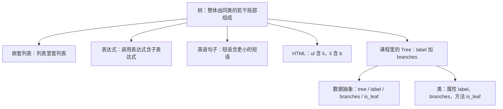
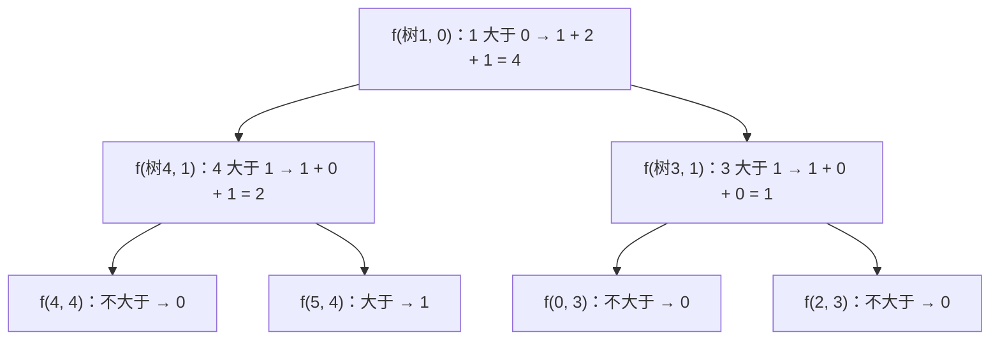
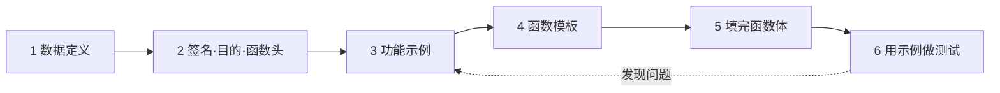
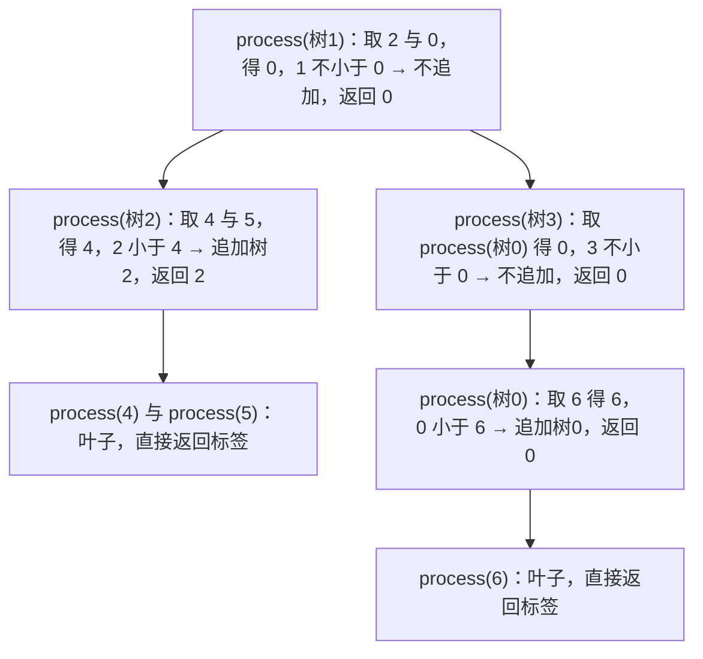

> **课程**：UC Berkeley CS61A · Structure and Interpretation of Computer Programs（Fall 2024）
> **本讲**：Lecture 39 ｜ 38:48 ｜ B 站分 P 37 ｜ [原视频](https://www.bilibili.com/video/BV1sy411z7nA?p=37)
> **课件**：无官方课件（期末例题课，`pdf_pages = 0`）；题干、代码与图示均为课堂现场展示，正文按字幕重建
> **字幕**：B 站英文原声字幕（38:48，491 段）；本笔记是中文书面化重构，非逐句翻译
> **版权**：课程与课件版权归 UC Berkeley CS61A 教学团队；本文为学习用途的二次整理

## 本讲速览

*(参考时间: 00:00:00 – 00:00:05｜Lecture 39)*

- **已掌握**：树的数据抽象（`tree`、`label`、`branches`、`is_leaf`）与它的类表示；树递归的“基准情形 + 递归情形”；`sum`、`min` 这类把一串子结果折成一个值的横向聚合；列表是可变对象，能在嵌套函数里被就地改写。
- **本讲主线**：
    - 树在计算机科学里是抽象概念：凡“整体由若干同类的整体组成”，就是树；嵌套列表、表达式、英语句子、HTML 都是同一个形状。
    - 期末例题靠的不是背模板，而是一套可复用的流程：读懂题意 → 手算样例 → 写下解里必须出现的成分 → 读模板 → 填空 → 追踪验证。
    - 两道题的辅助函数都不是题目给的，而是“先发现缺什么信息，再造一个能携带这份信息的函数”。
    - 同一道题有两种累加风格：把结果沿返回值往上累加，或初始化一个可变容器在遍历中就地更新；子目标完全一样，代码形状不同。
    - 六步设计法（How to Design Programs）把“想”和“写”分开，主张示例驱动，并把“写给人读”当作代码的目的之一。
- **关键结论**：树题的骨架永远是“遍历 + 聚合 + 边界”；真正决定对错的是**递归调用里那个参数有没有携带祖先（或后代）的信息**。

## 1. 树为什么年年出现在期末题里

*(参考时间: 00:00:07 – 00:02:55｜Lecture 39)*

课程里讨论过很多次树。同一棵抽象意义上的树，在课程中出现过两种表示：一种用列表，配一个构造函数、两个选择器，再加一个判断是否为叶子的辅助函数；另一种用类，用属性记录标签与分支。两种表示描述的是同一个东西，只是把“怎么取到”从函数调用换成了属性访问。

树既不是 Python 的内置类型，也不是某一门语言的特性。计算机科学里的“树”是一个抽象的概括：任何“自身由若干更小的自身组成”的东西都是树。它有两个要点：**树里装着别的树**；而且**可以装不止一棵**。正因为如此，这个形状才会到处出现：嵌套列表是树，Scheme 或 Python 的表达式是树（调用表达式的操作数本身又是调用表达式），一句英语的句法分析是树（一个句子拆成名词短语、动词短语和标点，短语再拆成更小的短语），网页的布局也是树（`HTML` 里一个 `ul` 标签装着若干 `li` 标签，`li` 里还装着把文字标成粗体的 `b` 标签）。凡是需要表示层级结构的数据，树都会出现。

| 判据 | 数据抽象表示 | 类表示 |
|---|---|---|
| 构造 | `tree(label, branches)` | `Tree(label, branches)` |
| 取标签 | `label(t)` | `t.label` |
| 取分支 | `branches(t)` | `t.branches` |
| 判断叶子 | `is_leaf(t)` | `t.is_leaf()` |
| 需要选择器吗 | 需要，四个名字都要记 | 不需要，属性名就是表示 |
| 判断叶子的依据 | 辅助函数外置 | 方法在对象内部，对 `self` 判断有无分支 |
| 扩展字段的成本 | 要同时改构造函数与选择器 | 加一个属性即可 |

```python
# 数据抽象表示
t = tree(1, [tree(2), tree(3)])
label(t)          # 1
branches(t)       # [tree(2), tree(3)]
is_leaf(t)        # False

# 类表示
t = Tree(1, [Tree(2), Tree(3)])
t.label           # 1
t.branches        # [Tree(2), Tree(3)]
t.is_leaf()       # False
```

> **编者说明**：本讲没有官方课件，幻灯片上的代码无法逐字核对，正文代码均按字幕逐句重建，并已实跑验证。本讲字幕把第一道题的函数名记作 `biggs`／`Biggs`，本文统一写作 `bigs`。为了让示例能真正跑起来，正文还需要一份最小的 `Tree` 类；它按课程一贯的写法补出，`repr` 的具体格式不影响任何结论。

这份脚手架只在正文中使用，后面的代码都以它为前提：

```python
class Tree:
    def __init__(self, label, branches=()):
        self.label = label
        for branch in branches:
            assert isinstance(branch, Tree)
        self.branches = list(branches)

    def is_leaf(self):
        return not self.branches
```

树的形状之所以重要，是因为**处理树的代码形状会被它决定**。树的处理几乎总是对子树做递归调用：函数拿到一个节点，对它每一棵子树再调用自己。这也是课程花大力气讲递归的首要理由——不是为了炫技，而是为了能操作这种数据。



## 2. 例题一 `bigs`：先把题读懂，再动手

*(参考时间: 00:02:56 – 00:07:40｜Lecture 39)*

第一道题的题面只有两句：实现 `bigs`，它接收一个标签为整数的树实例 `t`；返回 `t` 中“标签大于其所有祖先节点标签”的节点个数。

这里最重要的一句提醒是：**不要一上来就写代码**，也不要去猜“模板里可能已经有什么”。先想清楚要解决的问题。原因很朴素——大多数题目一开始并不显然，考试如此，自己写项目也如此；读不懂题之后必须有一套办法把自己从卡住的状态里推出来，一点点逼近答案。

第一步是理解题意。第一句没问题；第二句才是题眼，也最抽象：“标签大于其所有祖先节点的标签”，在没有任何具体例子的情况下很难把握。题面恰好没给例子，于是接下来的动作是：一边读一边做笔记——`t` 是一棵树；`bigs` 返回一个数——然后**自己造例子**，并且在动手写代码之前把它研究一会儿。

例子最好画出来。若题面没有配图，就自己画一张；考试也好，自己的项目也好，图几乎总是有帮助的。画出来之后，每个数字都是树里的一个位置，而**节点就是树里的一个位置**；每个位置又都是以它为根的一棵子树。

```text
1
├── 4
│   ├── 4
│   └── 5
└── 3
    ├── 0
    └── 2
```

接着逐个位置检查这条性质。讲师选中了标签为 5 的那个节点：它的祖先是父节点 4、以及 4 的父节点 1；5 大于 4 和 1，所以它确实是要数的节点之一。这里顺带出现了一个术语细节——祖先指父节点、父节点的父节点、父节点的父节点的父节点……考试中如果用到这类词，题面通常会给出定义；没给就自己写下定义再动手。

知道答案是 4 其实没有太大用处，有用的是搞清楚**是哪四个**节点满足性质。于是把整棵树走一遍：

| 节点标签 | 祖先标签 | 是否计数 | 理由 |
|---|---|---|---|
| 1（根） | 无 | 是 | 没有祖先可比，条件在空集上成立 |
| 4（左子） | 1 | 是 | 4 大于 1 |
| 4（左子的第一个子节点） | 1、4 | 否 | 4 不大于 4 |
| 5 | 1、4 | 是 | 5 大于 4，也大于 1 |
| 3（右子） | 1 | 是 | 3 大于 1 |
| 0 | 1、3 | 否 | 0 小于 3 |
| 2 | 1、3 | 否 | 2 大于兄弟 0，却小于祖先 3 |

合计四个，与题面给出的答案吻合。这一遍走下来得到两条结论。第一条是警告：**不能只看父节点**，必须看到父节点的父节点、父节点的父节点的父节点——2 就是反例，它赢了兄弟却输给了祖先。第二条是事实：根节点的标签总是大于它所有的祖先，因为它根本没有祖先；这条“空真”的观察看似琐碎，却在后面决定了递归的初始值该怎么取。

走完这一遍，第一个子目标已经完成了：题面抽象的那半句话，被翻译成了一条可以逐节点检验的判据。

## 3. 写代码之前：先列出解里必须出现什么

*(参考时间: 00:07:40 – 00:10:09｜Lecture 39)*

在真正落笔之前，值得先猜一猜解里应该出现什么。最自然的猜测是树处理的标准套路：如果 `t` 是叶子，做一件事；否则，把对每棵分支的递归调用聚合起来。这样想很合理——如果已经知道每棵分支里有几个满足性质的节点，剩下的就只要处理根节点。

但这个套路在这里行不通。原因就在上一节发现的那条警告：一路递归到叶子时，函数手上只有一个叶子，而**叶子并不知道自己上面有什么**；同样的叶子有的该数、有的不该数，仅凭叶子本身分不出来。讲师对这一点的处理方式值得记住：一个方案想不通不是问题，**只要快速把它走完、看出问题在哪、然后换下一个**。时间要花在推进上，而不是花在为一个已经失效的方案辩护上。

排除掉标准套路之后，改为把“解里必须有什么”列出来：

- **一个递增的计数器**。手算时的动作就是逐节点判定，命中就加一。
- **一条判定语句**。形如“某节点的标签大于它所有祖先标签的最大值”。
- **一份祖先信息**。要么把见过的祖先标签都记下来，要么找一个更省的办法：**只记目前为止见过的最大祖先**，然后拿节点标签与它比较。

“只记最大祖先”这个想法就是讲师所说的“有用的钩子”：先认出一个具体的表达式，再围绕它把剩下的实现补起来。它把“与所有祖先比较”这件事压缩成了“与一个数比较”，代价是需要一路上把这份信息带下去。

| 判据 | 记录全部祖先标签 | 只记录祖先最大值 |
|---|---|---|
| 额外参数 | 一个列表 | 一个数字 |
| 判定写法 | `t.label > max(祖先列表)` | `t.label > x` |
| 每次递归的准备工作 | 复制列表并追加一个标签 | 一次 `max` 比较 |
| 空间占用 | 与深度成正比 | 常数 |
| 出错机会 | 列表顺序、拷贝、空列表各一处 | 只需保证最大值传对 |
| 本讲的选择 | 未采用 | 采用 |

## 4. 读模板：双参数辅助函数 `f(a, x)`

*(参考时间: 00:10:10 – 00:15:26｜Lecture 39)*

到这里才去看题面给的模板。模板里有一个辅助函数 `f`，收两个参数。这两个参数的含义几乎不用猜：第一个说明“现在看的是哪个节点”，第二个说明“这个节点的祖先里最大的标签是多少”。上一节卡住的地方正好被它解开了——函数现在能携带那份关键信息了。

这是递归函数里一个反复出现的模式：外层函数自己带的参数不够用，于是另写一个函数，把缺的信息补进参数表。`f` 最终返回的正是 `bigs` 承诺返回的东西，所以 `bigs` 只要把 `f` 的结果原样转交即可。

模板里的 `a` 和 `x` 是题目指定的名字，与平时习惯的 `node`、`max_ancestor` 不同。考试有时会强制使用特定的名字，这属于人为约束；应对办法是**立刻在旁边记下这两个名字的含义**：`a` 是 `t` 里的某个节点，`x` 是到目前见过的祖先标签的最大值。如果抽象的描述不顶用，就写一个具体例子——`a` 是 `4, 4, 5` 那棵子树，`x` 是 1，也就是这棵子树最大的祖先。

先搭框架，再想细节：`bigs` 要在整棵树上调用 `f`，于是写成 `return f(t, ...)`，只留最后那个初值空着。一时想不出初值时可以先空着——**把格式摆对本身就是在靠近正确答案**。下面的骨架里，`...` 表示还没想好的空缺，不是可运行的代码。

```python
def bigs(t):
    def f(a, x):
        if a.label > x:
            return 1 + sum([f(b, ...) for b in a.branches])   # 传给下一层的最大值是什么？
        else:
            return sum([f(b, ...) for b in a.branches])
    return f(t, ...)                                          # 根节点的初始值取什么？
```

计数这一行是 `1 +` 加上“`a` 的子树里除根以外的命中数”。子树里的命中数用经典套路：对每棵分支递归调用再求和。这里的问题是 `a` 而不是 `t`——`bigs` 在整棵树上调用 `f`，`f` 再对分支调用 `f`，如此逐层下去，整棵树才被走遍。

递归调用里传什么，是写递归函数最费神的一步；但因为有笔记，这一步是可以推出来的。`x` 是“看 `a` 之前”的最大祖先。若 `a.label` 比 `x` 还大，那么看 `a` 之后，最大祖先就变成了 `a.label`，下一层应当传它；若 `a.label` 不大于 `x`，那么最大值没变，下一层仍传 `x`。

还有一条容易漏掉的正当性理由：即使当前节点不满足条件，也必须继续往分支里看。设想这棵树下面某个不起眼的位置藏着一个 12——它显然大于上面所有的 1、3、0、2，必须被数进去。所以两个分支都要递归，`else` 分支不是可有可无的“兜底”，而是逻辑必需。

把空填完：

```python
def bigs(t):
    """Return the number of nodes in t whose labels are larger than
    any labels of their ancestor nodes.

    >>> t = Tree(1, [Tree(4, [Tree(4), Tree(5)]), Tree(3, [Tree(0), Tree(2)])])
    >>> bigs(t)
    4
    """
    def f(a, x):
        if a.label > x:
            return 1 + sum([f(b, a.label) for b in a.branches])
        else:
            return sum([f(b, x) for b in a.branches])
    return f(t, t.label - 1)
```

## 5. 收尾、追踪与“检查你的作业”

*(参考时间: 00:15:27 – 00:19:08｜Lecture 39)*

只剩最开始记下的那条事实：根节点的标签总是大于它所有的祖先。也就是说，`f` 在整棵树的根上被调用时，`if` 的条件必须成立。

有两条路。第一条是给 `f` 加第三个参数，告诉它“这是不是根”；这能用，代价是参数表里多出一个只与根有关的信息。第二条是让它自然成立：初始的 `x` 传一个比 `t.label` 小的值即可，不必是真正的“最大值”。由于题目限定标签为整数，`t.label - 1` 就是一个合格的选择，于是根节点一定会被计数。

> **编者说明**：`t.label - 1` 依赖“标签是整数”这个前提。若标签可以是任意实数，安全的写法是传负无穷，例如 `float("-inf")`。两种写法在本题都成立，`t.label - 1` 更贴题面。

到这里实现就完整了。讲师最后把这次的收获压成几条操作建议：

- 手算一个例子，并把它画出来。
- 如果担心忘记 `a` 和 `x` 指什么，就给它们贴标签：写一句描述，或者写一个具体的取值。
- 递归调用时，传给下一层的必须是**有意义**的值，判断标准就是这些名字的含义。
- 最后一定要检查：沿着每个节点把代码走一遍，看结果是否仍是 4。

追踪过程如下。`f(t, 0)` 的 `x` 是 0（即 `t.label - 1`），根标签 1 大于 0，于是返回 `1 + 后面那些`。接下来对左分支调用 `f(4节点, 1)`：4 大于 1，继续加一；它有两个子节点，第一个 4 不大于 4，不加；第二个 5 大于 4，加一，于是这一支贡献 2。再对右分支调用 `f(3节点, 1)`：3 大于 1，加一；它的两个子节点里 0 和 2 都不大于 3，一个都不加，于是这一支贡献 1。总数 `1 + 2 + 1 = 4`。

| 调用 | 传下去的 `x` | 本节点是否计数 | 子树贡献 | 返回值 |
|---|---|---|---|---|
| `f(根1, 0)` | 0 | 是（1 大于 0） | 2 + 1 | 4 |
| `f(4节点, 1)` | 1 | 是（4 大于 1） | 0 + 1 | 2 |
| `f(4叶子, 4)` | 4 | 否（4 不大于 4） | 0 | 0 |
| `f(5叶子, 4)` | 4 | 是（5 大于 4） | 0 | 1 |
| `f(3节点, 1)` | 1 | 是（3 大于 1） | 0 + 0 | 1 |
| `f(0叶子, 3)` | 3 | 否（0 不大于 3） | 0 | 0 |
| `f(2叶子, 3)` | 3 | 否（2 不大于 3） | 0 | 0 |

追踪时还有一个细节值得单独看：走到叶子时，`sum` 作用在空的分支序列上，结果是 0。这个 0 恰好就是“没有子树可贡献”的正确含义，于是**基准情形不必显式写出来**，叶子自动被处理掉了。用一个聚合的单位元（这里是加法单位元 0）吃掉边界，是树递归里很省事的一招。



讲到这里，讲师说了一段关于环境图的话，值得完整保留：这正是为什么课上反复强调“这段代码在 Python 里会显示什么”。有人觉得既然有计算机，这类手算就没必要了，让机器去跑就行。但**要弄清楚一个函数为什么没有按预期工作，几乎总是要手工追踪它的执行过程**；而手工追踪的前提，是确切地知道表达式与语句是怎么被求值、怎么被执行的。检查作业因此不是走过场，而是解题流程里不可省的一步。

## 6. 第二种模板：把累加值放进可变容器

*(参考时间: 00:19:12 – 00:24:48｜Lecture 39)*

同一道题还有另一种解法。这件事本身不新鲜——课程里早就发现一个问题可以有好几种写法；但值得注意的是，面对反复出现的同一类需求，可用的手段其实只有少数几种。**累加**就是这样一个需求，它有两种形态：

- 把累加结果作为返回值一路上传，让递归函数负责把各分支的值合并起来；
- 先初始化一个值（比如 0 或空列表），在遍历过程中就地把这个值改大。

第一道题用的模板属于第一种。换一个模板，它强制使用第二种：函数里先建一个只含 `0` 的列表 `n`，最后返回的不是 0 本身，而是 `n[0]`。因为 `n` 绑定在一个可变值上，函数可以在递归过程中改写这个列表的内容。返回时 `n` 里装的早已不是 0，可能是 5，也可能是 7；重要的只有下标 0 上的那个元素。

为什么必须是列表而不是一个整数？因为要在内部函数里改动它，就必须有一个可变值可改。一个单元素列表是手边最简单的可变值。

模板看一遍就能读出结构：定义了 `f`，`f` 在某些情况下调用自己；但如果没有人调用 `f`，它永远不会执行，所以必然有一行在整棵树上调用它。`f` 要做的事情也和上一版一样：把 `n[0]` 正确地设成“`t` 中标签大于所有祖先的节点数”。仍然要追踪最大祖先，仍然要拿当前节点标签与它比较。

差别在于表达方式。写 `node.label > max_ancestor` 是不行的，因为没有叫 `node` 也没有叫 `max_ancestor` 的东西；必须使用**手头已有的名字**。把“节点”叫 `a`，把“祖先最大值”叫 `x`，那句话就变成 `a.label > x`；把“总数加一”翻译成代码，就是把下标 0 上的元素改成比原来大 1。

```python
def bigs(t):
    n = [0]
    def f(a, x):
        if a.label > x:
            n[0] = n[0] + 1
        for b in a.branches:
            f(b, max(x, a.label))
    f(t, t.label - 1)
    return n[0]
```

遍历部分和上一版用的是同一份推理。`a` 是树里的节点，因此它本身也是一棵树，有 `branches`；对每棵分支 `b` 调用 `f`。新的最大祖先取“此前见过的最大值”与 `a.label` 的较大者——因为这个过程中 `x` 一直被当作祖先最大值使用，而进入分支之后，分支的父节点 `a` 本身也可能刷新这个最大值。

初值同样要在调用前想清楚：必须在整棵树的根上调用 `f`，并且传一个比根标签小的值，否则根不会被计数。

> **编者说明**：这一版不能写成 `n = n + 1`。那样写会让 `n` 在 `f` 内部变成一个新的局部变量，执行到该行时抛 `UnboundLocalError`；列表可以就地改写，正是因为无需重新绑定名字。若坚持用整数计数，就必须写 `nonlocal n`。

两种模板把同一组子目标用不同方式表达出来，逐项对照就很清楚：

| 子目标 | 模板一：返回值累加 | 模板二：可变容器累加 |
|---|---|---|
| 知道当前节点 | 参数 `a` | 参数 `a` |
| 知道祖先最大值 | 参数 `x` | 参数 `x`，下一层传 `max(x, a.label)` |
| 判断是否计数 | `if a.label > x` | 同一条件 |
| 计数 | 写进返回值：`1 + ...` | 写进容器：`n[0] = n[0] + 1` |
| 汇总子树 | `sum([...])` 一次折完 | `for` 循环逐个调用，无返回值 |
| 交付结果 | `return f(t, t.label - 1)` | 先调用，再 `return n[0]` |
| 辅助函数的返回值 | 一个整数 | `None`，只靠副作用 |
| 出错时的表现 | 返回值偏小或偏大，容易定位 | 忘记调用或漏改容器，结果静默为 0 |

第二种写法的风险也在这里：`f` 不返回任何东西，正确性完全依赖“每个节点恰好被访问一次、每次命中恰好加一”。一旦漏掉末尾那行 `f(t, t.label - 1)`，函数会安静地返回 0；把 `max(x, a.label)` 误写成 `x`，更深处的节点就会拿过期的最大值去比较。

## 7. 六步设计法：把“想”和“写”分开

*(参考时间: 00:24:48 – 00:29:44｜Lecture 39)*

讲到这里，话题从具体题目转到了方法本身。计算机科学的入门课各有侧重：有的课以应用为主，有的课围绕某门语言展开；这门课侧重编程范式与编程语言，但真正的重心是**解决问题**。有一本叫《How to Design Programs》的教材，通篇只讨论一件事——怎样正确地定义一个函数。它的技术内容远没有 CS61A 多，但作者对“如何教解题过程”下过功夫，而且这本书在网上免费。

书里给出的设计函数六步是：

| 步骤 | 要做的事 | 在这两道题上的对应 |
|---|---|---|
| 1 数据定义 | 找出必须表示的信息，决定怎么表示，并用例子说明 | 树已由题面给定，直接用 `label` 与 `branches`；项目里这一步是设计字典或列表的形状 |
| 2 文档与函数头 | 写签名（吃什么、吐什么，即定义域与值域）、一句话说明函数算什么、写出 `def` 头 | `bigs(t)` 吃树吐整数；`smalls(t)` 吃树吐一串树 |
| 3 功能示例 | 用例子说明函数的目的，写在任何代码之前 | 逐个节点判定 1、4、4、5、3、0、2；以及 `smalls` 的逐节点判定 |
| 4 函数模板 | 把数据定义翻译成函数骨架：用哪些控制结构、条件是什么、打算发哪些调用 | `if a.label > x` 的两个分支；`sum([f(b, ...) ...])`；`min` 与 `for` |
| 5 函数定义 | 填模板的空，用目的说明和示例作依据 | 递归参数传 `a.label` 还是 `x`；追加 `t` 还是 `t.label` |
| 6 测试 | 把示例变成测试，确保全部通过 | `bigs(t) == 4`；沿每个节点追踪 |



这套流程有一个贯穿性的特征：**示例驱动**。不是先决定要写什么函数再写代码，而是很早就弄清数据代表什么——这个数字是矩形的边长，这个列表装着做划分时允许使用的那些数——然后在实现阶段也不泛泛地想，而是盯着已经算过的例子：想知道该发哪些调用、怎么发，就回去看例子。

第六步的理由也值得记住：测试不仅发现错误，还让示例成为别人读代码时的说明书。严肃的程序总会有人需要读它，所以**写程序不只是给机器执行，也是给人阅读**。讲师并不认为这是唯一正确的解法论，但认为它对“一开始完全不知道怎么做”的题，是一份考虑周到的描述。

> **编者说明**：书中的六步原文用英文表述，上表是按字幕转述的中文要点；教材主页为 `htdp.org`，可在网上免费阅读。

## 8. 例题二 `smalls`：规格就是一半答案

*(参考时间: 00:29:45 – 00:33:00｜Lecture 39)*

第二道题换了方向：实现 `smalls`，它接收一个标签为整数的树实例 `t`，返回 `t` 中“标签小于其所有后代节点标签”的**非叶子**节点。

第一步数据定义几乎不用做，题目直接工作在树上。第二步写文档，题面给了一部分，但有一件关键的事必须自己确认：函数的签名——吃什么、吐什么。

吃进一棵树，题面已经写明；吐出什么，要从示例里读。示例中 `smalls` 的调用结果被逐项取 `.label`，而每一项都是有标签的东西，这说明它返回的是一串**树**，也就是 `t` 里那些子树本身，而不是标签数字。

第三步手算例子，同样先画图：

```text
1
├── 2
│   ├── 4
│   └── 5
└── 3
    └── 0
        └── 6
```

逐个节点判定：

| 节点 | 是否叶子 | 后代标签 | 是否计入 | 理由 |
|---|---|---|---|---|
| 1 | 否 | 2、4、5、3、0、6 | 否 | 有后代 0，1 并不小于它 |
| 2 | 否 | 4、5 | 是 | 2 小于 4 和 5 |
| 4 | 是 | 无 | 否 | 叶子不是候选 |
| 5 | 是 | 无 | 否 | 叶子不是候选 |
| 3 | 否 | 0、6 | 否 | 3 不小于 0 |
| 0 | 否 | 6 | 是 | 0 小于 6 |
| 6 | 是 | 无 | 否 | 叶子不是候选 |

这一步里藏着一个必须记下的细节：1 其实小于 2 和 3，它只是不小于 0。所以判断一个节点时，不能只看直接孩子，必须知道**以该节点为根的整棵子树里的最小值**。换句话说，实现里需要一个“求子树最小标签”的能力，而它比“取每个孩子的标签”要深一层。

手算还没结束：还要显式写下 `smalls` 到底返回什么。要建的列表里装的是树，所以答案是以 2 为根的子树和以 0 为根的子树。题面的示例并没有打印整棵树，只列了这些子树的根标签（0 与 2），**读示例时要能把它还原成“一串树”**，否则后面很容易写成返回数字。

> **编者说明**：字幕里讲师逐节点判定的顺序是 1、2、4、5、3、0、6，据此可以还原出上图这棵树；题面原图无法核对，但每个判定都已被讲师的结论固定住。讲师提到示例只显示各子树的根标签，并按升序给出（0 与 2），所以正文不把 `repr` 当成答案原文；按第 10 节的实现实跑得到的是先 2 后 0，两者装的是同一组子树，只是顺序不同。

## 9. 逆向发现 `process`：先有判断，才有机能

*(参考时间: 00:33:01 – 00:35:46｜Lecture 39)*

第四步写模板：建一个空列表，用一个名为 `process` 的递归函数往列表里填，最后返回列表。

写到这一步，新函数出现了，于是流程要**对它再来一遍**：数据定义仍然没什么可做；但它的签名和目的必须想清楚。`process` 应该做什么？答案是：对树里的每个节点，算出以它为根的子树中最小的标签。

为什么要这个能力？因为要判断 1 是否达标，需要知道左边这棵子树的最小值，也需要知道右边这棵子树的最小值——1 必须小于它所有的后代。这个需求不是凭空出现的，而是“实现 `smalls`”这个目标逼出来的。

于是 `process` 的签名是：吃一棵树，返回一个数，那个数是这棵树里最小的标签。一句话目的：找出 `t` 中最小的标签。

有意思的是，`process` 可以**一次做两件事**。为求最小值而递归检查各个分支时，恰好会得到“后代里的最小标签”；拿它和当前节点的标签一比，就知道当前节点该不该进结果列表。如果不合并，就得把树遍历两遍：一遍求最小值，一遍做判断。

先按书里的流程对 `process` 走一个例子。以 `2` 为根的子树 `2, 4, 5` 作为输入：分别算出每棵分支里的最小值（4 和 5），取其中的最小值 4，这就是后代的最小标签；把它与根标签 2 比较，2 更小，于是把以 2 为根的这棵树加进结果；整棵子树的最小标签则是根标签与分支最小值中的较小者，即 2。

到此可以把模板写出来：如果这是一片叶子，整棵树里只有一个标签，返回它即可；否则，先算出各分支里的最小标签，再与根标签比较，最后返回两者的较小值。

## 10. 填完 `smalls`：叶子、最小值与后序追加

*(参考时间: 00:35:48 – 00:38:33｜Lecture 39)*

题面给出的模板与刚刚自己推出来的模板几乎一致，所以剩下的只是填空。第一步仍然是核对签名：`if t.is_leaf(): return t.label` 返回一个数，正是“叶子里的最小标签”，符合 `process` 的承诺；而叶子不可能是非叶子节点，因此这一支不需要往结果里追加任何东西。**每写完一个分支就回头对一遍规格**，是这套流程里最划算的习惯。

否则 `t` 一定有分支，要求出其中最小的标签，再判断根是否比它还小：

```python
def smalls(t):
    """Return the non-leaf nodes in t whose labels are smaller
    than any labels of their descendant nodes.

    >>> t = Tree(1, [Tree(2, [Tree(4), Tree(5)]),
    ...              Tree(3, [Tree(0, [Tree(6)])])])
    >>> [node.label for node in smalls(t)]
    [2, 0]
    """
    result = []
    def process(t):
        if t.is_leaf():
            return t.label
        smallest = min([process(b) for b in t.branches])
        if t.label < smallest:
            result.append(t)
        return min(t.label, smallest)
    process(t)
    return result
```

几处细节对应着前面的推理：

- 追加的是 `t` 本身，不是 `t.label`。看一眼 `smalls` 的签名就知道列表里装的是树，而 `t` 正是一棵树。
- 判断条件里的 `smallest` 是“后代中的最小标签”，所以 `t.label < smallest` 就是“根小于所有后代”。先发明这个名字并想清它的含义，再去实现它的计算，是可行的顺序——名字的语义比它的计算式更早到位。
- `min([process(b) for b in t.branches])` 是对每棵分支递归调用再聚合，和 `bigs` 里的 `sum([...])` 是同一个套路，只是聚合算子从求和换成了取最小。
- 返回值是 `min(t.label, smallest)`：整棵子树的最小标签，要么是根，要么在分支里。少了这一层 `min`，父节点拿到的“最小值”会偏大，判断随之出错。

`process` 对树里每个节点恰好被调用一次：先处理根，根再去处理分支，分支再处理分支的分支。追加发生在递归调用返回之后，也就是后序位置——一棵子树的后代全部处理完了，它自己才进列表。所以列表顺序反映的是“子树完成的顺序”，不是标签大小：本例里先追加以 2 为根的子树，再追加以 0 为根的子树，与题面示例按升序显示的 0、2 恰好相反，核对输出时不要把顺序当成答案的一部分。



把整段实跑一遍，`[node.label for node in smalls(t)]` 的输出是 `[2, 0]`，与手算一致。下表列出这道题上最容易出现的几种错误：

| 易错点 | 错误写法 | 症状 | 原因 |
|---|---|---|---|
| 只比较直接孩子 | 追加条件用 `min([b.label for b in t.branches])` | 结果为 `[2, 0, 1]`，根 1 被误加 | 1 小于孩子 2、3，却大于后代 0 |
| 追加标签而不是树 | `result.append(t.label)` | 打印出来仍是 `[2, 0]`，但元素是整数，调用方一取 `.label` 就报错 | 签名要求返回树，而不是标签 |
| 返回时漏掉根标签 | 返回 `smallest` | 结果为 `[2, 0, 3, 1]`，3 与 1 被误加 | 整棵子树的最小值可能在根上 |
| 忘记启动 | 只定义 `process` 不调用 | 结果恒为空列表 | 列表靠 `process` 填充 |
| 把叶子当候选 | 去掉 `is_leaf` 那一支 | 递归到叶子时 `min([])` 抛 `ValueError` | 叶子没有分支，无法取最小值，也没有候选资格 |

至此两道题都闭环了。它们的骨架完全一致：都是“对每个节点做判断，对每棵分支递归，用一个聚合把子树的结果收上来”；变的只是聚合算子（求和得计数、取最小得极值）和交付方式（返回值还是就地追加）。

## 小结

*(参考时间: 00:38:34 – 00:38:47｜Lecture 39)*

这一讲没有新语言特性，全部时间都花在“遇到不会的题怎么办”上。两道题给出的答案可以拆成几条可迁移的方法：

- **先有例子，再有代码**。示例不是装饰，而是把抽象描述落到可检验判据上的唯一手段；没有配图就自己画一张。
- **给名字贴标签**。`a`、`x`、`smallest` 这类名字一旦含义不清，递归参数必然传错；写一句描述或一个具体取值，比反复读题有效。
- **允许快速失败**。标准套路不适用时，快速走完、看清问题、换方向，比为一个失效的方案辩护更省时间。
- **缺什么信息，就造一个能携带它的函数**。`f(a, x)` 的第二个参数与 `process` 的存在，都是“先发现缺口，再补签名”的结果。
- **用聚合的单位元吃掉边界**。空分支上的 `sum` 是 0，叶子因此不需要特判；但取最小值没有这样的单位元，边界就得显式写出来。
- **检查作业，而且要手工追踪**。计算机能算出结果，却不能替人解释“为什么错”；能手工追踪的前提是清楚表达式与语句如何求值。
- **区分两种累加**。返回值累加让每个函数都自洽、易测；可变容器累加更短、更接近命令式写法，但正确性依赖“恰好访问每个节点一次”。
- **代码是写给人读的**。六步设计法把示例、目的说明、签名都留在了函数周围，测试因此同时成为文档。

## 附：本讲幻灯片索引

本讲没有官方课件（`pdf_pages = 0`），因此没有幻灯片页可索引，正文也没有引用任何 `slide_*.png`。这一节按规范保留为自检附录，不对应录像中的任何时段，故不设时间锚点。原本应由课件承担的图示（树的两种表示、`bigs` 的递归调用树、`smalls` 的后序追加）已改用代码块、对照表与 Mermaid 图表达，题干与代码则按字幕逐句重建，并已实跑核对输出。
