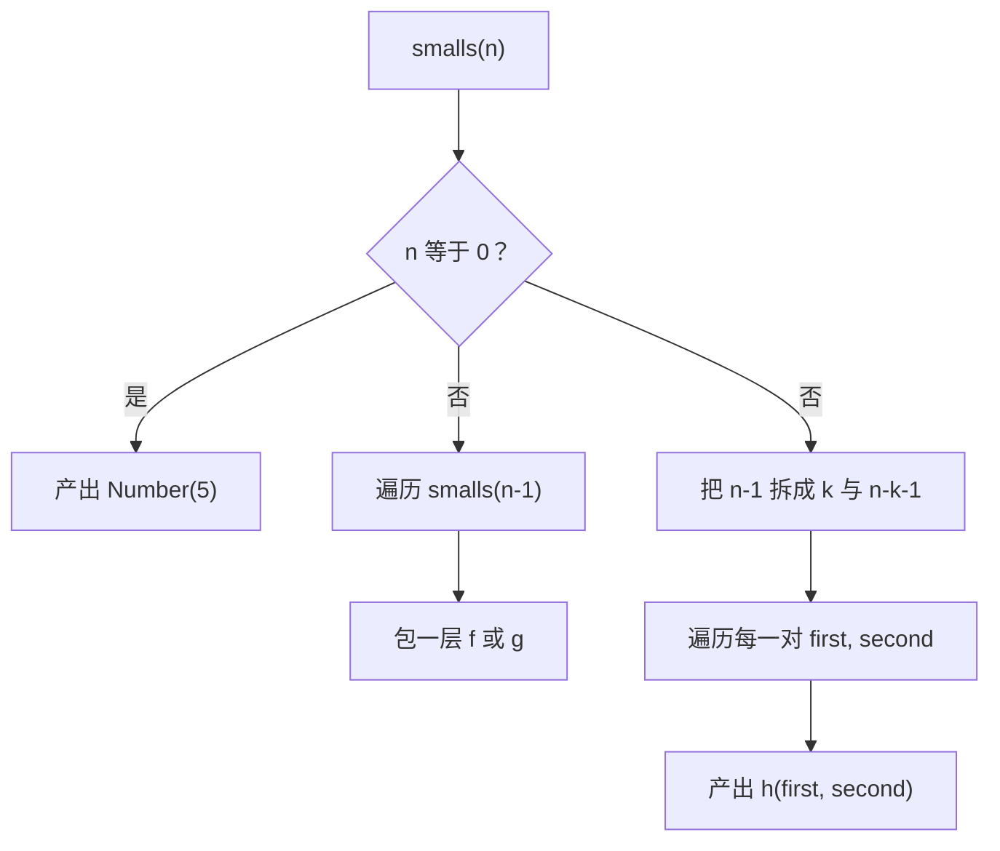
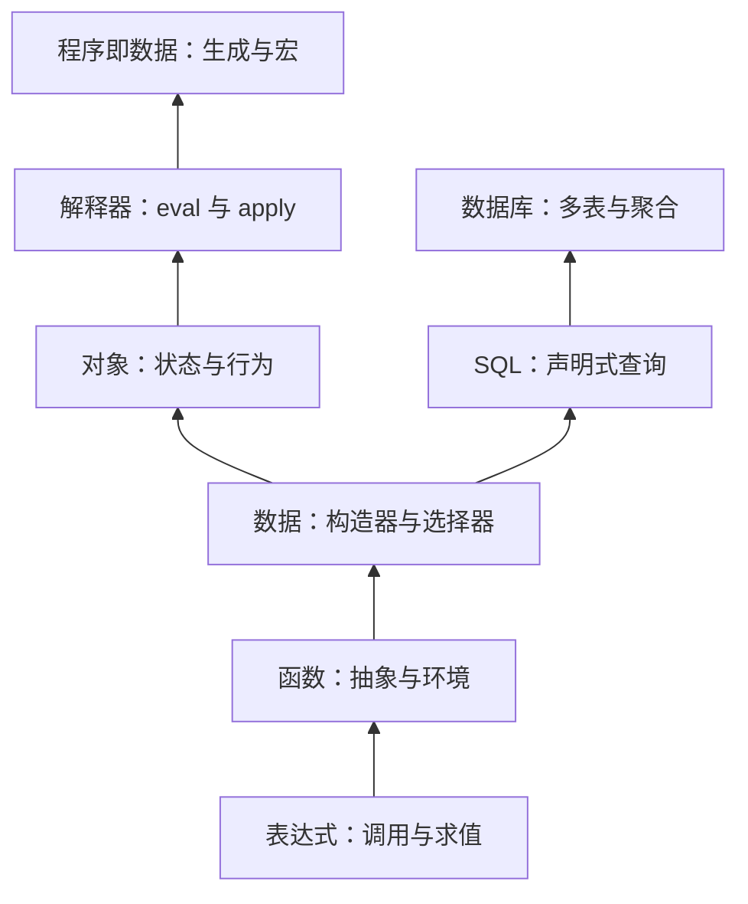

> **课程**：UC Berkeley CS61A · Structure and Interpretation of Computer Programs（Fall 2024）
> **本讲**：Lecture 40 ｜ Conclusion（结课）｜ **无录像**，B 站没有对应分 P
> **课件**：`38-Conclusion_1pp.pdf`（21 页，官方 PDF，逐页渲染图见正文插图）
> **内容依据**：官方课件逐页整理；本讲没有录像与字幕，正文只依据课件画面，不含课堂口述
> **说明**：无录像，故无时间锚点，内容依据官方课件整理
> **版权**：课程与课件版权归 UC Berkeley CS61A 教学团队；本文为学习用途的二次整理

## 本讲速览

- **已掌握**：一学期的主线——表达式求值、函数抽象与环境模型、数据抽象、可变性与对象、迭代器与生成器、解释器，以及后段的 SQL。读者应当能读懂 `Call(f, [n])` 这样的表达式树，也能写出递归遍历它的函数。
- **本讲主线**：
    - 用 Discussion 0 的老题（`f`、`g`、`h` 与 5 拼出 2024）做结课练习，答案 `g(h(g(5),g(g(f(f(5))))))` 恰好 7 次调用。
    - 把表达式变成对象：`Number` 与 `Call` 两个类分别承担求值、打印、计数三种职责。
    - 用生成器 `smalls(n)` 枚举"恰好 n 次调用"的所有表达式，把"找最短解"交给程序。
    - 课件后半程从代码转向人：课程团队、教学岗位、本科选课地图、自动化决策与社会。
- **关键结论**：CS61A 教的不是 Python 语法，而是"用抽象搭一台机器"的方法；结课页把这种方法放回它会发生作用的地方——一群人和他们要做的事。

## 1. 结课页：二十一面幻灯片的结构


课件第一页只有一个词：Conclusion。没有副标题，没有课程名，也没有日期。一份讲义的最后一页通常只需要说明"结束了"，剩下的交给听众自己回想。

第二页是公告页，标题居中，页面同样没有正文。课件把公告的具体事项留给了课堂；本讲没有录像，这一页的内容无法还原，本笔记也不替它补写。


第三页是一张整页图：黑色正方形底，成千上万条细线以红、橙、黄、绿、蓝、紫的颜色从两侧向中间汇聚，收成一个很窄的"腰"，再向另一侧散开。画面没有文字，也没有图注。


> **编者说明**：第三页在课件中没有标题与说明文字，无法确认这张图的生成方式与用途。本文只按画面本身描述；把它读成"一学期走过的许多条路径"是笔者的联想，不是课件给出的解释。

把 21 页按顺序排开，结构其实很清楚：第 1–3 页是开场（标题、公告、整页过渡图），第 4–7 页是唯一的技术段落，用一个调用表达式的老题复习"表达式—对象—递归"；第 8–13 页转向课程团队与教学岗位；第 14–17 页讲课程成员的本科经历与选课地图；第 18–21 页把话题推到社会、生活与致谢。技术只占四页，其余十七页大多在讲"人"——团队、教学、选课、社会与生活。这个比例不是偷懒：结课讲的任务本来就不是再教一个知识点，而是把一学期学过的东西放回它会发生作用的地方。

## 2. Call Expressions：一道讨论课老题


第 4 页是分节页。结课不讲新语法，而是回到课程里最早出现、也最耐看的表达式形式：调用表达式（call expression）。一个调用表达式同时包含三件事——子表达式如何求值、函数如何作为值被传递、递归结构如何被遍历。后面所有章节都是在这三件事上不断加东西。

第 5 页把题目完整地摆了出来：它来自 Discussion 0，即讨论课编号 0。


题目定义三个函数：

- `f(x)`：把 `x` 减一。
- `g(x)`：把 `x` 乘二。
- `h(x, y)`：把 `x` 与 `y` 的十进制数字拼接起来，例如 `h(8, 5)` 得到 `85`。

要求是：只使用 `f`、`g`、`h` 和数字 `5`，写出一个值等于 2024 的最短表达式。课件给出的答案是 `g(h(g(5),g(g(f(f(5))))))`，共 7 次调用。它还画了一条验算链：

1. `g(5)` 得 10，这是 `h` 的第一个操作数。
2. `f(5)` 得 4，再 `f` 一次得 3。
3. `g(3)` 得 6，再 `g` 一次得 12，这是 `h` 的第二个操作数。
4. `h(10, 12)` 把 "10" 与 "12" 拼成 "1012"，得到 1012。
5. 最外层 `g(1012)` 得 2024。

数一数调用：最外层 `g` 一次，`h` 一次，左边的 `g(5)` 一次，右边的 `g`、`g`、`f`、`f` 四次，合计 7 次。课件的箭头图把这条链拆成两条并行的支路——一条 `5➡10`，一条 `5➡4➡3➡6➡12`——再在 `h` 处汇合，最后一起变成 2024。

为什么 7 次就是最短？课件只写了 "has 7 calls"，没有给出证明过程。要真正确认"不存在 6 次调用的解"，最直接的办法是把所有不超过 6 次调用的表达式都列出来逐一求值——这正是后面两页要做的事。也就是说，这道题表面上是构造题，实际上是一次小规模的穷举：人负责给出一个 7 次的解，程序负责证明没有更短的。

## 3. 把表达式变成对象：Number 与 Call


第 6 页换了一个思路：不再直接写 Python 调用，而是用两个类把"表达式"本身变成对象。左侧是完整定义，右侧是 REPL 里的行为。

```python
def f(x):
    return x - 1
def g(x):
    return 2 * x
def h(x, y):
    return int(str(x) + str(y))

class Number:
    def __init__(self, value):
        self.value = value

    def __str__(self):
        return str(self.value)

    def calls(self):
        return 0

class Call:
    """A call expression."""
    def __init__(self, f, operands):
        self.f = f
        self.operands = operands
        self.value = f(*[e.value for e in operands])

    def __str__(self):
        return f'{self.f.__name__}({",".join(map(str, self.operands))})'

    def calls(self):
        return 1 + sum(o.calls() for o in self.operands)
```

右侧的 REPL 记录了这些行为：

```python
>>> n = Number(5)
>>> print(n)
5
>>> n.value
5
>>> Call(f, [n]).value
4
>>> h(g(f(5)), 5)
85
>>> c = Call(h, [Call(g, [Call(f, [n])]), n])
>>> print(c)
h(g(f(5)),5)
>>> c.value
85
>>> c.calls()
3
```

`Number` 是叶子：它只保存一个 `value`，`__str__` 返回数字的文本，`calls()` 返回 0。`Call` 是内部节点：它保存函数 `f`、操作数列表 `operands`，并在构造时递归读出每个操作数的 `value`，调用函数算出自己的 `value`。`c` 的三次调用分别来自 `h`、`g`、`f`，所以 `c.calls()` 是 3，而 `n` 作为叶子贡献 0。

这棵树上有三种彼此独立的递归：求值（`__init__` 里的那一行）、打印（`__str__`）、计数（`calls()`）。三者都只依赖"叶子/节点"这一个结构事实，因此可以各自写成独立的递归方法，互不干扰。这正是数据抽象的红利：表示一旦固定，新的操作可以不断加上去，而不必改老代码。

| 判据 | `Number` | `Call` |
| :--- | :--- | :--- |
| 在表达式树中的位置 | 叶子 | 内部节点 |
| 保存的核心数据 | 一个整数 `value` | 函数 `f`、操作数列表 `operands`、结果 `value` |
| `value` 何时确定 | 构造时写入 | 构造时递归求出 |
| `str()` 的输出 | 数字本身 | `f(子表达式,...)` |
| `calls()` 的返回值 | `0` | `1 + sum(o.calls() ...)` |

`Call.__init__` 里的 `self.value = f(*[e.value for e in operands])` 值得多看一眼。这是"构造即求值"（eager evaluation）：一个 `Call` 对象一旦被创建，它的值就已经算好，之后读取 `.value` 不会再触发计算。好处是简单——`smalls` 里可以随手用 `e.value` 过滤；代价是无法表示"尚未求值的表达式"，也无法把求值过程本身当作数据来操作，短路求值和副作用都要另想办法。

> **编者说明**：另一种设计是把 `value` 做成惰性属性（第一次访问时才计算），这样能表示未求值的表达式，也能避免无用的计算；代价是对象的状态变复杂，"构造完就有值"这条简单契约不再成立。课件选择 eager 版本，是为了让后面的枚举代码保持短小。

## 4. 生成而不是搜索：smalls 的递归枚举


第 7 页给出完整的搜索程序。它在第 6 页的两个类之上加了一个生成器 `smalls(n)`，语义是"产出所有恰好有 n 次调用的 `Call` 与 `Number` 对象"。

```python
def smalls(n):
    "Yield all Calls and Numbers with n calls."
    if n == 0:
        yield Number(5)
    else:
        for operand in smalls(n-1):
            yield Call(f, [operand])
            yield Call(g, [operand])
        for k in range(n):
            for first in smalls(k):
                for second in smalls(n-k-1):
                    if first.value > 0 and second.value > 0:
                        yield Call(h, [first, second])

result = []
for i in range(8):
    result.extend([e for e in smalls(i) if e.value == 2024])
print(result[0])  # prints g(h(g(5),g(g(f(f(5))))))
```

递归分三种情况，正好对应表达式树的三种形状：

- `n == 0`：唯一的零调用表达式就是叶子 `Number(5)`。
- 一元调用：任何 n-1 次调用的表达式，外面包一层 `f` 或 `g`，就得到 n 次调用。
- 二元调用：`h(first, second)` 本身占一次调用，剩下的 n-1 次分给两个操作数。令 `first` 用 k 次，`second` 就必须用 n-k-1 次，k 从 0 走到 n-1，恰好覆盖所有拆法。

这三条合起来是一个结构归纳：每个表达式要么是叶子，要么是最外层的一次一元调用，要么是最外层的一次二元调用；三种情况都被枚举到，且不会重复。`yield` 让 `smalls` 成为一个惰性序列——调用方要一个，它才往下走一步；调用方不消费，计算就停在那里。



`if first.value > 0 and second.value > 0` 这一行没有注释。它的作用是排除零与负数：`h` 用十进制字符串拼接数字，一旦操作数不是正数，拼接结果就不再等于"两个数并排写"——`h(0, 5)` 得到 5，`h(-1, 5)` 得到 -15，打印出来的形式和求值结果对不上，生成的表达式会互相碰撞。

> **编者说明**：课件只写了这个判断，没有解释原因；上面的理由是按 `h` 的定义推出来的。加上正值限制后，搜索空间变小，也保证了"表达式的字符串形式"与"它算出的数"一一对应。

驱动部分是三层循环的朴素写法：对 `i` 从 0 到 7，收集本层所有值为 2024 的表达式，追加到 `result`；最后打印第一个。因为 `i` 从小到大，`result[0]` 就是调用次数最少的那个解；课件注释写明它输出 `g(h(g(5),g(g(f(f(5))))))`，与第 5 页的答案一致。这同时补上了第 5 页缺的那半句话：7 次不是猜的，而是从 0 层开始逐层枚举、第一次出现 2024 时的层数。

代价也在这里。`smalls` 没有任何缓存：`smalls(n-1)` 在每一层被调用，`smalls(k)` 在 k 循环里被反复重新生成；表达式数量随 n 增长得很快（每个 n-1 的解都生出两个一元包裹，`h` 还要做两个子解的笛卡尔积），到 7 层时搜索树已经不小。生成器省下的是内存，不是时间。

> **编者说明**：如果要进一步优化，可以把 `smalls` 各层的结果缓存起来，或者在只需要第一个解时用 `next(e for e in smalls(i) if e.value == 2024)` 逐层短路，避免把整层结果都装进列表。课件保留了最直白的写法，因为它要展示的是"枚举思路"，不是工程优化。

## 5. 全景回看：六层抽象如何搭成一台机器

把 40 讲按依赖关系叠起来，会看到一台分层的机器。最底层是表达式：`Call` 对象只有三件事——函数、操作数、值。往上一层是函数：函数成为值，才能被 `Call` 当作 `self.f` 保存，才能被 `smalls` 当作参数传来传去。再往上是数据抽象：`Number` 与 `Call` 互为构造器与选择器，`value` 与 `operands` 是接口，`__str__` 是另一种接口。再往上是对象：`Call` 把数据与行为（`calls`、`__str__`）绑在同一个值上，继承则让"另一种表达式"可以复用求值逻辑。再往上是解释器：`Call.__init__` 里的 `f(*[e.value for e in operands])` 就是 eval 的雏形；真正的解释器只是把"函数对象"换成"环境里的名字"，把 Python 的调用换成 Scheme 的 apply。最后是 SQL：它换了一个方向——不描述怎么算，只描述要什么。



> **编者说明**：上面这张图与下表是本笔记对课程结构的整理，不是课件原图。课件第 40 讲并没有画这张知识地图；它只提供了一条线索——用 `Call` 的三种递归把整门课串起来。

| 层 | 这一层回答的问题 | 本讲中的具体物件 | 换一种表示会怎样 |
| :--- | :--- | :--- | :--- |
| 表达式 | 一段代码怎么变成一个值 | `Call.value` | 换成后缀式，求值顺序变，结果不变 |
| 函数 | 名字怎么找到值 | `f`、`g`、`h` 作为 `Call` 的参数 | 换成闭包或对象，调用协议变 |
| 数据 | 复合值怎么造、怎么拆 | `Number` 与 `Call` 的构造器 | 换成元组或字典，接口不变 |
| 对象 | 状态与行为怎么绑在一起 | `Call.calls()`、`Call.__str__` | 换成普通函数分派，行为不变 |
| 解释器 | 程序怎么解释程序 | `Call.__init__` 里的递归求值 | 加上环境，就能解释带名字的语言 |
| SQL | 怎么只描述结果 | 本讲未出现，属于课程后段 | 换成过程式循环，结果一样但更长 |

这张表想说明的是一件事：抽象层之间靠接口连接，而不靠实现细节。`smalls` 不关心 `Call` 内部怎么存值，只要求它暴露 `.value`；`__str__` 不关心树怎么建，只要求子节点能被 `str` 转换。只要接口不变，底下换一种表示，上面的程序一行都不用改。这就是"一台机器"的含义：不是某个大程序，而是一组可以互相替换、互相支撑的零件。

贯穿所有层的是递归。`Call` 里套 `Call`，`smalls(n)` 调 `smalls(k)`，解释器的 `eval` 调 `eval`，树递归与链表递归都是同一件事的不同外衣。CS61A 反复训练"相信递归"，原因就在这里：这台机器的传动轴就是递归。

## 6. 课程团队：一节课的隐藏依赖


第 8 页是分节页 Course Staff，第 9–11 页分别是三组人的致谢：TA（助教）、tutor（辅导教师）、academic intern（学术实习生）。三页的标题句式几乎一样："Thank you …!!! We couldn't have done it without you"，句尾还带一个爱心符号。这不是客套话。第 12 页自己列出了课程团队做的事：学生支持、写基础设施、迭代项目——一门课能运转，靠的是这些不在讲义里的劳动。


TA 页用十几张生活照拼成照片墙，没有统一的证件照风格。这个细节本身就是结课页的语气：先把人当人，再当助教。


Tutor 页的结构与 TA 页相同，照片更多。


Academic intern 页没有照片，只有一份二十四人的名单。三页的副标题都是同一句话，意思都是"没有你们，这门课做不成"；致谢方式则只有两种：前两页用照片，后一页用名单。顺序从带讨论课的 TA 到辅导岗 tutor，再到在实验课里帮忙的实习生——恰好也是第 13 页给出的三条入门路径的倒序。

## 7. 从学生到教师：为什么参与、怎么开始


第 12 页回答"为什么要参与教学"。课件列出的理由按原话可以归成五条：

- 教学是"magical"的——课件自己也说，找不到更好的词。
- 支持后来的人，"We're all in this together"。
- 遇见 Berkeley 最酷的一批人。
- 打磨自己对课程概念的技术理解。
- 自主探索：课堂是一个小型实验室；在 Berkeley，课程团队做的事很多（学生支持、写基础设施、迭代项目）。

第四条最容易被低估：把概念讲给别人听，会立刻暴露自己理解里的空洞；补上这些空洞，就是"refining your own technical understanding"。第二条则把这件事放回群体：今天被教会的人，明天会去教下一个人。教学最实在的收益，一半在知识，一半在这种接力。


第 13 页回答"怎么开始"，给出三条路径：

- 申请做 Academic Intern，在实验课里帮忙，由 TA 指导；CS365 是试图把这段经历标准化的新项目。
- 直接申请课程团队。UCS1（tutor）是温和的入口，主要通过办公时间与小组辅导打磨教学法（pedagogy）。课件在这里加了一句很直接的话："You are qualified."
- 想更快，就在暑期教学，直接进入 UCS2（teaching assistant），带自己的讨论课。暑期申请通常在 3 月中旬开放，更多信息见页面里的链接与 EECS 101 EdStem 公告。

页面最后还给了第四条路：Computer Science Mentors（CSM）是校内的社团，同样做小组辅导；课件作者说自己就是从 CSM 开始教课的。

| 岗位 | 入口 | 主要工作 | 说明 |
| :--- | :--- | :--- | :--- |
| Academic Intern | 申请后跟随 TA | 在实验课里帮忙 | 由助教指导的入门岗位 |
| UCS1 tutor | 直接申请课程团队 | 办公时间与小组辅导 | 温和的入口，用来打磨教学法 |
| UCS2 TA | 暑期教学项目 | 独立带一个讨论课 | 想快速进入主讲位置就走这条 |

> **编者说明**：暑期申请时间、CS365 与 EECS 101 EdStem 都是 2024 年秋季课件上的信息，具体安排应以当年课程公告为准。

这一页值得注意的不是信息，而是语气。"You are qualified." 不是"欢迎考虑"，而是直接告诉读者够格。结课讲把"你也可以成为这门课的一部分"说成事实，而不是邀请；对一门技术课来说，这种姿态比任何职业建议都更像传承。

## 8. 本科地图：两位讲述者的选课象限


第 14 页把话题从课程转向人。课件里的两位讲述者分别以 Jedi 与 shm 出现，各自回顾了一遍本科选课。


Jedi 的页面是一张时间表。左侧 Junior Spring：COMPSCI 61C（计算机体系结构）、PBHLTH C160（环境健康与发展）、POLSCI 103（国会）、POLSCI 171（加州政治），另外还有一个单位留给 CSM 与 URAP。右侧 (super senior) Fall：COMPSCI 170（有效算法与难解问题）、MATH 54（线性代数与微分方程）、PE 1（嘻哈舞）、PE 3（中级排球）。

页面下半部分写"Most of my time"：本科前三年在 ASUC、做 City of Berkeley 的委员、在 Berkeley Law 做学生工；后两年是教学（CSM、CS61B）。底部还有一句玩笑："shm's slide is a lot cooler. so i'm putting mine first >:D"。

这张课表把"CS 学位"拆成了三类时间：专业课（61C、170）、通识与兴趣（公共卫生、政治、体育）、以及占掉大部分时间的课外工作。课件没有给建议，只给了一份真实样本。它的价值在于让"选课"从抽象的最优化问题变成一个具体的人的选择。


第 16 页是 shm 的版本，画成了一张二维地图。横轴是"预测的职业重要性"（毕业前评估），纵轴是"实际的职业重要性"（毕业后回看）。四个象限分别对应四种预测结果：

| 象限 | 预测（毕业前） | 实际（毕业后） | 课件里的课 |
| :--- | :--- | :--- | :--- |
| 左上 | 只是为了好玩 | 对职业重要 | 艺术史、绘画、社会学 101、哲学 101、人机交互 |
| 右上 | 对职业重要 | 对职业重要 | 数据结构、软件工程、算法、离散结构 |
| 左下 | 只是为了好玩 | 主要还是好玩 | 美国手语、文学中的女巫、管乐团 |
| 右下 | 对职业重要 | 主要还是好玩 | 计算机网络、高级算法 |

右上角是"预测准确"的部分：数据结构、软件工程、算法、离散结构，这些是 CS 专业的核心课，猜对并不奇怪。左上角是"低估"的部分：艺术史、绘画、社会学、哲学，以及人机交互——课件把人机交互放在左上格、紧贴竖轴，说明"人如何与计算机互动"这类课在毕业后的价值高于读书时的预期。右下角是"高估"的部分：networking 与 advanced algorithms 都在这一格，旁边还注着"may come in handy one day"——这是自嘲，也提醒读者课程价值不只由职业相关性决定。左下角是纯粹的好玩：美国手语、文学、乐团，它们没有变成职业，但同样被算进"有价值"。

画面上还有几个细节：人机交互、美国手语压在竖轴附近，计算机图形压在横轴附近。位置本身在表达"这条预测说不准"——不是非黑即白的归类。页面底部另起一行："also super valuable & fun: research, tutoring, game design club, poetry club"。研究、辅导、游戏设计社团、诗歌社团都不在坐标轴里，却是这张地图承认的、同样有价值的部分。

> **编者说明**：把坐标轴读成"预测误差"是本笔记的解读。课件只画了四个格子与课程名，没有给出统计或结论；这张图更像一次个人复盘，而不是选课建议。

## 9. 编程之外：语言与决策的两组学科


第 17 页换成课件里的 John。他先列了"Intro courses galore"：哲学、语言学、经济学、计算机科学、数学，等等。然后给出两组他眼中最酷的问题。

第一组是语言：人如何使用、如何理解语言来完成交流。课件用三个学科从三个方向逼近它——语言学（Linguistics）研究语言及其使用；哲学（Philosophy）试图回答科学方法回答不了的问题；计算机（Computers）可以执行"使用与理解语言"的模拟。

第二组是决策：决定是如何做出的。经济学（Economics）描述个体与集体的决策；人工智能（Artificial Intelligence）实现自动决策的策略；概率论（Probability）为不确定性提供精确陈述的语言；文学（Literature）描述复杂的人及其决定实际上有多复杂。

| 学科 | 它提供什么 | 与计算的接口 |
| :--- | :--- | :--- |
| Linguistics 语言学 | 语言的结构与使用 | 语法、语义、自然语言处理 |
| Philosophy 哲学 | 科学方法回答不了的问题 | 逻辑、伦理、心智 |
| Economics 经济学 | 个体与集体的决策 | 机制设计、博弈 |
| Artificial Intelligence 人工智能 | 自动决策的策略 | 搜索、学习、规划 |
| Probability 概率论 | 不确定性的精确语言 | 推断、风险评估 |
| Literature 文学 | 复杂的人与决定 | 叙事、价值冲突 |

> **编者说明**：课件只列出各学科的一句话定义；表中"与计算的接口"一列是本笔记补充的常见连接点，不是课件原文。

这一页的论证结构值得学：先给出一个"最酷的事"（人如何使用和理解语言），再用三个学科从三个角度逼近它；换一个主题（决策），再用四个学科逼近。每个学科只回答一部分，计算是其中把"模拟"与"实现"接起来的那一环。这也解释了为什么 CS61A 在讲完 Python 之后还要讲 Scheme、解释器与 SQL：它们都是"用计算描述世界"的不同方言。

## 10. 自动化决策：两难与传感器


第 18 页只有一个词：Society。第 19 页把这个词具体化成一个问题——自动驾驶汽车应该怎么做？


左半页是两幅俯视示意图。同一辆车、同一条路：直行会撞上前方一组行人，转向会撞上另一组；路面上还有一辆蓝色推车。页面的标题是 "What should the self-driving car do?"——课件没有给答案。

右半页是两张工程图。"Self Driving Vehicle (SDV) Overview" 标出顶置激光雷达（lidar）、前向摄像头、360° 雷达覆盖、侧后摄像头、车顶天线与定制计算单元；"Self-Driving System Sensors" 标出后向摄像头、广角摄像头、环视摄像头、前向立体摄像头、超声波传感器、中央激光雷达与长距雷达。摄像头、激光雷达、雷达、超声波四类传感器拼出 360° 的感知范围。

左边是伦理问题，右边是工程问题；课件把它们放在同一页，是在说：自动驾驶的"应该"不能脱离"能看见什么"。传感器给出一份表示（representation），决策策略在这份表示上做选择。但表示永远不完整：传感器有盲区、有距离限制，行人也没有被标注身份、年龄之类的属性。这类两难之所以难，一部分原因是它把不可通约的价值压成了一个标量目标函数，而工程实现必须选一个目标。

课件没有说答案。任何"应该撞谁"的回答都要先声明伦理框架；这一页的作用是让读者意识到，写代码的人最终要面对"目标函数是谁定的"这个问题。

> **编者说明**：图右下角的 "UBER_NTSB_000435" 与 "Confidential Treatment Requested / Exempt from Disclosure under FOIA" 表明，这套传感器图来自美国国家运输安全委员会（NTSB）的调查档案。课件用它做教学示例，不代表对任何事故的结论。

## 11. 生活与收束


第 20 页只有一个词：Life。第 21 页是 "That's all. Thanks!"。从 Society 到 Life 再到 Thanks，课件最后四页的重心不在代码：第 19 页把伦理与工程并置，第 20、21 页只剩两个词。


如果把 CS61A 压缩成一句话，大概是：**把复杂问题拆成可组合的小块，再用递归把它们拼起来**。表达式是递归的（`Call` 里套 `Call`），数据是递归的（链表、树），解释器是递归的（`eval` 里调 `eval`），连"找最短表达式"也是递归的（`smalls(n)` 调 `smalls(k)`）。这门课从头到尾只在训练一种动作：先定义表示与接口，再让递归去覆盖所有情况。

结课页没有总结知识点，而是把镜头拉远：课程团队、教学岗位、选课、社会、生活。这个安排本身在说：技术能力只是本科教育的一部分；读者还要决定用它做什么、和谁一起做，以及什么时候停下来生活。

> **编者说明**：以下是本笔记给读者的三条复习建议，不是课件内容。其一，重做一遍 2024 题，不看答案，用 `smalls` 验证自己的最短解。其二，挑一个学过的抽象（环境、闭包、迭代器、解释器），用三句话向没学过的人解释它——能讲清楚，才算真的掌握。其三，找一门"预测不重要、但你可能真的喜欢"的课，给它一个学期。

## 小结

- 结课练习有两条路：人工构造给出直觉，程序枚举给出保证；两条路合起来，才回答得了"最短"。
- 同一棵表达式树可以被求值、打印、计数——操作与表示分离，是数据抽象最实用的形态。
- 生成器的价值在于把枚举变成可组合的惰性序列；递归分解的关键，是把 n 拆成 k 与 n−k−1 两部分。
- 选课地图的两个坐标轴是"预测"与"实际"；预测误差不是失败，而是信息。
- 一门课的质量不只由讲义决定，还由课程团队、教学岗位与基础设施决定；结课页先谢人，再谈技术，次序本身就是观点。
- 技术的终点是决策：自动驾驶那一页把"能看见什么"和"应该做什么"放在同一张图上，提醒读者抽象之外还有价值判断。

## 附：本讲幻灯片索引

| 页 | 内容 | 出现位置 |
| :--- | :--- | :--- |
| 1 | 标题页 Conclusion | §1 |
| 2 | 公告页 Announcements | §1 |
| 3 | 整页黑底彩色轨迹图 | §1 |
| 4 | 分节页 Call Expressions | §2 |
| 5 | Problem Definition：f、g、h 与 5 拼出 2024 | §2 |
| 6 | Number 与 Call 类及 REPL 行为 | §3 |
| 7 | smalls 生成器与驱动循环 | §4 |
| 8 | 分节页 Course Staff | §6 |
| 9 | 致谢 TA | §6 |
| 10 | 致谢 tutor | §6 |
| 11 | 致谢 academic intern | §6 |
| 12 | 为什么参与教学 | §7 |
| 13 | 如何开始：三条教学路径 | §7 |
| 14 | 分节页 How Did We Get Here? | §8 |
| 15 | Jedi 的本科课表 | §8 |
| 16 | Shmundergrad 选课四象限 | §8 |
| 17 | Undergrad John：语言与决策 | §9 |
| 18 | 分节页 Society | §10 |
| 19 | 自动驾驶：两难与传感器 | §10 |
| 20 | 分节页 Life | §11 |
| 21 | 结课页 That's all. Thanks! | §11 |
