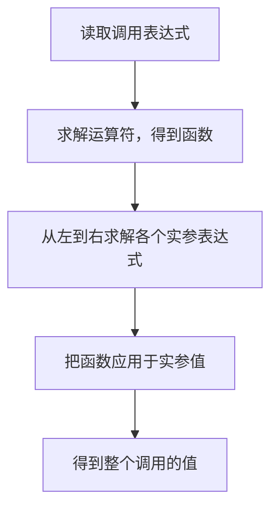
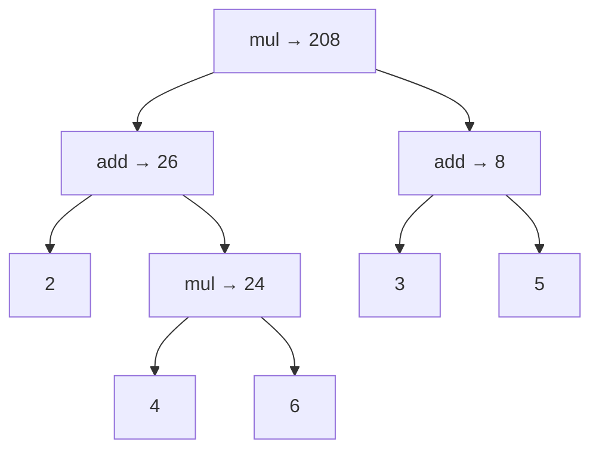

> **英文原课**：CS 61A: Structure and Interpretation of Computer Programs (Fall 2024)  
> **主讲教师**：Prof. John DeNero (UC Berkeley)  
> **图文整理**：VideoBook 视频转图文技术电子书流水线  
> **全书体量**：已收录 37 / 37 讲 ｜ 18.2 小时音视频讲义 ｜ 577 张高清板书截图  
> **在线目录**：[CS61A 专题目录](/notes/topics/CS61A)

---

## 全书总目录（Master Table of Contents）


### Module 1: 函数与抽象 (Functions & Abstraction)

- **[Lecture 01 · Welcome：表达式与函数调用](/notes/cs61a/lecture-01)** `(13:29 · 6 截图)` · [原视频 P1](https://www.bilibili.com/video/BV1sy411z7nA/?p=1)
- **[Lecture 02 · Functions：名称、环境与自定义函数](/notes/cs61a/lecture-02)** `(40:20 · 13 截图)` · [原视频 P2](https://www.bilibili.com/video/BV1sy411z7nA/?p=2)
- **[Lecture 03 · Control：多帧环境模型、条件分支与循环控制](/notes/cs61a/lecture-03)** `(32:21 · 15 截图)` · [原视频 P3](https://www.bilibili.com/video/BV1sy411z7nA/?p=3)
- **[Lecture 04 · Higher-Order Functions：高阶函数、控制流本质与计算抽象](/notes/cs61a/lecture-04)** `(42:53 · 16 截图)` · [原视频 P4](https://www.bilibili.com/video/BV1sy411z7nA/?p=4)
- **[Lecture 05 · Environments：高阶函数环境模型、嵌套作用域、Lambda 与柯里化](/notes/cs61a/lecture-05)** `(36:42 · 15 截图)` · [原视频 P5](https://www.bilibili.com/video/BV1sy411z7nA/?p=5)
- **[Lecture 06 · Sound (Optional)：高阶函数实战——从零合成音乐与超级马里奥](/notes/cs61a/lecture-06)** `(14:36 · 10 截图)` · [原视频 P6](https://www.bilibili.com/video/BV1sy411z7nA/?p=6)
- **[Lecture 07 · Functional Abstraction：函数抽象、环境模型进阶、反函数搜索与调试实战](/notes/cs61a/lecture-07)** `(30:05 · 14 截图)` · [原视频 P7](https://www.bilibili.com/video/BV1sy411z7nA/?p=7)
- **[Lecture 08 · Function Examples：期中经典考题深度解析、代码综合设计与装饰器魔法](/notes/cs61a/lecture-08)** `(34:16 · 14 截图)` · [原视频 P8](https://www.bilibili.com/video/BV1sy411z7nA/?p=8)

### Module 2: 递归与数据抽象 (Recursion & Sequences)

- **[Lecture 09 · Recursion (递归与环境模型)](/notes/cs61a/lecture-09)** `(37:49 · 14 截图)` · [原视频 P9](https://www.bilibili.com/video/BV1sy411z7nA/?p=9)
- **[Lecture 10 · Tree Recursion (树形递归与计算过程)](/notes/cs61a/lecture-10)** `(32:14 · 16 截图)` · [原视频 P10](https://www.bilibili.com/video/BV1sy411z7nA/?p=10)
- **[Lecture 11 · Sequences (序列、列表与列表推导式)](/notes/cs61a/lecture-11)** `(22:15 · 15 截图)` · [原视频 P11](https://www.bilibili.com/video/BV1sy411z7nA/?p=11)
- **[Lecture 12 · Containers (容器、盒式指针模型与字典抽象)](/notes/cs61a/lecture-12)** `(27:53 · 16 截图)` · [原视频 P12](https://www.bilibili.com/video/BV1sy411z7nA/?p=12)
- **[Lecture 13 · Data Abstraction (数据抽象与抽象屏障)](/notes/cs61a/lecture-13)** `(29:08 · 16 截图)` · [原视频 P13](https://www.bilibili.com/video/BV1sy411z7nA/?p=13)
- **[Lecture 14 · Trees (树形数据抽象与树遍历递归)](/notes/cs61a/lecture-14)** `(34:32 · 16 截图)` · [原视频 P14](https://www.bilibili.com/video/BV1sy411z7nA/?p=14)
- **[Lecture 15 · Mutability (可变性、对象别名与局部持久状态)](/notes/cs61a/lecture-15)** `(37:58 · 16 截图)` · [原视频 P15](https://www.bilibili.com/video/BV1sy411z7nA/?p=15)

### Module 3: 面向对象与效率 (OOP & Efficiency)

- **[Lecture 16 · Iterators (迭代器、惰性计算与生成流)](/notes/cs61a/lecture-16)** `(29:29 · 16 截图)` · [原视频 P16](https://www.bilibili.com/video/BV1sy411z7nA/?p=16)
- **[Lecture 17 · Generators (生成器、yield 机制与递归流生成)](/notes/cs61a/lecture-17)** `(17:13 · 16 截图)` · [原视频 P17](https://www.bilibili.com/video/BV1sy411z7nA/?p=17)
- **[Lecture 18 · Objects (面向对象编程、类与实例方法)](/notes/cs61a/lecture-18)** `(17:15 · 14 截图)` · [原视频 P18](https://www.bilibili.com/video/BV1sy411z7nA/?p=18)
- **[Lecture 19 · 类属性与方法 (Attributes)](/notes/cs61a/lecture-19)** `(17:47 · 15 截图)` · [原视频 P19](https://www.bilibili.com/video/BV1sy411z7nA/?p=19)
- **[Lecture 20 · 继承与面向对象设计 (Inheritance)](/notes/cs61a/lecture-20)** `(31:35 · 16 截图)` · [原视频 P20](https://www.bilibili.com/video/BV1sy411z7nA/?p=20)
- **[Lecture 21 · 对象表示与多态接口 (Representation)](/notes/cs61a/lecture-21)** `(30:31 · 17 截图)` · [原视频 P21](https://www.bilibili.com/video/BV1sy411z7nA/?p=21)
- **[Lecture 22 · 对象组合与链表树形结构 (Composition)](/notes/cs61a/lecture-22)** `(33:16 · 17 截图)` · [原视频 P22](https://www.bilibili.com/video/BV1sy411z7nA/?p=22)
- **[Lecture 23 · 程序效率与复杂度分析 (Efficiency)](/notes/cs61a/lecture-23)** `(36:37 · 18 截图)` · [原视频 P23](https://www.bilibili.com/video/BV1sy411z7nA/?p=23)
- **[Lecture 24 · 程序分解与模块化设计 (Decomposition)](/notes/cs61a/lecture-24)** `(27:16 · 16 截图)` · [原视频 P24](https://www.bilibili.com/video/BV1sy411z7nA/?p=24)
- **[Lecture 25 · 数据结构与期中经典题解 (Data Examples)](/notes/cs61a/lecture-25)** `(38:37 · 17 截图)` · [原视频 P25](https://www.bilibili.com/video/BV1sy411z7nA/?p=25)

### Module 4: 解释器与 Scheme (Interpreters & Scheme)

- **[Lecture 26 · 函数式语言 Scheme 基础 (Scheme)](/notes/cs61a/lecture-26)** `(31:14 · 17 截图)` · [原视频 P26](https://www.bilibili.com/video/BV1sy411z7nA/?p=26)
- **[Lecture 27 · Scheme 列表与符号计算 (Scheme Lists)](/notes/cs61a/lecture-27)** `(24:44 · 16 截图)` · [原视频 P27](https://www.bilibili.com/video/BV1sy411z7nA/?p=27)
- **[Lecture 28 · 异常处理、语法解析与计算器解释器 (Calculator)](/notes/cs61a/lecture-28)** `(47:54 · 18 截图)` · [原视频 P28](https://www.bilibili.com/video/BV1sy411z7nA/?p=28)
- **[Lecture 29 · 解释器架构与 Scheme 解释器实现 (Interpreters)](/notes/cs61a/lecture-29)** `(29:48 · 17 截图)` · [原视频 P29](https://www.bilibili.com/video/BV1sy411z7nA/?p=29)
- **[Lecture 30 · 尾递归与尾调用优化 (Tail Calls & Tail Recursion)](/notes/cs61a/lecture-30)** `(32:50 · 17 截图)` · [原视频 P30](https://www.bilibili.com/video/BV1sy411z7nA/?p=30)
- **[Lecture 31 · 代码即数据与元编程 (Programs as Data)](/notes/cs61a/lecture-31)** `(18:06 · 16 截图)` · [原视频 P31](https://www.bilibili.com/video/BV1sy411z7nA/?p=31)
- **[Lecture 32 · 宏与语法扩展 (Macros)](/notes/cs61a/lecture-32)** `(28:53 · 17 截图)` · [原视频 P32](https://www.bilibili.com/video/BV1sy411z7nA/?p=32)

### Module 5: 声明式编程与 SQL (Declarative & SQL)

- **[Lecture 33 · 声明式编程与 SQL 基础 (Declarative Programming & SQL)](/notes/cs61a/lecture-33)** `(25:43 · 17 截图)` · [原视频 P33](https://www.bilibili.com/video/BV1sy411z7nA/?p=33)
- **[Lecture 34 · 多表连接与关系运算 (Tables & Joins)](/notes/cs61a/lecture-34)** `(24:54 · 17 截图)` · [原视频 P34](https://www.bilibili.com/video/BV1sy411z7nA/?p=34)
- **[Lecture 35 · 数据聚合与分组统计 (Aggregation & Group By)](/notes/cs61a/lecture-35)** `(17:30 · 17 截图)` · [原视频 P35](https://www.bilibili.com/video/BV1sy411z7nA/?p=35)
- **[Lecture 36 · 数据库系统与 Python 交互 (Databases & Python Integration)](/notes/cs61a/lecture-36)** `(26:22 · 17 截图)` · [原视频 P36](https://www.bilibili.com/video/BV1sy411z7nA/?p=36)
- **[Lecture 37 · 课程总结与综合实战演练 (Final Examples & Conclusion)](/notes/cs61a/lecture-37)** `(38:48 · 17 截图)` · [原视频 P37](https://www.bilibili.com/video/BV1sy411z7nA/?p=37)


---


> **主讲**：John DeNero ｜ **时长**：13:29 ｜ **视频回链**：[B 站对应单集 (P1)](https://www.bilibili.com/video/BV1sy411z7nA/?p=1)

## 1. 课程怎样学习

*(参考时间：00:00:00 · [视频跳转 (P1 00:00:00)](https://www.bilibili.com/video/BV1sy411z7nA/?p=1&t=0))*

开场中，DeNero 说明自己与 Rao 分别教授两个班，两班共享作业、考试和预录视频。学生应在课堂之前看完对应视频，现场讲课进一步展开例子，讨论解题时需要考虑的问题。

预录内容按播放列表组织：先介绍通知，再进入课程主题。单个片段通常只有五到十分钟，一次课可能包含若干片段。部分视频来自往年的录制，课程更新时才重新录制，因此讲师的年龄、终端版本和画面风格可能不同。

这一讲从一种基本程序构件开始：**表达式**。

> **编者说明**：视频里的开课通知属于录制时的安排，不作为今天的作业截止日期。学习时应先理解规则，再亲自运行例子。

## 2. 表达式：描述计算，得到一个值

*(参考时间：00:02:11 · [视频跳转 (P1 00:02:11)](https://www.bilibili.com/video/BV1sy411z7nA/?p=1&t=131))*

**表达式（expression）描述一项计算，求值后得到一个值（value）。** 表达式是写下来的计算描述，值是计算的结果。

数学早已使用表达式组织计算，但不同运算常有不同记法：加法把 `+` 写在两个数之间，除法可以把分子放在分母上方，开方有根号，正弦写成 `sin`。讲师把根号形容为给数字放进一座“小房子”，提醒读者这些都是表示计算的符号。

函数调用记法提供了共同结构：先给出函数，再列出输入。数学里的 `f(x)` 或 `f(x, y)`，在程序中也能表达计算。接下来，课程用这种结构解释算术以及更复杂的表达式。

### 从 Python 交互解释器开始

*(参考时间：00:03:51 · [视频跳转 (P1 00:03:51)](https://www.bilibili.com/video/BV1sy411z7nA/?p=1&t=231))*

在终端运行 `python3`，启动交互解释器。看到 `>>>` 提示符后输入表达式，解释器会求值并显示结果。

```python
>>> 2015
2015
>>> 2000 + 15
2015
```

数字本身是简单表达式；通过运算把数字组合起来，就得到复合表达式。讲师还演示了乘法、括号嵌套、除法和乘方，说明 Python 能像计算器一样处理这些计算。


*⏱ 时间戳：00:04:20 · 📷 课堂截图 · [在 B 站观看对应片段 (P1 00:04:20)](https://www.bilibili.com/video/BV1sy411z7nA/?p=1&t=260)*

> **编者说明**：`>>>` 是提示符，不是代码；复制到 `.py` 文件时要去掉提示符和结果行。视频里的旧 Python 版本属于录制环境，本书例子可在现代 Python 3 中运行。

## 3. 调用表达式：函数与输入的组合

*(参考时间：00:04:55 · [视频跳转 (P1 00:04:55)](https://www.bilibili.com/video/BV1sy411z7nA/?p=1&t=295))*

调用表达式的一般形式是 `函数表达式(实参表达式1, 实参表达式2, ...)`。例如，`max` 取输入中的最大值：

```python
>>> max(2, 4)
4
>>> max(1, 2, 3, 4, 5)
5
```

`min` 则取最小值。函数后的括号划定一次调用，逗号分隔输入表达式。每个函数能接受多少输入，由该函数的规则决定；`max` 接受多个输入，不意味着所有函数都接受任意数量的实参。

### 把算术写成调用

*(参考时间：00:06:00 · [视频跳转 (P1 00:06:00)](https://www.bilibili.com/video/BV1sy411z7nA/?p=1&t=360))*

加法和乘法也有对应函数。先从 `operator` 模块导入：

```python
>>> from operator import add, mul
>>> add(2, 3)
5
>>> mul(2, 3)
6
```

`add(2, 3)` 表达的运算与 `2 + 3` 相同，`mul(2, 3)` 与 `2 * 3` 相同。导入使函数名称在当前会话中可用，之后就能反复调用。


*⏱ 时间戳：00:06:28 · 📷 课堂截图 · [在 B 站观看对应片段 (P1 00:06:28)](https://www.bilibili.com/video/BV1sy411z7nA/?p=1&t=388)*

### 嵌套调用：从小计算构成大计算

*(参考时间：00:06:33 · [视频跳转 (P1 00:06:33)](https://www.bilibili.com/video/BV1sy411z7nA/?p=1&t=393))*

一个调用可以放到另一个调用的实参位置。课堂核心例子是：

```python
>>> mul(add(2, mul(4, 6)), add(3, 5))
208
```

左侧输入是“2 加上 4 与 6 的乘积”，右侧输入是“3 与 5 的和”，最终把两者相乘。括号表明哪个结果属于哪个调用。

相同算术也能写成 `(2 + 4 * 6) * (3 + 5)`。使用中缀运算符时需要掌握运算优先级；调用记法把组合结构写在嵌套关系中。课程强调调用表达式，是为了建立可以重复应用的求值规则。


*⏱ 时间戳：00:07:30 · 📷 课堂截图 · [在 B 站观看对应片段 (P1 00:07:30)](https://www.bilibili.com/video/BV1sy411z7nA/?p=1&t=450)*

## 4. 调用表达式的解剖

*(参考时间：00:08:07 · [视频跳转 (P1 00:08:07)](https://www.bilibili.com/video/BV1sy411z7nA/?p=1&t=487))*

以 `add(2, 3)` 为例，它内部仍由表达式构成：

| 部分 | 本例 | 求值得到什么 |
| --- | --- | --- |
| 运算符子表达式（operator subexpression） | `add` | 加法函数 |
| 第一个运算对象子表达式（operand subexpression） | `2` | 数值 `2` |
| 第二个运算对象子表达式 | `3` | 数值 `3` |
| 整个调用表达式 | `add(2, 3)` | 数值 `5` |

这里“运算符”指括号前的部分，可以是函数名称，不限于 `+`、`*` 这些符号。**函数本身也是值**：求解名称 `add`，得到的是一个可以调用的函数。


*⏱ 时间戳：00:08:35 · 📷 课堂截图 · [在 B 站观看对应片段 (P1 00:08:35)](https://www.bilibili.com/video/BV1sy411z7nA/?p=1&t=515)*

还要区分：**operand 是程序里写出的表达式，argument 是求解该表达式后传给函数的实参值。** 在简单数字例子中两者看起来接近；嵌套调用则清楚地显示它们的不同。

## 5. 同一套规则怎样求解全部调用

*(参考时间：00:09:12 · [视频跳转 (P1 00:09:12)](https://www.bilibili.com/video/BV1sy411z7nA/?p=1&t=552))*

解释器反复执行相同过程：

1. 先求解运算符子表达式，得到要调用的函数。
2. 从左到右求解运算对象子表达式，得到实参值。
3. 把函数应用于这些实参，得到整个调用的值。



如果一个实参本身是调用表达式，解释器在求解它时，再次应用同一规则。复杂表达式不需要一种全新的求值方法。


*⏱ 时间戳：00:09:30 · 📷 课堂截图 · [在 B 站观看对应片段 (P1 00:09:30)](https://www.bilibili.com/video/BV1sy411z7nA/?p=1&t=570)*

### 逐步拆解 208 的来源

*(参考时间：00:10:12 · [视频跳转 (P1 00:10:12)](https://www.bilibili.com/video/BV1sy411z7nA/?p=1&t=612))*

考虑 `mul(add(2, mul(4, 6)), add(3, 5))`。首先求解外层 `mul`，得到乘法函数；此时还不能相乘，因为两个输入值尚未确定。

处理第一个输入 `add(2, mul(4, 6))`：找到 `add`，求得第一个输入 `2`；第二个输入是 `mul(4, 6)`，因此继续应用调用规则，得到 `24`。随后执行 `add(2, 24)`，得到 `26`。

外层第一个实参现在是 `26`，第二个仍需处理。求解 `add(3, 5)` 得到 `8`；最后执行 `mul(26, 8)`，得到 `208`。



这个图叫作**表达式树（expression tree）**，表示子表达式怎样组成大计算，以及中间值怎样向外传递。树表示依赖关系；追踪执行顺序时，还要记住先求解函数，再从左到右求解实参。


*⏱ 时间戳：00:12:25 · 📷 课堂截图 · [在 B 站观看对应片段 (P1 00:12:25)](https://www.bilibili.com/video/BV1sy411z7nA/?p=1&t=745)*

| 已完成的计算 | 得到的值 | 接下来交给谁 |
| --- | --- | --- |
| `mul(4, 6)` | `24` | 左侧 `add` 的第二个实参 |
| `add(2, 24)` | `26` | 外层 `mul` 的第一个实参 |
| `add(3, 5)` | `8` | 外层 `mul` 的第二个实参 |
| `mul(26, 8)` | `208` | 整个表达式的值 |

计算发生之前，规则已经提供了正确输入。讲师最后强调：代码中的 `add(2, mul(4, 6))` 是一个运算对象子表达式，`26` 是它的值，也是外层 `mul` 的第一个实参。

## 6. 自查：是否真正理解了调用

> **编者说明 · 练习**：以下题目用于复习，不是视频原有作业。

1. `add(2, 3)` 与 `5` 有什么区别？
2. 在 `mul(add(2, 3), 4)` 中，第一个 operand 是什么？第一个 argument 呢？
3. 不运行代码，写出 `add(mul(2, 3), mul(4, 5))` 的中间值和最终结果。

**参考答案**：第一题，前者描述计算，后者是求值结果。第二题，运算对象表达式是 `add(2, 3)`，实参值是 `5`。第三题，先得到 `6`、`20`，最后得到 `26`；执行时仍先求解各次调用的运算符。

L2 将继续扩展这些规则：让名称指向新的值，并定义自己的函数。

## 官方参考与来源

- [本讲 B 站视频 · P1](https://www.bilibili.com/video/BV1sy411z7nA/?p=1)：主要内容与截图来源，讲师 John DeNero。
- [Composing Programs §1.2](https://composingprograms.com/pages/12-elements-of-programming.html)：调用表达式、库函数、求值规则的校准资料。
- [Composing Programs §1.1](https://composingprograms.com/pages/11-getting-started.html)：解释器入门延伸阅读，不作为本讲额外讲过的内容。

视频画面版权归原权利人；教材作者 John DeNero，相关许可按原站说明保留。

---

