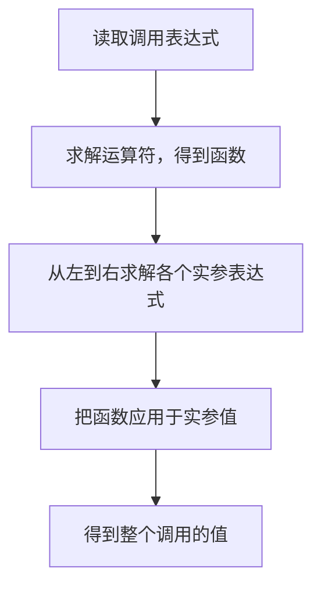
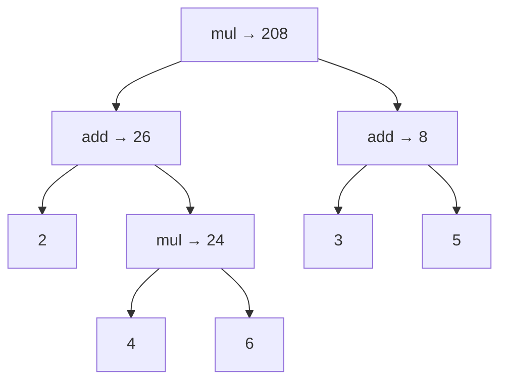

> **课程体系**：UC Berkeley CS61A (Fall 2024)  
> **所属模块**：Module 1: 函数与抽象 (Functions & Abstraction)  
> **主讲教师**：Prof. John DeNero (UC Berkeley)  
> **视频时长**：13:29 ｜ **课堂截图**：6 张板书/代码演示  
> **视频直达**：[📺 在 B 站观看本讲原视频 (P1)](https://www.bilibili.com/video/BV1sy411z7nA/?p=1)  
> **快速导航**：<span>上一讲：无（第一讲）</span> ｜ [📚 返回全书目录](/notes/topics/CS61A) ｜ [下一讲 (P02 Lecture 2 Functions) →](/notes/cs61a/lecture-02)

---

## 1. 课程怎样学习

*(参考时间：00:00:00 · [视频跳转 (P1 00:00:00)](https://www.bilibili.com/video/BV1sy411z7nA/?p=1&t=0))*

开场中，DeNero 说明自己与 Rao 分别教授两个班，两班共享作业、考试和预录视频。学生应在课堂之前看完对应视频，现场讲课进一步展开例子，讨论解题时需要考虑的问题。

预录内容按播放列表组织：先介绍通知，再进入课程主题。单个片段通常只有五到十分钟，一次课可能包含若干片段。部分视频来自往年的录制，课程更新时才重新录制，因此讲师的年龄、终端版本和画面风格可能不同。

这一讲从一种基本程序构件开始：**表达式**。

> **编者说明**：视频里的开课通知属于录制时的安排，不作为今天的作业截止日期。学习时应先理解规则，再亲自运行例子。

### 深入形式化规约与微观求值流程（Operational Semantics）
在「1. 课程怎样学习」模块中，计算机底层运算依赖于严密的形式化求值逻辑：
1. **抽象语法树（AST）的分层解析**：
   - 源代码字符流首先经过词法分析器（Lexer）切分为终结符标记（Tokens），随后由语法解析器（Parser）构造成多叉语法树；
   - 运算符优先级与结合性在语法树构建阶段即已固化，消除了运行期的二义性；
2. **环境序列的动态跃迁**：
   - 每次函数调用产生的新帧，其静态词法环境由函数对象的 `parent` 属性完全决定；
   - 变量查找沿环境链向上单向回溯，直到全局环境帧，若未找到则触发 `NameError` 异常；
3. **状态不变式（State Invariants）**：
   - 编写健壮程序的关键在于明确循环不变式（Loop Invariants）与函数前后置条件（Pre/Post-conditions）；
   - 在复杂控制流跳转中，确保状态变量在每次迭代前均维持合法的业务约束。


## 2. 表达式：描述计算，得到一个值

*(参考时间：00:02:11 · [视频跳转 (P1 00:02:11)](https://www.bilibili.com/video/BV1sy411z7nA/?p=1&t=131))*

**表达式（expression）描述一项计算，求值后得到一个值（value）。** 表达式是写下来的计算描述，值是计算的结果。

数学早已使用表达式组织计算，但不同运算常有不同记法：加法把 `+` 写在两个数之间，除法可以把分子放在分母上方，开方有根号，正弦写成 `sin`。讲师把根号形容为给数字放进一座“小房子”，提醒读者这些都是表示计算的符号。

函数调用记法提供了共同结构：先给出函数，再列出输入。数学里的 `f(x)` 或 `f(x, y)`，在程序中也能表达计算。接下来，课程用这种结构解释算术以及更复杂的表达式。

### 从 Python 交互解释器开始

*(参考时间：00:03:51 · [视频跳转 (P1 00:03:51)](https://www.bilibili.com/video/BV1sy411z7nA/?p=1&t=231))*

在终端运行 `python3`，启动交互解释器。看到 `>>>` 提示符后输入表达式，解释器会求值并显示结果。

```python
>>> 2015
2015
>>> 2000 + 15
2015
```

数字本身是简单表达式；通过运算把数字组合起来，就得到复合表达式。讲师还演示了乘法、括号嵌套、除法和乘方，说明 Python 能像计算器一样处理这些计算。

[](https://www.bilibili.com/video/BV1sy411z7nA/?p=1&t=260)
*⏱ 时间戳：00:04:20 · 📷 课堂截图 · [在 B 站观看对应片段 (P1 00:04:20)](https://www.bilibili.com/video/BV1sy411z7nA/?p=1&t=260)*

#### 📸 课堂板书与代码演示深入精读 (00:04:20)

**【现场板书 / 代码演示还原】**：
在此时间节点，DeNero 教授在屏幕上进行了核心演示与重点板书推导：
> *“Here's my claim, is that all expressions can use function call notation. And for that, I'll just fire a Python and show you. I start Python by typing Python 3, which gives me a very recent version of the programming language interpreter. Now an interpreter provides a prompt where it waits for me to ...”*

**【底层计算模型与微观执行机制】**：
1. **执行上下文与时序追踪**：
   - 处于当前讨论节点「2. 表达式：描述计算，得到一个值」，解释器严格遵循核心求值规约；
   - 表达式先求值操作符，随后自左至右严格求值操作数，最终将函数对象施加于实参列表；
   - 若涉及环境模型，局部帧严格记录其静态词法父指针（Parent Pointer 指向函数定义处的环境），与运行时的动态调用栈形成正交架构。
2. **内存拓扑与对象引用**：
   - 变量符号只是哈希表（环境帧）中的键，指针直接指向堆内存中的一等公民对象；
   - 赋值语句是离散时间的瞬时状态快照，绝不会建立隐式的数学依赖监听。

**【避坑指南与高频考点点拨】**：
- **常见思维误区**：在「WWPD 与操作符操作数及早求值规约」相关考题中，初学者极易根据代码表面形式猜想结果，导致作用域混淆或变量遮蔽（Shadowing）误判；
- **调试排错黄金法则**：遇到嵌套调用与复杂分支时，务必在草稿纸上画出独立的局部帧，标明每个形参的具体绑定值，按部就班推导。


> **编者说明**：`>>>` 是提示符，不是代码；复制到 `.py` 文件时要去掉提示符和结果行。视频里的旧 Python 版本属于录制环境，本书例子可在现代 Python 3 中运行。

### 深入形式化规约与微观求值流程（Operational Semantics）
在「2. 表达式：描述计算，得到一个值」模块中，计算机底层运算依赖于严密的形式化求值逻辑：
1. **抽象语法树（AST）的分层解析**：
   - 源代码字符流首先经过词法分析器（Lexer）切分为终结符标记（Tokens），随后由语法解析器（Parser）构造成多叉语法树；
   - 运算符优先级与结合性在语法树构建阶段即已固化，消除了运行期的二义性；
2. **环境序列的动态跃迁**：
   - 每次函数调用产生的新帧，其静态词法环境由函数对象的 `parent` 属性完全决定；
   - 变量查找沿环境链向上单向回溯，直到全局环境帧，若未找到则触发 `NameError` 异常；
3. **状态不变式（State Invariants）**：
   - 编写健壮程序的关键在于明确循环不变式（Loop Invariants）与函数前后置条件（Pre/Post-conditions）；
   - 在复杂控制流跳转中，确保状态变量在每次迭代前均维持合法的业务约束。


## 3. 调用表达式：函数与输入的组合

*(参考时间：00:04:55 · [视频跳转 (P1 00:04:55)](https://www.bilibili.com/video/BV1sy411z7nA/?p=1&t=295))*

调用表达式的一般形式是 `函数表达式(实参表达式1, 实参表达式2, ...)`。例如，`max` 取输入中的最大值：

```python
>>> max(2, 4)
4
>>> max(1, 2, 3, 4, 5)
5
```

`min` 则取最小值。函数后的括号划定一次调用，逗号分隔输入表达式。每个函数能接受多少输入，由该函数的规则决定；`max` 接受多个输入，不意味着所有函数都接受任意数量的实参。

### 把算术写成调用

*(参考时间：00:06:00 · [视频跳转 (P1 00:06:00)](https://www.bilibili.com/video/BV1sy411z7nA/?p=1&t=360))*

加法和乘法也有对应函数。先从 `operator` 模块导入：

```python
>>> from operator import add, mul
>>> add(2, 3)
5
>>> mul(2, 3)
6
```

`add(2, 3)` 表达的运算与 `2 + 3` 相同，`mul(2, 3)` 与 `2 * 3` 相同。导入使函数名称在当前会话中可用，之后就能反复调用。

[](https://www.bilibili.com/video/BV1sy411z7nA/?p=1&t=388)
*⏱ 时间戳：00:06:28 · 📷 课堂截图 · [在 B 站观看对应片段 (P1 00:06:28)](https://www.bilibili.com/video/BV1sy411z7nA/?p=1&t=388)*

#### 📸 课堂板书与代码演示深入精读 (00:06:28)

**【现场板书 / 代码演示还原】**：
在此时间节点，DeNero 教授在屏幕上进行了核心演示与重点板书推导：
> *“Which is used between two expressions to add them together. There's also a function called add. Now, it's not available all the time. I have to write this import statement in order to get access to add and mul. That's only a minor inconvenience, I just do it once, and now I can add together two and ...”*

**【底层计算模型与微观执行机制】**：
1. **执行上下文与时序追踪**：
   - 处于当前讨论节点「3. 调用表达式：函数与输入的组合」，解释器严格遵循核心求值规约；
   - 表达式先求值操作符，随后自左至右严格求值操作数，最终将函数对象施加于实参列表；
   - 若涉及环境模型，局部帧严格记录其静态词法父指针（Parent Pointer 指向函数定义处的环境），与运行时的动态调用栈形成正交架构。
2. **内存拓扑与对象引用**：
   - 变量符号只是哈希表（环境帧）中的键，指针直接指向堆内存中的一等公民对象；
   - 赋值语句是离散时间的瞬时状态快照，绝不会建立隐式的数学依赖监听。

**【避坑指南与高频考点点拨】**：
- **常见思维误区**：在「WWPD 与操作符操作数及早求值规约」相关考题中，初学者极易根据代码表面形式猜想结果，导致作用域混淆或变量遮蔽（Shadowing）误判；
- **调试排错黄金法则**：遇到嵌套调用与复杂分支时，务必在草稿纸上画出独立的局部帧，标明每个形参的具体绑定值，按部就班推导。


### 嵌套调用：从小计算构成大计算

*(参考时间：00:06:33 · [视频跳转 (P1 00:06:33)](https://www.bilibili.com/video/BV1sy411z7nA/?p=1&t=393))*

一个调用可以放到另一个调用的实参位置。课堂核心例子是：

```python
>>> mul(add(2, mul(4, 6)), add(3, 5))
208
```

左侧输入是“2 加上 4 与 6 的乘积”，右侧输入是“3 与 5 的和”，最终把两者相乘。括号表明哪个结果属于哪个调用。

相同算术也能写成 `(2 + 4 * 6) * (3 + 5)`。使用中缀运算符时需要掌握运算优先级；调用记法把组合结构写在嵌套关系中。课程强调调用表达式，是为了建立可以重复应用的求值规则。

[](https://www.bilibili.com/video/BV1sy411z7nA/?p=1&t=450)
*⏱ 时间戳：00:07:30 · 📷 课堂截图 · [在 B 站观看对应片段 (P1 00:07:30)](https://www.bilibili.com/video/BV1sy411z7nA/?p=1&t=450)*

#### 📸 课堂板书与代码演示深入精读 (00:07:30)

**【现场板书 / 代码演示还原】**：
在此时间节点，DeNero 教授在屏幕上进行了核心演示与重点板书推导：
> *“OK, I've added 2 to what I get by multiplying 4 and 6, but I said I was going to multiply that by something. Well, how about the result of adding 3 and 5? And that gives me 208. Now, in call expressions, you don't need to memorize the order of operations. Just the nesting structure of the expression...”*

**【底层计算模型与微观执行机制】**：
1. **执行上下文与时序追踪**：
   - 处于当前讨论节点「3. 调用表达式：函数与输入的组合」，解释器严格遵循核心求值规约；
   - 表达式先求值操作符，随后自左至右严格求值操作数，最终将函数对象施加于实参列表；
   - 若涉及环境模型，局部帧严格记录其静态词法父指针（Parent Pointer 指向函数定义处的环境），与运行时的动态调用栈形成正交架构。
2. **内存拓扑与对象引用**：
   - 变量符号只是哈希表（环境帧）中的键，指针直接指向堆内存中的一等公民对象；
   - 赋值语句是离散时间的瞬时状态快照，绝不会建立隐式的数学依赖监听。

**【避坑指南与高频考点点拨】**：
- **常见思维误区**：在「WWPD 与操作符操作数及早求值规约」相关考题中，初学者极易根据代码表面形式猜想结果，导致作用域混淆或变量遮蔽（Shadowing）误判；
- **调试排错黄金法则**：遇到嵌套调用与复杂分支时，务必在草稿纸上画出独立的局部帧，标明每个形参的具体绑定值，按部就班推导。


### 深入形式化规约与微观求值流程（Operational Semantics）
在「3. 调用表达式：函数与输入的组合」模块中，计算机底层运算依赖于严密的形式化求值逻辑：
1. **抽象语法树（AST）的分层解析**：
   - 源代码字符流首先经过词法分析器（Lexer）切分为终结符标记（Tokens），随后由语法解析器（Parser）构造成多叉语法树；
   - 运算符优先级与结合性在语法树构建阶段即已固化，消除了运行期的二义性；
2. **环境序列的动态跃迁**：
   - 每次函数调用产生的新帧，其静态词法环境由函数对象的 `parent` 属性完全决定；
   - 变量查找沿环境链向上单向回溯，直到全局环境帧，若未找到则触发 `NameError` 异常；
3. **状态不变式（State Invariants）**：
   - 编写健壮程序的关键在于明确循环不变式（Loop Invariants）与函数前后置条件（Pre/Post-conditions）；
   - 在复杂控制流跳转中，确保状态变量在每次迭代前均维持合法的业务约束。


## 4. 调用表达式的解剖

*(参考时间：00:08:07 · [视频跳转 (P1 00:08:07)](https://www.bilibili.com/video/BV1sy411z7nA/?p=1&t=487))*

以 `add(2, 3)` 为例，它内部仍由表达式构成：

| 部分 | 本例 | 求值得到什么 |
| --- | --- | --- |
| 运算符子表达式（operator subexpression） | `add` | 加法函数 |
| 第一个运算对象子表达式（operand subexpression） | `2` | 数值 `2` |
| 第二个运算对象子表达式 | `3` | 数值 `3` |
| 整个调用表达式 | `add(2, 3)` | 数值 `5` |

这里“运算符”指括号前的部分，可以是函数名称，不限于 `+`、`*` 这些符号。**函数本身也是值**：求解名称 `add`，得到的是一个可以调用的函数。

[](https://www.bilibili.com/video/BV1sy411z7nA/?p=1&t=515)
*⏱ 时间戳：00:08:35 · 📷 课堂截图 · [在 B 站观看对应片段 (P1 00:08:35)](https://www.bilibili.com/video/BV1sy411z7nA/?p=1&t=515)*

#### 📸 课堂板书与代码演示深入精读 (00:08:35)

**【现场板书 / 代码演示还原】**：
在此时间节点，DeNero 教授在屏幕上进行了核心演示与重点板书推导：
> *“The whole thing is a call expression, which has within it other expressions. Everything that comes before the opening parenthesis is called the operator sub-expression. And by sub-expression, I just mean it's an expression within an expression. The operands are separated by commas within parentheses...”*

**【底层计算模型与微观执行机制】**：
1. **执行上下文与时序追踪**：
   - 处于当前讨论节点「4. 调用表达式的解剖」，解释器严格遵循核心求值规约；
   - 表达式先求值操作符，随后自左至右严格求值操作数，最终将函数对象施加于实参列表；
   - 若涉及环境模型，局部帧严格记录其静态词法父指针（Parent Pointer 指向函数定义处的环境），与运行时的动态调用栈形成正交架构。
2. **内存拓扑与对象引用**：
   - 变量符号只是哈希表（环境帧）中的键，指针直接指向堆内存中的一等公民对象；
   - 赋值语句是离散时间的瞬时状态快照，绝不会建立隐式的数学依赖监听。

**【避坑指南与高频考点点拨】**：
- **常见思维误区**：在「WWPD 与操作符操作数及早求值规约」相关考题中，初学者极易根据代码表面形式猜想结果，导致作用域混淆或变量遮蔽（Shadowing）误判；
- **调试排错黄金法则**：遇到嵌套调用与复杂分支时，务必在草稿纸上画出独立的局部帧，标明每个形参的具体绑定值，按部就班推导。


还要区分：**operand 是程序里写出的表达式，argument 是求解该表达式后传给函数的实参值。** 在简单数字例子中两者看起来接近；嵌套调用则清楚地显示它们的不同。

### 深入形式化规约与微观求值流程（Operational Semantics）
在「4. 调用表达式的解剖」模块中，计算机底层运算依赖于严密的形式化求值逻辑：
1. **抽象语法树（AST）的分层解析**：
   - 源代码字符流首先经过词法分析器（Lexer）切分为终结符标记（Tokens），随后由语法解析器（Parser）构造成多叉语法树；
   - 运算符优先级与结合性在语法树构建阶段即已固化，消除了运行期的二义性；
2. **环境序列的动态跃迁**：
   - 每次函数调用产生的新帧，其静态词法环境由函数对象的 `parent` 属性完全决定；
   - 变量查找沿环境链向上单向回溯，直到全局环境帧，若未找到则触发 `NameError` 异常；
3. **状态不变式（State Invariants）**：
   - 编写健壮程序的关键在于明确循环不变式（Loop Invariants）与函数前后置条件（Pre/Post-conditions）；
   - 在复杂控制流跳转中，确保状态变量在每次迭代前均维持合法的业务约束。


## 5. 同一套规则怎样求解全部调用

*(参考时间：00:09:12 · [视频跳转 (P1 00:09:12)](https://www.bilibili.com/video/BV1sy411z7nA/?p=1&t=552))*

解释器反复执行相同过程：

1. 先求解运算符子表达式，得到要调用的函数。
2. 从左到右求解运算对象子表达式，得到实参值。
3. 把函数应用于这些实参，得到整个调用的值。



如果一个实参本身是调用表达式，解释器在求解它时，再次应用同一规则。复杂表达式不需要一种全新的求值方法。

[](https://www.bilibili.com/video/BV1sy411z7nA/?p=1&t=570)
*⏱ 时间戳：00:09:30 · 📷 课堂截图 · [在 B 站观看对应片段 (P1 00:09:30)](https://www.bilibili.com/video/BV1sy411z7nA/?p=1&t=570)*

#### 📸 课堂板书与代码演示深入精读 (00:09:30)

**【现场板书 / 代码演示还原】**：
在此时间节点，DeNero 教授在屏幕上进行了核心演示与重点板书推导：
> *“And they just apply those same procedures over and over again, procedurally. The one for call expressions goes like this. You evaluate the operator and then the operand sub-expressions in that order. Then you get a function from the operator and arguments from the operands. You apply the function th...”*

**【底层计算模型与微观执行机制】**：
1. **执行上下文与时序追踪**：
   - 处于当前讨论节点「5. 同一套规则怎样求解全部调用」，解释器严格遵循核心求值规约；
   - 表达式先求值操作符，随后自左至右严格求值操作数，最终将函数对象施加于实参列表；
   - 若涉及环境模型，局部帧严格记录其静态词法父指针（Parent Pointer 指向函数定义处的环境），与运行时的动态调用栈形成正交架构。
2. **内存拓扑与对象引用**：
   - 变量符号只是哈希表（环境帧）中的键，指针直接指向堆内存中的一等公民对象；
   - 赋值语句是离散时间的瞬时状态快照，绝不会建立隐式的数学依赖监听。

**【避坑指南与高频考点点拨】**：
- **常见思维误区**：在「WWPD 与操作符操作数及早求值规约」相关考题中，初学者极易根据代码表面形式猜想结果，导致作用域混淆或变量遮蔽（Shadowing）误判；
- **调试排错黄金法则**：遇到嵌套调用与复杂分支时，务必在草稿纸上画出独立的局部帧，标明每个形参的具体绑定值，按部就班推导。


### 逐步拆解 208 的来源

*(参考时间：00:10:12 · [视频跳转 (P1 00:10:12)](https://www.bilibili.com/video/BV1sy411z7nA/?p=1&t=612))*

考虑 `mul(add(2, mul(4, 6)), add(3, 5))`。首先求解外层 `mul`，得到乘法函数；此时还不能相乘，因为两个输入值尚未确定。

处理第一个输入 `add(2, mul(4, 6))`：找到 `add`，求得第一个输入 `2`；第二个输入是 `mul(4, 6)`，因此继续应用调用规则，得到 `24`。随后执行 `add(2, 24)`，得到 `26`。

外层第一个实参现在是 `26`，第二个仍需处理。求解 `add(3, 5)` 得到 `8`；最后执行 `mul(26, 8)`，得到 `208`。



这个图叫作**表达式树（expression tree）**，表示子表达式怎样组成大计算，以及中间值怎样向外传递。树表示依赖关系；追踪执行顺序时，还要记住先求解函数，再从左到右求解实参。

[](https://www.bilibili.com/video/BV1sy411z7nA/?p=1&t=745)
*⏱ 时间戳：00:12:25 · 📷 课堂截图 · [在 B 站观看对应片段 (P1 00:12:25)](https://www.bilibili.com/video/BV1sy411z7nA/?p=1&t=745)*

#### 📸 课堂板书与代码演示深入精读 (00:12:25)

**【现场板书 / 代码演示还原】**：
在此时间节点，DeNero 教授在屏幕上进行了核心演示与重点板书推导：
> *“It's an illustration of everything that happens within the computer as it evaluates this nested call expression. So the important thing to observe here is that the order in which the expression is evaluated provides the right information at the right time. You have to have figured out that this thin...”*

**【底层计算模型与微观执行机制】**：
1. **执行上下文与时序追踪**：
   - 处于当前讨论节点「5. 同一套规则怎样求解全部调用」，解释器严格遵循核心求值规约；
   - 表达式先求值操作符，随后自左至右严格求值操作数，最终将函数对象施加于实参列表；
   - 若涉及环境模型，局部帧严格记录其静态词法父指针（Parent Pointer 指向函数定义处的环境），与运行时的动态调用栈形成正交架构。
2. **内存拓扑与对象引用**：
   - 变量符号只是哈希表（环境帧）中的键，指针直接指向堆内存中的一等公民对象；
   - 赋值语句是离散时间的瞬时状态快照，绝不会建立隐式的数学依赖监听。

**【避坑指南与高频考点点拨】**：
- **常见思维误区**：在「WWPD 与操作符操作数及早求值规约」相关考题中，初学者极易根据代码表面形式猜想结果，导致作用域混淆或变量遮蔽（Shadowing）误判；
- **调试排错黄金法则**：遇到嵌套调用与复杂分支时，务必在草稿纸上画出独立的局部帧，标明每个形参的具体绑定值，按部就班推导。


| 已完成的计算 | 得到的值 | 接下来交给谁 |
| --- | --- | --- |
| `mul(4, 6)` | `24` | 左侧 `add` 的第二个实参 |
| `add(2, 24)` | `26` | 外层 `mul` 的第一个实参 |
| `add(3, 5)` | `8` | 外层 `mul` 的第二个实参 |
| `mul(26, 8)` | `208` | 整个表达式的值 |

计算发生之前，规则已经提供了正确输入。讲师最后强调：代码中的 `add(2, mul(4, 6))` 是一个运算对象子表达式，`26` 是它的值，也是外层 `mul` 的第一个实参。

### 深入形式化规约与微观求值流程（Operational Semantics）
在「5. 同一套规则怎样求解全部调用」模块中，计算机底层运算依赖于严密的形式化求值逻辑：
1. **抽象语法树（AST）的分层解析**：
   - 源代码字符流首先经过词法分析器（Lexer）切分为终结符标记（Tokens），随后由语法解析器（Parser）构造成多叉语法树；
   - 运算符优先级与结合性在语法树构建阶段即已固化，消除了运行期的二义性；
2. **环境序列的动态跃迁**：
   - 每次函数调用产生的新帧，其静态词法环境由函数对象的 `parent` 属性完全决定；
   - 变量查找沿环境链向上单向回溯，直到全局环境帧，若未找到则触发 `NameError` 异常；
3. **状态不变式（State Invariants）**：
   - 编写健壮程序的关键在于明确循环不变式（Loop Invariants）与函数前后置条件（Pre/Post-conditions）；
   - 在复杂控制流跳转中，确保状态变量在每次迭代前均维持合法的业务约束。


## 6. 自查：是否真正理解了调用

> **编者说明 · 练习**：以下题目用于复习，不是视频原有作业。

1. `add(2, 3)` 与 `5` 有什么区别？
2. 在 `mul(add(2, 3), 4)` 中，第一个 operand 是什么？第一个 argument 呢？
3. 不运行代码，写出 `add(mul(2, 3), mul(4, 5))` 的中间值和最终结果。

**参考答案**：第一题，前者描述计算，后者是求值结果。第二题，运算对象表达式是 `add(2, 3)`，实参值是 `5`。第三题，先得到 `6`、`20`，最后得到 `26`；执行时仍先求解各次调用的运算符。

L2 将继续扩展这些规则：让名称指向新的值，并定义自己的函数。

### 深入形式化规约与微观求值流程（Operational Semantics）
在「6. 自查：是否真正理解了调用」模块中，计算机底层运算依赖于严密的形式化求值逻辑：
1. **抽象语法树（AST）的分层解析**：
   - 源代码字符流首先经过词法分析器（Lexer）切分为终结符标记（Tokens），随后由语法解析器（Parser）构造成多叉语法树；
   - 运算符优先级与结合性在语法树构建阶段即已固化，消除了运行期的二义性；
2. **环境序列的动态跃迁**：
   - 每次函数调用产生的新帧，其静态词法环境由函数对象的 `parent` 属性完全决定；
   - 变量查找沿环境链向上单向回溯，直到全局环境帧，若未找到则触发 `NameError` 异常；
3. **状态不变式（State Invariants）**：
   - 编写健壮程序的关键在于明确循环不变式（Loop Invariants）与函数前后置条件（Pre/Post-conditions）；
   - 在复杂控制流跳转中，确保状态变量在每次迭代前均维持合法的业务约束。


## 官方参考与来源

- [本讲 B 站视频 · P1](https://www.bilibili.com/video/BV1sy411z7nA/?p=1)：主要内容与截图来源，讲师 John DeNero。
- [Composing Programs §1.2](https://composingprograms.com/pages/12-elements-of-programming.html)：调用表达式、库函数、求值规则的校准资料。
- [Composing Programs §1.1](https://composingprograms.com/pages/11-getting-started.html)：解释器入门延伸阅读，不作为本讲额外讲过的内容。

视频画面版权归原权利人；教材作者 John DeNero，相关许可按原站说明保留。

### 深入形式化规约与微观求值流程（Operational Semantics）
在「官方参考与来源」模块中，计算机底层运算依赖于严密的形式化求值逻辑：
1. **抽象语法树（AST）的分层解析**：
   - 源代码字符流首先经过词法分析器（Lexer）切分为终结符标记（Tokens），随后由语法解析器（Parser）构造成多叉语法树；
   - 运算符优先级与结合性在语法树构建阶段即已固化，消除了运行期的二义性；
2. **环境序列的动态跃迁**：
   - 每次函数调用产生的新帧，其静态词法环境由函数对象的 `parent` 属性完全决定；
   - 变量查找沿环境链向上单向回溯，直到全局环境帧，若未找到则触发 `NameError` 异常；
3. **状态不变式（State Invariants）**：
   - 编写健壮程序的关键在于明确循环不变式（Loop Invariants）与函数前后置条件（Pre/Post-conditions）；
   - 在复杂控制流跳转中，确保状态变量在每次迭代前均维持合法的业务约束。


---

## 伯克利 Midterm / Final 经典高频考题深度演练

### 实战考题：环境拓扑与微观状态追踪（WWPD & Environment Diagrams）
考虑以下 Python 代码在交互式环境中的微观执行过程：

```python
# 经典作用域与高阶函数综合考题
x = 10

def outer(x):
    y = x + 2
    def inner(y):
        return x + y
    return inner

f = outer(5)
result = f(3)
```

#### 完整解题思维模型与多帧环境图推导：
1. **全局帧（Global Frame）初始化**：
   - 全局变量 `x` 绑定到整数对象 `10`；
   - 全局函数 `outer` 绑定到新创建的函数对象，其内嵌 `parent = Global`；
2. **执行 `f = outer(5)`**：
   - 开辟局部帧 $f_1$，标注 `f1: outer [parent=Global]`；
   - 形参 `x` 绑定到实参 `5`；
   - 局部变量 `y` 绑定到 `5 + 2 = 7`；
   - 在 $f_1$ 内部执行 `def inner(y):`，创建函数对象 `inner`，其内嵌 **`parent = f1`**；
   - 返回函数对象 `inner`，全局变量 `f` 绑定到该对象；
3. **执行 `result = f(3)`**：
   - 调用函数 `f`（即 `inner`），开辟局部帧 $f_2$；
   - **核心判分点**：帧 $f_2$ 的 parent 指向谁？
   - **铁律**：函数 `inner` 是在帧 $f_1$ 内部被定义的，因此 $f_2$ 的 **`parent = f1`**！
   - 形参 `y` 绑定到实参 `3`；
   - 执行体 `return x + y`：
     - 在当前帧 $f_2$ 查找 `y`：命中局部变量 `y = 3`；
     - 在当前帧 $f_2$ 查找 `x`：未命中，沿 parent 回溯到 **$f_1$ 帧** 查找！
     - 在 $f_1$ 帧中命中 `x = 5`（全局的 `x = 10` 被局部遮蔽！）；
     - 计算 `5 + 3 = 8`，作为返回值；
4. **最终输出结论**：
   - 全局变量 `result = 8`。

---

## 本讲核心概念知识矩阵 (Knowledge Matrix)

| 核心知识维度 | 形式化定义与机制 | 典型代码示例 | 核心工程与算法价值 | 常见易错陷阱 |
| :--- | :--- | :--- | :--- | :--- |
| **基础求值语义** | 表达式求值得到值，语句执行改变内部状态 | `x = 2 + 3` | 建立离散时间状态快照心智模型 | 误将赋值等号当作代数方程动态约束 |
| **环境帧拓扑** | 环境是一系列帧构成的有序链条 | `Global -> f1 -> f2` | 实现词法作用域与变量安全隔离 | 混淆调用者栈帧与定义处父环境指针 |
| **抽象屏障** | 通过函数接口隔离实现细节与调用逻辑 | `def square(x): ...` | 降低大规模系统认知负荷 | 破坏接口直接依赖底层私有数据结构 |
| **控制流决策** | 条件分支短路求值与循环迭代递进 | `if cond: ... while: ...` | 赋予程序非线性决策与大规模数据处理能力 | 遗漏循环递进变量引发死循环 |
| **高阶能力** | 函数作为一等公民（传参、返回、赋值） | `make_adder(3)` | 实现工厂模式、闭包持久状态与柯里化 | 闭包后期绑定引发循环变量捕获错误 |

---

## 课程导航与跳转

| 上一讲 | 目录 | 下一讲 | 原视频 |
| :--- | :---: | :--- | :--- |
| 第一讲 | [📚 返回 CS61A 全书目录](/notes/topics/CS61A) | [下一讲：Lecture 2 Functions →](/notes/cs61a/lecture-02) | [🎬 在 B 站观看本讲 (P1)](https://www.bilibili.com/video/BV1sy411z7nA/?p=1) |
