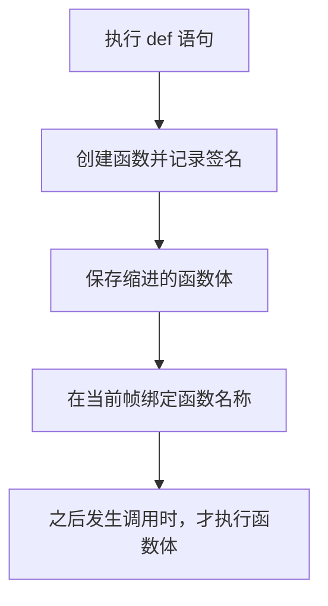
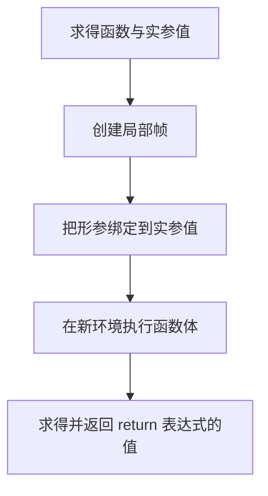
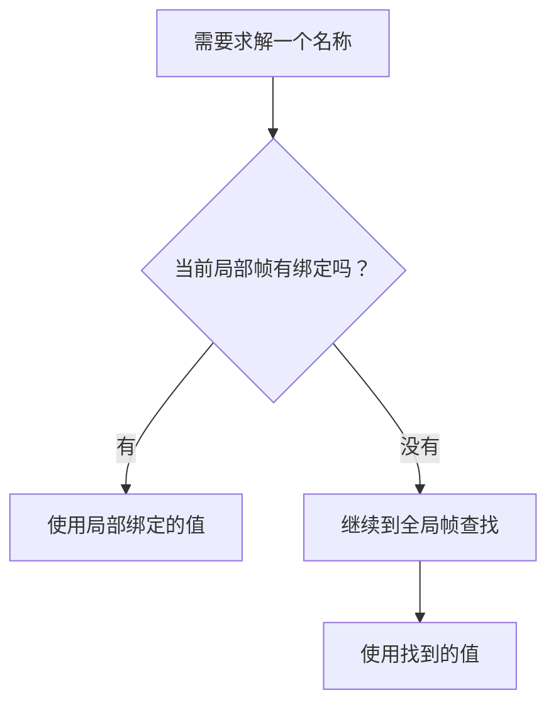
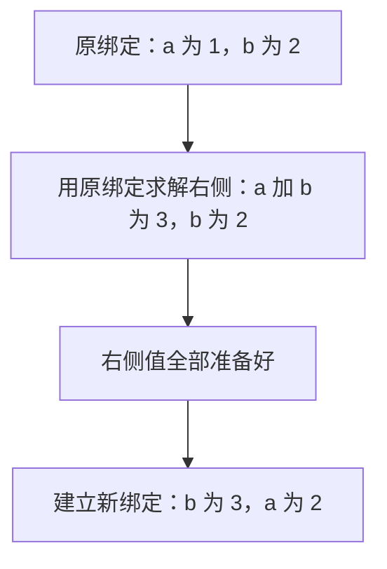

> **课程体系**：UC Berkeley CS61A (Fall 2024)  
> **所属模块**：Module 1: 函数与抽象 (Functions & Abstraction)  
> **主讲教师**：Prof. John DeNero (UC Berkeley)  
> **视频时长**：40:20 ｜ **课堂截图**：13 张板书/代码演示  
> **视频直达**：[📺 在 B 站观看本讲原视频 (P2)](https://www.bilibili.com/video/BV1sy411z7nA/?p=2)  
> **快速导航**：[← 上一讲 (P01 Lecture 1 Welcome)](/notes/cs61a/lecture-01) ｜ [📚 返回全书目录](/notes/topics/CS61A) ｜ [下一讲 (P03 Lecture 3 Control) →](/notes/cs61a/lecture-03)

---

## 1. 用所学内容解决问题

*(参考时间：00:00:00 · [视频跳转 (P2 00:00:00)](https://www.bilibili.com/video/BV1sy411z7nA/?p=2&t=0))*

讲师在通知中强调：把课堂知识用于解题，是课程的核心。作业发布后就应尽早尝试；遇到困难是正常现象，可以去答疑时间寻求帮助、在课程论坛提问，或和学习小组讨论。求助和讨论都需要时间，提前开始能够为它们留出空间。

> **编者说明**：视频里的具体发布日期和截止日期属于当年的课程通知。以下例子按主题组织，建议每组在新的 Python 会话中运行，避免前一组对 `max`、`square` 等名称的重绑定影响后一组。

### 深入形式化规约与微观求值流程（Operational Semantics）
在「1. 用所学内容解决问题」模块中，计算机底层运算依赖于严密的形式化求值逻辑：
1. **抽象语法树（AST）的分层解析**：
   - 源代码字符流首先经过词法分析器（Lexer）切分为终结符标记（Tokens），随后由语法解析器（Parser）构造成多叉语法树；
   - 运算符优先级与结合性在语法树构建阶段即已固化，消除了运行期的二义性；
2. **环境序列的动态跃迁**：
   - 每次函数调用产生的新帧，其静态词法环境由函数对象的 `parent` 属性完全决定；
   - 变量查找沿环境链向上单向回溯，直到全局环境帧，若未找到则触发 `NameError` 异常；
3. **状态不变式（State Invariants）**：
   - 编写健壮程序的关键在于明确循环不变式（Loop Invariants）与函数前后置条件（Pre/Post-conditions）；
   - 在复杂控制流跳转中，确保状态变量在每次迭代前均维持合法的业务约束。


## 2. 名称指向值，赋值保存求值结果

*(参考时间：00:01:30 · [视频跳转 (P2 00:01:30)](https://www.bilibili.com/video/BV1sy411z7nA/?p=2&t=90))*

Python 能进行计算，但许多库名称需要先导入。直接输入尚未导入的 `pi` 会报 `NameError`，并不意味着 Python 无法处理圆周率，而是当前环境中没有这个名称。

```python
>>> from math import pi, sin
>>> pi
3.141592653589793
>>> sin(pi / 2)
1.0
```

`import` 使已有的名称与值在当前环境中可用。讲师还演示了 `Ctrl+L` 清屏：这只清除终端显示，当前 Python 会话仍在，已经建立的名称绑定不会因此消失。

### 赋值：先求解右侧，再建立绑定

*(参考时间：00:02:31 · [视频跳转 (P2 00:02:31)](https://www.bilibili.com/video/BV1sy411z7nA/?p=2&t=151))*

赋值语句把名称写在左边，表达式写在右边。解释器先求解右侧表达式，再把得到的值绑定给左边的名称。

```python
>>> radius = 10
>>> 2 * radius
20
>>> area, circumference = pi * radius * radius, 2 * pi * radius
>>> area
314.1592653589793
>>> radius = 20
>>> area
314.1592653589793
```

最后的 `area` 为什么没有变成半径 20 的圆面积？因为第一次赋值保存的是当时已经算出的数值。**`area` 不记得这个数值由哪个表达式算出，也不自动追踪 `radius`。** 修改 `radius` 只是改变该名称的绑定。

[](https://www.bilibili.com/video/BV1sy411z7nA/?p=2&t=225)
*⏱ 时间戳：00:03:45 · 📷 课堂截图 · [在 B 站观看对应片段 (P2 00:03:45)](https://www.bilibili.com/video/BV1sy411z7nA/?p=2&t=225)*

#### 📸 课堂板书与代码演示深入精读 (00:03:45)

**【现场板书 / 代码演示还原】**：
在此时间节点，DeNero 教授在屏幕上进行了核心演示与重点板书推导：
> *“The area is still 314, 10 times 10 times pi. So these things are out of sync. And that's how assignment works. We are evaluating this expression to get a single value, 314, and that's what gets bound to area. It doesn't remember that area was once defined in terms of a radius. Assignment statements ...”*

**【底层计算模型与微观执行机制】**：
1. **执行上下文与时序追踪**：
   - 处于当前讨论节点「2. 名称指向值，赋值保存求值结果」，解释器严格遵循核心求值规约；
   - 表达式先求值操作符，随后自左至右严格求值操作数，最终将函数对象施加于实参列表；
   - 若涉及环境模型，局部帧严格记录其静态词法父指针（Parent Pointer 指向函数定义处的环境），与运行时的动态调用栈形成正交架构。
2. **内存拓扑与对象引用**：
   - 变量符号只是哈希表（环境帧）中的键，指针直接指向堆内存中的一等公民对象；
   - 赋值语句是离散时间的瞬时状态快照，绝不会建立隐式的数学依赖监听。

**【避坑指南与高频考点点拨】**：
- **常见思维误区**：在「def 语句求值、局部帧创建与 print vs return」相关考题中，初学者极易根据代码表面形式猜想结果，导致作用域混淆或变量遮蔽（Shadowing）误判；
- **调试排错黄金法则**：遇到嵌套调用与复杂分支时，务必在草稿纸上画出独立的局部帧，标明每个形参的具体绑定值，按部就班推导。


### 函数也可以有多个名称

*(参考时间：00:03:33 · [视频跳转 (P2 00:03:33)](https://www.bilibili.com/video/BV1sy411z7nA/?p=2&t=213))*

函数是一种值，可以和数字一样绑定给名称：

```python
>>> f = max
>>> f(1, 2, 3)
3
>>> max = 7
>>> f(1, 2, max)
7
>>> max = f
>>> max(1, 2, 3)
3
```

`f = max` 让 `f` 指向原来的最大值函数，并没有创建新函数。`max = 7` 改变的是名称 `max` 的含义，原函数仍可通过 `f` 找到。最后 `max = f` 恢复这个名称的绑定。

[](https://www.bilibili.com/video/BV1sy411z7nA/?p=2&t=290)
*⏱ 时间戳：00:04:50 · 📷 课堂截图 · [在 B 站观看对应片段 (P2 00:04:50)](https://www.bilibili.com/video/BV1sy411z7nA/?p=2&t=290)*

#### 📸 课堂板书与代码演示深入精读 (00:04:50)

**【现场板书 / 代码演示还原】**：
在此时间节点，DeNero 教授在屏幕上进行了核心演示与重点板书推导：
> *“I can also change what the name max means. Max is now 7. I haven't broken the original max function, which is currently named f. I've just made max mean something different. So if I take the f of 1, 2, and max, I'll get 7, because max is just the number 7. Now, I haven't actually gotten into too muc...”*

**【底层计算模型与微观执行机制】**：
1. **执行上下文与时序追踪**：
   - 处于当前讨论节点「2. 名称指向值，赋值保存求值结果」，解释器严格遵循核心求值规约；
   - 表达式先求值操作符，随后自左至右严格求值操作数，最终将函数对象施加于实参列表；
   - 若涉及环境模型，局部帧严格记录其静态词法父指针（Parent Pointer 指向函数定义处的环境），与运行时的动态调用栈形成正交架构。
2. **内存拓扑与对象引用**：
   - 变量符号只是哈希表（环境帧）中的键，指针直接指向堆内存中的一等公民对象；
   - 赋值语句是离散时间的瞬时状态快照，绝不会建立隐式的数学依赖监听。

**【避坑指南与高频考点点拨】**：
- **常见思维误区**：在「def 语句求值、局部帧创建与 print vs return」相关考题中，初学者极易根据代码表面形式猜想结果，导致作用域混淆或变量遮蔽（Shadowing）误判；
- **调试排错黄金法则**：遇到嵌套调用与复杂分支时，务必在草稿纸上画出独立的局部帧，标明每个形参的具体绑定值，按部就班推导。


**一个名称在同一个帧中最多绑定一个值，一个值却可以同时拥有多个名称。** 这两个方向不能混为一谈。

### 深入形式化规约与微观求值流程（Operational Semantics）
在「2. 名称指向值，赋值保存求值结果」模块中，计算机底层运算依赖于严密的形式化求值逻辑：
1. **抽象语法树（AST）的分层解析**：
   - 源代码字符流首先经过词法分析器（Lexer）切分为终结符标记（Tokens），随后由语法解析器（Parser）构造成多叉语法树；
   - 运算符优先级与结合性在语法树构建阶段即已固化，消除了运行期的二义性；
2. **环境序列的动态跃迁**：
   - 每次函数调用产生的新帧，其静态词法环境由函数对象的 `parent` 属性完全决定；
   - 变量查找沿环境链向上单向回溯，直到全局环境帧，若未找到则触发 `NameError` 异常；
3. **状态不变式（State Invariants）**：
   - 编写健壮程序的关键在于明确循环不变式（Loop Invariants）与函数前后置条件（Pre/Post-conditions）；
   - 在复杂控制流跳转中，确保状态变量在每次迭代前均维持合法的业务约束。


## 3. 定义函数：把计算过程命名

*(参考时间：00:05:32；00:10:22 · [视频跳转 (P2 00:05:32；00:10:22)](https://www.bilibili.com/video/BV1sy411z7nA/?p=2&t=332))*

课堂已经展示三种建立名称绑定的方式：导入语句、赋值语句、函数定义语句。赋值让名称指向一个求出的值，函数定义则创建一个函数，并给整个计算过程命名。

讲师把**抽象（abstraction）**解释为：给复杂的东西一个名称，把它作为整体使用，暂时不必关注内部细节。赋值是一种简单的抽象手段，函数定义更强大，因为函数体可以包含完整的表达式和语句序列。

### 从 square 到 sum_squares

*(参考时间：00:06:04 · [视频跳转 (P2 00:06:04)](https://www.bilibili.com/video/BV1sy411z7nA/?p=2&t=364))*

```python
from operator import add, mul

def square(x):
    return mul(x, x)

def sum_squares(x, y):
    return add(square(x), square(y))
```

定义好后，自定义函数可以像已有函数一样参与调用和嵌套：

```python
>>> square(3 + 4)
49
>>> square(square(3))
81
>>> sum_squares(3, 4)
25
```

`sum_squares(3, 4)` 先求出 `3` 与 `4` 的平方 `9`、`16`，再相加得到 `25`。函数让已经定义的小计算继续组成更大的计算。

[](https://www.bilibili.com/video/BV1sy411z7nA/?p=2&t=415)
*⏱ 时间戳：00:06:55 · 📷 课堂截图 · [在 B 站观看对应片段 (P2 00:06:55)](https://www.bilibili.com/video/BV1sy411z7nA/?p=2&t=415)*

#### 📸 课堂板书与代码演示深入精读 (00:06:55)

**【现场板书 / 代码演示还原】**：
在此时间节点，DeNero 教授在屏幕上进行了核心演示与重点板书推导：
> *“Exactly as I would a built-in function. I can even define a new function, sum-squares, which sums the squares of x and y by writing a return statement where I actually use the square function that I just defined. Now I could put a plus sign here, or I could use the add function. They both do the sam...”*

**【底层计算模型与微观执行机制】**：
1. **执行上下文与时序追踪**：
   - 处于当前讨论节点「3. 定义函数：把计算过程命名」，解释器严格遵循核心求值规约；
   - 表达式先求值操作符，随后自左至右严格求值操作数，最终将函数对象施加于实参列表；
   - 若涉及环境模型，局部帧严格记录其静态词法父指针（Parent Pointer 指向函数定义处的环境），与运行时的动态调用栈形成正交架构。
2. **内存拓扑与对象引用**：
   - 变量符号只是哈希表（环境帧）中的键，指针直接指向堆内存中的一等公民对象；
   - 赋值语句是离散时间的瞬时状态快照，绝不会建立隐式的数学依赖监听。

**【避坑指南与高频考点点拨】**：
- **常见思维误区**：在「def 语句求值、局部帧创建与 print vs return」相关考题中，初学者极易根据代码表面形式猜想结果，导致作用域混淆或变量遮蔽（Shadowing）误判；
- **调试排错黄金法则**：遇到嵌套调用与复杂分支时，务必在草稿纸上画出独立的局部帧，标明每个形参的具体绑定值，按部就班推导。


### 赋值与函数调用的关键区别

*(参考时间：00:07:09 · [视频跳转 (P2 00:07:09)](https://www.bilibili.com/video/BV1sy411z7nA/?p=2&t=429))*

前面的 `area` 不会随着半径变化，是因为赋值时只求值一次。函数体中的表达式则在每次调用时重新求值：

```python
from math import pi

radius = 20

def area():
    return pi * radius * radius
```

```python
>>> area()
1256.6370614359173
>>> radius = 10
>>> area()
314.1592653589793
>>> radius = 1
>>> area()
3.141592653589793
```

`area` 现在指向函数，不再指向先前那个数值。`area()` 虽然没有实参，仍是有效调用；调用时会读取当前的 `radius`，计算并返回面积。

[](https://www.bilibili.com/video/BV1sy411z7nA/?p=2&t=483)
*⏱ 时间戳：00:08:03 · 📷 课堂截图 · [在 B 站观看对应片段 (P2 00:08:03)](https://www.bilibili.com/video/BV1sy411z7nA/?p=2&t=483)*

#### 📸 课堂板书与代码演示深入精读 (00:08:03)

**【现场板书 / 代码演示还原】**：
在此时间节点，DeNero 教授在屏幕上进行了核心演示与重点板书推导：
> *“Then area is a function which I can call by putting it in a call expression. This is a call expression that just doesn't have any operands. Now area here, when called, is 1256. What's that? Well, that's 20 times 20 times pi. If I change radius back to 10 and I call area again, area is updated. It's ...”*

**【底层计算模型与微观执行机制】**：
1. **执行上下文与时序追踪**：
   - 处于当前讨论节点「3. 定义函数：把计算过程命名」，解释器严格遵循核心求值规约；
   - 表达式先求值操作符，随后自左至右严格求值操作数，最终将函数对象施加于实参列表；
   - 若涉及环境模型，局部帧严格记录其静态词法父指针（Parent Pointer 指向函数定义处的环境），与运行时的动态调用栈形成正交架构。
2. **内存拓扑与对象引用**：
   - 变量符号只是哈希表（环境帧）中的键，指针直接指向堆内存中的一等公民对象；
   - 赋值语句是离散时间的瞬时状态快照，绝不会建立隐式的数学依赖监听。

**【避坑指南与高频考点点拨】**：
- **常见思维误区**：在「def 语句求值、局部帧创建与 print vs return」相关考题中，初学者极易根据代码表面形式猜想结果，导致作用域混淆或变量遮蔽（Shadowing）误判；
- **调试排错黄金法则**：遇到嵌套调用与复杂分支时，务必在草稿纸上画出独立的局部帧，标明每个形参的具体绑定值，按部就班推导。


> **编者说明**：课堂此处特意展示读取全局名称的行为。这不意味着所有函数都会自动追踪外部数据；重新计算来自函数体的执行以及当时的名称查找规则。

### 深入形式化规约与微观求值流程（Operational Semantics）
在「3. 定义函数：把计算过程命名」模块中，计算机底层运算依赖于严密的形式化求值逻辑：
1. **抽象语法树（AST）的分层解析**：
   - 源代码字符流首先经过词法分析器（Lexer）切分为终结符标记（Tokens），随后由语法解析器（Parser）构造成多叉语法树；
   - 运算符优先级与结合性在语法树构建阶段即已固化，消除了运行期的二义性；
2. **环境序列的动态跃迁**：
   - 每次函数调用产生的新帧，其静态词法环境由函数对象的 `parent` 属性完全决定；
   - 变量查找沿环境链向上单向回溯，直到全局环境帧，若未找到则触发 `NameError` 异常；
3. **状态不变式（State Invariants）**：
   - 编写健壮程序的关键在于明确循环不变式（Loop Invariants）与函数前后置条件（Pre/Post-conditions）；
   - 在复杂控制流跳转中，确保状态变量在每次迭代前均维持合法的业务约束。


## 4. def 的结构与执行规则

*(参考时间：00:10:51 · [视频跳转 (P2 00:10:51)](https://www.bilibili.com/video/BV1sy411z7nA/?p=2&t=651))*

```python
def square(x):
    return mul(x, x)
```

第一行包含关键字 `def`、函数名称、括号中的**形参（formal parameter）**以及冒号。`square(x)` 是本例的**函数签名（signature）**，说明函数名称和形参结构。冒号后缩进的代码是**函数体（body）**。

形参是名称，调用时才会绑定到传入的实参值。`return` 后的表达式在函数体执行时求值，其值就是函数返回值。

[](https://www.bilibili.com/video/BV1sy411z7nA/?p=2&t=705)
*⏱ 时间戳：00:11:45 · 📷 课堂截图 · [在 B 站观看对应片段 (P2 00:11:45)](https://www.bilibili.com/video/BV1sy411z7nA/?p=2&t=705)*

#### 📸 课堂板书与代码演示深入精读 (00:11:45)

**【现场板书 / 代码演示还原】**：
在此时间节点，DeNero 教授在屏幕上进行了核心演示与重点板书推导：
> *“And you list its formal parameters, which are going to be names that refer to the argument values passed into the function. Then, a colon, indent the next line, and write the body of the function, which in the simplest case is just return, and then a return expression that gets evaluated every time ...”*

**【底层计算模型与微观执行机制】**：
1. **执行上下文与时序追踪**：
   - 处于当前讨论节点「4. def 的结构与执行规则」，解释器严格遵循核心求值规约；
   - 表达式先求值操作符，随后自左至右严格求值操作数，最终将函数对象施加于实参列表；
   - 若涉及环境模型，局部帧严格记录其静态词法父指针（Parent Pointer 指向函数定义处的环境），与运行时的动态调用栈形成正交架构。
2. **内存拓扑与对象引用**：
   - 变量符号只是哈希表（环境帧）中的键，指针直接指向堆内存中的一等公民对象；
   - 赋值语句是离散时间的瞬时状态快照，绝不会建立隐式的数学依赖监听。

**【避坑指南与高频考点点拨】**：
- **常见思维误区**：在「def 语句求值、局部帧创建与 print vs return」相关考题中，初学者极易根据代码表面形式猜想结果，导致作用域混淆或变量遮蔽（Shadowing）误判；
- **调试排错黄金法则**：遇到嵌套调用与复杂分支时，务必在草稿纸上画出独立的局部帧，标明每个形参的具体绑定值，按部就班推导。


执行 `def` 时，解释器完成三件事：创建具有相应签名的函数，保存函数体，把函数名称绑定到这个新函数。



**定义函数时，不执行函数体。** 执行 `def square(x)` 时还没有做任何乘法；乘法只在调用 `square` 后发生。讲师用 “squirreled away” 形容函数体被妥善保存起来，并顺便开了一个关于这个单词的语言玩笑。理解重点是“保存”与“执行”属于不同阶段。

### 深入形式化规约与微观求值流程（Operational Semantics）
在「4. def 的结构与执行规则」模块中，计算机底层运算依赖于严密的形式化求值逻辑：
1. **抽象语法树（AST）的分层解析**：
   - 源代码字符流首先经过词法分析器（Lexer）切分为终结符标记（Tokens），随后由语法解析器（Parser）构造成多叉语法树；
   - 运算符优先级与结合性在语法树构建阶段即已固化，消除了运行期的二义性；
2. **环境序列的动态跃迁**：
   - 每次函数调用产生的新帧，其静态词法环境由函数对象的 `parent` 属性完全决定；
   - 变量查找沿环境链向上单向回溯，直到全局环境帧，若未找到则触发 `NameError` 异常；
3. **状态不变式（State Invariants）**：
   - 编写健壮程序的关键在于明确循环不变式（Loop Invariants）与函数前后置条件（Pre/Post-conditions）；
   - 在复杂控制流跳转中，确保状态变量在每次迭代前均维持合法的业务约束。


## 5. 调用自定义函数：创建局部帧

*(参考时间：00:14:21 · [视频跳转 (P2 00:14:21)](https://www.bilibili.com/video/BV1sy411z7nA/?p=2&t=861))*

沿用 L1 的调用规则，先求得函数与实参值。对于用户定义函数，应用函数时还要完成以下过程：

1. 添加一个新的**局部帧（local frame）**，形成调用使用的环境。
2. 在该帧中把函数形参绑定到实参值。
3. 在这个环境里执行函数体。



### 跟踪 square(-2)

*(参考时间：00:15:28 · [视频跳转 (P2 00:15:28)](https://www.bilibili.com/video/BV1sy411z7nA/?p=2&t=928))*

```python
from operator import mul

def square(x):
    return mul(x, x)

square(-2)
```

导入先把 `mul` 绑定到乘法函数。定义语句创建 `square` 函数并绑定它的名称，仍未执行乘法。调用发生后，`square` 求值得到该函数，`-2` 求值得到数字 `-2`。

接着创建局部帧，在里面建立 `x → -2` 的绑定；执行 `return mul(x, x)` 时，两个 `x` 都查到 `-2`，相乘得到 `4`，并作为返回值交回调用处。

[](https://www.bilibili.com/video/BV1sy411z7nA/?p=2&t=1040)
*⏱ 时间戳：00:17:20 · 📷 课堂截图 · [在 B 站观看对应片段 (P2 00:17:20)](https://www.bilibili.com/video/BV1sy411z7nA/?p=2&t=1040)*

#### 📸 课堂板书与代码演示深入精读 (00:17:20)

**【现场板书 / 代码演示还原】**：
在此时间节点，DeNero 教授在屏幕上进行了核心演示与重点板书推导：
> *“Execute the body of the function in this new environment. Where x means negative 2, square still means the square function, and mul still means multiply. So the next line to execute will be the return statement of this function. When we execute that, we find that the return value of the function is ...”*

**【底层计算模型与微观执行机制】**：
1. **执行上下文与时序追踪**：
   - 处于当前讨论节点「5. 调用自定义函数：创建局部帧」，解释器严格遵循核心求值规约；
   - 表达式先求值操作符，随后自左至右严格求值操作数，最终将函数对象施加于实参列表；
   - 若涉及环境模型，局部帧严格记录其静态词法父指针（Parent Pointer 指向函数定义处的环境），与运行时的动态调用栈形成正交架构。
2. **内存拓扑与对象引用**：
   - 变量符号只是哈希表（环境帧）中的键，指针直接指向堆内存中的一等公民对象；
   - 赋值语句是离散时间的瞬时状态快照，绝不会建立隐式的数学依赖监听。

**【避坑指南与高频考点点拨】**：
- **常见思维误区**：在「def 语句求值、局部帧创建与 print vs return」相关考题中，初学者极易根据代码表面形式猜想结果，导致作用域混淆或变量遮蔽（Shadowing）误判；
- **调试排错黄金法则**：遇到嵌套调用与复杂分支时，务必在草稿纸上画出独立的局部帧，标明每个形参的具体绑定值，按部就班推导。


环境图往往给局部帧加上函数名标签，便于追踪是哪次调用。图中的 “Return value: 4” 是过程注释，**不是名为 Return value 的普通变量绑定**。函数签名之所以重要，是因为它提供建立局部帧及形参绑定所需的信息。

### 深入形式化规约与微观求值流程（Operational Semantics）
在「5. 调用自定义函数：创建局部帧」模块中，计算机底层运算依赖于严密的形式化求值逻辑：
1. **抽象语法树（AST）的分层解析**：
   - 源代码字符流首先经过词法分析器（Lexer）切分为终结符标记（Tokens），随后由语法解析器（Parser）构造成多叉语法树；
   - 运算符优先级与结合性在语法树构建阶段即已固化，消除了运行期的二义性；
2. **环境序列的动态跃迁**：
   - 每次函数调用产生的新帧，其静态词法环境由函数对象的 `parent` 属性完全决定；
   - 变量查找沿环境链向上单向回溯，直到全局环境帧，若未找到则触发 `NameError` 异常；
3. **状态不变式（State Invariants）**：
   - 编写健壮程序的关键在于明确循环不变式（Loop Invariants）与函数前后置条件（Pre/Post-conditions）；
   - 在复杂控制流跳转中，确保状态变量在每次迭代前均维持合法的业务约束。


## 6. 环境决定一个名称表示什么

*(参考时间：00:19:41 · [视频跳转 (P2 00:19:41)](https://www.bilibili.com/video/BV1sy411z7nA/?p=2&t=1181))*

表达式总是在某个**环境（environment）**中求值。环境记录名称与值的对应关系；同一个名称在不同环境中可能有不同含义。

本讲的模型中，环境是有顺序的帧序列。最简单的情况只有全局帧；调用函数时，则有局部帧以及后面的全局帧。帧内部记录名称绑定。

查找名称时，从当前环境的第一个帧开始，依次向后查找，采用**最早找到的绑定**。例如，在 `square` 的函数体里先找局部帧；找不到的名称再到全局帧查找。



[](https://www.bilibili.com/video/BV1sy411z7nA/?p=2&t=1265)
*⏱ 时间戳：00:21:05 · 📷 课堂截图 · [在 B 站观看对应片段 (P2 00:21:05)](https://www.bilibili.com/video/BV1sy411z7nA/?p=2&t=1265)*

#### 📸 课堂板书与代码演示深入精读 (00:21:05)

**【现场板书 / 代码演示还原】**：
在此时间节点，DeNero 教授在屏幕上进行了核心演示与重点板书推导：
> *“An environment is a sequence of these, which could be the local frame followed by the global frame. A name, when evaluated, evaluates to the value bound to that name in the earliest frame of the current environment in which that name is found. So if an environment consists of a sequence of frames an...”*

**【底层计算模型与微观执行机制】**：
1. **执行上下文与时序追踪**：
   - 处于当前讨论节点「6. 环境决定一个名称表示什么」，解释器严格遵循核心求值规约；
   - 表达式先求值操作符，随后自左至右严格求值操作数，最终将函数对象施加于实参列表；
   - 若涉及环境模型，局部帧严格记录其静态词法父指针（Parent Pointer 指向函数定义处的环境），与运行时的动态调用栈形成正交架构。
2. **内存拓扑与对象引用**：
   - 变量符号只是哈希表（环境帧）中的键，指针直接指向堆内存中的一等公民对象；
   - 赋值语句是离散时间的瞬时状态快照，绝不会建立隐式的数学依赖监听。

**【避坑指南与高频考点点拨】**：
- **常见思维误区**：在「def 语句求值、局部帧创建与 print vs return」相关考题中，初学者极易根据代码表面形式猜想结果，导致作用域混淆或变量遮蔽（Shadowing）误判；
- **调试排错黄金法则**：遇到嵌套调用与复杂分支时，务必在草稿纸上画出独立的局部帧，标明每个形参的具体绑定值，按部就班推导。


> **编者说明**：这是本讲阶段使用的模型。课堂把内置名称的查找简化到图中的全局环境，不在图里展开所有内置名称；更完整的 Python 作用域机制还有内置命名空间等细节。

### 函数名与形参同名，为什么仍能工作

*(参考时间：00:21:47 · [视频跳转 (P2 00:21:47)](https://www.bilibili.com/video/BV1sy411z7nA/?p=2&t=1307))*

```python
from operator import mul

def square(square):
    return mul(square, square)

square(-2)
```

这段代码的结果仍是 `4`。在全局环境中，`square` 指向函数；求解外层调用的运算符时，找到的是这个函数。调用建立局部帧后，形参 `square` 又被绑定到数字 `-2`。

于是，在函数体中查找 `square`，先在局部帧找到 `-2`，不再使用全局的同名函数。两个 `square` 属于不同帧，名称相同并不意味着它们绑定同一个值。

[](https://www.bilibili.com/video/BV1sy411z7nA/?p=2&t=1400)
*⏱ 时间戳：00:23:20 · 📷 课堂截图 · [在 B 站观看对应片段 (P2 00:23:20)](https://www.bilibili.com/video/BV1sy411z7nA/?p=2&t=1400)*

#### 📸 课堂板书与代码演示深入精读 (00:23:20)

**【现场板书 / 代码演示还原】**：
在此时间节点，DeNero 教授在屏幕上进行了核心演示与重点板书推导：
> *“When I actually call the square function, I look up this function, I name it the local frame square, and then I bind the argument negative two to the name square, which is the formal parameter. Then I return mall, square, square. Well, mall is mall. The important thing is that square in this environ...”*

**【底层计算模型与微观执行机制】**：
1. **执行上下文与时序追踪**：
   - 处于当前讨论节点「6. 环境决定一个名称表示什么」，解释器严格遵循核心求值规约；
   - 表达式先求值操作符，随后自左至右严格求值操作数，最终将函数对象施加于实参列表；
   - 若涉及环境模型，局部帧严格记录其静态词法父指针（Parent Pointer 指向函数定义处的环境），与运行时的动态调用栈形成正交架构。
2. **内存拓扑与对象引用**：
   - 变量符号只是哈希表（环境帧）中的键，指针直接指向堆内存中的一等公民对象；
   - 赋值语句是离散时间的瞬时状态快照，绝不会建立隐式的数学依赖监听。

**【避坑指南与高频考点点拨】**：
- **常见思维误区**：在「def 语句求值、局部帧创建与 print vs return」相关考题中，初学者极易根据代码表面形式猜想结果，导致作用域混淆或变量遮蔽（Shadowing）误判；
- **调试排错黄金法则**：遇到嵌套调用与复杂分支时，务必在草稿纸上画出独立的局部帧，标明每个形参的具体绑定值，按部就班推导。


> **编者说明**：这个命名方式故意用来检验查找规则。实际写程序时，`def square(x)` 更容易阅读。

### 深入形式化规约与微观求值流程（Operational Semantics）
在「6. 环境决定一个名称表示什么」模块中，计算机底层运算依赖于严密的形式化求值逻辑：
1. **抽象语法树（AST）的分层解析**：
   - 源代码字符流首先经过词法分析器（Lexer）切分为终结符标记（Tokens），随后由语法解析器（Parser）构造成多叉语法树；
   - 运算符优先级与结合性在语法树构建阶段即已固化，消除了运行期的二义性；
2. **环境序列的动态跃迁**：
   - 每次函数调用产生的新帧，其静态词法环境由函数对象的 `parent` 属性完全决定；
   - 变量查找沿环境链向上单向回溯，直到全局环境帧，若未找到则触发 `NameError` 异常；
3. **状态不变式（State Invariants）**：
   - 编写健壮程序的关键在于明确循环不变式（Loop Invariants）与函数前后置条件（Pre/Post-conditions）；
   - 在复杂控制流跳转中，确保状态变量在每次迭代前均维持合法的业务约束。


## 7. 环境图与多重赋值

*(参考时间：00:24:07 · [视频跳转 (P2 00:24:07)](https://www.bilibili.com/video/BV1sy411z7nA/?p=2&t=1447))*

环境图把解释器执行过程画出来：左边是代码，右边是帧，帧中显示名称及其对应的值。箭头标明执行位置；视频里的灰色箭头表示刚执行过的语句，红色箭头表示接下来要执行的语句。

讲师演示了 Online Python Tutor：输入代码，点击 Visualize Execution，然后逐步前进。例如，先导入 `pi`，再执行 `tau = 2 * pi`，就能看到这两个名称的绑定如何出现。

```python
from math import pi
tau = 2 * pi
```

画图并非附属技巧。讲师指出，计算机科学经常用方框和箭头表示结构，环境图是练习理解“程序做了什么”的具体工具。

### 多重赋值先计算全部右侧表达式

*(参考时间：00:27:44 · [视频跳转 (P2 00:27:44)](https://www.bilibili.com/video/BV1sy411z7nA/?p=2&t=1664))*

```python
a = 1
b = 2
b, a = a + b, b
```

最后一行分两个阶段执行：**先从左到右计算右侧的全部表达式，再把左侧名称绑定到相应结果。** 不能每算完一个表达式就立刻修改名称，再用已修改的名称去算后一个表达式。



因此右侧先得到 `(3, 2)`，随后 `b` 变成 `3`，`a` 变成 `2`。同一个帧中重新赋值会替换名称原来的绑定。

[](https://www.bilibili.com/video/BV1sy411z7nA/?p=2&t=1715)
*⏱ 时间戳：00:28:35 · 📷 课堂截图 · [在 B 站观看对应片段 (P2 00:28:35)](https://www.bilibili.com/video/BV1sy411z7nA/?p=2&t=1715)*

#### 📸 课堂板书与代码演示深入精读 (00:28:35)

**【现场板书 / 代码演示还原】**：
在此时间节点，DeNero 教授在屏幕上进行了核心演示与重点板书推导：
> *“To the resulting values. So in this case, here are all the expressions to the right of equals. We get a plus b, which evaluates to 1 plus 2 is 3. So this evaluates to 3. b evaluates to 2. And then, second step, find all names to the left of equals to the resulting values. So b will be bound to 3, an...”*

**【底层计算模型与微观执行机制】**：
1. **执行上下文与时序追踪**：
   - 处于当前讨论节点「7. 环境图与多重赋值」，解释器严格遵循核心求值规约；
   - 表达式先求值操作符，随后自左至右严格求值操作数，最终将函数对象施加于实参列表；
   - 若涉及环境模型，局部帧严格记录其静态词法父指针（Parent Pointer 指向函数定义处的环境），与运行时的动态调用栈形成正交架构。
2. **内存拓扑与对象引用**：
   - 变量符号只是哈希表（环境帧）中的键，指针直接指向堆内存中的一等公民对象；
   - 赋值语句是离散时间的瞬时状态快照，绝不会建立隐式的数学依赖监听。

**【避坑指南与高频考点点拨】**：
- **常见思维误区**：在「def 语句求值、局部帧创建与 print vs return」相关考题中，初学者极易根据代码表面形式猜想结果，导致作用域混淆或变量遮蔽（Shadowing）误判；
- **调试排错黄金法则**：遇到嵌套调用与复杂分支时，务必在草稿纸上画出独立的局部帧，标明每个形参的具体绑定值，按部就班推导。


### 深入形式化规约与微观求值流程（Operational Semantics）
在「7. 环境图与多重赋值」模块中，计算机底层运算依赖于严密的形式化求值逻辑：
1. **抽象语法树（AST）的分层解析**：
   - 源代码字符流首先经过词法分析器（Lexer）切分为终结符标记（Tokens），随后由语法解析器（Parser）构造成多叉语法树；
   - 运算符优先级与结合性在语法树构建阶段即已固化，消除了运行期的二义性；
2. **环境序列的动态跃迁**：
   - 每次函数调用产生的新帧，其静态词法环境由函数对象的 `parent` 属性完全决定；
   - 变量查找沿环境链向上单向回溯，直到全局环境帧，若未找到则触发 `NameError` 异常；
3. **状态不变式（State Invariants）**：
   - 编写健壮程序的关键在于明确循环不变式（Loop Invariants）与函数前后置条件（Pre/Post-conditions）；
   - 在复杂控制流跳转中，确保状态变量在每次迭代前均维持合法的业务约束。


## 8. 把名称绑定与嵌套调用结合起来

*(题目时间：00:09:14；解答时间：00:28:45)*

这是本讲的综合题。不要凭名称的字面含义猜函数行为，要按当前绑定求值：

```python
f = min
f = max
g, h = min, max
max = g
max(f(2, g(h(1, 5), 3)), 4)
```

[](https://www.bilibili.com/video/BV1sy411z7nA/?p=2&t=575)
*⏱ 时间戳：00:09:35 · 📷 课堂截图 · [在 B 站观看对应片段 (P2 00:09:35)](https://www.bilibili.com/video/BV1sy411z7nA/?p=2&t=575)*

#### 📸 课堂板书与代码演示深入精读 (00:09:35)

**【现场板书 / 代码演示还原】**：
在此时间节点，DeNero 教授在屏幕上进行了核心演示与重点板书推导：
> *“And how names work. So, let's go through a tricky case and see if you can figure out what happens. What is the value of the final expression in the following sequence? f equals min, f equals max, g comma h equals min comma max, then max equals g, then I compute the max of f of 2, g of h of 1 and 5, ...”*

**【底层计算模型与微观执行机制】**：
1. **执行上下文与时序追踪**：
   - 处于当前讨论节点「8. 把名称绑定与嵌套调用结合起来」，解释器严格遵循核心求值规约；
   - 表达式先求值操作符，随后自左至右严格求值操作数，最终将函数对象施加于实参列表；
   - 若涉及环境模型，局部帧严格记录其静态词法父指针（Parent Pointer 指向函数定义处的环境），与运行时的动态调用栈形成正交架构。
2. **内存拓扑与对象引用**：
   - 变量符号只是哈希表（环境帧）中的键，指针直接指向堆内存中的一等公民对象；
   - 赋值语句是离散时间的瞬时状态快照，绝不会建立隐式的数学依赖监听。

**【避坑指南与高频考点点拨】**：
- **常见思维误区**：在「def 语句求值、局部帧创建与 print vs return」相关考题中，初学者极易根据代码表面形式猜想结果，导致作用域混淆或变量遮蔽（Shadowing）误判；
- **调试排错黄金法则**：遇到嵌套调用与复杂分支时，务必在草稿纸上画出独立的局部帧，标明每个形参的具体绑定值，按部就班推导。


第一行让 `f` 指向最小值函数，第二行立即把它改绑为最大值函数。接着 `g` 指向最小值函数，`h` 指向最大值函数。`max = g` 又使名称 `max` 指向最小值函数。

| 最后调用前的名称 | 当前指向的函数 |
| --- | --- |
| `f` | 原来的最大值函数 |
| `g` | 原来的最小值函数 |
| `h` | 原来的最大值函数 |
| `max` | 原来的最小值函数 |

然后按调用规则计算：

1. `h(1, 5)` 使用最大值函数，得到 `5`。
2. `g(5, 3)` 使用最小值函数，得到 `3`。
3. `f(2, 3)` 使用最大值函数，得到 `3`。
4. 外层 `max(3, 4)` 此时实际使用最小值函数，得到 **`3`**。

原来的最大值和最小值函数并未被改造，改变的是名称指向谁。环境图记录绑定，表达式树记录组合；两者结合起来，才能可靠地求解这个例子。

### 深入形式化规约与微观求值流程（Operational Semantics）
在「8. 把名称绑定与嵌套调用结合起来」模块中，计算机底层运算依赖于严密的形式化求值逻辑：
1. **抽象语法树（AST）的分层解析**：
   - 源代码字符流首先经过词法分析器（Lexer）切分为终结符标记（Tokens），随后由语法解析器（Parser）构造成多叉语法树；
   - 运算符优先级与结合性在语法树构建阶段即已固化，消除了运行期的二义性；
2. **环境序列的动态跃迁**：
   - 每次函数调用产生的新帧，其静态词法环境由函数对象的 `parent` 属性完全决定；
   - 变量查找沿环境链向上单向回溯，直到全局环境帧，若未找到则触发 `NameError` 异常；
3. **状态不变式（State Invariants）**：
   - 编写健壮程序的关键在于明确循环不变式（Loop Invariants）与函数前后置条件（Pre/Post-conditions）；
   - 在复杂控制流跳转中，确保状态变量在每次迭代前均维持合法的业务约束。


## 9. print 的输出不等于返回值

*(参考时间：00:32:49 · [视频跳转 (P2 00:32:49)](https://www.bilibili.com/video/BV1sy411z7nA/?p=2&t=1969))*

在交互解释器里，下面两种操作看起来相似，机制却不同：

```python
>>> -2
-2
>>> print(-2)
-2
>>> 'Go Bears'
'Go Bears'
>>> print('Go Bears')
Go Bears
```

直接输入表达式后，是解释器显示这个表达式的值。调用 `print` 时，屏幕文字来自函数执行产生的打印动作。字符串例子中的引号差别，提示我们两条路径不能混为一谈。

### None 是一个特殊值

*(参考时间：00:33:28 · [视频跳转 (P2 00:33:28)](https://www.bilibili.com/video/BV1sy411z7nA/?p=2&t=2008))*

`None` 表示没有有意义的返回结果。它仍然是一个 Python 值，不等于“求值过程根本没有结果”。函数没有显式返回值时，返回的是 `None`。

```python
>>> None
>>> print(None)
None
```

交互解释器不会自动显示作为表达式结果的 `None`，但 `print` 可以把它打印出来。

### 计算了平方，未必返回平方

*(参考时间：00:35:02 · [视频跳转 (P2 00:35:02)](https://www.bilibili.com/video/BV1sy411z7nA/?p=2&t=2102))*

```python
def does_not_square(x):
    x * x
```

函数体确实计算 `x * x`，但没有 `return`，所以调用返回 `None`：

```python
>>> does_not_square(4)
>>> sixteen = does_not_square(4)
>>> sixteen
>>> sixteen + 4
Traceback (most recent call last):
    ...
TypeError: unsupported operand type(s) for +: 'NoneType' and 'int'
```

`sixteen` 只是名称，不保证它的值是 `16`。它绑定到调用的返回值 `None`，所以和整数相加时报错。问题不在乘法没执行，而在平方结果没有返回给调用者。

[](https://www.bilibili.com/video/BV1sy411z7nA/?p=2&t=2155)
*⏱ 时间戳：00:35:55 · 📷 课堂截图 · [在 B 站观看对应片段 (P2 00:35:55)](https://www.bilibili.com/video/BV1sy411z7nA/?p=2&t=2155)*

#### 📸 课堂板书与代码演示深入精读 (00:35:55)

**【现场板书 / 代码演示还原】**：
在此时间节点，DeNero 教授在屏幕上进行了核心演示与重点板书推导：
> *“According to this third rule, None is not displayed by the interpreter as the value of an expression. So here's a call expression. If I evaluate it, 4 does get multiplied by 4, but it doesn't get returned. What gets returned is None, and None doesn't appear at all. Okay, next I could say 16 equals d...”*

**【底层计算模型与微观执行机制】**：
1. **执行上下文与时序追踪**：
   - 处于当前讨论节点「9. print 的输出不等于返回值」，解释器严格遵循核心求值规约；
   - 表达式先求值操作符，随后自左至右严格求值操作数，最终将函数对象施加于实参列表；
   - 若涉及环境模型，局部帧严格记录其静态词法父指针（Parent Pointer 指向函数定义处的环境），与运行时的动态调用栈形成正交架构。
2. **内存拓扑与对象引用**：
   - 变量符号只是哈希表（环境帧）中的键，指针直接指向堆内存中的一等公民对象；
   - 赋值语句是离散时间的瞬时状态快照，绝不会建立隐式的数学依赖监听。

**【避坑指南与高频考点点拨】**：
- **常见思维误区**：在「def 语句求值、局部帧创建与 print vs return」相关考题中，初学者极易根据代码表面形式猜想结果，导致作用域混淆或变量遮蔽（Shadowing）误判；
- **调试排错黄金法则**：遇到嵌套调用与复杂分支时，务必在草稿纸上画出独立的局部帧，标明每个形参的具体绑定值，按部就班推导。


### 深入形式化规约与微观求值流程（Operational Semantics）
在「9. print 的输出不等于返回值」模块中，计算机底层运算依赖于严密的形式化求值逻辑：
1. **抽象语法树（AST）的分层解析**：
   - 源代码字符流首先经过词法分析器（Lexer）切分为终结符标记（Tokens），随后由语法解析器（Parser）构造成多叉语法树；
   - 运算符优先级与结合性在语法树构建阶段即已固化，消除了运行期的二义性；
2. **环境序列的动态跃迁**：
   - 每次函数调用产生的新帧，其静态词法环境由函数对象的 `parent` 属性完全决定；
   - 变量查找沿环境链向上单向回溯，直到全局环境帧，若未找到则触发 `NameError` 异常；
3. **状态不变式（State Invariants）**：
   - 编写健壮程序的关键在于明确循环不变式（Loop Invariants）与函数前后置条件（Pre/Post-conditions）；
   - 在复杂控制流跳转中，确保状态变量在每次迭代前均维持合法的业务约束。


## 10. 纯函数、副作用与嵌套 print

*(参考时间：00:36:30 · [视频跳转 (P2 00:36:30)](https://www.bilibili.com/video/BV1sy411z7nA/?p=2&t=2190))*

讲师把纯函数画成从输入通向输出的封闭管道。课堂中的 `abs(-2)` 只返回 `2`，`pow` 也通过输入计算返回值。非纯函数除了返回值，还会产生**副作用（side effect）**。

`print` 的返回值是 `None`，屏幕上的文字是副作用。副作用是发生的行为，不是交给调用者继续运算的返回值。

[](https://www.bilibili.com/video/BV1sy411z7nA/?p=2&t=2270)
*⏱ 时间戳：00:37:50 · 📷 课堂截图 · [在 B 站观看对应片段 (P2 00:37:50)](https://www.bilibili.com/video/BV1sy411z7nA/?p=2&t=2270)*

#### 📸 课堂板书与代码演示深入精读 (00:37:50)

**【现场板书 / 代码演示还原】**：
在此时间节点，DeNero 教授在屏幕上进行了核心演示与重点板书推导：
> *“They take in some input. They also have some output. In this case, print has the output None or the return value of None. But in addition, instead of being a closed system, it also has a side effect. That's what's coming out of here. Is that in addition to returning None, print displays whatever was...”*

**【底层计算模型与微观执行机制】**：
1. **执行上下文与时序追踪**：
   - 处于当前讨论节点「10. 纯函数、副作用与嵌套 print」，解释器严格遵循核心求值规约；
   - 表达式先求值操作符，随后自左至右严格求值操作数，最终将函数对象施加于实参列表；
   - 若涉及环境模型，局部帧严格记录其静态词法父指针（Parent Pointer 指向函数定义处的环境），与运行时的动态调用栈形成正交架构。
2. **内存拓扑与对象引用**：
   - 变量符号只是哈希表（环境帧）中的键，指针直接指向堆内存中的一等公民对象；
   - 赋值语句是离散时间的瞬时状态快照，绝不会建立隐式的数学依赖监听。

**【避坑指南与高频考点点拨】**：
- **常见思维误区**：在「def 语句求值、局部帧创建与 print vs return」相关考题中，初学者极易根据代码表面形式猜想结果，导致作用域混淆或变量遮蔽（Shadowing）误判；
- **调试排错黄金法则**：遇到嵌套调用与复杂分支时，务必在草稿纸上画出独立的局部帧，标明每个形参的具体绑定值，按部就班推导。


### 三行输出为什么出现

*(参考时间：00:38:02 · [视频跳转 (P2 00:38:02)](https://www.bilibili.com/video/BV1sy411z7nA/?p=2&t=2282))*

```python
>>> print(print(1), print(2))
1
2
None None
```

求解这个嵌套调用时仍遵守 L1 的顺序：先找到外层 `print`，再从左到右求解两个实参表达式。

| 执行到哪里 | 屏幕副作用 | 该次调用的返回值 |
| --- | --- | --- |
| 第一个内层 `print(1)` | 打印 `1` | `None` |
| 第二个内层 `print(2)` | 打印 `2` | `None` |
| 外层 `print(None, None)` | 打印 `None None` | `None` |

最终整个表达式的值仍是 `None`，交互解释器不自动显示它，所以不会出现第四行。前两行不是内层调用的返回值，而是它们执行时产生的打印副作用。

[](https://www.bilibili.com/video/BV1sy411z7nA/?p=2&t=2385)
*⏱ 时间戳：00:39:45 · 📷 课堂截图 · [在 B 站观看对应片段 (P2 00:39:45)](https://www.bilibili.com/video/BV1sy411z7nA/?p=2&t=2385)*

#### 📸 课堂板书与代码演示深入精读 (00:39:45)

**【现场板书 / 代码演示还原】**：
在此时间节点，DeNero 教授在屏幕上进行了核心演示与重点板书推导：
> *“Because that's what print always returns. Next, we evaluate this operand, which is itself a call expression. And applying print to the number 2 displays the number 2, which we see here. And the value of that sub-expression is None. So now we have print applied to None and None. When we apply print t...”*

**【底层计算模型与微观执行机制】**：
1. **执行上下文与时序追踪**：
   - 处于当前讨论节点「10. 纯函数、副作用与嵌套 print」，解释器严格遵循核心求值规约；
   - 表达式先求值操作符，随后自左至右严格求值操作数，最终将函数对象施加于实参列表；
   - 若涉及环境模型，局部帧严格记录其静态词法父指针（Parent Pointer 指向函数定义处的环境），与运行时的动态调用栈形成正交架构。
2. **内存拓扑与对象引用**：
   - 变量符号只是哈希表（环境帧）中的键，指针直接指向堆内存中的一等公民对象；
   - 赋值语句是离散时间的瞬时状态快照，绝不会建立隐式的数学依赖监听。

**【避坑指南与高频考点点拨】**：
- **常见思维误区**：在「def 语句求值、局部帧创建与 print vs return」相关考题中，初学者极易根据代码表面形式猜想结果，导致作用域混淆或变量遮蔽（Shadowing）误判；
- **调试排错黄金法则**：遇到嵌套调用与复杂分支时，务必在草稿纸上画出独立的局部帧，标明每个形参的具体绑定值，按部就班推导。


> **编者说明**：在 `.py` 文件中，直接写 `2 + 3` 不会自动显示结果；交互解释器的自动显示行为与 `print` 是两回事。写程序时，需要显示结果就显式打印，需要传回结果就使用 `return`。

### 深入形式化规约与微观求值流程（Operational Semantics）
在「10. 纯函数、副作用与嵌套 print」模块中，计算机底层运算依赖于严密的形式化求值逻辑：
1. **抽象语法树（AST）的分层解析**：
   - 源代码字符流首先经过词法分析器（Lexer）切分为终结符标记（Tokens），随后由语法解析器（Parser）构造成多叉语法树；
   - 运算符优先级与结合性在语法树构建阶段即已固化，消除了运行期的二义性；
2. **环境序列的动态跃迁**：
   - 每次函数调用产生的新帧，其静态词法环境由函数对象的 `parent` 属性完全决定；
   - 变量查找沿环境链向上单向回溯，直到全局环境帧，若未找到则触发 `NameError` 异常；
3. **状态不变式（State Invariants）**：
   - 编写健壮程序的关键在于明确循环不变式（Loop Invariants）与函数前后置条件（Pre/Post-conditions）；
   - 在复杂控制流跳转中，确保状态变量在每次迭代前均维持合法的业务约束。


## 11. 术语与易错点

| 术语 | 本讲中的含义 |
| --- | --- |
| 名称 name | 用来查找值的标识符 |
| 绑定 binding | 某个帧中名称与值的对应关系 |
| 帧 frame | 一组名称绑定的记录 |
| 环境 environment | 有顺序的帧序列 |
| 形参 formal parameter | 函数定义中的名称，如 `x` |
| 实参 argument | 调用时求值后传入函数的值，如 `-2` |
| 函数签名 signature | 函数名称与形参结构 |
| 返回值 return value | 调用表达式得到的值 |
| 副作用 side effect | 除返回值以外发生的行为，如打印 |

区分以下几件事，就能避免本讲的大多数错误：赋值保存当前值，函数体在调用时执行；名称与它指向的函数是两回事；形参与实参分别处于定义和调用层次；输出与返回值也属于不同路径。

### 自查练习

> **编者说明 · 练习**：以下题目用于复习，不是视频原有作业。各题独立运行。

1. 执行 `a = 1; b = 2; a, b = b, a` 后，两者各是多少？
2. 定义 `def double(x): return x + x` 后，调用 `double(3 + 4)` 时形参 `x` 绑定到什么？
3. `print(print(7))` 会显示哪些行？整个表达式的值是什么？
4. 去掉 `square` 中的 `return`，为什么调用结果不能继续作为数字使用？

**参考答案**：第一题为 `a = 2`、`b = 1`。第二题先求解 `3 + 4`，所以 `x = 7`，返回 `14`。第三题先显示 `7`，再显示 `None`；整个表达式的值也是 `None`。第四题仍计算了平方，但函数返回 `None`，没有把数值结果交回调用者。

### 深入形式化规约与微观求值流程（Operational Semantics）
在「11. 术语与易错点」模块中，计算机底层运算依赖于严密的形式化求值逻辑：
1. **抽象语法树（AST）的分层解析**：
   - 源代码字符流首先经过词法分析器（Lexer）切分为终结符标记（Tokens），随后由语法解析器（Parser）构造成多叉语法树；
   - 运算符优先级与结合性在语法树构建阶段即已固化，消除了运行期的二义性；
2. **环境序列的动态跃迁**：
   - 每次函数调用产生的新帧，其静态词法环境由函数对象的 `parent` 属性完全决定；
   - 变量查找沿环境链向上单向回溯，直到全局环境帧，若未找到则触发 `NameError` 异常；
3. **状态不变式（State Invariants）**：
   - 编写健壮程序的关键在于明确循环不变式（Loop Invariants）与函数前后置条件（Pre/Post-conditions）；
   - 在复杂控制流跳转中，确保状态变量在每次迭代前均维持合法的业务约束。


## 官方参考与来源

- [本讲 B 站视频 · P2](https://www.bilibili.com/video/BV1sy411z7nA/?p=2)：正文和截图主要来源，讲师 John DeNero。
- [Composing Programs §1.2](https://composingprograms.com/pages/12-elements-of-programming.html)：名称、嵌套表达式、非纯函数的辅助资料。
- [Composing Programs §1.3](https://composingprograms.com/pages/13-defining-new-functions.html)：函数定义、调用与局部名称的辅助资料。
- [Python Tutor](https://pythontutor.com/)：课堂演示的逐步执行与环境图工具。

视频、翻译及画面版权归原权利人；教材作者 John DeNero，相关许可按原站说明保留。

### 深入形式化规约与微观求值流程（Operational Semantics）
在「官方参考与来源」模块中，计算机底层运算依赖于严密的形式化求值逻辑：
1. **抽象语法树（AST）的分层解析**：
   - 源代码字符流首先经过词法分析器（Lexer）切分为终结符标记（Tokens），随后由语法解析器（Parser）构造成多叉语法树；
   - 运算符优先级与结合性在语法树构建阶段即已固化，消除了运行期的二义性；
2. **环境序列的动态跃迁**：
   - 每次函数调用产生的新帧，其静态词法环境由函数对象的 `parent` 属性完全决定；
   - 变量查找沿环境链向上单向回溯，直到全局环境帧，若未找到则触发 `NameError` 异常；
3. **状态不变式（State Invariants）**：
   - 编写健壮程序的关键在于明确循环不变式（Loop Invariants）与函数前后置条件（Pre/Post-conditions）；
   - 在复杂控制流跳转中，确保状态变量在每次迭代前均维持合法的业务约束。


---

## 伯克利 Midterm / Final 经典高频考题深度演练

### 实战考题：环境拓扑与微观状态追踪（WWPD & Environment Diagrams）
考虑以下 Python 代码在交互式环境中的微观执行过程：

```python
# 经典作用域与高阶函数综合考题
x = 10

def outer(x):
    y = x + 2
    def inner(y):
        return x + y
    return inner

f = outer(5)
result = f(3)
```

#### 完整解题思维模型与多帧环境图推导：
1. **全局帧（Global Frame）初始化**：
   - 全局变量 `x` 绑定到整数对象 `10`；
   - 全局函数 `outer` 绑定到新创建的函数对象，其内嵌 `parent = Global`；
2. **执行 `f = outer(5)`**：
   - 开辟局部帧 $f_1$，标注 `f1: outer [parent=Global]`；
   - 形参 `x` 绑定到实参 `5`；
   - 局部变量 `y` 绑定到 `5 + 2 = 7`；
   - 在 $f_1$ 内部执行 `def inner(y):`，创建函数对象 `inner`，其内嵌 **`parent = f1`**；
   - 返回函数对象 `inner`，全局变量 `f` 绑定到该对象；
3. **执行 `result = f(3)`**：
   - 调用函数 `f`（即 `inner`），开辟局部帧 $f_2$；
   - **核心判分点**：帧 $f_2$ 的 parent 指向谁？
   - **铁律**：函数 `inner` 是在帧 $f_1$ 内部被定义的，因此 $f_2$ 的 **`parent = f1`**！
   - 形参 `y` 绑定到实参 `3`；
   - 执行体 `return x + y`：
     - 在当前帧 $f_2$ 查找 `y`：命中局部变量 `y = 3`；
     - 在当前帧 $f_2$ 查找 `x`：未命中，沿 parent 回溯到 **$f_1$ 帧** 查找！
     - 在 $f_1$ 帧中命中 `x = 5`（全局的 `x = 10` 被局部遮蔽！）；
     - 计算 `5 + 3 = 8`，作为返回值；
4. **最终输出结论**：
   - 全局变量 `result = 8`。

---

## 本讲核心概念知识矩阵 (Knowledge Matrix)

| 核心知识维度 | 形式化定义与机制 | 典型代码示例 | 核心工程与算法价值 | 常见易错陷阱 |
| :--- | :--- | :--- | :--- | :--- |
| **基础求值语义** | 表达式求值得到值，语句执行改变内部状态 | `x = 2 + 3` | 建立离散时间状态快照心智模型 | 误将赋值等号当作代数方程动态约束 |
| **环境帧拓扑** | 环境是一系列帧构成的有序链条 | `Global -> f1 -> f2` | 实现词法作用域与变量安全隔离 | 混淆调用者栈帧与定义处父环境指针 |
| **抽象屏障** | 通过函数接口隔离实现细节与调用逻辑 | `def square(x): ...` | 降低大规模系统认知负荷 | 破坏接口直接依赖底层私有数据结构 |
| **控制流决策** | 条件分支短路求值与循环迭代递进 | `if cond: ... while: ...` | 赋予程序非线性决策与大规模数据处理能力 | 遗漏循环递进变量引发死循环 |
| **高阶能力** | 函数作为一等公民（传参、返回、赋值） | `make_adder(3)` | 实现工厂模式、闭包持久状态与柯里化 | 闭包后期绑定引发循环变量捕获错误 |

---

## 课程导航与跳转

| 上一讲 | 目录 | 下一讲 | 原视频 |
| :--- | :---: | :--- | :--- |
| [← 上一讲：Lecture 1 Welcome](/notes/cs61a/lecture-01) | [📚 返回 CS61A 全书目录](/notes/topics/CS61A) | [下一讲：Lecture 3 Control →](/notes/cs61a/lecture-03) | [🎬 在 B 站观看本讲 (P2)](https://www.bilibili.com/video/BV1sy411z7nA/?p=2) |
