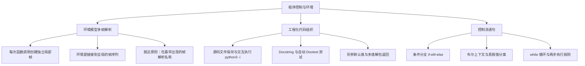

> **英文原课**：CS 61A: Structure and Interpretation of Computer Programs (Fall 2024)  
> **主讲教师**：Prof. John DeNero (UC Berkeley)  
> **图文整理**：VideoBook 视频转图文技术电子书流水线  
> **全书体量**：已收录 37 / 37 讲 ｜ 18.2 小时音视频讲义 ｜ 577 张高清板书截图  
> **在线目录**：[CS61A 专题目录](/notes/topics/CS61A)

---


> **主讲**：John DeNero ｜ **时长**：32:21 ｜ **视频回链**：[B 站对应单集 (P3)](https://www.bilibili.com/video/BV1sy411z7nA/?p=3)

## 1. 用户自定义函数回顾与要素拆解

*(参考时间：00:00:02 · [视频跳转 (P3 00:00:02)](https://www.bilibili.com/video/BV1sy411z7nA/?p=3&t=2))*

在深入控制流之前，DeNero 教授首先带领我们复盘了自定义函数（User-Defined Functions）的语法与运行期本质。

一个完整的函数定义是一条**复合语句（Compound Statement）**，称为 `def` 语句：

```python
def square(x):
    return mul(x, x)
```

这条语句横跨多行，具有严格的结构分工：
1. **函数名称（Name）**：`def` 关键字后紧随的名字（如 `square`）。
2. **形式参数（Formal Parameters）**：圆括号内的标识符列表（如 `x`）。如果包含多个输入，以逗号分隔；它们将在函数调用时充当实参值的占位名。
3. **函数体（Body）**：首行后所有缩进的语句集合。它决定了函数被调用时实际执行的操作序列。
4. **返回表达式（Return Expression）**：`return` 关键字后面的表达式（如 `mul(x, x)`），其求值结果将作为整个调用表达式的值。


*⏱ 时间戳：00:00:45 · 📷 课堂截图 · [在 B 站观看对应片段 (P3 00:00:45)](https://www.bilibili.com/video/BV1sy411z7nA/?p=3&t=45)*

> **核心机制**：执行 `def` 语句时，Python 仅创建函数对象，并在**当前帧**中把名称 `square` 绑定到该函数上。此时**绝对不会执行函数体内的代码**，乘法运算尚未发生！

只有当遇到**调用表达式（Call Expression）**（例如 `square(2 + 2)`）时，函数才被激活。调用包含三个关键要素：
- **运算符（Operator）**：`square`，其在当前环境中求值为刚定义的函数。
- **操作数（Operand）**：括号内的表达式 `2 + 2`，求值得到实参（Argument）`4`。
- **调用过程**：开辟一个独立的新帧，将形参 `x` 绑定到实参 `4`，随后在该新环境中执行函数体，计算 `4 * 4` 返回 `16`。


*⏱ 时间戳：00:02:40 · 📷 课堂截图 · [在 B 站观看对应片段 (P3 00:02:40)](https://www.bilibili.com/video/BV1sy411z7nA/?p=3&t=160)*

---

## 2. 多帧环境模型与名称查找规则

*(参考时间：00:03:06 · [视频跳转 (P3 00:03:06)](https://www.bilibili.com/video/BV1sy411z7nA/?p=3&t=186))*

在上一讲中，环境通常只有一个全局帧（Global Frame）。一旦引入函数的嵌套调用，Python 解释器就必须管理**多个帧组成的链式环境**。

以嵌套调用 `square(square(3))` 为例：

```python
from operator import mul

def square(x):
    return mul(x, x)

square(square(3))
```

### 嵌套调用的求值时序

1. **外层调用准备**：运算符 `square` 求值为平方函数；操作数是子调用 `square(3)`，必须先求其值。
2. **第一层函数调用（Frame F1）**：
   - 创建新帧 `F1`，父环境（Parent）为 `Global`。
   - 绑定形参：`x: 3`。
   - 在包含 `F1` 的环境中执行函数体：查找 `mul`（在 `Global` 帧中找到）和 `x`（在 `F1` 中找到），计算 `mul(3, 3) -> 9`。
   - `F1` 返回 `9`。
3. **第二层函数调用（Frame F2）**：
   - 此时外层调用的操作数已得到值 `9`。
   - 再次调用 `square`，创建全新的独立帧 `F2`，父环境同样为 `Global`。
   - 绑定形参：`x: 9`。
   - 在包含 `F2` 的环境中执行函数体：计算 `mul(9, 9) -> 81`。
   - `F2` 返回 `81`。


*⏱ 时间戳：00:04:45 · 📷 课堂截图 · [在 B 站观看对应片段 (P3 00:04:45)](https://www.bilibili.com/video/BV1sy411z7nA/?p=3&t=285)*

### 环境（Environment）的精确定义

> **环境（Environment）**：一个**由相互链接的帧组成的有序序列**。

在上述图解中：
- 存在唯一的 `square` 函数对象，但由于调用了两次，产生了两个不同的局部帧 `F1` 和 `F2`。
- 整个程序中一共有三个不同的环境：
  1. 仅包含 `Global` 帧的环境。
  2. 由 `F1` 引导、紧随 `Global` 帧的环境 `[F1 -> Global]`。
  3. 由 `F2` 引导、紧随 `Global` 帧的环境 `[F2 -> Global]`。
- **没有任何一个环境同时包含 F1 和 F2**！每个函数调用都在其专属的局部环境中独立运行。

### 名称求值的黄金法则（Earliest Frame Rule）

> **规则**：一个名称在当前环境中的求值结果，等于在当前环境的帧序列中**最早出现该名称的帧**中的绑定值。


*⏱ 时间戳：00:07:30 · 📷 课堂截图 · [在 B 站观看对应片段 (P3 00:07:30)](https://www.bilibili.com/video/BV1sy411z7nA/?p=3&t=450)*

当执行 `F2` 内部的 `mul(x, x)` 时：
- 查找 `x`：首先在首帧 `F2` 中检查，找到 `x = 9`，查找立即停止。
- 查找 `mul`：首先在首帧 `F2` 中检查，未找到；顺着父指针进入下一帧 `Global`，找到 `mul` 绑定的内置乘法函数。

### 形参遮蔽陷阱（Name Shadowing）

如果有人故意将形参命名为与函数相同的名字，会发生什么？

```python
def square(square):
    return mul(square, square)

square(4)
```

当我们调用 `square(4)` 时，得到的结果仍然是 `16`：
- 在全局帧中，`square` 绑定到该函数对象。
- 在局部帧 `F1` 中，形参 `square` 被绑定到传入的值 `4`。
- 函数体执行 `mul(square, square)` 时，当前环境为 `[F1 -> Global]`。
- 根据就近原则，局部帧 `F1` 中存在 `square`，取值为 `4`。因此计算的是 `mul(4, 4)`，得到 `16`。全局的函数名被局部的变量名**遮蔽（Shadowed）**了。


*⏱ 时间戳：00:08:48 · 📷 课堂截图 · [在 B 站观看对应片段 (P3 00:08:48)](https://www.bilibili.com/video/BV1sy411z7nA/?p=3&t=528)*

---

## 3. 运算符底层语义、整除与多值返回

*(参考时间：00:10:05 · [视频跳转 (P3 00:10:05)](https://www.bilibili.com/video/BV1sy411z7nA/?p=3&t=605))*

### 运算符与内置函数的对应关系

中缀运算符（如 `+`、`*`）遵循标准运算优先级，但在本质上均可对应到内置函数调用：

```python
from operator import add, mul

2 + 3 * 4 + 5  # 等价于 add(add(2, mul(3, 4)), 5)
(2 + 3) * (4 + 5)  # 等价于 mul(add(2, 3), add(4, 5))
```

### 两种除法与数字拆分技巧

计算机科学中经常需要对整数进行精确离散拆解：
1. **真除法（True Division, `/`）**：对应 `operator.truediv`，产生浮点数近似值。如 `2013 / 10 -> 201.3`，`5 / 3 -> 1.6666666666666667`。
2. **地板除/整除（Floor Division, `//`）**：对应 `operator.floordiv`，舍弃小数位向下取整。`2013 // 10 -> 201`。
3. **取模运算（Modulo, `%`）**：对应 `operator.mod`，求整除后的余数。`2013 % 10 -> 3`。

整除与取模是完全**精确无精度丢失的**，常用于数字拆分（如提取十进制最低位与剥除最低位）。


*⏱ 时间戳：00:12:35 · 📷 课堂截图 · [在 B 站观看对应片段 (P3 00:12:35)](https://www.bilibili.com/video/BV1sy411z7nA/?p=3&t=755)*

### 多重赋值与函数多值返回

Python 允许一条赋值语句同时为多个名称绑定值，同样支持函数一次性返回多个结果：

```python
def divide_exact(n, d):
    return n // d, n % d

quotient, remainder = divide_exact(2013, 10)
# quotient 绑定为 201，remainder 绑定为 3
```


*⏱ 时间戳：00:14:15 · 📷 课堂截图 · [在 B 站观看对应片段 (P3 00:14:15)](https://www.bilibili.com/video/BV1sy411z7nA/?p=3&t=855)*

---

## 4. 永久代码组织：源码文件、交互运行与 Doctest

*(参考时间：00:14:44 · [视频跳转 (P3 00:14:44)](https://www.bilibili.com/video/BV1sy411z7nA/?p=3&t=884))*

在终端的交互式解释器中编写代码适合快速探索，但要构建长期持久的软件，必须编写在 `.py` 源代码文件中。

### 编写与运行源文件

在 `ex.py` 文件中写入代码：

```python
from operator import floordiv, mod

def divide_exact(n, d=10):
    """返回 n 除以 d 的商和余数。

    >>> q, r = divide_exact(2013, 10)
    >>> q
    201
    >>> r
    3
    """
    return floordiv(n, d), mod(n, d)
```

在终端运行方式有两种：
1. **直接批处理执行**：`python3 ex.py`（若无 `print` 语句，终端将没有任何可见输出）。
2. **交互式载入模式（推荐）**：`python3 -i ex.py`。
   - 先执行整个文件中的所有定义，然后停留在交互提示符 `>>>`，供开发者直接调用与检查变量。


*⏱ 时间戳：00:16:30 · 📷 课堂截图 · [在 B 站观看对应片段 (P3 00:16:30)](https://www.bilibili.com/video/BV1sy411z7nA/?p=3&t=990)*

### 文档字符串（Docstring）与文档测试（Doctest）

高质量函数必须提供说明与测试用例。紧跟在 `def` 声明下方的三引号字符串即为 **Docstring**。

在 Docstring 中可以插入类似交互解释器的会话范例，Python 内置的 `doctest` 模块能够直接提取并执行这些用例进行自动化测试：

```bash
# 静默验证：若所有测试通过，则不输出任何信息
python3 -m doctest ex.py

# 详细模式（Verbose）：打印每一步执行与通过状态
python3 -m doctest -v ex.py
```


*⏱ 时间戳：00:18:40 · 📷 课堂截图 · [在 B 站观看对应片段 (P3 00:18:40)](https://www.bilibili.com/video/BV1sy411z7nA/?p=3&t=1120)*

### 形参默认值（Default Arguments）

定义形参时可指定默认值。当调用方省略该实参时，默认值自动生效：

```python
# 当未传入 d 时，默认 d 为 10
q, r = divide_exact(2013)  # q = 201, r = 3
```


*⏱ 时间戳：00:20:45 · 📷 课堂截图 · [在 B 站观看对应片段 (P3 00:20:45)](https://www.bilibili.com/video/BV1sy411z7nA/?p=3&t=1245)*

---

## 5. 复合语句架构与条件分支（if-elif-else）

*(参考时间：00:21:23 · [视频跳转 (P3 00:21:23)](https://www.bilibili.com/video/BV1sy411z7nA/?p=3&t=1283))*

### 复合语句（Compound Statement）的解剖学

Python 的语句体系分为简单语句（如赋值、`return`）与复合语句。复合语句具有统一的结构特征：

```text
Header 1:
    Suite 1 (一组缩进语句)
Header 2:
    Suite 2
```

- **子句（Clause）**：包含一个头部（Header）及其管控的一组缩进语句块（Suite）。
- 首个 Header 决定了整个语句的类别（如 `def`、`if`、`while`）。
- **Suite 的执行规则**：依次顺序执行其中的每条语句，除非遇到控制跳转（如 `return`、`break`）。


*⏱ 时间戳：00:22:20 · 📷 课堂截图 · [在 B 站观看对应片段 (P3 00:22:20)](https://www.bilibili.com/video/BV1sy411z7nA/?p=3&t=1340)*

### 条件语句（Conditional Statements）

条件语句使程序具备根据不同情况走不同分支的能力。以自定义绝对值函数为例：

```python
def absolute_value(x):
    """返回 x 的绝对值。"""
    if x < 0:
        return -x
    elif x == 0:
        return 0
    else:
        return x
```

### 条件语句的执行铁律

1. 从上到下依次考察每个子句。
2. 对当前子句 Header 中的布尔表达式求值。
3. **一旦某个表达式求值为真值（True Value）**：
   - 立即执行该子句对应的 Suite。
   - **完全跳过**后续所有剩下的子句（无论是 `elif` 还是 `else`）！
4. 任何一次执行中，**最多只有一个 Suite 会被激活执行**。


*⏱ 时间戳：00:24:40 · 📷 课堂截图 · [在 B 站观看对应片段 (P3 00:24:40)](https://www.bilibili.com/video/BV1sy411z7nA/?p=3&t=1480)*

---

## 6. 布尔上下文与真值判定（George Boole 的逻辑视界）

*(参考时间：00:25:40 · [视频跳转 (P3 00:25:40)](https://www.bilibili.com/video/BV1sy411z7nA/?p=3&t=1540))*

计算机科学奠基人之一乔治·布尔（George Boole）开创了逻辑代数。Python 代码中凡是需要判断真假的位置，统称为**布尔上下文（Boolean Context）**。

在 `if x < 0:` 或 `elif x == 0:` 中，头部表达式的值处于布尔上下文中。这里不仅能写简单的比较表达式，任何 Python 对象都可以求值！


*⏱ 时间戳：00:26:40 · 📷 课堂截图 · [在 B 站观看对应片段 (P3 00:26:40)](https://www.bilibili.com/video/BV1sy411z7nA/?p=3&t=1600)*

### Python 中的真值与假值规则

- **假值（False Values）**：
  - `False`（布尔假）
  - `0`（数字零）
  - `""`（空字符串）
  - `None`（空对象）
- **真值（True Values）**：
  - 除上述假值以外的**所有其他任何值**（包括非零整数、非空字符串、函数对象等）均为真值！

---

## 7. 迭代与 while 循环执行机制

*(参考时间：00:27:48 · [视频跳转 (P3 00:27:48)](https://www.bilibili.com/video/BV1sy411z7nA/?p=3&t=1668))*

计算机的核心威力在于高速重复执行。`while` 循环语句是 Python 中最基础的迭代控制结构。

以下示例使用 `while` 循环计算 $1 + 2 + 3 = 6$：

```python
i = 0
total = 0
while i < 3:
    i = i + 1
    total = total + i
```


*⏱ 时间戳：00:29:30 · 📷 课堂截图 · [在 B 站观看对应片段 (P3 00:29:30)](https://www.bilibili.com/video/BV1sy411z7nA/?p=3&t=1770)*

### while 循环执行的两步法定则

1. **第一步（求值头部条件）**：对 Header 中的表达式（处于布尔上下文）求值。
   - 如果为**假值**，循环终止，继续执行循环体之后的代码。
   - 如果为**真值**，进入第二步。
2. **第二步（执行完整 Suite）**：从头到尾完整执行 Suite 内的所有语句。执行完毕后，**无条件返回第一步**重新评估头部条件。

### 循环执行跟踪表（Trace Table）

理解循环的关键在于掌握每一轮迭代中变量状态的变化：

| 迭代轮次 | 判定前 i | 头部表达式 `i < 3` | 进入循环执行 `i = i + 1` | 执行 `total = total + i` | 轮次结束状态 |
| :---: | :---: | :---: | :---: | :---: | :---: |
| **初始** | `0` | — | — | — | `i=0, total=0` |
| **Round 1** | `0` | `0 < 3 -> True` | `i = 1` | `total = 0 + 1 = 1` | `i=1, total=1` |
| **Round 2** | `1` | `1 < 3 -> True` | `i = 2` | `total = 1 + 2 = 3` | `i=2, total=3` |
| **Round 3** | `2` | `2 < 3 -> True` | `i = 3` | `total = 3 + 3 = 6` | `i=3, total=6` |
| **退出判定** | `3` | `3 < 3 -> False` | *跳过 Suite，循环结束* | *跳过 Suite，循环结束* | **最终结果：i=3, total=6** |


*⏱ 时间戳：00:31:30 · 📷 课堂截图 · [在 B 站观看对应片段 (P3 00:31:30)](https://www.bilibili.com/video/BV1sy411z7nA/?p=3&t=1890)*

> **极其重要的心智模型**：在 Round 3 执行完 `i = i + 1` 后，`i` 已经变成了 `3`。但此时 Python **绝不会中途停下来去检查条件**，而是必须把整个 Suite 彻底执行完毕（即把 `total` 加成 `6`），回到第一步时才发现条件为假并退出。

---

## 8. 本讲小结与核心思维导图



在本讲中，我们完成了从“纯计算表达式”到“图灵完备控制流”的跨越：
1. **环境模型**为我们提供了精准预测多函数调用和嵌套执行的 X 光透视能力。
2. **源码组织与 Doctest** 确立了工业级 Python 开发的基础实践规范。
3. **条件分支与 while 循环** 赋予了代码根据数据决策并进行规模化迭代运算的核心能力。

---

