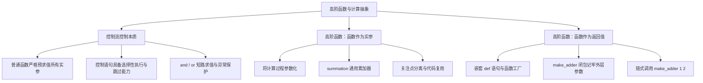

> **英文原课**：CS 61A: Structure and Interpretation of Computer Programs (Fall 2024)  
> **主讲教师**：Prof. John DeNero (UC Berkeley)  
> **图文整理**：VideoBook 视频转图文技术电子书流水线  
> **全书体量**：已收录 37 / 37 讲 ｜ 18.2 小时音视频讲义 ｜ 577 张高清板书截图  
> **在线目录**：[CS61A 专题目录](/notes/topics/CS61A)

---


> **主讲**：John DeNero ｜ **时长**：42:53 ｜ **视频回链**：[B 站对应单集 (P4)](https://www.bilibili.com/video/BV1sy411z7nA/?p=4)

## 1. 经典迭代案例：斐波那契数列（Fibonacci Sequence）

*(参考时间：00:01:25 · [视频跳转 (P4 00:01:25)](https://www.bilibili.com/video/BV1sy411z7nA/?p=4&t=85))*

为了掌握循环控制的心智模型，DeNero 教授以著名的斐波那契数列为例展开迭代算法设计。

斐波那契数列由 $0$ 和 $1$ 开始，后续每一项都是前两项之和：
$$0, 1, 1, 2, 3, 5, 8, 13, 21, 34, 55, \dots$$

按惯例，我们将第 $0$ 个斐波那契数记为 $\text{Fib}(0) = 0$，第 $1$ 个记为 $\text{Fib}(1) = 1$，第 $5$ 个即为 $\text{Fib}(5) = 5$。斐波那契数列与几何中的黄金螺旋（Golden Spiral）密切相连：用边长为斐波那契数的正方形拼在一起，连接交点即可得到自然界中常见的对数螺旋。


*⏱ 时间戳：00:01:50 · 📷 课堂截图 · [在 B 站观看对应片段 (P4 00:01:50)](https://www.bilibili.com/video/BV1sy411z7nA/?p=4&t=110)*

### 迭代函数设计要诀：状态变量的选取

设计一个迭代函数的关键，在于明确**需要跟踪哪些状态信息**：
- 前一项数值：`pred`（Predecessor）
- 当前项数值：`cur`（Current）
- 当前项对应的索引：`k`
- 目标项索引：`n`

```python
def fib(n):
    """计算第 n 个斐波那契数，其中 n >= 1。"""
    pred, cur = 0, 1
    k = 1
    while k < n:
        pred, cur = cur, pred + cur
        k = k + 1
    return cur
```


*⏱ 时间戳：00:04:15 · 📷 课堂截图 · [在 B 站观看对应片段 (P4 00:04:15)](https://www.bilibili.com/video/BV1sy411z7nA/?p=4&t=255)*

在环境图中，调用 `fib(5)` 会在局部帧中维护这组变量。注意多重赋值语句 `pred, cur = cur, pred + cur` 的威力：
1. **右侧表达式先同时求值**：计算 `cur` 的当前值，以及 `pred + cur` 的和。
2. **左侧名称再同时绑定**：这保证了计算下一项时，使用的仍然是未被覆盖的前项原值！

| 循环轮次 | k | pred | cur | 判定条件 `k < 5` |
| :---: | :---: | :---: | :---: | :---: |
| 初始状态 | 1 | 0 | 1 | `1 < 5 -> True` |
| Round 1 结束 | 2 | 1 | 1 | `2 < 5 -> True` |
| Round 2 结束 | 3 | 1 | 2 | `3 < 5 -> True` |
| Round 3 结束 | 4 | 2 | 3 | `4 < 5 -> True` |
| Round 4 结束 | 5 | 3 | 5 | `5 < 5 -> False`（退出循环） |

最终返回 `cur = 5`，正确得到第 5 个斐波那契数。


*⏱ 时间戳：00:06:50 · 📷 课堂截图 · [在 B 站观看对应片段 (P4 00:06:50)](https://www.bilibili.com/video/BV1sy411z7nA/?p=4&t=410)*

### 课堂思考：初始条件的精妙改写

如果将初始条件改为 `pred, cur = 1, 0`，`k = 0`，算法是否依然正确？

```python
def fib_alt(n):
    pred, cur = 1, 0
    k = 0
    while k < n:
        pred, cur = cur, pred + cur
        k = k + 1
    return cur
```

> **结论**：这一改动不仅同样正确，而且**表现更优**！
> - 当输入 `n = 0` 时，旧版本因 `n >= 1` 限制无法处理；新版本中 `k < n`（即 `0 < 0`）为假，循环直接跳过，返回 `cur = 0`，完美支持了 $\text{Fib}(0) = 0$ 的边界情况。
> - 当 `n = 5` 时，循环体执行 5 次，序列推进为 `0 -> 1 -> 1 -> 2 -> 3 -> 5`，最终同样得到 `5`。


*⏱ 时间戳：00:07:45 · 📷 课堂截图 · [在 B 站观看对应片段 (P4 00:07:45)](https://www.bilibili.com/video/BV1sy411z7nA/?p=4&t=465)*

---

## 2. 为什么需要控制语句？调用表达式与控制语句的本质分歧

*(参考时间：00:09:12 · [视频跳转 (P4 00:09:12)](https://www.bilibili.com/video/BV1sy411z7nA/?p=4&t=552))*

既然 Python 拥有强大的函数机制，我们能否写一个普通的函数 `if_(condition, true_result, false_result)`，从而彻底废除 `if` 语法关键字？


*⏱ 时间戳：00:09:40 · 📷 课堂截图 · [在 B 站观看对应片段 (P4 00:09:40)](https://www.bilibili.com/video/BV1sy411z7nA/?p=4&t=580)*

### 思想实验：尝试实现自定义 if_ 函数

```python
def if_(c, t, f):
    if c:
        return t
    else:
        return f
```

现在我们尝试用 `if_` 来编写一个计算非负实数平方根的函数 `real_sqrt(x)`。对于负数，其实数平方根部分定义为 `0`：

```python
from math import sqrt

# 标准 if 语句版本：工作完全正常
def real_sqrt_statement(x):
    if x >= 0:
        return sqrt(x)
    else:
        return 0

# 尝试用 if_ 函数替代：
def real_sqrt_call(x):
    return if_(x >= 0, sqrt(x), 0)
```

当我们测试 `real_sqrt_call(-16)` 时，程序崩溃了：
```text
ValueError: math domain error
```


*⏱ 时间戳：00:11:30 · 📷 课堂截图 · [在 B 站观看对应片段 (P4 00:11:30)](https://www.bilibili.com/video/BV1sy411z7nA/?p=4&t=690)*

### 失败根源：调用表达式求值规则与控制语句的冲突

> **调用表达式求值规则（严格求值）**：
> 在调用任何函数之前，**必须首先对运算符及所有操作数子表达式完成求值**，然后才将实参传入函数体！

在 `if_(x >= 0, sqrt(x), 0)` 中：
1. 解释器试图求出三个实参的值。
2. 当求值第二个实参 `sqrt(-16)` 时，Python 立即抛出数学域错误！
3. 函数 `if_` 内部的逻辑**甚至根本还没来得及运行**！

> **控制语句的存在意义**：控制语句（如 `if`、`while`）的核心能力在于**选择性执行**与**跳过执行**。条件不满足的分支，其代码永远不会被执行。函数调用无法实现这一点，因此编程语言必须保留控制语句。


*⏱ 时间戳：00:14:40 · 📷 课堂截图 · [在 B 站观看对应片段 (P4 00:14:40)](https://www.bilibili.com/video/BV1sy411z7nA/?p=4&t=880)*

---

## 3. 表达式级别的控制：布尔运算符的短路求值（Short-Circuiting）

*(参考时间：00:15:37 · [视频跳转 (P4 00:15:37)](https://www.bilibili.com/video/BV1sy411z7nA/?p=4&t=937))*

虽然普通函数无法跳过参数求值，但 Python 中的逻辑运算符 `and` 和 `or` 属于语言内核级别的特殊表达式，具备**短路求值（Short-Circuit Evaluation）**特性：


*⏱ 时间戳：00:16:30 · 📷 课堂截图 · [在 B 站观看对应片段 (P4 00:16:30)](https://www.bilibili.com/video/BV1sy411z7nA/?p=4&t=990)*

### and 的执行规则

对于表达式 `<left> and <right>`：
1. 先对 `<left>` 求值。
2. 若 `<left>` 为假值，**立即以该假值作为整个表达式的结果**，彻底跳过 `<right>` 的求值！
3. 若 `<left>` 为真值，则对 `<right>` 求值，并以 `<right>` 的值作为整个表达式的结果。

### or 的执行规则

对于表达式 `<left> or <right>`：
1. 先对 `<left>` 求值。
2. 若 `<left>` 为真值，**立即以该真值作为整个表达式的结果**，彻底跳过 `<right>` 的求值！
3. 若 `<left>` 为假值，则对 `<right>` 求值，并以 `<right>` 的值作为整个表达式的结果。

### 短路求值的防御性工程应用

利用短路特性，我们可以编写安全的保护性表达式，防止程序因非法输入而崩溃：

```python
# 案例 1：防止 math.sqrt 传入负数
def has_big_sqrt(x):
    return x >= 0 and sqrt(x) > 10

# 案例 2：防止除以零错误（ZeroDivisionError）
def is_reasonable(n):
    return n == 0 or (1 / n != 0)
```

当 `has_big_sqrt(-1000)` 执行时，`x >= 0` 求值为 `False`，`and` 立即停止求值并返回 `False`，右侧的 `sqrt(-1000)` 被完全跳过，成功避免了异常！


*⏱ 时间戳：00:18:20 · 📷 课堂截图 · [在 B 站观看对应片段 (P4 00:18:20)](https://www.bilibili.com/video/BV1sy411z7nA/?p=4&t=1100)*

---

## 4. 高阶函数与第一重抽象：形参化数值常数

*(参考时间：00:20:52 · [视频跳转 (P4 00:20:52)](https://www.bilibili.com/video/BV1sy411z7nA/?p=4&t=1252))*

编写清晰程序的原则之一是**不重复自己（DRY: Don't Repeat Yourself）**。如果多个函数共享相似的结构，我们应当提炼公共模式。

考察三种几何图形的面积计算：
- 正方形（边长 $r$）：$\text{Area} = 1 \times r^2$
- 圆形（半径 $r$）：$\text{Area} = \pi \times r^2$
- 正六边形（边长 $r$）：$\text{Area} = \left(\frac{3\sqrt{3}}{2}\right) \times r^2$


*⏱ 时间戳：00:21:45 · 📷 课堂截图 · [在 B 站观看对应片段 (P4 00:21:45)](https://www.bilibili.com/video/BV1sy411z7nA/?p=4&t=1305)*

这三个公式共享相同的计算结构：$r^2 \times \text{Shape Constant}$，且都要求边长 $r > 0$（可用 `assert` 断言加以约束）。

通过把特定的几何常数作为参数传入，我们可以构造一个统一通用的 `area` 函数：

```python
from math import pi, sqrt

def area(r, shape_constant):
    assert r > 0, "A length must be positive"
    return r * r * shape_constant

def area_square(r):
    return area(r, 1)

def area_circle(r):
    return area(r, pi)

def area_hexagon(r):
    return area(r, 3 * sqrt(3) / 2)
```


*⏱ 时间戳：00:25:30 · 📷 课堂截图 · [在 B 站观看对应片段 (P4 00:25:30)](https://www.bilibili.com/video/BV1sy411z7nA/?p=4&t=1530)*

---

## 5. 第二重抽象：高阶函数（函数作为形参）

*(参考时间：00:27:00 · [视频跳转 (P4 00:27:00)](https://www.bilibili.com/video/BV1sy411z7nA/?p=4&t=1620))*

如果相似函数之间的差异不仅仅是一个常数，而是**一整个计算过程**，该如何抽象？

考察数学中常见的三个累加级数：
1. **自然数求和**：$\sum_{k=1}^n k = 1 + 2 + \dots + n$
2. **立方和**：$\sum_{k=1}^n k^3 = 1^3 + 2^3 + \dots + n^3$
3. **莱布尼茨 $\pi$ 级数**：$\sum_{k=1}^n \frac{8}{(4k-3)(4k-1)} \approx \pi$


*⏱ 时间戳：00:27:30 · 📷 课堂截图 · [在 B 站观看对应片段 (P4 00:27:30)](https://www.bilibili.com/video/BV1sy411z7nA/?p=4&t=1650)*

这三个函数在迭代累加的骨架上完全一致：都从第 1 项加到第 $n$ 项。唯一的区别在于：**如何根据项索引 $k$ 计算出具体项的值**。

### 通用求和高阶函数：summation

我们可以定义一个高阶函数 `summation`，它接受一个额外的参数 `term`——**而 `term` 本身是一个函数**！

```python
def summation(n, term):
    """累加前 n 项，每一项由函数 term(k) 给出。

    >>> summation(5, cube)
    225
    """
    total, k = 0, 1
    while k <= n:
        total, k = total + term(k), k + 1
    return total

def identity(x):
    return x

def cube(x):
    return x ** 3

def sum_naturals(n):
    return summation(n, identity)

def sum_cubes(n):
    return summation(n, cube)
```


*⏱ 时间戳：00:32:30 · 📷 课堂截图 · [在 B 站观看对应片段 (P4 00:32:30)](https://www.bilibili.com/video/BV1sy411z7nA/?p=4&t=1950)*

### 什么是高阶函数（Higher-Order Function）？

> **定义**：**接受另一个函数作为实参**，或者**将函数作为返回值返回**的函数，称为高阶函数。

在 `summation(5, cube)` 中：
- `cube` 是一个函数对象，作为实参传递给 `summation` 的形参 `term`。
- 在循环体中，`term(k)` 动态调用传入的 `cube` 函数，计算出项的值。

我们还可以用它轻松逼近 $\pi$：

```python
def pi_term(k):
    return 8 / ((4 * k - 3) * * (4 * k - 1))

summation(1000000, pi_term)  # 逼近 3.141592...
```


*⏱ 时间戳：00:35:40 · 📷 课堂截图 · [在 B 站观看对应片段 (P4 00:35:40)](https://www.bilibili.com/video/BV1sy411z7nA/?p=4&t=2140)*

---

## 6. 函数作为返回值：工厂模式与柯里化（Currying）雏形

*(参考时间：00:37:00 · [视频跳转 (P4 00:37:00)](https://www.bilibili.com/video/BV1sy411z7nA/?p=4&t=2220))*

高阶函数的第二项超能力在于：**在运行期动态制造并返回全新函数**。

以加法器工厂 `make_adder` 为例：

```python
def make_adder(n):
    """返回一个将参数与 n 相加的函数。

    >>> add_three = make_adder(3)
    >>> add_three(4)
    7
    """
    def adder(k):
        return k + n
    return adder
```


*⏱ 时间戳：00:37:40 · 📷 课堂截图 · [在 B 站观看对应片段 (P4 00:37:40)](https://www.bilibili.com/video/BV1sy411z7nA/?p=4&t=2260)*

### 嵌套 def 语句与词法作用域初探

1. `make_adder` 内部包含了一个局部的 `def adder(k)` 语句。
2. 内部函数 `adder` 的函数体中引用了两个名字：形参 `k` 和外部函数的形参 `n`。
3. 当执行 `add_three = make_adder(3)` 时：
   - 创建了 `make_adder` 的局部帧，其中 `n = 3`。
   - 执行内部的 `def`，创建了一个专属的加法函数，**它牢牢记住了 n 的值为 3**！
   - `make_adder` 将这个刚刚打造出来的函数作为值返回，绑定到全局的 `add_three`。
4. 后续调用 `add_three(4)` 时，内部计算 `4 + 3`，得到 `7`。

### 嵌套调用链的直接求值：make_adder(1)(2)

我们甚至可以无需中间变量，直接链式调用：

```python
make_adder(1)(2)  # 求值得到 3
```

根据调用表达式的严格法则：
- `make_adder(1)` 是外层调用的运算符，求值得到内部的 `adder` 函数（其中 `n=1`）。
- 该函数随后立即作用于操作数 `2`，计算 `2 + 1` 返回 `3`。


*⏱ 时间戳：00:40:20 · 📷 课堂截图 · [在 B 站观看对应片段 (P4 00:40:20)](https://www.bilibili.com/video/BV1sy411z7nA/?p=4&t=2420)*

---

## 7. 第一等公民与职责分离原则

*(参考时间：00:41:50 · [视频跳转 (P4 00:41:50)](https://www.bilibili.com/video/BV1sy411z7nA/?p=4&t=2510))*

在 Python 中，函数是**第一等公民（First-Class Citizens）**：
- 函数可以绑定到任意变量名；
- 函数可以作为实参传递给另一个函数；
- 函数可以作为另一个函数的返回值被输出；
- 函数可以像数字和字符串一样自由组合与嵌套。

### 高阶函数带来的架构优势

1. **表达通用的计算方法**：例如 `summation` 表达了纯粹的“累加模式”，而无需关心具体累加的是什么。
2. **彻底消灭代码重复**：累加循环的骨架逻辑在全项目中仅需编写一次。
3. **关注点分离（Separation of Concerns）**：每个函数只做好一件专门的事。通用求和只负责循环调度，`cube` 只负责求立方，两者解耦组合，构建出优雅健壮的软件系统。

---

## 8. 本讲小结与核心思维导图



---

