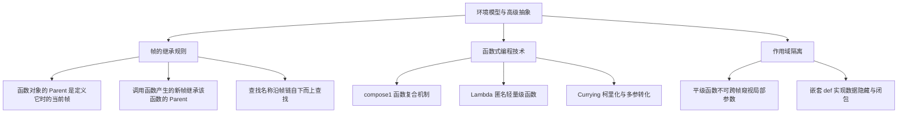

> **英文原课**：CS 61A: Structure and Interpretation of Computer Programs (Fall 2024)  
> **主讲教师**：Prof. John DeNero (UC Berkeley)  
> **图文整理**：VideoBook 视频转图文技术电子书流水线  
> **全书体量**：已收录 37 / 37 讲 ｜ 18.2 小时音视频讲义 ｜ 577 张高清板书截图  
> **在线目录**：[CS61A 专题目录](/notes/topics/CS61A)

---


> **主讲**：John DeNero ｜ **时长**：36:42 ｜ **视频回链**：[B 站对应单集 (P5)](https://www.bilibili.com/video/BV1sy411z7nA/?p=5)

## 1. 高阶函数在环境图中的行为

*(参考时间：00:01:48 · [视频跳转 (P5 00:01:48)](https://www.bilibili.com/video/BV1sy411z7nA/?p=5&t=108))*

在上一讲中，我们学习了高阶函数（Higher-Order Functions）的基本概念。许多初学者会问：引入高阶函数后，Python 解释器的底层规则是否变得更加复杂？

> **好消息**：我们在前几讲建立的环境图求值规则，**完全不需要做任何修改**，就能丝滑、精确地解释高阶函数的全部行为！环境图的存在，本就是为了彻底揭开高阶函数的运行黑盒。

考察接受函数作为参数的经典高阶函数 `apply_twice`：

```python
def apply_twice(f, x):
    return f(f(x))

def square(x):
    return x * x

result = apply_twice(square, 2)
```


*⏱ 时间戳：00:03:00 · 📷 课堂截图 · [在 B 站观看对应片段 (P5 00:03:00)](https://www.bilibili.com/video/BV1sy411z7nA/?p=5&t=180)*

### 调用时序与帧的逐级生成

执行 `apply_twice(square, 2)` 的具体步骤：
1. **全局帧准备**：定义 `apply_twice` 和 `square`，均保存在 `Global` 帧中。
2. **创建 F1 帧**：为 `apply_twice` 创建局部帧 `F1`。形参 `f` 绑定到全局的 `square` 函数对象，形参 `x` 绑定到整数 `2`。
3. **内层调用 `f(x)`**：
   - 在 `F1` 环境中查找 `f`，得到 `square` 函数。
   - 调用 `square(2)`，开辟独立帧 `F2`（父环境为 `Global`），形参 `x` 绑定为 `2`。
   - `F2` 返回 `4`。
4. **外层调用 `f(4)`**：
   - 再次调用 `square`，开辟全新独立帧 `F3`（父环境为 `Global`），形参 `x` 绑定为 `4`。
   - `F3` 返回 `16`。
5. `F1` 将最终计算结果 `16` 返回，并在全局绑定到 `result`。


*⏱ 时间戳：00:04:40 · 📷 课堂截图 · [在 B 站观看对应片段 (P5 00:04:40)](https://www.bilibili.com/video/BV1sy411z7nA/?p=5&t=280)*


*⏱ 时间戳：00:06:10 · 📷 课堂截图 · [在 B 站观看对应片段 (P5 00:06:10)](https://www.bilibili.com/video/BV1sy411z7nA/?p=5&t=370)*

---

## 2. 嵌套函数定义与父帧继承铁律

*(参考时间：00:07:00 · [视频跳转 (P5 00:07:00)](https://www.bilibili.com/video/BV1sy411z7nA/?p=5&t=420))*

当一个函数内部**嵌套定义**另一个函数时，环境模型展现出了其最迷人的机制。以加法器工厂 `make_adder` 为例：

```python
def make_adder(n):
    def adder(k):
        return k + n
    return adder

add_three = make_adder(3)
result = add_three(4)  # 得到 7
```


*⏱ 时间戳：00:08:40 · 📷 课堂截图 · [在 B 站观看对应片段 (P5 00:08:40)](https://www.bilibili.com/video/BV1sy411z7nA/?p=5&t=520)*

### 为什么 adder 能记住 n = 3？

追踪环境图的演变：
1. **调用 `make_adder(3)`**：
   - 创建局部帧 `F1 [make_adder]`，父帧为 `Global`。
   - 形参 `n` 绑定为 `3`。
2. **执行内部 `def adder(k)`**：
   - 此时当前活跃的帧是 `F1`。
   - 解释器创建一个新函数对象 `adder`，并把**当前帧 F1 标记为该函数的父帧（Parent: F1）**！
   - 将名称 `adder` 绑定到 `F1` 内部。
3. **返回函数对象**：
   - `return adder` 将这个携带了 `Parent: F1` 标记的函数返回给调用方。
   - 在全局帧中，变量名 `add_three` 绑定到该函数。


*⏱ 时间戳：00:10:45 · 📷 课堂截图 · [在 B 站观看对应片段 (P5 00:10:45)](https://www.bilibili.com/video/BV1sy411z7nA/?p=5&t=645)*

### 调用 add_three(4) 时的环境查找链

当我们在全局执行 `add_three(4)` 时：
1. 开辟新局部帧 `F2 [adder]`，形参 `k` 绑定为 `4`。
2. **关键步骤（父帧继承）**：因为被调用的 `adder` 函数对象的父帧是 `F1`，所以**新帧 F2 的父帧直接设定为 F1**！
3. 此时当前环境是一个包含 3 个帧的链条：
   $$\text{Current Environment} = [F2] \longrightarrow [F1] \longrightarrow [\text{Global}]$$
4. 执行 `return k + n`：
   - 查找 `k`：在第 1 帧 `F2` 中立即找到，值为 `4`。
   - 查找 `n`：在 `F2` 中找不到；沿着父指针进入第 2 帧 `F1`，找到 `n = 3`！
   - 计算 `4 + 3 = 7`，成功返回！


*⏱ 时间戳：00:12:50 · 📷 课堂截图 · [在 B 站观看对应片段 (P5 00:12:50)](https://www.bilibili.com/video/BV1sy411z7nA/?p=5&t=770)*

### 环境图绘制两大法则

> **法则一（定义函数时）**：
> 函数对象的 `Parent` 永远等于该函数**被定义时所处的当前帧（Current Frame）**。
>
> **法则二（调用函数时）**：
> 新创建的局部帧的 `Parent`，永远等于**被调用函数对象所记录的 Parent**。


*⏱ 时间戳：00:15:20 · 📷 课堂截图 · [在 B 站观看对应片段 (P5 00:15:20)](https://www.bilibili.com/video/BV1sy411z7nA/?p=5&t=920)*

---

## 3. 作用域陷阱：局部名称与平级函数无法跨帧访问

*(参考时间：00:16:22 · [视频跳转 (P5 00:16:22)](https://www.bilibili.com/video/BV1sy411z7nA/?p=5&t=982))*

初学者经常试图在平级定义的函数之间互相读取变量，例如：

```python
def f(x, y):
    return g(x)

def g(a):
    return a + y

f(1, 2)
```

执行这段代码会报错：`NameError: name 'y' is not defined`。


*⏱ 时间戳：00:17:40 · 📷 课堂截图 · [在 B 站观看对应片段 (P5 00:17:40)](https://www.bilibili.com/video/BV1sy411z7nA/?p=5&t=1060)*

### 为什么 g 找不到 y？

观察此时的环境链：
- `g` 是在全局作用域下定义的，因此 `g` 函数对象的父帧是 `Global`。
- 当在 `f` 内部调用 `g(x)` 时，为 `g` 创建的局部帧 `F2`，其父帧是 `Global`，而不是 `F1`！
- 此时 `g` 的环境链是 `[F2] -> [Global]`。
- 解释器先在 `F2` 找 `y`，没找到；再在 `Global` 找 `y`，依然没找到；**解释器绝不会横向跳进毫无亲缘关系的 F1 帧中去找 y**！
- 因此报错。这体现了函数形式参数的**局部作用域（Local Scope）**封闭性。

---

## 4. 经典案例：通用函数复合器（Function Composition）

*(参考时间：00:18:44 · [视频跳转 (P5 00:18:44)](https://www.bilibili.com/video/BV1sy411z7nA/?p=5&t=1124))*

在数学中，复合函数 $(f \circ g)(x) = f(g(x))$。我们在 Python 中可以编写一个完全通用的一阶复合器：

```python
def compose1(f, g):
    """返回一个新函数 h，使得 h(x) = f(g(x))。"""
    def h(x):
        return f(g(x))
    return h
```


*⏱ 时间戳：00:20:00 · 📷 课堂截图 · [在 B 站观看对应片段 (P5 00:20:00)](https://www.bilibili.com/video/BV1sy411z7nA/?p=5&t=1200)*

### 灵活组合基本算子

```python
def square(x):
    return x * x

def triple(x):
    return 3 * x

# 组合 1：先三倍再平方 -> (3 * x)^2
squipple = compose1(square, triple)
squipple(5)  # (3 * 5)^2 = 15^2 = 225

# 组合 2：先平方再三倍 -> 3 * (x^2)
tripere = compose1(triple, square)
tripere(5)   # 3 * (5^2) = 3 * 25 = 75

# 组合 3：复合高阶函数构造的闭包
squatter = compose1(square, make_adder(2))
squatter(3)  # (3 + 2)^2 = 5^2 = 25
```

我们可以将整个过程浓缩为一条极富表现力的复合调用表达式：
`compose1(square, make_adder(2))(3) -> 25`。


*⏱ 时间戳：00:22:20 · 📷 课堂截图 · [在 B 站观看对应片段 (P5 00:22:20)](https://www.bilibili.com/video/BV1sy411z7nA/?p=5&t=1340)*

---

## 5. Lambda 表达式：匿名函数与 Def 深度对比

*(参考时间：00:24:18 · [视频跳转 (P5 00:24:18)](https://www.bilibili.com/video/BV1sy411z7nA/?p=5&t=1458))*

在函数式编程中，很多辅助小函数（如 `triple` 或简单的项函数）只在某一处被使用一次。为此专门写一个 `def` 显得繁冗。Python 提供了 **Lambda 表达式（Lambda Expression）** 来现场定义匿名函数。

```python
# 传统 def 语句
def square(x):
    return x * x

# 等价的 lambda 表达式形式
square_lambda = lambda x: x * x
```


*⏱ 时间戳：00:25:50 · 📷 课堂截图 · [在 B 站观看对应片段 (P5 00:25:50)](https://www.bilibili.com/video/BV1sy411z7nA/?p=5&t=1550)*

### Lambda 表达式的语法特征

- 关键字 `lambda` 开启一个匿名函数。
- 冒号 `:` 左边为形参列表（如 `x`，多参用逗号隔开 `x, y`）。
- 冒号 `:` 右边是**单一返回表达式**。
- **注意**：Lambda 内部**禁止使用 `return` 关键字**，也不允许包含 `while`、`if` 等语句。表达式的值自动作为返回值。

### Lambda vs Def 大对决（Face-Off）

| 比较维度 | `lambda x: x * x` | `def square(x): return x * x` |
| :--- | :--- | :--- |
| **定义与本质** | 是一个**表达式（Expression）**，求值产出一个函数对象 | 是一条**复合语句（Statement）** |
| **内在名称 (Intrinsic Name)** | 无名字（显示为 `<function <lambda> at ...>`） | 拥有专属内在名称（显示为 `<function square at ...>`） |
| **名称绑定** | 必须由外部赋值语句绑定，或直接作为实参传入 | 执行语句时自动在当前帧完成名字绑定 |
| **支持结构** | 仅支持单个表达式，不支持语句块 | 支持任意多行语句块、分支、循环及异常处理 |
| **父帧 Parent** | 定义时所处的当前帧（规则完全一致） | 定义时所处的当前帧（规则完全一致） |


*⏱ 时间戳：00:28:50 · 📷 课堂截图 · [在 B 站观看对应片段 (P5 00:28:50)](https://www.bilibili.com/video/BV1sy411z7nA/?p=5&t=1730)*


*⏱ 时间戳：00:31:30 · 📷 课堂截图 · [在 B 站观看对应片段 (P5 00:31:30)](https://www.bilibili.com/video/BV1sy411z7nA/?p=5&t=1890)*

---

## 6. 函数柯里化（Currying）

*(参考时间：00:32:26 · [视频跳转 (P5 00:32:26)](https://www.bilibili.com/video/BV1sy411z7nA/?p=5&t=1946))*

在计算机科学中，**柯里化（Currying）** 是指把一个接收多个参数的函数，转化为一系列接收单一参数的高阶函数链的技术。

考察普通的双参加法函数与 `make_adder` 的对称性：
- 普通函数：`add(2, 3) -> 5`
- 柯里化形态：`make_adder(2)(3) -> 5`

我们可以编写一个元函数 `curry2`，把**任何接收两个参数的普通函数自动柯里化**：

```python
def curry2(f):
    """将双参函数 f 转换为单参高阶函数链。"""
    def g(x):
        def h(y):
            return f(x, y)
        return h
    return g
```

使用 `curry2`：
```python
from operator import add, mul

curried_add = curry2(add)
add_three = curried_add(3)
add_three(4)  # 得到 7

curried_mul = curry2(mul)
curried_mul(6)(7)  # 得到 42
```


*⏱ 时间戳：00:34:40 · 📷 课堂截图 · [在 B 站观看对应片段 (P5 00:34:40)](https://www.bilibili.com/video/BV1sy411z7nA/?p=5&t=2080)*

### 极简嵌套 Lambda 表达

利用 Lambda 表达式，`curry2` 可以写成一行极为精妙的代码：

```python
curry2 = lambda f: lambda x: lambda y: f(x, y)
```

> **历史趣闻**：该技术由逻辑学家摩西·申芬克尔（Moses Schönfinkel）于 1924 年首次提出，后由哈斯凯尔·柯里（Haskell Curry）发扬光大。虽然学术界称之为 Currying，但也有不少学者幽默地认为它应该被称为 **“Schönfinkeling”（申芬克尔化）**！


*⏱ 时间戳：00:36:30 · 📷 课堂截图 · [在 B 站观看对应片段 (P5 00:36:30)](https://www.bilibili.com/video/BV1sy411z7nA/?p=5&t=2190)*

---

## 7. 本讲小结与核心思维导图



---

