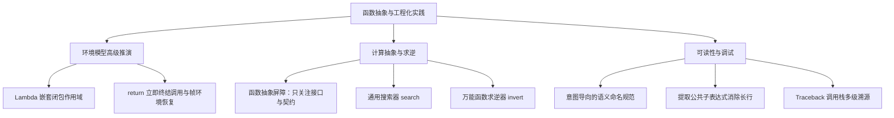

> **英文原课**：CS 61A: Structure and Interpretation of Computer Programs (Fall 2024)  
> **主讲教师**：Prof. John DeNero (UC Berkeley)  
> **图文整理**：VideoBook 视频转图文技术电子书流水线  
> **全书体量**：已收录 37 / 37 讲 ｜ 18.2 小时音视频讲义 ｜ 577 张高清板书截图  
> **在线目录**：[CS61A 专题目录](/notes/topics/CS61A)

---


> **主讲**：John DeNero ｜ **时长**：30:05 ｜ **视频回链**：[B 站对应单集 (P7)](https://www.bilibili.com/video/BV1sy411z7nA/?p=7)

## 1. 期中考试知识图谱与核心规范

*(参考时间：00:00:30 · [视频跳转 (P7 00:00:30)](https://www.bilibili.com/video/BV1sy411z7nA/?p=7&t=30))*

在进入本讲之前，DeNero 教授梳理了期中考试（Midterm 1）的考察范围与学习指南：
- **考察范围**：第 1 讲到第 5 讲的内容（表达式、控制流、函数定义与高阶环境模型）。
- **考试形式**：闭卷纸笔考试，提供官方精心整理的 Study Guide（覆盖所有语句的执行规则、内置函数与大型环境图综合样题）。
- **实战准备建议**：完成 Lab、Discussion、Homework 2 与 Hog 大作业的第一阶段（Phase 1），在此基础上独立完成一份往年真题。


*⏱ 时间戳：00:00:55 · 📷 课堂截图 · [在 B 站观看对应片段 (P7 00:00:55)](https://www.bilibili.com/video/BV1sy411z7nA/?p=7&t=55)*

---

## 2. 进阶环境图大挑战：嵌套 Lambda 与闭包作用域解析

*(参考时间：00:02:21 · [视频跳转 (P7 00:02:21)](https://www.bilibili.com/video/BV1sy411z7nA/?p=7&t=141))*

为了检验大家对环境模型的真正理解，DeNero 给出了一道极其经典且充满迷惑性的考题：

```python
a = 1

def f(g):
    a = 2
    return lambda y: a * g(y)

result = f(lambda y: a + y)(a)
```

这段代码执行完毕后，`result` 的值是多少？


*⏱ 时间戳：00:02:40 · 📷 课堂截图 · [在 B 站观看对应片段 (P7 00:02:40)](https://www.bilibili.com/video/BV1sy411z7nA/?p=7&t=160)*

### 静态词法分析（Lexical Analysis）

在动笔画图前，先通过缩进观察各个表达式在**何处被定义（何时被创建）**：
1. `lambda y: a + y`：位于第 6 行的最外层表达式中，**没有任何缩进**。因此它在全局帧中被创建，其父帧是 `Global`！它内部引用的 `a` 是全局变量 `a = 1`。
2. 调用实参 `(a)`：同样在最外层，因此传入的实参是全局的 `a = 1`。
3. `lambda y: a * g(y)`：位于 `f` 的函数体内部（第 4 行）。当 `f` 被调用时，当前活跃的局部帧是 `F1`（其中局部变量 `a = 2`），因此该匿名函数的父帧被盖章标记为 `F1`！它内部的 `a` 是局部变量 `a = 2`。


*⏱ 时间戳：00:05:00 · 📷 课堂截图 · [在 B 站观看对应片段 (P7 00:05:00)](https://www.bilibili.com/video/BV1sy411z7nA/?p=7&t=300)*

### 运行期环境图追踪（Step-by-Step）

1. **全局帧**：`a: 1`，`f: func f(g) [parent=Global]`。
2. **执行 `f(...)`**：
   - 先对实参 `lambda y: a + y` 求值，生成匿名函数对象 `λ1 [parent=Global]`。
   - 调用 `f(λ1)`，创建局部帧 `F1`。形参 `g` 绑定为 `λ1`。
   - 在 `F1` 中执行 `a = 2`（局部赋值，**绝不影响全局的 a=1**）。
   - 在 `F1` 中创建并返回另一个匿名函数 `λ2 [parent=F1]`。
3. **执行外层调用 `λ2(1)`**：
   - 为 `λ2` 创建局部帧 `F2`（父帧继承为 `F1`），形参 `y` 绑定为 `1`。
   - 执行函数体 `a * g(y)`：
     - 查找 `a`：在当前环境 `[F2 -> F1 -> Global]` 中，首帧 `F2` 无 `a`，进入父帧 `F1` 找到 `a = 2`。
     - 查找 `g`：在 `F1` 中找到 `g = λ1`。
     - 调用 `g(1)`：创建局部帧 `F3`。**注意：因为 λ1 的父帧是 Global，所以 F3 的父帧是 Global，而不是 F1 或 F2**！
     - 在 `F3` 的环境 `[F3 -> Global]` 中执行 `a + y`：`a` 来自 `Global`（值为 1），`y` 为 1，返回 `1 + 1 = 2`。
   - 回到 `F2`：计算 `a * g(y) = 2 * 2 = 4`。

最终，`result` 的值为 **`4`**！


*⏱ 时间戳：00:06:50 · 📷 课堂截图 · [在 B 站观看对应片段 (P7 00:06:50)](https://www.bilibili.com/video/BV1sy411z7nA/?p=7&t=410)*

---

## 3. Return 语句的执行法则与循环早期退出

*(参考时间：00:07:40 · [视频跳转 (P7 00:07:40)](https://www.bilibili.com/video/BV1sy411z7nA/?p=7&t=460))*

`return` 语句的核心职责是**结束当前函数调用，并向调用者交付结果**。

> **调用与返回的环境切换原理**：
> 当遇到调用表达式时，解释器切换到新创建的局部环境中执行函数体；一旦执行到 `return` 语句，解释器**立即销毁/冻结当前局部上下文，切换回调用发生时的外部环境**，并将返回表达式的值代入调用表达式所在位置。


*⏱ 时间戳：00:08:40 · 📷 课堂截图 · [在 B 站观看对应片段 (P7 00:08:40)](https://www.bilibili.com/video/BV1sy411z7nA/?p=7&t=520)*

### 经典技巧：在 while 循环中利用 return 提前中断

在编写搜索或数字处理函数时，我们常常需要一旦命中条件就立即跳出整个函数，而无需等待循环自然走完。

以从低位到高位打印整数数字、并在遇到指定数字 $d$ 时终止的函数为例：

```python
def end(n, d):
    """倒序打印 n 的各位数字，直到遇到 d 为止。

    >>> end(34567, 5)
    7
    6
    5
    """
    while n > 0:
        last, n = n % 10, n // 10
        print(last)
        if last == d:
            return None
```

只要 `last == d` 成立，`return None` 会立即终结整个 `end` 函数的执行，其后的循环迭代与代码块被完全跳过。


*⏱ 时间戳：00:10:00 · 📷 课堂截图 · [在 B 站观看对应片段 (P7 00:10:00)](https://www.bilibili.com/video/BV1sy411z7nA/?p=7&t=600)*

---

## 4. 高阶搜索器与自动函数求逆（Function Inversion）

*(参考时间：00:10:30 · [视频跳转 (P7 00:10:30)](https://www.bilibili.com/video/BV1sy411z7nA/?p=7&t=630))*

很多看似复杂的数学算法，其底层都是一种通用的搜索过程。我们可以定义一个通用的高阶搜索器 `search`：

```python
def search(f):
    """寻找使 f(x) 为真值的最小非负整数 x。"""
    x = 0
    while not f(x):
        x += 1
    return x
```


*⏱ 时间戳：00:11:30 · 📷 课堂截图 · [在 B 站观看对应片段 (P7 00:11:30)](https://www.bilibili.com/video/BV1sy411z7nA/?p=7&t=690)*

### 函数求逆通用算子：invert

在数学中，函数 $f$ 的反函数 $g = f^{-1}$ 满足 $g(y) = x \iff f(x) = y$。

利用高阶搜索器 `search`，我们只需 3 行代码就能构造一个**万能函数求逆器**：

```python
def invert(f):
    """返回单调递增函数 f 的反函数。"""
    return lambda y: search(lambda x: f(x) == y)
```

### 零数学库实现开平方根

我们甚至不需要调用任何数学库，就可以直接对平方函数求逆得到开平方：

```python
square = lambda x: x * x
sqrt = invert(square)

sqrt(16)   # 4
sqrt(256)  # 16
sqrt(100)  # 10
```

> **局限性与拓展**：这个极简的整数搜索算法对于完全平方数非常高效。如果要支持任意实数的精确开方，需要使用数值分析中的牛顿法（Newton's Method），其本质依然是用高阶函数不断迭代逼近零点。


*⏱ 时间戳：00:13:50 · 📷 课堂截图 · [在 B 站观看对应片段 (P7 00:13:50)](https://www.bilibili.com/video/BV1sy411z7nA/?p=7&t=830)*

---

## 5. 函数抽象的本质：调用者真正需要知道什么？

*(参考时间：00:15:16 · [视频跳转 (P7 00:15:16)](https://www.bilibili.com/video/BV1sy411z7nA/?p=7&t=916))*

> **函数抽象（Functional Abstraction）**：为一段计算过程赋予一个名字，随后将该过程视为一个黑盒整体来使用，而**无需关心其内部实现细节**。

考察调用 `square` 的上层函数 `sum_squares`：

```python
def sum_squares(x, y):
    return square(x) + square(y)
```

关于被调用的 `square` 函数，调用者 `sum_squares` 到底需要知道哪些信息？


*⏱ 时间戳：00:15:30 · 📷 课堂截图 · [在 B 站观看对应片段 (P7 00:15:30)](https://www.bilibili.com/video/BV1sy411z7nA/?p=7&t=930)*

| 疑问项 | 是否需要知道？ | 原因解析 |
| :--- | :---: | :--- |
| **square 是否恰好接受 1 个参数？** | **必须知道** | 参数个数不匹配会导致无法正确发起调用 |
| **square 的内在名称（Intrinsic Name）是否是 'square'？** | **不需要** | 无论函数内在名称是 lambda 还是其他，只要当前环境下绑定到 square 即可 |
| **square 的计算行为（Behavior，即求平方）？** | **必须知道** | 调用者必须明确其功能契约才能达成正确的组合目的 |
| **square 内部是用 `x*x` 还是 `pow(x, 2)` 实现的？** | **绝不需要** | 内部实现细节完全被抽象屏障（Abstraction Barrier）隔绝 |

---

## 6. 工程实践：代码命名规范与坏味道识别

*(参考时间：00:17:38 · [视频跳转 (P7 00:17:38)](https://www.bilibili.com/video/BV1sy411z7nA/?p=7&t=1058))*

程序是写给人读的，只是顺便能被机器运行。合理的命名能使代码自带文档属性。


*⏱ 时间戳：00:18:40 · 📷 课堂截图 · [在 B 站观看对应片段 (P7 00:18:40)](https://www.bilibili.com/video/BV1sy411z7nA/?p=7&t=1120)*

### 黄金命名准则

1. **描述含义而非类型**：
   - ❌ `true_false` $\longrightarrow$ ✅ `has_rolled_one`
   - ❌ `my_int` $\longrightarrow$ ✅ `num_rolls`
2. **描述职责而非调用关系**：
   - ❌ `play_helper` $\longrightarrow$ ✅ `take_turn`
3. **避免视觉易混淆字符**：单字母变量尽量避免使用小写 `l`、大写 `I` 或大写 `O`，优先使用 `k`、`i`、`m`、`n`。
4. **提炼重复的复合长表达式**：
   如果一条复杂的数学表达式多次出现，将其提取并赋予有意义的名字，既消除了重复代码，又大幅降低了心智负担：

```python
# 坏味道：冗长难以阅读
root1 = (-b + sqrt(b * b - 4 * a * c)) / (2 * a)
root2 = (-b - sqrt(b * b - 4 * a * c)) / (2 * a)

# 好风格：提取判别式（Discriminant）
discriminant = b * b - 4 * a * c
root1 = (-b + sqrt(discriminant)) / (2 * a)
root2 = (-b - sqrt(discriminant)) / (2 * a)
```


*⏱ 时间戳：00:21:00 · 📷 课堂截图 · [在 B 站观看对应片段 (P7 00:21:00)](https://www.bilibili.com/video/BV1sy411z7nA/?p=7&t=1260)*

---

## 7. 程序错误三部分类与 Traceback 调用栈回溯拆解

*(参考时间：00:22:51 · [视频跳转 (P7 00:22:51)](https://www.bilibili.com/video/BV1sy411z7nA/?p=7&t=1371))*

Python 中的 Bug 主要分为三大类别：
1. **语法错误（Syntax Errors）**：代码不符合语言文法规则（如括号不匹配、运算符连用）。在程序正式运行前就会被解析器拦截。
2. **运行时错误（Runtime Errors）**：语法正确，但执行期遇到非法操作（如除以零、类型不匹配 `TypeError`、未定义名称 `NameError`）。
3. **逻辑错误（Logical Errors）**：程序顺利运行且不报错，但计算结果完全错误。只能通过单元测试（如 Doctest）来发现。


*⏱ 时间戳：00:23:40 · 📷 课堂截图 · [在 B 站观看对应片段 (P7 00:23:40)](https://www.bilibili.com/video/BV1sy411z7nA/?p=7&t=1420)*

### 如何专业地阅读 Traceback 回溯信息？

当运行时错误爆发时，终端会打印出一条 Traceback。许多新手往往只看最后一行，但正确的阅读法是**自顶向下重构调用调用链**：


*⏱ 时间戳：00:26:00 · 📷 课堂截图 · [在 B 站观看对应片段 (P7 00:26:00)](https://www.bilibili.com/video/BV1sy411z7nA/?p=7&t=1560)*

1. **最外层入口**：观察是哪一行全局代码（如 `print(f(12))`）触发了连锁反应。
2. **中间传递链**：`f` 调用了 `g`，`g` 正在调用 `h`。
3. **现场捕获点**：最后一行指示了具体抛出异常的代码行。
4. **根因定位原则**：**报错的现场往往并不是 Bug 产生的地方**！

### 经典案例：丢失 return 导致的连锁灾难

```python
def h(z):
    z * z  # 忘记写 return！默认返回了 None

def g(y):
    return h(y) - h(1 / y)
```

执行时，报错点停留在 `g` 内部的减法上：
`TypeError: unsupported operand type(s) for -: 'NoneType' and 'NoneType'`。

如果你只在 `g` 里面找减法的问题，就会百思不得其解；真正的问题出在 `h` 没有写 `return`，悄悄返回了 `None`！


*⏱ 时间戳：00:28:15 · 📷 课堂截图 · [在 B 站观看对应片段 (P7 00:28:15)](https://www.bilibili.com/video/BV1sy411z7nA/?p=7&t=1695)*

---

## 8. 本讲小结与核心思维导图



---

