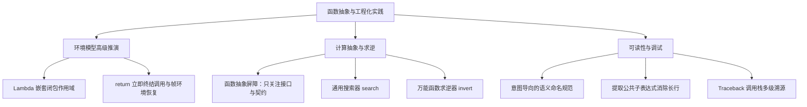

> **课程体系**：UC Berkeley CS61A (Fall 2024)  
> **所属模块**：Module 1: 函数与抽象 (Functions & Abstraction)  
> **主讲教师**：Prof. John DeNero (UC Berkeley)  
> **视频时长**：30:05 ｜ **课堂截图**：14 张板书/代码演示  
> **视频直达**：[📺 在 B 站观看本讲原视频 (P7)](https://www.bilibili.com/video/BV1sy411z7nA/?p=7)  
> **快速导航**：[← 上一讲 (P06 Lecture 6 Sound (Optional))](/notes/cs61a/lecture-06) ｜ [📚 返回全书目录](/notes/topics/CS61A) ｜ [下一讲 (P08 Lecture 8 Function Examples) →](/notes/cs61a/lecture-08)

---

## 1. 期中考试知识图谱与核心规范

*(参考时间：00:00:30 · [视频跳转 (P7 00:00:30)](https://www.bilibili.com/video/BV1sy411z7nA/?p=7&t=30))*

在进入本讲之前，DeNero 教授梳理了期中考试（Midterm 1）的考察范围与学习指南：
- **考察范围**：第 1 讲到第 5 讲的内容（表达式、控制流、函数定义与高阶环境模型）。
- **考试形式**：闭卷纸笔考试，提供官方精心整理的 Study Guide（覆盖所有语句的执行规则、内置函数与大型环境图综合样题）。
- **实战准备建议**：完成 Lab、Discussion、Homework 2 与 Hog 大作业的第一阶段（Phase 1），在此基础上独立完成一份往年真题。

[](https://www.bilibili.com/video/BV1sy411z7nA/?p=7&t=55)
*⏱ 时间戳：00:00:55 · 📷 课堂截图 · [在 B 站观看对应片段 (P7 00:00:55)](https://www.bilibili.com/video/BV1sy411z7nA/?p=7&t=55)*

#### 📸 课堂板书与代码演示深入精读 (00:00:55)

**【现场板书 / 代码演示还原】**：
在此时间节点，DeNero 教授在屏幕上进行了核心演示与重点板书推导：
> *“Midterm one is coming up next Monday. The format of the exam is a paper exam. You can see past exams here. We list them all. And you can expect the format of the exam to be similar to past exams, especially past fall semester exams. We will provide on paper the midterm one study guide, which looks l...”*

**【底层计算模型与微观执行机制】**：
1. **执行上下文与时序追踪**：
   - 处于当前讨论节点「1. 期中考试知识图谱与核心规范」，解释器严格遵循核心求值规约；
   - 表达式先求值操作符，随后自左至右严格求值操作数，最终将函数对象施加于实参列表；
   - 若涉及环境模型，局部帧严格记录其静态词法父指针（Parent Pointer 指向函数定义处的环境），与运行时的动态调用栈形成正交架构。
2. **内存拓扑与对象引用**：
   - 变量符号只是哈希表（环境帧）中的键，指针直接指向堆内存中的一等公民对象；
   - 赋值语句是离散时间的瞬时状态快照，绝不会建立隐式的数学依赖监听。

**【避坑指南与高频考点点拨】**：
- **常见思维误区**：在「抽象屏障、牛顿法逼近与反函数高阶搜索器」相关考题中，初学者极易根据代码表面形式猜想结果，导致作用域混淆或变量遮蔽（Shadowing）误判；
- **调试排错黄金法则**：遇到嵌套调用与复杂分支时，务必在草稿纸上画出独立的局部帧，标明每个形参的具体绑定值，按部就班推导。


---

### 深入形式化规约与微观求值流程（Operational Semantics）
在「1. 期中考试知识图谱与核心规范」模块中，计算机底层运算依赖于严密的形式化求值逻辑：
1. **抽象语法树（AST）的分层解析**：
   - 源代码字符流首先经过词法分析器（Lexer）切分为终结符标记（Tokens），随后由语法解析器（Parser）构造成多叉语法树；
   - 运算符优先级与结合性在语法树构建阶段即已固化，消除了运行期的二义性；
2. **环境序列的动态跃迁**：
   - 每次函数调用产生的新帧，其静态词法环境由函数对象的 `parent` 属性完全决定；
   - 变量查找沿环境链向上单向回溯，直到全局环境帧，若未找到则触发 `NameError` 异常；
3. **状态不变式（State Invariants）**：
   - 编写健壮程序的关键在于明确循环不变式（Loop Invariants）与函数前后置条件（Pre/Post-conditions）；
   - 在复杂控制流跳转中，确保状态变量在每次迭代前均维持合法的业务约束。


## 2. 进阶环境图大挑战：嵌套 Lambda 与闭包作用域解析

*(参考时间：00:02:21 · [视频跳转 (P7 00:02:21)](https://www.bilibili.com/video/BV1sy411z7nA/?p=7&t=141))*

为了检验大家对环境模型的真正理解，DeNero 给出了一道极其经典且充满迷惑性的考题：

```python
a = 1

def f(g):
    a = 2
    return lambda y: a * g(y)

result = f(lambda y: a + y)(a)
```

这段代码执行完毕后，`result` 的值是多少？

[](https://www.bilibili.com/video/BV1sy411z7nA/?p=7&t=160)
*⏱ 时间戳：00:02:40 · 📷 课堂截图 · [在 B 站观看对应片段 (P7 00:02:40)](https://www.bilibili.com/video/BV1sy411z7nA/?p=7&t=160)*

#### 📸 课堂板书与代码演示深入精读 (00:02:40)

**【现场板书 / 代码演示还原】**：
在此时间节点，DeNero 教授在屏幕上进行了核心演示与重点板书推导：
> *“Good luck. Let's look at an example of an environment diagram that includes lambda expressions and lambda functions. A lambda function's parent is the current frame in which the corresponding lambda expression is evaluated. So here's an example. Where we set a equal to 1, we define a new function f,...”*

**【底层计算模型与微观执行机制】**：
1. **执行上下文与时序追踪**：
   - 处于当前讨论节点「2. 进阶环境图大挑战：嵌套 Lambda 与闭包作用域解析」，解释器严格遵循核心求值规约；
   - 表达式先求值操作符，随后自左至右严格求值操作数，最终将函数对象施加于实参列表；
   - 若涉及环境模型，局部帧严格记录其静态词法父指针（Parent Pointer 指向函数定义处的环境），与运行时的动态调用栈形成正交架构。
2. **内存拓扑与对象引用**：
   - 变量符号只是哈希表（环境帧）中的键，指针直接指向堆内存中的一等公民对象；
   - 赋值语句是离散时间的瞬时状态快照，绝不会建立隐式的数学依赖监听。

**【避坑指南与高频考点点拨】**：
- **常见思维误区**：在「抽象屏障、牛顿法逼近与反函数高阶搜索器」相关考题中，初学者极易根据代码表面形式猜想结果，导致作用域混淆或变量遮蔽（Shadowing）误判；
- **调试排错黄金法则**：遇到嵌套调用与复杂分支时，务必在草稿纸上画出独立的局部帧，标明每个形参的具体绑定值，按部就班推导。


### 静态词法分析（Lexical Analysis）

在动笔画图前，先通过缩进观察各个表达式在**何处被定义（何时被创建）**：
1. `lambda y: a + y`：位于第 6 行的最外层表达式中，**没有任何缩进**。因此它在全局帧中被创建，其父帧是 `Global`！它内部引用的 `a` 是全局变量 `a = 1`。
2. 调用实参 `(a)`：同样在最外层，因此传入的实参是全局的 `a = 1`。
3. `lambda y: a * g(y)`：位于 `f` 的函数体内部（第 4 行）。当 `f` 被调用时，当前活跃的局部帧是 `F1`（其中局部变量 `a = 2`），因此该匿名函数的父帧被盖章标记为 `F1`！它内部的 `a` 是局部变量 `a = 2`。

[](https://www.bilibili.com/video/BV1sy411z7nA/?p=7&t=300)
*⏱ 时间戳：00:05:00 · 📷 课堂截图 · [在 B 站观看对应片段 (P7 00:05:00)](https://www.bilibili.com/video/BV1sy411z7nA/?p=7&t=300)*

#### 📸 课堂板书与代码演示深入精读 (00:05:00)

**【现场板书 / 代码演示还原】**：
在此时间节点，DeNero 教授在屏幕上进行了核心演示与重点板书推导：
> *“As assigned to one, f's bound to the f function, then we try to evaluate this expression. In order to do so, we have to evaluate its operator to figure out what function we're going to call. And that operator is itself a call expression where we evaluate f's. Okay, so we're calling this function and...”*

**【底层计算模型与微观执行机制】**：
1. **执行上下文与时序追踪**：
   - 处于当前讨论节点「2. 进阶环境图大挑战：嵌套 Lambda 与闭包作用域解析」，解释器严格遵循核心求值规约；
   - 表达式先求值操作符，随后自左至右严格求值操作数，最终将函数对象施加于实参列表；
   - 若涉及环境模型，局部帧严格记录其静态词法父指针（Parent Pointer 指向函数定义处的环境），与运行时的动态调用栈形成正交架构。
2. **内存拓扑与对象引用**：
   - 变量符号只是哈希表（环境帧）中的键，指针直接指向堆内存中的一等公民对象；
   - 赋值语句是离散时间的瞬时状态快照，绝不会建立隐式的数学依赖监听。

**【避坑指南与高频考点点拨】**：
- **常见思维误区**：在「抽象屏障、牛顿法逼近与反函数高阶搜索器」相关考题中，初学者极易根据代码表面形式猜想结果，导致作用域混淆或变量遮蔽（Shadowing）误判；
- **调试排错黄金法则**：遇到嵌套调用与复杂分支时，务必在草稿纸上画出独立的局部帧，标明每个形参的具体绑定值，按部就班推导。


### 运行期环境图追踪（Step-by-Step）

1. **全局帧**：`a: 1`，`f: func f(g) [parent=Global]`。
2. **执行 `f(...)`**：
   - 先对实参 `lambda y: a + y` 求值，生成匿名函数对象 `λ1 [parent=Global]`。
   - 调用 `f(λ1)`，创建局部帧 `F1`。形参 `g` 绑定为 `λ1`。
   - 在 `F1` 中执行 `a = 2`（局部赋值，**绝不影响全局的 a=1**）。
   - 在 `F1` 中创建并返回另一个匿名函数 `λ2 [parent=F1]`。
3. **执行外层调用 `λ2(1)`**：
   - 为 `λ2` 创建局部帧 `F2`（父帧继承为 `F1`），形参 `y` 绑定为 `1`。
   - 执行函数体 `a * g(y)`：
     - 查找 `a`：在当前环境 `[F2 -> F1 -> Global]` 中，首帧 `F2` 无 `a`，进入父帧 `F1` 找到 `a = 2`。
     - 查找 `g`：在 `F1` 中找到 `g = λ1`。
     - 调用 `g(1)`：创建局部帧 `F3`。**注意：因为 λ1 的父帧是 Global，所以 F3 的父帧是 Global，而不是 F1 或 F2**！
     - 在 `F3` 的环境 `[F3 -> Global]` 中执行 `a + y`：`a` 来自 `Global`（值为 1），`y` 为 1，返回 `1 + 1 = 2`。
   - 回到 `F2`：计算 `a * g(y) = 2 * 2 = 4`。

最终，`result` 的值为 **`4`**！

[](https://www.bilibili.com/video/BV1sy411z7nA/?p=7&t=410)
*⏱ 时间戳：00:06:50 · 📷 课堂截图 · [在 B 站观看对应片段 (P7 00:06:50)](https://www.bilibili.com/video/BV1sy411z7nA/?p=7&t=410)*

#### 📸 课堂板书与代码演示深入精读 (00:06:50)

**【现场板书 / 代码演示还原】**：
在此时间节点，DeNero 教授在屏幕上进行了核心演示与重点板书推导：
> *“Well, we have to go look up its body. This one, A times G of Y. What's A? We look here, and there's no A, so we look in the parent, A is 2. And what's G times Y? Well, we have to figure out what G is. There's no G here, so we look in the parent, there's G. We're going to call G on the number 1, and ...”*

**【底层计算模型与微观执行机制】**：
1. **执行上下文与时序追踪**：
   - 处于当前讨论节点「2. 进阶环境图大挑战：嵌套 Lambda 与闭包作用域解析」，解释器严格遵循核心求值规约；
   - 表达式先求值操作符，随后自左至右严格求值操作数，最终将函数对象施加于实参列表；
   - 若涉及环境模型，局部帧严格记录其静态词法父指针（Parent Pointer 指向函数定义处的环境），与运行时的动态调用栈形成正交架构。
2. **内存拓扑与对象引用**：
   - 变量符号只是哈希表（环境帧）中的键，指针直接指向堆内存中的一等公民对象；
   - 赋值语句是离散时间的瞬时状态快照，绝不会建立隐式的数学依赖监听。

**【避坑指南与高频考点点拨】**：
- **常见思维误区**：在「抽象屏障、牛顿法逼近与反函数高阶搜索器」相关考题中，初学者极易根据代码表面形式猜想结果，导致作用域混淆或变量遮蔽（Shadowing）误判；
- **调试排错黄金法则**：遇到嵌套调用与复杂分支时，务必在草稿纸上画出独立的局部帧，标明每个形参的具体绑定值，按部就班推导。


---

### 深入形式化规约与微观求值流程（Operational Semantics）
在「2. 进阶环境图大挑战：嵌套 Lambda 与闭包作用域解析」模块中，计算机底层运算依赖于严密的形式化求值逻辑：
1. **抽象语法树（AST）的分层解析**：
   - 源代码字符流首先经过词法分析器（Lexer）切分为终结符标记（Tokens），随后由语法解析器（Parser）构造成多叉语法树；
   - 运算符优先级与结合性在语法树构建阶段即已固化，消除了运行期的二义性；
2. **环境序列的动态跃迁**：
   - 每次函数调用产生的新帧，其静态词法环境由函数对象的 `parent` 属性完全决定；
   - 变量查找沿环境链向上单向回溯，直到全局环境帧，若未找到则触发 `NameError` 异常；
3. **状态不变式（State Invariants）**：
   - 编写健壮程序的关键在于明确循环不变式（Loop Invariants）与函数前后置条件（Pre/Post-conditions）；
   - 在复杂控制流跳转中，确保状态变量在每次迭代前均维持合法的业务约束。


## 3. Return 语句的执行法则与循环早期退出

*(参考时间：00:07:40 · [视频跳转 (P7 00:07:40)](https://www.bilibili.com/video/BV1sy411z7nA/?p=7&t=460))*

`return` 语句的核心职责是**结束当前函数调用，并向调用者交付结果**。

> **调用与返回的环境切换原理**：
> 当遇到调用表达式时，解释器切换到新创建的局部环境中执行函数体；一旦执行到 `return` 语句，解释器**立即销毁/冻结当前局部上下文，切换回调用发生时的外部环境**，并将返回表达式的值代入调用表达式所在位置。

[](https://www.bilibili.com/video/BV1sy411z7nA/?p=7&t=520)
*⏱ 时间戳：00:08:40 · 📷 课堂截图 · [在 B 站观看对应片段 (P7 00:08:40)](https://www.bilibili.com/video/BV1sy411z7nA/?p=7&t=520)*

#### 📸 课堂板书与代码演示深入精读 (00:08:40)

**【现场板书 / 代码演示还原】**：
在此时间节点，DeNero 教授在屏幕上进行了核心演示与重点板书推导：
> *“When you reach a call expression like f of x for some user-defined function f, that's when you switch to a new environment, and it's time to execute f's body. Why are we doing all this work? In order to figure out what's the value of f of x. When the return statement within f is reached, we switch b...”*

**【底层计算模型与微观执行机制】**：
1. **执行上下文与时序追踪**：
   - 处于当前讨论节点「3. Return 语句的执行法则与循环早期退出」，解释器严格遵循核心求值规约；
   - 表达式先求值操作符，随后自左至右严格求值操作数，最终将函数对象施加于实参列表；
   - 若涉及环境模型，局部帧严格记录其静态词法父指针（Parent Pointer 指向函数定义处的环境），与运行时的动态调用栈形成正交架构。
2. **内存拓扑与对象引用**：
   - 变量符号只是哈希表（环境帧）中的键，指针直接指向堆内存中的一等公民对象；
   - 赋值语句是离散时间的瞬时状态快照，绝不会建立隐式的数学依赖监听。

**【避坑指南与高频考点点拨】**：
- **常见思维误区**：在「抽象屏障、牛顿法逼近与反函数高阶搜索器」相关考题中，初学者极易根据代码表面形式猜想结果，导致作用域混淆或变量遮蔽（Shadowing）误判；
- **调试排错黄金法则**：遇到嵌套调用与复杂分支时，务必在草稿纸上画出独立的局部帧，标明每个形参的具体绑定值，按部就班推导。


### 经典技巧：在 while 循环中利用 return 提前中断

在编写搜索或数字处理函数时，我们常常需要一旦命中条件就立即跳出整个函数，而无需等待循环自然走完。

以从低位到高位打印整数数字、并在遇到指定数字 $d$ 时终止的函数为例：

```python
def end(n, d):
    """倒序打印 n 的各位数字，直到遇到 d 为止。

    >>> end(34567, 5)
    7
    6
    5
    """
    while n > 0:
        last, n = n % 10, n // 10
        print(last)
        if last == d:
            return None
```

只要 `last == d` 成立，`return None` 会立即终结整个 `end` 函数的执行，其后的循环迭代与代码块被完全跳过。

[](https://www.bilibili.com/video/BV1sy411z7nA/?p=7&t=600)
*⏱ 时间戳：00:10:00 · 📷 课堂截图 · [在 B 站观看对应片段 (P7 00:10:00)](https://www.bilibili.com/video/BV1sy411z7nA/?p=7&t=600)*

#### 📸 课堂板书与代码演示深入精读 (00:10:00)

**【现场板书 / 代码演示还原】**：
在此时间节点，DeNero 教授在屏幕上进行了核心演示与重点板书推导：
> *“How would we write this function? Well, one simple way to do it is to write a while statement that just prints all of the digits, 7, 6, 5, 4, 3. The approach here is to say that while n is greater than zero, we split n up into its last digit and everything but the last digit, print the last one out....”*

**【底层计算模型与微观执行机制】**：
1. **执行上下文与时序追踪**：
   - 处于当前讨论节点「3. Return 语句的执行法则与循环早期退出」，解释器严格遵循核心求值规约；
   - 表达式先求值操作符，随后自左至右严格求值操作数，最终将函数对象施加于实参列表；
   - 若涉及环境模型，局部帧严格记录其静态词法父指针（Parent Pointer 指向函数定义处的环境），与运行时的动态调用栈形成正交架构。
2. **内存拓扑与对象引用**：
   - 变量符号只是哈希表（环境帧）中的键，指针直接指向堆内存中的一等公民对象；
   - 赋值语句是离散时间的瞬时状态快照，绝不会建立隐式的数学依赖监听。

**【避坑指南与高频考点点拨】**：
- **常见思维误区**：在「抽象屏障、牛顿法逼近与反函数高阶搜索器」相关考题中，初学者极易根据代码表面形式猜想结果，导致作用域混淆或变量遮蔽（Shadowing）误判；
- **调试排错黄金法则**：遇到嵌套调用与复杂分支时，务必在草稿纸上画出独立的局部帧，标明每个形参的具体绑定值，按部就班推导。


---

### 深入形式化规约与微观求值流程（Operational Semantics）
在「3. Return 语句的执行法则与循环早期退出」模块中，计算机底层运算依赖于严密的形式化求值逻辑：
1. **抽象语法树（AST）的分层解析**：
   - 源代码字符流首先经过词法分析器（Lexer）切分为终结符标记（Tokens），随后由语法解析器（Parser）构造成多叉语法树；
   - 运算符优先级与结合性在语法树构建阶段即已固化，消除了运行期的二义性；
2. **环境序列的动态跃迁**：
   - 每次函数调用产生的新帧，其静态词法环境由函数对象的 `parent` 属性完全决定；
   - 变量查找沿环境链向上单向回溯，直到全局环境帧，若未找到则触发 `NameError` 异常；
3. **状态不变式（State Invariants）**：
   - 编写健壮程序的关键在于明确循环不变式（Loop Invariants）与函数前后置条件（Pre/Post-conditions）；
   - 在复杂控制流跳转中，确保状态变量在每次迭代前均维持合法的业务约束。


## 4. 高阶搜索器与自动函数求逆（Function Inversion）

*(参考时间：00:10:30 · [视频跳转 (P7 00:10:30)](https://www.bilibili.com/video/BV1sy411z7nA/?p=7&t=630))*

很多看似复杂的数学算法，其底层都是一种通用的搜索过程。我们可以定义一个通用的高阶搜索器 `search`：

```python
def search(f):
    """寻找使 f(x) 为真值的最小非负整数 x。"""
    x = 0
    while not f(x):
        x += 1
    return x
```

[](https://www.bilibili.com/video/BV1sy411z7nA/?p=7&t=690)
*⏱ 时间戳：00:11:30 · 📷 课堂截图 · [在 B 站观看对应片段 (P7 00:11:30)](https://www.bilibili.com/video/BV1sy411z7nA/?p=7&t=690)*

#### 📸 课堂板书与代码演示深入精读 (00:11:30)

**【现场板书 / 代码演示还原】**：
在此时间节点，DeNero 教授在屏幕上进行了核心演示与重点板书推导：
> *“One way to do that is to purposefully construct an infinite loop. This while statement will run forever unless a return statement within it tells us that we're done. While true, if it's the case that f of x is a true value, I want to return x. If that's not the case, I want to try a different x. I c...”*

**【底层计算模型与微观执行机制】**：
1. **执行上下文与时序追踪**：
   - 处于当前讨论节点「4. 高阶搜索器与自动函数求逆（Function Inversion）」，解释器严格遵循核心求值规约；
   - 表达式先求值操作符，随后自左至右严格求值操作数，最终将函数对象施加于实参列表；
   - 若涉及环境模型，局部帧严格记录其静态词法父指针（Parent Pointer 指向函数定义处的环境），与运行时的动态调用栈形成正交架构。
2. **内存拓扑与对象引用**：
   - 变量符号只是哈希表（环境帧）中的键，指针直接指向堆内存中的一等公民对象；
   - 赋值语句是离散时间的瞬时状态快照，绝不会建立隐式的数学依赖监听。

**【避坑指南与高频考点点拨】**：
- **常见思维误区**：在「抽象屏障、牛顿法逼近与反函数高阶搜索器」相关考题中，初学者极易根据代码表面形式猜想结果，导致作用域混淆或变量遮蔽（Shadowing）误判；
- **调试排错黄金法则**：遇到嵌套调用与复杂分支时，务必在草稿纸上画出独立的局部帧，标明每个形参的具体绑定值，按部就班推导。


### 函数求逆通用算子：invert

在数学中，函数 $f$ 的反函数 $g = f^{-1}$ 满足 $g(y) = x \iff f(x) = y$。

利用高阶搜索器 `search`，我们只需 3 行代码就能构造一个**万能函数求逆器**：

```python
def invert(f):
    """返回单调递增函数 f 的反函数。"""
    return lambda y: search(lambda x: f(x) == y)
```

### 零数学库实现开平方根

我们甚至不需要调用任何数学库，就可以直接对平方函数求逆得到开平方：

```python
square = lambda x: x * x
sqrt = invert(square)

sqrt(16)   # 4
sqrt(256)  # 16
sqrt(100)  # 10
```

> **局限性与拓展**：这个极简的整数搜索算法对于完全平方数非常高效。如果要支持任意实数的精确开方，需要使用数值分析中的牛顿法（Newton's Method），其本质依然是用高阶函数不断迭代逼近零点。

[](https://www.bilibili.com/video/BV1sy411z7nA/?p=7&t=830)
*⏱ 时间戳：00:13:50 · 📷 课堂截图 · [在 B 站观看对应片段 (P7 00:13:50)](https://www.bilibili.com/video/BV1sy411z7nA/?p=7&t=830)*

#### 📸 课堂板书与代码演示深入精读 (00:13:50)

**【现场板书 / 代码演示还原】**：
在此时间节点，DeNero 教授在屏幕上进行了核心演示与重点板书推导：
> *“A method for computing square roots just by trying a bunch of numbers until I find it. This is a general strategy for computing inverse functions. The inverse of s is to return a g such that it's the case that f of x passed into g gives us back x. And how do we find such a g? Well, it's a function t...”*

**【底层计算模型与微观执行机制】**：
1. **执行上下文与时序追踪**：
   - 处于当前讨论节点「4. 高阶搜索器与自动函数求逆（Function Inversion）」，解释器严格遵循核心求值规约；
   - 表达式先求值操作符，随后自左至右严格求值操作数，最终将函数对象施加于实参列表；
   - 若涉及环境模型，局部帧严格记录其静态词法父指针（Parent Pointer 指向函数定义处的环境），与运行时的动态调用栈形成正交架构。
2. **内存拓扑与对象引用**：
   - 变量符号只是哈希表（环境帧）中的键，指针直接指向堆内存中的一等公民对象；
   - 赋值语句是离散时间的瞬时状态快照，绝不会建立隐式的数学依赖监听。

**【避坑指南与高频考点点拨】**：
- **常见思维误区**：在「抽象屏障、牛顿法逼近与反函数高阶搜索器」相关考题中，初学者极易根据代码表面形式猜想结果，导致作用域混淆或变量遮蔽（Shadowing）误判；
- **调试排错黄金法则**：遇到嵌套调用与复杂分支时，务必在草稿纸上画出独立的局部帧，标明每个形参的具体绑定值，按部就班推导。


---

### 深入形式化规约与微观求值流程（Operational Semantics）
在「4. 高阶搜索器与自动函数求逆（Function Inversion）」模块中，计算机底层运算依赖于严密的形式化求值逻辑：
1. **抽象语法树（AST）的分层解析**：
   - 源代码字符流首先经过词法分析器（Lexer）切分为终结符标记（Tokens），随后由语法解析器（Parser）构造成多叉语法树；
   - 运算符优先级与结合性在语法树构建阶段即已固化，消除了运行期的二义性；
2. **环境序列的动态跃迁**：
   - 每次函数调用产生的新帧，其静态词法环境由函数对象的 `parent` 属性完全决定；
   - 变量查找沿环境链向上单向回溯，直到全局环境帧，若未找到则触发 `NameError` 异常；
3. **状态不变式（State Invariants）**：
   - 编写健壮程序的关键在于明确循环不变式（Loop Invariants）与函数前后置条件（Pre/Post-conditions）；
   - 在复杂控制流跳转中，确保状态变量在每次迭代前均维持合法的业务约束。


## 5. 函数抽象的本质：调用者真正需要知道什么？

*(参考时间：00:15:16 · [视频跳转 (P7 00:15:16)](https://www.bilibili.com/video/BV1sy411z7nA/?p=7&t=916))*

> **函数抽象（Functional Abstraction）**：为一段计算过程赋予一个名字，随后将该过程视为一个黑盒整体来使用，而**无需关心其内部实现细节**。

考察调用 `square` 的上层函数 `sum_squares`：

```python
def sum_squares(x, y):
    return square(x) + square(y)
```

关于被调用的 `square` 函数，调用者 `sum_squares` 到底需要知道哪些信息？

[](https://www.bilibili.com/video/BV1sy411z7nA/?p=7&t=930)
*⏱ 时间戳：00:15:30 · 📷 课堂截图 · [在 B 站观看对应片段 (P7 00:15:30)](https://www.bilibili.com/video/BV1sy411z7nA/?p=7&t=930)*

#### 📸 课堂板书与代码演示深入精读 (00:15:30)

**【现场板书 / 代码演示还原】**：
在此时间节点，DeNero 教授在屏幕上进行了核心演示与重点板书推导：
> *“So I think once you've written down an implementation for a function, it can't hurt to stare at it for a little while and see if there's some way to simplify the logic. Abstraction. So functional abstraction is giving a name to some computational process, and then referring to that process as a whol...”*

**【底层计算模型与微观执行机制】**：
1. **执行上下文与时序追踪**：
   - 处于当前讨论节点「5. 函数抽象的本质：调用者真正需要知道什么？」，解释器严格遵循核心求值规约；
   - 表达式先求值操作符，随后自左至右严格求值操作数，最终将函数对象施加于实参列表；
   - 若涉及环境模型，局部帧严格记录其静态词法父指针（Parent Pointer 指向函数定义处的环境），与运行时的动态调用栈形成正交架构。
2. **内存拓扑与对象引用**：
   - 变量符号只是哈希表（环境帧）中的键，指针直接指向堆内存中的一等公民对象；
   - 赋值语句是离散时间的瞬时状态快照，绝不会建立隐式的数学依赖监听。

**【避坑指南与高频考点点拨】**：
- **常见思维误区**：在「抽象屏障、牛顿法逼近与反函数高阶搜索器」相关考题中，初学者极易根据代码表面形式猜想结果，导致作用域混淆或变量遮蔽（Shadowing）误判；
- **调试排错黄金法则**：遇到嵌套调用与复杂分支时，务必在草稿纸上画出独立的局部帧，标明每个形参的具体绑定值，按部就班推导。


| 疑问项 | 是否需要知道？ | 原因解析 |
| :--- | :---: | :--- |
| **square 是否恰好接受 1 个参数？** | **必须知道** | 参数个数不匹配会导致无法正确发起调用 |
| **square 的内在名称（Intrinsic Name）是否是 'square'？** | **不需要** | 无论函数内在名称是 lambda 还是其他，只要当前环境下绑定到 square 即可 |
| **square 的计算行为（Behavior，即求平方）？** | **必须知道** | 调用者必须明确其功能契约才能达成正确的组合目的 |
| **square 内部是用 `x*x` 还是 `pow(x, 2)` 实现的？** | **绝不需要** | 内部实现细节完全被抽象屏障（Abstraction Barrier）隔绝 |

---

### 深入形式化规约与微观求值流程（Operational Semantics）
在「5. 函数抽象的本质：调用者真正需要知道什么？」模块中，计算机底层运算依赖于严密的形式化求值逻辑：
1. **抽象语法树（AST）的分层解析**：
   - 源代码字符流首先经过词法分析器（Lexer）切分为终结符标记（Tokens），随后由语法解析器（Parser）构造成多叉语法树；
   - 运算符优先级与结合性在语法树构建阶段即已固化，消除了运行期的二义性；
2. **环境序列的动态跃迁**：
   - 每次函数调用产生的新帧，其静态词法环境由函数对象的 `parent` 属性完全决定；
   - 变量查找沿环境链向上单向回溯，直到全局环境帧，若未找到则触发 `NameError` 异常；
3. **状态不变式（State Invariants）**：
   - 编写健壮程序的关键在于明确循环不变式（Loop Invariants）与函数前后置条件（Pre/Post-conditions）；
   - 在复杂控制流跳转中，确保状态变量在每次迭代前均维持合法的业务约束。


## 6. 工程实践：代码命名规范与坏味道识别

*(参考时间：00:17:38 · [视频跳转 (P7 00:17:38)](https://www.bilibili.com/video/BV1sy411z7nA/?p=7&t=1058))*

程序是写给人读的，只是顺便能被机器运行。合理的命名能使代码自带文档属性。

[](https://www.bilibili.com/video/BV1sy411z7nA/?p=7&t=1120)
*⏱ 时间戳：00:18:40 · 📷 课堂截图 · [在 B 站观看对应片段 (P7 00:18:40)](https://www.bilibili.com/video/BV1sy411z7nA/?p=7&t=1120)*

#### 📸 课堂板书与代码演示深入精读 (00:18:40)

**【现场板书 / 代码演示还原】**：
在此时间节点，DeNero 教授在屏幕上进行了核心演示与重点板书推导：
> *“Bound to the name, whether it's a number or a string, is best documented in a function's docstring, as opposed to the name that you bind to the value itself. And function names, the names that we give to our functions that we define, typically convey either their effect, such as printing, their beha...”*

**【底层计算模型与微观执行机制】**：
1. **执行上下文与时序追踪**：
   - 处于当前讨论节点「6. 工程实践：代码命名规范与坏味道识别」，解释器严格遵循核心求值规约；
   - 表达式先求值操作符，随后自左至右严格求值操作数，最终将函数对象施加于实参列表；
   - 若涉及环境模型，局部帧严格记录其静态词法父指针（Parent Pointer 指向函数定义处的环境），与运行时的动态调用栈形成正交架构。
2. **内存拓扑与对象引用**：
   - 变量符号只是哈希表（环境帧）中的键，指针直接指向堆内存中的一等公民对象；
   - 赋值语句是离散时间的瞬时状态快照，绝不会建立隐式的数学依赖监听。

**【避坑指南与高频考点点拨】**：
- **常见思维误区**：在「抽象屏障、牛顿法逼近与反函数高阶搜索器」相关考题中，初学者极易根据代码表面形式猜想结果，导致作用域混淆或变量遮蔽（Shadowing）误判；
- **调试排错黄金法则**：遇到嵌套调用与复杂分支时，务必在草稿纸上画出独立的局部帧，标明每个形参的具体绑定值，按部就班推导。


### 黄金命名准则

1. **描述含义而非类型**：
   - ❌ `true_false` $\longrightarrow$ ✅ `has_rolled_one`
   - ❌ `my_int` $\longrightarrow$ ✅ `num_rolls`
2. **描述职责而非调用关系**：
   - ❌ `play_helper` $\longrightarrow$ ✅ `take_turn`
3. **避免视觉易混淆字符**：单字母变量尽量避免使用小写 `l`、大写 `I` 或大写 `O`，优先使用 `k`、`i`、`m`、`n`。
4. **提炼重复的复合长表达式**：
   如果一条复杂的数学表达式多次出现，将其提取并赋予有意义的名字，既消除了重复代码，又大幅降低了心智负担：

```python
# 坏味道：冗长难以阅读
root1 = (-b + sqrt(b * b - 4 * a * c)) / (2 * a)
root2 = (-b - sqrt(b * b - 4 * a * c)) / (2 * a)

# 好风格：提取判别式（Discriminant）
discriminant = b * b - 4 * a * c
root1 = (-b + sqrt(discriminant)) / (2 * a)
root2 = (-b - sqrt(discriminant)) / (2 * a)
```

[](https://www.bilibili.com/video/BV1sy411z7nA/?p=7&t=1260)
*⏱ 时间戳：00:21:00 · 📷 课堂截图 · [在 B 站观看对应片段 (P7 00:21:00)](https://www.bilibili.com/video/BV1sy411z7nA/?p=7&t=1260)*

#### 📸 课堂板书与代码演示深入精读 (00:21:00)

**【现场板书 / 代码演示还原】**：
在此时间节点，DeNero 教授在屏幕上进行了核心演示与重点板书推导：
> *“of a squared plus b squared, both in a conditional statement and in the assignment statement in the suite. It's probably better to give that thing a name and then use it twice. Here and there. So that if we need to change how we compute the hypotenuse in some way, we can do that all in one place. So...”*

**【底层计算模型与微观执行机制】**：
1. **执行上下文与时序追踪**：
   - 处于当前讨论节点「6. 工程实践：代码命名规范与坏味道识别」，解释器严格遵循核心求值规约；
   - 表达式先求值操作符，随后自左至右严格求值操作数，最终将函数对象施加于实参列表；
   - 若涉及环境模型，局部帧严格记录其静态词法父指针（Parent Pointer 指向函数定义处的环境），与运行时的动态调用栈形成正交架构。
2. **内存拓扑与对象引用**：
   - 变量符号只是哈希表（环境帧）中的键，指针直接指向堆内存中的一等公民对象；
   - 赋值语句是离散时间的瞬时状态快照，绝不会建立隐式的数学依赖监听。

**【避坑指南与高频考点点拨】**：
- **常见思维误区**：在「抽象屏障、牛顿法逼近与反函数高阶搜索器」相关考题中，初学者极易根据代码表面形式猜想结果，导致作用域混淆或变量遮蔽（Shadowing）误判；
- **调试排错黄金法则**：遇到嵌套调用与复杂分支时，务必在草稿纸上画出独立的局部帧，标明每个形参的具体绑定值，按部就班推导。


---

### 深入形式化规约与微观求值流程（Operational Semantics）
在「6. 工程实践：代码命名规范与坏味道识别」模块中，计算机底层运算依赖于严密的形式化求值逻辑：
1. **抽象语法树（AST）的分层解析**：
   - 源代码字符流首先经过词法分析器（Lexer）切分为终结符标记（Tokens），随后由语法解析器（Parser）构造成多叉语法树；
   - 运算符优先级与结合性在语法树构建阶段即已固化，消除了运行期的二义性；
2. **环境序列的动态跃迁**：
   - 每次函数调用产生的新帧，其静态词法环境由函数对象的 `parent` 属性完全决定；
   - 变量查找沿环境链向上单向回溯，直到全局环境帧，若未找到则触发 `NameError` 异常；
3. **状态不变式（State Invariants）**：
   - 编写健壮程序的关键在于明确循环不变式（Loop Invariants）与函数前后置条件（Pre/Post-conditions）；
   - 在复杂控制流跳转中，确保状态变量在每次迭代前均维持合法的业务约束。


## 7. 程序错误三部分类与 Traceback 调用栈回溯拆解

*(参考时间：00:22:51 · [视频跳转 (P7 00:22:51)](https://www.bilibili.com/video/BV1sy411z7nA/?p=7&t=1371))*

Python 中的 Bug 主要分为三大类别：
1. **语法错误（Syntax Errors）**：代码不符合语言文法规则（如括号不匹配、运算符连用）。在程序正式运行前就会被解析器拦截。
2. **运行时错误（Runtime Errors）**：语法正确，但执行期遇到非法操作（如除以零、类型不匹配 `TypeError`、未定义名称 `NameError`）。
3. **逻辑错误（Logical Errors）**：程序顺利运行且不报错，但计算结果完全错误。只能通过单元测试（如 Doctest）来发现。

[](https://www.bilibili.com/video/BV1sy411z7nA/?p=7&t=1420)
*⏱ 时间戳：00:23:40 · 📷 课堂截图 · [在 B 站观看对应片段 (P7 00:23:40)](https://www.bilibili.com/video/BV1sy411z7nA/?p=7&t=1420)*

#### 📸 课堂板书与代码演示深入精读 (00:23:40)

**【现场板书 / 代码演示还原】**：
在此时间节点，DeNero 教授在屏幕上进行了核心演示与重点板书推导：
> *“And they're caused by having expressions that aren't formed well. The syntax of a language is its form, which requires that every opening parenthesis has a closing parenthesis and that a plus sign has to come between two expressions. It can't come at the beginning. These kinds of things. The second ...”*

**【底层计算模型与微观执行机制】**：
1. **执行上下文与时序追踪**：
   - 处于当前讨论节点「7. 程序错误三部分类与 Traceback 调用栈回溯拆解」，解释器严格遵循核心求值规约；
   - 表达式先求值操作符，随后自左至右严格求值操作数，最终将函数对象施加于实参列表；
   - 若涉及环境模型，局部帧严格记录其静态词法父指针（Parent Pointer 指向函数定义处的环境），与运行时的动态调用栈形成正交架构。
2. **内存拓扑与对象引用**：
   - 变量符号只是哈希表（环境帧）中的键，指针直接指向堆内存中的一等公民对象；
   - 赋值语句是离散时间的瞬时状态快照，绝不会建立隐式的数学依赖监听。

**【避坑指南与高频考点点拨】**：
- **常见思维误区**：在「抽象屏障、牛顿法逼近与反函数高阶搜索器」相关考题中，初学者极易根据代码表面形式猜想结果，导致作用域混淆或变量遮蔽（Shadowing）误判；
- **调试排错黄金法则**：遇到嵌套调用与复杂分支时，务必在草稿纸上画出独立的局部帧，标明每个形参的具体绑定值，按部就班推导。


### 如何专业地阅读 Traceback 回溯信息？

当运行时错误爆发时，终端会打印出一条 Traceback。许多新手往往只看最后一行，但正确的阅读法是**自顶向下重构调用调用链**：

[](https://www.bilibili.com/video/BV1sy411z7nA/?p=7&t=1560)
*⏱ 时间戳：00:26:00 · 📷 课堂截图 · [在 B 站观看对应片段 (P7 00:26:00)](https://www.bilibili.com/video/BV1sy411z7nA/?p=7&t=1560)*

#### 📸 课堂板书与代码演示深入精读 (00:26:00)

**【现场板书 / 代码演示还原】**：
在此时间节点，DeNero 教授在屏幕上进行了核心演示与重点板书推导：
> *“I opened a parenthesis and never closed it up here. So Python was expecting that whatever appeared on this line was part of the abs expression that I had never finished. And you can't have a def in the middle of a call to abs. So sometimes when you see a syntax error, in fact, the error is nearby. A...”*

**【底层计算模型与微观执行机制】**：
1. **执行上下文与时序追踪**：
   - 处于当前讨论节点「7. 程序错误三部分类与 Traceback 调用栈回溯拆解」，解释器严格遵循核心求值规约；
   - 表达式先求值操作符，随后自左至右严格求值操作数，最终将函数对象施加于实参列表；
   - 若涉及环境模型，局部帧严格记录其静态词法父指针（Parent Pointer 指向函数定义处的环境），与运行时的动态调用栈形成正交架构。
2. **内存拓扑与对象引用**：
   - 变量符号只是哈希表（环境帧）中的键，指针直接指向堆内存中的一等公民对象；
   - 赋值语句是离散时间的瞬时状态快照，绝不会建立隐式的数学依赖监听。

**【避坑指南与高频考点点拨】**：
- **常见思维误区**：在「抽象屏障、牛顿法逼近与反函数高阶搜索器」相关考题中，初学者极易根据代码表面形式猜想结果，导致作用域混淆或变量遮蔽（Shadowing）误判；
- **调试排错黄金法则**：遇到嵌套调用与复杂分支时，务必在草稿纸上画出独立的局部帧，标明每个形参的具体绑定值，按部就班推导。


1. **最外层入口**：观察是哪一行全局代码（如 `print(f(12))`）触发了连锁反应。
2. **中间传递链**：`f` 调用了 `g`，`g` 正在调用 `h`。
3. **现场捕获点**：最后一行指示了具体抛出异常的代码行。
4. **根因定位原则**：**报错的现场往往并不是 Bug 产生的地方**！

### 经典案例：丢失 return 导致的连锁灾难

```python
def h(z):
    z * z  # 忘记写 return！默认返回了 None

def g(y):
    return h(y) - h(1 / y)
```

执行时，报错点停留在 `g` 内部的减法上：
`TypeError: unsupported operand type(s) for -: 'NoneType' and 'NoneType'`。

如果你只在 `g` 里面找减法的问题，就会百思不得其解；真正的问题出在 `h` 没有写 `return`，悄悄返回了 `None`！

[](https://www.bilibili.com/video/BV1sy411z7nA/?p=7&t=1695)
*⏱ 时间戳：00:28:15 · 📷 课堂截图 · [在 B 站观看对应片段 (P7 00:28:15)](https://www.bilibili.com/video/BV1sy411z7nA/?p=7&t=1695)*

#### 📸 课堂板书与代码演示深入精读 (00:28:15)

**【现场板书 / 代码演示还原】**：
在此时间节点，DeNero 教授在屏幕上进行了核心演示与重点板书推导：
> *“And it hadn't completed yet. It was in the process of executing f's body, and this line in f's body, which said call g of x minus one, when the error occurred. And in fact, that's not the only thing that was going on. Python was also trying to find the value of print f of 12. In order to do that, it...”*

**【底层计算模型与微观执行机制】**：
1. **执行上下文与时序追踪**：
   - 处于当前讨论节点「7. 程序错误三部分类与 Traceback 调用栈回溯拆解」，解释器严格遵循核心求值规约；
   - 表达式先求值操作符，随后自左至右严格求值操作数，最终将函数对象施加于实参列表；
   - 若涉及环境模型，局部帧严格记录其静态词法父指针（Parent Pointer 指向函数定义处的环境），与运行时的动态调用栈形成正交架构。
2. **内存拓扑与对象引用**：
   - 变量符号只是哈希表（环境帧）中的键，指针直接指向堆内存中的一等公民对象；
   - 赋值语句是离散时间的瞬时状态快照，绝不会建立隐式的数学依赖监听。

**【避坑指南与高频考点点拨】**：
- **常见思维误区**：在「抽象屏障、牛顿法逼近与反函数高阶搜索器」相关考题中，初学者极易根据代码表面形式猜想结果，导致作用域混淆或变量遮蔽（Shadowing）误判；
- **调试排错黄金法则**：遇到嵌套调用与复杂分支时，务必在草稿纸上画出独立的局部帧，标明每个形参的具体绑定值，按部就班推导。


---

### 深入形式化规约与微观求值流程（Operational Semantics）
在「7. 程序错误三部分类与 Traceback 调用栈回溯拆解」模块中，计算机底层运算依赖于严密的形式化求值逻辑：
1. **抽象语法树（AST）的分层解析**：
   - 源代码字符流首先经过词法分析器（Lexer）切分为终结符标记（Tokens），随后由语法解析器（Parser）构造成多叉语法树；
   - 运算符优先级与结合性在语法树构建阶段即已固化，消除了运行期的二义性；
2. **环境序列的动态跃迁**：
   - 每次函数调用产生的新帧，其静态词法环境由函数对象的 `parent` 属性完全决定；
   - 变量查找沿环境链向上单向回溯，直到全局环境帧，若未找到则触发 `NameError` 异常；
3. **状态不变式（State Invariants）**：
   - 编写健壮程序的关键在于明确循环不变式（Loop Invariants）与函数前后置条件（Pre/Post-conditions）；
   - 在复杂控制流跳转中，确保状态变量在每次迭代前均维持合法的业务约束。


## 8. 本讲小结与核心思维导图



### 深入形式化规约与微观求值流程（Operational Semantics）
在「8. 本讲小结与核心思维导图」模块中，计算机底层运算依赖于严密的形式化求值逻辑：
1. **抽象语法树（AST）的分层解析**：
   - 源代码字符流首先经过词法分析器（Lexer）切分为终结符标记（Tokens），随后由语法解析器（Parser）构造成多叉语法树；
   - 运算符优先级与结合性在语法树构建阶段即已固化，消除了运行期的二义性；
2. **环境序列的动态跃迁**：
   - 每次函数调用产生的新帧，其静态词法环境由函数对象的 `parent` 属性完全决定；
   - 变量查找沿环境链向上单向回溯，直到全局环境帧，若未找到则触发 `NameError` 异常；
3. **状态不变式（State Invariants）**：
   - 编写健壮程序的关键在于明确循环不变式（Loop Invariants）与函数前后置条件（Pre/Post-conditions）；
   - 在复杂控制流跳转中，确保状态变量在每次迭代前均维持合法的业务约束。


---

## 伯克利 Midterm / Final 经典高频考题深度演练

### 实战考题：环境拓扑与微观状态追踪（WWPD & Environment Diagrams）
考虑以下 Python 代码在交互式环境中的微观执行过程：

```python
# 经典作用域与高阶函数综合考题
x = 10

def outer(x):
    y = x + 2
    def inner(y):
        return x + y
    return inner

f = outer(5)
result = f(3)
```

#### 完整解题思维模型与多帧环境图推导：
1. **全局帧（Global Frame）初始化**：
   - 全局变量 `x` 绑定到整数对象 `10`；
   - 全局函数 `outer` 绑定到新创建的函数对象，其内嵌 `parent = Global`；
2. **执行 `f = outer(5)`**：
   - 开辟局部帧 $f_1$，标注 `f1: outer [parent=Global]`；
   - 形参 `x` 绑定到实参 `5`；
   - 局部变量 `y` 绑定到 `5 + 2 = 7`；
   - 在 $f_1$ 内部执行 `def inner(y):`，创建函数对象 `inner`，其内嵌 **`parent = f1`**；
   - 返回函数对象 `inner`，全局变量 `f` 绑定到该对象；
3. **执行 `result = f(3)`**：
   - 调用函数 `f`（即 `inner`），开辟局部帧 $f_2$；
   - **核心判分点**：帧 $f_2$ 的 parent 指向谁？
   - **铁律**：函数 `inner` 是在帧 $f_1$ 内部被定义的，因此 $f_2$ 的 **`parent = f1`**！
   - 形参 `y` 绑定到实参 `3`；
   - 执行体 `return x + y`：
     - 在当前帧 $f_2$ 查找 `y`：命中局部变量 `y = 3`；
     - 在当前帧 $f_2$ 查找 `x`：未命中，沿 parent 回溯到 **$f_1$ 帧** 查找！
     - 在 $f_1$ 帧中命中 `x = 5`（全局的 `x = 10` 被局部遮蔽！）；
     - 计算 `5 + 3 = 8`，作为返回值；
4. **最终输出结论**：
   - 全局变量 `result = 8`。

---

## 本讲核心概念知识矩阵 (Knowledge Matrix)

| 核心知识维度 | 形式化定义与机制 | 典型代码示例 | 核心工程与算法价值 | 常见易错陷阱 |
| :--- | :--- | :--- | :--- | :--- |
| **基础求值语义** | 表达式求值得到值，语句执行改变内部状态 | `x = 2 + 3` | 建立离散时间状态快照心智模型 | 误将赋值等号当作代数方程动态约束 |
| **环境帧拓扑** | 环境是一系列帧构成的有序链条 | `Global -> f1 -> f2` | 实现词法作用域与变量安全隔离 | 混淆调用者栈帧与定义处父环境指针 |
| **抽象屏障** | 通过函数接口隔离实现细节与调用逻辑 | `def square(x): ...` | 降低大规模系统认知负荷 | 破坏接口直接依赖底层私有数据结构 |
| **控制流决策** | 条件分支短路求值与循环迭代递进 | `if cond: ... while: ...` | 赋予程序非线性决策与大规模数据处理能力 | 遗漏循环递进变量引发死循环 |
| **高阶能力** | 函数作为一等公民（传参、返回、赋值） | `make_adder(3)` | 实现工厂模式、闭包持久状态与柯里化 | 闭包后期绑定引发循环变量捕获错误 |

---

## 课程导航与跳转

| 上一讲 | 目录 | 下一讲 | 原视频 |
| :--- | :---: | :--- | :--- |
| [← 上一讲：Lecture 6 Sound (Optional)](/notes/cs61a/lecture-06) | [📚 返回 CS61A 全书目录](/notes/topics/CS61A) | [下一讲：Lecture 8 Function Examples →](/notes/cs61a/lecture-08) | [🎬 在 B 站观看本讲 (P7)](https://www.bilibili.com/video/BV1sy411z7nA/?p=7) |
