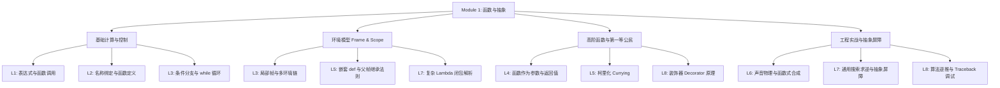

> **英文原课**：CS 61A: Structure and Interpretation of Computer Programs (Fall 2024)  
> **主讲教师**：Prof. John DeNero (UC Berkeley)  
> **图文整理**：VideoBook 视频转图文技术电子书流水线  
> **全书体量**：已收录 37 / 37 讲 ｜ 18.2 小时音视频讲义 ｜ 577 张高清板书截图  
> **在线目录**：[CS61A 专题目录](/notes/topics/CS61A)

---


> **主讲**：John DeNero ｜ **时长**：34:16 ｜ **视频回链**：[B 站对应单集 (P8)](https://www.bilibili.com/video/BV1sy411z7nA/?p=8)

## 1. 期中考试题型剖析与“Python 会打印什么”（WWPP）

*(参考时间：00:01:24 · [视频跳转 (P8 00:01:24)](https://www.bilibili.com/video/BV1sy411z7nA/?p=8&t=84))*

期中考试（Midterm 1）的考察重心在于检验你对**语言内在求值规则的精确理解**与**利用基础工具解决新问题的能力**。

其中最经典的题型是 **“What Would Python Print?” (WWPP)**：在交互式解释器中输入一段复杂嵌套的代码，预测终端会输出什么、表达式最终求值为什么。

做 WWPP 题目的绝对铁律：**严格区分“屏幕显示副作用（Display）”与“表达式求值结果（Value）”**！


*⏱ 时间戳：00:03:00 · 📷 课堂截图 · [在 B 站观看对应片段 (P8 00:03:00)](https://www.bilibili.com/video/BV1sy411z7nA/?p=8&t=180)*

| 表达式 | 求值结果 (Value) | 终端交互输出 (Interactive Output) |
| :--- | :---: | :---: |
| `5` | `5` | `5` |
| `print(5)` | `None` | `5`（注意：None 在交互式终端默认隐去不显示） |
| `print(print(5))` | `None` | `5`<br>`None`（先求内部参数输出 5，外部再打印其返回值 None） |


*⏱ 时间戳：00:04:15 · 📷 课堂截图 · [在 B 站观看对应片段 (P8 00:04:15)](https://www.bilibili.com/video/BV1sy411z7nA/?p=8&t=255)*

---

## 2. 闭包与链式调用真题实战：delay 与 pirate

*(参考时间：00:04:22 · [视频跳转 (P8 00:04:22)](https://www.bilibili.com/video/BV1sy411z7nA/?p=8&t=262))*

### 题目一：延迟调用与闭包作用域（delay）

```python
def delay(arg):
    print("delayed")
    def g():
        return arg
    return g
```

考察如下链式调用：
```python
delay(delay)()(6)()
```


*⏱ 时间戳：00:06:40 · 📷 课堂截图 · [在 B 站观看对应片段 (P8 00:06:40)](https://www.bilibili.com/video/BV1sy411z7nA/?p=8&t=400)*

#### 逐层拆解分析

1. `delay(delay)`：
   - 调用 `delay`，传入自身。
   - 打印：`delayed`。
   - 返回一个内层函数 `g`，其闭包捕获了 `arg = delay`。
2. `delay(delay)()`：
   - 调用上述 `g()`，返回其记录的 `arg`，即 `delay` 函数本身。
3. `delay(delay)()(6)`：
   - 即 `delay(6)`。
   - 打印：`delayed`。
   - 返回新函数 `g`，其闭包捕获了 `arg = 6`。
4. `delay(delay)()(6)()`：
   - 调用该 `g()`，返回 `6`。
   - 终端在最后打印出表达式的值 `6`。

**最终输出**：
```text
delayed
delayed
6
```

---

### 题目二：参数同名遮蔽与恒等变换（pirate）

```python
def pirate(arg):
    print("matey")
    def plunder(arg):
        return arg
    return plunder
```


*⏱ 时间戳：00:09:10 · 📷 课堂截图 · [在 B 站观看对应片段 (P8 00:09:10)](https://www.bilibili.com/video/BV1sy411z7nA/?p=8&t=550)*

#### 核心陷阱剖析

注意内层函数 `def plunder(arg)` 的形参也叫 `arg`！
- 当 `plunder` 被调用时，解释器首先在其专属局部帧中查找 `arg`。
- 首帧就找到了形参 `arg`，因此**外层 pirate 传入的那个 arg 被彻底遮蔽，永远无法被访问**！
- 换言之，`plunder` 无论在什么情况下，都只是一个最纯粹的**恒等函数（Identity Function）**：传入什么就原封不动返回什么。

#### 变式调用 1：`add(pirate(3)(square)(4), 1)`
1. `pirate(3)`：打印 `matey`，返回 `plunder`。
2. `plunder(square)`：原样返回 `square` 函数。
3. `square(4)`：计算得 `16`。
4. `add(16, 1)`：返回 `17`。
**终端输出**：先打印 `matey`，下一行显示求值结果 `17`。

#### 变式调用 2：`pirate(pirate(pirate))(5)(7)`
1. 内层 `pirate(pirate)`：打印 `matey`，返回 `plunder`。
2. 外层 `pirate(plunder)`：打印 `matey`，返回 `plunder`。
3. `plunder(5)`：返回整数 `5`！
4. 接下来试图执行 `5(7)`：
   - 整数 `5` 处于调用表达式的运算符位置！
   - 抛出严重运行时错误：`TypeError: 'int' object is not callable`。


*⏱ 时间戳：00:11:45 · 📷 课堂截图 · [在 B 站观看对应片段 (P8 00:11:45)](https://www.bilibili.com/video/BV1sy411z7nA/?p=8&t=705)*

---

## 3. 伯克利期中传奇考题：Horse-Mask 作用域拓扑谜题

*(参考时间：00:13:32 · [视频跳转 (P8 00:13:32)](https://www.bilibili.com/video/BV1sy411z7nA/?p=8&t=812))*

这是 CS61A 历年期中最具传奇色彩的高阶环境图试题：

```python
def horse(mask):
    horse = mask
    def mask(horse):
        return horse
    return horse(mask)

mask = lambda horse: horse(2)
horse(mask)
```

调用 `horse(mask)` 的最终返回值是多少？


*⏱ 时间戳：00:13:40 · 📷 课堂截图 · [在 B 站观看对应片段 (P8 00:13:40)](https://www.bilibili.com/video/BV1sy411z7nA/?p=8&t=820)*

### 环境演变推演图解

1. **全局帧准备**：
   - `horse`: 绑定到外层函数 `horse(mask)`。
   - `mask`: 绑定到 `lambda horse: horse(2)`（记为 $\lambda_1$），父帧为 `Global`。
2. **进入 `horse(mask)`（创建帧 F1）**：
   - 形参 `mask` 绑定为传入的 $\lambda_1$。
   - 执行 `horse = mask`：在当前局部帧 `F1` 中创建局部变量 `horse`，同样指向 $\lambda_1$。
   - 执行 `def mask(horse)`：
     - 在当前帧 `F1` 创建新函数 `mask`（记为 $f_{mask}$），其父帧为 `F1`！
     - 将局部帧中的名称 `mask` **重新绑定**为 $f_{mask}$（旧的 $\lambda_1$ 绑定被覆盖）。
3. **执行 `return horse(mask)`**：
   - 查找当前帧 `F1` 中的 `horse`：是 $\lambda_1$！
   - 查找当前帧 `F1` 中的 `mask`：是刚定义的 $f_{mask}$！
   - 发起调用：$\lambda_1(f_{mask})$。


*⏱ 时间戳：00:15:30 · 📷 课堂截图 · [在 B 站观看对应片段 (P8 00:15:30)](https://www.bilibili.com/video/BV1sy411z7nA/?p=8&t=930)*

4. **进入 $\lambda_1$（创建帧 F2）**：
   - $\lambda_1$ 的父帧是 `Global`。
   - 其形参 `horse` 绑定为传入的实参 $f_{mask}$。
   - 执行函数体 `horse(2)`：即调用 $f_{mask}(2)$！
5. **进入 $f_{mask}$（创建帧 F3）**：
   - $f_{mask}$ 的父帧是 `F1`。
   - 其形参 `horse` 绑定为传入的实参 `2`。
   - 执行函数体 `return horse`：直接返回当前帧绑定的数字 **`2`**！
6. 一路原样向上传递，整个表达式最终求值为 **`2`**！


*⏱ 时间戳：00:17:30 · 📷 课堂截图 · [在 B 站观看对应片段 (P8 00:17:30)](https://www.bilibili.com/video/BV1sy411z7nA/?p=8&t=1050)*

---

## 4. 函数实现通用策略：以 remove(n, digit) 为例

*(参考时间：00:19:35 · [视频跳转 (P8 00:19:35)](https://www.bilibili.com/video/BV1sy411z7nA/?p=8&t=1175))*

在纸笔考试中，面对全新的算法填空题，如何有条不紊地写出 Bug-free 的代码？

```python
def remove(n, digit):
    """从非负整数 n 中移除所有等于 digit 的数字，返回剩余数字拼成的整数。

    >>> remove(231, 3)
    21
    >>> remove(243132, 2)
    4313
    """
    kept, digits = 0, 0
    while n > 0:
        n, last = n // 10, n % 10
        if last != digit:
            kept = kept + last * (10 ** digits)
            digits = digits + 1
    return kept
```


*⏱ 时间戳：00:19:40 · 📷 课堂截图 · [在 B 站观看对应片段 (P8 00:19:40)](https://www.bilibili.com/video/BV1sy411z7nA/?p=8&t=1180)*

### 科学解题四步法

1. **透彻理解示例（Trace small cases）**：拿具体的 `n = 231, digit = 3` 在纸上草拟。
2. **拆分基本动作**：
   - 提取末位：`last = n % 10`
   - 剥除末位：`n = n // 10`
   - 过滤条件：`if last != digit`
3. **突破发明核心权值算法（The Creative Leap）**：
   - 从低位往高位剥离数字时，先拿到 `1`，再跳过 `3`，再拿到 `2`。
   - 如果直接做加法，得到的是 $1 + 2 = 3$；如果写成 `kept * 10 + last`，拼出来的是倒序的 $12$。
   - 正确的数学模型：**当前保留下来的数字，其真正的十进制位权取决于“之前已经保留了多少位”**！
   - 第 1 个保留的数字 `1` 应该放在 $10^0$ 位（个位）；第 2 个保留的数字 `2` 应该放在 $10^1$ 位（十位）。
   - 公式锁定为：`kept + last * (10 ** digits)`！


*⏱ 时间戳：00:23:30 · 📷 课堂截图 · [在 B 站观看对应片段 (P8 00:23:30)](https://www.bilibili.com/video/BV1sy411z7nA/?p=8&t=1410)*


*⏱ 时间戳：00:26:40 · 📷 课堂截图 · [在 B 站观看对应片段 (P8 00:26:40)](https://www.bilibili.com/video/BV1sy411z7nA/?p=8&t=1600)*

---

## 5. Python 装饰器（Decorators）揭秘：语法糖下的高阶函数

*(参考时间：00:29:08 · [视频跳转 (P8 00:29:08)](https://www.bilibili.com/video/BV1sy411z7nA/?p=8&t=1748))*

在工业界 Python 代码中，经常会看到形如 `@trace` 的特殊语法。这就是**装饰器（Decorator）**。

很多初学者觉得装饰器神秘高深，但学过高阶函数后，你会发现**它根本没有任何新魔法，仅仅是一个极度优雅的语法糖**！


*⏱ 时间戳：00:30:40 · 📷 课堂截图 · [在 B 站观看对应片段 (P8 00:30:40)](https://www.bilibili.com/video/BV1sy411z7nA/?p=8&t=1840)*

### 从零构建 trace 追踪装饰器

我们希望给任何单参函数增加一个“在被调用时自动打印入参”的调试功能：

```python
def trace1(fn):
    """接受函数 fn，返回一个带有打印日志增强功能的包裹函数。"""
    def traced(x):
        print(f"Calling {fn.__name__} on argument {x}")
        return fn(x)
    return traced
```


*⏱ 时间戳：00:32:00 · 📷 课堂截图 · [在 B 站观看对应片段 (P8 00:32:00)](https://www.bilibili.com/video/BV1sy411z7nA/?p=8&t=1920)*

### 装饰器语法糖等价原理

以下两种写法在 Python 解释器中**完全 100% 等价**：

```python
# 写法 A：使用 @ 装饰器语法
@trace1
def square(x):
    return x * x

# 写法 B：原始高阶函数重绑定
def square(x):
    return x * x
square = trace1(square)
```

当我们在 `sum_squares_up_to` 中调用被装饰的 `square` 时，每一次计算都会在控制台清晰打印出入参与调用时序。

> **思考题**：为什么 Python 要专门引入 `@` 语法？
> 1. **前置声明意图**：把装饰器写在函数头部，让人在阅读第一行时就知道该函数具备特殊切面行为（如缓存、鉴权、日志追踪）。
> 2. **降低心智门槛**：为那些尚未深入理解高阶函数闭包机制的开发者提供简单直观的声明式接口。


*⏱ 时间戳：00:33:30 · 📷 课堂截图 · [在 B 站观看对应片段 (P8 00:33:30)](https://www.bilibili.com/video/BV1sy411z7nA/?p=8&t=2010)*

---

## 6. 第一模块全景总结与期中必胜心法

至此，我们已经完整走完了 **Module 1: 函数与抽象（Functions & Abstraction）** 的全部 8 讲课程：



### 期中三大通关秘籍

1. **心无旁骛画环境图**：牢记“创建函数定 Parent，调用函数承 Parent”，永远在当前帧的最早位置解析变量名。
2. **算式隔离读 WWPP**：绝不靠直觉猜测，老老实实写下每一步运算的返回值与打印输出。
3. **小例推演构循环**：面对复杂迭代题，先拿一个最简单的小例子标注变量走势，推导出权值公式后再写出通用循环。

---

