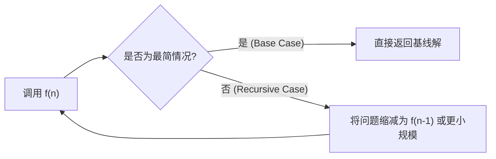
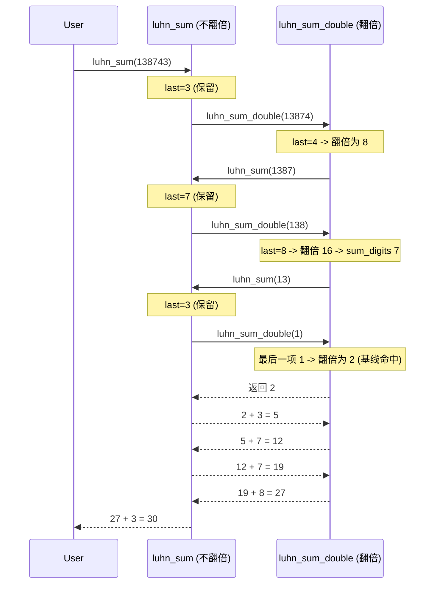

> **课程体系**：UC Berkeley CS61A (Fall 2024)  
> **所属模块**：Module 2: 递归与数据抽象 (Recursion & Sequences)  
> **主讲教师**：Prof. John DeNero (UC Berkeley)  
> **视频时长**：37:49 ｜ **课堂截图**：14 张板书/代码演示  
> **视频直达**：[📺 在 B 站观看本讲原视频 (P9)](https://www.bilibili.com/video/BV1sy411z7nA/?p=9)  
> **快速导航**：[← 上一讲 (P08 Lecture 8 Function Examples)](/notes/cs61a/lecture-08) ｜ [📚 返回全书目录](/notes/topics/CS61A) ｜ [下一讲 (P10 Lecture 10 Tree Recursion) →](/notes/cs61a/lecture-10)

---

## 目录 (Table of Contents)
1. [引言：环境模型中的自引用与状态累积](#1-引言环境模型中的自引用与状态累积)
2. [递归的本质与现实映照](#2-递归的本质与现实映照)
3. [递归函数的解剖结构 (Anatomy of a Recursive Function)](#3-递归函数的解剖结构-anatomy-of-a-recursive-function)
4. [环境模型视角：阶乘函数的调用栈展开与返回](#4-环境模型视角阶乘函数的调用栈展开与返回)
5. [迭代 vs. 递归：表达力与状态存储的抉择](#5-迭代-vs-递归表达力与状态存储的抉择)
6. [思维跃迁：递归信任跃进 (The Recursive Leap of Faith)](#6-思维跃迁递归信任跃进-the-recursive-leap-of-faith)
7. [互递归实战：信用卡校验 Luhn 算法](#7-互递归实战信用卡校验-luhn-算法)
8. [递归与迭代的双向转化定理](#8-递归与迭代的双向转化定理)
9. [本讲核心要点与思考题](#9-本讲核心要点与思考题)

---

### 深入形式化规约与微观求值流程（Operational Semantics）
在「目录 (Table of Contents)」模块中，计算机底层运算依赖于严密的形式化求值逻辑：
1. **抽象语法树（AST）的分层解析**：
   - 源代码字符流首先经过词法分析器（Lexer）切分为终结符标记（Tokens），随后由语法解析器（Parser）构造成多叉语法树；
   - 运算符优先级与结合性在语法树构建阶段即已固化，消除了运行期的二义性；
2. **环境序列的动态跃迁**：
   - 每次函数调用产生的新帧，其静态词法环境由函数对象的 `parent` 属性完全决定；
   - 变量查找沿环境链向上单向回溯，直到全局环境帧，若未找到则触发 `NameError` 异常；
3. **状态不变式（State Invariants）**：
   - 编写健壮程序的关键在于明确循环不变式（Loop Invariants）与函数前后置条件（Pre/Post-conditions）；
   - 在复杂控制流跳转中，确保状态变量在每次迭代前均维持合法的业务约束。


## 1. 引言：环境模型中的自引用与状态累积

在深入经典递归之前，DeNero 教授从环境模型的自然推论出发，探讨了一个看似简单却极为强大的机制：**函数体内部可以引用自身的名字**。

### 1.1 自引用返回自身的函数 (`print_all`)

考虑如下 Python 函数：
```python
def print_all(x):
    print(x)
    return print_all
```
当我们执行链式调用 `print_all(1)(3)(5)` 时：
1. `print_all(1)`：首先在全局帧查找 `print_all`，创建局部帧 `f1`，绑定 `x = 1`。打印 `1`，随后函数体查找 `print_all` 并返回该函数本身。
2. 链式调用的第二个括号 `(3)` 立即作用于返回的 `print_all`，创建局部帧 `f2`，绑定 `x = 3`，打印 `3`，再次返回 `print_all`。
3. 第三个括号 `(5)` 同样调用该函数，打印 `5`。

[](https://www.bilibili.com/video/BV1sy411z7nA/?p=9&t=322)
*⏱ 时间戳：00:05:22 · 📷 课堂截图 · [在 B 站观看对应片段 (P9 00:05:22)](https://www.bilibili.com/video/BV1sy411z7nA/?p=9&t=322)*

#### 📸 课堂板书与代码演示深入精读 (00:05:22)

**【现场板书 / 代码演示还原】**：
在此时间节点，DeNero 教授在屏幕上进行了核心演示与重点板书推导：
> *“And that expression will evaluate to the printAll function, so I could call it again. Let's see what happens. printAll is defined. By the time I call printAll, notice that printAll is already bound in the global frame. I call printAll on the first argument 1. 1 gets printed out. In this environment ...”*

**【底层计算模型与微观执行机制】**：
1. **执行上下文与时序追踪**：
   - 处于当前讨论节点「1. 引言：环境模型中的自引用与状态累积」，解释器严格遵循核心求值规约；
   - 表达式先求值操作符，随后自左至右严格求值操作数，最终将函数对象施加于实参列表；
   - 若涉及环境模型，局部帧严格记录其静态词法父指针（Parent Pointer 指向函数定义处的环境），与运行时的动态调用栈形成正交架构。
2. **内存拓扑与对象引用**：
   - 变量符号只是哈希表（环境帧）中的键，指针直接指向堆内存中的一等公民对象；
   - 赋值语句是离散时间的瞬时状态快照，绝不会建立隐式的数学依赖监听。

**【避坑指南与高频考点点拨】**：
- **常见思维误区**：在「递归展开与返回机制、Luhn 信用卡校验互递归算法」相关考题中，初学者极易根据代码表面形式猜想结果，导致作用域混淆或变量遮蔽（Shadowing）误判；
- **调试排错黄金法则**：遇到嵌套调用与复杂分支时，务必在草稿纸上画出独立的局部帧，标明每个形参的具体绑定值，按部就班推导。


```
Global frame
  print_all ───► func print_all(x) [parent=Global]
                    ▲
                    │ (returned each time)
f1: print_all [parent=Global]
  x: 1
  Return value ───► func print_all(x)

f2: print_all [parent=Global]
  x: 3
  Return value ───► func print_all(x)

f3: print_all [parent=Global]
  x: 5
  Return value ───► func print_all(x)
```

> **核心结论**：虽然 `print_all` 内部引用了自己，但它并没有在函数体内**调用**自己，因此不会无限循环；调用的次数完全由外部的链式调用表达式决定。

---

### 1.2 高阶函数与历史状态累积 (`print_sums`)

如果我们希望每次调用不仅打印当前参数，还能输出“迄今为止所有参数的累加和”，该如何设计？

利用词法闭包与父帧环境，我们可以编写：
```python
def print_sums(x):
    print(x)
    def next_sum(y):
        return print_sums(x + y)
    return next_sum
```

执行调用：`print_sums(1)(3)(5)`
- `print_sums(1)`：打印 `1`，定义局部函数 `next_sum`（其父帧为 `f1: x=1`），并返回 `next_sum`。
- `next_sum(3)`：局部帧 `f2` 绑定 `y = 3`。执行 `print_sums(x + y)`，在此处通过父帧 `f1` 找到 `x = 1`，计算 `1 + 3 = 4`，发起对 `print_sums(4)` 的调用。
- `print_sums(4)`：进入 `f3` 帧，打印累积和 `4`，定义新的 `next_sum`（父帧为 `f3: x=4`）并返回。
- 最终传入 `5` 时，新内部函数计算 `4 + 5 = 9`，进入 `f5` 打印 `9`。

[](https://www.bilibili.com/video/BV1sy411z7nA/?p=9&t=499)
*⏱ 时间戳：00:08:19 · 📷 课堂截图 · [在 B 站观看对应片段 (P9 00:08:19)](https://www.bilibili.com/video/BV1sy411z7nA/?p=9&t=499)*

#### 📸 课堂板书与代码演示深入精读 (00:08:19)

**【现场板书 / 代码演示还原】**：
在此时间节点，DeNero 教授在屏幕上进行了核心演示与重点板书推导：
> *“It's the value of print sums 1, 3. Notice that the function we're returning, which has parent f3, knows the sum so far of 4. And so if it wants to compute the sum of the whole thing, 1 plus 3 plus 5, it needs that 4 along with the 5 that I'm about to pass in. So I've just called nextSum for the seco...”*

**【底层计算模型与微观执行机制】**：
1. **执行上下文与时序追踪**：
   - 处于当前讨论节点「1. 引言：环境模型中的自引用与状态累积」，解释器严格遵循核心求值规约；
   - 表达式先求值操作符，随后自左至右严格求值操作数，最终将函数对象施加于实参列表；
   - 若涉及环境模型，局部帧严格记录其静态词法父指针（Parent Pointer 指向函数定义处的环境），与运行时的动态调用栈形成正交架构。
2. **内存拓扑与对象引用**：
   - 变量符号只是哈希表（环境帧）中的键，指针直接指向堆内存中的一等公民对象；
   - 赋值语句是离散时间的瞬时状态快照，绝不会建立隐式的数学依赖监听。

**【避坑指南与高频考点点拨】**：
- **常见思维误区**：在「递归展开与返回机制、Luhn 信用卡校验互递归算法」相关考题中，初学者极易根据代码表面形式猜想结果，导致作用域混淆或变量遮蔽（Shadowing）误判；
- **调试排错黄金法则**：遇到嵌套调用与复杂分支时，务必在草稿纸上画出独立的局部帧，标明每个形参的具体绑定值，按部就班推导。


这种模式展示了：**参数通过帧链可以在不同函数调用之间传递并记住计算历史**。这为我们理解递归的状态转移奠定了直观基础。

---

### 深入形式化规约与微观求值流程（Operational Semantics）
在「1. 引言：环境模型中的自引用与状态累积」模块中，计算机底层运算依赖于严密的形式化求值逻辑：
1. **抽象语法树（AST）的分层解析**：
   - 源代码字符流首先经过词法分析器（Lexer）切分为终结符标记（Tokens），随后由语法解析器（Parser）构造成多叉语法树；
   - 运算符优先级与结合性在语法树构建阶段即已固化，消除了运行期的二义性；
2. **环境序列的动态跃迁**：
   - 每次函数调用产生的新帧，其静态词法环境由函数对象的 `parent` 属性完全决定；
   - 变量查找沿环境链向上单向回溯，直到全局环境帧，若未找到则触发 `NameError` 异常；
3. **状态不变式（State Invariants）**：
   - 编写健壮程序的关键在于明确循环不变式（Loop Invariants）与函数前后置条件（Pre/Post-conditions）；
   - 在复杂控制流跳转中，确保状态变量在每次迭代前均维持合法的业务约束。


## 2. 递归的本质与现实映照

### 2.1 什么是递归函数？
> **递归函数 (Recursive Function)**：在自身函数体内直接或间接调用自身的函数。



递归不仅是计算机算法的基石，更在自然、艺术与数学中随处可见：
- **谢尔宾斯基三角形 (Sierpinski Triangle)**：一个大三角形由三个以角为顶点的小谢尔宾斯基三角形组成，无限嵌套。
- **俄罗斯套娃 (Matryoshka Dolls)**：打开一个娃娃，里面是一个一模一样但尺度更小的娃娃，直到最内层不可拆分的实心小木偶。

[](https://www.bilibili.com/video/BV1sy411z7nA/?p=9&t=622)
*⏱ 时间戳：00:10:22 · 📷 课堂截图 · [在 B 站观看对应片段 (P9 00:10:22)](https://www.bilibili.com/video/BV1sy411z7nA/?p=9&t=622)*

#### 📸 课堂板书与代码演示深入精读 (00:10:22)

**【现场板书 / 代码演示还原】**：
在此时间节点，DeNero 教授在屏幕上进行了核心演示与重点板书推导：
> *“Recursive functions. One of my favorite topics in this course. So a recursive function is a function whose body calls itself either directly or indirectly. We'll see both cases today. So what does that mean? Well, it means that sometimes when you're executing the body of a function, and it's a recur...”*

**【底层计算模型与微观执行机制】**：
1. **执行上下文与时序追踪**：
   - 处于当前讨论节点「2. 递归的本质与现实映照」，解释器严格遵循核心求值规约；
   - 表达式先求值操作符，随后自左至右严格求值操作数，最终将函数对象施加于实参列表；
   - 若涉及环境模型，局部帧严格记录其静态词法父指针（Parent Pointer 指向函数定义处的环境），与运行时的动态调用栈形成正交架构。
2. **内存拓扑与对象引用**：
   - 变量符号只是哈希表（环境帧）中的键，指针直接指向堆内存中的一等公民对象；
   - 赋值语句是离散时间的瞬时状态快照，绝不会建立隐式的数学依赖监听。

**【避坑指南与高频考点点拨】**：
- **常见思维误区**：在「递归展开与返回机制、Luhn 信用卡校验互递归算法」相关考题中，初学者极易根据代码表面形式猜想结果，导致作用域混淆或变量遮蔽（Shadowing）误判；
- **调试排错黄金法则**：遇到嵌套调用与复杂分支时，务必在草稿纸上画出独立的局部帧，标明每个形参的具体绑定值，按部就班推导。


### 2.2 典型动机：各位数字求和 (Sum Digits) 与校验位

以计算正整数各数位之和为例：`2013 -> 2 + 0 + 1 + 3 = 6`。
- **数学性质**：一个整数能被 9 整除，当且仅当其各位数字之和能被 9 整除。
- **工程应用（校验位 Checksum Digit）**：在信用卡、条形码（UPC）、身份证号中，最后一位数字通常不是账号本身，而是由前面所有位计算出来的校验位。如果用户输入错误，系统可无需联网直接识别出笔误。

[](https://www.bilibili.com/video/BV1sy411z7nA/?p=9&t=690)
*⏱ 时间戳：00:11:30 · 📷 课堂截图 · [在 B 站观看对应片段 (P9 00:11:30)](https://www.bilibili.com/video/BV1sy411z7nA/?p=9&t=690)*

#### 📸 课堂板书与代码演示深入精读 (00:11:30)

**【现场板书 / 代码演示还原】**：
在此时间节点，DeNero 教授在屏幕上进行了核心演示与重点板书推导：
> *“2 plus 0 plus 1 plus 3 is 6. Why would we do this? Well, there are interesting properties of digit sums, such as a number A is divisible by 9, if and only if its digit sum is also divisible by 9. And, summing up digits is very useful for typo detection. So here's a credit card. Now, the problem with...”*

**【底层计算模型与微观执行机制】**：
1. **执行上下文与时序追踪**：
   - 处于当前讨论节点「2. 递归的本质与现实映照」，解释器严格遵循核心求值规约；
   - 表达式先求值操作符，随后自左至右严格求值操作数，最终将函数对象施加于实参列表；
   - 若涉及环境模型，局部帧严格记录其静态词法父指针（Parent Pointer 指向函数定义处的环境），与运行时的动态调用栈形成正交架构。
2. **内存拓扑与对象引用**：
   - 变量符号只是哈希表（环境帧）中的键，指针直接指向堆内存中的一等公民对象；
   - 赋值语句是离散时间的瞬时状态快照，绝不会建立隐式的数学依赖监听。

**【避坑指南与高频考点点拨】**：
- **常见思维误区**：在「递归展开与返回机制、Luhn 信用卡校验互递归算法」相关考题中，初学者极易根据代码表面形式猜想结果，导致作用域混淆或变量遮蔽（Shadowing）误判；
- **调试排错黄金法则**：遇到嵌套调用与复杂分支时，务必在草稿纸上画出独立的局部帧，标明每个形参的具体绑定值，按部就班推导。


---

### 深入形式化规约与微观求值流程（Operational Semantics）
在「2. 递归的本质与现实映照」模块中，计算机底层运算依赖于严密的形式化求值逻辑：
1. **抽象语法树（AST）的分层解析**：
   - 源代码字符流首先经过词法分析器（Lexer）切分为终结符标记（Tokens），随后由语法解析器（Parser）构造成多叉语法树；
   - 运算符优先级与结合性在语法树构建阶段即已固化，消除了运行期的二义性；
2. **环境序列的动态跃迁**：
   - 每次函数调用产生的新帧，其静态词法环境由函数对象的 `parent` 属性完全决定；
   - 变量查找沿环境链向上单向回溯，直到全局环境帧，若未找到则触发 `NameError` 异常；
3. **状态不变式（State Invariants）**：
   - 编写健壮程序的关键在于明确循环不变式（Loop Invariants）与函数前后置条件（Pre/Post-conditions）；
   - 在复杂控制流跳转中，确保状态变量在每次迭代前均维持合法的业务约束。


## 3. 递归函数的解剖结构 (Anatomy of a Recursive Function)

如何不用 `while` 循环对整数各个数位求和？

### 3.1 积木构造：数位拆分 (`split`)
首先定义整数除法与取模的基本操作：
```python
def split(n):
    """返回 (去除个位后的数, 个位数字)"""
    return n // 10, n % 10
```
例如：`split(2013)` 返回 `(201, 3)`。如果我们已经知道如何对 `201` 的各个数位求和（得 `3`），再加上个位数 `3`，即可得到原数的结果 `6`！

[](https://www.bilibili.com/video/BV1sy411z7nA/?p=9&t=828)
*⏱ 时间戳：00:13:48 · 📷 课堂截图 · [在 B 站观看对应片段 (P9 00:13:48)](https://www.bilibili.com/video/BV1sy411z7nA/?p=9&t=828)*

#### 📸 课堂板书与代码演示深入精读 (00:13:48)

**【现场板书 / 代码演示还原】**：
在此时间节点，DeNero 教授在屏幕上进行了核心演示与重点板书推导：
> *“And then the last digit is 3. So if I can sum up the digits of 201, and I can add 3 to that, then I'll get the sum for 2013. Let's write that in code. In order to sum the digits of n, well, if n is less than 10, meaning it's a single digit, we'll just return n. The sum of the digits of 7 is just 7. ...”*

**【底层计算模型与微观执行机制】**：
1. **执行上下文与时序追踪**：
   - 处于当前讨论节点「3. 递归函数的解剖结构 (Anatomy of a Recursive Function)」，解释器严格遵循核心求值规约；
   - 表达式先求值操作符，随后自左至右严格求值操作数，最终将函数对象施加于实参列表；
   - 若涉及环境模型，局部帧严格记录其静态词法父指针（Parent Pointer 指向函数定义处的环境），与运行时的动态调用栈形成正交架构。
2. **内存拓扑与对象引用**：
   - 变量符号只是哈希表（环境帧）中的键，指针直接指向堆内存中的一等公民对象；
   - 赋值语句是离散时间的瞬时状态快照，绝不会建立隐式的数学依赖监听。

**【避坑指南与高频考点点拨】**：
- **常见思维误区**：在「递归展开与返回机制、Luhn 信用卡校验互递归算法」相关考题中，初学者极易根据代码表面形式猜想结果，导致作用域混淆或变量遮蔽（Shadowing）误判；
- **调试排错黄金法则**：遇到嵌套调用与复杂分支时，务必在草稿纸上画出独立的局部帧，标明每个形参的具体绑定值，按部就班推导。


### 3.2 递归标准范式
一个规范的递归函数必然由两大支柱构成：
1. **基线条件 (Base Cases)**：不需要递归调用就能直接求解的最简单情形。
2. **递归条件 (Recursive Cases)**：通过把原问题拆分为**规模更小的同类子问题**，并在子问题结果上完成组装。

```python
def sum_digits(n):
    """计算正整数 n 的各位数字之和。"""
    if n < 10:
        return n  # 基线条件：单数位直接返回自身
    else:
        all_but_last, last = split(n)
        return sum_digits(all_but_last) + last  # 递归条件：更小的问题 + 当前个位
```

[](https://www.bilibili.com/video/BV1sy411z7nA/?p=9&t=922)
*⏱ 时间戳：00:15:22 · 📷 课堂截图 · [在 B 站观看对应片段 (P9 00:15:22)](https://www.bilibili.com/video/BV1sy411z7nA/?p=9&t=922)*

#### 📸 课堂板书与代码演示深入精读 (00:15:22)

**【现场板书 / 代码演示还原】**：
在此时间节点，DeNero 教授在屏幕上进行了核心演示与重点板书推导：
> *“Base cases are very simple versions of the problem I'm trying to solve. In this case, the base case is a really simple case where you only have one digit, so summing it up is trivial. You just return N. So base cases are evaluated without recursive calls. They can usually be computed directly, such ...”*

**【底层计算模型与微观执行机制】**：
1. **执行上下文与时序追踪**：
   - 处于当前讨论节点「3. 递归函数的解剖结构 (Anatomy of a Recursive Function)」，解释器严格遵循核心求值规约；
   - 表达式先求值操作符，随后自左至右严格求值操作数，最终将函数对象施加于实参列表；
   - 若涉及环境模型，局部帧严格记录其静态词法父指针（Parent Pointer 指向函数定义处的环境），与运行时的动态调用栈形成正交架构。
2. **内存拓扑与对象引用**：
   - 变量符号只是哈希表（环境帧）中的键，指针直接指向堆内存中的一等公民对象；
   - 赋值语句是离散时间的瞬时状态快照，绝不会建立隐式的数学依赖监听。

**【避坑指南与高频考点点拨】**：
- **常见思维误区**：在「递归展开与返回机制、Luhn 信用卡校验互递归算法」相关考题中，初学者极易根据代码表面形式猜想结果，导致作用域混淆或变量遮蔽（Shadowing）误判；
- **调试排错黄金法则**：遇到嵌套调用与复杂分支时，务必在草稿纸上画出独立的局部帧，标明每个形参的具体绑定值，按部就班推导。


> **解剖要素对照表**：
> | 组成部分 | `sum_digits` 中的实现 | 关键作用 |
> | :--- | :--- | :--- |
> | **函数签名** | `def sum_digits(n):` | 声明函数接收的参数（状态载体） |
> | **条件分支** | `if n < 10:` | 区分基线与递归分支，防止无限自调 |
> | **基线求解** | `return n` | 为递归提供停止条件与出口返回值 |
> | **状态缩小** | `all_but_last, last = split(n)` | 确保每一次递归调用的输入都在向基线收敛 |
> | **递归组合** | `return sum_digits(...) + last` | 信任子问题的解，并合成最终答案 |

---

### 深入形式化规约与微观求值流程（Operational Semantics）
在「3. 递归函数的解剖结构 (Anatomy of a Recursive Function)」模块中，计算机底层运算依赖于严密的形式化求值逻辑：
1. **抽象语法树（AST）的分层解析**：
   - 源代码字符流首先经过词法分析器（Lexer）切分为终结符标记（Tokens），随后由语法解析器（Parser）构造成多叉语法树；
   - 运算符优先级与结合性在语法树构建阶段即已固化，消除了运行期的二义性；
2. **环境序列的动态跃迁**：
   - 每次函数调用产生的新帧，其静态词法环境由函数对象的 `parent` 属性完全决定；
   - 变量查找沿环境链向上单向回溯，直到全局环境帧，若未找到则触发 `NameError` 异常；
3. **状态不变式（State Invariants）**：
   - 编写健壮程序的关键在于明确循环不变式（Loop Invariants）与函数前后置条件（Pre/Post-conditions）；
   - 在复杂控制流跳转中，确保状态变量在每次迭代前均维持合法的业务约束。


## 4. 环境模型视角：阶乘函数的调用栈展开与返回

为了彻底祛除对递归的神秘感，我们用 CS61A 最强大的工具——**环境模型 (Environment Diagrams)** 逐帧分析阶乘函数 `fact(3)`：

```python
def fact(n):
    if n == 0:
        return 1
    else:
        return n * fact(n - 1)

fact(3)
```

[](https://www.bilibili.com/video/BV1sy411z7nA/?p=9&t=1058)
*⏱ 时间戳：00:17:38 · 📷 课堂截图 · [在 B 站观看对应片段 (P9 00:17:38)](https://www.bilibili.com/video/BV1sy411z7nA/?p=9&t=1058)*

#### 📸 课堂板书与代码演示深入精读 (00:17:38)

**【现场板书 / 代码演示还原】**：
在此时间节点，DeNero 教授在屏幕上进行了核心演示与重点板书推导：
> *“The nice thing is that environment diagrams are useful for understanding recursive functions. So we're going to look at a new example, the factorial function, which computes the factorial of n, or n times n minus 1 times n minus 2 times n minus 3, all the way down until you get to 1. We'll start out...”*

**【底层计算模型与微观执行机制】**：
1. **执行上下文与时序追踪**：
   - 处于当前讨论节点「4. 环境模型视角：阶乘函数的调用栈展开与返回」，解释器严格遵循核心求值规约；
   - 表达式先求值操作符，随后自左至右严格求值操作数，最终将函数对象施加于实参列表；
   - 若涉及环境模型，局部帧严格记录其静态词法父指针（Parent Pointer 指向函数定义处的环境），与运行时的动态调用栈形成正交架构。
2. **内存拓扑与对象引用**：
   - 变量符号只是哈希表（环境帧）中的键，指针直接指向堆内存中的一等公民对象；
   - 赋值语句是离散时间的瞬时状态快照，绝不会建立隐式的数学依赖监听。

**【避坑指南与高频考点点拨】**：
- **常见思维误区**：在「递归展开与返回机制、Luhn 信用卡校验互递归算法」相关考题中，初学者极易根据代码表面形式猜想结果，导致作用域混淆或变量遮蔽（Shadowing）误判；
- **调试排错黄金法则**：遇到嵌套调用与复杂分支时，务必在草稿纸上画出独立的局部帧，标明每个形参的具体绑定值，按部就班推导。


### 4.1 深入调用栈（向基线递进）
1. **调用 `fact(3)`**：创建帧 `f1`，绑定 `n = 3`。进入 `else` 分支，求值表达式 `3 * fact(2)`。为了得到乘法操作数，暂停当前帧的返回，发起子调用 `fact(2)`。
2. **调用 `fact(2)`**：创建帧 `f2`，绑定 `n = 2`。求值 `2 * fact(1)`，暂停等待 `fact(1)` 的返回值。
3. **调用 `fact(1)`**：创建帧 `f3`，绑定 `n = 1`。求值 `1 * fact(0)`，暂停等待 `fact(0)`。
4. **到达基线 `fact(0)`**：创建帧 `f4`，绑定 `n = 0`。满足 `n == 0`，直接返回 `1`！

### 4.2 栈帧返回与乘积聚合（从基线回溯）
5. `f4` 返回 `1` 到 `f3` 的等待点：`f3` 计算 `1 * 1 = 1`，将 `1` 作为 `f3` 的返回值返回给 `f2`。
6. `f2` 收到 `1`：计算 `2 * 1 = 2`，将 `2` 返回给 `f1`。
7. `f1` 收到 `2`：计算 `3 * 2 = 6`，最终返回 `6`。

[](https://www.bilibili.com/video/BV1sy411z7nA/?p=9&t=1300)
*⏱ 时间戳：00:21:40 · 📷 课堂截图 · [在 B 站观看对应片段 (P9 00:21:40)](https://www.bilibili.com/video/BV1sy411z7nA/?p=9&t=1300)*

#### 📸 课堂板书与代码演示深入精读 (00:21:40)

**【现场板书 / 代码演示还原】**：
在此时间节点，DeNero 教授在屏幕上进行了核心演示与重点板书推导：
> *“Of the original call to fact. In that case, we're multiplying 3 times whatever we got here, which was this return value, and 3 times 2 is 6. And so we get 6 for the entire return value of fact 3, which is actually the right answer. 3 times 2 times 1 is 6. So somewhere in the middle of execution, our...”*

**【底层计算模型与微观执行机制】**：
1. **执行上下文与时序追踪**：
   - 处于当前讨论节点「4. 环境模型视角：阶乘函数的调用栈展开与返回」，解释器严格遵循核心求值规约；
   - 表达式先求值操作符，随后自左至右严格求值操作数，最终将函数对象施加于实参列表；
   - 若涉及环境模型，局部帧严格记录其静态词法父指针（Parent Pointer 指向函数定义处的环境），与运行时的动态调用栈形成正交架构。
2. **内存拓扑与对象引用**：
   - 变量符号只是哈希表（环境帧）中的键，指针直接指向堆内存中的一等公民对象；
   - 赋值语句是离散时间的瞬时状态快照，绝不会建立隐式的数学依赖监听。

**【避坑指南与高频考点点拨】**：
- **常见思维误区**：在「递归展开与返回机制、Luhn 信用卡校验互递归算法」相关考题中，初学者极易根据代码表面形式猜想结果，导致作用域混淆或变量遮蔽（Shadowing）误判；
- **调试排错黄金法则**：遇到嵌套调用与复杂分支时，务必在草稿纸上画出独立的局部帧，标明每个形参的具体绑定值，按部就班推导。


```
Global frame
  fact ───► func fact(n) [parent=Global]

f1: fact [parent=Global]
  n: 3
  Return value: 6  ◄── 3 * 2

f2: fact [parent=Global]
  n: 2
  Return value: 2  ◄── 2 * 1

f3: fact [parent=Global]
  n: 1
  Return value: 1  ◄── 1 * 1

f4: fact [parent=Global]
  n: 0
  Return value: 1  (Base Case reached!)
```

> **环境模型的关键启示**：
> - **同一个函数被调用多次**，但**每个调用对应独立的活动帧 (Frame)**。
> - 计算机从来不会混淆不同层级的 `n`，因为每次求值当前表达式中的 `n` 时，它只在当前处于活跃状态的环境中向后查找。
> - 所有的未决计算（Pending computations）都被保存在各自所属帧的执行上下文中。

---

### 深入形式化规约与微观求值流程（Operational Semantics）
在「4. 环境模型视角：阶乘函数的调用栈展开与返回」模块中，计算机底层运算依赖于严密的形式化求值逻辑：
1. **抽象语法树（AST）的分层解析**：
   - 源代码字符流首先经过词法分析器（Lexer）切分为终结符标记（Tokens），随后由语法解析器（Parser）构造成多叉语法树；
   - 运算符优先级与结合性在语法树构建阶段即已固化，消除了运行期的二义性；
2. **环境序列的动态跃迁**：
   - 每次函数调用产生的新帧，其静态词法环境由函数对象的 `parent` 属性完全决定；
   - 变量查找沿环境链向上单向回溯，直到全局环境帧，若未找到则触发 `NameError` 异常；
3. **状态不变式（State Invariants）**：
   - 编写健壮程序的关键在于明确循环不变式（Loop Invariants）与函数前后置条件（Pre/Post-conditions）；
   - 在复杂控制流跳转中，确保状态变量在每次迭代前均维持合法的业务约束。


## 5. 迭代 vs. 递归：表达力与状态存储的抉择

### 5.1 代码与数学形式对比

计算阶乘的迭代实现与递归实现：

```python
# 迭代实现 (Iteration)
def fact_iter(n):
    total, k = 1, 1
    while k <= n:
        total, k = total * k, k + 1
    return total

# 递归实现 (Recursion)
def fact(n):
    if n == 0:
        return 1
    return n * fact(n - 1)
```

[](https://www.bilibili.com/video/BV1sy411z7nA/?p=9&t=1456)
*⏱ 时间戳：00:24:16 · 📷 课堂截图 · [在 B 站观看对应片段 (P9 00:24:16)](https://www.bilibili.com/video/BV1sy411z7nA/?p=9&t=1456)*

#### 📸 课堂板书与代码演示深入精读 (00:24:16)

**【现场板书 / 代码演示还原】**：
在此时间节点，DeNero 教授在屏幕上进行了核心演示与重点板书推导：
> *“By keeping track of the total factorial, and what number I'm about to multiply in, and as long as k is less than or equal to n, I change total to be total times the next number that I multiply in, and I change k to be one more than it was before. And when I'm finished with this while statement, then...”*

**【底层计算模型与微观执行机制】**：
1. **执行上下文与时序追踪**：
   - 处于当前讨论节点「5. 迭代 vs. 递归：表达力与状态存储的抉择」，解释器严格遵循核心求值规约；
   - 表达式先求值操作符，随后自左至右严格求值操作数，最终将函数对象施加于实参列表；
   - 若涉及环境模型，局部帧严格记录其静态词法父指针（Parent Pointer 指向函数定义处的环境），与运行时的动态调用栈形成正交架构。
2. **内存拓扑与对象引用**：
   - 变量符号只是哈希表（环境帧）中的键，指针直接指向堆内存中的一等公民对象；
   - 赋值语句是离散时间的瞬时状态快照，绝不会建立隐式的数学依赖监听。

**【避坑指南与高频考点点拨】**：
- **常见思维误区**：在「递归展开与返回机制、Luhn 信用卡校验互递归算法」相关考题中，初学者极易根据代码表面形式猜想结果，导致作用域混淆或变量遮蔽（Shadowing）误判；
- **调试排错黄金法则**：遇到嵌套调用与复杂分支时，务必在草稿纸上画出独立的局部帧，标明每个形参的具体绑定值，按部就班推导。


### 5.2 核心差异分析
| 维度 | 迭代 (Iteration) | 递归 (Recursion) |
| :--- | :--- | :--- |
| **状态维护机制** | 程序员必须显式定义变量（如 `total`、`k`）并在循环体内通过赋值语句不断修改其值 | 依赖**调用栈帧 (Call Stack Frames)** 隐式维护每一步的局部状态 |
| **变量命名负担** | 需要维护多个状态变量名，变量生命周期长，易出现变量被污染或越界 | 仅需关注函数参数与当前子问题规模，局部变量少 |
| **数学对应性** | 对应累乘积记号：$\prod_{k=1}^n k$ | 对应递推归纳定义：$n! = \begin{cases} 1 & \text{if } n = 0 \\ n \cdot (n-1)! & \text{otherwise} \end{cases}$ |
| **空间开销** | 常数级空间复杂度 $O(1)$ | 栈帧深度正比于递归步数 $O(n)$（非尾递归优化时） |

---

### 深入形式化规约与微观求值流程（Operational Semantics）
在「5. 迭代 vs. 递归：表达力与状态存储的抉择」模块中，计算机底层运算依赖于严密的形式化求值逻辑：
1. **抽象语法树（AST）的分层解析**：
   - 源代码字符流首先经过词法分析器（Lexer）切分为终结符标记（Tokens），随后由语法解析器（Parser）构造成多叉语法树；
   - 运算符优先级与结合性在语法树构建阶段即已固化，消除了运行期的二义性；
2. **环境序列的动态跃迁**：
   - 每次函数调用产生的新帧，其静态词法环境由函数对象的 `parent` 属性完全决定；
   - 变量查找沿环境链向上单向回溯，直到全局环境帧，若未找到则触发 `NameError` 异常；
3. **状态不变式（State Invariants）**：
   - 编写健壮程序的关键在于明确循环不变式（Loop Invariants）与函数前后置条件（Pre/Post-conditions）；
   - 在复杂控制流跳转中，确保状态变量在每次迭代前均维持合法的业务约束。


## 6. 思维跃迁：递归信任跃进 (The Recursive Leap of Faith)

初学者写递归时最常见的心理障碍是：“我还没把这个函数写完，为什么我可以在代码里直接调用它自己？它怎么可能给出正确的答案？”

DeNero 教授形象地称之为**“跳崖时的信任跃进” (Leap of Faith)**。

[](https://www.bilibili.com/video/BV1sy411z7nA/?p=9&t=1608)
*⏱ 时间戳：00:26:48 · 📷 课堂截图 · [在 B 站观看对应片段 (P9 00:26:48)](https://www.bilibili.com/video/BV1sy411z7nA/?p=9&t=1608)*

#### 📸 课堂板书与代码演示深入精读 (00:26:48)

**【现场板书 / 代码演示还原】**：
在此时间节点，DeNero 教授在屏幕上进行了核心演示与重点板书推导：
> *“Whereas on the left, we have to do that by keeping track of total and keeping track of k. Next, we'll talk about verifying the correctness of a recursive function. And that requires the recursive leap of faith. There's my friend Kevin, sitting on top of a very large cliff. And that's what it can fee...”*

**【底层计算模型与微观执行机制】**：
1. **执行上下文与时序追踪**：
   - 处于当前讨论节点「6. 思维跃迁：递归信任跃进 (The Recursive Leap of Faith)」，解释器严格遵循核心求值规约；
   - 表达式先求值操作符，随后自左至右严格求值操作数，最终将函数对象施加于实参列表；
   - 若涉及环境模型，局部帧严格记录其静态词法父指针（Parent Pointer 指向函数定义处的环境），与运行时的动态调用栈形成正交架构。
2. **内存拓扑与对象引用**：
   - 变量符号只是哈希表（环境帧）中的键，指针直接指向堆内存中的一等公民对象；
   - 赋值语句是离散时间的瞬时状态快照，绝不会建立隐式的数学依赖监听。

**【避坑指南与高频考点点拨】**：
- **常见思维误区**：在「递归展开与返回机制、Luhn 信用卡校验互递归算法」相关考题中，初学者极易根据代码表面形式猜想结果，导致作用域混淆或变量遮蔽（Shadowing）误判；
- **调试排错黄金法则**：遇到嵌套调用与复杂分支时，务必在草稿纸上画出独立的局部帧，标明每个形参的具体绑定值，按部就班推导。


### 6.1 验证递归正确性的三步心法
1. **第一步：验证基线条件 (Verify the Base Cases)**
   - 检查最简单输入下，函数是否直接返回正确的答案。对于 `fact(0)`，它返回 `1`，无需怀疑。
2. **第二步：将递归调用视为函数抽象 (Treat Recursive Call as Functional Abstraction)**
   - **绝对不要在脑海中层层展开递归调用的执行细节！**
   - 将 `fact(n - 1)` 视为一个黑盒子抽象。只关心它的**合约说明 (Contract)**：即假设它必定能正确计算出 $(n-1)!$。
3. **第三步：归纳证明整体正确性 (Verify Induction Step)**
   - 证明：如果 `fact(n - 1)` 确如预期工作，那么基于它的结果组装出的 `n * fact(n - 1)` 是否严格等价于 $n!$？
   - $n \cdot (n-1)! = n!$，等式在数学上绝对成立。结合基线条件，整个函数在所有自然数范围内皆正确！

> **思维法则**：写递归时，你的注意力必须始终放在**“如何利用子问题的解构建当前问题的解”**，而不是陷入跟踪调用栈调度的无限细节之中。

---

### 深入形式化规约与微观求值流程（Operational Semantics）
在「6. 思维跃迁：递归信任跃进 (The Recursive Leap of Faith)」模块中，计算机底层运算依赖于严密的形式化求值逻辑：
1. **抽象语法树（AST）的分层解析**：
   - 源代码字符流首先经过词法分析器（Lexer）切分为终结符标记（Tokens），随后由语法解析器（Parser）构造成多叉语法树；
   - 运算符优先级与结合性在语法树构建阶段即已固化，消除了运行期的二义性；
2. **环境序列的动态跃迁**：
   - 每次函数调用产生的新帧，其静态词法环境由函数对象的 `parent` 属性完全决定；
   - 变量查找沿环境链向上单向回溯，直到全局环境帧，若未找到则触发 `NameError` 异常；
3. **状态不变式（State Invariants）**：
   - 编写健壮程序的关键在于明确循环不变式（Loop Invariants）与函数前后置条件（Pre/Post-conditions）；
   - 在复杂控制流跳转中，确保状态变量在每次迭代前均维持合法的业务约束。


## 7. 互递归实战：信用卡校验 Luhn 算法

### 7.1 算法原理 (Wikipedia)
全球通用信用卡（如 Visa、MasterCard）采用 **Luhn 算法 (模 10 算法)** 检测输入错误：
1. 从最右侧数位（校验位本身）开始，自右向左扫描。
2. **偶数位置（从右往左数第 2, 4, 6... 个数字）翻倍 (Double)**。
3. 如果翻倍后的结果大于 9（例如 $8 \times 2 = 16$），则将其**各个数位求和**（$1 + 6 = 7$，等价于减去 9）。
4. 将所有数位（包括翻倍处理后的数位与未翻倍的数位）相加。
5. 若最终总和是 10 的倍数（即 `sum % 10 == 0`），则信用卡号合法。

[](https://www.bilibili.com/video/BV1sy411z7nA/?p=9&t=1794)
*⏱ 时间戳：00:29:54 · 📷 课堂截图 · [在 B 站观看对应片段 (P9 00:29:54)](https://www.bilibili.com/video/BV1sy411z7nA/?p=9&t=1794)*

#### 📸 课堂板书与代码演示深入精读 (00:29:54)

**【现场板书 / 代码演示还原】**：
在此时间节点，DeNero 教授在屏幕上进行了核心演示与重点板书推导：
> *“Double the value of every second digit. If product of this doubling operation is greater than 9, then sum the digits of the products. Take the sum of all the digits. So how does this work? Well, let's compute the ln sum of 1, 3, 8, 7, 4, 3. We do that by taking each digit, except for every other dig...”*

**【底层计算模型与微观执行机制】**：
1. **执行上下文与时序追踪**：
   - 处于当前讨论节点「7. 互递归实战：信用卡校验 Luhn 算法」，解释器严格遵循核心求值规约；
   - 表达式先求值操作符，随后自左至右严格求值操作数，最终将函数对象施加于实参列表；
   - 若涉及环境模型，局部帧严格记录其静态词法父指针（Parent Pointer 指向函数定义处的环境），与运行时的动态调用栈形成正交架构。
2. **内存拓扑与对象引用**：
   - 变量符号只是哈希表（环境帧）中的键，指针直接指向堆内存中的一等公民对象；
   - 赋值语句是离散时间的瞬时状态快照，绝不会建立隐式的数学依赖监听。

**【避坑指南与高频考点点拨】**：
- **常见思维误区**：在「递归展开与返回机制、Luhn 信用卡校验互递归算法」相关考题中，初学者极易根据代码表面形式猜想结果，导致作用域混淆或变量遮蔽（Shadowing）误判；
- **调试排错黄金法则**：遇到嵌套调用与复杂分支时，务必在草稿纸上画出独立的局部帧，标明每个形参的具体绑定值，按部就班推导。


**举例**：账号 `1 3 8 7 4 3`
- 从右往左处理：
  - `3`（第1位，保留）：$3$
  - `4`（第2位，翻倍）：$4 \times 2 = 8$
  - `7`（第3位，保留）：$7$
  - `8`（第4位，翻倍）：$8 \times 2 = 16 \rightarrow 1 + 6 = 7$
  - `3`（第5位，保留）：$3$
  - `1`（第6位，翻倍）：$1 \times 2 = 2$
- 求和：$2 + 3 + 7 + 7 + 8 + 3 = 30$。$30 \pmod{10} == 0$，校验通过！

---

### 7.2 互递归代码实现 (`luhn_sum` 与 `luhn_sum_double`)
通过两个函数相互调用，我们可以极度优雅地处理“每隔一位翻倍”的状态交替：

```python
def split(n):
    return n // 10, n % 10

def sum_digits(n):
    if n < 10:
        return n
    all_but_last, last = split(n)
    return sum_digits(all_but_last) + last

def luhn_sum(n):
    """计算当前最右侧数位不翻倍时的 Luhn 和。"""
    if n < 10:
        return n
    all_but_last, last = split(n)
    return luhn_sum_double(all_but_last) + last

def luhn_sum_double(n):
    """计算当前最右侧数位需要翻倍时的 Luhn 和。"""
    all_but_last, last = split(n)
    luhn_digit = sum_digits(2 * last)
    if n < 10:
        return luhn_digit
    return luhn_sum(all_but_last) + luhn_digit
```

[](https://www.bilibili.com/video/BV1sy411z7nA/?p=9&t=1953)
*⏱ 时间戳：00:32:33 · 📷 课堂截图 · [在 B 站观看对应片段 (P9 00:32:33)](https://www.bilibili.com/video/BV1sy411z7nA/?p=9&t=1953)*

#### 📸 课堂板书与代码演示深入精读 (00:32:33)

**【现场板书 / 代码演示还原】**：
在此时间节点，DeNero 教授在屏幕上进行了核心演示与重点板书推导：
> *“Otherwise, it does this doubly. Let's compute that double digit. So the first thing we'll do is we'll break up N, and then we'll compute the LUN digit, which is the sum of the digits of two times the last. If N is less than 10, we just return the LUN digit. Otherwise, we'll return the LUN sum of all...”*

**【底层计算模型与微观执行机制】**：
1. **执行上下文与时序追踪**：
   - 处于当前讨论节点「7. 互递归实战：信用卡校验 Luhn 算法」，解释器严格遵循核心求值规约；
   - 表达式先求值操作符，随后自左至右严格求值操作数，最终将函数对象施加于实参列表；
   - 若涉及环境模型，局部帧严格记录其静态词法父指针（Parent Pointer 指向函数定义处的环境），与运行时的动态调用栈形成正交架构。
2. **内存拓扑与对象引用**：
   - 变量符号只是哈希表（环境帧）中的键，指针直接指向堆内存中的一等公民对象；
   - 赋值语句是离散时间的瞬时状态快照，绝不会建立隐式的数学依赖监听。

**【避坑指南与高频考点点拨】**：
- **常见思维误区**：在「递归展开与返回机制、Luhn 信用卡校验互递归算法」相关考题中，初学者极易根据代码表面形式猜想结果，导致作用域混淆或变量遮蔽（Shadowing）误判；
- **调试排错黄金法则**：遇到嵌套调用与复杂分支时，务必在草稿纸上画出独立的局部帧，标明每个形参的具体绑定值，按部就班推导。




> **互递归 (Mutual Recursion)** 的核心特征：两个或多个函数形成相互调用的循环回路。通过函数控制权的交替转移，天然实现多状态机（如本例中“普通位”与“翻倍位”的双状态交替），完全无需显式维护布尔标志位。

---

### 深入形式化规约与微观求值流程（Operational Semantics）
在「7. 互递归实战：信用卡校验 Luhn 算法」模块中，计算机底层运算依赖于严密的形式化求值逻辑：
1. **抽象语法树（AST）的分层解析**：
   - 源代码字符流首先经过词法分析器（Lexer）切分为终结符标记（Tokens），随后由语法解析器（Parser）构造成多叉语法树；
   - 运算符优先级与结合性在语法树构建阶段即已固化，消除了运行期的二义性；
2. **环境序列的动态跃迁**：
   - 每次函数调用产生的新帧，其静态词法环境由函数对象的 `parent` 属性完全决定；
   - 变量查找沿环境链向上单向回溯，直到全局环境帧，若未找到则触发 `NameError` 异常；
3. **状态不变式（State Invariants）**：
   - 编写健壮程序的关键在于明确循环不变式（Loop Invariants）与函数前后置条件（Pre/Post-conditions）；
   - 在复杂控制流跳转中，确保状态变量在每次迭代前均维持合法的业务约束。


## 8. 递归与迭代的双向转化定理

### 8.1 递归转迭代：显式状态提升
将递归转换为迭代时，关键是识别**每次递归调用中传递的状态与返回的部分和**，并将其提升为循环变量：

```python
def sum_digits_iter(n):
    digit_sum = 0
    while n > 0:
        n, last = split(n)
        digit_sum = digit_sum + last
    return digit_sum
```
[](https://www.bilibili.com/video/BV1sy411z7nA/?p=9&t=2079)
*⏱ 时间戳：00:34:39 · 📷 课堂截图 · [在 B 站观看对应片段 (P9 00:34:39)](https://www.bilibili.com/video/BV1sy411z7nA/?p=9&t=2079)*

#### 📸 课堂板书与代码演示深入精读 (00:34:39)

**【现场板书 / 代码演示还原】**：
在此时间节点，DeNero 教授在屏幕上进行了核心演示与重点板书推导：
> *“The idea is that you have to figure out what state needs to be maintained by the iterative function across each pass through the while statements. And so if we look at the sum digits function that we implemented earlier, we can look at what gets passed into some digits in each recursive call and wha...”*

**【底层计算模型与微观执行机制】**：
1. **执行上下文与时序追踪**：
   - 处于当前讨论节点「8. 递归与迭代的双向转化定理」，解释器严格遵循核心求值规约；
   - 表达式先求值操作符，随后自左至右严格求值操作数，最终将函数对象施加于实参列表；
   - 若涉及环境模型，局部帧严格记录其静态词法父指针（Parent Pointer 指向函数定义处的环境），与运行时的动态调用栈形成正交架构。
2. **内存拓扑与对象引用**：
   - 变量符号只是哈希表（环境帧）中的键，指针直接指向堆内存中的一等公民对象；
   - 赋值语句是离散时间的瞬时状态快照，绝不会建立隐式的数学依赖监听。

**【避坑指南与高频考点点拨】**：
- **常见思维误区**：在「递归展开与返回机制、Luhn 信用卡校验互递归算法」相关考题中，初学者极易根据代码表面形式猜想结果，导致作用域混淆或变量遮蔽（Shadowing）误判；
- **调试排错黄金法则**：遇到嵌套调用与复杂分支时，务必在草稿纸上画出独立的局部帧，标明每个形参的具体绑定值，按部就班推导。


### 8.2 迭代转递归：循环状态参数化
将迭代转换为递归更为机械和直接（因为迭代在理论上只是递归的一个特例）：
1. 找出在 `while` 循环体之间发生变化的所有状态变量（例如 `n` 与 `digit_sum`）。
2. 将这些变量作为**递归函数的形参**。
3. `while` 循环的退出条件转换为**基线条件**。
4. 循环体内赋值更新操作转换为**递归调用时的传参**。

```python
def sum_digits_rec(n, digit_sum=0):
    if n == 0:
        return digit_sum  # 退出循环的基线条件
    n, last = split(n)
    return sum_digits_rec(n, digit_sum + last)  # 状态更新通过实参传递
```
[](https://www.bilibili.com/video/BV1sy411z7nA/?p=9&t=2216)
*⏱ 时间戳：00:36:56 · 📷 课堂截图 · [在 B 站观看对应片段 (P9 00:36:56)](https://www.bilibili.com/video/BV1sy411z7nA/?p=9&t=2216)*

#### 📸 课堂板书与代码演示深入精读 (00:36:56)

**【现场板书 / 代码演示还原】**：
在此时间节点，DeNero 教授在屏幕上进行了核心演示与重点板书推导：
> *“of sum digits. And the state that's maintained across each pass for the while suite here is n, which changes to be all but the last digit of n, and the digit sum, which contains the partial sum of digits so far. So, when we write a recursive version of the same thing, we pass in exactly that n and t...”*

**【底层计算模型与微观执行机制】**：
1. **执行上下文与时序追踪**：
   - 处于当前讨论节点「8. 递归与迭代的双向转化定理」，解释器严格遵循核心求值规约；
   - 表达式先求值操作符，随后自左至右严格求值操作数，最终将函数对象施加于实参列表；
   - 若涉及环境模型，局部帧严格记录其静态词法父指针（Parent Pointer 指向函数定义处的环境），与运行时的动态调用栈形成正交架构。
2. **内存拓扑与对象引用**：
   - 变量符号只是哈希表（环境帧）中的键，指针直接指向堆内存中的一等公民对象；
   - 赋值语句是离散时间的瞬时状态快照，绝不会建立隐式的数学依赖监听。

**【避坑指南与高频考点点拨】**：
- **常见思维误区**：在「递归展开与返回机制、Luhn 信用卡校验互递归算法」相关考题中，初学者极易根据代码表面形式猜想结果，导致作用域混淆或变量遮蔽（Shadowing）误判；
- **调试排错黄金法则**：遇到嵌套调用与复杂分支时，务必在草稿纸上画出独立的局部帧，标明每个形参的具体绑定值，按部就班推导。


---

### 深入形式化规约与微观求值流程（Operational Semantics）
在「8. 递归与迭代的双向转化定理」模块中，计算机底层运算依赖于严密的形式化求值逻辑：
1. **抽象语法树（AST）的分层解析**：
   - 源代码字符流首先经过词法分析器（Lexer）切分为终结符标记（Tokens），随后由语法解析器（Parser）构造成多叉语法树；
   - 运算符优先级与结合性在语法树构建阶段即已固化，消除了运行期的二义性；
2. **环境序列的动态跃迁**：
   - 每次函数调用产生的新帧，其静态词法环境由函数对象的 `parent` 属性完全决定；
   - 变量查找沿环境链向上单向回溯，直到全局环境帧，若未找到则触发 `NameError` 异常；
3. **状态不变式（State Invariants）**：
   - 编写健壮程序的关键在于明确循环不变式（Loop Invariants）与函数前后置条件（Pre/Post-conditions）；
   - 在复杂控制流跳转中，确保状态变量在每次迭代前均维持合法的业务约束。


## 9. 本讲核心要点与思考题

### 重点法则提炼
1. **基线条件不可或缺**：每一个递归函数都必须拥有至少一个无需递归即可直接计算的基线分支，且递归分支的参数必须持续向基线收敛。
2. **环境模型是理解递归的根本基石**：每次调用函数都会开辟专属活动帧，变量求值严格限定在当前环境上下文中。
3. **拥抱函数抽象 (Leap of Faith)**：拒绝在脑海中单步跟踪多层嵌套递归；写递归时，假设更小规模的子调用已经正确解决，专心完成当前步骤的组装。
4. **互递归处理交替状态**：当处理两相交替（如偶数位处理、两人博弈决策）问题时，互递归是表现力极强的设计范式。

---

### 课后自测练习

#### 练习 1：递归计算逆序打印数位
编写一个递归函数 `print_digits_reverse(n)`，给定一个正整数 `n`，从右向左逐行打印其数位。
```python
def print_digits_reverse(n):
    """
    >>> print_digits_reverse(1234)
    4
    3
    2
    1
    """
    print(n % 10)
    if n >= 10:
        print_digits_reverse(n // 10)
```

#### 练习 2：级联阶梯打印 (Cascade)
编写递归函数 `cascade(n)`，输出如下对称数字三角形：
```
>>> cascade(1234)
1234
123
12
1
12
123
1234
```
*思考提示：在递归调用前打印一次，在递归调用后打印一次，中间发生什么？*
```python
def cascade(n):
    if n < 10:
        print(n)
    else:
        print(n)
        cascade(n // 10)
        print(n)
```
通过本讲环境模型可以清晰看到：前序打印是在入栈递进时发生，后序打印是在退栈回溯时执行，展现了递归调用的天然镜像对称结构！

### 深入形式化规约与微观求值流程（Operational Semantics）
在「9. 本讲核心要点与思考题」模块中，计算机底层运算依赖于严密的形式化求值逻辑：
1. **抽象语法树（AST）的分层解析**：
   - 源代码字符流首先经过词法分析器（Lexer）切分为终结符标记（Tokens），随后由语法解析器（Parser）构造成多叉语法树；
   - 运算符优先级与结合性在语法树构建阶段即已固化，消除了运行期的二义性；
2. **环境序列的动态跃迁**：
   - 每次函数调用产生的新帧，其静态词法环境由函数对象的 `parent` 属性完全决定；
   - 变量查找沿环境链向上单向回溯，直到全局环境帧，若未找到则触发 `NameError` 异常；
3. **状态不变式（State Invariants）**：
   - 编写健壮程序的关键在于明确循环不变式（Loop Invariants）与函数前后置条件（Pre/Post-conditions）；
   - 在复杂控制流跳转中，确保状态变量在每次迭代前均维持合法的业务约束。


---

## 伯克利 Midterm / Final 经典高频考题深度演练

### 实战考题：环境拓扑与微观状态追踪（WWPD & Environment Diagrams）
考虑以下 Python 代码在交互式环境中的微观执行过程：

```python
# 经典作用域与高阶函数综合考题
x = 10

def outer(x):
    y = x + 2
    def inner(y):
        return x + y
    return inner

f = outer(5)
result = f(3)
```

#### 完整解题思维模型与多帧环境图推导：
1. **全局帧（Global Frame）初始化**：
   - 全局变量 `x` 绑定到整数对象 `10`；
   - 全局函数 `outer` 绑定到新创建的函数对象，其内嵌 `parent = Global`；
2. **执行 `f = outer(5)`**：
   - 开辟局部帧 $f_1$，标注 `f1: outer [parent=Global]`；
   - 形参 `x` 绑定到实参 `5`；
   - 局部变量 `y` 绑定到 `5 + 2 = 7`；
   - 在 $f_1$ 内部执行 `def inner(y):`，创建函数对象 `inner`，其内嵌 **`parent = f1`**；
   - 返回函数对象 `inner`，全局变量 `f` 绑定到该对象；
3. **执行 `result = f(3)`**：
   - 调用函数 `f`（即 `inner`），开辟局部帧 $f_2$；
   - **核心判分点**：帧 $f_2$ 的 parent 指向谁？
   - **铁律**：函数 `inner` 是在帧 $f_1$ 内部被定义的，因此 $f_2$ 的 **`parent = f1`**！
   - 形参 `y` 绑定到实参 `3`；
   - 执行体 `return x + y`：
     - 在当前帧 $f_2$ 查找 `y`：命中局部变量 `y = 3`；
     - 在当前帧 $f_2$ 查找 `x`：未命中，沿 parent 回溯到 **$f_1$ 帧** 查找！
     - 在 $f_1$ 帧中命中 `x = 5`（全局的 `x = 10` 被局部遮蔽！）；
     - 计算 `5 + 3 = 8`，作为返回值；
4. **最终输出结论**：
   - 全局变量 `result = 8`。

---

## 本讲核心概念知识矩阵 (Knowledge Matrix)

| 核心知识维度 | 形式化定义与机制 | 典型代码示例 | 核心工程与算法价值 | 常见易错陷阱 |
| :--- | :--- | :--- | :--- | :--- |
| **基础求值语义** | 表达式求值得到值，语句执行改变内部状态 | `x = 2 + 3` | 建立离散时间状态快照心智模型 | 误将赋值等号当作代数方程动态约束 |
| **环境帧拓扑** | 环境是一系列帧构成的有序链条 | `Global -> f1 -> f2` | 实现词法作用域与变量安全隔离 | 混淆调用者栈帧与定义处父环境指针 |
| **抽象屏障** | 通过函数接口隔离实现细节与调用逻辑 | `def square(x): ...` | 降低大规模系统认知负荷 | 破坏接口直接依赖底层私有数据结构 |
| **控制流决策** | 条件分支短路求值与循环迭代递进 | `if cond: ... while: ...` | 赋予程序非线性决策与大规模数据处理能力 | 遗漏循环递进变量引发死循环 |
| **高阶能力** | 函数作为一等公民（传参、返回、赋值） | `make_adder(3)` | 实现工厂模式、闭包持久状态与柯里化 | 闭包后期绑定引发循环变量捕获错误 |

---

## 课程导航与跳转

| 上一讲 | 目录 | 下一讲 | 原视频 |
| :--- | :---: | :--- | :--- |
| [← 上一讲：Lecture 8 Function Examples](/notes/cs61a/lecture-08) | [📚 返回 CS61A 全书目录](/notes/topics/CS61A) | [下一讲：Lecture 10 Tree Recursion →](/notes/cs61a/lecture-10) | [🎬 在 B 站观看本讲 (P9)](https://www.bilibili.com/video/BV1sy411z7nA/?p=9) |
