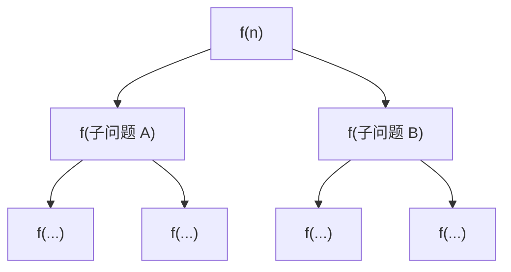
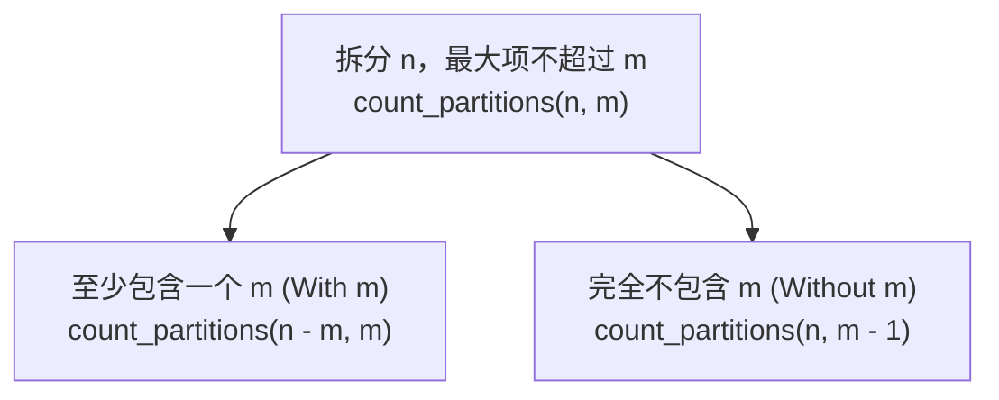

> **课程体系**：UC Berkeley CS61A (Fall 2024)  
> **所属模块**：Module 2: 递归与数据抽象 (Recursion & Sequences)  
> **主讲教师**：Prof. John DeNero (UC Berkeley)  
> **视频时长**：32:14 ｜ **课堂截图**：16 张板书/代码演示  
> **视频直达**：[📺 在 B 站观看本讲原视频 (P10)](https://www.bilibili.com/video/BV1sy411z7nA/?p=10)  
> **快速导航**：[← 上一讲 (P09 Lecture 9 Recursion)](/notes/cs61a/lecture-09) ｜ [📚 返回全书目录](/notes/topics/CS61A) ｜ [下一讲 (P11 Lecture 11 Sequences) →](/notes/cs61a/lecture-11)

---

## 目录 (Table of Contents)
1. [引言：递归调用的次序与等待机制](#1-引言递归调用的次序与等待机制)
2. [级联函数 (Cascade) 与对称调用栈](#2-级联函数-cascade-与对称调用栈)
3. [代码美学与抽象思维：逆级联 (Inverse Cascade)](#3-代码美学与抽象思维逆级联-inverse-cascade)
4. [树形递归的定义与结构演化](#4-树形递归的定义与结构演化)
5. [经典案例：斐波那契数列 (Fibonacci) 的树形展开](#5-经典案例斐波那契数列-fibonacci-的树形展开)
6. [计算开销与重复计算：`@trace` 观察树形爆炸](#6-计算开销与重复计算trace-观察树形爆炸)
7. [核心难题：整数拆分问题 (Counting Partitions)](#7-核心难题整数拆分问题-counting-partitions)
8. [基线条件的边界推演与代码落地](#8-基线条件的边界推演与代码落地)
9. [本讲核心要点与思考题](#9-本讲核心要点与思考题)

---

### 深入形式化规约与微观求值流程（Operational Semantics）
在「目录 (Table of Contents)」模块中，计算机底层运算依赖于严密的形式化求值逻辑：
1. **抽象语法树（AST）的分层解析**：
   - 源代码字符流首先经过词法分析器（Lexer）切分为终结符标记（Tokens），随后由语法解析器（Parser）构造成多叉语法树；
   - 运算符优先级与结合性在语法树构建阶段即已固化，消除了运行期的二义性；
2. **环境序列的动态跃迁**：
   - 每次函数调用产生的新帧，其静态词法环境由函数对象的 `parent` 属性完全决定；
   - 变量查找沿环境链向上单向回溯，直到全局环境帧，若未找到则触发 `NameError` 异常；
3. **状态不变式（State Invariants）**：
   - 编写健壮程序的关键在于明确循环不变式（Loop Invariants）与函数前后置条件（Pre/Post-conditions）；
   - 在复杂控制流跳转中，确保状态变量在每次迭代前均维持合法的业务约束。


## 1. 引言：递归调用的次序与等待机制

在上节课中，我们见到了线性递归与互递归。许多初学者会问：“既然很多问题可以用 `while` 循环解决，为什么非要学递归？”

DeNero 教授指出：
> **计算机科学中的许多复杂问题天生具有分治与分支结构**。线性递归只是开始，当函数的计算过程需要探索多个互斥选择时，**树形递归 (Tree Recursion)** 展现出循环语句无法比拟的极简与优雅。

理解递归的关键，在于时刻牢记**调用栈的阻塞与返回机制**：
- 当一个函数发起另一次函数调用时，**发起方必须暂停当前帧的执行，等待被调用者完全返回结果**，然后才能继续执行后续语句。
- 凡是在递归调用**之前**执行的代码，都在**入栈（向更小规模递进）**时运行；
- 凡是在递归调用**之后**执行的代码，都在**出栈（从基线回溯返回）**时运行。

---

### 深入形式化规约与微观求值流程（Operational Semantics）
在「1. 引言：递归调用的次序与等待机制」模块中，计算机底层运算依赖于严密的形式化求值逻辑：
1. **抽象语法树（AST）的分层解析**：
   - 源代码字符流首先经过词法分析器（Lexer）切分为终结符标记（Tokens），随后由语法解析器（Parser）构造成多叉语法树；
   - 运算符优先级与结合性在语法树构建阶段即已固化，消除了运行期的二义性；
2. **环境序列的动态跃迁**：
   - 每次函数调用产生的新帧，其静态词法环境由函数对象的 `parent` 属性完全决定；
   - 变量查找沿环境链向上单向回溯，直到全局环境帧，若未找到则触发 `NameError` 异常；
3. **状态不变式（State Invariants）**：
   - 编写健壮程序的关键在于明确循环不变式（Loop Invariants）与函数前后置条件（Pre/Post-conditions）；
   - 在复杂控制流跳转中，确保状态变量在每次迭代前均维持合法的业务约束。


## 2. 级联函数 (Cascade) 与对称调用栈

为了直观体会这一执行次序，我们考察经典的级联打印函数 `cascade`。

### 2.1 递归级联定义与输出
```python
def cascade(n):
    """打印正整数 n 的级联图案。"""
    if n < 10:
        print(n)
    else:
        print(n)          # 递归调用之前：入栈时打印（降序缩减）
        cascade(n // 10)  # 递归子问题：去掉个位
        print(n)          # 递归调用之后：退栈时打印（升序恢复）
```

调用 `cascade(12345)` 的输出效果：
```
12345
1234
123
12
1
12
123
1234
12345
```

[](https://www.bilibili.com/video/BV1sy411z7nA/?p=10&t=148)
*⏱ 时间戳：00:02:28 · 📷 课堂截图 · [在 B 站观看对应片段 (P10 00:02:28)](https://www.bilibili.com/video/BV1sy411z7nA/?p=10&t=148)*

#### 📸 课堂板书与代码演示深入精读 (00:02:28)

**【现场板书 / 代码演示还原】**：
在此时间节点，DeNero 教授在屏幕上进行了核心演示与重点板书推导：
> *“Then, makes a recursive call to cascade. On a smaller number, that's everything except for the last digit of n, or n divided by 10, with the remainder thrown away. Finally, after that recursive call to cascade, it prints n again. Let's take a look at the behavior of this function. If I cascade just ...”*

**【底层计算模型与微观执行机制】**：
1. **执行上下文与时序追踪**：
   - 处于当前讨论节点「2. 级联函数 (Cascade) 与对称调用栈」，解释器严格遵循核心求值规约；
   - 表达式先求值操作符，随后自左至右严格求值操作数，最终将函数对象施加于实参列表；
   - 若涉及环境模型，局部帧严格记录其静态词法父指针（Parent Pointer 指向函数定义处的环境），与运行时的动态调用栈形成正交架构。
2. **内存拓扑与对象引用**：
   - 变量符号只是哈希表（环境帧）中的键，指针直接指向堆内存中的一等公民对象；
   - 赋值语句是离散时间的瞬时状态快照，绝不会建立隐式的数学依赖监听。

**【避坑指南与高频考点点拨】**：
- **常见思维误区**：在「树形递归分支分治模型、整数划分 (Count Partitions)」相关考题中，初学者极易根据代码表面形式猜想结果，导致作用域混淆或变量遮蔽（Shadowing）误判；
- **调试排错黄金法则**：遇到嵌套调用与复杂分支时，务必在草稿纸上画出独立的局部帧，标明每个形参的具体绑定值，按部就班推导。


这一完美对称的几何沙漏结构，清晰反映出：除基线分支 `n=1` 仅被最内层帧打印一次外，外层的 `12`, `123`, `1234`, `12345` 分别在递归前与递归后各打印了一次！

---

### 2.2 环境模型跟踪调用栈
我们利用 Python Tutor 观察 `cascade(123)` 的环境模型演变：

[](https://www.bilibili.com/video/BV1sy411z7nA/?p=10&t=212)
*⏱ 时间戳：00:03:32 · 📷 课堂截图 · [在 B 站观看对应片段 (P10 00:03:32)](https://www.bilibili.com/video/BV1sy411z7nA/?p=10&t=212)*

#### 📸 课堂板书与代码演示深入精读 (00:03:32)

**【现场板书 / 代码演示还原】**：
在此时间节点，DeNero 教授在屏幕上进行了核心演示与重点板书推导：
> *“What this is supposed to illustrate is that all the cascading that happens recursively happens before the final print. And that's why you get this nice nested structure. Let's take a look at the environment diagram so that we can see exactly what's happening. So we defined cascade and then call it o...”*

**【底层计算模型与微观执行机制】**：
1. **执行上下文与时序追踪**：
   - 处于当前讨论节点「2. 级联函数 (Cascade) 与对称调用栈」，解释器严格遵循核心求值规约；
   - 表达式先求值操作符，随后自左至右严格求值操作数，最终将函数对象施加于实参列表；
   - 若涉及环境模型，局部帧严格记录其静态词法父指针（Parent Pointer 指向函数定义处的环境），与运行时的动态调用栈形成正交架构。
2. **内存拓扑与对象引用**：
   - 变量符号只是哈希表（环境帧）中的键，指针直接指向堆内存中的一等公民对象；
   - 赋值语句是离散时间的瞬时状态快照，绝不会建立隐式的数学依赖监听。

**【避坑指南与高频考点点拨】**：
- **常见思维误区**：在「树形递归分支分治模型、整数划分 (Count Partitions)」相关考题中，初学者极易根据代码表面形式猜想结果，导致作用域混淆或变量遮蔽（Shadowing）误判；
- **调试排错黄金法则**：遇到嵌套调用与复杂分支时，务必在草稿纸上画出独立的局部帧，标明每个形参的具体绑定值，按部就班推导。


1. **帧 `f1` (`n=123`)**：打印 `123`，遇到 `cascade(12)`，`f1` 暂停，派生 `f2`。
2. **帧 `f2` (`n=12`)**：打印 `12`，遇到 `cascade(1)`，`f2` 暂停，派生 `f3`。
3. **帧 `f3` (`n=1`)**：命中基线条件 `n < 10`，打印 `1`。`f3` 执行完毕，隐式返回 `None`。
4. **`f2` 恢复执行**：`f3` 返回后，`f2` 继续执行第三行 `print(n)`，打印 `12`，返回 `None`。
5. **`f1` 恢复执行**：`f2` 返回后，`f1` 执行第三行 `print(n)`，打印 `123`，返回 `None`。

[](https://www.bilibili.com/video/BV1sy411z7nA/?p=10&t=328)
*⏱ 时间戳：00:05:28 · 📷 课堂截图 · [在 B 站观看对应片段 (P10 00:05:28)](https://www.bilibili.com/video/BV1sy411z7nA/?p=10&t=328)*

#### 📸 课堂板书与代码演示深入精读 (00:05:28)

**【现场板书 / 代码演示还原】**：
在此时间节点，DeNero 教授在屏幕上进行了核心演示与重点板书推导：
> *“And when we print that, we actually see that 12 appear, and we have a return value of None from this call, which means that we can finally return to our original call to Cascade and finish up. So we've evaluated this, and in the course of evaluating that, we've generated all this output, and finally...”*

**【底层计算模型与微观执行机制】**：
1. **执行上下文与时序追踪**：
   - 处于当前讨论节点「2. 级联函数 (Cascade) 与对称调用栈」，解释器严格遵循核心求值规约；
   - 表达式先求值操作符，随后自左至右严格求值操作数，最终将函数对象施加于实参列表；
   - 若涉及环境模型，局部帧严格记录其静态词法父指针（Parent Pointer 指向函数定义处的环境），与运行时的动态调用栈形成正交架构。
2. **内存拓扑与对象引用**：
   - 变量符号只是哈希表（环境帧）中的键，指针直接指向堆内存中的一等公民对象；
   - 赋值语句是离散时间的瞬时状态快照，绝不会建立隐式的数学依赖监听。

**【避坑指南与高频考点点拨】**：
- **常见思维误区**：在「树形递归分支分治模型、整数划分 (Count Partitions)」相关考题中，初学者极易根据代码表面形式猜想结果，导致作用域混淆或变量遮蔽（Shadowing）误判；
- **调试排错黄金法则**：遇到嵌套调用与复杂分支时，务必在草稿纸上画出独立的局部帧，标明每个形参的具体绑定值，按部就班推导。


```
调用进入 (Call / Push)        返回退出 (Return / Pop)
─────────────────────►        ◄─────────────────────
f1: cascade(123)              f1: print(123)
 └── f2: cascade(12)           └── f2: print(12)
      └── f3: cascade(1)            └── (f3 returns None)
          (print 1)
```

---

### 2.3 代码风格的抉择：清晰 vs. 紧凑
`cascade` 也可以写成以下无 `else` 形式：
```python
def cascade_short(n):
    print(n)
    if n >= 10:
        cascade_short(n // 10)
        print(n)
```

[](https://www.bilibili.com/video/BV1sy411z7nA/?p=10&t=425)
*⏱ 时间戳：00:07:05 · 📷 课堂截图 · [在 B 站观看对应片段 (P10 00:07:05)](https://www.bilibili.com/video/BV1sy411z7nA/?p=10&t=425)*

#### 📸 课堂板书与代码演示深入精读 (00:07:05)

**【现场板书 / 代码演示还原】**：
在此时间节点，DeNero 教授在屏幕上进行了核心演示与重点板书推导：
> *“Now, that's not the only way to define cascade. An even shorter version would say, well, in the base case or in the recursive case, I always print N first. So why not just put that at the very top? And then there's actually nothing left to do in the base case. So I could just change this if statemen...”*

**【底层计算模型与微观执行机制】**：
1. **执行上下文与时序追踪**：
   - 处于当前讨论节点「2. 级联函数 (Cascade) 与对称调用栈」，解释器严格遵循核心求值规约；
   - 表达式先求值操作符，随后自左至右严格求值操作数，最终将函数对象施加于实参列表；
   - 若涉及环境模型，局部帧严格记录其静态词法父指针（Parent Pointer 指向函数定义处的环境），与运行时的动态调用栈形成正交架构。
2. **内存拓扑与对象引用**：
   - 变量符号只是哈希表（环境帧）中的键，指针直接指向堆内存中的一等公民对象；
   - 赋值语句是离散时间的瞬时状态快照，绝不会建立隐式的数学依赖监听。

**【避坑指南与高频考点点拨】**：
- **常见思维误区**：在「树形递归分支分治模型、整数划分 (Count Partitions)」相关考题中，初学者极易根据代码表面形式猜想结果，导致作用域混淆或变量遮蔽（Shadowing）误判；
- **调试排错黄金法则**：遇到嵌套调用与复杂分支时，务必在草稿纸上画出独立的局部帧，标明每个形参的具体绑定值，按部就班推导。


两种写法在功能上完全等价：
- 紧凑版本提炼出了公共操作（无论基线还是递归都先 `print(n)`）。
- 标准版本则显式隔离了基线与递归分支。

> **SICP 设计哲学**：
> > *"Programs must be written for people to read, and only incidentally for machines to execute."* —— Harold Abelson & Gerald Jay Sussman  
> 如果两种实现都能正确运行，优先选择**更容易向人类读者传达意图**的那一种。显式基线分支对于初学者构建归纳思维至关重要。

---

### 深入形式化规约与微观求值流程（Operational Semantics）
在「2. 级联函数 (Cascade) 与对称调用栈」模块中，计算机底层运算依赖于严密的形式化求值逻辑：
1. **抽象语法树（AST）的分层解析**：
   - 源代码字符流首先经过词法分析器（Lexer）切分为终结符标记（Tokens），随后由语法解析器（Parser）构造成多叉语法树；
   - 运算符优先级与结合性在语法树构建阶段即已固化，消除了运行期的二义性；
2. **环境序列的动态跃迁**：
   - 每次函数调用产生的新帧，其静态词法环境由函数对象的 `parent` 属性完全决定；
   - 变量查找沿环境链向上单向回溯，直到全局环境帧，若未找到则触发 `NameError` 异常；
3. **状态不变式（State Invariants）**：
   - 编写健壮程序的关键在于明确循环不变式（Loop Invariants）与函数前后置条件（Pre/Post-conditions）；
   - 在复杂控制流跳转中，确保状态变量在每次迭代前均维持合法的业务约束。


## 3. 代码美学与抽象思维：逆级联 (Inverse Cascade)

如果我们希望打印倒置的级联（从小到大生长，再从大到小收缩）：
```
1
12
123
1234
123
12
1
```

如何用高阶抽象拆解该过程？

[](https://www.bilibili.com/video/BV1sy411z7nA/?p=10&t=551)
*⏱ 时间戳：00:09:11 · 📷 课堂截图 · [在 B 站观看对应片段 (P10 00:09:11)](https://www.bilibili.com/video/BV1sy411z7nA/?p=10&t=551)*

#### 📸 课堂板书与代码演示深入精读 (00:09:11)

**【现场板书 / 代码演示还原】**：
在此时间节点，DeNero 教授在屏幕上进行了核心演示与重点板书推导：
> *“Well, if we pass in the number 1, 2, 3, 4, we want it to print out the following lines. 1, 1, 2, 1, 2, 3, 1, 2, 3, 4, and then get smaller on the way down. Now, if you want, you can try to implement this from scratch. I'm going to give you some structure right now so that you can implement it in a p...”*

**【底层计算模型与微观执行机制】**：
1. **执行上下文与时序追踪**：
   - 处于当前讨论节点「3. 代码美学与抽象思维：逆级联 (Inverse Cascade)」，解释器严格遵循核心求值规约；
   - 表达式先求值操作符，随后自左至右严格求值操作数，最终将函数对象施加于实参列表；
   - 若涉及环境模型，局部帧严格记录其静态词法父指针（Parent Pointer 指向函数定义处的环境），与运行时的动态调用栈形成正交架构。
2. **内存拓扑与对象引用**：
   - 变量符号只是哈希表（环境帧）中的键，指针直接指向堆内存中的一等公民对象；
   - 赋值语句是离散时间的瞬时状态快照，绝不会建立隐式的数学依赖监听。

**【避坑指南与高频考点点拨】**：
- **常见思维误区**：在「树形递归分支分治模型、整数划分 (Count Partitions)」相关考题中，初学者极易根据代码表面形式猜想结果，导致作用域混淆或变量遮蔽（Shadowing）误判；
- **调试排错黄金法则**：遇到嵌套调用与复杂分支时，务必在草稿纸上画出独立的局部帧，标明每个形参的具体绑定值，按部就班推导。


DeNero 教授设计了一个通用高阶函数 `f_then_g`：
```python
def inverse_cascade(n):
    grow(n)
    print(n)
    shrink(n)

def f_then_g(f, g, n):
    if n:
        f(n)
        g(n)

grow = lambda n: f_then_g(grow, print, n // 10)
shrink = lambda n: f_then_g(print, shrink, n // 10)
```

[](https://www.bilibili.com/video/BV1sy411z7nA/?p=10&t=641)
*⏱ 时间戳：00:10:41 · 📷 课堂截图 · [在 B 站观看对应片段 (P10 00:10:41)](https://www.bilibili.com/video/BV1sy411z7nA/?p=10&t=641)*

#### 📸 课堂板书与代码演示深入精读 (00:10:41)

**【现场板书 / 代码演示还原】**：
在此时间节点，DeNero 教授在屏幕上进行了核心演示与重点板书推导：
> *“Pause the video and think about it. I'll show you the answer in three, two, one. One way to implement inverse cascade is with a grow function that first grows and then prints. So why does grow grow and then print? Well, because we want to do the small stuff first and then the big stuff. And we're ca...”*

**【底层计算模型与微观执行机制】**：
1. **执行上下文与时序追踪**：
   - 处于当前讨论节点「3. 代码美学与抽象思维：逆级联 (Inverse Cascade)」，解释器严格遵循核心求值规约；
   - 表达式先求值操作符，随后自左至右严格求值操作数，最终将函数对象施加于实参列表；
   - 若涉及环境模型，局部帧严格记录其静态词法父指针（Parent Pointer 指向函数定义处的环境），与运行时的动态调用栈形成正交架构。
2. **内存拓扑与对象引用**：
   - 变量符号只是哈希表（环境帧）中的键，指针直接指向堆内存中的一等公民对象；
   - 赋值语句是离散时间的瞬时状态快照，绝不会建立隐式的数学依赖监听。

**【避坑指南与高频考点点拨】**：
- **常见思维误区**：在「树形递归分支分治模型、整数划分 (Count Partitions)」相关考题中，初学者极易根据代码表面形式猜想结果，导致作用域混淆或变量遮蔽（Shadowing）误判；
- **调试排错黄金法则**：遇到嵌套调用与复杂分支时，务必在草稿纸上画出独立的局部帧，标明每个形参的具体绑定值，按部就班推导。


- `grow`：先递归调用自身 `grow(n // 10)`，再执行 `print(n)`，因此是从最小的前缀开始向外打印（由小到大）。
- `shrink`：先打印 `print(n)`，再递归调用 `shrink(n // 10)`，因此是从大到小逐级衰减。

---

### 深入形式化规约与微观求值流程（Operational Semantics）
在「3. 代码美学与抽象思维：逆级联 (Inverse Cascade)」模块中，计算机底层运算依赖于严密的形式化求值逻辑：
1. **抽象语法树（AST）的分层解析**：
   - 源代码字符流首先经过词法分析器（Lexer）切分为终结符标记（Tokens），随后由语法解析器（Parser）构造成多叉语法树；
   - 运算符优先级与结合性在语法树构建阶段即已固化，消除了运行期的二义性；
2. **环境序列的动态跃迁**：
   - 每次函数调用产生的新帧，其静态词法环境由函数对象的 `parent` 属性完全决定；
   - 变量查找沿环境链向上单向回溯，直到全局环境帧，若未找到则触发 `NameError` 异常；
3. **状态不变式（State Invariants）**：
   - 编写健壮程序的关键在于明确循环不变式（Loop Invariants）与函数前后置条件（Pre/Post-conditions）；
   - 在复杂控制流跳转中，确保状态变量在每次迭代前均维持合法的业务约束。


## 4. 树形递归的定义与结构演化

> **树形递归 (Tree Recursion)**：在一个函数的执行体内，发起**两次或两次以上**对自身的递归调用。

当一个调用分叉成两个子调用，每个子调用又分叉成两个更小的子调用时，整个计算过程在时空上展开为一棵**分支树 (Computation Tree)**。



---

### 深入形式化规约与微观求值流程（Operational Semantics）
在「4. 树形递归的定义与结构演化」模块中，计算机底层运算依赖于严密的形式化求值逻辑：
1. **抽象语法树（AST）的分层解析**：
   - 源代码字符流首先经过词法分析器（Lexer）切分为终结符标记（Tokens），随后由语法解析器（Parser）构造成多叉语法树；
   - 运算符优先级与结合性在语法树构建阶段即已固化，消除了运行期的二义性；
2. **环境序列的动态跃迁**：
   - 每次函数调用产生的新帧，其静态词法环境由函数对象的 `parent` 属性完全决定；
   - 变量查找沿环境链向上单向回溯，直到全局环境帧，若未找到则触发 `NameError` 异常；
3. **状态不变式（State Invariants）**：
   - 编写健壮程序的关键在于明确循环不变式（Loop Invariants）与函数前后置条件（Pre/Post-conditions）；
   - 在复杂控制流跳转中，确保状态变量在每次迭代前均维持合法的业务约束。


## 5. 经典案例：斐波那契数列 (Fibonacci) 的树形展开

斐波那契数列是最经典的双分支树形递归：
$$\text{Fib}(0) = 0, \quad \text{Fib}(1) = 1, \quad \text{Fib}(n) = \text{Fib}(n-2) + \text{Fib}(n-1) \quad (n \ge 2)$$

[](https://www.bilibili.com/video/BV1sy411z7nA/?p=10&t=706)
*⏱ 时间戳：00:11:46 · 📷 课堂截图 · [在 B 站观看对应片段 (P10 00:11:46)](https://www.bilibili.com/video/BV1sy411z7nA/?p=10&t=706)*

#### 📸 课堂板书与代码演示深入精读 (00:11:46)

**【现场板书 / 代码演示还原】**：
在此时间节点，DeNero 教授在屏幕上进行了核心演示与重点板书推导：
> *“Makes more than one recursive call. So tree recursion creates tree-shaped processes that arise whenever executing the body of a recursive function makes more than one call to that function. And there's one example that almost every class that includes tree recursion covers at some point. The Fibonac...”*

**【底层计算模型与微观执行机制】**：
1. **执行上下文与时序追踪**：
   - 处于当前讨论节点「5. 经典案例：斐波那契数列 (Fibonacci) 的树形展开」，解释器严格遵循核心求值规约；
   - 表达式先求值操作符，随后自左至右严格求值操作数，最终将函数对象施加于实参列表；
   - 若涉及环境模型，局部帧严格记录其静态词法父指针（Parent Pointer 指向函数定义处的环境），与运行时的动态调用栈形成正交架构。
2. **内存拓扑与对象引用**：
   - 变量符号只是哈希表（环境帧）中的键，指针直接指向堆内存中的一等公民对象；
   - 赋值语句是离散时间的瞬时状态快照，绝不会建立隐式的数学依赖监听。

**【避坑指南与高频考点点拨】**：
- **常见思维误区**：在「树形递归分支分治模型、整数划分 (Count Partitions)」相关考题中，初学者极易根据代码表面形式猜想结果，导致作用域混淆或变量遮蔽（Shadowing）误判；
- **调试排错黄金法则**：遇到嵌套调用与复杂分支时，务必在草稿纸上画出独立的局部帧，标明每个形参的具体绑定值，按部就班推导。


### 5.1 Python 实现
```python
def fib(n):
    if n == 0:
        return 0
    elif n == 1:
        return 1
    else:
        return fib(n - 2) + fib(n - 1)
```

[](https://www.bilibili.com/video/BV1sy411z7nA/?p=10&t=797)
*⏱ 时间戳：00:13:17 · 📷 课堂截图 · [在 B 站观看对应片段 (P10 00:13:17)](https://www.bilibili.com/video/BV1sy411z7nA/?p=10&t=797)*

#### 📸 课堂板书与代码演示深入精读 (00:13:17)

**【现场板书 / 代码演示还原】**：
在此时间节点，DeNero 教授在屏幕上进行了核心演示与重点板书推导：
> *“35. So, let's look at a tree recursive way of computing Fibonacci numbers. We'll define fib to take in n. If n is 0, return 0. If n is 1, we'll return 1. Those are two base cases. What's the recursive case? Well, each Fibonacci number is the sum of the previous two, which we can write as fib n minus...”*

**【底层计算模型与微观执行机制】**：
1. **执行上下文与时序追踪**：
   - 处于当前讨论节点「5. 经典案例：斐波那契数列 (Fibonacci) 的树形展开」，解释器严格遵循核心求值规约；
   - 表达式先求值操作符，随后自左至右严格求值操作数，最终将函数对象施加于实参列表；
   - 若涉及环境模型，局部帧严格记录其静态词法父指针（Parent Pointer 指向函数定义处的环境），与运行时的动态调用栈形成正交架构。
2. **内存拓扑与对象引用**：
   - 变量符号只是哈希表（环境帧）中的键，指针直接指向堆内存中的一等公民对象；
   - 赋值语句是离散时间的瞬时状态快照，绝不会建立隐式的数学依赖监听。

**【避坑指南与高频考点点拨】**：
- **常见思维误区**：在「树形递归分支分治模型、整数划分 (Count Partitions)」相关考题中，初学者极易根据代码表面形式猜想结果，导致作用域混淆或变量遮蔽（Shadowing）误判；
- **调试排错黄金法则**：遇到嵌套调用与复杂分支时，务必在草稿纸上画出独立的局部帧，标明每个形参的具体绑定值，按部就班推导。


### 5.2 深度优先遍历轨迹 (Depth-First Execution)
计算机在执行 `fib(5)` 时，绝不是“同时”计算左右两个子树，而是严格遵循**深度优先、从左到右**的单线程执行顺序：

[](https://www.bilibili.com/video/BV1sy411z7nA/?p=10&t=891)
*⏱ 时间戳：00:14:51 · 📷 课堂截图 · [在 B 站观看对应片段 (P10 00:14:51)](https://www.bilibili.com/video/BV1sy411z7nA/?p=10&t=891)*

#### 📸 课堂板书与代码演示深入精读 (00:14:51)

**【现场板书 / 代码演示还原】**：
在此时间节点，DeNero 教授在屏幕上进行了核心演示与重点板书推导：
> *“So computing fib 5 actually traverses this tree-structured computation in the following way. In order to compute fib 5, we compute fib 3 first. That's n minus 2. And in order to compute fib 3, we compute fib 1. That gives us the number 1. So I put a blue dot here to say that this is the first return...”*

**【底层计算模型与微观执行机制】**：
1. **执行上下文与时序追踪**：
   - 处于当前讨论节点「5. 经典案例：斐波那契数列 (Fibonacci) 的树形展开」，解释器严格遵循核心求值规约；
   - 表达式先求值操作符，随后自左至右严格求值操作数，最终将函数对象施加于实参列表；
   - 若涉及环境模型，局部帧严格记录其静态词法父指针（Parent Pointer 指向函数定义处的环境），与运行时的动态调用栈形成正交架构。
2. **内存拓扑与对象引用**：
   - 变量符号只是哈希表（环境帧）中的键，指针直接指向堆内存中的一等公民对象；
   - 赋值语句是离散时间的瞬时状态快照，绝不会建立隐式的数学依赖监听。

**【避坑指南与高频考点点拨】**：
- **常见思维误区**：在「树形递归分支分治模型、整数划分 (Count Partitions)」相关考题中，初学者极易根据代码表面形式猜想结果，导致作用域混淆或变量遮蔽（Shadowing）误判；
- **调试排错黄金法则**：遇到嵌套调用与复杂分支时，务必在草稿纸上画出独立的局部帧，标明每个形参的具体绑定值，按部就班推导。


1. 计算 `fib(5)`：首先求左操作数 `fib(3)`。
2. 计算 `fib(3)`：求其左操作数 `fib(1)`，直接命中基线返回 `1`（这是全树诞生的第一个返回值！）。
3. 接着求 `fib(3)` 的右操作数 `fib(2)`：展开计算 `fib(0) -> 0` 与 `fib(1) -> 1`，返回 `1`。
4. `fib(3)` 汇总：$1 + 1 = 2$。此时 `fib(5)` 的左半边才彻底算完！
5. 接着启动右子树 `fib(4)` 的完整树形展开，最终得出 $2 + 3 = 5$。

---

### 深入形式化规约与微观求值流程（Operational Semantics）
在「5. 经典案例：斐波那契数列 (Fibonacci) 的树形展开」模块中，计算机底层运算依赖于严密的形式化求值逻辑：
1. **抽象语法树（AST）的分层解析**：
   - 源代码字符流首先经过词法分析器（Lexer）切分为终结符标记（Tokens），随后由语法解析器（Parser）构造成多叉语法树；
   - 运算符优先级与结合性在语法树构建阶段即已固化，消除了运行期的二义性；
2. **环境序列的动态跃迁**：
   - 每次函数调用产生的新帧，其静态词法环境由函数对象的 `parent` 属性完全决定；
   - 变量查找沿环境链向上单向回溯，直到全局环境帧，若未找到则触发 `NameError` 异常；
3. **状态不变式（State Invariants）**：
   - 编写健壮程序的关键在于明确循环不变式（Loop Invariants）与函数前后置条件（Pre/Post-conditions）；
   - 在复杂控制流跳转中，确保状态变量在每次迭代前均维持合法的业务约束。


## 6. 计算开销与重复计算：`@trace` 观察树形爆炸

当我们在 Python 中执行 `fib(35)` 时，程序会出现肉眼可见的卡顿。为什么主频高达几 GHz 的现代处理器算个 35 项的加法需要数秒？

### 6.1 使用 `@trace` 探查调用栈
利用 CS61A 提供的 `@trace` 装饰器，我们可以将函数进出调用栈的过程实时打在终端：

```python
from ucb import trace

@trace
def fib(n):
    if n == 0:
        return 0
    elif n == 1:
        return 1
    return fib(n - 2) + fib(n - 1)
```

[](https://www.bilibili.com/video/BV1sy411z7nA/?p=10&t=1082)
*⏱ 时间戳：00:18:02 · 📷 课堂截图 · [在 B 站观看对应片段 (P10 00:18:02)](https://www.bilibili.com/video/BV1sy411z7nA/?p=10&t=1082)*

#### 📸 课堂板书与代码演示深入精读 (00:18:02)

**【现场板书 / 代码演示还原】**：
在此时间节点，DeNero 教授在屏幕上进行了核心演示与重点板书推导：
> *“And perhaps you want to use it on future projects as well. It's called Trace. It's imported from the UCB module, which I provided with your project. Trace is called a decorator. You place it with an add sign just before the function that you want to define, and it changes the behavior of the functio...”*

**【底层计算模型与微观执行机制】**：
1. **执行上下文与时序追踪**：
   - 处于当前讨论节点「6. 计算开销与重复计算：`@trace` 观察树形爆炸」，解释器严格遵循核心求值规约；
   - 表达式先求值操作符，随后自左至右严格求值操作数，最终将函数对象施加于实参列表；
   - 若涉及环境模型，局部帧严格记录其静态词法父指针（Parent Pointer 指向函数定义处的环境），与运行时的动态调用栈形成正交架构。
2. **内存拓扑与对象引用**：
   - 变量符号只是哈希表（环境帧）中的键，指针直接指向堆内存中的一等公民对象；
   - 赋值语句是离散时间的瞬时状态快照，绝不会建立隐式的数学依赖监听。

**【避坑指南与高频考点点拨】**：
- **常见思维误区**：在「树形递归分支分治模型、整数划分 (Count Partitions)」相关考题中，初学者极易根据代码表面形式猜想结果，导致作用域混淆或变量遮蔽（Shadowing）误判；
- **调试排错黄金法则**：遇到嵌套调用与复杂分支时，务必在草稿纸上画出独立的局部帧，标明每个形参的具体绑定值，按部就班推导。


运行 `fib(5)` 时，终端打印出树状嵌套调用：
- `fib(3)` 被独立调用并完整计算了 **2 次**；
- `fib(2)` 被重复计算了 **3 次**；
- 基线条件 `fib(1)` 被调用了 **5 次**，`fib(0)` 被调用了 **3 次**！

[](https://www.bilibili.com/video/BV1sy411z7nA/?p=10&t=1201)
*⏱ 时间戳：00:20:01 · 📷 课堂截图 · [在 B 站观看对应片段 (P10 00:20:01)](https://www.bilibili.com/video/BV1sy411z7nA/?p=10&t=1201)*

#### 📸 课堂板书与代码演示深入精读 (00:20:01)

**【现场板书 / 代码演示还原】**：
在此时间节点，DeNero 教授在屏幕上进行了核心演示与重点板书推导：
> *“Which went all the way up to here, and fib8, which goes all the way up to the top. And within fib8, there's fib6, and fib4, and fib2, and all of those have recursive structures within them as well. And if we call fib15, all of a sudden we have really long lines that are extending off the end of the ...”*

**【底层计算模型与微观执行机制】**：
1. **执行上下文与时序追踪**：
   - 处于当前讨论节点「6. 计算开销与重复计算：`@trace` 观察树形爆炸」，解释器严格遵循核心求值规约；
   - 表达式先求值操作符，随后自左至右严格求值操作数，最终将函数对象施加于实参列表；
   - 若涉及环境模型，局部帧严格记录其静态词法父指针（Parent Pointer 指向函数定义处的环境），与运行时的动态调用栈形成正交架构。
2. **内存拓扑与对象引用**：
   - 变量符号只是哈希表（环境帧）中的键，指针直接指向堆内存中的一等公民对象；
   - 赋值语句是离散时间的瞬时状态快照，绝不会建立隐式的数学依赖监听。

**【避坑指南与高频考点点拨】**：
- **常见思维误区**：在「树形递归分支分治模型、整数划分 (Count Partitions)」相关考题中，初学者极易根据代码表面形式猜想结果，导致作用域混淆或变量遮蔽（Shadowing）误判；
- **调试排错黄金法则**：遇到嵌套调用与复杂分支时，务必在草稿纸上画出独立的局部帧，标明每个形参的具体绑定值，按部就班推导。


### 6.2 指数级复杂度与记忆化预告
计算 $fib(n)$ 时，整棵树的叶子节点数量严格等于 $Fib(n+1)$。
- 随着 $n$ 的增长，总调用次数呈几何级数爆炸（时间复杂度为 $O(\phi^n)$，其中黄金分割比 $\phi \approx 1.618$）。
- 重复计算占据了 99.99% 以上的 CPU 周期！
- **预告**：在后续章节中，我们将学习**记忆化 (Memoization) 与动态规划**，只需缓存计算结果，就能让树形递归以线性时间 $O(n)$ 飞速完成。

---

### 深入形式化规约与微观求值流程（Operational Semantics）
在「6. 计算开销与重复计算：`@trace` 观察树形爆炸」模块中，计算机底层运算依赖于严密的形式化求值逻辑：
1. **抽象语法树（AST）的分层解析**：
   - 源代码字符流首先经过词法分析器（Lexer）切分为终结符标记（Tokens），随后由语法解析器（Parser）构造成多叉语法树；
   - 运算符优先级与结合性在语法树构建阶段即已固化，消除了运行期的二义性；
2. **环境序列的动态跃迁**：
   - 每次函数调用产生的新帧，其静态词法环境由函数对象的 `parent` 属性完全决定；
   - 变量查找沿环境链向上单向回溯，直到全局环境帧，若未找到则触发 `NameError` 异常；
3. **状态不变式（State Invariants）**：
   - 编写健壮程序的关键在于明确循环不变式（Loop Invariants）与函数前后置条件（Pre/Post-conditions）；
   - 在复杂控制流跳转中，确保状态变量在每次迭代前均维持合法的业务约束。


## 7. 核心难题：整数拆分问题 (Counting Partitions)

树形递归真正无可替代的场景，是解决**具有互斥选择空间的组合计数问题**。

### 7.1 问题定义
> **整数拆分 (Counting Partitions)**：将正整数 $n$ 拆分为一系列**不超过 $m$ 的正整数之和**（按非降序排列），求总共有多少种不同的拆分方式。

**示例**：求 $n = 6, m = 4$ 的拆分种数。
所有合法拆分如下：
```
1) 2 + 4
2) 1 + 1 + 4
3) 3 + 3
4) 1 + 2 + 3
5) 1 + 1 + 1 + 3
6) 2 + 2 + 2
7) 1 + 1 + 2 + 2
8) 1 + 1 + 1 + 1 + 2
9) 1 + 1 + 1 + 1 + 1 + 1
```
共计 **9 种**。因此 `count_partitions(6, 4)` 应返回 `9`。

[](https://www.bilibili.com/video/BV1sy411z7nA/?p=10&t=1324)
*⏱ 时间戳：00:22:04 · 📷 课堂截图 · [在 B 站观看对应片段 (P10 00:22:04)](https://www.bilibili.com/video/BV1sy411z7nA/?p=10&t=1324)*

#### 📸 课堂板书与代码演示深入精读 (00:22:04)

**【现场板书 / 代码演示还原】**：
在此时间节点，DeNero 教授在屏幕上进行了核心演示与重点板书推导：
> *“Well, the number of partitions of a positive integer n using parts up to size m is the number of different ways in which n can be expressed as the sum of parts up to m in increasing order. Let me show you an example. Say we want to count the partitions of n equals 6 using parts up to size m equals 4...”*

**【底层计算模型与微观执行机制】**：
1. **执行上下文与时序追踪**：
   - 处于当前讨论节点「7. 核心难题：整数拆分问题 (Counting Partitions)」，解释器严格遵循核心求值规约；
   - 表达式先求值操作符，随后自左至右严格求值操作数，最终将函数对象施加于实参列表；
   - 若涉及环境模型，局部帧严格记录其静态词法父指针（Parent Pointer 指向函数定义处的环境），与运行时的动态调用栈形成正交架构。
2. **内存拓扑与对象引用**：
   - 变量符号只是哈希表（环境帧）中的键，指针直接指向堆内存中的一等公民对象；
   - 赋值语句是离散时间的瞬时状态快照，绝不会建立隐式的数学依赖监听。

**【避坑指南与高频考点点拨】**：
- **常见思维误区**：在「树形递归分支分治模型、整数划分 (Count Partitions)」相关考题中，初学者极易根据代码表面形式猜想结果，导致作用域混淆或变量遮蔽（Shadowing）误判；
- **调试排错黄金法则**：遇到嵌套调用与复杂分支时，务必在草稿纸上画出独立的局部帧，标明每个形参的具体绑定值，按部就班推导。


---

### 7.2 核心洞见：二分选择空间
如何将所有拆分划分为两个**不重不漏 (Mutually Exclusive & Collectively Exhaustive)** 的子集合？

DeNero 教授给出了极其经典的分析框架：
考察拆分方案中**是否用到了最大候选数 $m$**：

[](https://www.bilibili.com/video/BV1sy411z7nA/?p=10&t=1479)
*⏱ 时间戳：00:24:39 · 📷 课堂截图 · [在 B 站观看对应片段 (P10 00:24:39)](https://www.bilibili.com/video/BV1sy411z7nA/?p=10&t=1479)*

#### 📸 课堂板书与代码演示深入精读 (00:24:39)

**【现场板书 / 代码演示还原】**：
在此时间节点，DeNero 教授在屏幕上进行了核心演示与重点板书推导：
> *“We're going to do that by exploring two different possibilities. One is that we'll include at least one group of four or one four in the sum of parts that we use in the partition. The other option, which is everything that doesn't include a four, says that we're never going to include a four in the ...”*

**【底层计算模型与微观执行机制】**：
1. **执行上下文与时序追踪**：
   - 处于当前讨论节点「7. 核心难题：整数拆分问题 (Counting Partitions)」，解释器严格遵循核心求值规约；
   - 表达式先求值操作符，随后自左至右严格求值操作数，最终将函数对象施加于实参列表；
   - 若涉及环境模型，局部帧严格记录其静态词法父指针（Parent Pointer 指向函数定义处的环境），与运行时的动态调用栈形成正交架构。
2. **内存拓扑与对象引用**：
   - 变量符号只是哈希表（环境帧）中的键，指针直接指向堆内存中的一等公民对象；
   - 赋值语句是离散时间的瞬时状态快照，绝不会建立隐式的数学依赖监听。

**【避坑指南与高频考点点拨】**：
- **常见思维误区**：在「树形递归分支分治模型、整数划分 (Count Partitions)」相关考题中，初学者极易根据代码表面形式猜想结果，导致作用域混淆或变量遮蔽（Shadowing）误判；
- **调试排错黄金法则**：遇到嵌套调用与复杂分支时，务必在草稿纸上画出独立的局部帧，标明每个形参的具体绑定值，按部就班推导。




1. **子集 1：至少使用了一个 $m$ (With at least one $m$)**
   - 既然确定使用了一个 $m$，剩下的数字之和必须凑出 $n - m$。
   - 剩余部分依然允许使用不超过 $m$ 的数。
   - 对应子问题：`count_partitions(n - m, m)`。
   - 在 $n=6, m=4$ 时：即求凑出 $6 - 4 = 2$ 的拆分方式（对应 `2+4` 与 `1+1+4` 两种）。

2. **子集 2：完全不使用 $m$ (Without any $m$)**
   - 既然不使用 $m$，那么所有的拆分项都必须**小于等于 $m - 1$**。
   - 要凑的总和依然是原数 $n$。
   - 对应子问题：`count_partitions(n, m - 1)`。
   - 在 $n=6, m=4$ 时：即求使用不超过 $3$ 的数凑出 $6$ 的方案（对应第 3 至第 9 项，共 7 种）。

两部分相加：$2 + 7 = 9$！完美的数学归纳与问题分解！

[](https://www.bilibili.com/video/BV1sy411z7nA/?p=10&t=1579)
*⏱ 时间戳：00:26:19 · 📷 课堂截图 · [在 B 站观看对应片段 (P10 00:26:19)](https://www.bilibili.com/video/BV1sy411z7nA/?p=10&t=1579)*

#### 📸 课堂板书与代码演示深入精读 (00:26:19)

**【现场板书 / 代码演示还原】**：
在此时间节点，DeNero 教授在屏幕上进行了核心演示与重点板书推导：
> *“Using at least one 4 means that we then have to count the partitions of 2, again using parts up to size 4. So there's the simpler instance of the problem that we solve above this line, assuming that we use at least one 4. The other simpler instance is that we count the partitions of the whole number...”*

**【底层计算模型与微观执行机制】**：
1. **执行上下文与时序追踪**：
   - 处于当前讨论节点「7. 核心难题：整数拆分问题 (Counting Partitions)」，解释器严格遵循核心求值规约；
   - 表达式先求值操作符，随后自左至右严格求值操作数，最终将函数对象施加于实参列表；
   - 若涉及环境模型，局部帧严格记录其静态词法父指针（Parent Pointer 指向函数定义处的环境），与运行时的动态调用栈形成正交架构。
2. **内存拓扑与对象引用**：
   - 变量符号只是哈希表（环境帧）中的键，指针直接指向堆内存中的一等公民对象；
   - 赋值语句是离散时间的瞬时状态快照，绝不会建立隐式的数学依赖监听。

**【避坑指南与高频考点点拨】**：
- **常见思维误区**：在「树形递归分支分治模型、整数划分 (Count Partitions)」相关考题中，初学者极易根据代码表面形式猜想结果，导致作用域混淆或变量遮蔽（Shadowing）误判；
- **调试排错黄金法则**：遇到嵌套调用与复杂分支时，务必在草稿纸上画出独立的局部帧，标明每个形参的具体绑定值，按部就班推导。


---

### 深入形式化规约与微观求值流程（Operational Semantics）
在「7. 核心难题：整数拆分问题 (Counting Partitions)」模块中，计算机底层运算依赖于严密的形式化求值逻辑：
1. **抽象语法树（AST）的分层解析**：
   - 源代码字符流首先经过词法分析器（Lexer）切分为终结符标记（Tokens），随后由语法解析器（Parser）构造成多叉语法树；
   - 运算符优先级与结合性在语法树构建阶段即已固化，消除了运行期的二义性；
2. **环境序列的动态跃迁**：
   - 每次函数调用产生的新帧，其静态词法环境由函数对象的 `parent` 属性完全决定；
   - 变量查找沿环境链向上单向回溯，直到全局环境帧，若未找到则触发 `NameError` 异常；
3. **状态不变式（State Invariants）**：
   - 编写健壮程序的关键在于明确循环不变式（Loop Invariants）与函数前后置条件（Pre/Post-conditions）；
   - 在复杂控制流跳转中，确保状态变量在每次迭代前均维持合法的业务约束。


## 8. 基线条件的边界推演与代码落地

设计树形递归时，最考验内功的是**边界基线条件 (Base Cases)**。

### 8.1 严密的基线分析
1. **$n == 0$**：
   - 恰好凑出了目标数字（例如 $n - m = 0$）！这意味着前序的一连串选择构成了一个**完整合法的拆分方案**。
   - 成功方案计数 $+1$，因此 `return 1`。
2. **$n < 0$**：
   - 选取的拆分项之和超出了目标（例如用 $4$ 去拆分 $2$，剩余 $-2$），走入死胡同。
   - 无效方案，`return 0`。
3. **$m == 0$**：
   - 允许的最大拆分项已经衰减为 $0$，但此时仍有 $n > 0$ 未被凑出，无法继续拆分。
   - 无效方案，`return 0`。

### 8.2 完整 Python 代码实现
```python
def count_partitions(n, m):
    """计算使用不超过 m 的部分拆分正整数 n 的方式总数。
    
    >>> count_partitions(6, 4)
    9
    >>> count_partitions(5, 3)
    5
    """
    if n == 0:
        return 1      # 基线 1：成功完成一种拆分
    elif n < 0:
        return 0      # 基线 2：选数超额，路径非法
    elif m == 0:
        return 0      # 基线 3：无可用正整数零件
    else:
        with_m = count_partitions(n - m, m)
        without_m = count_partitions(n, m - 1)
        return with_m + without_m
```

[](https://www.bilibili.com/video/BV1sy411z7nA/?p=10&t=1737)
*⏱ 时间戳：00:28:57 · 📷 课堂截图 · [在 B 站观看对应片段 (P10 00:28:57)](https://www.bilibili.com/video/BV1sy411z7nA/?p=10&t=1737)*

#### 📸 课堂板书与代码演示深入精读 (00:28:57)

**【现场板书 / 代码演示还原】**：
在此时间节点，DeNero 教授在屏幕上进行了核心演示与重点板书推导：
> *“of size m. We also count the partitions of n using parts that are smaller than m, or m minus 1. And then we sum together the cases in which we used in m and the cases in which we didn't. And that should give us all the different cases that we're interested in and the total ways of partitioning n. So...”*

**【底层计算模型与微观执行机制】**：
1. **执行上下文与时序追踪**：
   - 处于当前讨论节点「8. 基线条件的边界推演与代码落地」，解释器严格遵循核心求值规约；
   - 表达式先求值操作符，随后自左至右严格求值操作数，最终将函数对象施加于实参列表；
   - 若涉及环境模型，局部帧严格记录其静态词法父指针（Parent Pointer 指向函数定义处的环境），与运行时的动态调用栈形成正交架构。
2. **内存拓扑与对象引用**：
   - 变量符号只是哈希表（环境帧）中的键，指针直接指向堆内存中的一等公民对象；
   - 赋值语句是离散时间的瞬时状态快照，绝不会建立隐式的数学依赖监听。

**【避坑指南与高频考点点拨】**：
- **常见思维误区**：在「树形递归分支分治模型、整数划分 (Count Partitions)」相关考题中，初学者极易根据代码表面形式猜想结果，导致作用域混淆或变量遮蔽（Shadowing）误判；
- **调试排错黄金法则**：遇到嵌套调用与复杂分支时，务必在草稿纸上画出独立的局部帧，标明每个形参的具体绑定值，按部就班推导。


---

### 8.3 实例跟踪：`count_partitions(5, 3)`
以 $n=5, m=3$ 为例，拆分方式共有 5 种：
`1+1+1+1+1`, `1+1+1+2`, `1+2+2`, `1+1+3`, `2+3`。

通过两路分支递归：
- `with_m = count_partitions(2, 3)` $\rightarrow$ 算出 2 种 (`1+1`, `2`)。
- `without_m = count_partitions(5, 2)` $\rightarrow$ 算出 3 种 (`1+1+1+1+1`, `1+1+1+2`, `1+2+2`)。
- 合计 $2 + 3 = 5$ 种。

[](https://www.bilibili.com/video/BV1sy411z7nA/?p=10&t=1868)
*⏱ 时间戳：00:31:08 · 📷 课堂截图 · [在 B 站观看对应片段 (P10 00:31:08)](https://www.bilibili.com/video/BV1sy411z7nA/?p=10&t=1868)*

#### 📸 课堂板书与代码演示深入精读 (00:31:08)

**【现场板书 / 代码演示还原】**：
在此时间节点，DeNero 教授在屏幕上进行了核心演示与重点板书推导：
> *“Like, if we try to use a part of size 3 in order to partition 2, that's impossible. So that's why we get a 0 there. If we try to partition the number 2 with things smaller than 3, then we find there are two different ways. 1 plus 1, and just the number 2 alone. So those are the two different alterna...”*

**【底层计算模型与微观执行机制】**：
1. **执行上下文与时序追踪**：
   - 处于当前讨论节点「8. 基线条件的边界推演与代码落地」，解释器严格遵循核心求值规约；
   - 表达式先求值操作符，随后自左至右严格求值操作数，最终将函数对象施加于实参列表；
   - 若涉及环境模型，局部帧严格记录其静态词法父指针（Parent Pointer 指向函数定义处的环境），与运行时的动态调用栈形成正交架构。
2. **内存拓扑与对象引用**：
   - 变量符号只是哈希表（环境帧）中的键，指针直接指向堆内存中的一等公民对象；
   - 赋值语句是离散时间的瞬时状态快照，绝不会建立隐式的数学依赖监听。

**【避坑指南与高频考点点拨】**：
- **常见思维误区**：在「树形递归分支分治模型、整数划分 (Count Partitions)」相关考题中，初学者极易根据代码表面形式猜想结果，导致作用域混淆或变量遮蔽（Shadowing）误判；
- **调试排错黄金法则**：遇到嵌套调用与复杂分支时，务必在草稿纸上画出独立的局部帧，标明每个形参的具体绑定值，按部就班推导。


---

### 深入形式化规约与微观求值流程（Operational Semantics）
在「8. 基线条件的边界推演与代码落地」模块中，计算机底层运算依赖于严密的形式化求值逻辑：
1. **抽象语法树（AST）的分层解析**：
   - 源代码字符流首先经过词法分析器（Lexer）切分为终结符标记（Tokens），随后由语法解析器（Parser）构造成多叉语法树；
   - 运算符优先级与结合性在语法树构建阶段即已固化，消除了运行期的二义性；
2. **环境序列的动态跃迁**：
   - 每次函数调用产生的新帧，其静态词法环境由函数对象的 `parent` 属性完全决定；
   - 变量查找沿环境链向上单向回溯，直到全局环境帧，若未找到则触发 `NameError` 异常；
3. **状态不变式（State Invariants）**：
   - 编写健壮程序的关键在于明确循环不变式（Loop Invariants）与函数前后置条件（Pre/Post-conditions）；
   - 在复杂控制流跳转中，确保状态变量在每次迭代前均维持合法的业务约束。


## 9. 本讲核心要点与思考题

### 重点法则提炼
1. **调用次序的时间镜像性**：递归调用前的语句在“深入树根”时执行，递归调用后的语句在“回退树根”时执行。
2. **树形递归的适用标志**：当求解的问题具有**组合选择性**（如“选与不选”、“做加法或乘法”、“在两种博弈下决策”）时，树形递归是天然建模语言。
3. **树形搜索的性能权衡**：朴素树形递归容易陷入重复计算陷阱，时间复杂度往往是指数级的；但其代码结构的简洁与数学透明度无与伦比。
4. **拆分问题的“两路法则”**：将全局解分解为“包含某个元素”与“排斥该元素”两个互斥子集，是算法设计中的常用黄金技巧。

---

### 课后自测练习

#### 练习 1：走楼梯问题 (Count Stairs)
你正在爬一段有 $n$ 级台阶的楼梯，每次你可以向上迈 $1$ 步或 $2$ 步。编写函数 `count_stairs(n)` 计算爬到第 $n$ 级台阶共有多少种不同的走法。
```python
def count_stairs(n):
    """
    >>> count_stairs(1)
    1
    >>> count_stairs(2)
    2
    >>> count_stairs(3)
    3
    >>> count_stairs(4)
    5
    """
    if n == 1:
        return 1
    elif n == 2:
        return 2
    return count_stairs(n - 1) + count_stairs(n - 2)
```
*思考：为什么走楼梯问题与斐波那契数列在结构上完全等价？*

#### 练习 2：路径探索计数
在一个网格地图中，你从 $(0, 0)$ 出发，每次只能向右移动一步或向上移动一步，到达目标点 $(x, y)$。请用树形递归写出总路径条数 `paths(x, y)`：
```python
def paths(x, y):
    """
    >>> paths(2, 2)
    6
    >>> paths(1, 1)
    2
    """
    if x == 0 or y == 0:
        return 1
    return paths(x - 1, y) + paths(x, y - 1)
```
无论是楼梯问题、路径计数还是整数拆分，树形递归的本质皆是将终局目标解构为“最后一步有几种互斥走法”的逆向推导！

### 深入形式化规约与微观求值流程（Operational Semantics）
在「9. 本讲核心要点与思考题」模块中，计算机底层运算依赖于严密的形式化求值逻辑：
1. **抽象语法树（AST）的分层解析**：
   - 源代码字符流首先经过词法分析器（Lexer）切分为终结符标记（Tokens），随后由语法解析器（Parser）构造成多叉语法树；
   - 运算符优先级与结合性在语法树构建阶段即已固化，消除了运行期的二义性；
2. **环境序列的动态跃迁**：
   - 每次函数调用产生的新帧，其静态词法环境由函数对象的 `parent` 属性完全决定；
   - 变量查找沿环境链向上单向回溯，直到全局环境帧，若未找到则触发 `NameError` 异常；
3. **状态不变式（State Invariants）**：
   - 编写健壮程序的关键在于明确循环不变式（Loop Invariants）与函数前后置条件（Pre/Post-conditions）；
   - 在复杂控制流跳转中，确保状态变量在每次迭代前均维持合法的业务约束。


---

## 伯克利 Midterm / Final 经典高频考题深度演练

### 实战考题：环境拓扑与微观状态追踪（WWPD & Environment Diagrams）
考虑以下 Python 代码在交互式环境中的微观执行过程：

```python
# 经典作用域与高阶函数综合考题
x = 10

def outer(x):
    y = x + 2
    def inner(y):
        return x + y
    return inner

f = outer(5)
result = f(3)
```

#### 完整解题思维模型与多帧环境图推导：
1. **全局帧（Global Frame）初始化**：
   - 全局变量 `x` 绑定到整数对象 `10`；
   - 全局函数 `outer` 绑定到新创建的函数对象，其内嵌 `parent = Global`；
2. **执行 `f = outer(5)`**：
   - 开辟局部帧 $f_1$，标注 `f1: outer [parent=Global]`；
   - 形参 `x` 绑定到实参 `5`；
   - 局部变量 `y` 绑定到 `5 + 2 = 7`；
   - 在 $f_1$ 内部执行 `def inner(y):`，创建函数对象 `inner`，其内嵌 **`parent = f1`**；
   - 返回函数对象 `inner`，全局变量 `f` 绑定到该对象；
3. **执行 `result = f(3)`**：
   - 调用函数 `f`（即 `inner`），开辟局部帧 $f_2$；
   - **核心判分点**：帧 $f_2$ 的 parent 指向谁？
   - **铁律**：函数 `inner` 是在帧 $f_1$ 内部被定义的，因此 $f_2$ 的 **`parent = f1`**！
   - 形参 `y` 绑定到实参 `3`；
   - 执行体 `return x + y`：
     - 在当前帧 $f_2$ 查找 `y`：命中局部变量 `y = 3`；
     - 在当前帧 $f_2$ 查找 `x`：未命中，沿 parent 回溯到 **$f_1$ 帧** 查找！
     - 在 $f_1$ 帧中命中 `x = 5`（全局的 `x = 10` 被局部遮蔽！）；
     - 计算 `5 + 3 = 8`，作为返回值；
4. **最终输出结论**：
   - 全局变量 `result = 8`。

---

## 本讲核心概念知识矩阵 (Knowledge Matrix)

| 核心知识维度 | 形式化定义与机制 | 典型代码示例 | 核心工程与算法价值 | 常见易错陷阱 |
| :--- | :--- | :--- | :--- | :--- |
| **基础求值语义** | 表达式求值得到值，语句执行改变内部状态 | `x = 2 + 3` | 建立离散时间状态快照心智模型 | 误将赋值等号当作代数方程动态约束 |
| **环境帧拓扑** | 环境是一系列帧构成的有序链条 | `Global -> f1 -> f2` | 实现词法作用域与变量安全隔离 | 混淆调用者栈帧与定义处父环境指针 |
| **抽象屏障** | 通过函数接口隔离实现细节与调用逻辑 | `def square(x): ...` | 降低大规模系统认知负荷 | 破坏接口直接依赖底层私有数据结构 |
| **控制流决策** | 条件分支短路求值与循环迭代递进 | `if cond: ... while: ...` | 赋予程序非线性决策与大规模数据处理能力 | 遗漏循环递进变量引发死循环 |
| **高阶能力** | 函数作为一等公民（传参、返回、赋值） | `make_adder(3)` | 实现工厂模式、闭包持久状态与柯里化 | 闭包后期绑定引发循环变量捕获错误 |

---

## 课程导航与跳转

| 上一讲 | 目录 | 下一讲 | 原视频 |
| :--- | :---: | :--- | :--- |
| [← 上一讲：Lecture 9 Recursion](/notes/cs61a/lecture-09) | [📚 返回 CS61A 全书目录](/notes/topics/CS61A) | [下一讲：Lecture 11 Sequences →](/notes/cs61a/lecture-11) | [🎬 在 B 站观看本讲 (P10)](https://www.bilibili.com/video/BV1sy411z7nA/?p=10) |
