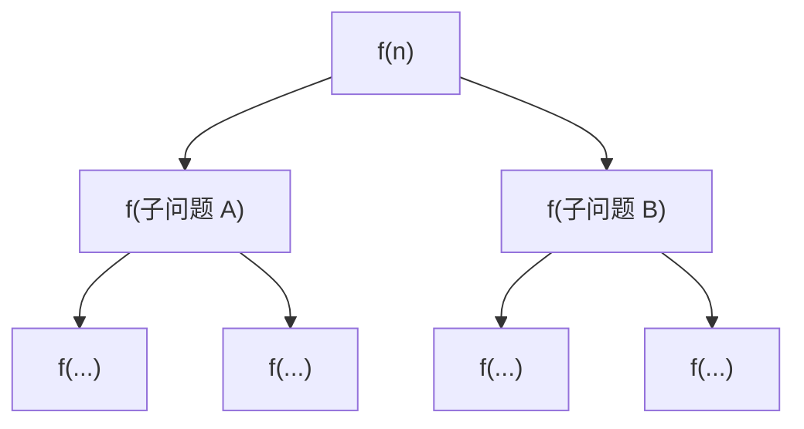
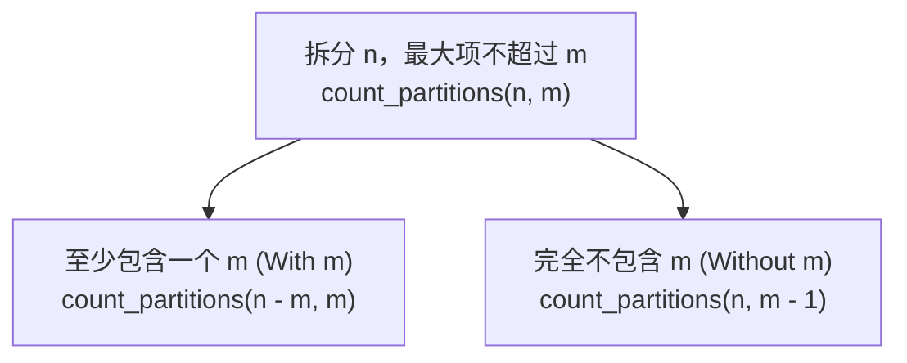

> **英文原课**：CS 61A: Structure and Interpretation of Computer Programs (Fall 2024)  
> **主讲教师**：Prof. John DeNero (UC Berkeley)  
> **图文整理**：VideoBook 视频转图文技术电子书流水线  
> **全书体量**：已收录 37 / 37 讲 ｜ 18.2 小时音视频讲义 ｜ 577 张高清板书截图  
> **在线目录**：[CS61A 专题目录](/notes/topics/CS61A)

---


> **主讲**：John DeNero ｜ **时长**：32:14 ｜ **视频回链**：[B 站对应单集 (P10)](https://www.bilibili.com/video/BV1sy411z7nA/?p=10)

## 1. 引言：递归调用的次序与等待机制

在上节课中，我们见到了线性递归与互递归。许多初学者会问：“既然很多问题可以用 `while` 循环解决，为什么非要学递归？”

DeNero 教授指出：
> **计算机科学中的许多复杂问题天生具有分治与分支结构**。线性递归只是开始，当函数的计算过程需要探索多个互斥选择时，**树形递归 (Tree Recursion)** 展现出循环语句无法比拟的极简与优雅。

理解递归的关键，在于时刻牢记**调用栈的阻塞与返回机制**：
- 当一个函数发起另一次函数调用时，**发起方必须暂停当前帧的执行，等待被调用者完全返回结果**，然后才能继续执行后续语句。
- 凡是在递归调用**之前**执行的代码，都在**入栈（向更小规模递进）**时运行；
- 凡是在递归调用**之后**执行的代码，都在**出栈（从基线回溯返回）**时运行。

---

## 2. 级联函数 (Cascade) 与对称调用栈

为了直观体会这一执行次序，我们考察经典的级联打印函数 `cascade`。

### 2.1 递归级联定义与输出
```python
def cascade(n):
    """打印正整数 n 的级联图案。"""
    if n < 10:
        print(n)
    else:
        print(n)          # 递归调用之前：入栈时打印（降序缩减）
        cascade(n // 10)  # 递归子问题：去掉个位
        print(n)          # 递归调用之后：退栈时打印（升序恢复）
```

调用 `cascade(12345)` 的输出效果：
```
12345
1234
123
12
1
12
123
1234
12345
```


*⏱ 时间戳：00:02:28 · 📷 课堂截图 · [在 B 站观看对应片段 (P10 00:02:28)](https://www.bilibili.com/video/BV1sy411z7nA/?p=10&t=148)*

这一完美对称的几何沙漏结构，清晰反映出：除基线分支 `n=1` 仅被最内层帧打印一次外，外层的 `12`, `123`, `1234`, `12345` 分别在递归前与递归后各打印了一次！

---

### 2.2 环境模型跟踪调用栈
我们利用 Python Tutor 观察 `cascade(123)` 的环境模型演变：


*⏱ 时间戳：00:03:32 · 📷 课堂截图 · [在 B 站观看对应片段 (P10 00:03:32)](https://www.bilibili.com/video/BV1sy411z7nA/?p=10&t=212)*

1. **帧 `f1` (`n=123`)**：打印 `123`，遇到 `cascade(12)`，`f1` 暂停，派生 `f2`。
2. **帧 `f2` (`n=12`)**：打印 `12`，遇到 `cascade(1)`，`f2` 暂停，派生 `f3`。
3. **帧 `f3` (`n=1`)**：命中基线条件 `n < 10`，打印 `1`。`f3` 执行完毕，隐式返回 `None`。
4. **`f2` 恢复执行**：`f3` 返回后，`f2` 继续执行第三行 `print(n)`，打印 `12`，返回 `None`。
5. **`f1` 恢复执行**：`f2` 返回后，`f1` 执行第三行 `print(n)`，打印 `123`，返回 `None`。


*⏱ 时间戳：00:05:28 · 📷 课堂截图 · [在 B 站观看对应片段 (P10 00:05:28)](https://www.bilibili.com/video/BV1sy411z7nA/?p=10&t=328)*

```
调用进入 (Call / Push)        返回退出 (Return / Pop)
─────────────────────►        ◄─────────────────────
f1: cascade(123)              f1: print(123)
 └── f2: cascade(12)           └── f2: print(12)
      └── f3: cascade(1)            └── (f3 returns None)
          (print 1)
```

---

### 2.3 代码风格的抉择：清晰 vs. 紧凑
`cascade` 也可以写成以下无 `else` 形式：
```python
def cascade_short(n):
    print(n)
    if n >= 10:
        cascade_short(n // 10)
        print(n)
```


*⏱ 时间戳：00:07:05 · 📷 课堂截图 · [在 B 站观看对应片段 (P10 00:07:05)](https://www.bilibili.com/video/BV1sy411z7nA/?p=10&t=425)*

两种写法在功能上完全等价：
- 紧凑版本提炼出了公共操作（无论基线还是递归都先 `print(n)`）。
- 标准版本则显式隔离了基线与递归分支。

> **SICP 设计哲学**：
> > *"Programs must be written for people to read, and only incidentally for machines to execute."* —— Harold Abelson & Gerald Jay Sussman  
> 如果两种实现都能正确运行，优先选择**更容易向人类读者传达意图**的那一种。显式基线分支对于初学者构建归纳思维至关重要。

---

## 3. 代码美学与抽象思维：逆级联 (Inverse Cascade)

如果我们希望打印倒置的级联（从小到大生长，再从大到小收缩）：
```
1
12
123
1234
123
12
1
```

如何用高阶抽象拆解该过程？


*⏱ 时间戳：00:09:11 · 📷 课堂截图 · [在 B 站观看对应片段 (P10 00:09:11)](https://www.bilibili.com/video/BV1sy411z7nA/?p=10&t=551)*

DeNero 教授设计了一个通用高阶函数 `f_then_g`：
```python
def inverse_cascade(n):
    grow(n)
    print(n)
    shrink(n)

def f_then_g(f, g, n):
    if n:
        f(n)
        g(n)

grow = lambda n: f_then_g(grow, print, n // 10)
shrink = lambda n: f_then_g(print, shrink, n // 10)
```


*⏱ 时间戳：00:10:41 · 📷 课堂截图 · [在 B 站观看对应片段 (P10 00:10:41)](https://www.bilibili.com/video/BV1sy411z7nA/?p=10&t=641)*

- `grow`：先递归调用自身 `grow(n // 10)`，再执行 `print(n)`，因此是从最小的前缀开始向外打印（由小到大）。
- `shrink`：先打印 `print(n)`，再递归调用 `shrink(n // 10)`，因此是从大到小逐级衰减。

---

## 4. 树形递归的定义与结构演化

> **树形递归 (Tree Recursion)**：在一个函数的执行体内，发起**两次或两次以上**对自身的递归调用。

当一个调用分叉成两个子调用，每个子调用又分叉成两个更小的子调用时，整个计算过程在时空上展开为一棵**分支树 (Computation Tree)**。



---

## 5. 经典案例：斐波那契数列 (Fibonacci) 的树形展开

斐波那契数列是最经典的双分支树形递归：
$$\text{Fib}(0) = 0, \quad \text{Fib}(1) = 1, \quad \text{Fib}(n) = \text{Fib}(n-2) + \text{Fib}(n-1) \quad (n \ge 2)$$


*⏱ 时间戳：00:11:46 · 📷 课堂截图 · [在 B 站观看对应片段 (P10 00:11:46)](https://www.bilibili.com/video/BV1sy411z7nA/?p=10&t=706)*

### 5.1 Python 实现
```python
def fib(n):
    if n == 0:
        return 0
    elif n == 1:
        return 1
    else:
        return fib(n - 2) + fib(n - 1)
```


*⏱ 时间戳：00:13:17 · 📷 课堂截图 · [在 B 站观看对应片段 (P10 00:13:17)](https://www.bilibili.com/video/BV1sy411z7nA/?p=10&t=797)*

### 5.2 深度优先遍历轨迹 (Depth-First Execution)
计算机在执行 `fib(5)` 时，绝不是“同时”计算左右两个子树，而是严格遵循**深度优先、从左到右**的单线程执行顺序：


*⏱ 时间戳：00:14:51 · 📷 课堂截图 · [在 B 站观看对应片段 (P10 00:14:51)](https://www.bilibili.com/video/BV1sy411z7nA/?p=10&t=891)*

1. 计算 `fib(5)`：首先求左操作数 `fib(3)`。
2. 计算 `fib(3)`：求其左操作数 `fib(1)`，直接命中基线返回 `1`（这是全树诞生的第一个返回值！）。
3. 接着求 `fib(3)` 的右操作数 `fib(2)`：展开计算 `fib(0) -> 0` 与 `fib(1) -> 1`，返回 `1`。
4. `fib(3)` 汇总：$1 + 1 = 2$。此时 `fib(5)` 的左半边才彻底算完！
5. 接着启动右子树 `fib(4)` 的完整树形展开，最终得出 $2 + 3 = 5$。

---

## 6. 计算开销与重复计算：`@trace` 观察树形爆炸

当我们在 Python 中执行 `fib(35)` 时，程序会出现肉眼可见的卡顿。为什么主频高达几 GHz 的现代处理器算个 35 项的加法需要数秒？

### 6.1 使用 `@trace` 探查调用栈
利用 CS61A 提供的 `@trace` 装饰器，我们可以将函数进出调用栈的过程实时打在终端：

```python
from ucb import trace

@trace
def fib(n):
    if n == 0:
        return 0
    elif n == 1:
        return 1
    return fib(n - 2) + fib(n - 1)
```


*⏱ 时间戳：00:18:02 · 📷 课堂截图 · [在 B 站观看对应片段 (P10 00:18:02)](https://www.bilibili.com/video/BV1sy411z7nA/?p=10&t=1082)*

运行 `fib(5)` 时，终端打印出树状嵌套调用：
- `fib(3)` 被独立调用并完整计算了 **2 次**；
- `fib(2)` 被重复计算了 **3 次**；
- 基线条件 `fib(1)` 被调用了 **5 次**，`fib(0)` 被调用了 **3 次**！


*⏱ 时间戳：00:20:01 · 📷 课堂截图 · [在 B 站观看对应片段 (P10 00:20:01)](https://www.bilibili.com/video/BV1sy411z7nA/?p=10&t=1201)*

### 6.2 指数级复杂度与记忆化预告
计算 $fib(n)$ 时，整棵树的叶子节点数量严格等于 $Fib(n+1)$。
- 随着 $n$ 的增长，总调用次数呈几何级数爆炸（时间复杂度为 $O(\phi^n)$，其中黄金分割比 $\phi \approx 1.618$）。
- 重复计算占据了 99.99% 以上的 CPU 周期！
- **预告**：在后续章节中，我们将学习**记忆化 (Memoization) 与动态规划**，只需缓存计算结果，就能让树形递归以线性时间 $O(n)$ 飞速完成。

---

## 7. 核心难题：整数拆分问题 (Counting Partitions)

树形递归真正无可替代的场景，是解决**具有互斥选择空间的组合计数问题**。

### 7.1 问题定义
> **整数拆分 (Counting Partitions)**：将正整数 $n$ 拆分为一系列**不超过 $m$ 的正整数之和**（按非降序排列），求总共有多少种不同的拆分方式。

**示例**：求 $n = 6, m = 4$ 的拆分种数。
所有合法拆分如下：
```
1) 2 + 4
2) 1 + 1 + 4
3) 3 + 3
4) 1 + 2 + 3
5) 1 + 1 + 1 + 3
6) 2 + 2 + 2
7) 1 + 1 + 2 + 2
8) 1 + 1 + 1 + 1 + 2
9) 1 + 1 + 1 + 1 + 1 + 1
```
共计 **9 种**。因此 `count_partitions(6, 4)` 应返回 `9`。


*⏱ 时间戳：00:22:04 · 📷 课堂截图 · [在 B 站观看对应片段 (P10 00:22:04)](https://www.bilibili.com/video/BV1sy411z7nA/?p=10&t=1324)*

---

### 7.2 核心洞见：二分选择空间
如何将所有拆分划分为两个**不重不漏 (Mutually Exclusive & Collectively Exhaustive)** 的子集合？

DeNero 教授给出了极其经典的分析框架：
考察拆分方案中**是否用到了最大候选数 $m$**：


*⏱ 时间戳：00:24:39 · 📷 课堂截图 · [在 B 站观看对应片段 (P10 00:24:39)](https://www.bilibili.com/video/BV1sy411z7nA/?p=10&t=1479)*



1. **子集 1：至少使用了一个 $m$ (With at least one $m$)**
   - 既然确定使用了一个 $m$，剩下的数字之和必须凑出 $n - m$。
   - 剩余部分依然允许使用不超过 $m$ 的数。
   - 对应子问题：`count_partitions(n - m, m)`。
   - 在 $n=6, m=4$ 时：即求凑出 $6 - 4 = 2$ 的拆分方式（对应 `2+4` 与 `1+1+4` 两种）。

2. **子集 2：完全不使用 $m$ (Without any $m$)**
   - 既然不使用 $m$，那么所有的拆分项都必须**小于等于 $m - 1$**。
   - 要凑的总和依然是原数 $n$。
   - 对应子问题：`count_partitions(n, m - 1)`。
   - 在 $n=6, m=4$ 时：即求使用不超过 $3$ 的数凑出 $6$ 的方案（对应第 3 至第 9 项，共 7 种）。

两部分相加：$2 + 7 = 9$！完美的数学归纳与问题分解！


*⏱ 时间戳：00:26:19 · 📷 课堂截图 · [在 B 站观看对应片段 (P10 00:26:19)](https://www.bilibili.com/video/BV1sy411z7nA/?p=10&t=1579)*

---

## 8. 基线条件的边界推演与代码落地

设计树形递归时，最考验内功的是**边界基线条件 (Base Cases)**。

### 8.1 严密的基线分析
1. **$n == 0$**：
   - 恰好凑出了目标数字（例如 $n - m = 0$）！这意味着前序的一连串选择构成了一个**完整合法的拆分方案**。
   - 成功方案计数 $+1$，因此 `return 1`。
2. **$n < 0$**：
   - 选取的拆分项之和超出了目标（例如用 $4$ 去拆分 $2$，剩余 $-2$），走入死胡同。
   - 无效方案，`return 0`。
3. **$m == 0$**：
   - 允许的最大拆分项已经衰减为 $0$，但此时仍有 $n > 0$ 未被凑出，无法继续拆分。
   - 无效方案，`return 0`。

### 8.2 完整 Python 代码实现
```python
def count_partitions(n, m):
    """计算使用不超过 m 的部分拆分正整数 n 的方式总数。
    
    >>> count_partitions(6, 4)
    9
    >>> count_partitions(5, 3)
    5
    """
    if n == 0:
        return 1      # 基线 1：成功完成一种拆分
    elif n < 0:
        return 0      # 基线 2：选数超额，路径非法
    elif m == 0:
        return 0      # 基线 3：无可用正整数零件
    else:
        with_m = count_partitions(n - m, m)
        without_m = count_partitions(n, m - 1)
        return with_m + without_m
```


*⏱ 时间戳：00:28:57 · 📷 课堂截图 · [在 B 站观看对应片段 (P10 00:28:57)](https://www.bilibili.com/video/BV1sy411z7nA/?p=10&t=1737)*

---

### 8.3 实例跟踪：`count_partitions(5, 3)`
以 $n=5, m=3$ 为例，拆分方式共有 5 种：
`1+1+1+1+1`, `1+1+1+2`, `1+2+2`, `1+1+3`, `2+3`。

通过两路分支递归：
- `with_m = count_partitions(2, 3)` $\rightarrow$ 算出 2 种 (`1+1`, `2`)。
- `without_m = count_partitions(5, 2)` $\rightarrow$ 算出 3 种 (`1+1+1+1+1`, `1+1+1+2`, `1+2+2`)。
- 合计 $2 + 3 = 5$ 种。


*⏱ 时间戳：00:31:08 · 📷 课堂截图 · [在 B 站观看对应片段 (P10 00:31:08)](https://www.bilibili.com/video/BV1sy411z7nA/?p=10&t=1868)*

---

## 9. 本讲核心要点与思考题

### 重点法则提炼
1. **调用次序的时间镜像性**：递归调用前的语句在“深入树根”时执行，递归调用后的语句在“回退树根”时执行。
2. **树形递归的适用标志**：当求解的问题具有**组合选择性**（如“选与不选”、“做加法或乘法”、“在两种博弈下决策”）时，树形递归是天然建模语言。
3. **树形搜索的性能权衡**：朴素树形递归容易陷入重复计算陷阱，时间复杂度往往是指数级的；但其代码结构的简洁与数学透明度无与伦比。
4. **拆分问题的“两路法则”**：将全局解分解为“包含某个元素”与“排斥该元素”两个互斥子集，是算法设计中的常用黄金技巧。

---

### 课后自测练习

#### 练习 1：走楼梯问题 (Count Stairs)
你正在爬一段有 $n$ 级台阶的楼梯，每次你可以向上迈 $1$ 步或 $2$ 步。编写函数 `count_stairs(n)` 计算爬到第 $n$ 级台阶共有多少种不同的走法。
```python
def count_stairs(n):
    """
    >>> count_stairs(1)
    1
    >>> count_stairs(2)
    2
    >>> count_stairs(3)
    3
    >>> count_stairs(4)
    5
    """
    if n == 1:
        return 1
    elif n == 2:
        return 2
    return count_stairs(n - 1) + count_stairs(n - 2)
```
*思考：为什么走楼梯问题与斐波那契数列在结构上完全等价？*

#### 练习 2：路径探索计数
在一个网格地图中，你从 $(0, 0)$ 出发，每次只能向右移动一步或向上移动一步，到达目标点 $(x, y)$。请用树形递归写出总路径条数 `paths(x, y)`：
```python
def paths(x, y):
    """
    >>> paths(2, 2)
    6
    >>> paths(1, 1)
    2
    """
    if x == 0 or y == 0:
        return 1
    return paths(x - 1, y) + paths(x, y - 1)
```
无论是楼梯问题、路径计数还是整数拆分，树形递归的本质皆是将终局目标解构为“最后一步有几种互斥走法”的逆向推导！

---

