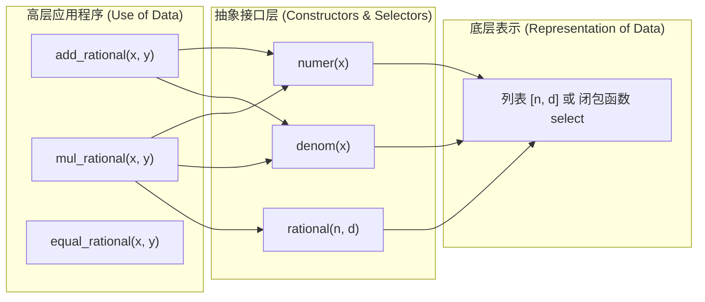

> **课程体系**：UC Berkeley CS61A (Fall 2024)  
> **所属模块**：Module 2: 递归与数据抽象 (Recursion & Sequences)  
> **主讲教师**：Prof. John DeNero (UC Berkeley)  
> **视频时长**：29:08 ｜ **课堂截图**：16 张板书/代码演示  
> **视频直达**：[📺 在 B 站观看本讲原视频 (P13)](https://www.bilibili.com/video/BV1sy411z7nA/?p=13)  
> **快速导航**：[← 上一讲 (P12 Lecture 12 Containers)](/notes/cs61a/lecture-12) ｜ [📚 返回全书目录](/notes/topics/CS61A) ｜ [下一讲 (P14 Lecture 14 Trees) →](/notes/cs61a/lecture-14)

---

## 目录 (Table of Contents)
1. [引言：何为“数据”？行为公理与表现无关性](#1-引言何为数据行为公理与表现无关性)
2. [抽象数据类型 (ADT)：构造器与选择器的合约](#2-抽象数据类型-adt构造器与选择器的合约)
3. [实战演练：有理数算术系统的完整构建](#3-实战演练有理数算术系统的完整构建)
4. [核心法则：抽象屏障 (Abstraction Barriers)](#4-核心法则抽象屏障-abstraction-barriers)
5. [重罪批判：违背抽象屏障的灾难性后果](#5-重罪批判违背抽象屏障的灾难性后果)
6. [数据抽象的威力：通过 GCD 自动约分化简](#6-数据抽象的威力通过-gcd-自动约分化简)
7. [思维升维：用纯函数构建数据（函数式偶对）](#7-思维升维用纯函数构建数据函数式偶对)
8. [本讲核心要点与思考题](#8-本讲核心要点与思考题)

---

### 深入形式化规约与微观求值流程（Operational Semantics）
在「目录 (Table of Contents)」模块中，计算机底层运算依赖于严密的形式化求值逻辑：
1. **抽象语法树（AST）的分层解析**：
   - 源代码字符流首先经过词法分析器（Lexer）切分为终结符标记（Tokens），随后由语法解析器（Parser）构造成多叉语法树；
   - 运算符优先级与结合性在语法树构建阶段即已固化，消除了运行期的二义性；
2. **环境序列的动态跃迁**：
   - 每次函数调用产生的新帧，其静态词法环境由函数对象的 `parent` 属性完全决定；
   - 变量查找沿环境链向上单向回溯，直到全局环境帧，若未找到则触发 `NameError` 异常；
3. **状态不变式（State Invariants）**：
   - 编写健壮程序的关键在于明确循环不变式（Loop Invariants）与函数前后置条件（Pre/Post-conditions）；
   - 在复杂控制流跳转中，确保状态变量在每次迭代前均维持合法的业务约束。


## 1. 引言：何为“数据”？行为公理与表现无关性

在日常编程中，我们直觉地认为“数据”就是内存中存放的某个字节序列、一串数字或一个列表。但在计算机科学（特别是 SICP 体系）中，**数据是由其“行为”定义的，而非其物理存储方式**。

### 1.1 行为条件 (Behavioral Conditions)
> **行为公理**：判断某种结构是否能够代表“有理数”，唯一的判定标准是：**它的构造器与选择器是否协同满足有理数的代数行为公理**。

[](https://www.bilibili.com/video/BV1sy411z7nA/?p=13&t=33)
*⏱ 时间戳：00:00:33 · 📷 课堂截图 · [在 B 站观看对应片段 (P13 00:00:33)](https://www.bilibili.com/video/BV1sy411z7nA/?p=13&t=33)*

#### 📸 课堂板书与代码演示深入精读 (00:00:33)

**【现场板书 / 代码演示还原】**：
在此时间节点，DeNero 教授在屏幕上进行了核心演示与重点板书推导：
> *“The purpose of maintaining abstraction barriers is so that you can change your data representation without having to rewrite your entire program. Let's poke a little bit deeper into this idea of data representation. What is data? What does it mean for something to represent a rational number? Well, ...”*

**【底层计算模型与微观执行机制】**：
1. **执行上下文与时序追踪**：
   - 处于当前讨论节点「1. 引言：何为“数据”？行为公理与表现无关性」，解释器严格遵循核心求值规约；
   - 表达式先求值操作符，随后自左至右严格求值操作数，最终将函数对象施加于实参列表；
   - 若涉及环境模型，局部帧严格记录其静态词法父指针（Parent Pointer 指向函数定义处的环境），与运行时的动态调用栈形成正交架构。
2. **内存拓扑与对象引用**：
   - 变量符号只是哈希表（环境帧）中的键，指针直接指向堆内存中的一等公民对象；
   - 赋值语句是离散时间的瞬时状态快照，绝不会建立隐式的数学依赖监听。

**【避坑指南与高频考点点拨】**：
- **常见思维误区**：在「有理数 ADT 接口抽象屏障违规检测 (Violation of Barriers)」相关考题中，初学者极易根据代码表面形式猜想结果，导致作用域混淆或变量遮蔽（Shadowing）误判；
- **调试排错黄金法则**：遇到嵌套调用与复杂分支时，务必在草稿纸上画出独立的局部帧，标明每个形参的具体绑定值，按部就班推导。


对于由分子 $n$ 和分母 $d$ 构成的有理数 $x = \text{rational}(n, d)$，它必须严格满足：
$$\frac{\text{numer}(x)}{\text{denom}(x)} = \frac{n}{d}$$

只要上述关系成立，无论底层是用双元素列表 `[n, d]`、字典 `{'n': n, 'd': d}`、双精度浮点数、还是一个高阶函数，它都是完全合法且等价的有理数表示！

---

### 深入形式化规约与微观求值流程（Operational Semantics）
在「1. 引言：何为“数据”？行为公理与表现无关性」模块中，计算机底层运算依赖于严密的形式化求值逻辑：
1. **抽象语法树（AST）的分层解析**：
   - 源代码字符流首先经过词法分析器（Lexer）切分为终结符标记（Tokens），随后由语法解析器（Parser）构造成多叉语法树；
   - 运算符优先级与结合性在语法树构建阶段即已固化，消除了运行期的二义性；
2. **环境序列的动态跃迁**：
   - 每次函数调用产生的新帧，其静态词法环境由函数对象的 `parent` 属性完全决定；
   - 变量查找沿环境链向上单向回溯，直到全局环境帧，若未找到则触发 `NameError` 异常；
3. **状态不变式（State Invariants）**：
   - 编写健壮程序的关键在于明确循环不变式（Loop Invariants）与函数前后置条件（Pre/Post-conditions）；
   - 在复杂控制流跳转中，确保状态变量在每次迭代前均维持合法的业务约束。


## 2. 抽象数据类型 (ADT)：构造器与选择器的合约

现实世界中的概念往往是复合的（例如日期由年/月/日组成，地理坐标由纬度/经度组成）。**抽象数据类型 (Abstract Data Type, ADT)** 允许我们将这些复合部件作为一个整体单位来操作。

[](https://www.bilibili.com/video/BV1sy411z7nA/?p=13&t=414)
*⏱ 时间戳：00:06:54 · 📷 课堂截图 · [在 B 站观看对应片段 (P13 00:06:54)](https://www.bilibili.com/video/BV1sy411z7nA/?p=13&t=414)*

#### 📸 课堂板书与代码演示深入精读 (00:06:54)

**【现场板书 / 代码演示还原】**：
在此时间节点，DeNero 教授在屏幕上进行了核心演示与重点板书推导：
> *“A new method of abstraction. Here we go. So, most values are compound values, in the sense that they combine different objects together in order to create some object with multiple parts, such as a date, which has a year, a month, and a day, all combined together into one thing. Or a geographic posi...”*

**【底层计算模型与微观执行机制】**：
1. **执行上下文与时序追踪**：
   - 处于当前讨论节点「2. 抽象数据类型 (ADT)：构造器与选择器的合约」，解释器严格遵循核心求值规约；
   - 表达式先求值操作符，随后自左至右严格求值操作数，最终将函数对象施加于实参列表；
   - 若涉及环境模型，局部帧严格记录其静态词法父指针（Parent Pointer 指向函数定义处的环境），与运行时的动态调用栈形成正交架构。
2. **内存拓扑与对象引用**：
   - 变量符号只是哈希表（环境帧）中的键，指针直接指向堆内存中的一等公民对象；
   - 赋值语句是离散时间的瞬时状态快照，绝不会建立隐式的数学依赖监听。

**【避坑指南与高频考点点拨】**：
- **常见思维误区**：在「有理数 ADT 接口抽象屏障违规检测 (Violation of Barriers)」相关考题中，初学者极易根据代码表面形式猜想结果，导致作用域混淆或变量遮蔽（Shadowing）误判；
- **调试排错黄金法则**：遇到嵌套调用与复杂分支时，务必在草稿纸上画出独立的局部帧，标明每个形参的具体绑定值，按部就班推导。


数据抽象的核心目标是**关注点分离 (Separation of Concerns)**：
- **数据的底层表示 (How data are represented)**
- **数据的高层使用 (How data are manipulated)**

为了在二者之间建立安全隔离，必须制定明确的接口合约：
1. **构造器 (Constructor)**：用于创建该数据类型实例的函数，如 `rational(n, d)`。
2. **选择器 (Selectors)**：用于提取该数据类型各个组成部分的函数，如 `numer(x)` 与 `denom(x)`。

[](https://www.bilibili.com/video/BV1sy411z7nA/?p=13&t=572)
*⏱ 时间戳：00:09:32 · 📷 课堂截图 · [在 B 站观看对应片段 (P13 00:09:32)](https://www.bilibili.com/video/BV1sy411z7nA/?p=13&t=572)*

#### 📸 课堂板书与代码演示深入精读 (00:09:32)

**【现场板书 / 代码演示还原】**：
在此时间节点，DeNero 教授在屏幕上进行了核心演示与重点板书推导：
> *“We have another function, numer x, which returns the numerator of a rational number, x. And likewise, we have a denom x function, which returns the denominator. So we have a way of combining together a numerator and a denominator, and then we have a way of selecting those two parts. This is called a...”*

**【底层计算模型与微观执行机制】**：
1. **执行上下文与时序追踪**：
   - 处于当前讨论节点「2. 抽象数据类型 (ADT)：构造器与选择器的合约」，解释器严格遵循核心求值规约；
   - 表达式先求值操作符，随后自左至右严格求值操作数，最终将函数对象施加于实参列表；
   - 若涉及环境模型，局部帧严格记录其静态词法父指针（Parent Pointer 指向函数定义处的环境），与运行时的动态调用栈形成正交架构。
2. **内存拓扑与对象引用**：
   - 变量符号只是哈希表（环境帧）中的键，指针直接指向堆内存中的一等公民对象；
   - 赋值语句是离散时间的瞬时状态快照，绝不会建立隐式的数学依赖监听。

**【避坑指南与高频考点点拨】**：
- **常见思维误区**：在「有理数 ADT 接口抽象屏障违规检测 (Violation of Barriers)」相关考题中，初学者极易根据代码表面形式猜想结果，导致作用域混淆或变量遮蔽（Shadowing）误判；
- **调试排错黄金法则**：遇到嵌套调用与复杂分支时，务必在草稿纸上画出独立的局部帧，标明每个形参的具体绑定值，按部就班推导。




---

### 深入形式化规约与微观求值流程（Operational Semantics）
在「2. 抽象数据类型 (ADT)：构造器与选择器的合约」模块中，计算机底层运算依赖于严密的形式化求值逻辑：
1. **抽象语法树（AST）的分层解析**：
   - 源代码字符流首先经过词法分析器（Lexer）切分为终结符标记（Tokens），随后由语法解析器（Parser）构造成多叉语法树；
   - 运算符优先级与结合性在语法树构建阶段即已固化，消除了运行期的二义性；
2. **环境序列的动态跃迁**：
   - 每次函数调用产生的新帧，其静态词法环境由函数对象的 `parent` 属性完全决定；
   - 变量查找沿环境链向上单向回溯，直到全局环境帧，若未找到则触发 `NameError` 异常；
3. **状态不变式（State Invariants）**：
   - 编写健壮程序的关键在于明确循环不变式（Loop Invariants）与函数前后置条件（Pre/Post-conditions）；
   - 在复杂控制流跳转中，确保状态变量在每次迭代前均维持合法的业务约束。


## 3. 实战演练：有理数算术系统的完整构建

为什么我们要构造有理数 ADT，而不是直接执行浮点数除法 `1 / 3`？
- 计算机浮点数采用有限的二进制小数展开，会产生精度损失（$1/3 \approx 0.3333333333333333$）。
- 通过保持分子与分母为精确的整数对，我们可以实现**无精度损耗的完全精确分数算术**。

[](https://www.bilibili.com/video/BV1sy411z7nA/?p=13&t=511)
*⏱ 时间戳：00:08:31 · 📷 课堂截图 · [在 B 站观看对应片段 (P13 00:08:31)](https://www.bilibili.com/video/BV1sy411z7nA/?p=13&t=511)*

#### 📸 课堂板书与代码演示深入精读 (00:08:31)

**【现场板书 / 代码演示还原】**：
在此时间节点，DeNero 教授在屏幕上进行了核心演示与重点板书推导：
> *“And we'll see what we mean by data abstraction. So a rational member can be expressed as a numerator divided by a denominator, where both numerator and denominators are integers. And since we can represent integers exactly, this gives us an exact representation of fractions. So a pair of integers le...”*

**【底层计算模型与微观执行机制】**：
1. **执行上下文与时序追踪**：
   - 处于当前讨论节点「3. 实战演练：有理数算术系统的完整构建」，解释器严格遵循核心求值规约；
   - 表达式先求值操作符，随后自左至右严格求值操作数，最终将函数对象施加于实参列表；
   - 若涉及环境模型，局部帧严格记录其静态词法父指针（Parent Pointer 指向函数定义处的环境），与运行时的动态调用栈形成正交架构。
2. **内存拓扑与对象引用**：
   - 变量符号只是哈希表（环境帧）中的键，指针直接指向堆内存中的一等公民对象；
   - 赋值语句是离散时间的瞬时状态快照，绝不会建立隐式的数学依赖监听。

**【避坑指南与高频考点点拨】**：
- **常见思维误区**：在「有理数 ADT 接口抽象屏障违规检测 (Violation of Barriers)」相关考题中，初学者极易根据代码表面形式猜想结果，导致作用域混淆或变量遮蔽（Shadowing）误判；
- **调试排错黄金法则**：遇到嵌套调用与复杂分支时，务必在草稿纸上画出独立的局部帧，标明每个形参的具体绑定值，按部就班推导。


### 3.1 乘法、加法与判等规则的数学推导
根据初等分数代数运算法则：
- **乘法 (Multiplication)**：
  $$\frac{n_1}{d_1} \times \frac{n_2}{d_2} = \frac{n_1 \cdot n_2}{d_1 \cdot d_2}$$
- **加法 (Addition)**：
  $$\frac{n_1}{d_1} + \frac{n_2}{d_2} = \frac{n_1 \cdot d_2 + n_2 \cdot d_1}{d_1 \cdot d_2}$$
- **相等性判定 (Equality)**：不能单纯比较分子分母是否相同（因为 $1/2 = 2/4$）。通过交叉相乘验证：
  $$\frac{n_1}{d_1} = \frac{n_2}{d_2} \iff n_1 \cdot d_2 = n_2 \cdot d_1$$

### 3.2 纯粹基于选择器与构造器的函数实现
```python
def mul_rational(x, y):
    """有理数乘法。"""
    return rational(numer(x) * numer(y), denom(x) * denom(y))

def add_rational(x, y):
    """有理数加法。"""
    nx, dx = numer(x), denom(x)
    ny, dy = numer(y), denom(y)
    return rational(nx * dy + ny * dx, dx * dy)

def equal_rational(x, y):
    """有理数判等。"""
    return numer(x) * denom(y) == numer(y) * denom(x)

def print_rational(x):
    """有理数可视化输出。"""
    print(f"{numer(x)} / {denom(x)}")
```

[](https://www.bilibili.com/video/BV1sy411z7nA/?p=13&t=660)
*⏱ 时间戳：00:11:00 · 📷 课堂截图 · [在 B 站观看对应片段 (P13 00:11:00)](https://www.bilibili.com/video/BV1sy411z7nA/?p=13&t=660)*

#### 📸 课堂板书与代码演示深入精读 (00:11:00)

**【现场板书 / 代码演示还原】**：
在此时间节点，DeNero 教授在屏幕上进行了核心演示与重点板书推导：
> *“And that's our new numerator, and our new denominator is the product of the denominators of the first and second rational number that we're adding together. So now we have formulas for how to multiply and add rational numbers. How do we write code that does that? Well, we'll write it in terms of our...”*

**【底层计算模型与微观执行机制】**：
1. **执行上下文与时序追踪**：
   - 处于当前讨论节点「3. 实战演练：有理数算术系统的完整构建」，解释器严格遵循核心求值规约；
   - 表达式先求值操作符，随后自左至右严格求值操作数，最终将函数对象施加于实参列表；
   - 若涉及环境模型，局部帧严格记录其静态词法父指针（Parent Pointer 指向函数定义处的环境），与运行时的动态调用栈形成正交架构。
2. **内存拓扑与对象引用**：
   - 变量符号只是哈希表（环境帧）中的键，指针直接指向堆内存中的一等公民对象；
   - 赋值语句是离散时间的瞬时状态快照，绝不会建立隐式的数学依赖监听。

**【避坑指南与高频考点点拨】**：
- **常见思维误区**：在「有理数 ADT 接口抽象屏障违规检测 (Violation of Barriers)」相关考题中，初学者极易根据代码表面形式猜想结果，导致作用域混淆或变量遮蔽（Shadowing）误判；
- **调试排错黄金法则**：遇到嵌套调用与复杂分支时，务必在草稿纸上画出独立的局部帧，标明每个形参的具体绑定值，按部就班推导。


[](https://www.bilibili.com/video/BV1sy411z7nA/?p=13&t=723)
*⏱ 时间戳：00:12:03 · 📷 课堂截图 · [在 B 站观看对应片段 (P13 00:12:03)](https://www.bilibili.com/video/BV1sy411z7nA/?p=13&t=723)*

#### 📸 课堂板书与代码演示深入精读 (00:12:03)

**【现场板书 / 代码演示还原】**：
在此时间节点，DeNero 教授在屏幕上进行了核心演示与重点板书推导：
> *“Because we use those multiple times in our expression, and then we return a rational, which follows the formula on the right. One more function lets us really work with rational numbers, and that is equal rational, which returns true, if x and y are the same number. Now, we can't just compare their ...”*

**【底层计算模型与微观执行机制】**：
1. **执行上下文与时序追踪**：
   - 处于当前讨论节点「3. 实战演练：有理数算术系统的完整构建」，解释器严格遵循核心求值规约；
   - 表达式先求值操作符，随后自左至右严格求值操作数，最终将函数对象施加于实参列表；
   - 若涉及环境模型，局部帧严格记录其静态词法父指针（Parent Pointer 指向函数定义处的环境），与运行时的动态调用栈形成正交架构。
2. **内存拓扑与对象引用**：
   - 变量符号只是哈希表（环境帧）中的键，指针直接指向堆内存中的一等公民对象；
   - 赋值语句是离散时间的瞬时状态快照，绝不会建立隐式的数学依赖监听。

**【避坑指南与高频考点点拨】**：
- **常见思维误区**：在「有理数 ADT 接口抽象屏障违规检测 (Violation of Barriers)」相关考题中，初学者极易根据代码表面形式猜想结果，导致作用域混淆或变量遮蔽（Shadowing）误判；
- **调试排错黄金法则**：遇到嵌套调用与复杂分支时，务必在草稿纸上画出独立的局部帧，标明每个形参的具体绑定值，按部就班推导。


> **惊艳之处**：在上述所有运算函数的代码中，**我们从未提及列表、字典、元组等任何具体的 Python 数据类型**！它们完全基于抽象的 `rational`, `numer`, `denom` 编写。即便底层表示尚未实现，高层逻辑已经百分之百完备！

---

### 深入形式化规约与微观求值流程（Operational Semantics）
在「3. 实战演练：有理数算术系统的完整构建」模块中，计算机底层运算依赖于严密的形式化求值逻辑：
1. **抽象语法树（AST）的分层解析**：
   - 源代码字符流首先经过词法分析器（Lexer）切分为终结符标记（Tokens），随后由语法解析器（Parser）构造成多叉语法树；
   - 运算符优先级与结合性在语法树构建阶段即已固化，消除了运行期的二义性；
2. **环境序列的动态跃迁**：
   - 每次函数调用产生的新帧，其静态词法环境由函数对象的 `parent` 属性完全决定；
   - 变量查找沿环境链向上单向回溯，直到全局环境帧，若未找到则触发 `NameError` 异常；
3. **状态不变式（State Invariants）**：
   - 编写健壮程序的关键在于明确循环不变式（Loop Invariants）与函数前后置条件（Pre/Post-conditions）；
   - 在复杂控制流跳转中，确保状态变量在每次迭代前均维持合法的业务约束。


## 4. 核心法则：抽象屏障 (Abstraction Barriers)

抽象屏障是一道道无形的“防火墙”，严格划分了大型软件系统中不同层级所掌握的知识范围：

[](https://www.bilibili.com/video/BV1sy411z7nA/?p=13&t=815)
*⏱ 时间戳：00:13:35 · 📷 课堂截图 · [在 B 站观看对应片段 (P13 00:13:35)](https://www.bilibili.com/video/BV1sy411z7nA/?p=13&t=815)*

#### 📸 课堂板书与代码演示深入精读 (00:13:35)

**【现场板书 / 代码演示还原】**：
在此时间节点，DeNero 教授在屏幕上进行了核心演示与重点板书推导：
> *“Now, these separations are important because they allow you to make changes to one part of your program and have other parts take advantage of those changes without breaking in any way or creating inconsistencies. So let's talk about the abstraction barriers in the development of a rational arithmet...”*

**【底层计算模型与微观执行机制】**：
1. **执行上下文与时序追踪**：
   - 处于当前讨论节点「4. 核心法则：抽象屏障 (Abstraction Barriers)」，解释器严格遵循核心求值规约；
   - 表达式先求值操作符，随后自左至右严格求值操作数，最终将函数对象施加于实参列表；
   - 若涉及环境模型，局部帧严格记录其静态词法父指针（Parent Pointer 指向函数定义处的环境），与运行时的动态调用栈形成正交架构。
2. **内存拓扑与对象引用**：
   - 变量符号只是哈希表（环境帧）中的键，指针直接指向堆内存中的一等公民对象；
   - 赋值语句是离散时间的瞬时状态快照，绝不会建立隐式的数学依赖监听。

**【避坑指南与高频考点点拨】**：
- **常见思维误区**：在「有理数 ADT 接口抽象屏障违规检测 (Violation of Barriers)」相关考题中，初学者极易根据代码表面形式猜想结果，导致作用域混淆或变量遮蔽（Shadowing）误判；
- **调试排错黄金法则**：遇到嵌套调用与复杂分支时，务必在草稿纸上画出独立的局部帧，标明每个形参的具体绑定值，按部就班推导。


[](https://www.bilibili.com/video/BV1sy411z7nA/?p=13&t=907)
*⏱ 时间戳：00:15:07 · 📷 课堂截图 · [在 B 站观看对应片段 (P13 00:15:07)](https://www.bilibili.com/video/BV1sy411z7nA/?p=13&t=907)*

#### 📸 课堂板书与代码演示深入精读 (00:15:07)

**【现场板书 / 代码演示还原】**：
在此时间节点，DeNero 教授在屏幕上进行了核心演示与重点板书推导：
> *“We find parts of the program that create rationals, or implement rational operations, and they treat rationals as a numerator and a denominator paired together. Now, they may not need to know exactly how that pairing happens, but they do need to know that a rational number has a numerator and a deno...”*

**【底层计算模型与微观执行机制】**：
1. **执行上下文与时序追踪**：
   - 处于当前讨论节点「4. 核心法则：抽象屏障 (Abstraction Barriers)」，解释器严格遵循核心求值规约；
   - 表达式先求值操作符，随后自左至右严格求值操作数，最终将函数对象施加于实参列表；
   - 若涉及环境模型，局部帧严格记录其静态词法父指针（Parent Pointer 指向函数定义处的环境），与运行时的动态调用栈形成正交架构。
2. **内存拓扑与对象引用**：
   - 变量符号只是哈希表（环境帧）中的键，指针直接指向堆内存中的一等公民对象；
   - 赋值语句是离散时间的瞬时状态快照，绝不会建立隐式的数学依赖监听。

**【避坑指南与高频考点点拨】**：
- **常见思维误区**：在「有理数 ADT 接口抽象屏障违规检测 (Violation of Barriers)」相关考题中，初学者极易根据代码表面形式猜想结果，导致作用域混淆或变量遮蔽（Shadowing）误判；
- **调试排错黄金法则**：遇到嵌套调用与复杂分支时，务必在草稿纸上画出独立的局部帧，标明每个形参的具体绑定值，按部就班推导。


[](https://www.bilibili.com/video/BV1sy411z7nA/?p=13&t=1002)
*⏱ 时间戳：00:16:42 · 📷 课堂截图 · [在 B 站观看对应片段 (P13 00:16:42)](https://www.bilibili.com/video/BV1sy411z7nA/?p=13&t=1002)*

#### 📸 课堂板书与代码演示深入精读 (00:16:42)

**【现场板书 / 代码演示还原】**：
在此时间节点，DeNero 教授在屏幕上进行了核心演示与重点板书推导：
> *“They do understand their whole data values, that they're consisting of numerators and denominators. And now we have a further detail, that the numerator and denominator are glued together using a list. So for this, we use list literals and element selection. And again, there's an abstraction barrier...”*

**【底层计算模型与微观执行机制】**：
1. **执行上下文与时序追踪**：
   - 处于当前讨论节点「4. 核心法则：抽象屏障 (Abstraction Barriers)」，解释器严格遵循核心求值规约；
   - 表达式先求值操作符，随后自左至右严格求值操作数，最终将函数对象施加于实参列表；
   - 若涉及环境模型，局部帧严格记录其静态词法父指针（Parent Pointer 指向函数定义处的环境），与运行时的动态调用栈形成正交架构。
2. **内存拓扑与对象引用**：
   - 变量符号只是哈希表（环境帧）中的键，指针直接指向堆内存中的一等公民对象；
   - 赋值语句是离散时间的瞬时状态快照，绝不会建立隐式的数学依赖监听。

**【避坑指南与高频考点点拨】**：
- **常见思维误区**：在「有理数 ADT 接口抽象屏障违规检测 (Violation of Barriers)」相关考题中，初学者极易根据代码表面形式猜想结果，导致作用域混淆或变量遮蔽（Shadowing）误判；
- **调试排错黄金法则**：遇到嵌套调用与复杂分支时，务必在草稿纸上画出独立的局部帧，标明每个形参的具体绑定值，按部就班推导。


```
┌─────────────────────────────────────────────────────────────┐
│ 1. 使用有理数进行业务计算的程序                             │
│     treat rational numbers as whole data values              │
│     (调用: add_rational, mul_rational, print_rational)      │
├─────────────────────────────────────────────────────────────┤
│ ══════════════════ 抽象屏障 1 (Barrier 1) ══════════════════ │
├─────────────────────────────────────────────────────────────┤
│ 2. 实现有理数算术运算与构造的层级                           │
│     treat rational numbers as numerators and denominators    │
│     (调用: rational, numer, denom)                           │
├─────────────────────────────────────────────────────────────┤
│ ══════════════════ 抽象屏障 2 (Barrier 2) ══════════════════ │
├─────────────────────────────────────────────────────────────┤
│ 3. 实现选择器与构造器的具体数据结构层级                     │
│     treat rational numbers as two-element lists              │
│     (使用: 列表字面量 [n, d], 索引选择 x[0], x[1])          │
├─────────────────────────────────────────────────────────────┤
│ ══════════════════ 抽象屏障 3 (Barrier 3) ══════════════════ │
├─────────────────────────────────────────────────────────────┤
│ 4. Python 语言运行时底层对列表与内存的实现                   │
│     (C 语言数组分配、垃圾回收等，外部不可见)                 │
└─────────────────────────────────────────────────────────────┘
```

> **屏障准则**：在编写任何一层代码时，**只能调用其正下方屏障所提供的公有接口，严禁向下跨越屏障去假设更底层的实现细节**！

---

### 深入形式化规约与微观求值流程（Operational Semantics）
在「4. 核心法则：抽象屏障 (Abstraction Barriers)」模块中，计算机底层运算依赖于严密的形式化求值逻辑：
1. **抽象语法树（AST）的分层解析**：
   - 源代码字符流首先经过词法分析器（Lexer）切分为终结符标记（Tokens），随后由语法解析器（Parser）构造成多叉语法树；
   - 运算符优先级与结合性在语法树构建阶段即已固化，消除了运行期的二义性；
2. **环境序列的动态跃迁**：
   - 每次函数调用产生的新帧，其静态词法环境由函数对象的 `parent` 属性完全决定；
   - 变量查找沿环境链向上单向回溯，直到全局环境帧，若未找到则触发 `NameError` 异常；
3. **状态不变式（State Invariants）**：
   - 编写健壮程序的关键在于明确循环不变式（Loop Invariants）与函数前后置条件（Pre/Post-conditions）；
   - 在复杂控制流跳转中，确保状态变量在每次迭代前均维持合法的业务约束。


## 5. 重罪批判：违背抽象屏障的灾难性后果

为了向学生深刻灌输抽象屏障的严肃性，DeNero 教授展示了一段“极其恶劣但表面上能够运行”的代码，并给出了 CS61A 历史上最著名的警句之一：

[](https://www.bilibili.com/video/BV1sy411z7nA/?p=13&t=1119)
*⏱ 时间戳：00:18:39 · 📷 课堂截图 · [在 B 站观看对应片段 (P13 00:18:39)](https://www.bilibili.com/video/BV1sy411z7nA/?p=13&t=1119)*

#### 📸 课堂板书与代码演示深入精读 (00:18:39)

**【现场板书 / 代码演示还原】**：
在此时间节点，DeNero 教授在屏幕上进行了核心演示与重点板书推导：
> *“1, 2, and 1, 4. So a half plus a 4 should give me 3 fourths. And under the code we've written, this will work just fine. I have a definition of dividing a rational, which returns a list of whatever is the 0th element of x times the first element of y. And then we have the first element of x and the ...”*

**【底层计算模型与微观执行机制】**：
1. **执行上下文与时序追踪**：
   - 处于当前讨论节点「5. 重罪批判：违背抽象屏障的灾难性后果」，解释器严格遵循核心求值规约；
   - 表达式先求值操作符，随后自左至右严格求值操作数，最终将函数对象施加于实参列表；
   - 若涉及环境模型，局部帧严格记录其静态词法父指针（Parent Pointer 指向函数定义处的环境），与运行时的动态调用栈形成正交架构。
2. **内存拓扑与对象引用**：
   - 变量符号只是哈希表（环境帧）中的键，指针直接指向堆内存中的一等公民对象；
   - 赋值语句是离散时间的瞬时状态快照，绝不会建立隐式的数学依赖监听。

**【避坑指南与高频考点点拨】**：
- **常见思维误区**：在「有理数 ADT 接口抽象屏障违规检测 (Violation of Barriers)」相关考题中，初学者极易根据代码表面形式猜想结果，导致作用域混淆或变量遮蔽（Shadowing）误判；
- **调试排错黄金法则**：遇到嵌套调用与复杂分支时，务必在草稿纸上画出独立的局部帧，标明每个形参的具体绑定值，按部就班推导。


```python
# 极其糟糕的调用示例 (跨越屏障罪状 1)
add_rational([1, 2], [1, 4])

# 极其糟糕的除法实现 (跨越屏障罪状 2)
def divide_rational(x, y):
    return [x[0] * y[1], x[1] * y[0]]
```

[](https://www.bilibili.com/video/BV1sy411z7nA/?p=13&t=1210)
*⏱ 时间戳：00:20:10 · 📷 课堂截图 · [在 B 站观看对应片段 (P13 00:20:10)](https://www.bilibili.com/video/BV1sy411z7nA/?p=13&t=1210)*

#### 📸 课堂板书与代码演示深入精读 (00:20:10)

**【现场板书 / 代码演示还原】**：
在此时间节点，DeNero 教授在屏幕上进行了核心演示与重点板书推导：
> *“Numer selector function. Instead, I've used the element selection that works for lists, thereby assuming that X is a list. Instead of saying, oh, it's something that has a numerator and a denominator, but I don't know exactly what it is. So I've gone down to too low of a level. And, oh, look, I did ...”*

**【底层计算模型与微观执行机制】**：
1. **执行上下文与时序追踪**：
   - 处于当前讨论节点「5. 重罪批判：违背抽象屏障的灾难性后果」，解释器严格遵循核心求值规约；
   - 表达式先求值操作符，随后自左至右严格求值操作数，最终将函数对象施加于实参列表；
   - 若涉及环境模型，局部帧严格记录其静态词法父指针（Parent Pointer 指向函数定义处的环境），与运行时的动态调用栈形成正交架构。
2. **内存拓扑与对象引用**：
   - 变量符号只是哈希表（环境帧）中的键，指针直接指向堆内存中的一等公民对象；
   - 赋值语句是离散时间的瞬时状态快照，绝不会建立隐式的数学依赖监听。

**【避坑指南与高频考点点拨】**：
- **常见思维误区**：在「有理数 ADT 接口抽象屏障违规检测 (Violation of Barriers)」相关考题中，初学者极易根据代码表面形式猜想结果，导致作用域混淆或变量遮蔽（Shadowing）误判；
- **调试排错黄金法则**：遇到嵌套调用与复杂分支时，务必在草稿纸上画出独立的局部帧，标明每个形参的具体绑定值，按部就班推导。


### 罪状剖析
1. 在调用 `add_rational` 时，程序员直接传入了两个列表字面量 `[1, 2]`，而不是调用构造器 `rational(1, 2)`。这假设了有理数必定是列表。
2. 在定义 `divide_rational` 时，程序员直接使用了列表下标 `x[0]` 与 `y[1]`，而不是调用选择器 `numer(x)` 与 `denom(y)`；且最后直接返回方括号列表，而未通过 `rational(...)` 构造。

> **DeNero 教授的经典判词**：
> > *"If I saw somebody's computer with this code on it, I think I would honestly just light it on fire and just watch it burn, because code that violates abstraction barriers should burn."*  
> （如果我在谁的电脑上看到这种破坏抽象屏障的代码，我真想把它一把火点着看着它烧成灰，因为践踏抽象屏障的代码就该被焚毁！）

### 为什么必须如此严厉？
一旦有理数的底层表示发生变更（例如为了性能改用元组、类对象、或加入化简逻辑），**所有违背抽象屏障的代码将瞬间全部崩溃**！

---

### 深入形式化规约与微观求值流程（Operational Semantics）
在「5. 重罪批判：违背抽象屏障的灾难性后果」模块中，计算机底层运算依赖于严密的形式化求值逻辑：
1. **抽象语法树（AST）的分层解析**：
   - 源代码字符流首先经过词法分析器（Lexer）切分为终结符标记（Tokens），随后由语法解析器（Parser）构造成多叉语法树；
   - 运算符优先级与结合性在语法树构建阶段即已固化，消除了运行期的二义性；
2. **环境序列的动态跃迁**：
   - 每次函数调用产生的新帧，其静态词法环境由函数对象的 `parent` 属性完全决定；
   - 变量查找沿环境链向上单向回溯，直到全局环境帧，若未找到则触发 `NameError` 异常；
3. **状态不变式（State Invariants）**：
   - 编写健壮程序的关键在于明确循环不变式（Loop Invariants）与函数前后置条件（Pre/Post-conditions）；
   - 在复杂控制流跳转中，确保状态变量在每次迭代前均维持合法的业务约束。


## 6. 数据抽象的威力：通过 GCD 自动约分化简

### 6.1 传统列表表示下的基础构造器与选择器
```python
def rational(n, d):
    return [n, d]

def numer(x):
    return x[0]

def denom(x):
    return x[1]
```

[](https://www.bilibili.com/video/BV1sy411z7nA/?p=13&t=1457)
*⏱ 时间戳：00:24:17 · 📷 课堂截图 · [在 B 站观看对应片段 (P13 00:24:17)](https://www.bilibili.com/video/BV1sy411z7nA/?p=13&t=1457)*

#### 📸 课堂板书与代码演示深入精读 (00:24:17)

**【现场板书 / 代码演示还原】**：
在此时间节点，DeNero 教授在屏幕上进行了核心演示与重点板书推导：
> *“Okay, we now have a basic introduction to what lists are, and so far we've used them to create pairs. And why is that useful? Well, a rational number is a pair of integers, the numerator and the denominator. So here's a definition of the constructor of the abstract data type for rational numbers. It...”*

**【底层计算模型与微观执行机制】**：
1. **执行上下文与时序追踪**：
   - 处于当前讨论节点「6. 数据抽象的威力：通过 GCD 自动约分化简」，解释器严格遵循核心求值规约；
   - 表达式先求值操作符，随后自左至右严格求值操作数，最终将函数对象施加于实参列表；
   - 若涉及环境模型，局部帧严格记录其静态词法父指针（Parent Pointer 指向函数定义处的环境），与运行时的动态调用栈形成正交架构。
2. **内存拓扑与对象引用**：
   - 变量符号只是哈希表（环境帧）中的键，指针直接指向堆内存中的一等公民对象；
   - 赋值语句是离散时间的瞬时状态快照，绝不会建立隐式的数学依赖监听。

**【避坑指南与高频考点点拨】**：
- **常见思维误区**：在「有理数 ADT 接口抽象屏障违规检测 (Violation of Barriers)」相关考题中，初学者极易根据代码表面形式猜想结果，导致作用域混淆或变量遮蔽（Shadowing）误判；
- **调试排错黄金法则**：遇到嵌套调用与复杂分支时，务必在草稿纸上画出独立的局部帧，标明每个形参的具体绑定值，按部就班推导。


此时若计算 $3/2 \times 5/3$，结果为 $15/6$。虽然数值正确，但未化简为既约分数 $5/2$。

### 6.2 零修改高层逻辑：仅重构构造器
利用最大公约数 (GCD)，我们在构造有理数时直接除以分子分母的公约数：
```python
from math import gcd

def rational(n, d):
    """构造始终处于既约形态的有理数。"""
    g = gcd(n, d)
    return [n // g, d // g]
```

[](https://www.bilibili.com/video/BV1sy411z7nA/?p=13&t=1675)
*⏱ 时间戳：00:27:55 · 📷 课堂截图 · [在 B 站观看对应片段 (P13 00:27:55)](https://www.bilibili.com/video/BV1sy411z7nA/?p=13&t=1675)*

#### 📸 课堂板书与代码演示深入精读 (00:27:55)

**【现场板书 / 代码演示还原】**：
在此时间节点，DeNero 教授在屏幕上进行了核心演示与重点板书推导：
> *“So one thing I can do is import a function that computes the greatest common divisor. In a previous lecture, I showed you how to write a function that does this, but it also happens to be built into Python. And then what I'm going to do is redefine the rational constructor to take any numerator and ...”*

**【底层计算模型与微观执行机制】**：
1. **执行上下文与时序追踪**：
   - 处于当前讨论节点「6. 数据抽象的威力：通过 GCD 自动约分化简」，解释器严格遵循核心求值规约；
   - 表达式先求值操作符，随后自左至右严格求值操作数，最终将函数对象施加于实参列表；
   - 若涉及环境模型，局部帧严格记录其静态词法父指针（Parent Pointer 指向函数定义处的环境），与运行时的动态调用栈形成正交架构。
2. **内存拓扑与对象引用**：
   - 变量符号只是哈希表（环境帧）中的键，指针直接指向堆内存中的一等公民对象；
   - 赋值语句是离散时间的瞬时状态快照，绝不会建立隐式的数学依赖监听。

**【避坑指南与高频考点点拨】**：
- **常见思维误区**：在「有理数 ADT 接口抽象屏障违规检测 (Violation of Barriers)」相关考题中，初学者极易根据代码表面形式猜想结果，导致作用域混淆或变量遮蔽（Shadowing）误判；
- **调试排错黄金法则**：遇到嵌套调用与复杂分支时，务必在草稿纸上画出独立的局部帧，标明每个形参的具体绑定值，按部就班推导。


**立竿见影的效果**：
- 执行 `mul_rational(rational(3, 2), rational(5, 3))` 自动输出 `5 / 2`！
- 执行 `add_rational(rational(2, 5), rational(1, 10))`（得到 $25/50$）自动化简为 `1 / 2`！
- **整个 `add_rational`、`mul_rational`、`equal_rational`、`print_rational` 无需修改一个字符**！这就是遵守抽象屏障所赋予软件的极致扩展性与可维护性。

---

### 深入形式化规约与微观求值流程（Operational Semantics）
在「6. 数据抽象的威力：通过 GCD 自动约分化简」模块中，计算机底层运算依赖于严密的形式化求值逻辑：
1. **抽象语法树（AST）的分层解析**：
   - 源代码字符流首先经过词法分析器（Lexer）切分为终结符标记（Tokens），随后由语法解析器（Parser）构造成多叉语法树；
   - 运算符优先级与结合性在语法树构建阶段即已固化，消除了运行期的二义性；
2. **环境序列的动态跃迁**：
   - 每次函数调用产生的新帧，其静态词法环境由函数对象的 `parent` 属性完全决定；
   - 变量查找沿环境链向上单向回溯，直到全局环境帧，若未找到则触发 `NameError` 异常；
3. **状态不变式（State Invariants）**：
   - 编写健壮程序的关键在于明确循环不变式（Loop Invariants）与函数前后置条件（Pre/Post-conditions）；
   - 在复杂控制流跳转中，确保状态变量在每次迭代前均维持合法的业务约束。


## 7. 思维升维：用纯函数构建数据（函数式偶对）

为了彻底证明“数据即行为，无关具体容器”，DeNero 教授展示了源自丘奇编码 (Church Pairs) 的计算机科学奇迹：**完全不使用列表、元组或任何内置数据结构，仅凭 Python 函数实现有理数偶对**！

### 7.1 函数式构造器与分发闭包
```python
def rational(n, d):
    """完全使用函数闭包表示有理数。"""
    def select(name):
        if name == 'n':
            return n
        elif name == 'd':
            return d
    return select

def numer(x):
    return x('n')

def denom(x):
    return x('d')
```

[](https://www.bilibili.com/video/BV1sy411z7nA/?p=13&t=165)
*⏱ 时间戳：00:02:45 · 📷 课堂截图 · [在 B 站观看对应片段 (P13 00:02:45)](https://www.bilibili.com/video/BV1sy411z7nA/?p=13&t=165)*

#### 📸 课堂板书与代码演示深入精读 (00:02:45)

**【现场板书 / 代码演示还原】**：
在此时间节点，DeNero 教授在屏幕上进行了核心演示与重点板书推导：
> *“One, two, and the rational number three-eighths. I should say one-half and three-eighths. So what happens when I print the result of multiplying together x and y? I get three over 16. It should be the case that I can change my representation, and all of this will still work. So here we go. Instead o...”*

**【底层计算模型与微观执行机制】**：
1. **执行上下文与时序追踪**：
   - 处于当前讨论节点「7. 思维升维：用纯函数构建数据（函数式偶对）」，解释器严格遵循核心求值规约；
   - 表达式先求值操作符，随后自左至右严格求值操作数，最终将函数对象施加于实参列表；
   - 若涉及环境模型，局部帧严格记录其静态词法父指针（Parent Pointer 指向函数定义处的环境），与运行时的动态调用栈形成正交架构。
2. **内存拓扑与对象引用**：
   - 变量符号只是哈希表（环境帧）中的键，指针直接指向堆内存中的一等公民对象；
   - 赋值语句是离散时间的瞬时状态快照，绝不会建立隐式的数学依赖监听。

**【避坑指南与高频考点点拨】**：
- **常见思维误区**：在「有理数 ADT 接口抽象屏障违规检测 (Violation of Barriers)」相关考题中，初学者极易根据代码表面形式猜想结果，导致作用域混淆或变量遮蔽（Shadowing）误判；
- **调试排错黄金法则**：遇到嵌套调用与复杂分支时，务必在草稿纸上画出独立的局部帧，标明每个形参的具体绑定值，按部就班推导。


[](https://www.bilibili.com/video/BV1sy411z7nA/?p=13&t=262)
*⏱ 时间戳：00:04:22 · 📷 课堂截图 · [在 B 站观看对应片段 (P13 00:04:22)](https://www.bilibili.com/video/BV1sy411z7nA/?p=13&t=262)*

#### 📸 课堂板书与代码演示深入精读 (00:04:22)

**【现场板书 / 代码演示还原】**：
在此时间节点，DeNero 教授在屏幕上进行了核心演示与重点板书推导：
> *“I then printed the result of multiplying x and y together, and I got 3 sixteenths. Did we really change anything? Well, certainly we did, because x is now a function. So that's a change in representation that led to another valid representation of rational numbers that works just as well with our ol...”*

**【底层计算模型与微观执行机制】**：
1. **执行上下文与时序追踪**：
   - 处于当前讨论节点「7. 思维升维：用纯函数构建数据（函数式偶对）」，解释器严格遵循核心求值规约；
   - 表达式先求值操作符，随后自左至右严格求值操作数，最终将函数对象施加于实参列表；
   - 若涉及环境模型，局部帧严格记录其静态词法父指针（Parent Pointer 指向函数定义处的环境），与运行时的动态调用栈形成正交架构。
2. **内存拓扑与对象引用**：
   - 变量符号只是哈希表（环境帧）中的键，指针直接指向堆内存中的一等公民对象；
   - 赋值语句是离散时间的瞬时状态快照，绝不会建立隐式的数学依赖监听。

**【避坑指南与高频考点点拨】**：
- **常见思维误区**：在「有理数 ADT 接口抽象屏障违规检测 (Violation of Barriers)」相关考题中，初学者极易根据代码表面形式猜想结果，导致作用域混淆或变量遮蔽（Shadowing）误判；
- **调试排错黄金法则**：遇到嵌套调用与复杂分支时，务必在草稿纸上画出独立的局部帧，标明每个形参的具体绑定值，按部就班推导。


### 7.2 环境模型透视：被闭包捕获的数据
执行 `x = rational(3, 8)` 与 `numer(x)`：

[](https://www.bilibili.com/video/BV1sy411z7nA/?p=13&t=322)
*⏱ 时间戳：00:05:22 · 📷 课堂截图 · [在 B 站观看对应片段 (P13 00:05:22)](https://www.bilibili.com/video/BV1sy411z7nA/?p=13&t=322)*

#### 📸 课堂板书与代码演示深入精读 (00:05:22)

**【现场板书 / 代码演示还原】**：
在此时间节点，DeNero 教授在屏幕上进行了核心演示与重点板书推导：
> *“We called the function that resulted from calling rational in order to get the numerator back. By defining a function within another function, we were able to refer to the N and the D in the enclosing scope. And so this select function that we returned did have, carrying with it, the numerator and d...”*

**【底层计算模型与微观执行机制】**：
1. **执行上下文与时序追踪**：
   - 处于当前讨论节点「7. 思维升维：用纯函数构建数据（函数式偶对）」，解释器严格遵循核心求值规约；
   - 表达式先求值操作符，随后自左至右严格求值操作数，最终将函数对象施加于实参列表；
   - 若涉及环境模型，局部帧严格记录其静态词法父指针（Parent Pointer 指向函数定义处的环境），与运行时的动态调用栈形成正交架构。
2. **内存拓扑与对象引用**：
   - 变量符号只是哈希表（环境帧）中的键，指针直接指向堆内存中的一等公民对象；
   - 赋值语句是离散时间的瞬时状态快照，绝不会建立隐式的数学依赖监听。

**【避坑指南与高频考点点拨】**：
- **常见思维误区**：在「有理数 ADT 接口抽象屏障违规检测 (Violation of Barriers)」相关考题中，初学者极易根据代码表面形式猜想结果，导致作用域混淆或变量遮蔽（Shadowing）误判；
- **调试排错黄金法则**：遇到嵌套调用与复杂分支时，务必在草稿纸上画出独立的局部帧，标明每个形参的具体绑定值，按部就班推导。


```
Global frame
  rational ───► func rational(n, d)
  numer    ───► func numer(x)
  denom    ───► func denom(x)
  x        ───► func select(name) [parent=f1]

f1: rational [parent=Global]
  n: 3
  d: 8
  select ───► func select(name) [parent=f1]
```
1. 调用 `rational(3, 8)` 在局部帧 `f1` 中绑定了 `n = 3, d = 8`。
2. 返回的内部函数 `select` 的父帧为 `f1`。
3. 当执行 `numer(x)` 即 `x('n')` 时，新建帧 `f2`，参数 `name = 'n'`。在父帧 `f1` 中找到 `n = 3` 并成功返回！

> **终极启示**：
> - 变量 `x` 本身是一个函数！
> - 状态数据并不存在于任何专门的“数据容器”中，而是静静地栖息在函数的**词法闭包父帧 (Parent Frame)** 中。
> - 任何符合行为合约的实体皆可成为数据，**过程与数据在理论最深处是完全统一的**。

---

### 深入形式化规约与微观求值流程（Operational Semantics）
在「7. 思维升维：用纯函数构建数据（函数式偶对）」模块中，计算机底层运算依赖于严密的形式化求值逻辑：
1. **抽象语法树（AST）的分层解析**：
   - 源代码字符流首先经过词法分析器（Lexer）切分为终结符标记（Tokens），随后由语法解析器（Parser）构造成多叉语法树；
   - 运算符优先级与结合性在语法树构建阶段即已固化，消除了运行期的二义性；
2. **环境序列的动态跃迁**：
   - 每次函数调用产生的新帧，其静态词法环境由函数对象的 `parent` 属性完全决定；
   - 变量查找沿环境链向上单向回溯，直到全局环境帧，若未找到则触发 `NameError` 异常；
3. **状态不变式（State Invariants）**：
   - 编写健壮程序的关键在于明确循环不变式（Loop Invariants）与函数前后置条件（Pre/Post-conditions）；
   - 在复杂控制流跳转中，确保状态变量在每次迭代前均维持合法的业务约束。


## 8. 本讲核心要点与思考题

### 重点法则提炼
1. **数据抽象分离表示与使用**：构造器与选择器构筑了唯一的公有通信协议。
2. **严禁向下穿透抽象屏障**：高层业务代码绝不应假设底层的具体存储数据结构。
3. **闭包即对象**：函数闭包能够完整封装状态并响应请求，这是面向对象思想在函数式语言中的最初萌芽。

---

### 课后自测练习

#### 练习 1：平面直角坐标系中的线段抽象
请为二维平面上的线段设计一个数据抽象。包含点 `make_point(x, y)`、选择器 `x_point(p)`、`y_point(p)`，以及线段 `make_segment(start_p, end_p)`、选择器 `start_segment(s)`、`end_segment(s)`。随后编写计算线段中点的函数 `midpoint_segment(s)`：
```python
def make_point(x, y):
    return [x, y]

def x_point(p):
    return p[0]

def y_point(p):
    return p[1]

def make_segment(start_point, end_point):
    return [start_point, end_point]

def start_segment(s):
    return s[0]

def end_segment(s):
    return s[1]

def midpoint_segment(s):
    p1 = start_segment(s)
    p2 = end_segment(s)
    mid_x = (x_point(p1) + x_point(p2)) / 2
    mid_y = (y_point(p1) + y_point(p2)) / 2
    return make_point(mid_x, mid_y)
```
注意在 `midpoint_segment` 中，完全没有出现任何方括号索引，所有操作皆严守抽象屏障！

### 深入形式化规约与微观求值流程（Operational Semantics）
在「8. 本讲核心要点与思考题」模块中，计算机底层运算依赖于严密的形式化求值逻辑：
1. **抽象语法树（AST）的分层解析**：
   - 源代码字符流首先经过词法分析器（Lexer）切分为终结符标记（Tokens），随后由语法解析器（Parser）构造成多叉语法树；
   - 运算符优先级与结合性在语法树构建阶段即已固化，消除了运行期的二义性；
2. **环境序列的动态跃迁**：
   - 每次函数调用产生的新帧，其静态词法环境由函数对象的 `parent` 属性完全决定；
   - 变量查找沿环境链向上单向回溯，直到全局环境帧，若未找到则触发 `NameError` 异常；
3. **状态不变式（State Invariants）**：
   - 编写健壮程序的关键在于明确循环不变式（Loop Invariants）与函数前后置条件（Pre/Post-conditions）；
   - 在复杂控制流跳转中，确保状态变量在每次迭代前均维持合法的业务约束。


---

## 伯克利 Midterm / Final 经典高频考题深度演练

### 实战考题：环境拓扑与微观状态追踪（WWPD & Environment Diagrams）
考虑以下 Python 代码在交互式环境中的微观执行过程：

```python
# 经典作用域与高阶函数综合考题
x = 10

def outer(x):
    y = x + 2
    def inner(y):
        return x + y
    return inner

f = outer(5)
result = f(3)
```

#### 完整解题思维模型与多帧环境图推导：
1. **全局帧（Global Frame）初始化**：
   - 全局变量 `x` 绑定到整数对象 `10`；
   - 全局函数 `outer` 绑定到新创建的函数对象，其内嵌 `parent = Global`；
2. **执行 `f = outer(5)`**：
   - 开辟局部帧 $f_1$，标注 `f1: outer [parent=Global]`；
   - 形参 `x` 绑定到实参 `5`；
   - 局部变量 `y` 绑定到 `5 + 2 = 7`；
   - 在 $f_1$ 内部执行 `def inner(y):`，创建函数对象 `inner`，其内嵌 **`parent = f1`**；
   - 返回函数对象 `inner`，全局变量 `f` 绑定到该对象；
3. **执行 `result = f(3)`**：
   - 调用函数 `f`（即 `inner`），开辟局部帧 $f_2$；
   - **核心判分点**：帧 $f_2$ 的 parent 指向谁？
   - **铁律**：函数 `inner` 是在帧 $f_1$ 内部被定义的，因此 $f_2$ 的 **`parent = f1`**！
   - 形参 `y` 绑定到实参 `3`；
   - 执行体 `return x + y`：
     - 在当前帧 $f_2$ 查找 `y`：命中局部变量 `y = 3`；
     - 在当前帧 $f_2$ 查找 `x`：未命中，沿 parent 回溯到 **$f_1$ 帧** 查找！
     - 在 $f_1$ 帧中命中 `x = 5`（全局的 `x = 10` 被局部遮蔽！）；
     - 计算 `5 + 3 = 8`，作为返回值；
4. **最终输出结论**：
   - 全局变量 `result = 8`。

---

## 本讲核心概念知识矩阵 (Knowledge Matrix)

| 核心知识维度 | 形式化定义与机制 | 典型代码示例 | 核心工程与算法价值 | 常见易错陷阱 |
| :--- | :--- | :--- | :--- | :--- |
| **基础求值语义** | 表达式求值得到值，语句执行改变内部状态 | `x = 2 + 3` | 建立离散时间状态快照心智模型 | 误将赋值等号当作代数方程动态约束 |
| **环境帧拓扑** | 环境是一系列帧构成的有序链条 | `Global -> f1 -> f2` | 实现词法作用域与变量安全隔离 | 混淆调用者栈帧与定义处父环境指针 |
| **抽象屏障** | 通过函数接口隔离实现细节与调用逻辑 | `def square(x): ...` | 降低大规模系统认知负荷 | 破坏接口直接依赖底层私有数据结构 |
| **控制流决策** | 条件分支短路求值与循环迭代递进 | `if cond: ... while: ...` | 赋予程序非线性决策与大规模数据处理能力 | 遗漏循环递进变量引发死循环 |
| **高阶能力** | 函数作为一等公民（传参、返回、赋值） | `make_adder(3)` | 实现工厂模式、闭包持久状态与柯里化 | 闭包后期绑定引发循环变量捕获错误 |

---

## 课程导航与跳转

| 上一讲 | 目录 | 下一讲 | 原视频 |
| :--- | :---: | :--- | :--- |
| [← 上一讲：Lecture 12 Containers](/notes/cs61a/lecture-12) | [📚 返回 CS61A 全书目录](/notes/topics/CS61A) | [下一讲：Lecture 14 Trees →](/notes/cs61a/lecture-14) | [🎬 在 B 站观看本讲 (P13)](https://www.bilibili.com/video/BV1sy411z7nA/?p=13) |
