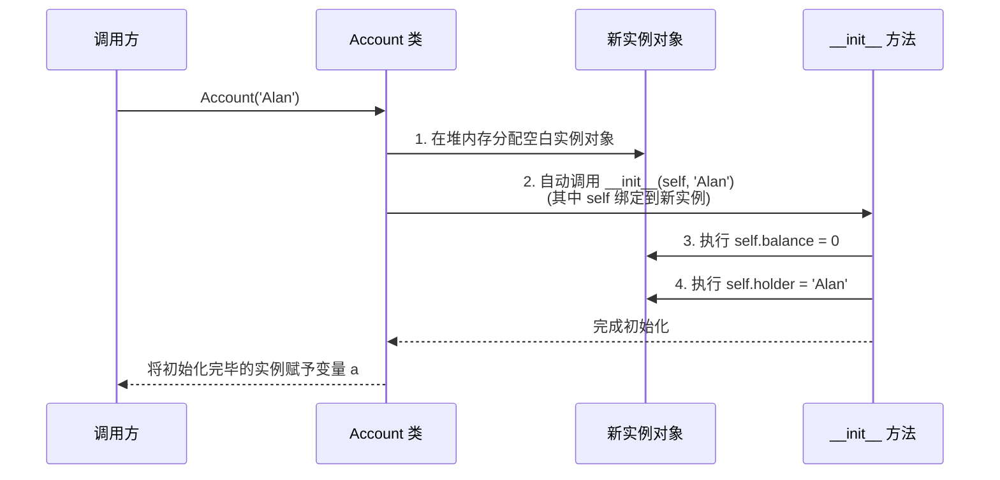

> **英文原课**：CS 61A: Structure and Interpretation of Computer Programs (Fall 2024)  
> **主讲教师**：Prof. John DeNero (UC Berkeley)  
> **图文整理**：VideoBook 视频转图文技术电子书流水线  
> **全书体量**：已收录 37 / 37 讲 ｜ 18.2 小时音视频讲义 ｜ 577 张高清板书截图  
> **在线目录**：[CS61A 专题目录](/notes/topics/CS61A)

---


> **主讲**：John DeNero ｜ **时长**：17:15 ｜ **视频回链**：[B 站对应单集 (P18)](https://www.bilibili.com/video/BV1sy411z7nA/?p=18)

## 1. 引言：应对软件复杂度的 OOP 范式

随着软件系统规模呈指数级膨胀，人类大脑无法同时理解全局所有细节。
- **面向过程思维**：将程序视为一堆全局数据结构，以及一大组按顺序操作这些数据的函数。随着变量增多，系统变得极其脆弱。
- **面向对象思维 (Object-Oriented Programming, OOP)**：将复杂世界分解为**一组相互协作、彼此自治的独立对象 (Objects)**。


*⏱ 时间戳：00:00:57 · 📷 课堂截图 · [在 B 站观看对应片段 (P18 00:00:57)](https://www.bilibili.com/video/BV1sy411z7nA/?p=18&t=57)*

每个对象拥有**自己的局部状态 (Local State)**，并负责维护和管理这些状态的变化。程序运行的过程，就是各个对象通过**发送消息（调用方法）**相互协作的过程。

---

## 2. 类与对象的概念体系：模具与实体


*⏱ 时间戳：00:02:19 · 📷 课堂截图 · [在 B 站观看对应片段 (P18 00:02:19)](https://www.bilibili.com/video/BV1sy411z7nA/?p=18&t=139)*

- **类 (Class)**：对象的模板与蓝图，定义了该类型对象**所拥有的所有行为法则与方法**。
- **实例 / 对象 (Instance / Object)**：依据类创建出的具体实体，拥有类所定义的行为规范，同时保存自身独一无二的属性数据。
- **方法 (Method)**：专属于某个类、必须通过特定对象调用的函数。


*⏱ 时间戳：00:03:44 · 📷 课堂截图 · [在 B 站观看对应片段 (P18 00:03:44)](https://www.bilibili.com/video/BV1sy411z7nA/?p=18&t=224)*

在 Python 中，**一切皆对象**。即使是内建的 `list`，其本质也是一个类。当我们调用 `list([1, 2])` 时，实际上就是在实例化 `list` 类的对象。

---

## 3. 银行账户案例 (`Account`)：状态与行为的封装

为了落地 OOP 思想，DeNero 教授设计了经典的银行账户类 `Account`。


*⏱ 时间戳：00:05:12 · 📷 课堂截图 · [在 B 站观看对应片段 (P18 00:05:12)](https://www.bilibili.com/video/BV1sy411z7nA/?p=18&t=312)*

一个银行账户必须具备：
- **属性 (Attributes)**：`holder`（持有人名字）与 `balance`（当前余额）。
- **方法 (Methods)**：`deposit(amount)`（存款）与 `withdraw(amount)`（取款）。

```python
a = Account('John')
a.holder     # 'John'
a.balance    # 0
a.deposit(15) # 15
a.withdraw(10) # 5
a.balance    # 5
```


*⏱ 时间戳：00:06:58 · 📷 课堂截图 · [在 B 站观看对应片段 (P18 00:06:58)](https://www.bilibili.com/video/BV1sy411z7nA/?p=18&t=418)*

- 存款与取款操作直接就地修改账户自己的 `balance` 局部状态；
- 如果余额不足，取款拒绝执行并返回 `'Insufficient funds'`，实现了**对象对自己内部状态变动的全权管控**。

---

## 4. 类的定义与解剖：`__init__` 与方法

```python
class Account:
    def __init__(self, account_holder):
        self.balance = 0
        self.holder = account_holder

    def deposit(self, amount):
        self.balance = self.balance + amount
        return self.balance

    def withdraw(self, amount):
        if amount > self.balance:
            return 'Insufficient funds'
        self.balance = self.balance - amount
        return self.balance
```


*⏱ 时间戳：00:08:23 · 📷 课堂截图 · [在 B 站观看对应片段 (P18 00:08:23)](https://www.bilibili.com/video/BV1sy411z7nA/?p=18&t=503)*


*⏱ 时间戳：00:09:50 · 📷 课堂截图 · [在 B 站观看对应片段 (P18 00:09:50)](https://www.bilibili.com/video/BV1sy411z7nA/?p=18&t=590)*

### 核心要素剖析
1. **`class <Name>:` 语句**：声明一个新类。
2. **`__init__` 构造方法 (Initializer)**：双下划线特殊方法，在创建新实例时被解释器自动调用。
3. **`self` 参数**：指向当前被操作的具体实例对象本身。

---

## 5. 对象构造四部曲：空白实例的诞生与赋能

当我们执行调用表达式 `a = Account('Alan')` 时，Python 解释器在幕后完成了四个步骤：


*⏱ 时间戳：00:11:09 · 📷 课堂截图 · [在 B 站观看对应片段 (P18 00:11:09)](https://www.bilibili.com/video/BV1sy411z7nA/?p=18&t=669)*



---

## 6. 属性的动态读写与对象间引用关联

Python 是一门高度动态的语言，对象的属性具有强大的灵活性：


*⏱ 时间戳：00:12:38 · 📷 课堂截图 · [在 B 站观看对应片段 (P18 00:12:38)](https://www.bilibili.com/video/BV1sy411z7nA/?p=18&t=758)*

### 6.1 运行时属性就地修改
```python
a = Account('John')
a.balance = 12  # 直接修改现有属性
```

### 6.2 运行时动态注入新属性
```python
b = Account('Jack')
b.balance = 20
a.backup = b  # 在 a 上动态新增 backup 属性，指向账户 b！
```


*⏱ 时间戳：00:13:34 · 📷 课堂截图 · [在 B 站观看对应片段 (P18 00:13:34)](https://www.bilibili.com/video/BV1sy411z7nA/?p=18&t=814)*

此时我们可以通过链式点表达式访问：
```python
a.backup.balance  # 输出 20
```
对象的属性可以引用另一个对象！这为构建复杂网状系统、复合数据结构提供了无尽的可能。

---

## 7. 对象的独立同一性 (Identity) 与别名机制

每次调用类名构造函数，都会在堆内存中独立开辟一个全新对象实例：


*⏱ 时间戳：00:14:33 · 📷 课堂截图 · [在 B 站观看对应片段 (P18 00:14:33)](https://www.bilibili.com/video/BV1sy411z7nA/?p=18&t=873)*

```python
a = Account('John')
b = Account('John')

a == b  # 取决于类的 __eq__ 实现
a is b  # False！独立开辟的两个账户，各自拥有独立账本！
```


*⏱ 时间戳：00:15:04 · 📷 课堂截图 · [在 B 站观看对应片段 (P18 00:15:04)](https://www.bilibili.com/video/BV1sy411z7nA/?p=18&t=904)*

若执行变量赋值：
```python
c = a
c is a  # True (别名！同一账户的两个代号)
```

---

## 8. 为什么需要方法？多态与类型特异性分发

初学者常问：“为什么必须写成 `a.deposit(15)`，而不是写一个全局函数 `deposit(a, 15)`？”


*⏱ 时间戳：00:15:34 · 📷 课堂截图 · [在 B 站观看对应片段 (P18 00:15:34)](https://www.bilibili.com/video/BV1sy411z7nA/?p=18&t=934)*

DeNero 教授指出，这就是面向对象的核心魅力——**类型分发与多态 (Polymorphism)**：


*⏱ 时间戳：00:16:27 · 📷 课堂截图 · [在 B 站观看对应片段 (P18 00:16:27)](https://www.bilibili.com/video/BV1sy411z7nA/?p=18&t=987)*

- 假设系统中不仅有普通银行账户 `Account`，还有投资理财基金 `InvestmentFund`、加密钱包 `CryptoWallet`。
- 每种资产的“存款 (deposit)”业务逻辑截然不同（投资账户可能需要扣除管理费，加密钱包可能需要验证区块哈希）。
- 通过方法调用 `target.deposit(15)`，**解释器会根据 `target` 的具体所属类型，自动寻找并执行该类所特有的存款算法**！调用方无需编写冗长的 `if type == ...` 分支，代码扩展性达到全新高度。

---

## 9. 本讲核心要点与思考题

### 重点法则提炼
1. **OOP 封装状态与行为**：对象不仅持有数据，更定义了合法改变这些数据的手段。
2. **`self` 是实例的自我指代**：方法定义中的首个参数 `self` 由 Python 解释器在点表达式调用时自动隐式传入。
3. **点表达式驱动多态分发**：方法隶属于类，不同类的同名方法可以拥有各不相同的业务逻辑。

---

### 课后自测练习

#### 练习 1：计息储蓄账户
请为 `Account` 编写一个子类概念或扩展：添加一个 `interest` 属性（年利率，如 0.05）。添加一个方法 `accrue()`，计算当期利息并自动存入余额：
```python
class SavingsAccount(Account):
    def __init__(self, holder, interest=0.05):
        Account.__init__(self, holder)
        self.interest = interest

    def accrue(self):
        earned = self.balance * self.interest
        self.deposit(earned)
        return self.balance
```
通过重用已有方法，面向对象展现出非凡的代码复用魔力！

---

