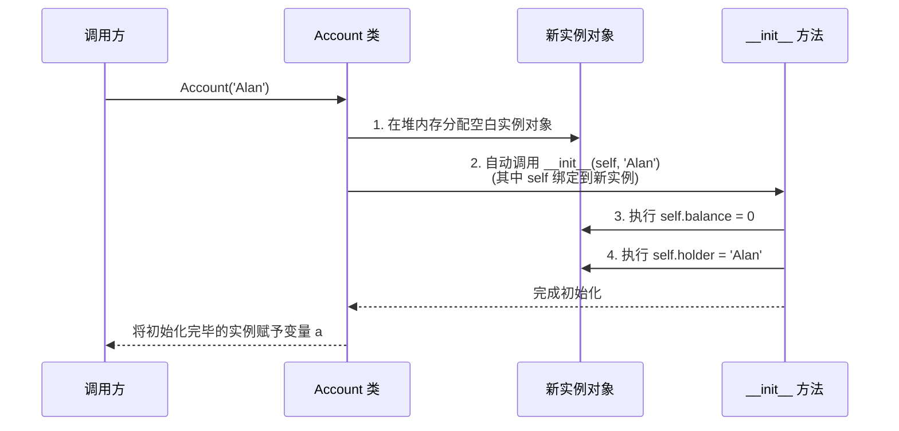

> **课程体系**：UC Berkeley CS61A (Fall 2024)  
> **所属模块**：Module 3: 面向对象与效率 (OOP & Efficiency)  
> **主讲教师**：Prof. John DeNero (UC Berkeley)  
> **视频时长**：17:15 ｜ **课堂截图**：14 张板书/代码演示  
> **视频直达**：[📺 在 B 站观看本讲原视频 (P18)](https://www.bilibili.com/video/BV1sy411z7nA/?p=18)  
> **快速导航**：[← 上一讲 (P17 Lecture 17 Generators)](/notes/cs61a/lecture-17) ｜ [📚 返回全书目录](/notes/topics/CS61A) ｜ [下一讲 (P19 Lecture 19 Attributes) →](/notes/cs61a/lecture-19)

---

## 目录 (Table of Contents)
1. [引言：应对软件复杂度的 OOP 范式](#1-引言应对软件复杂度的-oop-范式)
2. [类与对象的概念体系：模具与实体](#2-类与对象的概念体系模具与实体)
3. [银行账户案例 (`Account`)：状态与行为的封装](#3-银行账户案例-account状态与行为的封装)
4. [类的定义与解剖：`__init__` 与方法](#4-类的定义与解剖__init__-与方法)
5. [对象构造四部曲：空白实例的诞生与赋能](#5-对象构造四部曲空白实例的诞生与赋能)
6. [属性的动态读写与对象间引用关联](#6-属性的动态读写与对象间引用关联)
7. [对象的独立同一性 (Identity) 与别名机制](#7-对象的独立同一性-identity-与别名机制)
8. [为什么需要方法？多态与类型特异性分发](#8-为什么需要方法多态与类型特异性分发)
9. [本讲核心要点与思考题](#9-本讲核心要点与思考题)

---

### 深入形式化规约与微观求值流程（Operational Semantics）
在「目录 (Table of Contents)」模块中，计算机底层运算依赖于严密的形式化求值逻辑：
1. **抽象语法树（AST）的分层解析**：
   - 源代码字符流首先经过词法分析器（Lexer）切分为终结符标记（Tokens），随后由语法解析器（Parser）构造成多叉语法树；
   - 运算符优先级与结合性在语法树构建阶段即已固化，消除了运行期的二义性；
2. **环境序列的动态跃迁**：
   - 每次函数调用产生的新帧，其静态词法环境由函数对象的 `parent` 属性完全决定；
   - 变量查找沿环境链向上单向回溯，直到全局环境帧，若未找到则触发 `NameError` 异常；
3. **状态不变式（State Invariants）**：
   - 编写健壮程序的关键在于明确循环不变式（Loop Invariants）与函数前后置条件（Pre/Post-conditions）；
   - 在复杂控制流跳转中，确保状态变量在每次迭代前均维持合法的业务约束。


## 1. 引言：应对软件复杂度的 OOP 范式

随着软件系统规模呈指数级膨胀，人类大脑无法同时理解全局所有细节。
- **面向过程思维**：将程序视为一堆全局数据结构，以及一大组按顺序操作这些数据的函数。随着变量增多，系统变得极其脆弱。
- **面向对象思维 (Object-Oriented Programming, OOP)**：将复杂世界分解为**一组相互协作、彼此自治的独立对象 (Objects)**。

[](https://www.bilibili.com/video/BV1sy411z7nA/?p=18&t=57)
*⏱ 时间戳：00:00:57 · 📷 课堂截图 · [在 B 站观看对应片段 (P18 00:00:57)](https://www.bilibili.com/video/BV1sy411z7nA/?p=18&t=57)*

#### 📸 课堂板书与代码演示深入精读 (00:00:57)

**【现场板书 / 代码演示还原】**：
在此时间节点，DeNero 教授在屏幕上进行了核心演示与重点板书推导：
> *“We need to organize large programs that are very complex into small, modular components that can individually be written and tested and thought about all at once, because humans can only think about so much complexity at a time. We do this with data abstraction, but object-oriented programming takes...”*

**【底层计算模型与微观执行机制】**：
1. **执行上下文与时序追踪**：
   - 处于当前讨论节点「1. 引言：应对软件复杂度的 OOP 范式」，解释器严格遵循核心求值规约；
   - 表达式先求值操作符，随后自左至右严格求值操作数，最终将函数对象施加于实参列表；
   - 若涉及环境模型，局部帧严格记录其静态词法父指针（Parent Pointer 指向函数定义处的环境），与运行时的动态调用栈形成正交架构。
2. **内存拓扑与对象引用**：
   - 变量符号只是哈希表（环境帧）中的键，指针直接指向堆内存中的一等公民对象；
   - 赋值语句是离散时间的瞬时状态快照，绝不会建立隐式的数学依赖监听。

**【避坑指南与高频考点点拨】**：
- **常见思维误区**：在「类对象 vs 实例对象、__init__ 构造器与 self 绑定机制」相关考题中，初学者极易根据代码表面形式猜想结果，导致作用域混淆或变量遮蔽（Shadowing）误判；
- **调试排错黄金法则**：遇到嵌套调用与复杂分支时，务必在草稿纸上画出独立的局部帧，标明每个形参的具体绑定值，按部就班推导。


每个对象拥有**自己的局部状态 (Local State)**，并负责维护和管理这些状态的变化。程序运行的过程，就是各个对象通过**发送消息（调用方法）**相互协作的过程。

---

### 深入形式化规约与微观求值流程（Operational Semantics）
在「1. 引言：应对软件复杂度的 OOP 范式」模块中，计算机底层运算依赖于严密的形式化求值逻辑：
1. **抽象语法树（AST）的分层解析**：
   - 源代码字符流首先经过词法分析器（Lexer）切分为终结符标记（Tokens），随后由语法解析器（Parser）构造成多叉语法树；
   - 运算符优先级与结合性在语法树构建阶段即已固化，消除了运行期的二义性；
2. **环境序列的动态跃迁**：
   - 每次函数调用产生的新帧，其静态词法环境由函数对象的 `parent` 属性完全决定；
   - 变量查找沿环境链向上单向回溯，直到全局环境帧，若未找到则触发 `NameError` 异常；
3. **状态不变式（State Invariants）**：
   - 编写健壮程序的关键在于明确循环不变式（Loop Invariants）与函数前后置条件（Pre/Post-conditions）；
   - 在复杂控制流跳转中，确保状态变量在每次迭代前均维持合法的业务约束。


## 2. 类与对象的概念体系：模具与实体

[](https://www.bilibili.com/video/BV1sy411z7nA/?p=18&t=139)
*⏱ 时间戳：00:02:19 · 📷 课堂截图 · [在 B 站观看对应片段 (P18 00:02:19)](https://www.bilibili.com/video/BV1sy411z7nA/?p=18&t=139)*

#### 📸 课堂板书与代码演示深入精读 (00:02:19)

**【现场板书 / 代码演示还原】**：
在此时间节点，DeNero 教授在屏幕上进行了核心演示与重点板书推导：
> *“But when mutation happens, it doesn't happen in some global list that keeps track of all the information in the program. Instead, the information that's changing belongs to a particular object. Each object should know how to manage its local state, meaning that it keeps track of what changes are all...”*

**【底层计算模型与微观执行机制】**：
1. **执行上下文与时序追踪**：
   - 处于当前讨论节点「2. 类与对象的概念体系：模具与实体」，解释器严格遵循核心求值规约；
   - 表达式先求值操作符，随后自左至右严格求值操作数，最终将函数对象施加于实参列表；
   - 若涉及环境模型，局部帧严格记录其静态词法父指针（Parent Pointer 指向函数定义处的环境），与运行时的动态调用栈形成正交架构。
2. **内存拓扑与对象引用**：
   - 变量符号只是哈希表（环境帧）中的键，指针直接指向堆内存中的一等公民对象；
   - 赋值语句是离散时间的瞬时状态快照，绝不会建立隐式的数学依赖监听。

**【避坑指南与高频考点点拨】**：
- **常见思维误区**：在「类对象 vs 实例对象、__init__ 构造器与 self 绑定机制」相关考题中，初学者极易根据代码表面形式猜想结果，导致作用域混淆或变量遮蔽（Shadowing）误判；
- **调试排错黄金法则**：遇到嵌套调用与复杂分支时，务必在草稿纸上画出独立的局部帧，标明每个形参的具体绑定值，按部就班推导。


- **类 (Class)**：对象的模板与蓝图，定义了该类型对象**所拥有的所有行为法则与方法**。
- **实例 / 对象 (Instance / Object)**：依据类创建出的具体实体，拥有类所定义的行为规范，同时保存自身独一无二的属性数据。
- **方法 (Method)**：专属于某个类、必须通过特定对象调用的函数。

[](https://www.bilibili.com/video/BV1sy411z7nA/?p=18&t=224)
*⏱ 时间戳：00:03:44 · 📷 课堂截图 · [在 B 站观看对应片段 (P18 00:03:44)](https://www.bilibili.com/video/BV1sy411z7nA/?p=18&t=224)*

#### 📸 课堂板书与代码演示深入精读 (00:03:44)

**【现场板书 / 代码演示还原】**：
在此时间节点，DeNero 教授在屏幕上进行了核心演示与重点板书推导：
> *“And what makes methods different from functions is that a function is typically defined in the global frame, and it can be called on any value, whereas a method is specific to a particular object, so I can't just call append on anything, but I can invoke it on S, because S knows how to append. Let's...”*

**【底层计算模型与微观执行机制】**：
1. **执行上下文与时序追踪**：
   - 处于当前讨论节点「2. 类与对象的概念体系：模具与实体」，解释器严格遵循核心求值规约；
   - 表达式先求值操作符，随后自左至右严格求值操作数，最终将函数对象施加于实参列表；
   - 若涉及环境模型，局部帧严格记录其静态词法父指针（Parent Pointer 指向函数定义处的环境），与运行时的动态调用栈形成正交架构。
2. **内存拓扑与对象引用**：
   - 变量符号只是哈希表（环境帧）中的键，指针直接指向堆内存中的一等公民对象；
   - 赋值语句是离散时间的瞬时状态快照，绝不会建立隐式的数学依赖监听。

**【避坑指南与高频考点点拨】**：
- **常见思维误区**：在「类对象 vs 实例对象、__init__ 构造器与 self 绑定机制」相关考题中，初学者极易根据代码表面形式猜想结果，导致作用域混淆或变量遮蔽（Shadowing）误判；
- **调试排错黄金法则**：遇到嵌套调用与复杂分支时，务必在草稿纸上画出独立的局部帧，标明每个形参的具体绑定值，按部就班推导。


在 Python 中，**一切皆对象**。即使是内建的 `list`，其本质也是一个类。当我们调用 `list([1, 2])` 时，实际上就是在实例化 `list` 类的对象。

---

### 深入形式化规约与微观求值流程（Operational Semantics）
在「2. 类与对象的概念体系：模具与实体」模块中，计算机底层运算依赖于严密的形式化求值逻辑：
1. **抽象语法树（AST）的分层解析**：
   - 源代码字符流首先经过词法分析器（Lexer）切分为终结符标记（Tokens），随后由语法解析器（Parser）构造成多叉语法树；
   - 运算符优先级与结合性在语法树构建阶段即已固化，消除了运行期的二义性；
2. **环境序列的动态跃迁**：
   - 每次函数调用产生的新帧，其静态词法环境由函数对象的 `parent` 属性完全决定；
   - 变量查找沿环境链向上单向回溯，直到全局环境帧，若未找到则触发 `NameError` 异常；
3. **状态不变式（State Invariants）**：
   - 编写健壮程序的关键在于明确循环不变式（Loop Invariants）与函数前后置条件（Pre/Post-conditions）；
   - 在复杂控制流跳转中，确保状态变量在每次迭代前均维持合法的业务约束。


## 3. 银行账户案例 (`Account`)：状态与行为的封装

为了落地 OOP 思想，DeNero 教授设计了经典的银行账户类 `Account`。

[](https://www.bilibili.com/video/BV1sy411z7nA/?p=18&t=312)
*⏱ 时间戳：00:05:12 · 📷 课堂截图 · [在 B 站观看对应片段 (P18 00:05:12)](https://www.bilibili.com/video/BV1sy411z7nA/?p=18&t=312)*

#### 📸 课堂板书与代码演示深入精读 (00:05:12)

**【现场板书 / 代码演示还原】**：
在此时间节点，DeNero 教授在屏幕上进行了核心演示与重点板书推导：
> *“Instead of element one. In addition to using built-in classes, we can define our own classes and then create instances of those classes to build new types of objects. A class describes the behavior of its instances. Let's say we want to represent bank accounts and we want to bundle together the info...”*

**【底层计算模型与微观执行机制】**：
1. **执行上下文与时序追踪**：
   - 处于当前讨论节点「3. 银行账户案例 (`Account`)：状态与行为的封装」，解释器严格遵循核心求值规约；
   - 表达式先求值操作符，随后自左至右严格求值操作数，最终将函数对象施加于实参列表；
   - 若涉及环境模型，局部帧严格记录其静态词法父指针（Parent Pointer 指向函数定义处的环境），与运行时的动态调用栈形成正交架构。
2. **内存拓扑与对象引用**：
   - 变量符号只是哈希表（环境帧）中的键，指针直接指向堆内存中的一等公民对象；
   - 赋值语句是离散时间的瞬时状态快照，绝不会建立隐式的数学依赖监听。

**【避坑指南与高频考点点拨】**：
- **常见思维误区**：在「类对象 vs 实例对象、__init__ 构造器与 self 绑定机制」相关考题中，初学者极易根据代码表面形式猜想结果，导致作用域混淆或变量遮蔽（Shadowing）误判；
- **调试排错黄金法则**：遇到嵌套调用与复杂分支时，务必在草稿纸上画出独立的局部帧，标明每个形参的具体绑定值，按部就班推导。


一个银行账户必须具备：
- **属性 (Attributes)**：`holder`（持有人名字）与 `balance`（当前余额）。
- **方法 (Methods)**：`deposit(amount)`（存款）与 `withdraw(amount)`（取款）。

```python
a = Account('John')
a.holder     # 'John'
a.balance    # 0
a.deposit(15) # 15
a.withdraw(10) # 5
a.balance    # 5
```

[](https://www.bilibili.com/video/BV1sy411z7nA/?p=18&t=418)
*⏱ 时间戳：00:06:58 · 📷 课堂截图 · [在 B 站观看对应片段 (P18 00:06:58)](https://www.bilibili.com/video/BV1sy411z7nA/?p=18&t=418)*

#### 📸 课堂板书与代码演示深入精读 (00:06:58)

**【现场板书 / 代码演示还原】**：
在此时间节点，DeNero 教授在屏幕上进行了核心演示与重点板书推导：
> *“They might have different balances and different holders, but what it means to deposit into a bank account is the same, regardless of which bank account it is. Here we invoke the deposit method, on A, and deposit 15 into it, and that leaves us with the remaining balance of 15 since it was 0 before. ...”*

**【底层计算模型与微观执行机制】**：
1. **执行上下文与时序追踪**：
   - 处于当前讨论节点「3. 银行账户案例 (`Account`)：状态与行为的封装」，解释器严格遵循核心求值规约；
   - 表达式先求值操作符，随后自左至右严格求值操作数，最终将函数对象施加于实参列表；
   - 若涉及环境模型，局部帧严格记录其静态词法父指针（Parent Pointer 指向函数定义处的环境），与运行时的动态调用栈形成正交架构。
2. **内存拓扑与对象引用**：
   - 变量符号只是哈希表（环境帧）中的键，指针直接指向堆内存中的一等公民对象；
   - 赋值语句是离散时间的瞬时状态快照，绝不会建立隐式的数学依赖监听。

**【避坑指南与高频考点点拨】**：
- **常见思维误区**：在「类对象 vs 实例对象、__init__ 构造器与 self 绑定机制」相关考题中，初学者极易根据代码表面形式猜想结果，导致作用域混淆或变量遮蔽（Shadowing）误判；
- **调试排错黄金法则**：遇到嵌套调用与复杂分支时，务必在草稿纸上画出独立的局部帧，标明每个形参的具体绑定值，按部就班推导。


- 存款与取款操作直接就地修改账户自己的 `balance` 局部状态；
- 如果余额不足，取款拒绝执行并返回 `'Insufficient funds'`，实现了**对象对自己内部状态变动的全权管控**。

---

### 深入形式化规约与微观求值流程（Operational Semantics）
在「3. 银行账户案例 (`Account`)：状态与行为的封装」模块中，计算机底层运算依赖于严密的形式化求值逻辑：
1. **抽象语法树（AST）的分层解析**：
   - 源代码字符流首先经过词法分析器（Lexer）切分为终结符标记（Tokens），随后由语法解析器（Parser）构造成多叉语法树；
   - 运算符优先级与结合性在语法树构建阶段即已固化，消除了运行期的二义性；
2. **环境序列的动态跃迁**：
   - 每次函数调用产生的新帧，其静态词法环境由函数对象的 `parent` 属性完全决定；
   - 变量查找沿环境链向上单向回溯，直到全局环境帧，若未找到则触发 `NameError` 异常；
3. **状态不变式（State Invariants）**：
   - 编写健壮程序的关键在于明确循环不变式（Loop Invariants）与函数前后置条件（Pre/Post-conditions）；
   - 在复杂控制流跳转中，确保状态变量在每次迭代前均维持合法的业务约束。


## 4. 类的定义与解剖：`__init__` 与方法

```python
class Account:
    def __init__(self, account_holder):
        self.balance = 0
        self.holder = account_holder

    def deposit(self, amount):
        self.balance = self.balance + amount
        return self.balance

    def withdraw(self, amount):
        if amount > self.balance:
            return 'Insufficient funds'
        self.balance = self.balance - amount
        return self.balance
```

[](https://www.bilibili.com/video/BV1sy411z7nA/?p=18&t=503)
*⏱ 时间戳：00:08:23 · 📷 课堂截图 · [在 B 站观看对应片段 (P18 00:08:23)](https://www.bilibili.com/video/BV1sy411z7nA/?p=18&t=503)*

#### 📸 课堂板书与代码演示深入精读 (00:08:23)

**【现场板书 / 代码演示还原】**：
在此时间节点，DeNero 教授在屏幕上进行了核心演示与重点板书推导：
> *“So I'm just going to walk through all of it now so that you can see it. And then we'll talk about the details of why it is the way it is. Methods are functions defined in a class statement. So a class statement starts with the keyword class, then you have to name the class. Then you have to define w...”*

**【底层计算模型与微观执行机制】**：
1. **执行上下文与时序追踪**：
   - 处于当前讨论节点「4. 类的定义与解剖：`__init__` 与方法」，解释器严格遵循核心求值规约；
   - 表达式先求值操作符，随后自左至右严格求值操作数，最终将函数对象施加于实参列表；
   - 若涉及环境模型，局部帧严格记录其静态词法父指针（Parent Pointer 指向函数定义处的环境），与运行时的动态调用栈形成正交架构。
2. **内存拓扑与对象引用**：
   - 变量符号只是哈希表（环境帧）中的键，指针直接指向堆内存中的一等公民对象；
   - 赋值语句是离散时间的瞬时状态快照，绝不会建立隐式的数学依赖监听。

**【避坑指南与高频考点点拨】**：
- **常见思维误区**：在「类对象 vs 实例对象、__init__ 构造器与 self 绑定机制」相关考题中，初学者极易根据代码表面形式猜想结果，导致作用域混淆或变量遮蔽（Shadowing）误判；
- **调试排错黄金法则**：遇到嵌套调用与复杂分支时，务必在草稿纸上画出独立的局部帧，标明每个形参的具体绑定值，按部就班推导。


[](https://www.bilibili.com/video/BV1sy411z7nA/?p=18&t=590)
*⏱ 时间戳：00:09:50 · 📷 课堂截图 · [在 B 站观看对应片段 (P18 00:09:50)](https://www.bilibili.com/video/BV1sy411z7nA/?p=18&t=590)*

#### 📸 课堂板书与代码演示深入精读 (00:09:50)

**【现场板书 / 代码演示还原】**：
在此时间节点，DeNero 教授在屏幕上进行了核心演示与重点板书推导：
> *“On which deposit was invoked when I write a dot expression using deposit. So notice that I call deposit on only one argument, but I define it in terms of two so that I have access to all the attributes of the account that I'm depositing into. It's as if A is assigned to self. Now we can look at the ...”*

**【底层计算模型与微观执行机制】**：
1. **执行上下文与时序追踪**：
   - 处于当前讨论节点「4. 类的定义与解剖：`__init__` 与方法」，解释器严格遵循核心求值规约；
   - 表达式先求值操作符，随后自左至右严格求值操作数，最终将函数对象施加于实参列表；
   - 若涉及环境模型，局部帧严格记录其静态词法父指针（Parent Pointer 指向函数定义处的环境），与运行时的动态调用栈形成正交架构。
2. **内存拓扑与对象引用**：
   - 变量符号只是哈希表（环境帧）中的键，指针直接指向堆内存中的一等公民对象；
   - 赋值语句是离散时间的瞬时状态快照，绝不会建立隐式的数学依赖监听。

**【避坑指南与高频考点点拨】**：
- **常见思维误区**：在「类对象 vs 实例对象、__init__ 构造器与 self 绑定机制」相关考题中，初学者极易根据代码表面形式猜想结果，导致作用域混淆或变量遮蔽（Shadowing）误判；
- **调试排错黄金法则**：遇到嵌套调用与复杂分支时，务必在草稿纸上画出独立的局部帧，标明每个形参的具体绑定值，按部就班推导。


### 核心要素剖析
1. **`class <Name>:` 语句**：声明一个新类。
2. **`__init__` 构造方法 (Initializer)**：双下划线特殊方法，在创建新实例时被解释器自动调用。
3. **`self` 参数**：指向当前被操作的具体实例对象本身。

---

### 深入形式化规约与微观求值流程（Operational Semantics）
在「4. 类的定义与解剖：`__init__` 与方法」模块中，计算机底层运算依赖于严密的形式化求值逻辑：
1. **抽象语法树（AST）的分层解析**：
   - 源代码字符流首先经过词法分析器（Lexer）切分为终结符标记（Tokens），随后由语法解析器（Parser）构造成多叉语法树；
   - 运算符优先级与结合性在语法树构建阶段即已固化，消除了运行期的二义性；
2. **环境序列的动态跃迁**：
   - 每次函数调用产生的新帧，其静态词法环境由函数对象的 `parent` 属性完全决定；
   - 变量查找沿环境链向上单向回溯，直到全局环境帧，若未找到则触发 `NameError` 异常；
3. **状态不变式（State Invariants）**：
   - 编写健壮程序的关键在于明确循环不变式（Loop Invariants）与函数前后置条件（Pre/Post-conditions）；
   - 在复杂控制流跳转中，确保状态变量在每次迭代前均维持合法的业务约束。


## 5. 对象构造四部曲：空白实例的诞生与赋能

当我们执行调用表达式 `a = Account('Alan')` 时，Python 解释器在幕后完成了四个步骤：

[](https://www.bilibili.com/video/BV1sy411z7nA/?p=18&t=669)
*⏱ 时间戳：00:11:09 · 📷 课堂截图 · [在 B 站观看对应片段 (P18 00:11:09)](https://www.bilibili.com/video/BV1sy411z7nA/?p=18&t=669)*

#### 📸 课堂板书与代码演示深入精读 (00:11:09)

**【现场板书 / 代码演示还原】**：
在此时间节点，DeNero 教授在屏幕上进行了核心演示与重点板书推导：
> *“Let's look at a little more detail about what happens when you try to create an instance of a class that you defined. Object construction implements this idea that all bank accounts should have a balance and an account holder. It's got to be up to the account class to add those attributes. And what ...”*

**【底层计算模型与微观执行机制】**：
1. **执行上下文与时序追踪**：
   - 处于当前讨论节点「5. 对象构造四部曲：空白实例的诞生与赋能」，解释器严格遵循核心求值规约；
   - 表达式先求值操作符，随后自左至右严格求值操作数，最终将函数对象施加于实参列表；
   - 若涉及环境模型，局部帧严格记录其静态词法父指针（Parent Pointer 指向函数定义处的环境），与运行时的动态调用栈形成正交架构。
2. **内存拓扑与对象引用**：
   - 变量符号只是哈希表（环境帧）中的键，指针直接指向堆内存中的一等公民对象；
   - 赋值语句是离散时间的瞬时状态快照，绝不会建立隐式的数学依赖监听。

**【避坑指南与高频考点点拨】**：
- **常见思维误区**：在「类对象 vs 实例对象、__init__ 构造器与 self 绑定机制」相关考题中，初学者极易根据代码表面形式猜想结果，导致作用域混淆或变量遮蔽（Shadowing）误判；
- **调试排错黄金法则**：遇到嵌套调用与复杂分支时，务必在草稿纸上画出独立的局部帧，标明每个形参的具体绑定值，按部就班推导。




---

### 深入形式化规约与微观求值流程（Operational Semantics）
在「5. 对象构造四部曲：空白实例的诞生与赋能」模块中，计算机底层运算依赖于严密的形式化求值逻辑：
1. **抽象语法树（AST）的分层解析**：
   - 源代码字符流首先经过词法分析器（Lexer）切分为终结符标记（Tokens），随后由语法解析器（Parser）构造成多叉语法树；
   - 运算符优先级与结合性在语法树构建阶段即已固化，消除了运行期的二义性；
2. **环境序列的动态跃迁**：
   - 每次函数调用产生的新帧，其静态词法环境由函数对象的 `parent` 属性完全决定；
   - 变量查找沿环境链向上单向回溯，直到全局环境帧，若未找到则触发 `NameError` 异常；
3. **状态不变式（State Invariants）**：
   - 编写健壮程序的关键在于明确循环不变式（Loop Invariants）与函数前后置条件（Pre/Post-conditions）；
   - 在复杂控制流跳转中，确保状态变量在每次迭代前均维持合法的业务约束。


## 6. 属性的动态读写与对象间引用关联

Python 是一门高度动态的语言，对象的属性具有强大的灵活性：

[](https://www.bilibili.com/video/BV1sy411z7nA/?p=18&t=758)
*⏱ 时间戳：00:12:38 · 📷 课堂截图 · [在 B 站观看对应片段 (P18 00:12:38)](https://www.bilibili.com/video/BV1sy411z7nA/?p=18&t=758)*

#### 📸 课堂板书与代码演示深入精读 (00:12:38)

**【现场板书 / 代码演示还原】**：
在此时间节点，DeNero 教授在屏幕上进行了核心演示与重点板书推导：
> *“We'll add a holder attribute. And now this instance has two attributes. It's ready to be used like an account. The init method is sometimes called a constructor method. And that vocabulary is used in other programming languages as well. This one call expression does all that work, one and two, at wh...”*

**【底层计算模型与微观执行机制】**：
1. **执行上下文与时序追踪**：
   - 处于当前讨论节点「6. 属性的动态读写与对象间引用关联」，解释器严格遵循核心求值规约；
   - 表达式先求值操作符，随后自左至右严格求值操作数，最终将函数对象施加于实参列表；
   - 若涉及环境模型，局部帧严格记录其静态词法父指针（Parent Pointer 指向函数定义处的环境），与运行时的动态调用栈形成正交架构。
2. **内存拓扑与对象引用**：
   - 变量符号只是哈希表（环境帧）中的键，指针直接指向堆内存中的一等公民对象；
   - 赋值语句是离散时间的瞬时状态快照，绝不会建立隐式的数学依赖监听。

**【避坑指南与高频考点点拨】**：
- **常见思维误区**：在「类对象 vs 实例对象、__init__ 构造器与 self 绑定机制」相关考题中，初学者极易根据代码表面形式猜想结果，导致作用域混淆或变量遮蔽（Shadowing）误判；
- **调试排错黄金法则**：遇到嵌套调用与复杂分支时，务必在草稿纸上画出独立的局部帧，标明每个形参的具体绑定值，按部就班推导。


### 6.1 运行时属性就地修改
```python
a = Account('John')
a.balance = 12  # 直接修改现有属性
```

### 6.2 运行时动态注入新属性
```python
b = Account('Jack')
b.balance = 20
a.backup = b  # 在 a 上动态新增 backup 属性，指向账户 b！
```

[](https://www.bilibili.com/video/BV1sy411z7nA/?p=18&t=814)
*⏱ 时间戳：00:13:34 · 📷 课堂截图 · [在 B 站观看对应片段 (P18 00:13:34)](https://www.bilibili.com/video/BV1sy411z7nA/?p=18&t=814)*

#### 📸 课堂板书与代码演示深入精读 (00:13:34)

**【现场板书 / 代码演示还原】**：
在此时间节点，DeNero 教授在屏幕上进行了核心演示与重点板书推导：
> *“B is a separate account for a different account holder. It has a balance of zero. Here, we set it to 20. Here, I'm creating an attribute called backup on the A account, which I created earlier, and assigning it the value of the B account, which I also created earlier. It's okay to have the value of ...”*

**【底层计算模型与微观执行机制】**：
1. **执行上下文与时序追踪**：
   - 处于当前讨论节点「6. 属性的动态读写与对象间引用关联」，解释器严格遵循核心求值规约；
   - 表达式先求值操作符，随后自左至右严格求值操作数，最终将函数对象施加于实参列表；
   - 若涉及环境模型，局部帧严格记录其静态词法父指针（Parent Pointer 指向函数定义处的环境），与运行时的动态调用栈形成正交架构。
2. **内存拓扑与对象引用**：
   - 变量符号只是哈希表（环境帧）中的键，指针直接指向堆内存中的一等公民对象；
   - 赋值语句是离散时间的瞬时状态快照，绝不会建立隐式的数学依赖监听。

**【避坑指南与高频考点点拨】**：
- **常见思维误区**：在「类对象 vs 实例对象、__init__ 构造器与 self 绑定机制」相关考题中，初学者极易根据代码表面形式猜想结果，导致作用域混淆或变量遮蔽（Shadowing）误判；
- **调试排错黄金法则**：遇到嵌套调用与复杂分支时，务必在草稿纸上画出独立的局部帧，标明每个形参的具体绑定值，按部就班推导。


此时我们可以通过链式点表达式访问：
```python
a.backup.balance  # 输出 20
```
对象的属性可以引用另一个对象！这为构建复杂网状系统、复合数据结构提供了无尽的可能。

---

### 深入形式化规约与微观求值流程（Operational Semantics）
在「6. 属性的动态读写与对象间引用关联」模块中，计算机底层运算依赖于严密的形式化求值逻辑：
1. **抽象语法树（AST）的分层解析**：
   - 源代码字符流首先经过词法分析器（Lexer）切分为终结符标记（Tokens），随后由语法解析器（Parser）构造成多叉语法树；
   - 运算符优先级与结合性在语法树构建阶段即已固化，消除了运行期的二义性；
2. **环境序列的动态跃迁**：
   - 每次函数调用产生的新帧，其静态词法环境由函数对象的 `parent` 属性完全决定；
   - 变量查找沿环境链向上单向回溯，直到全局环境帧，若未找到则触发 `NameError` 异常；
3. **状态不变式（State Invariants）**：
   - 编写健壮程序的关键在于明确循环不变式（Loop Invariants）与函数前后置条件（Pre/Post-conditions）；
   - 在复杂控制流跳转中，确保状态变量在每次迭代前均维持合法的业务约束。


## 7. 对象的独立同一性 (Identity) 与别名机制

每次调用类名构造函数，都会在堆内存中独立开辟一个全新对象实例：

[](https://www.bilibili.com/video/BV1sy411z7nA/?p=18&t=873)
*⏱ 时间戳：00:14:33 · 📷 课堂截图 · [在 B 站观看对应片段 (P18 00:14:33)](https://www.bilibili.com/video/BV1sy411z7nA/?p=18&t=873)*

#### 📸 课堂板书与代码演示深入精读 (00:14:33)

**【现场板书 / 代码演示还原】**：
在此时间节点，DeNero 教授在屏幕上进行了核心演示与重点板书推导：
> *“Let's talk about object identity. This is important because objects attributes can change. So the objects can mutate. And so you have to know whether you happen to have two objects that are different with the same attributes or whether they are in fact the same object. Every object that is an instan...”*

**【底层计算模型与微观执行机制】**：
1. **执行上下文与时序追踪**：
   - 处于当前讨论节点「7. 对象的独立同一性 (Identity) 与别名机制」，解释器严格遵循核心求值规约；
   - 表达式先求值操作符，随后自左至右严格求值操作数，最终将函数对象施加于实参列表；
   - 若涉及环境模型，局部帧严格记录其静态词法父指针（Parent Pointer 指向函数定义处的环境），与运行时的动态调用栈形成正交架构。
2. **内存拓扑与对象引用**：
   - 变量符号只是哈希表（环境帧）中的键，指针直接指向堆内存中的一等公民对象；
   - 赋值语句是离散时间的瞬时状态快照，绝不会建立隐式的数学依赖监听。

**【避坑指南与高频考点点拨】**：
- **常见思维误区**：在「类对象 vs 实例对象、__init__ 构造器与 self 绑定机制」相关考题中，初学者极易根据代码表面形式猜想结果，导致作用域混淆或变量遮蔽（Shadowing）误判；
- **调试排错黄金法则**：遇到嵌套调用与复杂分支时，务必在草稿纸上画出独立的局部帧，标明每个形参的具体绑定值，按部就班推导。


```python
a = Account('John')
b = Account('John')

a == b  # 取决于类的 __eq__ 实现
a is b  # False！独立开辟的两个账户，各自拥有独立账本！
```

[](https://www.bilibili.com/video/BV1sy411z7nA/?p=18&t=904)
*⏱ 时间戳：00:15:04 · 📷 课堂截图 · [在 B 站观看对应片段 (P18 00:15:04)](https://www.bilibili.com/video/BV1sy411z7nA/?p=18&t=904)*

#### 📸 课堂板书与代码演示深入精读 (00:15:04)

**【现场板书 / 代码演示还原】**：
在此时间节点，DeNero 教授在屏幕上进行了核心演示与重点板书推导：
> *“There's only one account class, but many instances. A has a balance and a holder. B has a balance and a holder. The identity operators is and is not test to see if two expressions evaluate to the same object. A is A is true, because both of these are expressions that evaluate to the John account. A ...”*

**【底层计算模型与微观执行机制】**：
1. **执行上下文与时序追踪**：
   - 处于当前讨论节点「7. 对象的独立同一性 (Identity) 与别名机制」，解释器严格遵循核心求值规约；
   - 表达式先求值操作符，随后自左至右严格求值操作数，最终将函数对象施加于实参列表；
   - 若涉及环境模型，局部帧严格记录其静态词法父指针（Parent Pointer 指向函数定义处的环境），与运行时的动态调用栈形成正交架构。
2. **内存拓扑与对象引用**：
   - 变量符号只是哈希表（环境帧）中的键，指针直接指向堆内存中的一等公民对象；
   - 赋值语句是离散时间的瞬时状态快照，绝不会建立隐式的数学依赖监听。

**【避坑指南与高频考点点拨】**：
- **常见思维误区**：在「类对象 vs 实例对象、__init__ 构造器与 self 绑定机制」相关考题中，初学者极易根据代码表面形式猜想结果，导致作用域混淆或变量遮蔽（Shadowing）误判；
- **调试排错黄金法则**：遇到嵌套调用与复杂分支时，务必在草稿纸上画出独立的局部帧，标明每个形参的具体绑定值，按部就班推导。


若执行变量赋值：
```python
c = a
c is a  # True (别名！同一账户的两个代号)
```

---

### 深入形式化规约与微观求值流程（Operational Semantics）
在「7. 对象的独立同一性 (Identity) 与别名机制」模块中，计算机底层运算依赖于严密的形式化求值逻辑：
1. **抽象语法树（AST）的分层解析**：
   - 源代码字符流首先经过词法分析器（Lexer）切分为终结符标记（Tokens），随后由语法解析器（Parser）构造成多叉语法树；
   - 运算符优先级与结合性在语法树构建阶段即已固化，消除了运行期的二义性；
2. **环境序列的动态跃迁**：
   - 每次函数调用产生的新帧，其静态词法环境由函数对象的 `parent` 属性完全决定；
   - 变量查找沿环境链向上单向回溯，直到全局环境帧，若未找到则触发 `NameError` 异常；
3. **状态不变式（State Invariants）**：
   - 编写健壮程序的关键在于明确循环不变式（Loop Invariants）与函数前后置条件（Pre/Post-conditions）；
   - 在复杂控制流跳转中，确保状态变量在每次迭代前均维持合法的业务约束。


## 8. 为什么需要方法？多态与类型特异性分发

初学者常问：“为什么必须写成 `a.deposit(15)`，而不是写一个全局函数 `deposit(a, 15)`？”

[](https://www.bilibili.com/video/BV1sy411z7nA/?p=18&t=934)
*⏱ 时间戳：00:15:34 · 📷 课堂截图 · [在 B 站观看对应片段 (P18 00:15:34)](https://www.bilibili.com/video/BV1sy411z7nA/?p=18&t=934)*

#### 📸 课堂板书与代码演示深入精读 (00:15:34)

**【现场板书 / 代码演示还原】**：
在此时间节点，DeNero 教授在屏幕上进行了核心演示与重点板书推导：
> *“Binding an object to a new name using assignment does not create a new object. If I say C equals A, it's still the case that C is A. They're just two different names for the same account. The last part of that original class statement that we need to discuss is the method definition. Invoking method...”*

**【底层计算模型与微观执行机制】**：
1. **执行上下文与时序追踪**：
   - 处于当前讨论节点「8. 为什么需要方法？多态与类型特异性分发」，解释器严格遵循核心求值规约；
   - 表达式先求值操作符，随后自左至右严格求值操作数，最终将函数对象施加于实参列表；
   - 若涉及环境模型，局部帧严格记录其静态词法父指针（Parent Pointer 指向函数定义处的环境），与运行时的动态调用栈形成正交架构。
2. **内存拓扑与对象引用**：
   - 变量符号只是哈希表（环境帧）中的键，指针直接指向堆内存中的一等公民对象；
   - 赋值语句是离散时间的瞬时状态快照，绝不会建立隐式的数学依赖监听。

**【避坑指南与高频考点点拨】**：
- **常见思维误区**：在「类对象 vs 实例对象、__init__ 构造器与 self 绑定机制」相关考题中，初学者极易根据代码表面形式猜想结果，导致作用域混淆或变量遮蔽（Shadowing）误判；
- **调试排错黄金法则**：遇到嵌套调用与复杂分支时，务必在草稿纸上画出独立的局部帧，标明每个形参的具体绑定值，按部就班推导。


DeNero 教授指出，这就是面向对象的核心魅力——**类型分发与多态 (Polymorphism)**：

[](https://www.bilibili.com/video/BV1sy411z7nA/?p=18&t=987)
*⏱ 时间戳：00:16:27 · 📷 课堂截图 · [在 B 站观看对应片段 (P18 00:16:27)](https://www.bilibili.com/video/BV1sy411z7nA/?p=18&t=987)*

#### 📸 课堂板书与代码演示深入精读 (00:16:27)

**【现场板书 / 代码演示还原】**：
在此时间节点，DeNero 教授在屏幕上进行了核心演示与重点板书推导：
> *“Combine them together to get a new balance and assign that to self.balance. This is defined with two parameters, but dot notation automatically supplies the first argument to a method. And so, if I create an account for Tom and I use deposit, even though it's defined with two parameters, it's called...”*

**【底层计算模型与微观执行机制】**：
1. **执行上下文与时序追踪**：
   - 处于当前讨论节点「8. 为什么需要方法？多态与类型特异性分发」，解释器严格遵循核心求值规约；
   - 表达式先求值操作符，随后自左至右严格求值操作数，最终将函数对象施加于实参列表；
   - 若涉及环境模型，局部帧严格记录其静态词法父指针（Parent Pointer 指向函数定义处的环境），与运行时的动态调用栈形成正交架构。
2. **内存拓扑与对象引用**：
   - 变量符号只是哈希表（环境帧）中的键，指针直接指向堆内存中的一等公民对象；
   - 赋值语句是离散时间的瞬时状态快照，绝不会建立隐式的数学依赖监听。

**【避坑指南与高频考点点拨】**：
- **常见思维误区**：在「类对象 vs 实例对象、__init__ 构造器与 self 绑定机制」相关考题中，初学者极易根据代码表面形式猜想结果，导致作用域混淆或变量遮蔽（Shadowing）误判；
- **调试排错黄金法则**：遇到嵌套调用与复杂分支时，务必在草稿纸上画出独立的局部帧，标明每个形参的具体绑定值，按部就班推导。


- 假设系统中不仅有普通银行账户 `Account`，还有投资理财基金 `InvestmentFund`、加密钱包 `CryptoWallet`。
- 每种资产的“存款 (deposit)”业务逻辑截然不同（投资账户可能需要扣除管理费，加密钱包可能需要验证区块哈希）。
- 通过方法调用 `target.deposit(15)`，**解释器会根据 `target` 的具体所属类型，自动寻找并执行该类所特有的存款算法**！调用方无需编写冗长的 `if type == ...` 分支，代码扩展性达到全新高度。

---

### 深入形式化规约与微观求值流程（Operational Semantics）
在「8. 为什么需要方法？多态与类型特异性分发」模块中，计算机底层运算依赖于严密的形式化求值逻辑：
1. **抽象语法树（AST）的分层解析**：
   - 源代码字符流首先经过词法分析器（Lexer）切分为终结符标记（Tokens），随后由语法解析器（Parser）构造成多叉语法树；
   - 运算符优先级与结合性在语法树构建阶段即已固化，消除了运行期的二义性；
2. **环境序列的动态跃迁**：
   - 每次函数调用产生的新帧，其静态词法环境由函数对象的 `parent` 属性完全决定；
   - 变量查找沿环境链向上单向回溯，直到全局环境帧，若未找到则触发 `NameError` 异常；
3. **状态不变式（State Invariants）**：
   - 编写健壮程序的关键在于明确循环不变式（Loop Invariants）与函数前后置条件（Pre/Post-conditions）；
   - 在复杂控制流跳转中，确保状态变量在每次迭代前均维持合法的业务约束。


## 9. 本讲核心要点与思考题

### 重点法则提炼
1. **OOP 封装状态与行为**：对象不仅持有数据，更定义了合法改变这些数据的手段。
2. **`self` 是实例的自我指代**：方法定义中的首个参数 `self` 由 Python 解释器在点表达式调用时自动隐式传入。
3. **点表达式驱动多态分发**：方法隶属于类，不同类的同名方法可以拥有各不相同的业务逻辑。

---

### 课后自测练习

#### 练习 1：计息储蓄账户
请为 `Account` 编写一个子类概念或扩展：添加一个 `interest` 属性（年利率，如 0.05）。添加一个方法 `accrue()`，计算当期利息并自动存入余额：
```python
class SavingsAccount(Account):
    def __init__(self, holder, interest=0.05):
        Account.__init__(self, holder)
        self.interest = interest

    def accrue(self):
        earned = self.balance * self.interest
        self.deposit(earned)
        return self.balance
```
通过重用已有方法，面向对象展现出非凡的代码复用魔力！

### 深入形式化规约与微观求值流程（Operational Semantics）
在「9. 本讲核心要点与思考题」模块中，计算机底层运算依赖于严密的形式化求值逻辑：
1. **抽象语法树（AST）的分层解析**：
   - 源代码字符流首先经过词法分析器（Lexer）切分为终结符标记（Tokens），随后由语法解析器（Parser）构造成多叉语法树；
   - 运算符优先级与结合性在语法树构建阶段即已固化，消除了运行期的二义性；
2. **环境序列的动态跃迁**：
   - 每次函数调用产生的新帧，其静态词法环境由函数对象的 `parent` 属性完全决定；
   - 变量查找沿环境链向上单向回溯，直到全局环境帧，若未找到则触发 `NameError` 异常；
3. **状态不变式（State Invariants）**：
   - 编写健壮程序的关键在于明确循环不变式（Loop Invariants）与函数前后置条件（Pre/Post-conditions）；
   - 在复杂控制流跳转中，确保状态变量在每次迭代前均维持合法的业务约束。


---

## 伯克利 Midterm / Final 经典高频考题深度演练

### 实战考题：环境拓扑与微观状态追踪（WWPD & Environment Diagrams）
考虑以下 Python 代码在交互式环境中的微观执行过程：

```python
# 经典作用域与高阶函数综合考题
x = 10

def outer(x):
    y = x + 2
    def inner(y):
        return x + y
    return inner

f = outer(5)
result = f(3)
```

#### 完整解题思维模型与多帧环境图推导：
1. **全局帧（Global Frame）初始化**：
   - 全局变量 `x` 绑定到整数对象 `10`；
   - 全局函数 `outer` 绑定到新创建的函数对象，其内嵌 `parent = Global`；
2. **执行 `f = outer(5)`**：
   - 开辟局部帧 $f_1$，标注 `f1: outer [parent=Global]`；
   - 形参 `x` 绑定到实参 `5`；
   - 局部变量 `y` 绑定到 `5 + 2 = 7`；
   - 在 $f_1$ 内部执行 `def inner(y):`，创建函数对象 `inner`，其内嵌 **`parent = f1`**；
   - 返回函数对象 `inner`，全局变量 `f` 绑定到该对象；
3. **执行 `result = f(3)`**：
   - 调用函数 `f`（即 `inner`），开辟局部帧 $f_2$；
   - **核心判分点**：帧 $f_2$ 的 parent 指向谁？
   - **铁律**：函数 `inner` 是在帧 $f_1$ 内部被定义的，因此 $f_2$ 的 **`parent = f1`**！
   - 形参 `y` 绑定到实参 `3`；
   - 执行体 `return x + y`：
     - 在当前帧 $f_2$ 查找 `y`：命中局部变量 `y = 3`；
     - 在当前帧 $f_2$ 查找 `x`：未命中，沿 parent 回溯到 **$f_1$ 帧** 查找！
     - 在 $f_1$ 帧中命中 `x = 5`（全局的 `x = 10` 被局部遮蔽！）；
     - 计算 `5 + 3 = 8`，作为返回值；
4. **最终输出结论**：
   - 全局变量 `result = 8`。

---

## 本讲核心概念知识矩阵 (Knowledge Matrix)

| 核心知识维度 | 形式化定义与机制 | 典型代码示例 | 核心工程与算法价值 | 常见易错陷阱 |
| :--- | :--- | :--- | :--- | :--- |
| **基础求值语义** | 表达式求值得到值，语句执行改变内部状态 | `x = 2 + 3` | 建立离散时间状态快照心智模型 | 误将赋值等号当作代数方程动态约束 |
| **环境帧拓扑** | 环境是一系列帧构成的有序链条 | `Global -> f1 -> f2` | 实现词法作用域与变量安全隔离 | 混淆调用者栈帧与定义处父环境指针 |
| **抽象屏障** | 通过函数接口隔离实现细节与调用逻辑 | `def square(x): ...` | 降低大规模系统认知负荷 | 破坏接口直接依赖底层私有数据结构 |
| **控制流决策** | 条件分支短路求值与循环迭代递进 | `if cond: ... while: ...` | 赋予程序非线性决策与大规模数据处理能力 | 遗漏循环递进变量引发死循环 |
| **高阶能力** | 函数作为一等公民（传参、返回、赋值） | `make_adder(3)` | 实现工厂模式、闭包持久状态与柯里化 | 闭包后期绑定引发循环变量捕获错误 |

---

## 课程导航与跳转

| 上一讲 | 目录 | 下一讲 | 原视频 |
| :--- | :---: | :--- | :--- |
| [← 上一讲：Lecture 17 Generators](/notes/cs61a/lecture-17) | [📚 返回 CS61A 全书目录](/notes/topics/CS61A) | [下一讲：Lecture 19 Attributes →](/notes/cs61a/lecture-19) | [🎬 在 B 站观看本讲 (P18)](https://www.bilibili.com/video/BV1sy411z7nA/?p=18) |
