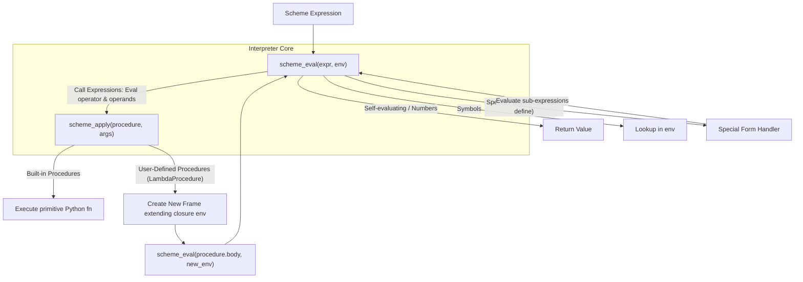

> **课程体系**：UC Berkeley CS61A (Fall 2024)  
> **所属模块**：Module 4: 解释器与 Scheme (Interpreters & Scheme)  
> **主讲教师**：Prof. John DeNero (UC Berkeley)  
> **视频时长**：29:48 ｜ **课堂截图**：17 张板书/代码演示  
> **视频直达**：[📺 在 B 站观看本讲原视频 (P29)](https://www.bilibili.com/video/BV1sy411z7nA/?p=29)  
> **快速导航**：[← 上一讲 (P28 Lecture 30 Calculator)](/notes/cs61a/lecture-28) ｜ [📚 返回全书目录](/notes/topics/CS61A) ｜ [下一讲 (P30 Lecture 32 Tail Calls (Optional)) →](/notes/cs61a/lecture-30)

---

## 课程核心目标与全景图

在上一讲中，我们构建了一个小巧的计算器语言解释器（Calculator），它只支持原始数值与基本的四则运算函数调用。而在本讲中，我们将迈入现代编程语言实现的核心殿堂——**构建完整的 Scheme 解释器（Scheme Interpreter）**。

一个通用的编程语言解释器不仅需要计算算术表达式，还必须具备**环境模型（Environment Model）**、**符号绑定（Symbol Binding）**、**特殊形式派发（Special Form Dispatch）**、**词法作用域（Lexical Scope）**以及**用户自定义过程（User-Defined Procedures）**。

本讲将深入揭示计算机科学史上最优雅的设计模式之一：**`Eval` 与 `Apply` 的相互递归（Mutual Recursion）**。



---

### 深入形式化规约与微观求值流程（Operational Semantics）
在「课程核心目标与全景图」模块中，计算机底层运算依赖于严密的形式化求值逻辑：
1. **抽象语法树（AST）的分层解析**：
   - 源代码字符流首先经过词法分析器（Lexer）切分为终结符标记（Tokens），随后由语法解析器（Parser）构造成多叉语法树；
   - 运算符优先级与结合性在语法树构建阶段即已固化，消除了运行期的二义性；
2. **环境序列的动态跃迁**：
   - 每次函数调用产生的新帧，其静态词法环境由函数对象的 `parent` 属性完全决定；
   - 变量查找沿环境链向上单向回溯，直到全局环境帧，若未找到则触发 `NameError` 异常；
3. **状态不变式（State Invariants）**：
   - 编写健壮程序的关键在于明确循环不变式（Loop Invariants）与函数前后置条件（Pre/Post-conditions）；
   - 在复杂控制流跳转中，确保状态变量在每次迭代前均维持合法的业务约束。


## 1. 表达式分类与特殊形式派发 (Special Forms & Eval Dispatch)

在 Scheme 中，所有表达式按语义分为三大类：
1. **自求值表达式（Self-evaluating Expressions）**：如数字、布尔值、空列表（`nil`），其求值结果直接就是其本身。
2. **符号（Symbols）**：在当前环境（Environment）中查找其绑定的值。
3. **组合式（Combinations / Well-formed Scheme Lists）**：
   - **特殊形式（Special Forms）**：由列表第一个元素（操作符符号）决定，如 `if`、`lambda`、`define`、`quote`、`cond`、`and`、`or`。特殊形式拥有自定义的非标准求值规则，其子表达式不一定全部求值，也不一定按常规顺序求值。
   - **调用表达式（Call Expressions）**：如果列表第一个元素不是已知特殊形式，则被当作常规过程调用。先求值操作符得到过程对象，再依次求值所有操作数，最后将过程应用于实参列表。

[](https://www.bilibili.com/video/BV1sy411z7nA/?p=29&t=55)
*⏱ 时间戳：00:00:55 · 📷 课堂截图 · [在 B 站观看对应片段 (P29 00:00:55)](https://www.bilibili.com/video/BV1sy411z7nA/?p=29&t=55)*

#### 📸 课堂板书与代码演示深入精读 (00:00:55)

**【现场板书 / 代码演示还原】**：
在此时间节点，DeNero 教授在屏幕上进行了核心演示与重点板书推导：
> *“Symbols that are bound to values in the current environment. Self-evaluating expressions are returned. Those are things like numbers and the empty list. Everything else is going to be a scheme list called a combination. So we call it a combination just to say that it's a well-formed scheme list that...”*

**【底层计算模型与微观执行机制】**：
1. **执行上下文与时序追踪**：
   - 处于当前讨论节点「1. 表达式分类与特殊形式派发 (Special Forms & Eval Dispatch)」，解释器严格遵循核心求值规约；
   - 表达式先求值操作符，随后自左至右严格求值操作数，最终将函数对象施加于实参列表；
   - 若涉及环境模型，局部帧严格记录其静态词法父指针（Parent Pointer 指向函数定义处的环境），与运行时的动态调用栈形成正交架构。
2. **内存拓扑与对象引用**：
   - 变量符号只是哈希表（环境帧）中的键，指针直接指向堆内存中的一等公民对象；
   - 赋值语句是离散时间的瞬时状态快照，绝不会建立隐式的数学依赖监听。

**【避坑指南与高频考点点拨】**：
- **常见思维误区**：在「scheme_eval 与 scheme_apply、用户自定义过程的环境帧创建」相关考题中，初学者极易根据代码表面形式猜想结果，导致作用域混淆或变量遮蔽（Shadowing）误判；
- **调试排错黄金法则**：遇到嵌套调用与复杂分支时，务必在草稿纸上画出独立的局部帧，标明每个形参的具体绑定值，按部就班推导。


### 示例：自定义过程 `demo`

John DeNero 教授给出了一个在列表尾部追加元素 `3` 的递归过程定义：

```scheme
(define (demo s)
  (if (null? s)
      '(3)
      (cons (car s) (demo (cdr s)))))

(demo '(1 2)) ; => (1 2 3)
```

当 `(null? s)` 为真时直接返回基准列表 `'(3)`；否则通过 `cons` 构造新 pair，其头部为 `(car s)`，尾部递归调用 `(demo (cdr s))`。

[](https://www.bilibili.com/video/BV1sy411z7nA/?p=29&t=135)
*⏱ 时间戳：00:02:15 · 📷 课堂截图 · [在 B 站观看对应片段 (P29 00:02:15)](https://www.bilibili.com/video/BV1sy411z7nA/?p=29&t=135)*

#### 📸 课堂板书与代码演示深入精读 (00:02:15)

**【现场板书 / 代码演示还原】**：
在此时间节点，DeNero 教授在屏幕上进行了核心演示与重点板书推导：
> *“One and two is whatever we get back from a recursive call to demo on the rest of the list. And we might call that on, for instance, one and two. Now, what does this do? Think about it for a minute. This function demo puts a three at the end of the list that's passed in. Well, actually, it constructs...”*

**【底层计算模型与微观执行机制】**：
1. **执行上下文与时序追踪**：
   - 处于当前讨论节点「1. 表达式分类与特殊形式派发 (Special Forms & Eval Dispatch)」，解释器严格遵循核心求值规约；
   - 表达式先求值操作符，随后自左至右严格求值操作数，最终将函数对象施加于实参列表；
   - 若涉及环境模型，局部帧严格记录其静态词法父指针（Parent Pointer 指向函数定义处的环境），与运行时的动态调用栈形成正交架构。
2. **内存拓扑与对象引用**：
   - 变量符号只是哈希表（环境帧）中的键，指针直接指向堆内存中的一等公民对象；
   - 赋值语句是离散时间的瞬时状态快照，绝不会建立隐式的数学依赖监听。

**【避坑指南与高频考点点拨】**：
- **常见思维误区**：在「scheme_eval 与 scheme_apply、用户自定义过程的环境帧创建」相关考题中，初学者极易根据代码表面形式猜想结果，导致作用域混淆或变量遮蔽（Shadowing）误判；
- **调试排错黄金法则**：遇到嵌套调用与复杂分支时，务必在草稿纸上画出独立的局部帧，标明每个形参的具体绑定值，按部就班推导。


---

### 深入形式化规约与微观求值流程（Operational Semantics）
在「1. 表达式分类与特殊形式派发 (Special Forms & Eval Dispatch)」模块中，计算机底层运算依赖于严密的形式化求值逻辑：
1. **抽象语法树（AST）的分层解析**：
   - 源代码字符流首先经过词法分析器（Lexer）切分为终结符标记（Tokens），随后由语法解析器（Parser）构造成多叉语法树；
   - 运算符优先级与结合性在语法树构建阶段即已固化，消除了运行期的二义性；
2. **环境序列的动态跃迁**：
   - 每次函数调用产生的新帧，其静态词法环境由函数对象的 `parent` 属性完全决定；
   - 变量查找沿环境链向上单向回溯，直到全局环境帧，若未找到则触发 `NameError` 异常；
3. **状态不变式（State Invariants）**：
   - 编写健壮程序的关键在于明确循环不变式（Loop Invariants）与函数前后置条件（Pre/Post-conditions）；
   - 在复杂控制流跳转中，确保状态变量在每次迭代前均维持合法的业务约束。


## 2. 跟踪 Scheme 解释器执行 (Tracing `scheme_eval`)

在终端中启动 Scheme 解释器的调试跟踪模式，可以清晰观察表达式如何在 Python 实现的 `scheme_eval` 中逐层展开。

[](https://www.bilibili.com/video/BV1sy411z7nA/?p=29&t=225)
*⏱ 时间戳：00:03:45 · 📷 课堂截图 · [在 B 站观看对应片段 (P29 00:03:45)](https://www.bilibili.com/video/BV1sy411z7nA/?p=29&t=225)*

#### 📸 课堂板书与代码演示深入精读 (00:03:45)

**【现场板书 / 代码演示还原】**：
在此时间节点，DeNero 教授在屏幕上进行了核心演示与重点板书推导：
> *“Well, it has eval and apply functions, and scheme eval evaluates a scheme expression, which could be one of a number of types. We could have just a number, or we could have a combination. So let's see what happens when we trace this, and then we start up our scheme interpreter. The number 2 involves...”*

**【底层计算模型与微观执行机制】**：
1. **执行上下文与时序追踪**：
   - 处于当前讨论节点「2. 跟踪 Scheme 解释器执行 (Tracing `scheme_eval`)」，解释器严格遵循核心求值规约；
   - 表达式先求值操作符，随后自左至右严格求值操作数，最终将函数对象施加于实参列表；
   - 若涉及环境模型，局部帧严格记录其静态词法父指针（Parent Pointer 指向函数定义处的环境），与运行时的动态调用栈形成正交架构。
2. **内存拓扑与对象引用**：
   - 变量符号只是哈希表（环境帧）中的键，指针直接指向堆内存中的一等公民对象；
   - 赋值语句是离散时间的瞬时状态快照，绝不会建立隐式的数学依赖监听。

**【避坑指南与高频考点点拨】**：
- **常见思维误区**：在「scheme_eval 与 scheme_apply、用户自定义过程的环境帧创建」相关考题中，初学者极易根据代码表面形式猜想结果，导致作用域混淆或变量遮蔽（Shadowing）误判；
- **调试排错黄金法则**：遇到嵌套调用与复杂分支时，务必在草稿纸上画出独立的局部帧，标明每个形参的具体绑定值，按部就班推导。


求值数值 `2` 时，`scheme_eval` 接收表达式 `2` 和全局帧（Global Frame），直接返回 `2`。求值 `(- 2)` 时：
1. 识别为调用表达式；
2. 在环境中查找到操作符 `-` 对应的内置取负/减法函数；
3. 求值操作数 `2` 得到 `2`；
4. 调用内置函数计算得到 `-2`。

当调用 `(demo '(1 2))` 时，解释器经历了完整的帧创建与递归跟踪：

[](https://www.bilibili.com/video/BV1sy411z7nA/?p=29&t=345)
*⏱ 时间戳：00:05:45 · 📷 课堂截图 · [在 B 站观看对应片段 (P29 00:05:45)](https://www.bilibili.com/video/BV1sy411z7nA/?p=29&t=345)*

#### 📸 课堂板书与代码演示深入精读 (00:05:45)

**【现场板书 / 代码演示还原】**：
在此时间节点，DeNero 教授在屏幕上进行了核心演示与重点板书推导：
> *“I called demo on list12, which means I'm evaluating this expression, which is a call expression. We figure out what demo means. Demo is a function that has the body that we wrote down before. And we figure out what list12 means after a bit of work. We find out that it's the list12. So now we're goin...”*

**【底层计算模型与微观执行机制】**：
1. **执行上下文与时序追踪**：
   - 处于当前讨论节点「2. 跟踪 Scheme 解释器执行 (Tracing `scheme_eval`)」，解释器严格遵循核心求值规约；
   - 表达式先求值操作符，随后自左至右严格求值操作数，最终将函数对象施加于实参列表；
   - 若涉及环境模型，局部帧严格记录其静态词法父指针（Parent Pointer 指向函数定义处的环境），与运行时的动态调用栈形成正交架构。
2. **内存拓扑与对象引用**：
   - 变量符号只是哈希表（环境帧）中的键，指针直接指向堆内存中的一等公民对象；
   - 赋值语句是离散时间的瞬时状态快照，绝不会建立隐式的数学依赖监听。

**【避坑指南与高频考点点拨】**：
- **常见思维误区**：在「scheme_eval 与 scheme_apply、用户自定义过程的环境帧创建」相关考题中，初学者极易根据代码表面形式猜想结果，导致作用域混淆或变量遮蔽（Shadowing）误判；
- **调试排错黄金法则**：遇到嵌套调用与复杂分支时，务必在草稿纸上画出独立的局部帧，标明每个形参的具体绑定值，按部就班推导。


- 初始调用创建局部帧 $F_1$，形参 `s` 绑定到列表 `(1 2)`；
- 递归调用创建局部帧 $F_2$，形参 `s` 绑定到 `(2)`；
- 基线调用创建局部帧 $F_3$，形参 `s` 绑定到 `nil`；
- 基线命中返回 `(3)`，沿调用链反向执行 `cons`，依次拼装成 `(2 3)` 与 `(1 2 3)`。

---

### 深入形式化规约与微观求值流程（Operational Semantics）
在「2. 跟踪 Scheme 解释器执行 (Tracing `scheme_eval`)」模块中，计算机底层运算依赖于严密的形式化求值逻辑：
1. **抽象语法树（AST）的分层解析**：
   - 源代码字符流首先经过词法分析器（Lexer）切分为终结符标记（Tokens），随后由语法解析器（Parser）构造成多叉语法树；
   - 运算符优先级与结合性在语法树构建阶段即已固化，消除了运行期的二义性；
2. **环境序列的动态跃迁**：
   - 每次函数调用产生的新帧，其静态词法环境由函数对象的 `parent` 属性完全决定；
   - 变量查找沿环境链向上单向回溯，直到全局环境帧，若未找到则触发 `NameError` 异常；
3. **状态不变式（State Invariants）**：
   - 编写健壮程序的关键在于明确循环不变式（Loop Invariants）与函数前后置条件（Pre/Post-conditions）；
   - 在复杂控制流跳转中，确保状态变量在每次迭代前均维持合法的业务约束。


## 3. 引用特殊形式 (Quotation & `SchemeReader`)

在 Lisp/Scheme 中，**数据与代码具有相同的物理表现形式（Homoiconicity）**。为了防止解释器将列表作为代码执行，而是将其作为纯数据保留，我们需要使用 `quote` 特殊形式。

```scheme
(quote (+ 1 2)) ; => (+ 1 2) 列表数据，而非数值 3
'(+ 1 2)        ; => (+ 1 2) 单引号语法糖
```

单引号 `'expr` 仅仅是语法糖（Syntactic Sugar），在读取器（Reader）阶段就被展开为标准的二元列表 `(quote expr)`。

[](https://www.bilibili.com/video/BV1sy411z7nA/?p=29&t=465)
*⏱ 时间戳：00:07:45 · 📷 课堂截图 · [在 B 站观看对应片段 (P29 00:07:45)](https://www.bilibili.com/video/BV1sy411z7nA/?p=29&t=465)*

#### 📸 课堂板书与代码演示深入精读 (00:07:45)

**【现场板书 / 代码演示还原】**：
在此时间节点，DeNero 教授在屏幕上进行了核心演示与重点板书推导：
> *“So, the quote special form evaluates to the quoted expression. That expression is not evaluated. So, if I quote an expression, that is a quote special form. And, for example, quoting plus one two evaluates to the scheme list, which contains the symbol plus, followed by the number one, followed by th...”*

**【底层计算模型与微观执行机制】**：
1. **执行上下文与时序追踪**：
   - 处于当前讨论节点「3. 引用特殊形式 (Quotation & `SchemeReader`)」，解释器严格遵循核心求值规约；
   - 表达式先求值操作符，随后自左至右严格求值操作数，最终将函数对象施加于实参列表；
   - 若涉及环境模型，局部帧严格记录其静态词法父指针（Parent Pointer 指向函数定义处的环境），与运行时的动态调用栈形成正交架构。
2. **内存拓扑与对象引用**：
   - 变量符号只是哈希表（环境帧）中的键，指针直接指向堆内存中的一等公民对象；
   - 赋值语句是离散时间的瞬时状态快照，绝不会建立隐式的数学依赖监听。

**【避坑指南与高频考点点拨】**：
- **常见思维误区**：在「scheme_eval 与 scheme_apply、用户自定义过程的环境帧创建」相关考题中，初学者极易根据代码表面形式猜想结果，导致作用域混淆或变量遮蔽（Shadowing）误判；
- **调试排错黄金法则**：遇到嵌套调用与复杂分支时，务必在草稿纸上画出独立的局部帧，标明每个形参的具体绑定值，按部就班推导。


### `SchemeReader` 的工作流程

在 `scheme_reader.py` 中，词法分析器（Tokenizer）将文本拆分为 token 流，语法分析器（Syntactic Analyzer）将嵌套的括号和缩进构建为嵌套的 `Pair` 链表：

[](https://www.bilibili.com/video/BV1sy411z7nA/?p=29&t=565)
*⏱ 时间戳：00:09:25 · 📷 课堂截图 · [在 B 站观看对应片段 (P29 00:09:25)](https://www.bilibili.com/video/BV1sy411z7nA/?p=29&t=565)*

#### 📸 课堂板书与代码演示深入精读 (00:09:25)

**【现场板书 / 代码演示还原】**：
在此时间节点，DeNero 教授在屏幕上进行了核心演示与重点板书推导：
> *“That starts with the word quote. So what am I talking about? Well, there's a file called SchemeReader. And what SchemeReader does is it just reads expressions. It doesn't actually do any sort of summing. And we looked at this before. This is called the Syntactic Analyzer. And it's also running the L...”*

**【底层计算模型与微观执行机制】**：
1. **执行上下文与时序追踪**：
   - 处于当前讨论节点「3. 引用特殊形式 (Quotation & `SchemeReader`)」，解释器严格遵循核心求值规约；
   - 表达式先求值操作符，随后自左至右严格求值操作数，最终将函数对象施加于实参列表；
   - 若涉及环境模型，局部帧严格记录其静态词法父指针（Parent Pointer 指向函数定义处的环境），与运行时的动态调用栈形成正交架构。
2. **内存拓扑与对象引用**：
   - 变量符号只是哈希表（环境帧）中的键，指针直接指向堆内存中的一等公民对象；
   - 赋值语句是离散时间的瞬时状态快照，绝不会建立隐式的数学依赖监听。

**【避坑指南与高频考点点拨】**：
- **常见思维误区**：在「scheme_eval 与 scheme_apply、用户自定义过程的环境帧创建」相关考题中，初学者极易根据代码表面形式猜想结果，导致作用域混淆或变量遮蔽（Shadowing）误判；
- **调试排错黄金法则**：遇到嵌套调用与复杂分支时，务必在草稿纸上画出独立的局部帧，标明每个形参的具体绑定值，按部就班推导。


求值器核心 `scheme_eval` 永远不会直接面对文本格式的单引号 `'x`，它接收到的永远是已经解析好的 Pair 结构：`Pair('quote', Pair('x', nil))`。

---

### 深入形式化规约与微观求值流程（Operational Semantics）
在「3. 引用特殊形式 (Quotation & `SchemeReader`)」模块中，计算机底层运算依赖于严密的形式化求值逻辑：
1. **抽象语法树（AST）的分层解析**：
   - 源代码字符流首先经过词法分析器（Lexer）切分为终结符标记（Tokens），随后由语法解析器（Parser）构造成多叉语法树；
   - 运算符优先级与结合性在语法树构建阶段即已固化，消除了运行期的二义性；
2. **环境序列的动态跃迁**：
   - 每次函数调用产生的新帧，其静态词法环境由函数对象的 `parent` 属性完全决定；
   - 变量查找沿环境链向上单向回溯，直到全局环境帧，若未找到则触发 `NameError` 异常；
3. **状态不变式（State Invariants）**：
   - 编写健壮程序的关键在于明确循环不变式（Loop Invariants）与函数前后置条件（Pre/Post-conditions）；
   - 在复杂控制流跳转中，确保状态变量在每次迭代前均维持合法的业务约束。


## 4. 逻辑特殊形式与短路求值 (Logical Special Forms & `do_if_form`)

逻辑形式（Logical Forms）如 `if`、`and`、`or`、`cond` 的核心特点是：**子表达式按需条件求值（Short-circuit Evaluation）**。

```scheme
(if <predicate> <consequent> <alternative>)
```

在 Python 实现中，对应的处理函数为 `do_if_form(expressions, env)`：
1. 调用 `scheme_eval(expressions.first, env)` 求值谓词（Predicate）；
2. 根据谓词的真假，决定选择求值后件（Consequent）还是前件（Alternative）；
3. **未被选中的分支绝对不会被求值**！

[](https://www.bilibili.com/video/BV1sy411z7nA/?p=29&t=645)
*⏱ 时间戳：00:10:45 · 📷 课堂截图 · [在 B 站观看对应片段 (P29 00:10:45)](https://www.bilibili.com/video/BV1sy411z7nA/?p=29&t=645)*

#### 📸 课堂板书与代码演示深入精读 (00:10:45)

**【现场板书 / 代码演示还原】**：
在此时间节点，DeNero 教授在屏幕上进行了核心演示与重点板书推导：
> *“So, when the schema-evaluator actually deals with quotation, it never sees this. It only sees that. Next, we'll talk about logical forms. So, logical-special forms are things that involve conditions, and they only evaluate some sub-expressions. So, an if-expression is one of these. Its evaluation pr...”*

**【底层计算模型与微观执行机制】**：
1. **执行上下文与时序追踪**：
   - 处于当前讨论节点「4. 逻辑特殊形式与短路求值 (Logical Special Forms & `do_if_form`)」，解释器严格遵循核心求值规约；
   - 表达式先求值操作符，随后自左至右严格求值操作数，最终将函数对象施加于实参列表；
   - 若涉及环境模型，局部帧严格记录其静态词法父指针（Parent Pointer 指向函数定义处的环境），与运行时的动态调用栈形成正交架构。
2. **内存拓扑与对象引用**：
   - 变量符号只是哈希表（环境帧）中的键，指针直接指向堆内存中的一等公民对象；
   - 赋值语句是离散时间的瞬时状态快照，绝不会建立隐式的数学依赖监听。

**【避坑指南与高频考点点拨】**：
- **常见思维误区**：在「scheme_eval 与 scheme_apply、用户自定义过程的环境帧创建」相关考题中，初学者极易根据代码表面形式猜想结果，导致作用域混淆或变量遮蔽（Shadowing）误判；
- **调试排错黄金法则**：遇到嵌套调用与复杂分支时，务必在草稿纸上画出独立的局部帧，标明每个形参的具体绑定值，按部就班推导。


### 短路求值演示与除零保护

考虑表达式：
```scheme
(if #t 1 (/ 1 0)) ; => 1 （不会触发除零异常）
(if #f 1 (/ 1 0)) ; => ZeroDivisionError!
```

[](https://www.bilibili.com/video/BV1sy411z7nA/?p=29&t=735)
*⏱ 时间戳：00:12:15 · 📷 课堂截图 · [在 B 站观看对应片段 (P29 00:12:15)](https://www.bilibili.com/video/BV1sy411z7nA/?p=29&t=735)*

#### 📸 课堂板书与代码演示深入精读 (00:12:15)

**【现场板书 / 代码演示还原】**：
在此时间节点，DeNero 教授在屏幕上进行了核心演示与重点板书推导：
> *“And that's a Python function that gets called every time. Your interpreter encounters an if expression. And all it does is it evaluates the predicate and chooses a subexpression to be evaluated next. We already have a function that evaluates a subexpression. And so we just use that scheme eval in or...”*

**【底层计算模型与微观执行机制】**：
1. **执行上下文与时序追踪**：
   - 处于当前讨论节点「4. 逻辑特殊形式与短路求值 (Logical Special Forms & `do_if_form`)」，解释器严格遵循核心求值规约；
   - 表达式先求值操作符，随后自左至右严格求值操作数，最终将函数对象施加于实参列表；
   - 若涉及环境模型，局部帧严格记录其静态词法父指针（Parent Pointer 指向函数定义处的环境），与运行时的动态调用栈形成正交架构。
2. **内存拓扑与对象引用**：
   - 变量符号只是哈希表（环境帧）中的键，指针直接指向堆内存中的一等公民对象；
   - 赋值语句是离散时间的瞬时状态快照，绝不会建立隐式的数学依赖监听。

**【避坑指南与高频考点点拨】**：
- **常见思维误区**：在「scheme_eval 与 scheme_apply、用户自定义过程的环境帧创建」相关考题中，初学者极易根据代码表面形式猜想结果，导致作用域混淆或变量遮蔽（Shadowing）误判；
- **调试排错黄金法则**：遇到嵌套调用与复杂分支时，务必在草稿纸上画出独立的局部帧，标明每个形参的具体绑定值，按部就班推导。


如果 `if` 是普通函数调用，所有的实参都会在进入函数前被全部求值，那么 `(/ 1 0)` 将无条件报错。这正是特殊形式之所以必须作为特殊处理分支存在的关键原因。

---

### 深入形式化规约与微观求值流程（Operational Semantics）
在「4. 逻辑特殊形式与短路求值 (Logical Special Forms & `do_if_form`)」模块中，计算机底层运算依赖于严密的形式化求值逻辑：
1. **抽象语法树（AST）的分层解析**：
   - 源代码字符流首先经过词法分析器（Lexer）切分为终结符标记（Tokens），随后由语法解析器（Parser）构造成多叉语法树；
   - 运算符优先级与结合性在语法树构建阶段即已固化，消除了运行期的二义性；
2. **环境序列的动态跃迁**：
   - 每次函数调用产生的新帧，其静态词法环境由函数对象的 `parent` 属性完全决定；
   - 变量查找沿环境链向上单向回溯，直到全局环境帧，若未找到则触发 `NameError` 异常；
3. **状态不变式（State Invariants）**：
   - 编写健壮程序的关键在于明确循环不变式（Loop Invariants）与函数前后置条件（Pre/Post-conditions）；
   - 在复杂控制流跳转中，确保状态变量在每次迭代前均维持合法的业务约束。


## 5. Lambda 表达式与过程对象 (`LambdaProcedure`)

`lambda` 是函数式编程的核心灵魂，它用于在运行时创建用户自定义过程（User-defined Procedure）。

```scheme
(lambda (x) (* x x))
```

在 Python 宿主实现中，我们定义 `LambdaProcedure` 类，它封装了构成闭包（Closure）的三个关键要素：
1. **形参列表（`formals`）**：由符号组成的 Scheme 列表，指定参数名称；
2. **函数体（`body`）**：一个或多个 Scheme 表达式构成的列表；
3. **定义时环境（`env`）**：一个 `Frame` 实例，记录该函数被定义时所在的环境帧。

[](https://www.bilibili.com/video/BV1sy411z7nA/?p=29&t=815)
*⏱ 时间戳：00:13:35 · 📷 课堂截图 · [在 B 站观看对应片段 (P29 00:13:35)](https://www.bilibili.com/video/BV1sy411z7nA/?p=29&t=815)*

#### 📸 课堂板书与代码演示深入精读 (00:13:35)

**【现场板书 / 代码演示还原】**：
在此时间节点，DeNero 教授在屏幕上进行了核心演示与重点板书推导：
> *“So you have a whole expression that starts with lambda, and when you evaluate it, you get a new procedure that you didn't have before. It has formal parameters and a body. So, for instance, if I write lambda x is x times x. This defines a procedure that squares things. Now, how do we encode this? We...”*

**【底层计算模型与微观执行机制】**：
1. **执行上下文与时序追踪**：
   - 处于当前讨论节点「5. Lambda 表达式与过程对象 (`LambdaProcedure`)」，解释器严格遵循核心求值规约；
   - 表达式先求值操作符，随后自左至右严格求值操作数，最终将函数对象施加于实参列表；
   - 若涉及环境模型，局部帧严格记录其静态词法父指针（Parent Pointer 指向函数定义处的环境），与运行时的动态调用栈形成正交架构。
2. **内存拓扑与对象引用**：
   - 变量符号只是哈希表（环境帧）中的键，指针直接指向堆内存中的一等公民对象；
   - 赋值语句是离散时间的瞬时状态快照，绝不会建立隐式的数学依赖监听。

**【避坑指南与高频考点点拨】**：
- **常见思维误区**：在「scheme_eval 与 scheme_apply、用户自定义过程的环境帧创建」相关考题中，初学者极易根据代码表面形式猜想结果，导致作用域混淆或变量遮蔽（Shadowing）误判；
- **调试排错黄金法则**：遇到嵌套调用与复杂分支时，务必在草稿纸上画出独立的局部帧，标明每个形参的具体绑定值，按部就班推导。


```python
class LambdaProcedure:
    def __init__(self, formals, body, env):
        self.formals = formals # Scheme list of symbols
        self.body = body       # Scheme list of expressions
        self.env = env         # Frame instance
```

---

### 深入形式化规约与微观求值流程（Operational Semantics）
在「5. Lambda 表达式与过程对象 (`LambdaProcedure`)」模块中，计算机底层运算依赖于严密的形式化求值逻辑：
1. **抽象语法树（AST）的分层解析**：
   - 源代码字符流首先经过词法分析器（Lexer）切分为终结符标记（Tokens），随后由语法解析器（Parser）构造成多叉语法树；
   - 运算符优先级与结合性在语法树构建阶段即已固化，消除了运行期的二义性；
2. **环境序列的动态跃迁**：
   - 每次函数调用产生的新帧，其静态词法环境由函数对象的 `parent` 属性完全决定；
   - 变量查找沿环境链向上单向回溯，直到全局环境帧，若未找到则触发 `NameError` 异常；
3. **状态不变式（State Invariants）**：
   - 编写健壮程序的关键在于明确循环不变式（Loop Invariants）与函数前后置条件（Pre/Post-conditions）；
   - 在复杂控制流跳转中，确保状态变量在每次迭代前均维持合法的业务约束。


## 6. 环境模型与帧的链式查找 (Frames and Environments)

**环境（Environment）** 是用于确定符号绑定的帧序列（Chain of Frames）。
每一个 `Frame` 实例维护：
- 一个局部字典（`bindings`）：记录局部符号与值的映射；
- 一个指向父帧的引用（`parent`）：指向上层环境；全局帧的 `parent` 为 `None`。

帧提供两个核心操作方法：
- `lookup(symbol)`：先在当前局部帧查找；若未找到且父帧存在，则递归在 `parent` 帧中查找；若全局帧仍未找到，抛出 `SchemeError`。
- `define(symbol, value)`：直接在**当前局部帧**中添加或覆盖符号绑定（不影响父帧）。

[](https://www.bilibili.com/video/BV1sy411z7nA/?p=29&t=915)
*⏱ 时间戳：00:15:15 · 📷 课堂截图 · [在 B 站观看对应片段 (P29 00:15:15)](https://www.bilibili.com/video/BV1sy411z7nA/?p=29&t=915)*

#### 📸 课堂板书与代码演示深入精读 (00:15:15)

**【现场板书 / 代码演示还原】**：
在此时间节点，DeNero 教授在屏幕上进行了核心演示与重点板书推导：
> *“Frames don't actually hold any return values, they just hold the name value bindings that are used for lookup. So let's do this example in code. We're going to have a global frame with y bound to 3 and z bound to 5, and then another frame, f1, with x bound to 2 and z bound to 4. Okay, so I'm going t...”*

**【底层计算模型与微观执行机制】**：
1. **执行上下文与时序追踪**：
   - 处于当前讨论节点「6. 环境模型与帧的链式查找 (Frames and Environments)」，解释器严格遵循核心求值规约；
   - 表达式先求值操作符，随后自左至右严格求值操作数，最终将函数对象施加于实参列表；
   - 若涉及环境模型，局部帧严格记录其静态词法父指针（Parent Pointer 指向函数定义处的环境），与运行时的动态调用栈形成正交架构。
2. **内存拓扑与对象引用**：
   - 变量符号只是哈希表（环境帧）中的键，指针直接指向堆内存中的一等公民对象；
   - 赋值语句是离散时间的瞬时状态快照，绝不会建立隐式的数学依赖监听。

**【避坑指南与高频考点点拨】**：
- **常见思维误区**：在「scheme_eval 与 scheme_apply、用户自定义过程的环境帧创建」相关考题中，初学者极易根据代码表面形式猜想结果，导致作用域混淆或变量遮蔽（Shadowing）误判；
- **调试排错黄金法则**：遇到嵌套调用与复杂分支时，务必在草稿纸上画出独立的局部帧，标明每个形参的具体绑定值，按部就班推导。


### Python 交互式测试 Frame 链

教授在 Python 中手动构建全局帧 $G$ 与局部帧 $F_1$ 并进行变量遮蔽（Shadowing）实验：

[](https://www.bilibili.com/video/BV1sy411z7nA/?p=29&t=995)
*⏱ 时间戳：00:16:35 · 📷 课堂截图 · [在 B 站观看对应片段 (P29 00:16:35)](https://www.bilibili.com/video/BV1sy411z7nA/?p=29&t=995)*

#### 📸 课堂板书与代码演示深入精读 (00:16:35)

**【现场板书 / 代码演示还原】**：
在此时间节点，DeNero 教授在屏幕上进行了核心演示与重点板书推导：
> *“And starts an environment that's followed by the global frame. I believe I had said I was going to bind Y to 3 and Z to 5. So now if I look up Y, if I look up Y, I'll get 3. And if I look up Z, I'll get 5. Okay, so now we're going to actually define X to be 2 in the F1 frame and define Z. to be 4 in...”*

**【底层计算模型与微观执行机制】**：
1. **执行上下文与时序追踪**：
   - 处于当前讨论节点「6. 环境模型与帧的链式查找 (Frames and Environments)」，解释器严格遵循核心求值规约；
   - 表达式先求值操作符，随后自左至右严格求值操作数，最终将函数对象施加于实参列表；
   - 若涉及环境模型，局部帧严格记录其静态词法父指针（Parent Pointer 指向函数定义处的环境），与运行时的动态调用栈形成正交架构。
2. **内存拓扑与对象引用**：
   - 变量符号只是哈希表（环境帧）中的键，指针直接指向堆内存中的一等公民对象；
   - 赋值语句是离散时间的瞬时状态快照，绝不会建立隐式的数学依赖监听。

**【避坑指南与高频考点点拨】**：
- **常见思维误区**：在「scheme_eval 与 scheme_apply、用户自定义过程的环境帧创建」相关考题中，初学者极易根据代码表面形式猜想结果，导致作用域混淆或变量遮蔽（Shadowing）误判；
- **调试排错黄金法则**：遇到嵌套调用与复杂分支时，务必在草稿纸上画出独立的局部帧，标明每个形参的具体绑定值，按部就班推导。


- 全局帧 $G$ 绑定：`y = 3`, `z = 5`；
- 局部帧 $F_1$（父帧为 $G$）绑定：`x = 2`, `z = 4`；
- 在 $F_1$ 中查找 `x` 得到 `2`；查找 `z` 得到局部帧的值 `4`（遮蔽了全局的 `5`）；
- 在 $F_1$ 中查找 `y`，局部无但顺沿父帧链找到全局的 `3`。

---

### 深入形式化规约与微观求值流程（Operational Semantics）
在「6. 环境模型与帧的链式查找 (Frames and Environments)」模块中，计算机底层运算依赖于严密的形式化求值逻辑：
1. **抽象语法树（AST）的分层解析**：
   - 源代码字符流首先经过词法分析器（Lexer）切分为终结符标记（Tokens），随后由语法解析器（Parser）构造成多叉语法树；
   - 运算符优先级与结合性在语法树构建阶段即已固化，消除了运行期的二义性；
2. **环境序列的动态跃迁**：
   - 每次函数调用产生的新帧，其静态词法环境由函数对象的 `parent` 属性完全决定；
   - 变量查找沿环境链向上单向回溯，直到全局环境帧，若未找到则触发 `NameError` 异常；
3. **状态不变式（State Invariants）**：
   - 编写健壮程序的关键在于明确循环不变式（Loop Invariants）与函数前后置条件（Pre/Post-conditions）；
   - 在复杂控制流跳转中，确保状态变量在每次迭代前均维持合法的业务约束。


## 7. 词法作用域 vs 动态作用域 (Lexical vs Dynamic Scope)

这是程序设计语言语义学中最关键的理论分水岭之一：

| 作用域机制 | 新帧的父帧定义 | 查找依据 | 现代代表语言 |
| :--- | :--- | :--- | :--- |
| **词法作用域（Lexical / Static Scope）** | **过程定义时（Definition-time）** 所在的环境 | 依据代码在文本中的静态嵌套结构 | Scheme, Python, JavaScript |
| **动态作用域（Dynamic Scope）** | **过程被调用时（Call-time）** 所在的当前环境 | 依据调用栈运行时的先后顺序 | 早期 Lisp, Emacs Lisp (默认) |

[](https://www.bilibili.com/video/BV1sy411z7nA/?p=29&t=1085)
*⏱ 时间戳：00:18:05 · 📷 课堂截图 · [在 B 站观看对应片段 (P29 00:18:05)](https://www.bilibili.com/video/BV1sy411z7nA/?p=29&t=1085)*

#### 📸 课堂板书与代码演示深入精读 (00:18:05)

**【现场板书 / 代码演示还原】**：
在此时间节点，DeNero 教授在屏幕上进行了核心演示与重点板书推导：
> *“And remember the rule. The parent of a frame is the environment in which a procedure was defined. So when you create a new frame for applying a procedure, you just look at the procedure, figure out what its environment was when it was created, and use that as the parent of the new frame. Dynamic sco...”*

**【底层计算模型与微观执行机制】**：
1. **执行上下文与时序追踪**：
   - 处于当前讨论节点「7. 词法作用域 vs 动态作用域 (Lexical vs Dynamic Scope)」，解释器严格遵循核心求值规约；
   - 表达式先求值操作符，随后自左至右严格求值操作数，最终将函数对象施加于实参列表；
   - 若涉及环境模型，局部帧严格记录其静态词法父指针（Parent Pointer 指向函数定义处的环境），与运行时的动态调用栈形成正交架构。
2. **内存拓扑与对象引用**：
   - 变量符号只是哈希表（环境帧）中的键，指针直接指向堆内存中的一等公民对象；
   - 赋值语句是离散时间的瞬时状态快照，绝不会建立隐式的数学依赖监听。

**【避坑指南与高频考点点拨】**：
- **常见思维误区**：在「scheme_eval 与 scheme_apply、用户自定义过程的环境帧创建」相关考题中，初学者极易根据代码表面形式猜想结果，导致作用域混淆或变量遮蔽（Shadowing）误判；
- **调试排错黄金法则**：遇到嵌套调用与复杂分支时，务必在草稿纸上画出独立的局部帧，标明每个形参的具体绑定值，按部就班推导。


### 经典对比范例

```scheme
(define (f x) (+ x y))
(define (g x y) (f (+ x x)))
(g 3 7)
```

- **词法作用域（Lexical Scope）**：
  `f` 是在全局定义的，因此无论在哪里调用 `f`，其新帧的父帧永远是全局帧 $G$。当 `f` 试图查找 `y` 时，在 $F_f$ 和全局帧 $G$ 中均找不到 `y`，报错：`unknown identifier: y`。
- **动态作用域（Dynamic Scope）**：
  `f` 是在 `g` 的内部被调用的，因此 $F_f$ 的父帧是 $F_g$。在查找 `y` 时直接沿调用链找到 $F_g$ 中的 `y = 7`，计算结果为 `(+ 6 7) = 13`！

Scheme 与 Python 一致，严格遵循**词法作用域**。

---

### 深入形式化规约与微观求值流程（Operational Semantics）
在「7. 词法作用域 vs 动态作用域 (Lexical vs Dynamic Scope)」模块中，计算机底层运算依赖于严密的形式化求值逻辑：
1. **抽象语法树（AST）的分层解析**：
   - 源代码字符流首先经过词法分析器（Lexer）切分为终结符标记（Tokens），随后由语法解析器（Parser）构造成多叉语法树；
   - 运算符优先级与结合性在语法树构建阶段即已固化，消除了运行期的二义性；
2. **环境序列的动态跃迁**：
   - 每次函数调用产生的新帧，其静态词法环境由函数对象的 `parent` 属性完全决定；
   - 变量查找沿环境链向上单向回溯，直到全局环境帧，若未找到则触发 `NameError` 异常；
3. **状态不变式（State Invariants）**：
   - 编写健壮程序的关键在于明确循环不变式（Loop Invariants）与函数前后置条件（Pre/Post-conditions）；
   - 在复杂控制流跳转中，确保状态变量在每次迭代前均维持合法的业务约束。


## 8. 解释器核心：Eval 与 Apply 相互递归 (The Core Architecture)

解释器的执行引擎建立在两个互为递归的核心函数之上：

```python
def scheme_eval(expr, env):
    """求值表达式 expr 在环境 env 中的值。"""
    if is_primitive(expr):
        return expr
    elif is_symbol(expr):
        return env.lookup(expr)
    elif is_special_form(expr):
        return eval_special_form(expr, env)
    else: # 调用表达式
        procedure = scheme_eval(expr.first, env)
        args = expr.rest.map(lambda operand: scheme_eval(operand, env))
        return scheme_apply(procedure, args, env)

def scheme_apply(procedure, args, env):
    """将过程 procedure 应用于实参 args。"""
    if isinstance(procedure, PrimitiveProcedure):
        return procedure.apply(args)
    elif isinstance(procedure, LambdaProcedure):
        new_frame = procedure.env.make_child_frame(procedure.formals, args)
        return eval_all(procedure.body, new_frame)
```

[](https://www.bilibili.com/video/BV1sy411z7nA/?p=29&t=1245)
*⏱ 时间戳：00:20:45 · 📷 课堂截图 · [在 B 站观看对应片段 (P29 00:20:45)](https://www.bilibili.com/video/BV1sy411z7nA/?p=29&t=1245)*

#### 📸 课堂板书与代码演示深入精读 (00:20:45)

**【现场板书 / 代码演示还原】**：
在此时间节点，DeNero 教授在屏幕上进行了核心演示与重点板书推导：
> *“And then apply function. And eval evaluates primitive expressions. It also evaluates combined expressions. But when it finds one of those, then it calls apply to actually apply some procedure to some arguments. So these are both recursive. Here's how. The base cases of eval are for primitive values,...”*

**【底层计算模型与微观执行机制】**：
1. **执行上下文与时序追踪**：
   - 处于当前讨论节点「8. 解释器核心：Eval 与 Apply 相互递归 (The Core Architecture)」，解释器严格遵循核心求值规约；
   - 表达式先求值操作符，随后自左至右严格求值操作数，最终将函数对象施加于实参列表；
   - 若涉及环境模型，局部帧严格记录其静态词法父指针（Parent Pointer 指向函数定义处的环境），与运行时的动态调用栈形成正交架构。
2. **内存拓扑与对象引用**：
   - 变量符号只是哈希表（环境帧）中的键，指针直接指向堆内存中的一等公民对象；
   - 赋值语句是离散时间的瞬时状态快照，绝不会建立隐式的数学依赖监听。

**【避坑指南与高频考点点拨】**：
- **常见思维误区**：在「scheme_eval 与 scheme_apply、用户自定义过程的环境帧创建」相关考题中，初学者极易根据代码表面形式猜想结果，导致作用域混淆或变量遮蔽（Shadowing）误判；
- **调试排错黄金法则**：遇到嵌套调用与复杂分支时，务必在草稿纸上画出独立的局部帧，标明每个形参的具体绑定值，按部就班推导。


[](https://www.bilibili.com/video/BV1sy411z7nA/?p=29&t=1365)
*⏱ 时间戳：00:22:45 · 📷 课堂截图 · [在 B 站观看对应片段 (P29 00:22:45)](https://www.bilibili.com/video/BV1sy411z7nA/?p=29&t=1365)*

#### 📸 课堂板书与代码演示深入精读 (00:22:45)

**【现场板书 / 代码演示还原】**：
在此时间节点，DeNero 教授在屏幕上进行了核心演示与重点板书推导：
> *“Procedures that we define, too. So here are the extensions that we'll talk about today. One is that there's a new base case for eval where it will look up a value bound to a symbol. So we can define what symbols mean and look up what those mean in an environment. Another one is that we're going to e...”*

**【底层计算模型与微观执行机制】**：
1. **执行上下文与时序追踪**：
   - 处于当前讨论节点「8. 解释器核心：Eval 与 Apply 相互递归 (The Core Architecture)」，解释器严格遵循核心求值规约；
   - 表达式先求值操作符，随后自左至右严格求值操作数，最终将函数对象施加于实参列表；
   - 若涉及环境模型，局部帧严格记录其静态词法父指针（Parent Pointer 指向函数定义处的环境），与运行时的动态调用栈形成正交架构。
2. **内存拓扑与对象引用**：
   - 变量符号只是哈希表（环境帧）中的键，指针直接指向堆内存中的一等公民对象；
   - 赋值语句是离散时间的瞬时状态快照，绝不会建立隐式的数学依赖监听。

**【避坑指南与高频考点点拨】**：
- **常见思维误区**：在「scheme_eval 与 scheme_apply、用户自定义过程的环境帧创建」相关考题中，初学者极易根据代码表面形式猜想结果，导致作用域混淆或变量遮蔽（Shadowing）误判；
- **调试排错黄金法则**：遇到嵌套调用与复杂分支时，务必在草稿纸上画出独立的局部帧，标明每个形参的具体绑定值，按部就班推导。


- **`scheme_eval` 调用 `scheme_apply`**：当求值遇到普通函数调用时，先递归求值出运算符和所有操作数，然后交给 `scheme_apply`；
- **`scheme_apply` 调用 `scheme_eval`**：当应用用户自定义的 `LambdaProcedure` 时，创建新帧并调用 `scheme_eval` 来执行函数体表达式。

---

### 深入形式化规约与微观求值流程（Operational Semantics）
在「8. 解释器核心：Eval 与 Apply 相互递归 (The Core Architecture)」模块中，计算机底层运算依赖于严密的形式化求值逻辑：
1. **抽象语法树（AST）的分层解析**：
   - 源代码字符流首先经过词法分析器（Lexer）切分为终结符标记（Tokens），随后由语法解析器（Parser）构造成多叉语法树；
   - 运算符优先级与结合性在语法树构建阶段即已固化，消除了运行期的二义性；
2. **环境序列的动态跃迁**：
   - 每次函数调用产生的新帧，其静态词法环境由函数对象的 `parent` 属性完全决定；
   - 变量查找沿环境链向上单向回溯，直到全局环境帧，若未找到则触发 `NameError` 异常；
3. **状态不变式（State Invariants）**：
   - 编写健壮程序的关键在于明确循环不变式（Loop Invariants）与函数前后置条件（Pre/Post-conditions）；
   - 在复杂控制流跳转中，确保状态变量在每次迭代前均维持合法的业务约束。


## 9. 符号绑定与过程定义语法糖 (Handling `define` Expressions)

`define` 表达式有两种形式：
1. **变量定义**：`(define <symbol> <expression>)`  
   先求值 `<expression>` 得到具体值，然后将 `<symbol>` 与该值绑定在当前帧中。
2. **过程定义**：`(define (<symbol> <param1> ...) <body>)`  
   这实际上是 `define` 配合 `lambda` 的完全等价语法糖：
   ```scheme
   (define <symbol> (lambda (<param1> ...) <body>))
   ```

[](https://www.bilibili.com/video/BV1sy411z7nA/?p=29&t=1505)
*⏱ 时间戳：00:25:05 · 📷 课堂截图 · [在 B 站观看对应片段 (P29 00:25:05)](https://www.bilibili.com/video/BV1sy411z7nA/?p=29&t=1505)*

#### 📸 课堂板书与代码演示深入精读 (00:25:05)

**【现场板书 / 代码演示还原】**：
在此时间节点，DeNero 教授在屏幕上进行了核心演示与重点板书推导：
> *“And so when you look something up, you might find it in the parent frame. The defined expression just gives a name and an expression. We evaluate the expression, then bind the name to its value in the current frame. So if I define x to be plus one two, notice that we evaluate plus one two. So we get...”*

**【底层计算模型与微观执行机制】**：
1. **执行上下文与时序追踪**：
   - 处于当前讨论节点「9. 符号绑定与过程定义语法糖 (Handling `define` Expressions)」，解释器严格遵循核心求值规约；
   - 表达式先求值操作符，随后自左至右严格求值操作数，最终将函数对象施加于实参列表；
   - 若涉及环境模型，局部帧严格记录其静态词法父指针（Parent Pointer 指向函数定义处的环境），与运行时的动态调用栈形成正交架构。
2. **内存拓扑与对象引用**：
   - 变量符号只是哈希表（环境帧）中的键，指针直接指向堆内存中的一等公民对象；
   - 赋值语句是离散时间的瞬时状态快照，绝不会建立隐式的数学依赖监听。

**【避坑指南与高频考点点拨】**：
- **常见思维误区**：在「scheme_eval 与 scheme_apply、用户自定义过程的环境帧创建」相关考题中，初学者极易根据代码表面形式猜想结果，导致作用域混淆或变量遮蔽（Shadowing）误判；
- **调试排错黄金法则**：遇到嵌套调用与复杂分支时，务必在草稿纸上画出独立的局部帧，标明每个形参的具体绑定值，按部就班推导。


解释器在遇到 `(define (demo s) ...)` 时，会自动将其等价转换为 `(define demo (lambda (s) ...))`，从而复用通用的 `lambda` 求值逻辑。

---

### 深入形式化规约与微观求值流程（Operational Semantics）
在「9. 符号绑定与过程定义语法糖 (Handling `define` Expressions)」模块中，计算机底层运算依赖于严密的形式化求值逻辑：
1. **抽象语法树（AST）的分层解析**：
   - 源代码字符流首先经过词法分析器（Lexer）切分为终结符标记（Tokens），随后由语法解析器（Parser）构造成多叉语法树；
   - 运算符优先级与结合性在语法树构建阶段即已固化，消除了运行期的二义性；
2. **环境序列的动态跃迁**：
   - 每次函数调用产生的新帧，其静态词法环境由函数对象的 `parent` 属性完全决定；
   - 变量查找沿环境链向上单向回溯，直到全局环境帧，若未找到则触发 `NameError` 异常；
3. **状态不变式（State Invariants）**：
   - 编写健壮程序的关键在于明确循环不变式（Loop Invariants）与函数前后置条件（Pre/Post-conditions）；
   - 在复杂控制流跳转中，确保状态变量在每次迭代前均维持合法的业务约束。


## 10. 递归执行的环境链演进 (Environment Frame Chains in Action)

重温本课开头的 `demo` 函数，在执行 `(demo '(1 2))` 的整个生命周期中，环境链的构建过程如下图所示：

[](https://www.bilibili.com/video/BV1sy411z7nA/?p=29&t=1635)
*⏱ 时间戳：00:27:15 · 📷 课堂截图 · [在 B 站观看对应片段 (P29 00:27:15)](https://www.bilibili.com/video/BV1sy411z7nA/?p=29&t=1635)*

#### 📸 课堂板书与代码演示深入精读 (00:27:15)

**【现场板书 / 代码演示还原】**：
在此时间节点，DeNero 教授在屏幕上进行了核心演示与重点板书推导：
> *“Let's return to the demonstration that we started with at the very beginning of this lecture. This demo procedure returns a new list, taking in an old list and giving us back something with the same elements, but also the number 3 at the end. So, let's look at the environments that are created. When...”*

**【底层计算模型与微观执行机制】**：
1. **执行上下文与时序追踪**：
   - 处于当前讨论节点「10. 递归执行的环境链演进 (Environment Frame Chains in Action)」，解释器严格遵循核心求值规约；
   - 表达式先求值操作符，随后自左至右严格求值操作数，最终将函数对象施加于实参列表；
   - 若涉及环境模型，局部帧严格记录其静态词法父指针（Parent Pointer 指向函数定义处的环境），与运行时的动态调用栈形成正交架构。
2. **内存拓扑与对象引用**：
   - 变量符号只是哈希表（环境帧）中的键，指针直接指向堆内存中的一等公民对象；
   - 赋值语句是离散时间的瞬时状态快照，绝不会建立隐式的数学依赖监听。

**【避坑指南与高频考点点拨】**：
- **常见思维误区**：在「scheme_eval 与 scheme_apply、用户自定义过程的环境帧创建」相关考题中，初学者极易根据代码表面形式猜想结果，导致作用域混淆或变量遮蔽（Shadowing）误判；
- **调试排错黄金法则**：遇到嵌套调用与复杂分支时，务必在草稿纸上画出独立的局部帧，标明每个形参的具体绑定值，按部就班推导。


1. 全局帧 $G$ 包含符号 `demo`，其绑定到一个 `LambdaProcedure` 实例，该实例的闭包环境 `env` 指向 $G$；
2. 第一次调用 `(demo '(1 2))`：创建新帧 $F_1$，父帧为 $G$，绑定 `s = (1 2)`；
3. 第二次递归调用 `(demo '(2))`：创建新帧 $F_2$，**父帧同样为 $G$**（根据词法作用域规则），绑定 `s = (2)`；
4. 第三次递归调用 `(demo nil)`：创建新帧 $F_3$，父帧同样为 $G$，绑定 `s = nil`；命中基线条件，开始逐层返回。

---

### 深入形式化规约与微观求值流程（Operational Semantics）
在「10. 递归执行的环境链演进 (Environment Frame Chains in Action)」模块中，计算机底层运算依赖于严密的形式化求值逻辑：
1. **抽象语法树（AST）的分层解析**：
   - 源代码字符流首先经过词法分析器（Lexer）切分为终结符标记（Tokens），随后由语法解析器（Parser）构造成多叉语法树；
   - 运算符优先级与结合性在语法树构建阶段即已固化，消除了运行期的二义性；
2. **环境序列的动态跃迁**：
   - 每次函数调用产生的新帧，其静态词法环境由函数对象的 `parent` 属性完全决定；
   - 变量查找沿环境链向上单向回溯，直到全局环境帧，若未找到则触发 `NameError` 异常；
3. **状态不变式（State Invariants）**：
   - 编写健壮程序的关键在于明确循环不变式（Loop Invariants）与函数前后置条件（Pre/Post-conditions）；
   - 在复杂控制流跳转中，确保状态变量在每次迭代前均维持合法的业务约束。


## 11. 计算机科学史的丰碑：Lisp 1.5 Eval-Apply

在 1960 年代，图灵奖得主 John McCarthy 在其发表的《Lisp 1.5 Programmer's Manual》中，首次仅仅用不到一页的篇幅，给出了 `eval` 和 `apply` 的形式化定义。

[](https://www.bilibili.com/video/BV1sy411z7nA/?p=29&t=1750)
*⏱ 时间戳：00:29:10 · 📷 课堂截图 · [在 B 站观看对应片段 (P29 00:29:10)](https://www.bilibili.com/video/BV1sy411z7nA/?p=29&t=1750)*

#### 📸 课堂板书与代码演示深入精读 (00:29:10)

**【现场板书 / 代码演示还原】**：
在此时间节点，DeNero 教授在屏幕上进行了核心演示与重点板书推导：
> *“Apply and eval, in the documentation for Lisp 1.5, which was the predecessor to skeet. This is very old, but it has much of the structure that you see today, though in a different syntax. It kept track of things like char and cooter and cons. Those were built-in. There was a check of something was a...”*

**【底层计算模型与微观执行机制】**：
1. **执行上下文与时序追踪**：
   - 处于当前讨论节点「11. 计算机科学史的丰碑：Lisp 1.5 Eval-Apply」，解释器严格遵循核心求值规约；
   - 表达式先求值操作符，随后自左至右严格求值操作数，最终将函数对象施加于实参列表；
   - 若涉及环境模型，局部帧严格记录其静态词法父指针（Parent Pointer 指向函数定义处的环境），与运行时的动态调用栈形成正交架构。
2. **内存拓扑与对象引用**：
   - 变量符号只是哈希表（环境帧）中的键，指针直接指向堆内存中的一等公民对象；
   - 赋值语句是离散时间的瞬时状态快照，绝不会建立隐式的数学依赖监听。

**【避坑指南与高频考点点拨】**：
- **常见思维误区**：在「scheme_eval 与 scheme_apply、用户自定义过程的环境帧创建」相关考题中，初学者极易根据代码表面形式猜想结果，导致作用域混淆或变量遮蔽（Shadowing）误判；
- **调试排错黄金法则**：遇到嵌套调用与复杂分支时，务必在草稿纸上画出独立的局部帧，标明每个形参的具体绑定值，按部就班推导。


这份历史文献展现了编程语言最本质的统一性：**一个能够解释自身语言的元循环求值器（Metacircular Evaluator）**。你用 Python 实现的 Project 4 解释器，其核心逻辑与 60 多年前 McCarthy 的设计在精神与骨架上完全一致！

---

### 深入形式化规约与微观求值流程（Operational Semantics）
在「11. 计算机科学史的丰碑：Lisp 1.5 Eval-Apply」模块中，计算机底层运算依赖于严密的形式化求值逻辑：
1. **抽象语法树（AST）的分层解析**：
   - 源代码字符流首先经过词法分析器（Lexer）切分为终结符标记（Tokens），随后由语法解析器（Parser）构造成多叉语法树；
   - 运算符优先级与结合性在语法树构建阶段即已固化，消除了运行期的二义性；
2. **环境序列的动态跃迁**：
   - 每次函数调用产生的新帧，其静态词法环境由函数对象的 `parent` 属性完全决定；
   - 变量查找沿环境链向上单向回溯，直到全局环境帧，若未找到则触发 `NameError` 异常；
3. **状态不变式（State Invariants）**：
   - 编写健壮程序的关键在于明确循环不变式（Loop Invariants）与函数前后置条件（Pre/Post-conditions）；
   - 在复杂控制流跳转中，确保状态变量在每次迭代前均维持合法的业务约束。


## 关键知识点与复习速查

| 核心组件 | 关键职责 / 逻辑实现 |
| :--- | :--- |
| **`scheme_eval(expr, env)`** | 表达式求值入口。根据类型分发（自求值、符号查找、特殊形式、过程调用）。 |
| **`scheme_apply(proc, args)`** | 过程调用入口。区分内置过程（调用 Python 函数）与用户自定义过程（创建新帧并求值函数体）。 |
| **`Frame`** | 环境链节点。包含局部键值对 `bindings` 和指向父环境的 `parent`。支持 `lookup` 和 `define`。 |
| **`LambdaProcedure`** | 闭包对象。封装形参列表 `formals`、函数体 `body` 和定义时环境 `env`。 |
| **词法作用域 (Lexical Scope)** | 新帧的 `parent` 指向函数被**定义**时的环境，而非调用时的环境。 |
| **短路求值 (Short-circuiting)** | 特殊形式（如 `if`、`and`、`or`）只选择性求值必要分支，避免无效计算或异常。 |

### 深入形式化规约与微观求值流程（Operational Semantics）
在「关键知识点与复习速查」模块中，计算机底层运算依赖于严密的形式化求值逻辑：
1. **抽象语法树（AST）的分层解析**：
   - 源代码字符流首先经过词法分析器（Lexer）切分为终结符标记（Tokens），随后由语法解析器（Parser）构造成多叉语法树；
   - 运算符优先级与结合性在语法树构建阶段即已固化，消除了运行期的二义性；
2. **环境序列的动态跃迁**：
   - 每次函数调用产生的新帧，其静态词法环境由函数对象的 `parent` 属性完全决定；
   - 变量查找沿环境链向上单向回溯，直到全局环境帧，若未找到则触发 `NameError` 异常；
3. **状态不变式（State Invariants）**：
   - 编写健壮程序的关键在于明确循环不变式（Loop Invariants）与函数前后置条件（Pre/Post-conditions）；
   - 在复杂控制流跳转中，确保状态变量在每次迭代前均维持合法的业务约束。


---

## 伯克利 Midterm / Final 经典高频考题深度演练

### 实战考题：环境拓扑与微观状态追踪（WWPD & Environment Diagrams）
考虑以下 Python 代码在交互式环境中的微观执行过程：

```python
# 经典作用域与高阶函数综合考题
x = 10

def outer(x):
    y = x + 2
    def inner(y):
        return x + y
    return inner

f = outer(5)
result = f(3)
```

#### 完整解题思维模型与多帧环境图推导：
1. **全局帧（Global Frame）初始化**：
   - 全局变量 `x` 绑定到整数对象 `10`；
   - 全局函数 `outer` 绑定到新创建的函数对象，其内嵌 `parent = Global`；
2. **执行 `f = outer(5)`**：
   - 开辟局部帧 $f_1$，标注 `f1: outer [parent=Global]`；
   - 形参 `x` 绑定到实参 `5`；
   - 局部变量 `y` 绑定到 `5 + 2 = 7`；
   - 在 $f_1$ 内部执行 `def inner(y):`，创建函数对象 `inner`，其内嵌 **`parent = f1`**；
   - 返回函数对象 `inner`，全局变量 `f` 绑定到该对象；
3. **执行 `result = f(3)`**：
   - 调用函数 `f`（即 `inner`），开辟局部帧 $f_2$；
   - **核心判分点**：帧 $f_2$ 的 parent 指向谁？
   - **铁律**：函数 `inner` 是在帧 $f_1$ 内部被定义的，因此 $f_2$ 的 **`parent = f1`**！
   - 形参 `y` 绑定到实参 `3`；
   - 执行体 `return x + y`：
     - 在当前帧 $f_2$ 查找 `y`：命中局部变量 `y = 3`；
     - 在当前帧 $f_2$ 查找 `x`：未命中，沿 parent 回溯到 **$f_1$ 帧** 查找！
     - 在 $f_1$ 帧中命中 `x = 5`（全局的 `x = 10` 被局部遮蔽！）；
     - 计算 `5 + 3 = 8`，作为返回值；
4. **最终输出结论**：
   - 全局变量 `result = 8`。

---

## 本讲核心概念知识矩阵 (Knowledge Matrix)

| 核心知识维度 | 形式化定义与机制 | 典型代码示例 | 核心工程与算法价值 | 常见易错陷阱 |
| :--- | :--- | :--- | :--- | :--- |
| **基础求值语义** | 表达式求值得到值，语句执行改变内部状态 | `x = 2 + 3` | 建立离散时间状态快照心智模型 | 误将赋值等号当作代数方程动态约束 |
| **环境帧拓扑** | 环境是一系列帧构成的有序链条 | `Global -> f1 -> f2` | 实现词法作用域与变量安全隔离 | 混淆调用者栈帧与定义处父环境指针 |
| **抽象屏障** | 通过函数接口隔离实现细节与调用逻辑 | `def square(x): ...` | 降低大规模系统认知负荷 | 破坏接口直接依赖底层私有数据结构 |
| **控制流决策** | 条件分支短路求值与循环迭代递进 | `if cond: ... while: ...` | 赋予程序非线性决策与大规模数据处理能力 | 遗漏循环递进变量引发死循环 |
| **高阶能力** | 函数作为一等公民（传参、返回、赋值） | `make_adder(3)` | 实现工厂模式、闭包持久状态与柯里化 | 闭包后期绑定引发循环变量捕获错误 |

---

## 课程导航与跳转

| 上一讲 | 目录 | 下一讲 | 原视频 |
| :--- | :---: | :--- | :--- |
| [← 上一讲：Lecture 30 Calculator](/notes/cs61a/lecture-28) | [📚 返回 CS61A 全书目录](/notes/topics/CS61A) | [下一讲：Lecture 32 Tail Calls (Optional) →](/notes/cs61a/lecture-30) | [🎬 在 B 站观看本讲 (P29)](https://www.bilibili.com/video/BV1sy411z7nA/?p=29) |
