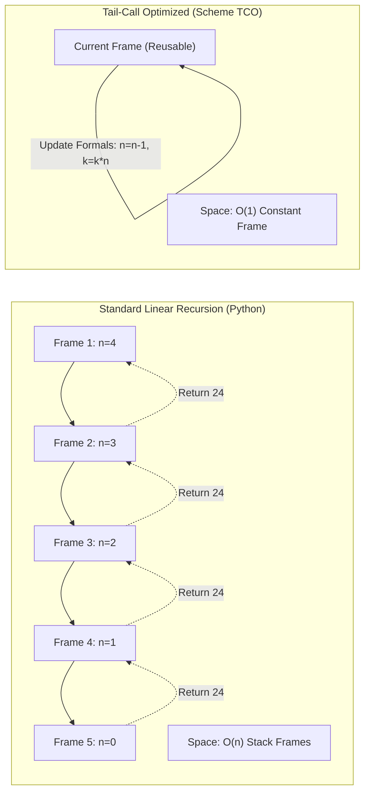

> **课程体系**：UC Berkeley CS61A (Fall 2024)  
> **所属模块**：Module 4: 解释器与 Scheme (Interpreters & Scheme)  
> **主讲教师**：Prof. John DeNero (UC Berkeley)  
> **视频时长**：32:50 ｜ **课堂截图**：17 张板书/代码演示  
> **视频直达**：[📺 在 B 站观看本讲原视频 (P30)](https://www.bilibili.com/video/BV1sy411z7nA/?p=30)  
> **快速导航**：[← 上一讲 (P29 Lecture 31 Interpreters)](/notes/cs61a/lecture-29) ｜ [📚 返回全书目录](/notes/topics/CS61A) ｜ [下一讲 (P31 Lecture 33 Programs as Data) →](/notes/cs61a/lecture-31)

---

## 课程核心目标与全景图

函数式编程（Functional Programming）强调**纯函数（Pure Functions）**、**引用透明性（Referential Transparency）**与**不可变性（Immutability）**。在没有 `while` 或 `for` 循环语句、不允许变量重新赋值的前提下，程序该如何表达循环迭代？

如果只能使用递归，而在标准语言（如 Python）中每一次递归调用都会在调用栈上新建一个活动帧（Active Frame），那么线性递归必然会消耗 $O(n)$ 的内存空间，最终导致栈溢出（Stack Overflow）。

**Scheme 语言规范要求所有合规实现必须支持尾调用优化（Properly Tail Recursive）**。这意味着：即使计算过程是用语法上的递归函数表达的，只要它符合尾递归规范，解释器就能在**严格恒定的常数空间 $O(1)$** 内执行它！



---

### 深入形式化规约与微观求值流程（Operational Semantics）
在「课程核心目标与全景图」模块中，计算机底层运算依赖于严密的形式化求值逻辑：
1. **抽象语法树（AST）的分层解析**：
   - 源代码字符流首先经过词法分析器（Lexer）切分为终结符标记（Tokens），随后由语法解析器（Parser）构造成多叉语法树；
   - 运算符优先级与结合性在语法树构建阶段即已固化，消除了运行期的二义性；
2. **环境序列的动态跃迁**：
   - 每次函数调用产生的新帧，其静态词法环境由函数对象的 `parent` 属性完全决定；
   - 变量查找沿环境链向上单向回溯，直到全局环境帧，若未找到则触发 `NameError` 异常；
3. **状态不变式（State Invariants）**：
   - 编写健壮程序的关键在于明确循环不变式（Loop Invariants）与函数前后置条件（Pre/Post-conditions）；
   - 在复杂控制流跳转中，确保状态变量在每次迭代前均维持合法的业务约束。


## 1. 函数式编程的承诺与效率悖论 (Functional Programming & Referential Transparency)

函数式编程具有非凡的理论优势：
1. **纯函数无副作用**：函数的行为只取决于输入实参；
2. **引用透明（Referential Transparency）**：任何子表达式都可以直接用其求值结果替换，而不会改变程序的语义。这为**自动并行化计算（Automatic Parallelization）**和**记忆化缓存（Memoization）**奠定了坚实基础；
3. **消除可变状态**：没有变量重绑定，彻底消除了并发竞态。

[](https://www.bilibili.com/video/BV1sy411z7nA/?p=30&t=35)
*⏱ 时间戳：00:00:35 · 📷 课堂截图 · [在 B 站观看对应片段 (P30 00:00:35)](https://www.bilibili.com/video/BV1sy411z7nA/?p=30&t=35)*

#### 📸 课堂板书与代码演示深入精读 (00:00:35)

**【现场板书 / 代码演示还原】**：
在此时间节点，DeNero 教授在屏幕上进行了核心演示与重点板书推导：
> *“Tail recursion. So functional programming is this idea that you can organize entire programs according to pure functions, which are modular, can be combined in interesting ways, and also have other advantages. So functional programming is a very broad term, but often refers to the following properti...”*

**【底层计算模型与微观执行机制】**：
1. **执行上下文与时序追踪**：
   - 处于当前讨论节点「1. 函数式编程的承诺与效率悖论 (Functional Programming & Referential Transparency)」，解释器严格遵循核心求值规约；
   - 表达式先求值操作符，随后自左至右严格求值操作数，最终将函数对象施加于实参列表；
   - 若涉及环境模型，局部帧严格记录其静态词法父指针（Parent Pointer 指向函数定义处的环境），与运行时的动态调用栈形成正交架构。
2. **内存拓扑与对象引用**：
   - 变量符号只是哈希表（环境帧）中的键，指针直接指向堆内存中的一等公民对象；
   - 赋值语句是离散时间的瞬时状态快照，绝不会建立隐式的数学依赖监听。

**【避坑指南与高频考点点拨】**：
- **常见思维误区**：在「尾上下文 (Tail Context) 识别、尾调用优化避免调用栈溢出」相关考题中，初学者极易根据代码表面形式猜想结果，导致作用域混淆或变量遮蔽（Shadowing）误判；
- **调试排错黄金法则**：遇到嵌套调用与复杂分支时，务必在草稿纸上画出独立的局部帧，标明每个形参的具体绑定值，按部就班推导。


然而，缺乏可变循环控制流引发了一个关键质疑：**没有 `for` 和 `while` 循环，函数式语言如何实现高效率的迭代计算？** 尾递归正是这一难题的完美答案。

---

### 深入形式化规约与微观求值流程（Operational Semantics）
在「1. 函数式编程的承诺与效率悖论 (Functional Programming & Referential Transparency)」模块中，计算机底层运算依赖于严密的形式化求值逻辑：
1. **抽象语法树（AST）的分层解析**：
   - 源代码字符流首先经过词法分析器（Lexer）切分为终结符标记（Tokens），随后由语法解析器（Parser）构造成多叉语法树；
   - 运算符优先级与结合性在语法树构建阶段即已固化，消除了运行期的二义性；
2. **环境序列的动态跃迁**：
   - 每次函数调用产生的新帧，其静态词法环境由函数对象的 `parent` 属性完全决定；
   - 变量查找沿环境链向上单向回溯，直到全局环境帧，若未找到则触发 `NameError` 异常；
3. **状态不变式（State Invariants）**：
   - 编写健壮程序的关键在于明确循环不变式（Loop Invariants）与函数前后置条件（Pre/Post-conditions）；
   - 在复杂控制流跳转中，确保状态变量在每次迭代前均维持合法的业务约束。


## 2. 递归 vs 迭代：空间复杂度的鸿沟 (Recursion vs Iteration in Python)

以阶乘计算辅助函数 $k \times n!$ 为例，我们在 Python 中对比递归与迭代两种写法：

```python
# 递归版本 (Linear Recursive in Python)
def factorial_rec(n, k):
    if n == 0:
        return k
    return factorial_rec(n - 1, k * n)

# 迭代版本 (Iterative with while)
def factorial_iter(n, k):
    while n > 0:
        n, k = n - 1, k * n
    return k
```

[](https://www.bilibili.com/video/BV1sy411z7nA/?p=30&t=152)
*⏱ 时间戳：00:02:32 · 📷 课堂截图 · [在 B 站观看对应片段 (P30 00:02:32)](https://www.bilibili.com/video/BV1sy411z7nA/?p=30&t=152)*

#### 📸 课堂板书与代码演示深入精读 (00:02:32)

**【现场板书 / 代码演示还原】**：
在此时间节点，DeNero 教授在屏幕上进行了核心演示与重点板书推导：
> *“Because we're not allowed to rebind a name to a new value, can we really make basic iterative procedures efficient? Or are we just stuck using recursion and recursion is slow, and so there's no way these languages could ever be fast? Well, it turns out there's an answer to this question. You can mak...”*

**【底层计算模型与微观执行机制】**：
1. **执行上下文与时序追踪**：
   - 处于当前讨论节点「2. 递归 vs 迭代：空间复杂度的鸿沟 (Recursion vs Iteration in Python)」，解释器严格遵循核心求值规约；
   - 表达式先求值操作符，随后自左至右严格求值操作数，最终将函数对象施加于实参列表；
   - 若涉及环境模型，局部帧严格记录其静态词法父指针（Parent Pointer 指向函数定义处的环境），与运行时的动态调用栈形成正交架构。
2. **内存拓扑与对象引用**：
   - 变量符号只是哈希表（环境帧）中的键，指针直接指向堆内存中的一等公民对象；
   - 赋值语句是离散时间的瞬时状态快照，绝不会建立隐式的数学依赖监听。

**【避坑指南与高频考点点拨】**：
- **常见思维误区**：在「尾上下文 (Tail Context) 识别、尾调用优化避免调用栈溢出」相关考题中，初学者极易根据代码表面形式猜想结果，导致作用域混淆或变量遮蔽（Shadowing）误判；
- **调试排错黄金法则**：遇到嵌套调用与复杂分支时，务必在草稿纸上画出独立的局部帧，标明每个形参的具体绑定值，按部就班推导。


- **时间复杂度**：两者均为 $O(n)$，执行相同次数的乘法和递减。
- **空间复杂度**：
  - `factorial_iter` 仅使用固定的两个局部变量 `n` 和 `k`，占用 **$O(1)$ 常数空间**；
  - `factorial_rec` 在 Python 中每次调用都分配一个新帧，占用 **$O(n)$ 线性空间**。

---

### 深入形式化规约与微观求值流程（Operational Semantics）
在「2. 递归 vs 迭代：空间复杂度的鸿沟 (Recursion vs Iteration in Python)」模块中，计算机底层运算依赖于严密的形式化求值逻辑：
1. **抽象语法树（AST）的分层解析**：
   - 源代码字符流首先经过词法分析器（Lexer）切分为终结符标记（Tokens），随后由语法解析器（Parser）构造成多叉语法树；
   - 运算符优先级与结合性在语法树构建阶段即已固化，消除了运行期的二义性；
2. **环境序列的动态跃迁**：
   - 每次函数调用产生的新帧，其静态词法环境由函数对象的 `parent` 属性完全决定；
   - 变量查找沿环境链向上单向回溯，直到全局环境帧，若未找到则触发 `NameError` 异常；
3. **状态不变式（State Invariants）**：
   - 编写健壮程序的关键在于明确循环不变式（Loop Invariants）与函数前后置条件（Pre/Post-conditions）；
   - 在复杂控制流跳转中，确保状态变量在每次迭代前均维持合法的业务约束。


## 3. Scheme 语言规范：尾递归强制要求 (Properly Tail Recursive)

Scheme 语言正式标准（Revised^n Report on the Algorithmic Language Scheme）明确规定：
> **Scheme 的实现必须是真尾递归的（Properly Tail Recursive）。**  
> 这允许将迭代计算以纯递归过程的形式表达，而执行时仅占用恒定的常数空间。

[](https://www.bilibili.com/video/BV1sy411z7nA/?p=30&t=274)
*⏱ 时间戳：00:04:34 · 📷 课堂截图 · [在 B 站观看对应片段 (P30 00:04:34)](https://www.bilibili.com/video/BV1sy411z7nA/?p=30&t=274)*

#### 📸 课堂板书与代码演示深入精读 (00:04:34)

**【现场板书 / 代码演示还原】**：
在此时间节点，DeNero 教授在屏幕上进行了核心演示与重点板书推导：
> *“Because we have a constant number of names that we have to remember, n, nk, and factorial, regardless of how big n is. So how do we bridge this gap between the space that's required for factorial in the recursive sense versus the iterative one? That's the whole idea of what we're talking about today...”*

**【底层计算模型与微观执行机制】**：
1. **执行上下文与时序追踪**：
   - 处于当前讨论节点「3. Scheme 语言规范：尾递归强制要求 (Properly Tail Recursive)」，解释器严格遵循核心求值规约；
   - 表达式先求值操作符，随后自左至右严格求值操作数，最终将函数对象施加于实参列表；
   - 若涉及环境模型，局部帧严格记录其静态词法父指针（Parent Pointer 指向函数定义处的环境），与运行时的动态调用栈形成正交架构。
2. **内存拓扑与对象引用**：
   - 变量符号只是哈希表（环境帧）中的键，指针直接指向堆内存中的一等公民对象；
   - 赋值语句是离散时间的瞬时状态快照，绝不会建立隐式的数学依赖监听。

**【避坑指南与高频考点点拨】**：
- **常见思维误区**：在「尾上下文 (Tail Context) 识别、尾调用优化避免调用栈溢出」相关考题中，初学者极易根据代码表面形式猜想结果，导致作用域混淆或变量遮蔽（Shadowing）误判；
- **调试排错黄金法则**：遇到嵌套调用与复杂分支时，务必在草稿纸上画出独立的局部帧，标明每个形参的具体绑定值，按部就班推导。


在 Scheme 中书写如下过程：
```scheme
(define (factorial n k)
  (if (zero? n)
      k
      (factorial (- n 1) (* k n))))
```
解释器必须保证该过程在执行时与底层的 `while` 循环消耗相同的常数空间。

---

### 深入形式化规约与微观求值流程（Operational Semantics）
在「3. Scheme 语言规范：尾递归强制要求 (Properly Tail Recursive)」模块中，计算机底层运算依赖于严密的形式化求值逻辑：
1. **抽象语法树（AST）的分层解析**：
   - 源代码字符流首先经过词法分析器（Lexer）切分为终结符标记（Tokens），随后由语法解析器（Parser）构造成多叉语法树；
   - 运算符优先级与结合性在语法树构建阶段即已固化，消除了运行期的二义性；
2. **环境序列的动态跃迁**：
   - 每次函数调用产生的新帧，其静态词法环境由函数对象的 `parent` 属性完全决定；
   - 变量查找沿环境链向上单向回溯，直到全局环境帧，若未找到则触发 `NameError` 异常；
3. **状态不变式（State Invariants）**：
   - 编写健壮程序的关键在于明确循环不变式（Loop Invariants）与函数前后置条件（Pre/Post-conditions）；
   - 在复杂控制流跳转中，确保状态变量在每次迭代前均维持合法的业务约束。


## 4. 消除调用栈冗余帧 (Eliminating Redundant Frames)

为什么 Python 的递归调用无法复用空间？我们观察环境模型（Environment Model）：

[](https://www.bilibili.com/video/BV1sy411z7nA/?p=30&t=338)
*⏱ 时间戳：00:05:38 · 📷 课堂截图 · [在 B 站观看对应片段 (P30 00:05:38)](https://www.bilibili.com/video/BV1sy411z7nA/?p=30&t=338)*

#### 📸 课堂板书与代码演示深入精读 (00:05:38)

**【现场板书 / 代码演示还原】**：
在此时间节点，DeNero 教授在屏幕上进行了核心演示与重点板书推导：
> *“As a scheme procedure, so this says the way you compute k times n factorial is you check and see if n is zero, then you return k, otherwise you make a recursive call. And that should use resources like this. But how do we do that? Well, the answer is that we eliminate the middleman. We eliminate fra...”*

**【底层计算模型与微观执行机制】**：
1. **执行上下文与时序追踪**：
   - 处于当前讨论节点「4. 消除调用栈冗余帧 (Eliminating Redundant Frames)」，解释器严格遵循核心求值规约；
   - 表达式先求值操作符，随后自左至右严格求值操作数，最终将函数对象施加于实参列表；
   - 若涉及环境模型，局部帧严格记录其静态词法父指针（Parent Pointer 指向函数定义处的环境），与运行时的动态调用栈形成正交架构。
2. **内存拓扑与对象引用**：
   - 变量符号只是哈希表（环境帧）中的键，指针直接指向堆内存中的一等公民对象；
   - 赋值语句是离散时间的瞬时状态快照，绝不会建立隐式的数学依赖监听。

**【避坑指南与高频考点点拨】**：
- **常见思维误区**：在「尾上下文 (Tail Context) 识别、尾调用优化避免调用栈溢出」相关考题中，初学者极易根据代码表面形式猜想结果，导致作用域混淆或变量遮蔽（Shadowing）误判；
- **调试排错黄金法则**：遇到嵌套调用与复杂分支时，务必在草稿纸上画出独立的局部帧，标明每个形参的具体绑定值，按部就班推导。


在 `factorial(4, 1)` 执行过程中：
- $F_1(n=4, k=1)$ 调用 $F_2(n=3, k=4)$；
- $F_2$ 调用 $F_3(n=2, k=12)$；
- $F_3$ 调用 $F_4(n=1, k=24)$；
- $F_4$ 调用 $F_5(n=0, k=24)$ 返回 `24`。
此时，$F_4$ 除了直接将 $F_5$ 的返回值传递给 $F_3$ 之外，**没有任何后续计算**！$F_3$、$F_2$、$F_1$ 同样只是充当“中转传话人”。

在递归调用发起的那一刻，上层帧的历史局部变量已经没有任何残留价值。尾调用优化的核心就是**直接丢弃或复用当前活动帧**。

---

### 深入形式化规约与微观求值流程（Operational Semantics）
在「4. 消除调用栈冗余帧 (Eliminating Redundant Frames)」模块中，计算机底层运算依赖于严密的形式化求值逻辑：
1. **抽象语法树（AST）的分层解析**：
   - 源代码字符流首先经过词法分析器（Lexer）切分为终结符标记（Tokens），随后由语法解析器（Parser）构造成多叉语法树；
   - 运算符优先级与结合性在语法树构建阶段即已固化，消除了运行期的二义性；
2. **环境序列的动态跃迁**：
   - 每次函数调用产生的新帧，其静态词法环境由函数对象的 `parent` 属性完全决定；
   - 变量查找沿环境链向上单向回溯，直到全局环境帧，若未找到则触发 `NameError` 异常；
3. **状态不变式（State Invariants）**：
   - 编写健壮程序的关键在于明确循环不变式（Loop Invariants）与函数前后置条件（Pre/Post-conditions）；
   - 在复杂控制流跳转中，确保状态变量在每次迭代前均维持合法的业务约束。


## 5. 尾调用与尾上下文的形式化定义 (Tail Calls & Tail Contexts)

### 什么是尾调用 (Tail Call)？

> **尾调用（Tail Call）** 是指位于**尾上下文（Tail Context）**中的过程调用表达式。

[](https://www.bilibili.com/video/BV1sy411z7nA/?p=30&t=433)
*⏱ 时间戳：00:07:13 · 📷 课堂截图 · [在 B 站观看对应片段 (P30 00:07:13)](https://www.bilibili.com/video/BV1sy411z7nA/?p=30&t=433)*

#### 📸 课堂板书与代码演示深入精读 (00:07:13)

**【现场板书 / 代码演示还原】**：
在此时间节点，DeNero 教授在屏幕上进行了核心演示与重点板书推导：
> *“We'll not do that. The fundamental idea here to make these recursive procedures efficient is that some calls are tail calls and some aren't. It's a distinction that figures out whether when one procedure is calling another procedure, is there more work to do when that called procedure is finished or...”*

**【底层计算模型与微观执行机制】**：
1. **执行上下文与时序追踪**：
   - 处于当前讨论节点「5. 尾调用与尾上下文的形式化定义 (Tail Calls & Tail Contexts)」，解释器严格遵循核心求值规约；
   - 表达式先求值操作符，随后自左至右严格求值操作数，最终将函数对象施加于实参列表；
   - 若涉及环境模型，局部帧严格记录其静态词法父指针（Parent Pointer 指向函数定义处的环境），与运行时的动态调用栈形成正交架构。
2. **内存拓扑与对象引用**：
   - 变量符号只是哈希表（环境帧）中的键，指针直接指向堆内存中的一等公民对象；
   - 赋值语句是离散时间的瞬时状态快照，绝不会建立隐式的数学依赖监听。

**【避坑指南与高频考点点拨】**：
- **常见思维误区**：在「尾上下文 (Tail Context) 识别、尾调用优化避免调用栈溢出」相关考题中，初学者极易根据代码表面形式猜想结果，导致作用域混淆或变量遮蔽（Shadowing）误判；
- **调试排错黄金法则**：遇到嵌套调用与复杂分支时，务必在草稿纸上画出独立的局部帧，标明每个形参的具体绑定值，按部就班推导。


如果一个过程调用是当前过程返回前需要做的**最后一件事情**（即调用完成后的返回值直接成为当前过程的返回值，无需进行任何二次计算），那么该调用就是尾调用。

### 尾上下文判定规则 (Tail Context Rules)

一个表达式是否处于尾上下文，取决于其在父表达式中的语法位置：

[](https://www.bilibili.com/video/BV1sy411z7nA/?p=30&t=523)
*⏱ 时间戳：00:08:43 · 📷 课堂截图 · [在 B 站观看对应片段 (P30 00:08:43)](https://www.bilibili.com/video/BV1sy411z7nA/?p=30&t=523)*

#### 📸 课堂板书与代码演示深入精读 (00:08:43)

**【现场板书 / 代码演示还原】**：
在此时间节点，DeNero 教授在屏幕上进行了核心演示与重点板书推导：
> *“It turns out that a lambda expression can have multiple different body expressions. The last one is the one that determines the return value. And so that expression is in a tail context, meaning it's a description of the last thing that this procedure is going to do before it returns. Now, in additi...”*

**【底层计算模型与微观执行机制】**：
1. **执行上下文与时序追踪**：
   - 处于当前讨论节点「5. 尾调用与尾上下文的形式化定义 (Tail Calls & Tail Contexts)」，解释器严格遵循核心求值规约；
   - 表达式先求值操作符，随后自左至右严格求值操作数，最终将函数对象施加于实参列表；
   - 若涉及环境模型，局部帧严格记录其静态词法父指针（Parent Pointer 指向函数定义处的环境），与运行时的动态调用栈形成正交架构。
2. **内存拓扑与对象引用**：
   - 变量符号只是哈希表（环境帧）中的键，指针直接指向堆内存中的一等公民对象；
   - 赋值语句是离散时间的瞬时状态快照，绝不会建立隐式的数学依赖监听。

**【避坑指南与高频考点点拨】**：
- **常见思维误区**：在「尾上下文 (Tail Context) 识别、尾调用优化避免调用栈溢出」相关考题中，初学者极易根据代码表面形式猜想结果，导致作用域混淆或变量遮蔽（Shadowing）误判；
- **调试排错黄金法则**：遇到嵌套调用与复杂分支时，务必在草稿纸上画出独立的局部帧，标明每个形参的具体绑定值，按部就班推导。


1. **Lambda 函数体**：`lambda` 表达式体中的**最后一个子表达式**处于尾上下文；
2. **If 条件分支**：若整个 `if` 表达式处于尾上下文，则其**第 2 个子表达式（Consequent）和第 3 个子表达式（Alternative）**也处于尾上下文；（注意：Predicate 谓词表达式绝不在尾上下文中！）
3. **Cond 分支**：处于尾上下文的 `cond` 表达式中，各子句的非谓词结果表达式处于尾上下文；
4. **And / Or 逻辑式**：处于尾上下文的 `and`/`or` 表达式的**最后一个子表达式**处于尾上下文；
5. **Begin 代码块**：处于尾上下文的 `begin` 块中的**最后一个子表达式**处于尾上下文。

---

### 深入形式化规约与微观求值流程（Operational Semantics）
在「5. 尾调用与尾上下文的形式化定义 (Tail Calls & Tail Contexts)」模块中，计算机底层运算依赖于严密的形式化求值逻辑：
1. **抽象语法树（AST）的分层解析**：
   - 源代码字符流首先经过词法分析器（Lexer）切分为终结符标记（Tokens），随后由语法解析器（Parser）构造成多叉语法树；
   - 运算符优先级与结合性在语法树构建阶段即已固化，消除了运行期的二义性；
2. **环境序列的动态跃迁**：
   - 每次函数调用产生的新帧，其静态词法环境由函数对象的 `parent` 属性完全决定；
   - 变量查找沿环境链向上单向回溯，直到全局环境帧，若未找到则触发 `NameError` 异常；
3. **状态不变式（State Invariants）**：
   - 编写健壮程序的关键在于明确循环不变式（Loop Invariants）与函数前后置条件（Pre/Post-conditions）；
   - 在复杂控制流跳转中，确保状态变量在每次迭代前均维持合法的业务约束。


## 6. 线性递归改写为尾递归：列表长度 (Rewriting `length` with Accumulator)

### 非尾递归的经典写法

```scheme
(define (length s)
  (if (null? s)
      0
      (+ 1 (length (cdr s)))))
```

[](https://www.bilibili.com/video/BV1sy411z7nA/?p=30&t=646)
*⏱ 时间戳：00:10:46 · 📷 课堂截图 · [在 B 站观看对应片段 (P30 00:10:46)](https://www.bilibili.com/video/BV1sy411z7nA/?p=30&t=646)*

#### 📸 课堂板书与代码演示深入精读 (00:10:46)

**【现场板书 / 代码演示还原】**：
在此时间节点，DeNero 教授在屏幕上进行了核心演示与重点板书推导：
> *“And the last sub-expression in a tail context began. These aren't terribly important, except that, if you're actually sitting down and writing a scheme program, you need to know what the tail contexts are, so you know what's going to be the space efficiency, or space usage, of your program. So, peop...”*

**【底层计算模型与微观执行机制】**：
1. **执行上下文与时序追踪**：
   - 处于当前讨论节点「6. 线性递归改写为尾递归：列表长度 (Rewriting `length` with Accumulator)」，解释器严格遵循核心求值规约；
   - 表达式先求值操作符，随后自左至右严格求值操作数，最终将函数对象施加于实参列表；
   - 若涉及环境模型，局部帧严格记录其静态词法父指针（Parent Pointer 指向函数定义处的环境），与运行时的动态调用栈形成正交架构。
2. **内存拓扑与对象引用**：
   - 变量符号只是哈希表（环境帧）中的键，指针直接指向堆内存中的一等公民对象；
   - 赋值语句是离散时间的瞬时状态快照，绝不会建立隐式的数学依赖监听。

**【避坑指南与高频考点点拨】**：
- **常见思维误区**：在「尾上下文 (Tail Context) 识别、尾调用优化避免调用栈溢出」相关考题中，初学者极易根据代码表面形式猜想结果，导致作用域混淆或变量遮蔽（Shadowing）误判；
- **调试排错黄金法则**：遇到嵌套调用与复杂分支时，务必在草稿纸上画出独立的局部帧，标明每个形参的具体绑定值，按部就班推导。


- 整个 `if` 处于尾上下文，因此分支 `0` 和 `(+ 1 (length (cdr s)))` 处于尾上下文；
- 但是，最外层的调用是加法 `+`，内部的递归调用 `(length (cdr s))` 是加法操作符的操作数，**处于嵌套调用表达式中，绝非尾调用**！
- 当递归返回列表剩余长度后，当前帧还必须保留在栈上以等待执行加 1 操作。因此空间复杂度为 $O(n)$。

### 尾递归改写：累加器技术 (Accumulator Pattern)

通过引入辅助过程与累加器参数，把“回溯时累加”提前为“前进时累加”：

```scheme
(define (length-tail s)
  (define (length-iter s n)
    (if (null? s)
        n
        (length-iter (cdr s) (+ n 1))))
  (length-iter s 0))
```

[](https://www.bilibili.com/video/BV1sy411z7nA/?p=30&t=769)
*⏱ 时间戳：00:12:49 · 📷 课堂截图 · [在 B 站观看对应片段 (P30 00:12:49)](https://www.bilibili.com/video/BV1sy411z7nA/?p=30&t=769)*

#### 📸 课堂板书与代码演示深入精读 (00:12:49)

**【现场板书 / 代码演示还原】**：
在此时间节点，DeNero 教授在屏幕上进行了核心演示与重点板书推导：
> *“We still have more work to do to add one to it. Now, we don't know what work there might be to do left. And so, for instance, maybe there would be a reference to S and so we might need the environment for this function call around because there's more work to do. So in this case, an implementation o...”*

**【底层计算模型与微观执行机制】**：
1. **执行上下文与时序追踪**：
   - 处于当前讨论节点「6. 线性递归改写为尾递归：列表长度 (Rewriting `length` with Accumulator)」，解释器严格遵循核心求值规约；
   - 表达式先求值操作符，随后自左至右严格求值操作数，最终将函数对象施加于实参列表；
   - 若涉及环境模型，局部帧严格记录其静态词法父指针（Parent Pointer 指向函数定义处的环境），与运行时的动态调用栈形成正交架构。
2. **内存拓扑与对象引用**：
   - 变量符号只是哈希表（环境帧）中的键，指针直接指向堆内存中的一等公民对象；
   - 赋值语句是离散时间的瞬时状态快照，绝不会建立隐式的数学依赖监听。

**【避坑指南与高频考点点拨】**：
- **常见思维误区**：在「尾上下文 (Tail Context) 识别、尾调用优化避免调用栈溢出」相关考题中，初学者极易根据代码表面形式猜想结果，导致作用域混淆或变量遮蔽（Shadowing）误判；
- **调试排错黄金法则**：遇到嵌套调用与复杂分支时，务必在草稿纸上画出独立的局部帧，标明每个形参的具体绑定值，按部就班推导。


在 `length-iter` 中，递归调用 `(length-iter (cdr s) (+ n 1))` 位于 `if` 的 alternative 分支顶层，是完完全全的尾调用！因此空间复杂度直接降为 $O(1)$。

---

### 深入形式化规约与微观求值流程（Operational Semantics）
在「6. 线性递归改写为尾递归：列表长度 (Rewriting `length` with Accumulator)」模块中，计算机底层运算依赖于严密的形式化求值逻辑：
1. **抽象语法树（AST）的分层解析**：
   - 源代码字符流首先经过词法分析器（Lexer）切分为终结符标记（Tokens），随后由语法解析器（Parser）构造成多叉语法树；
   - 运算符优先级与结合性在语法树构建阶段即已固化，消除了运行期的二义性；
2. **环境序列的动态跃迁**：
   - 每次函数调用产生的新帧，其静态词法环境由函数对象的 `parent` 属性完全决定；
   - 变量查找沿环境链向上单向回溯，直到全局环境帧，若未找到则触发 `NameError` 异常；
3. **状态不变式（State Invariants）**：
   - 编写健壮程序的关键在于明确循环不变式（Loop Invariants）与函数前后置条件（Pre/Post-conditions）；
   - 在复杂控制流跳转中，确保状态变量在每次迭代前均维持合法的业务约束。


## 7. 解释器实战：尾调用优化演示 (`scheme.py`)

在 CS61A Project 4（Scheme 解释器）的 Extra Credit 部分，我们需要为解释器增加尾调用优化支持。

[](https://www.bilibili.com/video/BV1sy411z7nA/?p=30&t=926)
*⏱ 时间戳：00:15:26 · 📷 课堂截图 · [在 B 站观看对应片段 (P30 00:15:26)](https://www.bilibili.com/video/BV1sy411z7nA/?p=30&t=926)*

#### 📸 课堂板书与代码演示深入精读 (00:15:26)

**【现场板书 / 代码演示还原】**：
在此时间节点，DeNero 教授在屏幕上进行了核心演示与重点板书推导：
> *“Well, we're going to have to run a demonstration. So it should be that the return value of the tail call is the return value of the current procedure call, meaning we can skip keeping around all the frames that we don't need, because the return values for the last frame can return straight up to the...”*

**【底层计算模型与微观执行机制】**：
1. **执行上下文与时序追踪**：
   - 处于当前讨论节点「7. 解释器实战：尾调用优化演示 (`scheme.py`)」，解释器严格遵循核心求值规约；
   - 表达式先求值操作符，随后自左至右严格求值操作数，最终将函数对象施加于实参列表；
   - 若涉及环境模型，局部帧严格记录其静态词法父指针（Parent Pointer 指向函数定义处的环境），与运行时的动态调用栈形成正交架构。
2. **内存拓扑与对象引用**：
   - 变量符号只是哈希表（环境帧）中的键，指针直接指向堆内存中的一等公民对象；
   - 赋值语句是离散时间的瞬时状态快照，绝不会建立隐式的数学依赖监听。

**【避坑指南与高频考点点拨】**：
- **常见思维误区**：在「尾上下文 (Tail Context) 识别、尾调用优化避免调用栈溢出」相关考题中，初学者极易根据代码表面形式猜想结果，导致作用域混淆或变量遮蔽（Shadowing）误判；
- **调试排错黄金法则**：遇到嵌套调用与复杂分支时，务必在草稿纸上画出独立的局部帧，标明每个形参的具体绑定值，按部就班推导。


### 未开启优化时的崩溃测试

在普通解释器中运行阶乘函数：
```scheme
(factorial 10)   ; => 3628800
(factorial 100)  ; => 正常返回
(factorial 1000) ; => 报错: RuntimeError: maximum recursion depth exceeded!
```

Python 解释器默认调用栈上限约为 1000 层，当调用到第 673 层左右时，因堆栈耗尽直接抛出异常崩溃。

[](https://www.bilibili.com/video/BV1sy411z7nA/?p=30&t=1026)
*⏱ 时间戳：00:17:06 · 📷 课堂截图 · [在 B 站观看对应片段 (P30 00:17:06)](https://www.bilibili.com/video/BV1sy411z7nA/?p=30&t=1026)*

#### 📸 课堂板书与代码演示深入精读 (00:17:06)

**【现场板书 / 代码演示还原】**：
在此时间节点，DeNero 教授在屏幕上进行了核心演示与重点板书推导：
> *“We have an interpreter that is not optimized for tail calls. So it's just going to create a frame every time we make a recursive call and that frame will stick around until we return from the call. And that will use a linear amount of space, which means that if we run scheme.py and load in this fact...”*

**【底层计算模型与微观执行机制】**：
1. **执行上下文与时序追踪**：
   - 处于当前讨论节点「7. 解释器实战：尾调用优化演示 (`scheme.py`)」，解释器严格遵循核心求值规约；
   - 表达式先求值操作符，随后自左至右严格求值操作数，最终将函数对象施加于实参列表；
   - 若涉及环境模型，局部帧严格记录其静态词法父指针（Parent Pointer 指向函数定义处的环境），与运行时的动态调用栈形成正交架构。
2. **内存拓扑与对象引用**：
   - 变量符号只是哈希表（环境帧）中的键，指针直接指向堆内存中的一等公民对象；
   - 赋值语句是离散时间的瞬时状态快照，绝不会建立隐式的数学依赖监听。

**【避坑指南与高频考点点拨】**：
- **常见思维误区**：在「尾上下文 (Tail Context) 识别、尾调用优化避免调用栈溢出」相关考题中，初学者极易根据代码表面形式猜想结果，导致作用域混淆或变量遮蔽（Shadowing）误判；
- **调试排错黄金法则**：遇到嵌套调用与复杂分支时，务必在草稿纸上画出独立的局部帧，标明每个形参的具体绑定值，按部就班推导。


### 开启优化后的无限制执行

开启尾调用优化（通过迭代循环 trampoline 或直接更新局部求值环境）后，即使计算 `(factorial 10000 1)`，解释器也绝不会新增任何活动栈帧，而是恒定以常数空间瞬时或平稳完成海量递归！

---

### 深入形式化规约与微观求值流程（Operational Semantics）
在「7. 解释器实战：尾调用优化演示 (`scheme.py`)」模块中，计算机底层运算依赖于严密的形式化求值逻辑：
1. **抽象语法树（AST）的分层解析**：
   - 源代码字符流首先经过词法分析器（Lexer）切分为终结符标记（Tokens），随后由语法解析器（Parser）构造成多叉语法树；
   - 运算符优先级与结合性在语法树构建阶段即已固化，消除了运行期的二义性；
2. **环境序列的动态跃迁**：
   - 每次函数调用产生的新帧，其静态词法环境由函数对象的 `parent` 属性完全决定；
   - 变量查找沿环境链向上单向回溯，直到全局环境帧，若未找到则触发 `NameError` 异常；
3. **状态不变式（State Invariants）**：
   - 编写健壮程序的关键在于明确循环不变式（Loop Invariants）与函数前后置条件（Pre/Post-conditions）；
   - 在复杂控制流跳转中，确保状态变量在每次迭代前均维持合法的业务约束。


## 8. 诊断测试：辨析尾递归过程 (Diagnostic Exercises)

请分析以下四个 Scheme 过程，判断哪些是真正的尾递归（在常数空间内运行）：

[](https://www.bilibili.com/video/BV1sy411z7nA/?p=30&t=1116)
*⏱ 时间戳：00:18:36 · 📷 课堂截图 · [在 B 站观看对应片段 (P30 00:18:36)](https://www.bilibili.com/video/BV1sy411z7nA/?p=30&t=1116)*

#### 📸 课堂板书与代码演示深入精读 (00:18:36)

**【现场板书 / 代码演示还原】**：
在此时间节点，DeNero 教授在屏幕上进行了核心演示与重点板书推导：
> *“And if I compute the factorial of 10,000, well, sure, it takes a while. I'm not making anything really faster, but I am saving the extra space. So we computed this huge number, 10,000 factorial. Now, eventually, this program will run out of space, not because we create extra frames, but because repr...”*

**【底层计算模型与微观执行机制】**：
1. **执行上下文与时序追踪**：
   - 处于当前讨论节点「8. 诊断测试：辨析尾递归过程 (Diagnostic Exercises)」，解释器严格遵循核心求值规约；
   - 表达式先求值操作符，随后自左至右严格求值操作数，最终将函数对象施加于实参列表；
   - 若涉及环境模型，局部帧严格记录其静态词法父指针（Parent Pointer 指向函数定义处的环境），与运行时的动态调用栈形成正交架构。
2. **内存拓扑与对象引用**：
   - 变量符号只是哈希表（环境帧）中的键，指针直接指向堆内存中的一等公民对象；
   - 赋值语句是离散时间的瞬时状态快照，绝不会建立隐式的数学依赖监听。

**【避坑指南与高频考点点拨】**：
- **常见思维误区**：在「尾上下文 (Tail Context) 识别、尾调用优化避免调用栈溢出」相关考题中，初学者极易根据代码表面形式猜想结果，导致作用域混淆或变量遮蔽（Shadowing）误判；
- **调试排错黄金法则**：遇到嵌套调用与复杂分支时，务必在草稿纸上画出独立的局部帧，标明每个形参的具体绑定值，按部就班推导。


### 案例 1：`contains?`

```scheme
(define (contains? s x)
  (cond ((null? s) #f)
        ((= (car s) x) #t)
        (else (contains? (cdr s) x))))
```

[](https://www.bilibili.com/video/BV1sy411z7nA/?p=30&t=1208)
*⏱ 时间戳：00:20:08 · 📷 课堂截图 · [在 B 站观看对应片段 (P30 00:20:08)](https://www.bilibili.com/video/BV1sy411z7nA/?p=30&t=1208)*

#### 📸 课堂板书与代码演示深入精读 (00:20:08)

**【现场板书 / 代码演示还原】**：
在此时间节点，DeNero 教授在屏幕上进行了核心演示与重点板书推导：
> *“If is a tail context, but the sub-expressions of it aren't. So in particular, this if expression is not in a tail context. And that idea that the consequent and alternative sub-expressions of an if are in tail contexts only works if the whole if is in a tail context. So this is not either, which mea...”*

**【底层计算模型与微观执行机制】**：
1. **执行上下文与时序追踪**：
   - 处于当前讨论节点「8. 诊断测试：辨析尾递归过程 (Diagnostic Exercises)」，解释器严格遵循核心求值规约；
   - 表达式先求值操作符，随后自左至右严格求值操作数，最终将函数对象施加于实参列表；
   - 若涉及环境模型，局部帧严格记录其静态词法父指针（Parent Pointer 指向函数定义处的环境），与运行时的动态调用栈形成正交架构。
2. **内存拓扑与对象引用**：
   - 变量符号只是哈希表（环境帧）中的键，指针直接指向堆内存中的一等公民对象；
   - 赋值语句是离散时间的瞬时状态快照，绝不会建立隐式的数学依赖监听。

**【避坑指南与高频考点点拨】**：
- **常见思维误区**：在「尾上下文 (Tail Context) 识别、尾调用优化避免调用栈溢出」相关考题中，初学者极易根据代码表面形式猜想结果，导致作用域混淆或变量遮蔽（Shadowing）误判；
- **调试排错黄金法则**：遇到嵌套调用与复杂分支时，务必在草稿纸上画出独立的局部帧，标明每个形参的具体绑定值，按部就班推导。


- **分析**：`cond` 的 `else` 分支直接返回递归调用结果，没有任何挂起操作。
- **结论**：**是尾递归**，空间复杂度 $O(1)$。

### 案例 2：`has-repeat?`

```scheme
(define (has-repeat? s)
  (if (null? s)
      #f
      (if (contains? (cdr s) (car s))
          #t
          (has-repeat? (cdr s)))))
```

- **分析**：对 `has-repeat?` 的递归调用处于嵌套 `if` 的 alternative 尾上下文中；调用 `contains?` 虽非尾调用，但 `contains?` 自身为 $O(1)$ 空间。
- **结论**：**是尾递归**，空间复杂度 $O(1)$。

### 案例 3：`fib-iter`

```scheme
(define (fib-iter n)
  (define (helper k current prev)
    (if (= k n)
        current
        (helper (+ k 1) (+ current prev) current)))
  (if (zero? n) 0 (helper 1 1 0)))
```

[](https://www.bilibili.com/video/BV1sy411z7nA/?p=30&t=1331)
*⏱ 时间戳：00:22:11 · 📷 课堂截图 · [在 B 站观看对应片段 (P30 00:22:11)](https://www.bilibili.com/video/BV1sy411z7nA/?p=30&t=1331)*

#### 📸 课堂板书与代码演示深入精读 (00:22:11)

**【现场板书 / 代码演示还原】**：
在此时间节点，DeNero 教授在屏幕上进行了核心演示与重点板书推导：
> *“We don't have to worry about that taking up a bunch of room. Finally, we have a procedure to compute the nth Fibonacci number. So let's see how this actually works. Fibidr takes the current Fibonacci number, which is Fibonacci number k, and if we're all the way up to the nth one, which is the one we...”*

**【底层计算模型与微观执行机制】**：
1. **执行上下文与时序追踪**：
   - 处于当前讨论节点「8. 诊断测试：辨析尾递归过程 (Diagnostic Exercises)」，解释器严格遵循核心求值规约；
   - 表达式先求值操作符，随后自左至右严格求值操作数，最终将函数对象施加于实参列表；
   - 若涉及环境模型，局部帧严格记录其静态词法父指针（Parent Pointer 指向函数定义处的环境），与运行时的动态调用栈形成正交架构。
2. **内存拓扑与对象引用**：
   - 变量符号只是哈希表（环境帧）中的键，指针直接指向堆内存中的一等公民对象；
   - 赋值语句是离散时间的瞬时状态快照，绝不会建立隐式的数学依赖监听。

**【避坑指南与高频考点点拨】**：
- **常见思维误区**：在「尾上下文 (Tail Context) 识别、尾调用优化避免调用栈溢出」相关考题中，初学者极易根据代码表面形式猜想结果，导致作用域混淆或变量遮蔽（Shadowing）误判；
- **调试排错黄金法则**：遇到嵌套调用与复杂分支时，务必在草稿纸上画出独立的局部帧，标明每个形参的具体绑定值，按部就班推导。


- **分析**：所有参数计算（如 `(+ current prev)`）均在进入下一轮调用前完成，递归调用 `helper` 处于尾上下文。
- **结论**：**是尾递归**，空间复杂度 $O(1)$。

---

### 深入形式化规约与微观求值流程（Operational Semantics）
在「8. 诊断测试：辨析尾递归过程 (Diagnostic Exercises)」模块中，计算机底层运算依赖于严密的形式化求值逻辑：
1. **抽象语法树（AST）的分层解析**：
   - 源代码字符流首先经过词法分析器（Lexer）切分为终结符标记（Tokens），随后由语法解析器（Parser）构造成多叉语法树；
   - 运算符优先级与结合性在语法树构建阶段即已固化，消除了运行期的二义性；
2. **环境序列的动态跃迁**：
   - 每次函数调用产生的新帧，其静态词法环境由函数对象的 `parent` 属性完全决定；
   - 变量查找沿环境链向上单向回溯，直到全局环境帧，若未找到则触发 `NameError` 异常；
3. **状态不变式（State Invariants）**：
   - 编写健壮程序的关键在于明确循环不变式（Loop Invariants）与函数前后置条件（Pre/Post-conditions）；
   - 在复杂控制流跳转中，确保状态变量在每次迭代前均维持合法的业务约束。


## 9. 高阶函数的尾递归改造：`reduce` 与 `map`

### 尾递归的 `reduce`

```scheme
(define (reduce fn s start)
  (if (null? s)
      start
      (reduce fn (cdr s) (fn start (car s)))))
```

[](https://www.bilibili.com/video/BV1sy411z7nA/?p=30&t=1421)
*⏱ 时间戳：00:23:41 · 📷 课堂截图 · [在 B 站观看对应片段 (P30 00:23:41)](https://www.bilibili.com/video/BV1sy411z7nA/?p=30&t=1421)*

#### 📸 课堂板书与代码演示深入精读 (00:23:41)

**【现场板书 / 代码演示还原】**：
在此时间节点，DeNero 教授在屏幕上进行了核心演示与重点板书推导：
> *“As soon as we figure out the k-1 Fibonacci number, we still have to combine it with current, in order to finish. And then we have to call fibiter on that. Next, we'll look at two higher-order functions, map and reduce. So let's look at reduce first. Reduce is a procedure that takes another procedure...”*

**【底层计算模型与微观执行机制】**：
1. **执行上下文与时序追踪**：
   - 处于当前讨论节点「9. 高阶函数的尾递归改造：`reduce` 与 `map`」，解释器严格遵循核心求值规约；
   - 表达式先求值操作符，随后自左至右严格求值操作数，最终将函数对象施加于实参列表；
   - 若涉及环境模型，局部帧严格记录其静态词法父指针（Parent Pointer 指向函数定义处的环境），与运行时的动态调用栈形成正交架构。
2. **内存拓扑与对象引用**：
   - 变量符号只是哈希表（环境帧）中的键，指针直接指向堆内存中的一等公民对象；
   - 赋值语句是离散时间的瞬时状态快照，绝不会建立隐式的数学依赖监听。

**【避坑指南与高频考点点拨】**：
- **常见思维误区**：在「尾上下文 (Tail Context) 识别、尾调用优化避免调用栈溢出」相关考题中，初学者极易根据代码表面形式猜想结果，导致作用域混淆或变量遮蔽（Shadowing）误判；
- **调试排错黄金法则**：遇到嵌套调用与复杂分支时，务必在草稿纸上画出独立的局部帧，标明每个形参的具体绑定值，按部就班推导。


递归调用 `reduce` 处于尾上下文，新累加值 `(fn start (car s))` 作为实参传入。只要传入的过程 `fn` 本身运行在常数空间，整个 `reduce` 就在 $O(1)$ 空间内运行。

---

### 深入形式化规约与微观求值流程（Operational Semantics）
在「9. 高阶函数的尾递归改造：`reduce` 与 `map`」模块中，计算机底层运算依赖于严密的形式化求值逻辑：
1. **抽象语法树（AST）的分层解析**：
   - 源代码字符流首先经过词法分析器（Lexer）切分为终结符标记（Tokens），随后由语法解析器（Parser）构造成多叉语法树；
   - 运算符优先级与结合性在语法树构建阶段即已固化，消除了运行期的二义性；
2. **环境序列的动态跃迁**：
   - 每次函数调用产生的新帧，其静态词法环境由函数对象的 `parent` 属性完全决定；
   - 变量查找沿环境链向上单向回溯，直到全局环境帧，若未找到则触发 `NameError` 异常；
3. **状态不变式（State Invariants）**：
   - 编写健壮程序的关键在于明确循环不变式（Loop Invariants）与函数前后置条件（Pre/Post-conditions）；
   - 在复杂控制流跳转中，确保状态变量在每次迭代前均维持合法的业务约束。


## 10. 高难度挑战：常数空间的尾递归 `map` (Tail Recursive `map`)

标准 `map` 的传统递归定义必须等待后续子列表返回后执行 `cons`，因而占用 $O(n)$ 线性空间：

```scheme
(define (map fn s)
  (if (null? s)
      nil
      (cons (fn (car s)) (map fn (cdr s))))) ; 非尾调用！
```

[](https://www.bilibili.com/video/BV1sy411z7nA/?p=30&t=1580)
*⏱ 时间戳：00:26:20 · 📷 课堂截图 · [在 B 站观看对应片段 (P30 00:26:20)](https://www.bilibili.com/video/BV1sy411z7nA/?p=30&t=1580)*

#### 📸 课堂板书与代码演示深入精读 (00:26:20)

**【现场板书 / 代码演示还原】**：
在此时间节点，DeNero 教授在屏幕上进行了核心演示与重点板书推导：
> *“And this is a higher-order function, so we don't know what procedure will be passed in. So the total space of reduce will depend on whether the procedure requires constant space or not. Hopefully, it just requires constant space, in which case the entire reduce will require only constant space. Okay...”*

**【底层计算模型与微观执行机制】**：
1. **执行上下文与时序追踪**：
   - 处于当前讨论节点「10. 高难度挑战：常数空间的尾递归 `map` (Tail Recursive `map`)」，解释器严格遵循核心求值规约；
   - 表达式先求值操作符，随后自左至右严格求值操作数，最终将函数对象施加于实参列表；
   - 若涉及环境模型，局部帧严格记录其静态词法父指针（Parent Pointer 指向函数定义处的环境），与运行时的动态调用栈形成正交架构。
2. **内存拓扑与对象引用**：
   - 变量符号只是哈希表（环境帧）中的键，指针直接指向堆内存中的一等公民对象；
   - 赋值语句是离散时间的瞬时状态快照，绝不会建立隐式的数学依赖监听。

**【避坑指南与高频考点点拨】**：
- **常见思维误区**：在「尾上下文 (Tail Context) 识别、尾调用优化避免调用栈溢出」相关考题中，初学者极易根据代码表面形式猜想结果，导致作用域混淆或变量遮蔽（Shadowing）误判；
- **调试排错黄金法则**：遇到嵌套调用与复杂分支时，务必在草稿纸上画出独立的局部帧，标明每个形参的具体绑定值，按部就班推导。


如何在不消耗额外帧空间的前提下实现 `map`？

### 技巧：先逆序累加，再尾递归反转

[](https://www.bilibili.com/video/BV1sy411z7nA/?p=30&t=1699)
*⏱ 时间戳：00:28:19 · 📷 课堂截图 · [在 B 站观看对应片段 (P30 00:28:19)](https://www.bilibili.com/video/BV1sy411z7nA/?p=30&t=1699)*

#### 📸 课堂板书与代码演示深入精读 (00:28:19)

**【现场板书 / 代码演示还原】**：
在此时间节点，DeNero 教授在屏幕上进行了核心演示与重点板书推导：
> *“Which is an entail context. We have a sub-expression that's not an entail context. It calls map. So here is a tail recursive definition of map, not what you would expect. Define map by computing the reverse of the map, meaning exactly what we want, but in the reverse order. This first checks if S is...”*

**【底层计算模型与微观执行机制】**：
1. **执行上下文与时序追踪**：
   - 处于当前讨论节点「10. 高难度挑战：常数空间的尾递归 `map` (Tail Recursive `map`)」，解释器严格遵循核心求值规约；
   - 表达式先求值操作符，随后自左至右严格求值操作数，最终将函数对象施加于实参列表；
   - 若涉及环境模型，局部帧严格记录其静态词法父指针（Parent Pointer 指向函数定义处的环境），与运行时的动态调用栈形成正交架构。
2. **内存拓扑与对象引用**：
   - 变量符号只是哈希表（环境帧）中的键，指针直接指向堆内存中的一等公民对象；
   - 赋值语句是离散时间的瞬时状态快照，绝不会建立隐式的数学依赖监听。

**【避坑指南与高频考点点拨】**：
- **常见思维误区**：在「尾上下文 (Tail Context) 识别、尾调用优化避免调用栈溢出」相关考题中，初学者极易根据代码表面形式猜想结果，导致作用域混淆或变量遮蔽（Shadowing）误判；
- **调试排错黄金法则**：遇到嵌套调用与复杂分支时，务必在草稿纸上画出独立的局部帧，标明每个形参的具体绑定值，按部就班推导。


```scheme
;; 1. 尾递归的逆序 map
(define (map-reverse fn s acc)
  (if (null? s)
      acc
      (map-reverse fn (cdr s) (cons (fn (car s)) acc))))

;; 2. 尾递归的列表反转
(define (reverse s acc)
  (if (null? s)
      acc
      (reverse (cdr s) (cons (car s) acc))))

;; 3. 组合出真正的尾递归 map
(define (map-tail fn s)
  (reverse (map-reverse fn s nil) nil))
```

在构造新列表的同时，累加器顺次在头部压入元素，得到逆序列表；随后利用尾递归的 `reverse` 将其翻转。整个过程中所有递归调用均处于尾上下文，空间开销严格保持常数！

---

### 深入形式化规约与微观求值流程（Operational Semantics）
在「10. 高难度挑战：常数空间的尾递归 `map` (Tail Recursive `map`)」模块中，计算机底层运算依赖于严密的形式化求值逻辑：
1. **抽象语法树（AST）的分层解析**：
   - 源代码字符流首先经过词法分析器（Lexer）切分为终结符标记（Tokens），随后由语法解析器（Parser）构造成多叉语法树；
   - 运算符优先级与结合性在语法树构建阶段即已固化，消除了运行期的二义性；
2. **环境序列的动态跃迁**：
   - 每次函数调用产生的新帧，其静态词法环境由函数对象的 `parent` 属性完全决定；
   - 变量查找沿环境链向上单向回溯，直到全局环境帧，若未找到则触发 `NameError` 异常；
3. **状态不变式（State Invariants）**：
   - 编写健壮程序的关键在于明确循环不变式（Loop Invariants）与函数前后置条件（Pre/Post-conditions）；
   - 在复杂控制流跳转中，确保状态变量在每次迭代前均维持合法的业务约束。


## 11. 哲学升华：程序是专用机器，解释器是通用机器 (Universal Computing Machine)

在本讲的结尾，John DeNero 教授给出了一个极富启发的计算本质视角：

[](https://www.bilibili.com/video/BV1sy411z7nA/?p=30&t=1858)
*⏱ 时间戳：00:30:58 · 📷 课堂截图 · [在 B 站观看对应片段 (P30 00:30:58)](https://www.bilibili.com/video/BV1sy411z7nA/?p=30&t=1858)*

#### 📸 课堂板书与代码演示深入精读 (00:30:58)

**【现场板书 / 代码演示还原】**：
在此时间节点，DeNero 教授在屏幕上进行了核心演示与重点板书推导：
> *“And then we realized, well, I would build it in the reverse order because as you are building up the recursive list from the back to the front, you're processing the input from the front to the back. And so then we had to define reverse in order to give us exactly the result that we want. Our final ...”*

**【底层计算模型与微观执行机制】**：
1. **执行上下文与时序追踪**：
   - 处于当前讨论节点「11. 哲学升华：程序是专用机器，解释器是通用机器 (Universal Computing Machine)」，解释器严格遵循核心求值规约；
   - 表达式先求值操作符，随后自左至右严格求值操作数，最终将函数对象施加于实参列表；
   - 若涉及环境模型，局部帧严格记录其静态词法父指针（Parent Pointer 指向函数定义处的环境），与运行时的动态调用栈形成正交架构。
2. **内存拓扑与对象引用**：
   - 变量符号只是哈希表（环境帧）中的键，指针直接指向堆内存中的一等公民对象；
   - 赋值语句是离散时间的瞬时状态快照，绝不会建立隐式的数学依赖监听。

**【避坑指南与高频考点点拨】**：
- **常见思维误区**：在「尾上下文 (Tail Context) 识别、尾调用优化避免调用栈溢出」相关考题中，初学者极易根据代码表面形式猜想结果，导致作用域混淆或变量遮蔽（Shadowing）误判；
- **调试排错黄金法则**：遇到嵌套调用与复杂分支时，务必在草稿纸上画出独立的局部帧，标明每个形参的具体绑定值，按部就班推导。


- **专用计算机器（Special-Purpose Machine）**：每一个具体程序（如计算阶乘的函数）就像一台特定功能的物理齿轮装置，输入 $5$，内部流水线运转，输出 $120$。
- **通用计算机器（Universal Machine / Interpreter）**：解释器本身并不固化任何具体的业务逻辑。它同时接受**两样输入**：
  1. 源代码程序（描述某台特定机器的蓝图）；
  2. 该程序所需的输入数据。
  解释器在内存中动态模拟这台机器的物理运转！

这正是阿兰·图灵（Alan Turing）在 1936 年提出的**通用图灵机（Universal Turing Machine）**的思想内核。我们在 Project 4 中亲手编写的 Scheme 解释器，本质上就是一台能够模拟宇宙中任何可计算过程的通用计算机。

---

### 深入形式化规约与微观求值流程（Operational Semantics）
在「11. 哲学升华：程序是专用机器，解释器是通用机器 (Universal Computing Machine)」模块中，计算机底层运算依赖于严密的形式化求值逻辑：
1. **抽象语法树（AST）的分层解析**：
   - 源代码字符流首先经过词法分析器（Lexer）切分为终结符标记（Tokens），随后由语法解析器（Parser）构造成多叉语法树；
   - 运算符优先级与结合性在语法树构建阶段即已固化，消除了运行期的二义性；
2. **环境序列的动态跃迁**：
   - 每次函数调用产生的新帧，其静态词法环境由函数对象的 `parent` 属性完全决定；
   - 变量查找沿环境链向上单向回溯，直到全局环境帧，若未找到则触发 `NameError` 异常；
3. **状态不变式（State Invariants）**：
   - 编写健壮程序的关键在于明确循环不变式（Loop Invariants）与函数前后置条件（Pre/Post-conditions）；
   - 在复杂控制流跳转中，确保状态变量在每次迭代前均维持合法的业务约束。


## 核心复习要点总结

| 核心术语 | 核心定义与关键法则 |
| :--- | :--- |
| **尾调用 (Tail Call)** | 位于尾上下文中的过程调用。其返回值即为外层过程的最终返回值，调用后无需后续计算。 |
| **尾上下文 (Tail Context)** | 过程体最后一条语句、处于尾上下文的 `if` 表达式的两个分支表达式等。 |
| **尾调用优化 (TCO)** | 编译器/解释器复用当前调用帧，支持无限次尾调用而仅消耗 $O(1)$ 常数空间。 |
| **累加器模式 (Accumulator)** | 将中间计算结果作为实参传递给下一轮递归调用，使计算在“向下深入”时发生，从而将线性递归转为尾递归。 |
| **通用计算机器** | 解释器接受程序文本与数据作为输入，具备模拟任意计算过程的能力。 |

### 深入形式化规约与微观求值流程（Operational Semantics）
在「核心复习要点总结」模块中，计算机底层运算依赖于严密的形式化求值逻辑：
1. **抽象语法树（AST）的分层解析**：
   - 源代码字符流首先经过词法分析器（Lexer）切分为终结符标记（Tokens），随后由语法解析器（Parser）构造成多叉语法树；
   - 运算符优先级与结合性在语法树构建阶段即已固化，消除了运行期的二义性；
2. **环境序列的动态跃迁**：
   - 每次函数调用产生的新帧，其静态词法环境由函数对象的 `parent` 属性完全决定；
   - 变量查找沿环境链向上单向回溯，直到全局环境帧，若未找到则触发 `NameError` 异常；
3. **状态不变式（State Invariants）**：
   - 编写健壮程序的关键在于明确循环不变式（Loop Invariants）与函数前后置条件（Pre/Post-conditions）；
   - 在复杂控制流跳转中，确保状态变量在每次迭代前均维持合法的业务约束。


---

## 伯克利 Midterm / Final 经典高频考题深度演练

### 实战考题：环境拓扑与微观状态追踪（WWPD & Environment Diagrams）
考虑以下 Python 代码在交互式环境中的微观执行过程：

```python
# 经典作用域与高阶函数综合考题
x = 10

def outer(x):
    y = x + 2
    def inner(y):
        return x + y
    return inner

f = outer(5)
result = f(3)
```

#### 完整解题思维模型与多帧环境图推导：
1. **全局帧（Global Frame）初始化**：
   - 全局变量 `x` 绑定到整数对象 `10`；
   - 全局函数 `outer` 绑定到新创建的函数对象，其内嵌 `parent = Global`；
2. **执行 `f = outer(5)`**：
   - 开辟局部帧 $f_1$，标注 `f1: outer [parent=Global]`；
   - 形参 `x` 绑定到实参 `5`；
   - 局部变量 `y` 绑定到 `5 + 2 = 7`；
   - 在 $f_1$ 内部执行 `def inner(y):`，创建函数对象 `inner`，其内嵌 **`parent = f1`**；
   - 返回函数对象 `inner`，全局变量 `f` 绑定到该对象；
3. **执行 `result = f(3)`**：
   - 调用函数 `f`（即 `inner`），开辟局部帧 $f_2$；
   - **核心判分点**：帧 $f_2$ 的 parent 指向谁？
   - **铁律**：函数 `inner` 是在帧 $f_1$ 内部被定义的，因此 $f_2$ 的 **`parent = f1`**！
   - 形参 `y` 绑定到实参 `3`；
   - 执行体 `return x + y`：
     - 在当前帧 $f_2$ 查找 `y`：命中局部变量 `y = 3`；
     - 在当前帧 $f_2$ 查找 `x`：未命中，沿 parent 回溯到 **$f_1$ 帧** 查找！
     - 在 $f_1$ 帧中命中 `x = 5`（全局的 `x = 10` 被局部遮蔽！）；
     - 计算 `5 + 3 = 8`，作为返回值；
4. **最终输出结论**：
   - 全局变量 `result = 8`。

---

## 本讲核心概念知识矩阵 (Knowledge Matrix)

| 核心知识维度 | 形式化定义与机制 | 典型代码示例 | 核心工程与算法价值 | 常见易错陷阱 |
| :--- | :--- | :--- | :--- | :--- |
| **基础求值语义** | 表达式求值得到值，语句执行改变内部状态 | `x = 2 + 3` | 建立离散时间状态快照心智模型 | 误将赋值等号当作代数方程动态约束 |
| **环境帧拓扑** | 环境是一系列帧构成的有序链条 | `Global -> f1 -> f2` | 实现词法作用域与变量安全隔离 | 混淆调用者栈帧与定义处父环境指针 |
| **抽象屏障** | 通过函数接口隔离实现细节与调用逻辑 | `def square(x): ...` | 降低大规模系统认知负荷 | 破坏接口直接依赖底层私有数据结构 |
| **控制流决策** | 条件分支短路求值与循环迭代递进 | `if cond: ... while: ...` | 赋予程序非线性决策与大规模数据处理能力 | 遗漏循环递进变量引发死循环 |
| **高阶能力** | 函数作为一等公民（传参、返回、赋值） | `make_adder(3)` | 实现工厂模式、闭包持久状态与柯里化 | 闭包后期绑定引发循环变量捕获错误 |

---

## 课程导航与跳转

| 上一讲 | 目录 | 下一讲 | 原视频 |
| :--- | :---: | :--- | :--- |
| [← 上一讲：Lecture 31 Interpreters](/notes/cs61a/lecture-29) | [📚 返回 CS61A 全书目录](/notes/topics/CS61A) | [下一讲：Lecture 33 Programs as Data →](/notes/cs61a/lecture-31) | [🎬 在 B 站观看本讲 (P30)](https://www.bilibili.com/video/BV1sy411z7nA/?p=30) |
