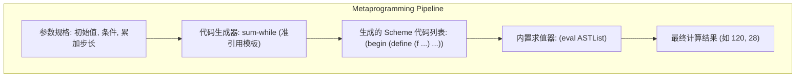

> **课程体系**：UC Berkeley CS61A (Fall 2024)  
> **所属模块**：Module 4: 解释器与 Scheme (Interpreters & Scheme)  
> **主讲教师**：Prof. John DeNero (UC Berkeley)  
> **视频时长**：18:06 ｜ **课堂截图**：16 张板书/代码演示  
> **视频直达**：[📺 在 B 站观看本讲原视频 (P31)](https://www.bilibili.com/video/BV1sy411z7nA/?p=31)  
> **快速导航**：[← 上一讲 (P30 Lecture 32 Tail Calls (Optional))](/notes/cs61a/lecture-30) ｜ [📚 返回全书目录](/notes/topics/CS61A) ｜ [下一讲 (P32 Lecture 34 Macros) →](/notes/cs61a/lecture-32)

---

## 课程核心目标与全景图

在大多数经典编程语言中，程序源代码是冰冷的纯文本字符串，而程序运行时的对象是内存中的数字、列表与字典。源代码与运行数据之间隔着一道编译器与解释器的巨大天堑。

然而在 Lisp 与 Scheme 语言中，存在一个极其震撼人心的核心设计哲学——**同像性（Homoiconicity，即代码即数据）**。
- 一条 Scheme 语句本质上就是一个**Scheme 链表（Pair）**；
- 函数调用的语法不过是包含了操作符符号与操作数元素的标准列表；
- 编写“生成代码的程序”就像操纵普通列表一样简单直接！

本讲深入剖析如何使用 Scheme 的列表操作、**准引用（Quasi-quotation）**机制以及内置的 `eval` 函数，编写能够自动编写、组装并执行其他程序的通用代码生成器。



---

### 深入形式化规约与微观求值流程（Operational Semantics）
在「课程核心目标与全景图」模块中，计算机底层运算依赖于严密的形式化求值逻辑：
1. **抽象语法树（AST）的分层解析**：
   - 源代码字符流首先经过词法分析器（Lexer）切分为终结符标记（Tokens），随后由语法解析器（Parser）构造成多叉语法树；
   - 运算符优先级与结合性在语法树构建阶段即已固化，消除了运行期的二义性；
2. **环境序列的动态跃迁**：
   - 每次函数调用产生的新帧，其静态词法环境由函数对象的 `parent` 属性完全决定；
   - 变量查找沿环境链向上单向回溯，直到全局环境帧，若未找到则触发 `NameError` 异常；
3. **状态不变式（State Invariants）**：
   - 编写健壮程序的关键在于明确循环不变式（Loop Invariants）与函数前后置条件（Pre/Post-conditions）；
   - 在复杂控制流跳转中，确保状态变量在每次迭代前均维持合法的业务约束。


## 1. 代码即数据：同像性原理 (Programs as Data & Homoiconicity)

Scheme 的所有非基础表达式（组合式，Combination）在内存中都是通过标准列表（链表）表示的：

```scheme
;; 构造一个二元除法代码列表
(list 'quotient 10 2) ; => (quotient 10 2)
```

[](https://www.bilibili.com/video/BV1sy411z7nA/?p=31&t=30)
*⏱ 时间戳：00:00:30 · 📷 课堂截图 · [在 B 站观看对应片段 (P31 00:00:30)](https://www.bilibili.com/video/BV1sy411z7nA/?p=31&t=30)*

#### 📸 课堂板书与代码演示深入精读 (00:00:30)

**【现场板书 / 代码演示还原】**：
在此时间节点，DeNero 教授在屏幕上进行了核心演示与重点板书推导：
> *“Programs are data. Scheme programs consist of expressions. Those expressions can either be primitive expressions, just the number 2, 3.3, true, the symbol plus, the symbol quotient. But everything else is a combination, and each combination is a scheme list. So here we have a list containing the sym...”*

**【底层计算模型与微观执行机制】**：
1. **执行上下文与时序追踪**：
   - 处于当前讨论节点「1. 代码即数据：同像性原理 (Programs as Data & Homoiconicity)」，解释器严格遵循核心求值规约；
   - 表达式先求值操作符，随后自左至右严格求值操作数，最终将函数对象施加于实参列表；
   - 若涉及环境模型，局部帧严格记录其静态词法父指针（Parent Pointer 指向函数定义处的环境），与运行时的动态调用栈形成正交架构。
2. **内存拓扑与对象引用**：
   - 变量符号只是哈希表（环境帧）中的键，指针直接指向堆内存中的一等公民对象；
   - 赋值语句是离散时间的瞬时状态快照，绝不会建立隐式的数学依赖监听。

**【避坑指南与高频考点点拨】**：
- **常见思维误区**：在「宏前置概念：将代码作为数据列表进行动态拼接修改」相关考题中，初学者极易根据代码表面形式猜想结果，导致作用域混淆或变量遮蔽（Shadowing）误判；
- **调试排错黄金法则**：遇到嵌套调用与复杂分支时，务必在草稿纸上画出独立的局部帧，标明每个形参的具体绑定值，按部就班推导。


求值该列表并不会立即执行除法，它仅仅生成了一个包含三个元素（符号 `quotient`、数字 `10`、数字 `2`）的普通列表数据。

---

### 深入形式化规约与微观求值流程（Operational Semantics）
在「1. 代码即数据：同像性原理 (Programs as Data & Homoiconicity)」模块中，计算机底层运算依赖于严密的形式化求值逻辑：
1. **抽象语法树（AST）的分层解析**：
   - 源代码字符流首先经过词法分析器（Lexer）切分为终结符标记（Tokens），随后由语法解析器（Parser）构造成多叉语法树；
   - 运算符优先级与结合性在语法树构建阶段即已固化，消除了运行期的二义性；
2. **环境序列的动态跃迁**：
   - 每次函数调用产生的新帧，其静态词法环境由函数对象的 `parent` 属性完全决定；
   - 变量查找沿环境链向上单向回溯，直到全局环境帧，若未找到则触发 `NameError` 异常；
3. **状态不变式（State Invariants）**：
   - 编写健壮程序的关键在于明确循环不变式（Loop Invariants）与函数前后置条件（Pre/Post-conditions）；
   - 在复杂控制流跳转中，确保状态变量在每次迭代前均维持合法的业务约束。


## 2. 内置 `eval`：数据与代码的任意转换 (The `eval` Procedure)

如果一个列表的结构符合合法的 Scheme 语法，我们就可以将其传递给内置的 `eval` 过程：

```scheme
(define expr (list 'quotient 10 2))
(eval expr) ; => 5
```

[](https://www.bilibili.com/video/BV1sy411z7nA/?p=31&t=89)
*⏱ 时间戳：00:01:29 · 📷 课堂截图 · [在 B 站观看对应片段 (P31 00:01:29)](https://www.bilibili.com/video/BV1sy411z7nA/?p=31&t=89)*

#### 📸 课堂板书与代码演示深入精读 (00:01:29)

**【现场板书 / 代码演示还原】**：
在此时间节点，DeNero 教授在屏幕上进行了核心演示与重点板书推导：
> *“A combination that says take the quotient of 10 and 2. Now, notice evaluating this doesn't actually divide 10 by 2. Instead, it just builds a list. But there's a built-in procedure called eval, and eval takes any expression represented as a scheme list or primitive and gives you back its value. So, ...”*

**【底层计算模型与微观执行机制】**：
1. **执行上下文与时序追踪**：
   - 处于当前讨论节点「2. 内置 `eval`：数据与代码的任意转换 (The `eval` Procedure)」，解释器严格遵循核心求值规约；
   - 表达式先求值操作符，随后自左至右严格求值操作数，最终将函数对象施加于实参列表；
   - 若涉及环境模型，局部帧严格记录其静态词法父指针（Parent Pointer 指向函数定义处的环境），与运行时的动态调用栈形成正交架构。
2. **内存拓扑与对象引用**：
   - 变量符号只是哈希表（环境帧）中的键，指针直接指向堆内存中的一等公民对象；
   - 赋值语句是离散时间的瞬时状态快照，绝不会建立隐式的数学依赖监听。

**【避坑指南与高频考点点拨】**：
- **常见思维误区**：在「宏前置概念：将代码作为数据列表进行动态拼接修改」相关考题中，初学者极易根据代码表面形式猜想结果，导致作用域混淆或变量遮蔽（Shadowing）误判；
- **调试排错黄金法则**：遇到嵌套调用与复杂分支时，务必在草稿纸上画出独立的局部帧，标明每个形参的具体绑定值，按部就班推导。


- Python 虽然也有内置的 `eval("10 // 2")`，但 Python 只能解析非结构化的文本字符串；
- Scheme 的独特威力在于：**代码天生就是结构化的链表数据**。你可以使用所有的列表操作函数（`cons`、`car`、`cdr`、`map`、`filter`）任意操纵、组装和变换程序的抽象语法树（AST），然后一键调用 `eval` 执行它！

---

### 深入形式化规约与微观求值流程（Operational Semantics）
在「2. 内置 `eval`：数据与代码的任意转换 (The `eval` Procedure)」模块中，计算机底层运算依赖于严密的形式化求值逻辑：
1. **抽象语法树（AST）的分层解析**：
   - 源代码字符流首先经过词法分析器（Lexer）切分为终结符标记（Tokens），随后由语法解析器（Parser）构造成多叉语法树；
   - 运算符优先级与结合性在语法树构建阶段即已固化，消除了运行期的二义性；
2. **环境序列的动态跃迁**：
   - 每次函数调用产生的新帧，其静态词法环境由函数对象的 `parent` 属性完全决定；
   - 变量查找沿环境链向上单向回溯，直到全局环境帧，若未找到则触发 `NameError` 异常；
3. **状态不变式（State Invariants）**：
   - 编写健壮程序的关键在于明确循环不变式（Loop Invariants）与函数前后置条件（Pre/Post-conditions）；
   - 在复杂控制流跳转中，确保状态变量在每次迭代前均维持合法的业务约束。


## 3. 符号引用与表达式求值机制

在交互式解释器中，我们可以清晰分辨普通表达式求值与构造代码列表的区别：

[](https://www.bilibili.com/video/BV1sy411z7nA/?p=31&t=149)
*⏱ 时间戳：00:02:29 · 📷 课堂截图 · [在 B 站观看对应片段 (P31 00:02:29)](https://www.bilibili.com/video/BV1sy411z7nA/?p=31&t=149)*

#### 📸 课堂板书与代码演示深入精读 (00:02:29)

**【现场板书 / 代码演示还原】**：
在此时间节点，DeNero 教授在屏幕上进行了核心演示与重点板书推导：
> *“Is that it has all this built-in functionality for working with scheme lists, and all the code is just lists. So it's easier to construct programs by writing things like list quotient 10-2. So one of the beautiful things about the scheme language, and this is true of Lisp in general, is that it's st...”*

**【底层计算模型与微观执行机制】**：
1. **执行上下文与时序追踪**：
   - 处于当前讨论节点「3. 符号引用与表达式求值机制」，解释器严格遵循核心求值规约；
   - 表达式先求值操作符，随后自左至右严格求值操作数，最终将函数对象施加于实参列表；
   - 若涉及环境模型，局部帧严格记录其静态词法父指针（Parent Pointer 指向函数定义处的环境），与运行时的动态调用栈形成正交架构。
2. **内存拓扑与对象引用**：
   - 变量符号只是哈希表（环境帧）中的键，指针直接指向堆内存中的一等公民对象；
   - 赋值语句是离散时间的瞬时状态快照，绝不会建立隐式的数学依赖监听。

**【避坑指南与高频考点点拨】**：
- **常见思维误区**：在「宏前置概念：将代码作为数据列表进行动态拼接修改」相关考题中，初学者极易根据代码表面形式猜想结果，导致作用域混淆或变量遮蔽（Shadowing）误判；
- **调试排错黄金法则**：遇到嵌套调用与复杂分支时，务必在草稿纸上画出独立的局部帧，标明每个形参的具体绑定值，按部就班推导。


```scheme
(+ 1 2)         ; => 3 (立即执行加法)
(list '+ 1 2)   ; => (#[primitive:+] 1 2) (直接求值了 + 符号)
(list '+ 1 2)   ; 传递带引用的符号: (list '+ 1 2) => (+ 1 2)
```

只要通过单引号 `'` 阻止操作符被立即求值，它就能以符号形式安全地嵌入到新建的表达式列表中。

---

### 深入形式化规约与微观求值流程（Operational Semantics）
在「3. 符号引用与表达式求值机制」模块中，计算机底层运算依赖于严密的形式化求值逻辑：
1. **抽象语法树（AST）的分层解析**：
   - 源代码字符流首先经过词法分析器（Lexer）切分为终结符标记（Tokens），随后由语法解析器（Parser）构造成多叉语法树；
   - 运算符优先级与结合性在语法树构建阶段即已固化，消除了运行期的二义性；
2. **环境序列的动态跃迁**：
   - 每次函数调用产生的新帧，其静态词法环境由函数对象的 `parent` 属性完全决定；
   - 变量查找沿环境链向上单向回溯，直到全局环境帧，若未找到则触发 `NameError` 异常；
3. **状态不变式（State Invariants）**：
   - 编写健壮程序的关键在于明确循环不变式（Loop Invariants）与函数前后置条件（Pre/Post-conditions）；
   - 在复杂控制流跳转中，确保状态变量在每次迭代前均维持合法的业务约束。


## 4. 计算数值 vs 生成表达式：阶乘的两种视角

考虑经典的递归阶乘函数。我们不仅可以编写返回计算结果数值的函数，还可以编写**返回完整计算表达式树**的元程序：

```scheme
;; 常规版本：返回数值 120
(define (fact n)
  (if (zero? n)
      1
      (* n (fact (- n 1)))))

;; 元编程版本：返回计算表达式树
(define (fact-exp n)
  (if (zero? n)
      1
      (list '* n (fact-exp (- n 1)))))
```

[](https://www.bilibili.com/video/BV1sy411z7nA/?p=31&t=237)
*⏱ 时间戳：00:03:57 · 📷 课堂截图 · [在 B 站观看对应片段 (P31 00:03:57)](https://www.bilibili.com/video/BV1sy411z7nA/?p=31&t=237)*

#### 📸 课堂板书与代码演示深入精读 (00:03:57)

**【现场板书 / 代码演示还原】**：
在此时间节点，DeNero 教授在屏幕上进行了核心演示与重点板书推导：
> *“Where this part had been evaluated already, because it's just part of Scheme, and Scheme evaluates the operator and its operands, and gives me back an expression that's already computed the 5, but hasn't computed the 6 yet. Okay, now let's load this small program on the right. Fact is a procedure th...”*

**【底层计算模型与微观执行机制】**：
1. **执行上下文与时序追踪**：
   - 处于当前讨论节点「4. 计算数值 vs 生成表达式：阶乘的两种视角」，解释器严格遵循核心求值规约；
   - 表达式先求值操作符，随后自左至右严格求值操作数，最终将函数对象施加于实参列表；
   - 若涉及环境模型，局部帧严格记录其静态词法父指针（Parent Pointer 指向函数定义处的环境），与运行时的动态调用栈形成正交架构。
2. **内存拓扑与对象引用**：
   - 变量符号只是哈希表（环境帧）中的键，指针直接指向堆内存中的一等公民对象；
   - 赋值语句是离散时间的瞬时状态快照，绝不会建立隐式的数学依赖监听。

**【避坑指南与高频考点点拨】**：
- **常见思维误区**：在「宏前置概念：将代码作为数据列表进行动态拼接修改」相关考题中，初学者极易根据代码表面形式猜想结果，导致作用域混淆或变量遮蔽（Shadowing）误判；
- **调试排错黄金法则**：遇到嵌套调用与复杂分支时，务必在草稿纸上画出独立的局部帧，标明每个形参的具体绑定值，按部就班推导。


运行测试对比：
```scheme
(fact 5)     ; => 120
(fact-exp 5) ; => (* 5 (* 4 (* 3 (* 2 (* 1 1)))))
```

[](https://www.bilibili.com/video/BV1sy411z7nA/?p=31&t=297)
*⏱ 时间戳：00:04:57 · 📷 课堂截图 · [在 B 站观看对应片段 (P31 00:04:57)](https://www.bilibili.com/video/BV1sy411z7nA/?p=31&t=297)*

#### 📸 课堂板书与代码演示深入精读 (00:04:57)

**【现场板书 / 代码演示还原】**：
在此时间节点，DeNero 教授在屏幕上进行了核心演示与重点板书推导：
> *“So, this variant, called fact x, doesn't have the job of returning a number. Instead, it has the job of returning an expression. One is an expression, a perfectly good way of representing the number one. If I want to build an expression out of smaller expressions, I need a list. A list containing mu...”*

**【底层计算模型与微观执行机制】**：
1. **执行上下文与时序追踪**：
   - 处于当前讨论节点「4. 计算数值 vs 生成表达式：阶乘的两种视角」，解释器严格遵循核心求值规约；
   - 表达式先求值操作符，随后自左至右严格求值操作数，最终将函数对象施加于实参列表；
   - 若涉及环境模型，局部帧严格记录其静态词法父指针（Parent Pointer 指向函数定义处的环境），与运行时的动态调用栈形成正交架构。
2. **内存拓扑与对象引用**：
   - 变量符号只是哈希表（环境帧）中的键，指针直接指向堆内存中的一等公民对象；
   - 赋值语句是离散时间的瞬时状态快照，绝不会建立隐式的数学依赖监听。

**【避坑指南与高频考点点拨】**：
- **常见思维误区**：在「宏前置概念：将代码作为数据列表进行动态拼接修改」相关考题中，初学者极易根据代码表面形式猜想结果，导致作用域混淆或变量遮蔽（Shadowing）误判；
- **调试排错黄金法则**：遇到嵌套调用与复杂分支时，务必在草稿纸上画出独立的局部帧，标明每个形参的具体绑定值，按部就班推导。


生成的表达式直观呈现了阶乘递归展开的完整计算全貌！如果对该表达式调用 `(eval (fact-exp 5))`，即可立即得到 `120`。

---

### 深入形式化规约与微观求值流程（Operational Semantics）
在「4. 计算数值 vs 生成表达式：阶乘的两种视角」模块中，计算机底层运算依赖于严密的形式化求值逻辑：
1. **抽象语法树（AST）的分层解析**：
   - 源代码字符流首先经过词法分析器（Lexer）切分为终结符标记（Tokens），随后由语法解析器（Parser）构造成多叉语法树；
   - 运算符优先级与结合性在语法树构建阶段即已固化，消除了运行期的二义性；
2. **环境序列的动态跃迁**：
   - 每次函数调用产生的新帧，其静态词法环境由函数对象的 `parent` 属性完全决定；
   - 变量查找沿环境链向上单向回溯，直到全局环境帧，若未找到则触发 `NameError` 异常；
3. **状态不变式（State Invariants）**：
   - 编写健壮程序的关键在于明确循环不变式（Loop Invariants）与函数前后置条件（Pre/Post-conditions）；
   - 在复杂控制流跳转中，确保状态变量在每次迭代前均维持合法的业务约束。


## 5. 树递归表达式展开：斐波那契数列

同样的技巧可以应用于树形递归。我们可以编写 `fib-exp` 来可视化斐波那契数的加法展开树：

```scheme
(define (fib-exp n)
  (if (<= n 1)
      n
      (list '+ (fib-exp (- n 2)) (fib-exp (- n 1)))))
```

[](https://www.bilibili.com/video/BV1sy411z7nA/?p=31&t=360)
*⏱ 时间戳：00:06:00 · 📷 课堂截图 · [在 B 站观看对应片段 (P31 00:06:00)](https://www.bilibili.com/video/BV1sy411z7nA/?p=31&t=360)*

#### 📸 课堂板书与代码演示深入精读 (00:06:00)

**【现场板书 / 代码演示还原】**：
在此时间节点，DeNero 教授在屏幕上进行了核心演示与重点板书推导：
> *“Fibonacci number n. If it's the case that n is 0 or 1, any number less than or equal to 1, then fib n is just n. Otherwise, I have to add together the two previous Fibonacci numbers, fib n minus 2 and fib n minus 1. So, Fibonacci number 2 is 1, Fibonacci number 6 is 8. How did it compute 8 while usi...”*

**【底层计算模型与微观执行机制】**：
1. **执行上下文与时序追踪**：
   - 处于当前讨论节点「5. 树递归表达式展开：斐波那契数列」，解释器严格遵循核心求值规约；
   - 表达式先求值操作符，随后自左至右严格求值操作数，最终将函数对象施加于实参列表；
   - 若涉及环境模型，局部帧严格记录其静态词法父指针（Parent Pointer 指向函数定义处的环境），与运行时的动态调用栈形成正交架构。
2. **内存拓扑与对象引用**：
   - 变量符号只是哈希表（环境帧）中的键，指针直接指向堆内存中的一等公民对象；
   - 赋值语句是离散时间的瞬时状态快照，绝不会建立隐式的数学依赖监听。

**【避坑指南与高频考点点拨】**：
- **常见思维误区**：在「宏前置概念：将代码作为数据列表进行动态拼接修改」相关考题中，初学者极易根据代码表面形式猜想结果，导致作用域混淆或变量遮蔽（Shadowing）误判；
- **调试排错黄金法则**：遇到嵌套调用与复杂分支时，务必在草稿纸上画出独立的局部帧，标明每个形参的具体绑定值，按部就班推导。


[](https://www.bilibili.com/video/BV1sy411z7nA/?p=31&t=421)
*⏱ 时间戳：00:07:01 · 📷 课堂截图 · [在 B 站观看对应片段 (P31 00:07:01)](https://www.bilibili.com/video/BV1sy411z7nA/?p=31&t=421)*

#### 📸 课堂板书与代码演示深入精读 (00:07:01)

**【现场板书 / 代码演示还原】**：
在此时间节点，DeNero 教授在屏幕上进行了核心演示与重点板书推导：
> *“Applying that to the result of two smaller expressions that compute fib N minus 2 and fib N minus 1. So, fib 6 is still 8, but the expression that computes fib 6 is that I add together fib 4 and fib 5, where fib 4 is an expression that looks like that. And here is the expression for fib 5. Now, if I...”*

**【底层计算模型与微观执行机制】**：
1. **执行上下文与时序追踪**：
   - 处于当前讨论节点「5. 树递归表达式展开：斐波那契数列」，解释器严格遵循核心求值规约；
   - 表达式先求值操作符，随后自左至右严格求值操作数，最终将函数对象施加于实参列表；
   - 若涉及环境模型，局部帧严格记录其静态词法父指针（Parent Pointer 指向函数定义处的环境），与运行时的动态调用栈形成正交架构。
2. **内存拓扑与对象引用**：
   - 变量符号只是哈希表（环境帧）中的键，指针直接指向堆内存中的一等公民对象；
   - 赋值语句是离散时间的瞬时状态快照，绝不会建立隐式的数学依赖监听。

**【避坑指南与高频考点点拨】**：
- **常见思维误区**：在「宏前置概念：将代码作为数据列表进行动态拼接修改」相关考题中，初学者极易根据代码表面形式猜想结果，导致作用域混淆或变量遮蔽（Shadowing）误判；
- **调试排错黄金法则**：遇到嵌套调用与复杂分支时，务必在草稿纸上画出独立的局部帧，标明每个形参的具体绑定值，按部就班推导。


执行 `(fib-exp 6)` 会生成一个由 `+` 与基线数值 `0`、`1` 组成的庞大嵌套列表；而对其求值 `(eval (fib-exp 6))` 则精确得到 Fibonacci 第 6 项的值 `8`。

---

### 深入形式化规约与微观求值流程（Operational Semantics）
在「5. 树递归表达式展开：斐波那契数列」模块中，计算机底层运算依赖于严密的形式化求值逻辑：
1. **抽象语法树（AST）的分层解析**：
   - 源代码字符流首先经过词法分析器（Lexer）切分为终结符标记（Tokens），随后由语法解析器（Parser）构造成多叉语法树；
   - 运算符优先级与结合性在语法树构建阶段即已固化，消除了运行期的二义性；
2. **环境序列的动态跃迁**：
   - 每次函数调用产生的新帧，其静态词法环境由函数对象的 `parent` 属性完全决定；
   - 变量查找沿环境链向上单向回溯，直到全局环境帧，若未找到则触发 `NameError` 异常；
3. **状态不变式（State Invariants）**：
   - 编写健壮程序的关键在于明确循环不变式（Loop Invariants）与函数前后置条件（Pre/Post-conditions）；
   - 在复杂控制流跳转中，确保状态变量在每次迭代前均维持合法的业务约束。


## 6. 准引用语法：Backtick 与 Unquote (Quasi-quotation)

手动使用 `list` 和 `'` 拼接复杂代码极易引发括号混乱。为此，Scheme 提供了强大的模板语法——**准引用（Quasi-quotation）**：

| 语法符号 | 名称 | 语义 |
| :--- | :--- | :--- |
| **反引号 \`** | Quasi-quote (准引用) | 类似于普通单引号引用，但允许内部进行局部求值插入 |
| **逗号 ,** | Unquote (解引用) | 仅在准引用内部有效，强制解释器对其后面的子表达式进行即时求值并替换 |

[](https://www.bilibili.com/video/BV1sy411z7nA/?p=31&t=481)
*⏱ 时间戳：00:08:01 · 📷 课堂截图 · [在 B 站观看对应片段 (P31 00:08:01)](https://www.bilibili.com/video/BV1sy411z7nA/?p=31&t=481)*

#### 📸 课堂板书与代码演示深入精读 (00:08:01)

**【现场板书 / 代码演示还原】**：
在此时间节点，DeNero 教授在屏幕上进行了核心演示与重点板书推导：
> *“You could actually write a program that generates programs. Before we do that, I'm going to teach you one more feature called quasi-quotation, which is a lot like the quotation you already know, but there's an important difference, which is that you can unquote parts of a quoted expression. So there...”*

**【底层计算模型与微观执行机制】**：
1. **执行上下文与时序追踪**：
   - 处于当前讨论节点「6. 准引用语法：Backtick 与 Unquote (Quasi-quotation)」，解释器严格遵循核心求值规约；
   - 表达式先求值操作符，随后自左至右严格求值操作数，最终将函数对象施加于实参列表；
   - 若涉及环境模型，局部帧严格记录其静态词法父指针（Parent Pointer 指向函数定义处的环境），与运行时的动态调用栈形成正交架构。
2. **内存拓扑与对象引用**：
   - 变量符号只是哈希表（环境帧）中的键，指针直接指向堆内存中的一等公民对象；
   - 赋值语句是离散时间的瞬时状态快照，绝不会建立隐式的数学依赖监听。

**【避坑指南与高频考点点拨】**：
- **常见思维误区**：在「宏前置概念：将代码作为数据列表进行动态拼接修改」相关考题中，初学者极易根据代码表面形式猜想结果，导致作用域混淆或变量遮蔽（Shadowing）误判；
- **调试排错黄金法则**：遇到嵌套调用与复杂分支时，务必在草稿纸上画出独立的局部帧，标明每个形参的具体绑定值，按部就班推导。


### 静态引用 vs 准引用对比

假设先在环境中绑定 `(define b 4)`：

```scheme
'(a (+ b 1))  ; => (a (+ b 1)) (全部视为字面符号，不求值)
`(a ,(+ b 1)) ; => (a 5)       (a 保持字面符号，(+ b 1) 被动态求值替换为 5!)
```

[](https://www.bilibili.com/video/BV1sy411z7nA/?p=31&t=566)
*⏱ 时间戳：00:09:26 · 📷 课堂截图 · [在 B 站观看对应片段 (P31 00:09:26)](https://www.bilibili.com/video/BV1sy411z7nA/?p=31&t=566)*

#### 📸 课堂板书与代码演示深入精读 (00:09:26)

**【现场板书 / 代码演示还原】**：
在此时间节点，DeNero 教授在屏幕上进行了核心演示与重点板书推导：
> *“So here we have a list within a list within a list. But writing the same expression started with a quasi-quote will give me something that I think is more useful, a list A5, where 5 is the value of evaluating the expression B plus 1. Why did this expression get evaluated, whereas A did not? Because ...”*

**【底层计算模型与微观执行机制】**：
1. **执行上下文与时序追踪**：
   - 处于当前讨论节点「6. 准引用语法：Backtick 与 Unquote (Quasi-quotation)」，解释器严格遵循核心求值规约；
   - 表达式先求值操作符，随后自左至右严格求值操作数，最终将函数对象施加于实参列表；
   - 若涉及环境模型，局部帧严格记录其静态词法父指针（Parent Pointer 指向函数定义处的环境），与运行时的动态调用栈形成正交架构。
2. **内存拓扑与对象引用**：
   - 变量符号只是哈希表（环境帧）中的键，指针直接指向堆内存中的一等公民对象；
   - 赋值语句是离散时间的瞬时状态快照，绝不会建立隐式的数学依赖监听。

**【避坑指南与高频考点点拨】**：
- **常见思维误区**：在「宏前置概念：将代码作为数据列表进行动态拼接修改」相关考题中，初学者极易根据代码表面形式猜想结果，导致作用域混淆或变量遮蔽（Shadowing）误判；
- **调试排错黄金法则**：遇到嵌套调用与复杂分支时，务必在草稿纸上画出独立的局部帧，标明每个形参的具体绑定值，按部就班推导。


### 代码模板工厂：`make-add-procedure`

利用准引用，我们可以动态生成特定参数的函数定义代码：

```scheme
(define (make-add-procedure n)
  `(lambda (d) (+ d ,n)))

(make-add-procedure 2) ; => (lambda (d) (+ d 2))
```

[](https://www.bilibili.com/video/BV1sy411z7nA/?p=31&t=654)
*⏱ 时间戳：00:10:54 · 📷 课堂截图 · [在 B 站观看对应片段 (P31 00:10:54)](https://www.bilibili.com/video/BV1sy411z7nA/?p=31&t=654)*

#### 📸 课堂板书与代码演示深入精读 (00:10:54)

**【现场板书 / 代码演示还原】**：
在此时间节点，DeNero 教授在屏幕上进行了核心演示与重点板书推导：
> *“That says lambda D plus Dn for whatever n is. And then I call make add procedure on 2. What I get back is a list. A list whose first element is the symbol lambda. Second element is a list containing just one element D. And the third is a list containing the symbol plus the symbol D and the number 2....”*

**【底层计算模型与微观执行机制】**：
1. **执行上下文与时序追踪**：
   - 处于当前讨论节点「6. 准引用语法：Backtick 与 Unquote (Quasi-quotation)」，解释器严格遵循核心求值规约；
   - 表达式先求值操作符，随后自左至右严格求值操作数，最终将函数对象施加于实参列表；
   - 若涉及环境模型，局部帧严格记录其静态词法父指针（Parent Pointer 指向函数定义处的环境），与运行时的动态调用栈形成正交架构。
2. **内存拓扑与对象引用**：
   - 变量符号只是哈希表（环境帧）中的键，指针直接指向堆内存中的一等公民对象；
   - 赋值语句是离散时间的瞬时状态快照，绝不会建立隐式的数学依赖监听。

**【避坑指南与高频考点点拨】**：
- **常见思维误区**：在「宏前置概念：将代码作为数据列表进行动态拼接修改」相关考题中，初学者极易根据代码表面形式猜想结果，导致作用域混淆或变量遮蔽（Shadowing）误判；
- **调试排错黄金法则**：遇到嵌套调用与复杂分支时，务必在草稿纸上画出独立的局部帧，标明每个形参的具体绑定值，按部就班推导。


这里的参数 `n` 在代码生成阶段被精确替换为常数 `2`，从而生成了一个专用的单参数自增过程源代码！

---

### 深入形式化规约与微观求值流程（Operational Semantics）
在「6. 准引用语法：Backtick 与 Unquote (Quasi-quotation)」模块中，计算机底层运算依赖于严密的形式化求值逻辑：
1. **抽象语法树（AST）的分层解析**：
   - 源代码字符流首先经过词法分析器（Lexer）切分为终结符标记（Tokens），随后由语法解析器（Parser）构造成多叉语法树；
   - 运算符优先级与结合性在语法树构建阶段即已固化，消除了运行期的二义性；
2. **环境序列的动态跃迁**：
   - 每次函数调用产生的新帧，其静态词法环境由函数对象的 `parent` 属性完全决定；
   - 变量查找沿环境链向上单向回溯，直到全局环境帧，若未找到则触发 `NameError` 异常；
3. **状态不变式（State Invariants）**：
   - 编写健壮程序的关键在于明确循环不变式（Loop Invariants）与函数前后置条件（Pre/Post-conditions）；
   - 在复杂控制流跳转中，确保状态变量在每次迭代前均维持合法的业务约束。


## 7. 实践挑战：用代码生成填补语言特性缺失 (Simulating While Loops)

Scheme 语言为了保持极简内核，没有提供 `while` 循环语句。假设我们需要计算前几个偶数的平方和：

```python
# Python 原生写法
x, total = 2, 0
while x < 10:
    total += x * x
    x += 2
# total => 120
```

[](https://www.bilibili.com/video/BV1sy411z7nA/?p=31&t=713)
*⏱ 时间戳：00:11:53 · 📷 课堂截图 · [在 B 站观看对应片段 (P31 00:11:53)](https://www.bilibili.com/video/BV1sy411z7nA/?p=31&t=713)*

#### 📸 课堂板书与代码演示深入精读 (00:11:53)

**【现场板书 / 代码演示还原】**：
在此时间节点，DeNero 教授在屏幕上进行了核心演示与重点板书推导：
> *“OK, let's do a longer example. While statements. Well, in Scheme, there aren't a while statements. But while statements are awfully convenient, like let's say you wanted to know what's the sum of the squares of even numbers less than 10, starting with 2. So 2 squared plus 4 squared plus 6 squared pl...”*

**【底层计算模型与微观执行机制】**：
1. **执行上下文与时序追踪**：
   - 处于当前讨论节点「7. 实践挑战：用代码生成填补语言特性缺失 (Simulating While Loops)」，解释器严格遵循核心求值规约；
   - 表达式先求值操作符，随后自左至右严格求值操作数，最终将函数对象施加于实参列表；
   - 若涉及环境模型，局部帧严格记录其静态词法父指针（Parent Pointer 指向函数定义处的环境），与运行时的动态调用栈形成正交架构。
2. **内存拓扑与对象引用**：
   - 变量符号只是哈希表（环境帧）中的键，指针直接指向堆内存中的一等公民对象；
   - 赋值语句是离散时间的瞬时状态快照，绝不会建立隐式的数学依赖监听。

**【避坑指南与高频考点点拨】**：
- **常见思维误区**：在「宏前置概念：将代码作为数据列表进行动态拼接修改」相关考题中，初学者极易根据代码表面形式猜想结果，导致作用域混淆或变量遮蔽（Shadowing）误判；
- **调试排错黄金法则**：遇到嵌套调用与复杂分支时，务必在草稿纸上画出独立的局部帧，标明每个形参的具体绑定值，按部就班推导。


在 Scheme 中，程序员每次都需要手工编写繁琐的尾递归辅助函数：

```scheme
(define (f x total)
  (if (< x 10)
      (f (+ x 2) (+ total (* x x)))
      total))
(f 2 0) ; => 120
```

如果我们有成百上千个不同的循环计算需求，每次都手写递归极其冗长乏味。能否让 Scheme 自动为我们生成并执行这段样板代码？

[](https://www.bilibili.com/video/BV1sy411z7nA/?p=31&t=801)
*⏱ 时间戳：00:13:21 · 📷 课堂截图 · [在 B 站观看对应片段 (P31 00:13:21)](https://www.bilibili.com/video/BV1sy411z7nA/?p=31&t=801)*

#### 📸 课堂板书与代码演示深入精读 (00:13:21)

**【现场板书 / 代码演示还原】**：
在此时间节点，DeNero 教授在屏幕上进行了核心演示与重点板书推导：
> *“And now I've written two expressions instead of one. If I wanted to fit it all into one expression, I would need to use begin. Okay, so it can be done in Python. It can be done in Scheme. I find the Python easier to read. There's nothing inherently recursive about this expression. It just happens to...”*

**【底层计算模型与微观执行机制】**：
1. **执行上下文与时序追踪**：
   - 处于当前讨论节点「7. 实践挑战：用代码生成填补语言特性缺失 (Simulating While Loops)」，解释器严格遵循核心求值规约；
   - 表达式先求值操作符，随后自左至右严格求值操作数，最终将函数对象施加于实参列表；
   - 若涉及环境模型，局部帧严格记录其静态词法父指针（Parent Pointer 指向函数定义处的环境），与运行时的动态调用栈形成正交架构。
2. **内存拓扑与对象引用**：
   - 变量符号只是哈希表（环境帧）中的键，指针直接指向堆内存中的一等公民对象；
   - 赋值语句是离散时间的瞬时状态快照，绝不会建立隐式的数学依赖监听。

**【避坑指南与高频考点点拨】**：
- **常见思维误区**：在「宏前置概念：将代码作为数据列表进行动态拼接修改」相关考题中，初学者极易根据代码表面形式猜想结果，导致作用域混淆或变量遮蔽（Shadowing）误判；
- **调试排错黄金法则**：遇到嵌套调用与复杂分支时，务必在草稿纸上画出独立的局部帧，标明每个形参的具体绑定值，按部就班推导。


---

### 深入形式化规约与微观求值流程（Operational Semantics）
在「7. 实践挑战：用代码生成填补语言特性缺失 (Simulating While Loops)」模块中，计算机底层运算依赖于严密的形式化求值逻辑：
1. **抽象语法树（AST）的分层解析**：
   - 源代码字符流首先经过词法分析器（Lexer）切分为终结符标记（Tokens），随后由语法解析器（Parser）构造成多叉语法树；
   - 运算符优先级与结合性在语法树构建阶段即已固化，消除了运行期的二义性；
2. **环境序列的动态跃迁**：
   - 每次函数调用产生的新帧，其静态词法环境由函数对象的 `parent` 属性完全决定；
   - 变量查找沿环境链向上单向回溯，直到全局环境帧，若未找到则触发 `NameError` 异常；
3. **状态不变式（State Invariants）**：
   - 编写健壮程序的关键在于明确循环不变式（Loop Invariants）与函数前后置条件（Pre/Post-conditions）；
   - 在复杂控制流跳转中，确保状态变量在每次迭代前均维持合法的业务约束。


## 8. 通用循环代码生成器：`sum-while`

通过准引用模板，我们可以编写一个通用的 `sum-while` 元过程：

```scheme
(define (sum-while initial-x condition add-term update-x)
  `(begin
     (define (f x total)
       (if ,condition
           (f ,update-x (+ total ,add-term))
           total))
     (f ,initial-x 0)))
```

[](https://www.bilibili.com/video/BV1sy411z7nA/?p=31&t=861)
*⏱ 时间戳：00:14:21 · 📷 课堂截图 · [在 B 站观看对应片段 (P31 00:14:21)](https://www.bilibili.com/video/BV1sy411z7nA/?p=31&t=861)*

#### 📸 课堂板书与代码演示深入精读 (00:14:21)

**【现场板书 / 代码演示还原】**：
在此时间节点，DeNero 教授在屏幕上进行了核心演示与重点板书推导：
> *“Wouldn't it be nice if you could just get schemed to write this whole thing for you? Well, that's exactly what you could do. So I'm going to start us off with that example that you just saw of summing numbers whose square is less than 50, starting with 1. But I want to be able to define a procedure ...”*

**【底层计算模型与微观执行机制】**：
1. **执行上下文与时序追踪**：
   - 处于当前讨论节点「8. 通用循环代码生成器：`sum-while`」，解释器严格遵循核心求值规约；
   - 表达式先求值操作符，随后自左至右严格求值操作数，最终将函数对象施加于实参列表；
   - 若涉及环境模型，局部帧严格记录其静态词法父指针（Parent Pointer 指向函数定义处的环境），与运行时的动态调用栈形成正交架构。
2. **内存拓扑与对象引用**：
   - 变量符号只是哈希表（环境帧）中的键，指针直接指向堆内存中的一等公民对象；
   - 赋值语句是离散时间的瞬时状态快照，绝不会建立隐式的数学依赖监听。

**【避坑指南与高频考点点拨】**：
- **常见思维误区**：在「宏前置概念：将代码作为数据列表进行动态拼接修改」相关考题中，初学者极易根据代码表面形式猜想结果，导致作用域混淆或变量遮蔽（Shadowing）误判；
- **调试排错黄金法则**：遇到嵌套调用与复杂分支时，务必在草稿纸上画出独立的局部帧，标明每个形参的具体绑定值，按部就班推导。


[](https://www.bilibili.com/video/BV1sy411z7nA/?p=31&t=948)
*⏱ 时间戳：00:15:48 · 📷 课堂截图 · [在 B 站观看对应片段 (P31 00:15:48)](https://www.bilibili.com/video/BV1sy411z7nA/?p=31&t=948)*

#### 📸 课堂板书与代码演示深入精读 (00:15:48)

**【现场板书 / 代码演示还原】**：
在此时间节点，DeNero 教授在屏幕上进行了核心演示与重点板书推导：
> *“The reason I unquote this is that I don't want the symbol condition in the result. I want whatever's passed in this expression in the result. Likewise, I want this expression as what we update X with. So I'll unquote and write update X. I always want to add something to total, but what it is depends...”*

**【底层计算模型与微观执行机制】**：
1. **执行上下文与时序追踪**：
   - 处于当前讨论节点「8. 通用循环代码生成器：`sum-while`」，解释器严格遵循核心求值规约；
   - 表达式先求值操作符，随后自左至右严格求值操作数，最终将函数对象施加于实参列表；
   - 若涉及环境模型，局部帧严格记录其静态词法父指针（Parent Pointer 指向函数定义处的环境），与运行时的动态调用栈形成正交架构。
2. **内存拓扑与对象引用**：
   - 变量符号只是哈希表（环境帧）中的键，指针直接指向堆内存中的一等公民对象；
   - 赋值语句是离散时间的瞬时状态快照，绝不会建立隐式的数学依赖监听。

**【避坑指南与高频考点点拨】**：
- **常见思维误区**：在「宏前置概念：将代码作为数据列表进行动态拼接修改」相关考题中，初学者极易根据代码表面形式猜想结果，导致作用域混淆或变量遮蔽（Shadowing）误判；
- **调试排错黄金法则**：遇到嵌套调用与复杂分支时，务必在草稿纸上画出独立的局部帧，标明每个形参的具体绑定值，按部就班推导。


### 代码生成与动态求值运行

测试 1：计算 $1 + 2 + \dots + 7 = 28$（在 $x^2 < 50$ 范围内的整数和）：
```scheme
(define code (sum-while 1 '(< (* x x) 50) 'x '(+ x 1)))
(eval code) ; => 28
```

测试 2：计算偶数平方和 $2^2 + 4^2 + 6^2 + 8^2 = 120$：
```scheme
(define code2 (sum-while 2 '(< x 10) '(* x x) '(+ x 2)))
(eval code2) ; => 120
```

[](https://www.bilibili.com/video/BV1sy411z7nA/?p=31&t=1008)
*⏱ 时间戳：00:16:48 · 📷 课堂截图 · [在 B 站观看对应片段 (P31 00:16:48)](https://www.bilibili.com/video/BV1sy411z7nA/?p=31&t=1008)*

#### 📸 课堂板书与代码演示深入精读 (00:16:48)

**【现场板书 / 代码演示还原】**：
在此时间节点，DeNero 教授在屏幕上进行了核心演示与重点板书推导：
> *“But I still need to close the parenthesis for the procedure that I'm defining. Okay, I've rearranged a bit so that I can load this file and make this call. And look what it did. It built for me something. Let's give this thing a name. Result of evaluating this expression. This result is a list. It b...”*

**【底层计算模型与微观执行机制】**：
1. **执行上下文与时序追踪**：
   - 处于当前讨论节点「8. 通用循环代码生成器：`sum-while`」，解释器严格遵循核心求值规约；
   - 表达式先求值操作符，随后自左至右严格求值操作数，最终将函数对象施加于实参列表；
   - 若涉及环境模型，局部帧严格记录其静态词法父指针（Parent Pointer 指向函数定义处的环境），与运行时的动态调用栈形成正交架构。
2. **内存拓扑与对象引用**：
   - 变量符号只是哈希表（环境帧）中的键，指针直接指向堆内存中的一等公民对象；
   - 赋值语句是离散时间的瞬时状态快照，绝不会建立隐式的数学依赖监听。

**【避坑指南与高频考点点拨】**：
- **常见思维误区**：在「宏前置概念：将代码作为数据列表进行动态拼接修改」相关考题中，初学者极易根据代码表面形式猜想结果，导致作用域混淆或变量遮蔽（Shadowing）误判；
- **调试排错黄金法则**：遇到嵌套调用与复杂分支时，务必在草稿纸上画出独立的局部帧，标明每个形参的具体绑定值，按部就班推导。


解释器接收 `sum-while` 生成的列表代码结构，使用 `eval` 动态定义局部尾递归函数 `f` 并发起初始调用，最终精确返回 `120`！

---

### 深入形式化规约与微观求值流程（Operational Semantics）
在「8. 通用循环代码生成器：`sum-while`」模块中，计算机底层运算依赖于严密的形式化求值逻辑：
1. **抽象语法树（AST）的分层解析**：
   - 源代码字符流首先经过词法分析器（Lexer）切分为终结符标记（Tokens），随后由语法解析器（Parser）构造成多叉语法树；
   - 运算符优先级与结合性在语法树构建阶段即已固化，消除了运行期的二义性；
2. **环境序列的动态跃迁**：
   - 每次函数调用产生的新帧，其静态词法环境由函数对象的 `parent` 属性完全决定；
   - 变量查找沿环境链向上单向回溯，直到全局环境帧，若未找到则触发 `NameError` 异常；
3. **状态不变式（State Invariants）**：
   - 编写健壮程序的关键在于明确循环不变式（Loop Invariants）与函数前后置条件（Pre/Post-conditions）；
   - 在复杂控制流跳转中，确保状态变量在每次迭代前均维持合法的业务约束。


## 9. 总结：元编程的无上威力 (The Power of Metaprogramming)

Lisp 与 Scheme 之所以在计算机科学史上占据神圣地位，正是源于这种“能够编写程序的程序”的终极表现力。

[](https://www.bilibili.com/video/BV1sy411z7nA/?p=31&t=1070)
*⏱ 时间戳：00:17:50 · 📷 课堂截图 · [在 B 站观看对应片段 (P31 00:17:50)](https://www.bilibili.com/video/BV1sy411z7nA/?p=31&t=1070)*

#### 📸 课堂板书与代码演示深入精读 (00:17:50)

**【现场板书 / 代码演示还原】**：
在此时间节点，DeNero 教授在屏幕上进行了核心演示与重点板书推导：
> *“What I add to total in this case is not x, but x squared, and I update x to go to the next even number. This should give me 2 squared plus 4 squared plus 6 squared plus 8 squared is 120. And the way that it did it was to actually produce the code that results in 120, including defining a new recursi...”*

**【底层计算模型与微观执行机制】**：
1. **执行上下文与时序追踪**：
   - 处于当前讨论节点「9. 总结：元编程的无上威力 (The Power of Metaprogramming)」，解释器严格遵循核心求值规约；
   - 表达式先求值操作符，随后自左至右严格求值操作数，最终将函数对象施加于实参列表；
   - 若涉及环境模型，局部帧严格记录其静态词法父指针（Parent Pointer 指向函数定义处的环境），与运行时的动态调用栈形成正交架构。
2. **内存拓扑与对象引用**：
   - 变量符号只是哈希表（环境帧）中的键，指针直接指向堆内存中的一等公民对象；
   - 赋值语句是离散时间的瞬时状态快照，绝不会建立隐式的数学依赖监听。

**【避坑指南与高频考点点拨】**：
- **常见思维误区**：在「宏前置概念：将代码作为数据列表进行动态拼接修改」相关考题中，初学者极易根据代码表面形式猜想结果，导致作用域混淆或变量遮蔽（Shadowing）误判；
- **调试排错黄金法则**：遇到嵌套调用与复杂分支时，务必在草稿纸上画出独立的局部帧，标明每个形参的具体绑定值，按部就班推导。


- 程序可以像处理普通数据一样审视自身、重构自身、生成新的抽象；
- 这种代码生成模式正是下一讲宏（**Macros**）的基础；
- 它将程序员从机械的重复劳动中彻底解放，赋予了我们在已有语言中创造新语言构造的造物主能力。

---

### 深入形式化规约与微观求值流程（Operational Semantics）
在「9. 总结：元编程的无上威力 (The Power of Metaprogramming)」模块中，计算机底层运算依赖于严密的形式化求值逻辑：
1. **抽象语法树（AST）的分层解析**：
   - 源代码字符流首先经过词法分析器（Lexer）切分为终结符标记（Tokens），随后由语法解析器（Parser）构造成多叉语法树；
   - 运算符优先级与结合性在语法树构建阶段即已固化，消除了运行期的二义性；
2. **环境序列的动态跃迁**：
   - 每次函数调用产生的新帧，其静态词法环境由函数对象的 `parent` 属性完全决定；
   - 变量查找沿环境链向上单向回溯，直到全局环境帧，若未找到则触发 `NameError` 异常；
3. **状态不变式（State Invariants）**：
   - 编写健壮程序的关键在于明确循环不变式（Loop Invariants）与函数前后置条件（Pre/Post-conditions）；
   - 在复杂控制流跳转中，确保状态变量在每次迭代前均维持合法的业务约束。


## 关键知识点速查

| 概念 | 核心功能与语法 | 典型使用场景 |
| :--- | :--- | :--- |
| **代码即数据 (Homoiconicity)** | 组合式即 Scheme 链表数据 | 允许直接使用链表操作函数构建与分析 AST |
| **`eval` 过程** | `(eval expr)` | 执行动态构建或生成的 Scheme 列表表达式 |
| **准引用 (Quasi-quote)** | 语法符号 \` | 声明一个允许局部动态插值的代码模板 |
| **解引用 (Unquote)** | 语法符号 `,` | 在模板中强行求值指定子表达式并将结果填入 |
| **代码生成 (Code Generation)** | 接受参数生成语法树 | 自动消除样板递归代码，构建高级语法结构 |

### 深入形式化规约与微观求值流程（Operational Semantics）
在「关键知识点速查」模块中，计算机底层运算依赖于严密的形式化求值逻辑：
1. **抽象语法树（AST）的分层解析**：
   - 源代码字符流首先经过词法分析器（Lexer）切分为终结符标记（Tokens），随后由语法解析器（Parser）构造成多叉语法树；
   - 运算符优先级与结合性在语法树构建阶段即已固化，消除了运行期的二义性；
2. **环境序列的动态跃迁**：
   - 每次函数调用产生的新帧，其静态词法环境由函数对象的 `parent` 属性完全决定；
   - 变量查找沿环境链向上单向回溯，直到全局环境帧，若未找到则触发 `NameError` 异常；
3. **状态不变式（State Invariants）**：
   - 编写健壮程序的关键在于明确循环不变式（Loop Invariants）与函数前后置条件（Pre/Post-conditions）；
   - 在复杂控制流跳转中，确保状态变量在每次迭代前均维持合法的业务约束。


---

## 伯克利 Midterm / Final 经典高频考题深度演练

### 实战考题：环境拓扑与微观状态追踪（WWPD & Environment Diagrams）
考虑以下 Python 代码在交互式环境中的微观执行过程：

```python
# 经典作用域与高阶函数综合考题
x = 10

def outer(x):
    y = x + 2
    def inner(y):
        return x + y
    return inner

f = outer(5)
result = f(3)
```

#### 完整解题思维模型与多帧环境图推导：
1. **全局帧（Global Frame）初始化**：
   - 全局变量 `x` 绑定到整数对象 `10`；
   - 全局函数 `outer` 绑定到新创建的函数对象，其内嵌 `parent = Global`；
2. **执行 `f = outer(5)`**：
   - 开辟局部帧 $f_1$，标注 `f1: outer [parent=Global]`；
   - 形参 `x` 绑定到实参 `5`；
   - 局部变量 `y` 绑定到 `5 + 2 = 7`；
   - 在 $f_1$ 内部执行 `def inner(y):`，创建函数对象 `inner`，其内嵌 **`parent = f1`**；
   - 返回函数对象 `inner`，全局变量 `f` 绑定到该对象；
3. **执行 `result = f(3)`**：
   - 调用函数 `f`（即 `inner`），开辟局部帧 $f_2$；
   - **核心判分点**：帧 $f_2$ 的 parent 指向谁？
   - **铁律**：函数 `inner` 是在帧 $f_1$ 内部被定义的，因此 $f_2$ 的 **`parent = f1`**！
   - 形参 `y` 绑定到实参 `3`；
   - 执行体 `return x + y`：
     - 在当前帧 $f_2$ 查找 `y`：命中局部变量 `y = 3`；
     - 在当前帧 $f_2$ 查找 `x`：未命中，沿 parent 回溯到 **$f_1$ 帧** 查找！
     - 在 $f_1$ 帧中命中 `x = 5`（全局的 `x = 10` 被局部遮蔽！）；
     - 计算 `5 + 3 = 8`，作为返回值；
4. **最终输出结论**：
   - 全局变量 `result = 8`。

---

## 本讲核心概念知识矩阵 (Knowledge Matrix)

| 核心知识维度 | 形式化定义与机制 | 典型代码示例 | 核心工程与算法价值 | 常见易错陷阱 |
| :--- | :--- | :--- | :--- | :--- |
| **基础求值语义** | 表达式求值得到值，语句执行改变内部状态 | `x = 2 + 3` | 建立离散时间状态快照心智模型 | 误将赋值等号当作代数方程动态约束 |
| **环境帧拓扑** | 环境是一系列帧构成的有序链条 | `Global -> f1 -> f2` | 实现词法作用域与变量安全隔离 | 混淆调用者栈帧与定义处父环境指针 |
| **抽象屏障** | 通过函数接口隔离实现细节与调用逻辑 | `def square(x): ...` | 降低大规模系统认知负荷 | 破坏接口直接依赖底层私有数据结构 |
| **控制流决策** | 条件分支短路求值与循环迭代递进 | `if cond: ... while: ...` | 赋予程序非线性决策与大规模数据处理能力 | 遗漏循环递进变量引发死循环 |
| **高阶能力** | 函数作为一等公民（传参、返回、赋值） | `make_adder(3)` | 实现工厂模式、闭包持久状态与柯里化 | 闭包后期绑定引发循环变量捕获错误 |

---

## 课程导航与跳转

| 上一讲 | 目录 | 下一讲 | 原视频 |
| :--- | :---: | :--- | :--- |
| [← 上一讲：Lecture 32 Tail Calls (Optional)](/notes/cs61a/lecture-30) | [📚 返回 CS61A 全书目录](/notes/topics/CS61A) | [下一讲：Lecture 34 Macros →](/notes/cs61a/lecture-32) | [🎬 在 B 站观看本讲 (P31)](https://www.bilibili.com/video/BV1sy411z7nA/?p=31) |
