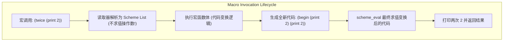

> **课程体系**：UC Berkeley CS61A (Fall 2024)  
> **所属模块**：Module 4: 解释器与 Scheme (Interpreters & Scheme)  
> **主讲教师**：Prof. John DeNero (UC Berkeley)  
> **视频时长**：28:53 ｜ **课堂截图**：17 张板书/代码演示  
> **视频直达**：[📺 在 B 站观看本讲原视频 (P32)](https://www.bilibili.com/video/BV1sy411z7nA/?p=32)  
> **快速导航**：[← 上一讲 (P31 Lecture 33 Programs as Data)](/notes/cs61a/lecture-31) ｜ [📚 返回全书目录](/notes/topics/CS61A) ｜ [下一讲 (P33 Lecture 35 SQL) →](/notes/cs61a/lecture-33)

---

## 课程核心目标与全景图

在几乎所有主流编程语言中，语言的**语法（Syntax）**与**特殊形式（Special Forms）**是语言设计者在编译器中固定死的核心特权。普通程序员无法定义新的控制流语句，例如为 Python 添加一个自定义的 `unless` 或类似 `do-while` 的语法。

而在 Lisp/Scheme 体系中，**宏（Macros）**打破了语言设计者与语言使用者之间的界限。宏允许程序员在解释器求值代码**之前**，直接拦截并重写抽象语法树（AST），从而赋予程序员在现有语言内部**自由定义全新特殊形式**的无上权力！



---

### 深入形式化规约与微观求值流程（Operational Semantics）
在「课程核心目标与全景图」模块中，计算机底层运算依赖于严密的形式化求值逻辑：
1. **抽象语法树（AST）的分层解析**：
   - 源代码字符流首先经过词法分析器（Lexer）切分为终结符标记（Tokens），随后由语法解析器（Parser）构造成多叉语法树；
   - 运算符优先级与结合性在语法树构建阶段即已固化，消除了运行期的二义性；
2. **环境序列的动态跃迁**：
   - 每次函数调用产生的新帧，其静态词法环境由函数对象的 `parent` 属性完全决定；
   - 变量查找沿环境链向上单向回溯，直到全局环境帧，若未找到则触发 `NameError` 异常；
3. **状态不变式（State Invariants）**：
   - 编写健壮程序的关键在于明确循环不变式（Loop Invariants）与函数前后置条件（Pre/Post-conditions）；
   - 在复杂控制流跳转中，确保状态变量在每次迭代前均维持合法的业务约束。


## 1. 准引用热身与符号表达式操纵 (Quasi-quotation Practice)

在正式探索宏之前，必须炉火纯青地掌握准引用（\`）与解引用（,）的精确控制。

[](https://www.bilibili.com/video/BV1sy411z7nA/?p=32&t=27)
*⏱ 时间戳：00:00:27 · 📷 课堂截图 · [在 B 站观看对应片段 (P32 00:00:27)](https://www.bilibili.com/video/BV1sy411z7nA/?p=32&t=27)*

#### 📸 课堂板书与代码演示深入精读 (00:00:27)

**【现场板书 / 代码演示还原】**：
在此时间节点，DeNero 教授在屏幕上进行了核心演示与重点板书推导：
> *“Let's practice writing procedures that return expressions, which are scheme lists. Here's a discussion question that we'll go through. First, a quick quasi-quotation review. This is the quasi-quote symbol. What it does is quote the next expression, but allow for unquoting. The comma is the unquote s...”*

**【底层计算模型与微观执行机制】**：
1. **执行上下文与时序追踪**：
   - 处于当前讨论节点「1. 准引用热身与符号表达式操纵 (Quasi-quotation Practice)」，解释器严格遵循核心求值规约；
   - 表达式先求值操作符，随后自左至右严格求值操作数，最终将函数对象施加于实参列表；
   - 若涉及环境模型，局部帧严格记录其静态词法父指针（Parent Pointer 指向函数定义处的环境），与运行时的动态调用栈形成正交架构。
2. **内存拓扑与对象引用**：
   - 变量符号只是哈希表（环境帧）中的键，指针直接指向堆内存中的一等公民对象；
   - 赋值语句是离散时间的瞬时状态快照，绝不会建立隐式的数学依赖监听。

**【避坑指南与高频考点点拨】**：
- **常见思维误区**：在「define-macro 机制：宏展开阶段 vs 运行时执行阶段的绝对区隔」相关考题中，初学者极易根据代码表面形式猜想结果，导致作用域混淆或变量遮蔽（Shadowing）误判；
- **调试排错黄金法则**：遇到嵌套调用与复杂分支时，务必在草稿纸上画出独立的局部帧，标明每个形参的具体绑定值，按部就班推导。


### 综合思考题：构造平方和表达式

目标：补全空白处的准引用与解引用符号，使得调用后能精确生成表示 $a^2 + b^2$ 的 Scheme 代码列表 `(+ (* a a) (* b b))`：

```scheme
;; 目标：定义 square-expr 并生成代码列表
(define (square-expr term)
  `(* ,term ,term))

`(+ ,(square-expr 'a) ,(square-expr 'b))
;; => (+ (* a a) (* b b))
```

[](https://www.bilibili.com/video/BV1sy411z7nA/?p=32&t=110)
*⏱ 时间戳：00:01:50 · 📷 课堂截图 · [在 B 站观看对应片段 (P32 00:01:50)](https://www.bilibili.com/video/BV1sy411z7nA/?p=32&t=110)*

#### 📸 课堂板书与代码演示深入精读 (00:01:50)

**【现场板书 / 代码演示还原】**：
在此时间节点，DeNero 教授在屏幕上进行了核心演示与重点板书推导：
> *“We're going to call it twice on A and B, so that's going to generate the times AA and the times BB, and then we're going to add in the symbol plus in order to get A squared plus B squared. So each blank here can either be empty or contain quasi-quote or unquote. I'd recommend that you pause the vide...”*

**【底层计算模型与微观执行机制】**：
1. **执行上下文与时序追踪**：
   - 处于当前讨论节点「1. 准引用热身与符号表达式操纵 (Quasi-quotation Practice)」，解释器严格遵循核心求值规约；
   - 表达式先求值操作符，随后自左至右严格求值操作数，最终将函数对象施加于实参列表；
   - 若涉及环境模型，局部帧严格记录其静态词法父指针（Parent Pointer 指向函数定义处的环境），与运行时的动态调用栈形成正交架构。
2. **内存拓扑与对象引用**：
   - 变量符号只是哈希表（环境帧）中的键，指针直接指向堆内存中的一等公民对象；
   - 赋值语句是离散时间的瞬时状态快照，绝不会建立隐式的数学依赖监听。

**【避坑指南与高频考点点拨】**：
- **常见思维误区**：在「define-macro 机制：宏展开阶段 vs 运行时执行阶段的绝对区隔」相关考题中，初学者极易根据代码表面形式猜想结果，导致作用域混淆或变量遮蔽（Shadowing）误判；
- **调试排错黄金法则**：遇到嵌套调用与复杂分支时，务必在草稿纸上画出独立的局部帧，标明每个形参的具体绑定值，按部就班推导。


[](https://www.bilibili.com/video/BV1sy411z7nA/?p=32&t=224)
*⏱ 时间戳：00:03:44 · 📷 课堂截图 · [在 B 站观看对应片段 (P32 00:03:44)](https://www.bilibili.com/video/BV1sy411z7nA/?p=32&t=224)*

#### 📸 课堂板书与代码演示深入精读 (00:03:44)

**【现场板书 / 代码演示还原】**：
在此时间节点，DeNero 教授在屏幕上进行了核心演示与重点板书推导：
> *“And this could be a regular quote or a quasi-quote, it doesn't matter which, because there's no unquoting inside. But since the direction set just used these two, I left it as a quasi-quote. And that's the answer. Let's see what some different answers do. So here's the correct answer as it was on th...”*

**【底层计算模型与微观执行机制】**：
1. **执行上下文与时序追踪**：
   - 处于当前讨论节点「1. 准引用热身与符号表达式操纵 (Quasi-quotation Practice)」，解释器严格遵循核心求值规约；
   - 表达式先求值操作符，随后自左至右严格求值操作数，最终将函数对象施加于实参列表；
   - 若涉及环境模型，局部帧严格记录其静态词法父指针（Parent Pointer 指向函数定义处的环境），与运行时的动态调用栈形成正交架构。
2. **内存拓扑与对象引用**：
   - 变量符号只是哈希表（环境帧）中的键，指针直接指向堆内存中的一等公民对象；
   - 赋值语句是离散时间的瞬时状态快照，绝不会建立隐式的数学依赖监听。

**【避坑指南与高频考点点拨】**：
- **常见思维误区**：在「define-macro 机制：宏展开阶段 vs 运行时执行阶段的绝对区隔」相关考题中，初学者极易根据代码表面形式猜想结果，导致作用域混淆或变量遮蔽（Shadowing）误判；
- **调试排错黄金法则**：遇到嵌套调用与复杂分支时，务必在草稿纸上画出独立的局部帧，标明每个形参的具体绑定值，按部就班推导。


- **关键解析**：
  1. `square-expr` 需要返回形如 `(* a a)` 的列表，因此外层必须加上准引用 \`；
  2. 形参 `term` 不能作为字面符号保留，必须加上解引用 `,term`，才能将实参符号填入乘法表达式中；
  3. 外层的 `+` 表达式必须整体准引用，而内部调用 `(square-expr 'a)` 则必须解引用求值，以获取生成的乘法表达式列表。

---

### 深入形式化规约与微观求值流程（Operational Semantics）
在「1. 准引用热身与符号表达式操纵 (Quasi-quotation Practice)」模块中，计算机底层运算依赖于严密的形式化求值逻辑：
1. **抽象语法树（AST）的分层解析**：
   - 源代码字符流首先经过词法分析器（Lexer）切分为终结符标记（Tokens），随后由语法解析器（Parser）构造成多叉语法树；
   - 运算符优先级与结合性在语法树构建阶段即已固化，消除了运行期的二义性；
2. **环境序列的动态跃迁**：
   - 每次函数调用产生的新帧，其静态词法环境由函数对象的 `parent` 属性完全决定；
   - 变量查找沿环境链向上单向回溯，直到全局环境帧，若未找到则触发 `NameError` 异常；
3. **状态不变式（State Invariants）**：
   - 编写健壮程序的关键在于明确循环不变式（Loop Invariants）与函数前后置条件（Pre/Post-conditions）；
   - 在复杂控制流跳转中，确保状态变量在每次迭代前均维持合法的业务约束。


## 2. 什么是宏？为语言发明新的特殊形式 (What Are Macros?)

在普通函数调用中，解释器遵循**应用序求值（Applicative-Order Evaluation）**：先求值操作符与所有操作数，再进入函数体。这决定了普通函数无法控制参数的求值时机与求值次数。

[](https://www.bilibili.com/video/BV1sy411z7nA/?p=32&t=335)
*⏱ 时间戳：00:05:35 · 📷 课堂截图 · [在 B 站观看对应片段 (P32 00:05:35)](https://www.bilibili.com/video/BV1sy411z7nA/?p=32&t=335)*

#### 📸 课堂板书与代码演示深入精读 (00:05:35)

**【现场板书 / 代码演示还原】**：
在此时间节点，DeNero 教授在屏幕上进行了核心演示与重点板书推导：
> *“If you don't quote A, then you're within a context that's being evaluated because it's unquoted, and so Scheme tries to evaluate the symbol A, but this is an unknown identifier, and so you get an error, which is why you need that quasi-quote symbol there. Macros are a feature of Scheme that allow yo...”*

**【底层计算模型与微观执行机制】**：
1. **执行上下文与时序追踪**：
   - 处于当前讨论节点「2. 什么是宏？为语言发明新的特殊形式 (What Are Macros?)」，解释器严格遵循核心求值规约；
   - 表达式先求值操作符，随后自左至右严格求值操作数，最终将函数对象施加于实参列表；
   - 若涉及环境模型，局部帧严格记录其静态词法父指针（Parent Pointer 指向函数定义处的环境），与运行时的动态调用栈形成正交架构。
2. **内存拓扑与对象引用**：
   - 变量符号只是哈希表（环境帧）中的键，指针直接指向堆内存中的一等公民对象；
   - 赋值语句是离散时间的瞬时状态快照，绝不会建立隐式的数学依赖监听。

**【避坑指南与高频考点点拨】**：
- **常见思维误区**：在「define-macro 机制：宏展开阶段 vs 运行时执行阶段的绝对区隔」相关考题中，初学者极易根据代码表面形式猜想结果，导致作用域混淆或变量遮蔽（Shadowing）误判；
- **调试排错黄金法则**：遇到嵌套调用与复杂分支时，务必在草稿纸上画出独立的局部帧，标明每个形参的具体绑定值，按部就班推导。


[](https://www.bilibili.com/video/BV1sy411z7nA/?p=32&t=426)
*⏱ 时间戳：00:07:06 · 📷 课堂截图 · [在 B 站观看对应片段 (P32 00:07:06)](https://www.bilibili.com/video/BV1sy411z7nA/?p=32&t=426)*

#### 📸 课堂板书与代码演示深入精读 (00:07:06)

**【现场板书 / 代码演示还原】**：
在此时间节点，DeNero 教授在屏幕上进行了核心演示与重点板书推导：
> *“So the way that we'll invent new special forms is to describe how to take the parts of a special form and construct a regular piece of scheme code out of them and then evaluate that scheme code. So a macro is an operation performed on the source code of a program before that source code is evaluated...”*

**【底层计算模型与微观执行机制】**：
1. **执行上下文与时序追踪**：
   - 处于当前讨论节点「2. 什么是宏？为语言发明新的特殊形式 (What Are Macros?)」，解释器严格遵循核心求值规约；
   - 表达式先求值操作符，随后自左至右严格求值操作数，最终将函数对象施加于实参列表；
   - 若涉及环境模型，局部帧严格记录其静态词法父指针（Parent Pointer 指向函数定义处的环境），与运行时的动态调用栈形成正交架构。
2. **内存拓扑与对象引用**：
   - 变量符号只是哈希表（环境帧）中的键，指针直接指向堆内存中的一等公民对象；
   - 赋值语句是离散时间的瞬时状态快照，绝不会建立隐式的数学依赖监听。

**【避坑指南与高频考点点拨】**：
- **常见思维误区**：在「define-macro 机制：宏展开阶段 vs 运行时执行阶段的绝对区隔」相关考题中，初学者极易根据代码表面形式猜想结果，导致作用域混淆或变量遮蔽（Shadowing）误判；
- **调试排错黄金法则**：遇到嵌套调用与复杂分支时，务必在草稿纸上画出独立的局部帧，标明每个形参的具体绑定值，按部就班推导。


**宏（Macro）是作用于程序源代码本身的变换过程**：
1. 宏接收**未经求值的表达式列表**作为参数；
2. 宏通过代码拼接生成一段全新的 Scheme 表达式代码；
3. 解释器对生成的代码执行二次求值。

---

### 深入形式化规约与微观求值流程（Operational Semantics）
在「2. 什么是宏？为语言发明新的特殊形式 (What Are Macros?)」模块中，计算机底层运算依赖于严密的形式化求值逻辑：
1. **抽象语法树（AST）的分层解析**：
   - 源代码字符流首先经过词法分析器（Lexer）切分为终结符标记（Tokens），随后由语法解析器（Parser）构造成多叉语法树；
   - 运算符优先级与结合性在语法树构建阶段即已固化，消除了运行期的二义性；
2. **环境序列的动态跃迁**：
   - 每次函数调用产生的新帧，其静态词法环境由函数对象的 `parent` 属性完全决定；
   - 变量查找沿环境链向上单向回溯，直到全局环境帧，若未找到则触发 `NameError` 异常；
3. **状态不变式（State Invariants）**：
   - 编写健壮程序的关键在于明确循环不变式（Loop Invariants）与函数前后置条件（Pre/Post-conditions）；
   - 在复杂控制流跳转中，确保状态变量在每次迭代前均维持合法的业务约束。


## 3. 经典宏案例 1：执行两次的 `twice` 宏

假设我们需要一个语法结构，能够将任意操作执行两次。如果用普通过程实现：

```scheme
;; 错误尝试：普通过程
(define (twice expr)
  (begin expr expr))

(twice (print 2))
```

[](https://www.bilibili.com/video/BV1sy411z7nA/?p=32&t=483)
*⏱ 时间戳：00:08:03 · 📷 课堂截图 · [在 B 站观看对应片段 (P32 00:08:03)](https://www.bilibili.com/video/BV1sy411z7nA/?p=32&t=483)*

#### 📸 课堂板书与代码演示深入精读 (00:08:03)

**【现场板书 / 代码演示还原】**：
在此时间节点，DeNero 教授在屏幕上进行了核心演示与重点板书推导：
> *“You build a list that starts with begin and then has that expression twice. Once you've defined this macro, you can twice anything. And here, we're twice-ing the expression print two. What happens behind the scenes because twice is a macro is that it evaluates the body of the macro on the expression...”*

**【底层计算模型与微观执行机制】**：
1. **执行上下文与时序追踪**：
   - 处于当前讨论节点「3. 经典宏案例 1：执行两次的 `twice` 宏」，解释器严格遵循核心求值规约；
   - 表达式先求值操作符，随后自左至右严格求值操作数，最终将函数对象施加于实参列表；
   - 若涉及环境模型，局部帧严格记录其静态词法父指针（Parent Pointer 指向函数定义处的环境），与运行时的动态调用栈形成正交架构。
2. **内存拓扑与对象引用**：
   - 变量符号只是哈希表（环境帧）中的键，指针直接指向堆内存中的一等公民对象；
   - 赋值语句是离散时间的瞬时状态快照，绝不会建立隐式的数学依赖监听。

**【避坑指南与高频考点点拨】**：
- **常见思维误区**：在「define-macro 机制：宏展开阶段 vs 运行时执行阶段的绝对区隔」相关考题中，初学者极易根据代码表面形式猜想结果，导致作用域混淆或变量遮蔽（Shadowing）误判；
- **调试排错黄金法则**：遇到嵌套调用与复杂分支时，务必在草稿纸上画出独立的局部帧，标明每个形参的具体绑定值，按部就班推导。


普通过程在调用前就会立即执行实参 `(print 2)`，屏幕上只输出一次 `2`，然后将 `print` 的返回值 `undefined` 传入 `twice`，无法实现真正的两次执行。

### 宏解决方案：`define-macro`

```scheme
(define-macro (twice expr)
  `(begin ,expr ,expr))

(twice (print 2))
```

[](https://www.bilibili.com/video/BV1sy411z7nA/?p=32&t=543)
*⏱ 时间戳：00:09:03 · 📷 课堂截图 · [在 B 站观看对应片段 (P32 00:09:03)](https://www.bilibili.com/video/BV1sy411z7nA/?p=32&t=543)*

#### 📸 课堂板书与代码演示深入精读 (00:09:03)

**【现场板书 / 代码演示还原】**：
在此时间节点，DeNero 教授在屏幕上进行了核心演示与重点板书推导：
> *“So there is something that twice can do that a regular procedure can't do, which is to take this expression and duplicate it before it gets evaluated and then evaluate it twice. So the evaluation procedure of a macro call expression in general, like this one, is that we evaluate the operator sub-exp...”*

**【底层计算模型与微观执行机制】**：
1. **执行上下文与时序追踪**：
   - 处于当前讨论节点「3. 经典宏案例 1：执行两次的 `twice` 宏」，解释器严格遵循核心求值规约；
   - 表达式先求值操作符，随后自左至右严格求值操作数，最终将函数对象施加于实参列表；
   - 若涉及环境模型，局部帧严格记录其静态词法父指针（Parent Pointer 指向函数定义处的环境），与运行时的动态调用栈形成正交架构。
2. **内存拓扑与对象引用**：
   - 变量符号只是哈希表（环境帧）中的键，指针直接指向堆内存中的一等公民对象；
   - 赋值语句是离散时间的瞬时状态快照，绝不会建立隐式的数学依赖监听。

**【避坑指南与高频考点点拨】**：
- **常见思维误区**：在「define-macro 机制：宏展开阶段 vs 运行时执行阶段的绝对区隔」相关考题中，初学者极易根据代码表面形式猜想结果，导致作用域混淆或变量遮蔽（Shadowing）误判；
- **调试排错黄金法则**：遇到嵌套调用与复杂分支时，务必在草稿纸上画出独立的局部帧，标明每个形参的具体绑定值，按部就班推导。


[](https://www.bilibili.com/video/BV1sy411z7nA/?p=32&t=630)
*⏱ 时间戳：00:10:30 · 📷 课堂截图 · [在 B 站观看对应片段 (P32 00:10:30)](https://www.bilibili.com/video/BV1sy411z7nA/?p=32&t=630)*

#### 📸 课堂板书与代码演示深入精读 (00:10:30)

**【现场板书 / 代码演示还原】**：
在此时间节点，DeNero 教授在屏幕上进行了核心演示与重点板书推导：
> *“And I wanted to define twice. I'm going to write the same body that I had on the slide. Begin the expression, and then the expression again. Now, twice print two doesn't work. I get two displayed, and then I construct an expression that says begin, none, none, the value of print two. If I wanted to ...”*

**【底层计算模型与微观执行机制】**：
1. **执行上下文与时序追踪**：
   - 处于当前讨论节点「3. 经典宏案例 1：执行两次的 `twice` 宏」，解释器严格遵循核心求值规约；
   - 表达式先求值操作符，随后自左至右严格求值操作数，最终将函数对象施加于实参列表；
   - 若涉及环境模型，局部帧严格记录其静态词法父指针（Parent Pointer 指向函数定义处的环境），与运行时的动态调用栈形成正交架构。
2. **内存拓扑与对象引用**：
   - 变量符号只是哈希表（环境帧）中的键，指针直接指向堆内存中的一等公民对象；
   - 赋值语句是离散时间的瞬时状态快照，绝不会建立隐式的数学依赖监听。

**【避坑指南与高频考点点拨】**：
- **常见思维误区**：在「define-macro 机制：宏展开阶段 vs 运行时执行阶段的绝对区隔」相关考题中，初学者极易根据代码表面形式猜想结果，导致作用域混淆或变量遮蔽（Shadowing）误判；
- **调试排错黄金法则**：遇到嵌套调用与复杂分支时，务必在草稿纸上画出独立的局部帧，标明每个形参的具体绑定值，按部就班推导。


- 解释器遇到宏调用 `twice` 时，**完全不求值 `(print 2)`**；
- 宏函数体接收到的 `expr` 是原始列表 `(print 2)`；
- 宏模板生成代码：`(begin (print 2) (print 2))`；
- 解释器求值该代码，屏幕上成功打印两次 `2`！

---

### 深入形式化规约与微观求值流程（Operational Semantics）
在「3. 经典宏案例 1：执行两次的 `twice` 宏」模块中，计算机底层运算依赖于严密的形式化求值逻辑：
1. **抽象语法树（AST）的分层解析**：
   - 源代码字符流首先经过词法分析器（Lexer）切分为终结符标记（Tokens），随后由语法解析器（Parser）构造成多叉语法树；
   - 运算符优先级与结合性在语法树构建阶段即已固化，消除了运行期的二义性；
2. **环境序列的动态跃迁**：
   - 每次函数调用产生的新帧，其静态词法环境由函数对象的 `parent` 属性完全决定；
   - 变量查找沿环境链向上单向回溯，直到全局环境帧，若未找到则触发 `NameError` 异常；
3. **状态不变式（State Invariants）**：
   - 编写健壮程序的关键在于明确循环不变式（Loop Invariants）与函数前后置条件（Pre/Post-conditions）；
   - 在复杂控制流跳转中，确保状态变量在每次迭代前均维持合法的业务约束。


## 4. 经典宏案例 2：带源码报告的断言测试宏 `check`

在编写单元测试断言时，普通函数只能接收布尔值，无法知道究竟是哪行表达式失败了：

```scheme
;; 普通过程测试：失败时仅能输出 "failed"，丢失了上下文
(define (check val)
  (if val 'passed 'failed))
```

[](https://www.bilibili.com/video/BV1sy411z7nA/?p=32&t=750)
*⏱ 时间戳：00:12:30 · 📷 课堂截图 · [在 B 站观看对应片段 (P32 00:12:30)](https://www.bilibili.com/video/BV1sy411z7nA/?p=32&t=750)*

#### 📸 课堂板书与代码演示深入精读 (00:12:30)

**【现场板书 / 代码演示还原】**：
在此时间节点，DeNero 教授在屏幕上进行了核心演示与重点板书推导：
> *“I can write, if the value is true, then I passed the check. Otherwise, I failed the check. And if, for instance, I had x negative 2 and I wanted to check that x is greater than 0, I would have failed that check. So this is a reasonable way to add little tests inside of your scheme program. But unfor...”*

**【底层计算模型与微观执行机制】**：
1. **执行上下文与时序追踪**：
   - 处于当前讨论节点「4. 经典宏案例 2：带源码报告的断言测试宏 `check`」，解释器严格遵循核心求值规约；
   - 表达式先求值操作符，随后自左至右严格求值操作数，最终将函数对象施加于实参列表；
   - 若涉及环境模型，局部帧严格记录其静态词法父指针（Parent Pointer 指向函数定义处的环境），与运行时的动态调用栈形成正交架构。
2. **内存拓扑与对象引用**：
   - 变量符号只是哈希表（环境帧）中的键，指针直接指向堆内存中的一等公民对象；
   - 赋值语句是离散时间的瞬时状态快照，绝不会建立隐式的数学依赖监听。

**【避坑指南与高频考点点拨】**：
- **常见思维误区**：在「define-macro 机制：宏展开阶段 vs 运行时执行阶段的绝对区隔」相关考题中，初学者极易根据代码表面形式猜想结果，导致作用域混淆或变量遮蔽（Shadowing）误判；
- **调试排错黄金法则**：遇到嵌套调用与复杂分支时，务必在草稿纸上画出独立的局部帧，标明每个形参的具体绑定值，按部就班推导。


通过宏，我们可以同时获取**测试表达式的代码**与其**执行结果**：

```scheme
(define-macro (check expr)
  `(if ,expr
       'passed
       (list 'failed ',expr)))
```

[](https://www.bilibili.com/video/BV1sy411z7nA/?p=32&t=845)
*⏱ 时间戳：00:14:05 · 📷 课堂截图 · [在 B 站观看对应片段 (P32 00:14:05)](https://www.bilibili.com/video/BV1sy411z7nA/?p=32&t=845)*

#### 📸 课堂板书与代码演示深入精读 (00:14:05)

**【现场板书 / 代码演示还原】**：
在此时间节点，DeNero 教授在屏幕上进行了核心演示与重点板书推导：
> *“X to be negative two, and then I check to see, is it the case that X is greater than zero? It will say failed. So I've done all this work to define a macro. It was slightly more complicated than the procedure, and it doesn't do anything new yet. But we could get it to do something new by not only sa...”*

**【底层计算模型与微观执行机制】**：
1. **执行上下文与时序追踪**：
   - 处于当前讨论节点「4. 经典宏案例 2：带源码报告的断言测试宏 `check`」，解释器严格遵循核心求值规约；
   - 表达式先求值操作符，随后自左至右严格求值操作数，最终将函数对象施加于实参列表；
   - 若涉及环境模型，局部帧严格记录其静态词法父指针（Parent Pointer 指向函数定义处的环境），与运行时的动态调用栈形成正交架构。
2. **内存拓扑与对象引用**：
   - 变量符号只是哈希表（环境帧）中的键，指针直接指向堆内存中的一等公民对象；
   - 赋值语句是离散时间的瞬时状态快照，绝不会建立隐式的数学依赖监听。

**【避坑指南与高频考点点拨】**：
- **常见思维误区**：在「define-macro 机制：宏展开阶段 vs 运行时执行阶段的绝对区隔」相关考题中，初学者极易根据代码表面形式猜想结果，导致作用域混淆或变量遮蔽（Shadowing）误判；
- **调试排错黄金法则**：遇到嵌套调用与复杂分支时，务必在草稿纸上画出独立的局部帧，标明每个形参的具体绑定值，按部就班推导。


注意其中的 `',expr`：
- 外层单引号使得生成的代码中包含被引用的原始表达式；
- 当断言失败时，输出不仅包含 `'failed`，还直接打印出发生失败的原始表达式 `(> x 0)`！这是普通函数绝对无法做到的。

---

### 深入形式化规约与微观求值流程（Operational Semantics）
在「4. 经典宏案例 2：带源码报告的断言测试宏 `check`」模块中，计算机底层运算依赖于严密的形式化求值逻辑：
1. **抽象语法树（AST）的分层解析**：
   - 源代码字符流首先经过词法分析器（Lexer）切分为终结符标记（Tokens），随后由语法解析器（Parser）构造成多叉语法树；
   - 运算符优先级与结合性在语法树构建阶段即已固化，消除了运行期的二义性；
2. **环境序列的动态跃迁**：
   - 每次函数调用产生的新帧，其静态词法环境由函数对象的 `parent` 属性完全决定；
   - 变量查找沿环境链向上单向回溯，直到全局环境帧，若未找到则触发 `NameError` 异常；
3. **状态不变式（State Invariants）**：
   - 编写健壮程序的关键在于明确循环不变式（Loop Invariants）与函数前后置条件（Pre/Post-conditions）；
   - 在复杂控制流跳转中，确保状态变量在每次迭代前均维持合法的业务约束。


## 5. 经典宏案例 3：为 Scheme 增设 `for` 循环语法

Scheme 语言本身没有 `for ... in ...` 语法。借助宏，我们只需几行代码就能为 Scheme 创造出一套崭新的 `for` 循环语言特性！

[](https://www.bilibili.com/video/BV1sy411z7nA/?p=32&t=942)
*⏱ 时间戳：00:15:42 · 📷 课堂截图 · [在 B 站观看对应片段 (P32 00:15:42)](https://www.bilibili.com/video/BV1sy411z7nA/?p=32&t=942)*

#### 📸 课堂板书与代码演示深入精读 (00:15:42)

**【现场板书 / 代码演示还原】**：
在此时间节点，DeNero 教授在屏幕上进行了核心演示与重点板书推导：
> *“Is x greater than zero? Constructs the following expression. If x is greater than zero, then it just says passed. Otherwise, it builds this list, failed, and then the expression. If I were to evaluate that, then I would get the fact that it failed. But of course, if instead x were two, and I evaluat...”*

**【底层计算模型与微观执行机制】**：
1. **执行上下文与时序追踪**：
   - 处于当前讨论节点「5. 经典宏案例 3：为 Scheme 增设 `for` 循环语法」，解释器严格遵循核心求值规约；
   - 表达式先求值操作符，随后自左至右严格求值操作数，最终将函数对象施加于实参列表；
   - 若涉及环境模型，局部帧严格记录其静态词法父指针（Parent Pointer 指向函数定义处的环境），与运行时的动态调用栈形成正交架构。
2. **内存拓扑与对象引用**：
   - 变量符号只是哈希表（环境帧）中的键，指针直接指向堆内存中的一等公民对象；
   - 赋值语句是离散时间的瞬时状态快照，绝不会建立隐式的数学依赖监听。

**【避坑指南与高频考点点拨】**：
- **常见思维误区**：在「define-macro 机制：宏展开阶段 vs 运行时执行阶段的绝对区隔」相关考题中，初学者极易根据代码表面形式猜想结果，导致作用域混淆或变量遮蔽（Shadowing）误判；
- **调试排错黄金法则**：遇到嵌套调用与复杂分支时，务必在草稿纸上画出独立的局部帧，标明每个形参的具体绑定值，按部就班推导。


目标语法：
```scheme
(for x in '(2 3 4 5) (* x x))
;; 预期输出 => (4 9 16 25)
```

底层等价转换目标：
```scheme
(map (lambda (x) (* x x)) '(2 3 4 5))
```

[](https://www.bilibili.com/video/BV1sy411z7nA/?p=32&t=1061)
*⏱ 时间戳：00:17:41 · 📷 课堂截图 · [在 B 站观看对应片段 (P32 00:17:41)](https://www.bilibili.com/video/BV1sy411z7nA/?p=32&t=1061)*

#### 📸 课堂板书与代码演示深入精读 (00:17:41)

**【现场板书 / 代码演示还原】**：
在此时间节点，DeNero 教授在屏幕上进行了核心演示与重点板书推导：
> *“More straightforward to state what I want because I don't have to explicitly write out the word lambda. So, defining the macro means saying what happens when you have four and then a symbol and then some values and then an expression to evaluate for each of those values. What we do is build this exp...”*

**【底层计算模型与微观执行机制】**：
1. **执行上下文与时序追踪**：
   - 处于当前讨论节点「5. 经典宏案例 3：为 Scheme 增设 `for` 循环语法」，解释器严格遵循核心求值规约；
   - 表达式先求值操作符，随后自左至右严格求值操作数，最终将函数对象施加于实参列表；
   - 若涉及环境模型，局部帧严格记录其静态词法父指针（Parent Pointer 指向函数定义处的环境），与运行时的动态调用栈形成正交架构。
2. **内存拓扑与对象引用**：
   - 变量符号只是哈希表（环境帧）中的键，指针直接指向堆内存中的一等公民对象；
   - 赋值语句是离散时间的瞬时状态快照，绝不会建立隐式的数学依赖监听。

**【避坑指南与高频考点点拨】**：
- **常见思维误区**：在「define-macro 机制：宏展开阶段 vs 运行时执行阶段的绝对区隔」相关考题中，初学者极易根据代码表面形式猜想结果，导致作用域混淆或变量遮蔽（Shadowing）误判；
- **调试排错黄金法则**：遇到嵌套调用与复杂分支时，务必在草稿纸上画出独立的局部帧，标明每个形参的具体绑定值，按部就班推导。


### `for` 宏的完整实现

```scheme
(define-macro (for sym in vals expr)
  `(map (lambda (,sym) ,expr) ,vals))
```

测试执行：
```scheme
(for x in '(2 3 4 5) (* x x)) ; => (4 9 16 25)
```
仅仅通过定义一个简单的宏，我们就神不知鬼不觉地为 Scheme 语言扩展了高级循环控制结构！

---

### 深入形式化规约与微观求值流程（Operational Semantics）
在「5. 经典宏案例 3：为 Scheme 增设 `for` 循环语法」模块中，计算机底层运算依赖于严密的形式化求值逻辑：
1. **抽象语法树（AST）的分层解析**：
   - 源代码字符流首先经过词法分析器（Lexer）切分为终结符标记（Tokens），随后由语法解析器（Parser）构造成多叉语法树；
   - 运算符优先级与结合性在语法树构建阶段即已固化，消除了运行期的二义性；
2. **环境序列的动态跃迁**：
   - 每次函数调用产生的新帧，其静态词法环境由函数对象的 `parent` 属性完全决定；
   - 变量查找沿环境链向上单向回溯，直到全局环境帧，若未找到则触发 `NameError` 异常；
3. **状态不变式（State Invariants）**：
   - 编写健壮程序的关键在于明确循环不变式（Loop Invariants）与函数前后置条件（Pre/Post-conditions）；
   - 在复杂控制流跳转中，确保状态变量在每次迭代前均维持合法的业务约束。


## 6. 进阶挑战：递归过程的动态追踪宏 (`trace`)

在 Python 中，我们可以使用 `@trace` 装饰器打印递归调用的每一层输入与返回值：

[](https://www.bilibili.com/video/BV1sy411z7nA/?p=32&t=1176)
*⏱ 时间戳：00:19:36 · 📷 课堂截图 · [在 B 站观看对应片段 (P32 00:19:36)](https://www.bilibili.com/video/BV1sy411z7nA/?p=32&t=1176)*

#### 📸 课堂板书与代码演示深入精读 (00:19:36)

**【现场板书 / 代码演示还原】**：
在此时间节点，DeNero 教授在屏幕上进行了核心演示与重点板书推导：
> *“This time about tracing the execution of a recursive function or procedure. We've been tracing recursive calls in this course before. In Python, we did it with a decorator. So here's a decorator called trace. It takes in another function to be traced, defines a version of that function that has the ...”*

**【底层计算模型与微观执行机制】**：
1. **执行上下文与时序追踪**：
   - 处于当前讨论节点「6. 进阶挑战：递归过程的动态追踪宏 (`trace`)」，解释器严格遵循核心求值规约；
   - 表达式先求值操作符，随后自左至右严格求值操作数，最终将函数对象施加于实参列表；
   - 若涉及环境模型，局部帧严格记录其静态词法父指针（Parent Pointer 指向函数定义处的环境），与运行时的动态调用栈形成正交架构。
2. **内存拓扑与对象引用**：
   - 变量符号只是哈希表（环境帧）中的键，指针直接指向堆内存中的一等公民对象；
   - 赋值语句是离散时间的瞬时状态快照，绝不会建立隐式的数学依赖监听。

**【避坑指南与高频考点点拨】**：
- **常见思维误区**：在「define-macro 机制：宏展开阶段 vs 运行时执行阶段的绝对区隔」相关考题中，初学者极易根据代码表面形式猜想结果，导致作用域混淆或变量遮蔽（Shadowing）误判；
- **调试排错黄金法则**：遇到嵌套调用与复杂分支时，务必在草稿纸上画出独立的局部帧，标明每个形参的具体绑定值，按部就班推导。


[](https://www.bilibili.com/video/BV1sy411z7nA/?p=32&t=1302)
*⏱ 时间戳：00:21:42 · 📷 课堂截图 · [在 B 站观看对应片段 (P32 00:21:42)](https://www.bilibili.com/video/BV1sy411z7nA/?p=32&t=1302)*

#### 📸 课堂板书与代码演示深入精读 (00:21:42)

**【现场板书 / 代码演示还原】**：
在此时间节点，DeNero 教授在屏幕上进行了核心演示与重点板书推导：
> *“Here's something we can do without using a macro. We could define factorial of n as a procedure that has the same logic as the Python version. We could then assign the symbol original to this fact procedure and redefined the fact procedure as a function that first prints and then calls the original....”*

**【底层计算模型与微观执行机制】**：
1. **执行上下文与时序追踪**：
   - 处于当前讨论节点「6. 进阶挑战：递归过程的动态追踪宏 (`trace`)」，解释器严格遵循核心求值规约；
   - 表达式先求值操作符，随后自左至右严格求值操作数，最终将函数对象施加于实参列表；
   - 若涉及环境模型，局部帧严格记录其静态词法父指针（Parent Pointer 指向函数定义处的环境），与运行时的动态调用栈形成正交架构。
2. **内存拓扑与对象引用**：
   - 变量符号只是哈希表（环境帧）中的键，指针直接指向堆内存中的一等公民对象；
   - 赋值语句是离散时间的瞬时状态快照，绝不会建立隐式的数学依赖监听。

**【避坑指南与高频考点点拨】**：
- **常见思维误区**：在「define-macro 机制：宏展开阶段 vs 运行时执行阶段的绝对区隔」相关考题中，初学者极易根据代码表面形式猜想结果，导致作用域混淆或变量遮蔽（Shadowing）误判；
- **调试排错黄金法则**：遇到嵌套调用与复杂分支时，务必在草稿纸上画出独立的局部帧，标明每个形参的具体绑定值，按部就班推导。


而在 Scheme 中，由于没有语言内置的装饰器语法，如果想要在不永久修改函数定义的前提下，按需单次追踪递归函数的执行，宏是唯一的终极利器。

### 追踪的设计思路

[](https://www.bilibili.com/video/BV1sy411z7nA/?p=32&t=1464)
*⏱ 时间戳：00:24:24 · 📷 课堂截图 · [在 B 站观看对应片段 (P32 00:24:24)](https://www.bilibili.com/video/BV1sy411z7nA/?p=32&t=1464)*

#### 📸 课堂板书与代码演示深入精读 (00:24:24)

**【现场板书 / 代码演示还原】**：
在此时间节点，DeNero 教授在屏幕上进行了核心演示与重点板书推导：
> *“We'd see that before we trace it, it's 120. After we retrace it, it gives us the printing in 120. But then when we go back to the original, it just shows us 120 without the tracing. In order to build this logic into a generic macro, we're going to have to turn it into one expression instead of four....”*

**【底层计算模型与微观执行机制】**：
1. **执行上下文与时序追踪**：
   - 处于当前讨论节点「6. 进阶挑战：递归过程的动态追踪宏 (`trace`)」，解释器严格遵循核心求值规约；
   - 表达式先求值操作符，随后自左至右严格求值操作数，最终将函数对象施加于实参列表；
   - 若涉及环境模型，局部帧严格记录其静态词法父指针（Parent Pointer 指向函数定义处的环境），与运行时的动态调用栈形成正交架构。
2. **内存拓扑与对象引用**：
   - 变量符号只是哈希表（环境帧）中的键，指针直接指向堆内存中的一等公民对象；
   - 赋值语句是离散时间的瞬时状态快照，绝不会建立隐式的数学依赖监听。

**【避坑指南与高频考点点拨】**：
- **常见思维误区**：在「define-macro 机制：宏展开阶段 vs 运行时执行阶段的绝对区隔」相关考题中，初学者极易根据代码表面形式猜想结果，导致作用域混淆或变量遮蔽（Shadowing）误判；
- **调试排错黄金法则**：遇到嵌套调用与复杂分支时，务必在草稿纸上画出独立的局部帧，标明每个形参的具体绑定值，按部就班推导。


在执行 `(trace (fact 5))` 时，我们希望自动完成以下流水线：
1. 保存 `fact` 的原始过程定义到临时变量 `original`；
2. 将 `fact` 重定义为带打印日志的包装过程；
3. 执行 `(fact 5)`（此时内部递归调用都会触发打印）；
4. 将 `fact` 恢复为原始过程 `original`；
5. 返回计算结果 `120`。

### `trace` 宏代码实现

```scheme
(define-macro (trace expr)
  (let ((op (car expr)))
    `(begin
       (define original ,op)
       (define ,op (lambda (n)
                     (print (list ',op n))
                     (original n)))
       (define result ,expr)
       (define ,op original)
       result)))
```

[](https://www.bilibili.com/video/BV1sy411z7nA/?p=32&t=1580)
*⏱ 时间戳：00:26:20 · 📷 课堂截图 · [在 B 站观看对应片段 (P32 00:26:20)](https://www.bilibili.com/video/BV1sy411z7nA/?p=32&t=1580)*

#### 📸 课堂板书与代码演示深入精读 (00:26:20)

**【现场板书 / 代码演示还原】**：
在此时间节点，DeNero 教授在屏幕上进行了核心演示与重点板书推导：
> *“We don't want it always to be fact. We want it to be whatever the operator is. And so we use unquote in order to make sure that the operator gets evaluated. Then we redefine whatever the operator is, such as fact, to be a new lambda that prints out list. Instead of always printing fact, we want to p...”*

**【底层计算模型与微观执行机制】**：
1. **执行上下文与时序追踪**：
   - 处于当前讨论节点「6. 进阶挑战：递归过程的动态追踪宏 (`trace`)」，解释器严格遵循核心求值规约；
   - 表达式先求值操作符，随后自左至右严格求值操作数，最终将函数对象施加于实参列表；
   - 若涉及环境模型，局部帧严格记录其静态词法父指针（Parent Pointer 指向函数定义处的环境），与运行时的动态调用栈形成正交架构。
2. **内存拓扑与对象引用**：
   - 变量符号只是哈希表（环境帧）中的键，指针直接指向堆内存中的一等公民对象；
   - 赋值语句是离散时间的瞬时状态快照，绝不会建立隐式的数学依赖监听。

**【避坑指南与高频考点点拨】**：
- **常见思维误区**：在「define-macro 机制：宏展开阶段 vs 运行时执行阶段的绝对区隔」相关考题中，初学者极易根据代码表面形式猜想结果，导致作用域混淆或变量遮蔽（Shadowing）误判；
- **调试排错黄金法则**：遇到嵌套调用与复杂分支时，务必在草稿纸上画出独立的局部帧，标明每个形参的具体绑定值，按部就班推导。


[](https://www.bilibili.com/video/BV1sy411z7nA/?p=32&t=1660)
*⏱ 时间戳：00:27:40 · 📷 课堂截图 · [在 B 站观看对应片段 (P32 00:27:40)](https://www.bilibili.com/video/BV1sy411z7nA/?p=32&t=1660)*

#### 📸 课堂板书与代码演示深入精读 (00:27:40)

**【现场板书 / 代码演示还原】**：
在此时间节点，DeNero 教授在屏幕上进行了核心演示与重点板书推导：
> *“By quoting that symbol, which generically is called operator. So if we run this again, now we see what we were looking for. Calling fact five gives me 120, tracing fact five. Shows me what happened and gives me 120. But if I call fact five after that, everything is back to normal because I went back...”*

**【底层计算模型与微观执行机制】**：
1. **执行上下文与时序追踪**：
   - 处于当前讨论节点「6. 进阶挑战：递归过程的动态追踪宏 (`trace`)」，解释器严格遵循核心求值规约；
   - 表达式先求值操作符，随后自左至右严格求值操作数，最终将函数对象施加于实参列表；
   - 若涉及环境模型，局部帧严格记录其静态词法父指针（Parent Pointer 指向函数定义处的环境），与运行时的动态调用栈形成正交架构。
2. **内存拓扑与对象引用**：
   - 变量符号只是哈希表（环境帧）中的键，指针直接指向堆内存中的一等公民对象；
   - 赋值语句是离散时间的瞬时状态快照，绝不会建立隐式的数学依赖监听。

**【避坑指南与高频考点点拨】**：
- **常见思维误区**：在「define-macro 机制：宏展开阶段 vs 运行时执行阶段的绝对区隔」相关考题中，初学者极易根据代码表面形式猜想结果，导致作用域混淆或变量遮蔽（Shadowing）误判；
- **调试排错黄金法则**：遇到嵌套调用与复杂分支时，务必在草稿纸上画出独立的局部帧，标明每个形参的具体绑定值，按部就班推导。


### 为什么 Scheme 的宏追踪比 Python 装饰器更灵活？

- Python 装饰器在函数定义时静态绑定，一旦装饰，所有后续调用都会强制打印日志；
- Scheme 的 `trace` 宏在**调用点动态介入**：
  - 想要追踪时调用 `(trace (fact 5))`，屏幕输出完整调用链；
  - 正常调用时写 `(fact 5)`，完全无日志开销！

---

### 深入形式化规约与微观求值流程（Operational Semantics）
在「6. 进阶挑战：递归过程的动态追踪宏 (`trace`)」模块中，计算机底层运算依赖于严密的形式化求值逻辑：
1. **抽象语法树（AST）的分层解析**：
   - 源代码字符流首先经过词法分析器（Lexer）切分为终结符标记（Tokens），随后由语法解析器（Parser）构造成多叉语法树；
   - 运算符优先级与结合性在语法树构建阶段即已固化，消除了运行期的二义性；
2. **环境序列的动态跃迁**：
   - 每次函数调用产生的新帧，其静态词法环境由函数对象的 `parent` 属性完全决定；
   - 变量查找沿环境链向上单向回溯，直到全局环境帧，若未找到则触发 `NameError` 异常；
3. **状态不变式（State Invariants）**：
   - 编写健壮程序的关键在于明确循环不变式（Loop Invariants）与函数前后置条件（Pre/Post-conditions）；
   - 在复杂控制流跳转中，确保状态变量在每次迭代前均维持合法的业务约束。


## 宏与普通过程的核心差异速查

| 维度 | 普通过程 (Procedures) | 宏 (Macros) |
| :--- | :--- | :--- |
| **定义语法** | `(define (f x) ...)` | `(define-macro (f x) ...)` |
| **实参求值** | 进入函数前，实参**立即求值** | 实参**原样作为表达式列表传入** |
| **返回值语义** | 返回值即为最终计算结果 | 返回值是一段**新代码**，解释器立即对其再次求值 |
| **能力边界** | 数据计算与逻辑抽象 | 语法扩展、控制流定制、元编程 |
| **副作用控制** | 无法阻止参数表达式的副作用 | 能够推迟、重复或彻底跳过表达式求值 |

### 深入形式化规约与微观求值流程（Operational Semantics）
在「宏与普通过程的核心差异速查」模块中，计算机底层运算依赖于严密的形式化求值逻辑：
1. **抽象语法树（AST）的分层解析**：
   - 源代码字符流首先经过词法分析器（Lexer）切分为终结符标记（Tokens），随后由语法解析器（Parser）构造成多叉语法树；
   - 运算符优先级与结合性在语法树构建阶段即已固化，消除了运行期的二义性；
2. **环境序列的动态跃迁**：
   - 每次函数调用产生的新帧，其静态词法环境由函数对象的 `parent` 属性完全决定；
   - 变量查找沿环境链向上单向回溯，直到全局环境帧，若未找到则触发 `NameError` 异常；
3. **状态不变式（State Invariants）**：
   - 编写健壮程序的关键在于明确循环不变式（Loop Invariants）与函数前后置条件（Pre/Post-conditions）；
   - 在复杂控制流跳转中，确保状态变量在每次迭代前均维持合法的业务约束。


---

## 伯克利 Midterm / Final 经典高频考题深度演练

### 实战考题：环境拓扑与微观状态追踪（WWPD & Environment Diagrams）
考虑以下 Python 代码在交互式环境中的微观执行过程：

```python
# 经典作用域与高阶函数综合考题
x = 10

def outer(x):
    y = x + 2
    def inner(y):
        return x + y
    return inner

f = outer(5)
result = f(3)
```

#### 完整解题思维模型与多帧环境图推导：
1. **全局帧（Global Frame）初始化**：
   - 全局变量 `x` 绑定到整数对象 `10`；
   - 全局函数 `outer` 绑定到新创建的函数对象，其内嵌 `parent = Global`；
2. **执行 `f = outer(5)`**：
   - 开辟局部帧 $f_1$，标注 `f1: outer [parent=Global]`；
   - 形参 `x` 绑定到实参 `5`；
   - 局部变量 `y` 绑定到 `5 + 2 = 7`；
   - 在 $f_1$ 内部执行 `def inner(y):`，创建函数对象 `inner`，其内嵌 **`parent = f1`**；
   - 返回函数对象 `inner`，全局变量 `f` 绑定到该对象；
3. **执行 `result = f(3)`**：
   - 调用函数 `f`（即 `inner`），开辟局部帧 $f_2$；
   - **核心判分点**：帧 $f_2$ 的 parent 指向谁？
   - **铁律**：函数 `inner` 是在帧 $f_1$ 内部被定义的，因此 $f_2$ 的 **`parent = f1`**！
   - 形参 `y` 绑定到实参 `3`；
   - 执行体 `return x + y`：
     - 在当前帧 $f_2$ 查找 `y`：命中局部变量 `y = 3`；
     - 在当前帧 $f_2$ 查找 `x`：未命中，沿 parent 回溯到 **$f_1$ 帧** 查找！
     - 在 $f_1$ 帧中命中 `x = 5`（全局的 `x = 10` 被局部遮蔽！）；
     - 计算 `5 + 3 = 8`，作为返回值；
4. **最终输出结论**：
   - 全局变量 `result = 8`。

---

## 本讲核心概念知识矩阵 (Knowledge Matrix)

| 核心知识维度 | 形式化定义与机制 | 典型代码示例 | 核心工程与算法价值 | 常见易错陷阱 |
| :--- | :--- | :--- | :--- | :--- |
| **基础求值语义** | 表达式求值得到值，语句执行改变内部状态 | `x = 2 + 3` | 建立离散时间状态快照心智模型 | 误将赋值等号当作代数方程动态约束 |
| **环境帧拓扑** | 环境是一系列帧构成的有序链条 | `Global -> f1 -> f2` | 实现词法作用域与变量安全隔离 | 混淆调用者栈帧与定义处父环境指针 |
| **抽象屏障** | 通过函数接口隔离实现细节与调用逻辑 | `def square(x): ...` | 降低大规模系统认知负荷 | 破坏接口直接依赖底层私有数据结构 |
| **控制流决策** | 条件分支短路求值与循环迭代递进 | `if cond: ... while: ...` | 赋予程序非线性决策与大规模数据处理能力 | 遗漏循环递进变量引发死循环 |
| **高阶能力** | 函数作为一等公民（传参、返回、赋值） | `make_adder(3)` | 实现工厂模式、闭包持久状态与柯里化 | 闭包后期绑定引发循环变量捕获错误 |

---

## 课程导航与跳转

| 上一讲 | 目录 | 下一讲 | 原视频 |
| :--- | :---: | :--- | :--- |
| [← 上一讲：Lecture 33 Programs as Data](/notes/cs61a/lecture-31) | [📚 返回 CS61A 全书目录](/notes/topics/CS61A) | [下一讲：Lecture 35 SQL →](/notes/cs61a/lecture-33) | [🎬 在 B 站观看本讲 (P32)](https://www.bilibili.com/video/BV1sy411z7nA/?p=32) |
