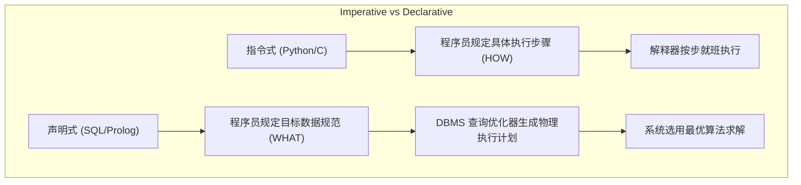
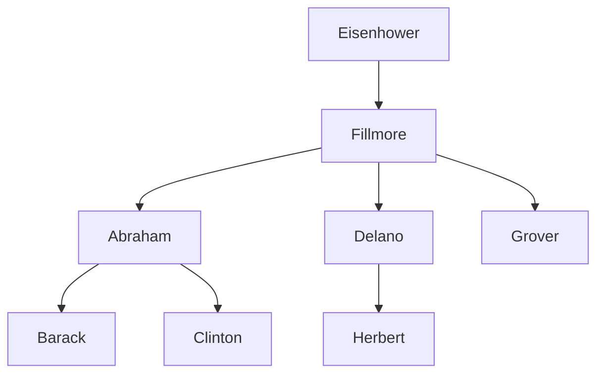

> **课程体系**：UC Berkeley CS61A (Fall 2024)  
> **所属模块**：Module 5: 声明式编程与 SQL (Declarative & SQL)  
> **主讲教师**：Prof. John DeNero (UC Berkeley)  
> **视频时长**：25:43 ｜ **课堂截图**：17 张板书/代码演示  
> **视频直达**：[📺 在 B 站观看本讲原视频 (P33)](https://www.bilibili.com/video/BV1sy411z7nA/?p=33)  
> **快速导航**：[← 上一讲 (P32 Lecture 34 Macros)](/notes/cs61a/lecture-32) ｜ [📚 返回全书目录](/notes/topics/CS61A) ｜ [下一讲 (P34 Lecture 36 Tables) →](/notes/cs61a/lecture-34)

---

## 课程核心目标与全景图

从课程开始至今，我们所学习的所有编程范式——过程式编程、面向对象编程、函数式编程——本质上都属于**指令式编程（Imperative Programming）**：程序员需要详尽地向计算机描述“第一步做什么、第二步做什么、如何在循环中修改变量”。

本讲我们将迈入全新的世界：**声明式编程（Declarative Programming）**。其工业界的集大成者正是统治全球数据存储半个多世纪的**结构化查询语言（SQL, Structured Query Language）**。

在声明式编程中：
- 程序员**仅需描述最终期望的结果结构**（“找出一周内消费超过 100 美元的所有用户”）；
- 数据库管理系统（DBMS）的**查询优化器（Query Optimizer）**自动推演并决定最底层的扫描算法、索引查找与排序执行路径！



---

### 深入形式化规约与微观求值流程（Operational Semantics）
在「课程核心目标与全景图」模块中，计算机底层运算依赖于严密的形式化求值逻辑：
1. **抽象语法树（AST）的分层解析**：
   - 源代码字符流首先经过词法分析器（Lexer）切分为终结符标记（Tokens），随后由语法解析器（Parser）构造成多叉语法树；
   - 运算符优先级与结合性在语法树构建阶段即已固化，消除了运行期的二义性；
2. **环境序列的动态跃迁**：
   - 每次函数调用产生的新帧，其静态词法环境由函数对象的 `parent` 属性完全决定；
   - 变量查找沿环境链向上单向回溯，直到全局环境帧，若未找到则触发 `NameError` 异常；
3. **状态不变式（State Invariants）**：
   - 编写健壮程序的关键在于明确循环不变式（Loop Invariants）与函数前后置条件（Pre/Post-conditions）；
   - 在复杂控制流跳转中，确保状态变量在每次迭代前均维持合法的业务约束。


## 1. 关系数据库与表结构 (Databases, Tables & Records)

数据库管理系统（DBMS）是当今软件基础设施中最关键的系统软件之一。关系模型的核心抽象是**表（Table）**：
- **列（Column / Attribute）**：拥有唯一的列名，并定义了该属性的数据类型（如整型、字符串等）；
- **行（Row / Record）**：代表一条具体的实体记录，包含该实体在所有列上的具体取值。

[](https://www.bilibili.com/video/BV1sy411z7nA/?p=33&t=29)
*⏱ 时间戳：00:00:29 · 📷 课堂截图 · [在 B 站观看对应片段 (P33 00:00:29)](https://www.bilibili.com/video/BV1sy411z7nA/?p=33&t=29)*

#### 📸 课堂板书与代码演示深入精读 (00:00:29)

**【现场板书 / 代码演示还原】**：
在此时间节点，DeNero 教授在屏幕上进行了核心演示与重点板书推导：
> *“Databases hold data in structured tables, and database management systems are some of the most important, heavily used and interesting large software applications there are. Organizations spend a lot of money on their database management systems, and there are also wonderful open source projects. An...”*

**【底层计算模型与微观执行机制】**：
1. **执行上下文与时序追踪**：
   - 处于当前讨论节点「1. 关系数据库与表结构 (Databases, Tables & Records)」，解释器严格遵循核心求值规约；
   - 表达式先求值操作符，随后自左至右严格求值操作数，最终将函数对象施加于实参列表；
   - 若涉及环境模型，局部帧严格记录其静态词法父指针（Parent Pointer 指向函数定义处的环境），与运行时的动态调用栈形成正交架构。
2. **内存拓扑与对象引用**：
   - 变量符号只是哈希表（环境帧）中的键，指针直接指向堆内存中的一等公民对象；
   - 赋值语句是离散时间的瞬时状态快照，绝不会建立隐式的数学依赖监听。

**【避坑指南与高频考点点拨】**：
- **常见思维误区**：在「声明式思维 (Declarative) vs 命令式思维 (Imperative)、WHERE 过滤与投影」相关考题中，初学者极易根据代码表面形式猜想结果，导致作用域混淆或变量遮蔽（Shadowing）误判；
- **调试排错黄金法则**：遇到嵌套调用与复杂分支时，务必在草稿纸上画出独立的局部帧，标明每个形参的具体绑定值，按部就班推导。


---

### 深入形式化规约与微观求值流程（Operational Semantics）
在「1. 关系数据库与表结构 (Databases, Tables & Records)」模块中，计算机底层运算依赖于严密的形式化求值逻辑：
1. **抽象语法树（AST）的分层解析**：
   - 源代码字符流首先经过词法分析器（Lexer）切分为终结符标记（Tokens），随后由语法解析器（Parser）构造成多叉语法树；
   - 运算符优先级与结合性在语法树构建阶段即已固化，消除了运行期的二义性；
2. **环境序列的动态跃迁**：
   - 每次函数调用产生的新帧，其静态词法环境由函数对象的 `parent` 属性完全决定；
   - 变量查找沿环境链向上单向回溯，直到全局环境帧，若未找到则触发 `NameError` 异常；
3. **状态不变式（State Invariants）**：
   - 编写健壮程序的关键在于明确循环不变式（Loop Invariants）与函数前后置条件（Pre/Post-conditions）；
   - 在复杂控制流跳转中，确保状态变量在每次迭代前均维持合法的业务约束。


## 2. 编程范式变革：指令式 vs 声明式 (Imperative vs Declarative)

[](https://www.bilibili.com/video/BV1sy411z7nA/?p=33&t=86)
*⏱ 时间戳：00:01:26 · 📷 课堂截图 · [在 B 站观看对应片段 (P33 00:01:26)](https://www.bilibili.com/video/BV1sy411z7nA/?p=33&t=86)*

#### 📸 课堂板书与代码演示深入精读 (00:01:26)

**【现场板书 / 代码演示还原】**：
在此时间节点，DeNero 教授在屏幕上进行了核心演示与重点板书推导：
> *“So this is not a record at the top, this is just the name of the columns, and the name of the column tells you what attribute of the record is contained within that column. Simple enough. It's also typically the case that there is some type of value associated with each column, so these are all stri...”*

**【底层计算模型与微观执行机制】**：
1. **执行上下文与时序追踪**：
   - 处于当前讨论节点「2. 编程范式变革：指令式 vs 声明式 (Imperative vs Declarative)」，解释器严格遵循核心求值规约；
   - 表达式先求值操作符，随后自左至右严格求值操作数，最终将函数对象施加于实参列表；
   - 若涉及环境模型，局部帧严格记录其静态词法父指针（Parent Pointer 指向函数定义处的环境），与运行时的动态调用栈形成正交架构。
2. **内存拓扑与对象引用**：
   - 变量符号只是哈希表（环境帧）中的键，指针直接指向堆内存中的一等公民对象；
   - 赋值语句是离散时间的瞬时状态快照，绝不会建立隐式的数学依赖监听。

**【避坑指南与高频考点点拨】**：
- **常见思维误区**：在「声明式思维 (Declarative) vs 命令式思维 (Imperative)、WHERE 过滤与投影」相关考题中，初学者极易根据代码表面形式猜想结果，导致作用域混淆或变量遮蔽（Shadowing）误判；
- **调试排错黄金法则**：遇到嵌套调用与复杂分支时，务必在草稿纸上画出独立的局部帧，标明每个形参的具体绑定值，按部就班推导。


| 编程范式 | 核心思想 | 程序员的职责 | 系统的职责 |
| :--- | :--- | :--- | :--- |
| **指令式 (Imperative)** | 描述计算过程 (Description of Process) | 编写算法步骤、循环条件与状态变化 | 机械忠实地执行每一步 |
| **声明式 (Declarative)** | 描述计算目标 (Description of Result) | 给出目标结果的数学谓词与逻辑关系 | 自主选择最优执行路径并返回结果 |

在 SQL 中，由于执行路径完全交由数据库引擎决定，执行顺序可能与代码书写顺序完全不同，但这极大地解放了程序员的生产力。

---

### 深入形式化规约与微观求值流程（Operational Semantics）
在「2. 编程范式变革：指令式 vs 声明式 (Imperative vs Declarative)」模块中，计算机底层运算依赖于严密的形式化求值逻辑：
1. **抽象语法树（AST）的分层解析**：
   - 源代码字符流首先经过词法分析器（Lexer）切分为终结符标记（Tokens），随后由语法解析器（Parser）构造成多叉语法树；
   - 运算符优先级与结合性在语法树构建阶段即已固化，消除了运行期的二义性；
2. **环境序列的动态跃迁**：
   - 每次函数调用产生的新帧，其静态词法环境由函数对象的 `parent` 属性完全决定；
   - 变量查找沿环境链向上单向回溯，直到全局环境帧，若未找到则触发 `NameError` 异常；
3. **状态不变式（State Invariants）**：
   - 编写健壮程序的关键在于明确循环不变式（Loop Invariants）与函数前后置条件（Pre/Post-conditions）；
   - 在复杂控制流跳转中，确保状态变量在每次迭代前均维持合法的业务约束。


## 3. 从零创建表与行级投影 (Creating Tables & `SELECT`)

尽管工业级数据大多来自外部写入，但在 SQL 中我们可以直接使用字面量（Literals）构建数据：

```sql
SELECT 38 AS latitude, 122 AS longitude, "Berkeley" AS name;
```

[](https://www.bilibili.com/video/BV1sy411z7nA/?p=33&t=199)
*⏱ 时间戳：00:03:19 · 📷 课堂截图 · [在 B 站观看对应片段 (P33 00:03:19)](https://www.bilibili.com/video/BV1sy411z7nA/?p=33&t=199)*

#### 📸 课堂板书与代码演示深入精读 (00:03:19)

**【现场板书 / 代码演示还原】**：
在此时间节点，DeNero 教授在屏幕上进行了核心演示与重点板书推导：
> *“Okay, so here's another example of SQL. How do we get the tables in the first place? Well, normally they are built up through some process like some other application, logging information or somebody typing it in. But it is possible to create a table from scratch using the structured query language....”*

**【底层计算模型与微观执行机制】**：
1. **执行上下文与时序追踪**：
   - 处于当前讨论节点「3. 从零创建表与行级投影 (Creating Tables & `SELECT`)」，解释器严格遵循核心求值规约；
   - 表达式先求值操作符，随后自左至右严格求值操作数，最终将函数对象施加于实参列表；
   - 若涉及环境模型，局部帧严格记录其静态词法父指针（Parent Pointer 指向函数定义处的环境），与运行时的动态调用栈形成正交架构。
2. **内存拓扑与对象引用**：
   - 变量符号只是哈希表（环境帧）中的键，指针直接指向堆内存中的一等公民对象；
   - 赋值语句是离散时间的瞬时状态快照，绝不会建立隐式的数学依赖监听。

**【避坑指南与高频考点点拨】**：
- **常见思维误区**：在「声明式思维 (Declarative) vs 命令式思维 (Imperative)、WHERE 过滤与投影」相关考题中，初学者极易根据代码表面形式猜想结果，导致作用域混淆或变量遮蔽（Shadowing）误判；
- **调试排错黄金法则**：遇到嵌套调用与复杂分支时，务必在草稿纸上画出独立的局部帧，标明每个形参的具体绑定值，按部就班推导。


- `SELECT` 后面跟逗号分隔的列描述；
- `AS <name>` 用于重命名列标题；
- 字符串必须使用双引号或单引号包围，而列名不需要引号。

### 联合多行：`UNION` 运算符

使用 `UNION` 可以将多个单行结果拼接为一个多行新表：

```sql
CREATE TABLE cities AS
  SELECT 38 AS latitude, 122 AS longitude, "Berkeley" AS name UNION
  SELECT 42,             71,               "Cambridge"        UNION
  SELECT 45,             93,               "Minneapolis";
```

[](https://www.bilibili.com/video/BV1sy411z7nA/?p=33&t=283)
*⏱ 时间戳：00:04:43 · 📷 课堂截图 · [在 B 站观看对应片段 (P33 00:04:43)](https://www.bilibili.com/video/BV1sy411z7nA/?p=33&t=283)*

#### 📸 课堂板书与代码演示深入精读 (00:04:43)

**【现场板书 / 代码演示还原】**：
在此时间节点，DeNero 教授在屏幕上进行了核心演示与重点板书推导：
> *“We'd like multiple rows. You can do that with union, which takes a description of another one row table and puts that together into a two row table. And you can union multiple times in order to, for example, get a three row table. Like I said, this is an uncommon way of building a table that would o...”*

**【底层计算模型与微观执行机制】**：
1. **执行上下文与时序追踪**：
   - 处于当前讨论节点「3. 从零创建表与行级投影 (Creating Tables & `SELECT`)」，解释器严格遵循核心求值规约；
   - 表达式先求值操作符，随后自左至右严格求值操作数，最终将函数对象施加于实参列表；
   - 若涉及环境模型，局部帧严格记录其静态词法父指针（Parent Pointer 指向函数定义处的环境），与运行时的动态调用栈形成正交架构。
2. **内存拓扑与对象引用**：
   - 变量符号只是哈希表（环境帧）中的键，指针直接指向堆内存中的一等公民对象；
   - 赋值语句是离散时间的瞬时状态快照，绝不会建立隐式的数学依赖监听。

**【避坑指南与高频考点点拨】**：
- **常见思维误区**：在「声明式思维 (Declarative) vs 命令式思维 (Imperative)、WHERE 过滤与投影」相关考题中，初学者极易根据代码表面形式猜想结果，导致作用域混淆或变量遮蔽（Shadowing）误判；
- **调试排错黄金法则**：遇到嵌套调用与复杂分支时，务必在草稿纸上画出独立的局部帧，标明每个形参的具体绑定值，按部就班推导。


通过对已有表进行带条件的查询投影，我们可以轻松生成衍生分析表：

```sql
SELECT "West Coast" AS region, name FROM cities WHERE longitude >= 115 UNION
SELECT "Other"      AS region, name FROM cities WHERE longitude < 115;
```

---

### 深入形式化规约与微观求值流程（Operational Semantics）
在「3. 从零创建表与行级投影 (Creating Tables & `SELECT`)」模块中，计算机底层运算依赖于严密的形式化求值逻辑：
1. **抽象语法树（AST）的分层解析**：
   - 源代码字符流首先经过词法分析器（Lexer）切分为终结符标记（Tokens），随后由语法解析器（Parser）构造成多叉语法树；
   - 运算符优先级与结合性在语法树构建阶段即已固化，消除了运行期的二义性；
2. **环境序列的动态跃迁**：
   - 每次函数调用产生的新帧，其静态词法环境由函数对象的 `parent` 属性完全决定；
   - 变量查找沿环境链向上单向回溯，直到全局环境帧，若未找到则触发 `NameError` 异常；
3. **状态不变式（State Invariants）**：
   - 编写健壮程序的关键在于明确循环不变式（Loop Invariants）与函数前后置条件（Pre/Post-conditions）；
   - 在复杂控制流跳转中，确保状态变量在每次迭代前均维持合法的业务约束。


## 4. SQL 语言核心：无所不在的 `SELECT` (The Power of `SELECT`)

SQL 标准虽然包含了大量的 DML/DDL 语句（如 `INSERT`、`UPDATE`、`DELETE`、`EXPLAIN` 等），但其最本质、最纯粹的计算内核几乎完全蕴含在 `SELECT` 语句之中：

[](https://www.bilibili.com/video/BV1sy411z7nA/?p=33&t=394)
*⏱ 时间戳：00:06:34 · 📷 课堂截图 · [在 B 站观看对应片段 (P33 00:06:34)](https://www.bilibili.com/video/BV1sy411z7nA/?p=33&t=394)*

#### 📸 课堂板书与代码演示深入精读 (00:06:34)

**【现场板书 / 代码演示还原】**：
在此时间节点，DeNero 教授在屏幕上进行了核心演示与重点板书推导：
> *“But being able to manipulate data in this way is incredibly useful. So we will now learn the details of the SQL language so that you can see the breadth of things that it's able to do. Time to learn a new programming language, the structured query language. SQL is standardized based on a specificati...”*

**【底层计算模型与微观执行机制】**：
1. **执行上下文与时序追踪**：
   - 处于当前讨论节点「4. SQL 语言核心：无所不在的 `SELECT` (The Power of `SELECT`)」，解释器严格遵循核心求值规约；
   - 表达式先求值操作符，随后自左至右严格求值操作数，最终将函数对象施加于实参列表；
   - 若涉及环境模型，局部帧严格记录其静态词法父指针（Parent Pointer 指向函数定义处的环境），与运行时的动态调用栈形成正交架构。
2. **内存拓扑与对象引用**：
   - 变量符号只是哈希表（环境帧）中的键，指针直接指向堆内存中的一等公民对象；
   - 赋值语句是离散时间的瞬时状态快照，绝不会建立隐式的数学依赖监听。

**【避坑指南与高频考点点拨】**：
- **常见思维误区**：在「声明式思维 (Declarative) vs 命令式思维 (Imperative)、WHERE 过滤与投影」相关考题中，初学者极易根据代码表面形式猜想结果，导致作用域混淆或变量遮蔽（Shadowing）误判；
- **调试排错黄金法则**：遇到嵌套调用与复杂分支时，务必在草稿纸上画出独立的局部帧，标明每个形参的具体绑定值，按部就班推导。


- `SELECT` 既是查询语句，又是构建新表的**纯函数式生成器**；
- 一个小巧的 Python 解释器只需百行代码就能实现一个完整的 `SELECT` 引擎内核！

---

### 深入形式化规约与微观求值流程（Operational Semantics）
在「4. SQL 语言核心：无所不在的 `SELECT` (The Power of `SELECT`)」模块中，计算机底层运算依赖于严密的形式化求值逻辑：
1. **抽象语法树（AST）的分层解析**：
   - 源代码字符流首先经过词法分析器（Lexer）切分为终结符标记（Tokens），随后由语法解析器（Parser）构造成多叉语法树；
   - 运算符优先级与结合性在语法树构建阶段即已固化，消除了运行期的二义性；
2. **环境序列的动态跃迁**：
   - 每次函数调用产生的新帧，其静态词法环境由函数对象的 `parent` 属性完全决定；
   - 变量查找沿环境链向上单向回溯，直到全局环境帧，若未找到则触发 `NameError` 异常；
3. **状态不变式（State Invariants）**：
   - 编写健壮程序的关键在于明确循环不变式（Loop Invariants）与函数前后置条件（Pre/Post-conditions）；
   - 在复杂控制流跳转中，确保状态变量在每次迭代前均维持合法的业务约束。


## 5. 经典实战主题：小狗家族树 (The Dogs Family Tree)

John DeNero 教授以他最喜欢的狗狗家谱为背景，建立了一组按字母顺序 A 到 H 命名的狗谱数据：

[](https://www.bilibili.com/video/BV1sy411z7nA/?p=33&t=515)
*⏱ 时间戳：00:08:35 · 📷 课堂截图 · [在 B 站观看对应片段 (P33 00:08:35)](https://www.bilibili.com/video/BV1sy411z7nA/?p=33&t=515)*

#### 📸 课堂板书与代码演示深入精读 (00:08:35)

**【现场板书 / 代码演示还原】**：
在此时间节点，DeNero 教授在屏幕上进行了核心演示与重点板书推导：
> *“Quite easily, using Python, and we'll go over the details of that in the next lecture. But first, we have to learn how to use the language. We're going to take a break from Fibonacci sequences and integer sequences and all of that, and instead focus on a theme for the day, and that theme is dogs. I ...”*

**【底层计算模型与微观执行机制】**：
1. **执行上下文与时序追踪**：
   - 处于当前讨论节点「5. 经典实战主题：小狗家族树 (The Dogs Family Tree)」，解释器严格遵循核心求值规约；
   - 表达式先求值操作符，随后自左至右严格求值操作数，最终将函数对象施加于实参列表；
   - 若涉及环境模型，局部帧严格记录其静态词法父指针（Parent Pointer 指向函数定义处的环境），与运行时的动态调用栈形成正交架构。
2. **内存拓扑与对象引用**：
   - 变量符号只是哈希表（环境帧）中的键，指针直接指向堆内存中的一等公民对象；
   - 赋值语句是离散时间的瞬时状态快照，绝不会建立隐式的数学依赖监听。

**【避坑指南与高频考点点拨】**：
- **常见思维误区**：在「声明式思维 (Declarative) vs 命令式思维 (Imperative)、WHERE 过滤与投影」相关考题中，初学者极易根据代码表面形式猜想结果，导致作用域混淆或变量遮蔽（Shadowing）误判；
- **调试排错黄金法则**：遇到嵌套调用与复杂分支时，务必在草稿纸上画出独立的局部帧，标明每个形参的具体绑定值，按部就班推导。


[](https://www.bilibili.com/video/BV1sy411z7nA/?p=33&t=641)
*⏱ 时间戳：00:10:41 · 📷 课堂截图 · [在 B 站观看对应片段 (P33 00:10:41)](https://www.bilibili.com/video/BV1sy411z7nA/?p=33&t=641)*

#### 📸 课堂板书与代码演示深入精读 (00:10:41)

**【现场板书 / 代码演示还原】**：
在此时间节点，DeNero 教授在屏幕上进行了核心演示与重点板书推导：
> *“So this would create a two-column table. As and the name are optional. You can have more of these. Whenever you're done declaring different columns, you should put a semicolon at the end. All SQL statements end in a semicolon. If you select literals, which are expressions like the number two or the ...”*

**【底层计算模型与微观执行机制】**：
1. **执行上下文与时序追踪**：
   - 处于当前讨论节点「5. 经典实战主题：小狗家族树 (The Dogs Family Tree)」，解释器严格遵循核心求值规约；
   - 表达式先求值操作符，随后自左至右严格求值操作数，最终将函数对象施加于实参列表；
   - 若涉及环境模型，局部帧严格记录其静态词法父指针（Parent Pointer 指向函数定义处的环境），与运行时的动态调用栈形成正交架构。
2. **内存拓扑与对象引用**：
   - 变量符号只是哈希表（环境帧）中的键，指针直接指向堆内存中的一等公民对象；
   - 赋值语句是离散时间的瞬时状态快照，绝不会建立隐式的数学依赖监听。

**【避坑指南与高频考点点拨】**：
- **常见思维误区**：在「声明式思维 (Declarative) vs 命令式思维 (Imperative)、WHERE 过滤与投影」相关考题中，初学者极易根据代码表面形式猜想结果，导致作用域混淆或变量遮蔽（Shadowing）误判；
- **调试排错黄金法则**：遇到嵌套调用与复杂分支时，务必在草稿纸上画出独立的局部帧，标明每个形参的具体绑定值，按部就班推导。


[](https://www.bilibili.com/video/BV1sy411z7nA/?p=33&t=728)
*⏱ 时间戳：00:12:08 · 📷 课堂截图 · [在 B 站观看对应片段 (P33 00:12:08)](https://www.bilibili.com/video/BV1sy411z7nA/?p=33&t=728)*

#### 📸 课堂板书与代码演示深入精读 (00:12:08)

**【现场板书 / 代码演示还原】**：
在此时间节点，DeNero 教授在屏幕上进行了核心演示与重点板书推导：
> *“So a select statement with literals Abraham and Barack will create a one-row table with two columns, a parent column, and a child column. And the values that go in those are the values of the literals, Abraham the string and Barack the string. Now, if I have more dogs, which I do, then I'll need to ...”*

**【底层计算模型与微观执行机制】**：
1. **执行上下文与时序追踪**：
   - 处于当前讨论节点「5. 经典实战主题：小狗家族树 (The Dogs Family Tree)」，解释器严格遵循核心求值规约；
   - 表达式先求值操作符，随后自左至右严格求值操作数，最终将函数对象施加于实参列表；
   - 若涉及环境模型，局部帧严格记录其静态词法父指针（Parent Pointer 指向函数定义处的环境），与运行时的动态调用栈形成正交架构。
2. **内存拓扑与对象引用**：
   - 变量符号只是哈希表（环境帧）中的键，指针直接指向堆内存中的一等公民对象；
   - 赋值语句是离散时间的瞬时状态快照，绝不会建立隐式的数学依赖监听。

**【避坑指南与高频考点点拨】**：
- **常见思维误区**：在「声明式思维 (Declarative) vs 命令式思维 (Imperative)、WHERE 过滤与投影」相关考题中，初学者极易根据代码表面形式猜想结果，导致作用域混淆或变量遮蔽（Shadowing）误判；
- **调试排错黄金法则**：遇到嵌套调用与复杂分支时，务必在草稿纸上画出独立的局部帧，标明每个形参的具体绑定值，按部就班推导。




### 建立 `parents` 关系表

```sql
CREATE TABLE parents AS
  SELECT "abraham" AS parent, "barack" AS child UNION
  SELECT "abraham",           "clinton"         UNION
  SELECT "delano",            "herbert"         UNION
  SELECT "fillmore",          "abraham"         UNION
  SELECT "fillmore",          "delano"          UNION
  SELECT "fillmore",          "grover"          UNION
  SELECT "eisenhower",        "fillmore";
```

[](https://www.bilibili.com/video/BV1sy411z7nA/?p=33&t=817)
*⏱ 时间戳：00:13:37 · 📷 课堂截图 · [在 B 站观看对应片段 (P33 00:13:37)](https://www.bilibili.com/video/BV1sy411z7nA/?p=33&t=817)*

#### 📸 课堂板书与代码演示深入精读 (00:13:37)

**【现场板书 / 代码演示还原】**：
在此时间节点，DeNero 教授在屏幕上进行了核心演示与重点板书推导：
> *“SQL is often used as an interactive language. You just want to see within the database. And so, by default, the result of a SELECT statement, or a bunch of SELECT statements unioned together, won't be stored. The result of a SELECT statement is displayed to the user instead. If you want to store it,...”*

**【底层计算模型与微观执行机制】**：
1. **执行上下文与时序追踪**：
   - 处于当前讨论节点「5. 经典实战主题：小狗家族树 (The Dogs Family Tree)」，解释器严格遵循核心求值规约；
   - 表达式先求值操作符，随后自左至右严格求值操作数，最终将函数对象施加于实参列表；
   - 若涉及环境模型，局部帧严格记录其静态词法父指针（Parent Pointer 指向函数定义处的环境），与运行时的动态调用栈形成正交架构。
2. **内存拓扑与对象引用**：
   - 变量符号只是哈希表（环境帧）中的键，指针直接指向堆内存中的一等公民对象；
   - 赋值语句是离散时间的瞬时状态快照，绝不会建立隐式的数学依赖监听。

**【避坑指南与高频考点点拨】**：
- **常见思维误区**：在「声明式思维 (Declarative) vs 命令式思维 (Imperative)、WHERE 过滤与投影」相关考题中，初学者极易根据代码表面形式猜想结果，导致作用域混淆或变量遮蔽（Shadowing）误判；
- **调试排错黄金法则**：遇到嵌套调用与复杂分支时，务必在草稿纸上画出独立的局部帧，标明每个形参的具体绑定值，按部就班推导。


---

### 深入形式化规约与微观求值流程（Operational Semantics）
在「5. 经典实战主题：小狗家族树 (The Dogs Family Tree)」模块中，计算机底层运算依赖于严密的形式化求值逻辑：
1. **抽象语法树（AST）的分层解析**：
   - 源代码字符流首先经过词法分析器（Lexer）切分为终结符标记（Tokens），随后由语法解析器（Parser）构造成多叉语法树；
   - 运算符优先级与结合性在语法树构建阶段即已固化，消除了运行期的二义性；
2. **环境序列的动态跃迁**：
   - 每次函数调用产生的新帧，其静态词法环境由函数对象的 `parent` 属性完全决定；
   - 变量查找沿环境链向上单向回溯，直到全局环境帧，若未找到则触发 `NameError` 异常；
3. **状态不变式（State Invariants）**：
   - 编写健壮程序的关键在于明确循环不变式（Loop Invariants）与函数前后置条件（Pre/Post-conditions）；
   - 在复杂控制流跳转中，确保状态变量在每次迭代前均维持合法的业务约束。


## 6. 查询投影与条件过滤 (`FROM`, `WHERE`, `ORDER BY`)

`SELECT` 语句的完整单表查询语法结构如下：

```sql
SELECT <column_expressions>
FROM <input_table>
WHERE <filter_condition>
ORDER BY <sort_ordering>;
```

[](https://www.bilibili.com/video/BV1sy411z7nA/?p=33&t=884)
*⏱ 时间戳：00:14:44 · 📷 课堂截图 · [在 B 站观看对应片段 (P33 00:14:44)](https://www.bilibili.com/video/BV1sy411z7nA/?p=33&t=884)*

#### 📸 课堂板书与代码演示深入精读 (00:14:44)

**【现场板书 / 代码演示还原】**：
在此时间节点，DeNero 教授在屏幕上进行了核心演示与重点板书推导：
> *“And if we wanted to draw that out explicitly, we might write something like parents with a parent column and a child column and all this stuff inside. Now that we know how to create tables from scratch, let's talk about projecting tables. So select statements can project existing tables into new tab...”*

**【底层计算模型与微观执行机制】**：
1. **执行上下文与时序追踪**：
   - 处于当前讨论节点「6. 查询投影与条件过滤 (`FROM`, `WHERE`, `ORDER BY`)」，解释器严格遵循核心求值规约；
   - 表达式先求值操作符，随后自左至右严格求值操作数，最终将函数对象施加于实参列表；
   - 若涉及环境模型，局部帧严格记录其静态词法父指针（Parent Pointer 指向函数定义处的环境），与运行时的动态调用栈形成正交架构。
2. **内存拓扑与对象引用**：
   - 变量符号只是哈希表（环境帧）中的键，指针直接指向堆内存中的一等公民对象；
   - 赋值语句是离散时间的瞬时状态快照，绝不会建立隐式的数学依赖监听。

**【避坑指南与高频考点点拨】**：
- **常见思维误区**：在「声明式思维 (Declarative) vs 命令式思维 (Imperative)、WHERE 过滤与投影」相关考题中，初学者极易根据代码表面形式猜想结果，导致作用域混淆或变量遮蔽（Shadowing）误判；
- **调试排错黄金法则**：遇到嵌套调用与复杂分支时，务必在草稿纸上画出独立的局部帧，标明每个形参的具体绑定值，按部就班推导。


### 查询示例与字典序比较

1. 查询所有以 `abraham` 为父辈的孩子：
   ```sql
   SELECT child FROM parents WHERE parent = "abraham";
   -- 结果: barack, clinton
   ```

2. 查找父名在字母表中晚于子名的行：
   ```sql
   SELECT parent FROM parents WHERE parent > child;
   -- 结果: fillmore (来自 fillmore > abraham)
   --       fillmore (来自 fillmore > delano)
   ```

[](https://www.bilibili.com/video/BV1sy411z7nA/?p=33&t=977)
*⏱ 时间戳：00:16:17 · 📷 课堂截图 · [在 B 站观看对应片段 (P33 00:16:17)](https://www.bilibili.com/video/BV1sy411z7nA/?p=33&t=977)*

#### 📸 课堂板书与代码演示深入精读 (00:16:17)

**【现场板书 / 代码演示还原】**：
在此时间节点，DeNero 教授在屏幕上进行了核心演示与重点板书推导：
> *“The rows that we choose are here, but the input rows get transformed or projected into the output rows. So imagine I have my parents table, which I already told you about, and then I write another select statement. Select child from parents. Parents is the name of the table that contains these data,...”*

**【底层计算模型与微观执行机制】**：
1. **执行上下文与时序追踪**：
   - 处于当前讨论节点「6. 查询投影与条件过滤 (`FROM`, `WHERE`, `ORDER BY`)」，解释器严格遵循核心求值规约；
   - 表达式先求值操作符，随后自左至右严格求值操作数，最终将函数对象施加于实参列表；
   - 若涉及环境模型，局部帧严格记录其静态词法父指针（Parent Pointer 指向函数定义处的环境），与运行时的动态调用栈形成正交架构。
2. **内存拓扑与对象引用**：
   - 变量符号只是哈希表（环境帧）中的键，指针直接指向堆内存中的一等公民对象；
   - 赋值语句是离散时间的瞬时状态快照，绝不会建立隐式的数学依赖监听。

**【避坑指南与高频考点点拨】**：
- **常见思维误区**：在「声明式思维 (Declarative) vs 命令式思维 (Imperative)、WHERE 过滤与投影」相关考题中，初学者极易根据代码表面形式猜想结果，导致作用域混淆或变量遮蔽（Shadowing）误判；
- **调试排错黄金法则**：遇到嵌套调用与复杂分支时，务必在草稿纸上画出独立的局部帧，标明每个形参的具体绑定值，按部就班推导。


注意：`fillmore` 出现了两次！SQL 表默认是**多重集（Multiset / Bag）**，允许相同的行重复出现。

---

### 深入形式化规约与微观求值流程（Operational Semantics）
在「6. 查询投影与条件过滤 (`FROM`, `WHERE`, `ORDER BY`)」模块中，计算机底层运算依赖于严密的形式化求值逻辑：
1. **抽象语法树（AST）的分层解析**：
   - 源代码字符流首先经过词法分析器（Lexer）切分为终结符标记（Tokens），随后由语法解析器（Parser）构造成多叉语法树；
   - 运算符优先级与结合性在语法树构建阶段即已固化，消除了运行期的二义性；
2. **环境序列的动态跃迁**：
   - 每次函数调用产生的新帧，其静态词法环境由函数对象的 `parent` 属性完全决定；
   - 变量查找沿环境链向上单向回溯，直到全局环境帧，若未找到则触发 `NameError` 异常；
3. **状态不变式（State Invariants）**：
   - 编写健壮程序的关键在于明确循环不变式（Loop Invariants）与函数前后置条件（Pre/Post-conditions）；
   - 在复杂控制流跳转中，确保状态变量在每次迭代前均维持合法的业务约束。


## 7. SQLite 实操演练 (SQLite Interactive Shell)

在 SQLite 交互环境与命令行中直接执行上述语句：

[](https://www.bilibili.com/video/BV1sy411z7nA/?p=33&t=1070)
*⏱ 时间戳：00:17:50 · 📷 课堂截图 · [在 B 站观看对应片段 (P33 00:17:50)](https://www.bilibili.com/video/BV1sy411z7nA/?p=33&t=1070)*

#### 📸 课堂板书与代码演示深入精读 (00:17:50)

**【现场板书 / 代码演示还原】**：
在此时间节点，DeNero 教授在屏幕上进行了核心演示与重点板书推导：
> *“Let's actually execute these different statements and watch how they work. I'm going to use the online SQL interpreter. Here's the create table statement for parents. If I execute it, then parents is defined. I could select all of the columns, that's shorthand for all of the columns, from parents in...”*

**【底层计算模型与微观执行机制】**：
1. **执行上下文与时序追踪**：
   - 处于当前讨论节点「7. SQLite 实操演练 (SQLite Interactive Shell)」，解释器严格遵循核心求值规约；
   - 表达式先求值操作符，随后自左至右严格求值操作数，最终将函数对象施加于实参列表；
   - 若涉及环境模型，局部帧严格记录其静态词法父指针（Parent Pointer 指向函数定义处的环境），与运行时的动态调用栈形成正交架构。
2. **内存拓扑与对象引用**：
   - 变量符号只是哈希表（环境帧）中的键，指针直接指向堆内存中的一等公民对象；
   - 赋值语句是离散时间的瞬时状态快照，绝不会建立隐式的数学依赖监听。

**【避坑指南与高频考点点拨】**：
- **常见思维误区**：在「声明式思维 (Declarative) vs 命令式思维 (Imperative)、WHERE 过滤与投影」相关考题中，初学者极易根据代码表面形式猜想结果，导致作用域混淆或变量遮蔽（Shadowing）误判；
- **调试排错黄金法则**：遇到嵌套调用与复杂分支时，务必在草稿纸上画出独立的局部帧，标明每个形参的具体绑定值，按部就班推导。


使用 `SELECT * FROM parents;` 可以查看整张表，SQLite 默认使用竖线 `|` 分隔各列数据。

---

### 深入形式化规约与微观求值流程（Operational Semantics）
在「7. SQLite 实操演练 (SQLite Interactive Shell)」模块中，计算机底层运算依赖于严密的形式化求值逻辑：
1. **抽象语法树（AST）的分层解析**：
   - 源代码字符流首先经过词法分析器（Lexer）切分为终结符标记（Tokens），随后由语法解析器（Parser）构造成多叉语法树；
   - 运算符优先级与结合性在语法树构建阶段即已固化，消除了运行期的二义性；
2. **环境序列的动态跃迁**：
   - 每次函数调用产生的新帧，其静态词法环境由函数对象的 `parent` 属性完全决定；
   - 变量查找沿环境链向上单向回溯，直到全局环境帧，若未找到则触发 `NameError` 异常；
3. **状态不变式（State Invariants）**：
   - 编写健壮程序的关键在于明确循环不变式（Loop Invariants）与函数前后置条件（Pre/Post-conditions）；
   - 在复杂控制流跳转中，确保状态变量在每次迭代前均维持合法的业务约束。


## 8. 行内算术计算：滑雪场缆车容量分析 (Arithmetic in SQL)

在 `SELECT` 表达式中，不仅可以引用列名，还可以自由进行多项式数学运算。列名会被替换为当前输入行对应的具体数值：

```sql
-- 表 lift: chair (缆车号), single (单人乘客数), couple (双人乘客数)
SELECT chair, single + 2 * couple AS total FROM lift;
```

[](https://www.bilibili.com/video/BV1sy411z7nA/?p=33&t=1175)
*⏱ 时间戳：00:19:35 · 📷 课堂截图 · [在 B 站观看对应片段 (P33 00:19:35)](https://www.bilibili.com/video/BV1sy411z7nA/?p=33&t=1175)*

#### 📸 课堂板书与代码演示深入精读 (00:19:35)

**【现场板书 / 代码演示还原】**：
在此时间节点，DeNero 教授在屏幕上进行了核心演示与重点板书推导：
> *“In a select expression, column names evaluate to row values, and arithmetic expressions can combine row values and constants together to create new values. We're going to do an example based on chairlifts at ski resorts. Let's say that every lift chair has a number, and it also has the number of sin...”*

**【底层计算模型与微观执行机制】**：
1. **执行上下文与时序追踪**：
   - 处于当前讨论节点「8. 行内算术计算：滑雪场缆车容量分析 (Arithmetic in SQL)」，解释器严格遵循核心求值规约；
   - 表达式先求值操作符，随后自左至右严格求值操作数，最终将函数对象施加于实参列表；
   - 若涉及环境模型，局部帧严格记录其静态词法父指针（Parent Pointer 指向函数定义处的环境），与运行时的动态调用栈形成正交架构。
2. **内存拓扑与对象引用**：
   - 变量符号只是哈希表（环境帧）中的键，指针直接指向堆内存中的一等公民对象；
   - 赋值语句是离散时间的瞬时状态快照，绝不会建立隐式的数学依赖监听。

**【避坑指南与高频考点点拨】**：
- **常见思维误区**：在「声明式思维 (Declarative) vs 命令式思维 (Imperative)、WHERE 过滤与投影」相关考题中，初学者极易根据代码表面形式猜想结果，导致作用域混淆或变量遮蔽（Shadowing）误判；
- **调试排错黄金法则**：遇到嵌套调用与复杂分支时，务必在草稿纸上画出独立的局部帧，标明每个形参的具体绑定值，按部就班推导。


每张缆椅的载客总人数直接通过行内算术运算求出，各行独立并发计算，互不干扰。

---

### 深入形式化规约与微观求值流程（Operational Semantics）
在「8. 行内算术计算：滑雪场缆车容量分析 (Arithmetic in SQL)」模块中，计算机底层运算依赖于严密的形式化求值逻辑：
1. **抽象语法树（AST）的分层解析**：
   - 源代码字符流首先经过词法分析器（Lexer）切分为终结符标记（Tokens），随后由语法解析器（Parser）构造成多叉语法树；
   - 运算符优先级与结合性在语法树构建阶段即已固化，消除了运行期的二义性；
2. **环境序列的动态跃迁**：
   - 每次函数调用产生的新帧，其静态词法环境由函数对象的 `parent` 属性完全决定；
   - 变量查找沿环境链向上单向回溯，直到全局环境帧，若未找到则触发 `NameError` 异常；
3. **状态不变式（State Invariants）**：
   - 编写健壮程序的关键在于明确循环不变式（Loop Invariants）与函数前后置条件（Pre/Post-conditions）；
   - 在复杂控制流跳转中，确保状态变量在每次迭代前均维持合法的业务约束。


## 9. 深度思考题：二进制整数表示与声明式排序列行为

给定表 `ints`，用 4 个二进制权重位（1, 2, 4, 8）表示各个整数：

[](https://www.bilibili.com/video/BV1sy411z7nA/?p=33&t=1266)
*⏱ 时间戳：00:21:06 · 📷 课堂截图 · [在 B 站观看对应片段 (P33 00:21:06)](https://www.bilibili.com/video/BV1sy411z7nA/?p=33&t=1266)*

#### 📸 课堂板书与代码演示深入精读 (00:21:06)

**【现场板书 / 代码演示还原】**：
在此时间节点，DeNero 教授在屏幕上进行了核心演示与重点板书推导：
> *“Instead, I computed this output row from this input row, this output row from this input row, etc. And I used the names of columns to select the values in each row and then combine them here with a constant and do some multiplication and addition. Here's a discussion question. Given the table ints t...”*

**【底层计算模型与微观执行机制】**：
1. **执行上下文与时序追踪**：
   - 处于当前讨论节点「9. 深度思考题：二进制整数表示与声明式排序列行为」，解释器严格遵循核心求值规约；
   - 表达式先求值操作符，随后自左至右严格求值操作数，最终将函数对象施加于实参列表；
   - 若涉及环境模型，局部帧严格记录其静态词法父指针（Parent Pointer 指向函数定义处的环境），与运行时的动态调用栈形成正交架构。
2. **内存拓扑与对象引用**：
   - 变量符号只是哈希表（环境帧）中的键，指针直接指向堆内存中的一等公民对象；
   - 赋值语句是离散时间的瞬时状态快照，绝不会建立隐式的数学依赖监听。

**【避坑指南与高频考点点拨】**：
- **常见思维误区**：在「声明式思维 (Declarative) vs 命令式思维 (Imperative)、WHERE 过滤与投影」相关考题中，初学者极易根据代码表面形式猜想结果，导致作用域混淆或变量遮蔽（Shadowing）误判；
- **调试排错黄金法则**：遇到嵌套调用与复杂分支时，务必在草稿纸上画出独立的局部帧，标明每个形参的具体绑定值，按部就班推导。


```sql
-- 表 ints 列结构: word, one, two, four, eight
-- 如 "seven": 1, 2, 4, 0
```

### 声明式系统的无序性与去重机制

当使用 `UNION` 联合多个 `SELECT` 结果时，许多初学者会发现输出的行顺序与代码书写顺序完全不一致：

[](https://www.bilibili.com/video/BV1sy411z7nA/?p=33&t=1388)
*⏱ 时间戳：00:23:08 · 📷 课堂截图 · [在 B 站观看对应片段 (P33 00:23:08)](https://www.bilibili.com/video/BV1sy411z7nA/?p=33&t=1388)*

#### 📸 课堂板书与代码演示深入精读 (00:23:08)

**【现场板书 / 代码演示还原】**：
在此时间节点，DeNero 教授在屏幕上进行了核心演示与重点板书推导：
> *“Here's the table of ints. If I start SQLite, I can load that table and look at it using select star from ints. Notice something quite interesting. These rows don't appear in the order that I wrote them out in the first place. When you union together a bunch of select statements, you get no guarantee...”*

**【底层计算模型与微观执行机制】**：
1. **执行上下文与时序追踪**：
   - 处于当前讨论节点「9. 深度思考题：二进制整数表示与声明式排序列行为」，解释器严格遵循核心求值规约；
   - 表达式先求值操作符，随后自左至右严格求值操作数，最终将函数对象施加于实参列表；
   - 若涉及环境模型，局部帧严格记录其静态词法父指针（Parent Pointer 指向函数定义处的环境），与运行时的动态调用栈形成正交架构。
2. **内存拓扑与对象引用**：
   - 变量符号只是哈希表（环境帧）中的键，指针直接指向堆内存中的一等公民对象；
   - 赋值语句是离散时间的瞬时状态快照，绝不会建立隐式的数学依赖监听。

**【避坑指南与高频考点点拨】**：
- **常见思维误区**：在「声明式思维 (Declarative) vs 命令式思维 (Imperative)、WHERE 过滤与投影」相关考题中，初学者极易根据代码表面形式猜想结果，导致作用域混淆或变量遮蔽（Shadowing）误判；
- **调试排错黄金法则**：遇到嵌套调用与复杂分支时，务必在草稿纸上画出独立的局部帧，标明每个形参的具体绑定值，按部就班推导。


> **核心原理**：`UNION` 规范要求必须**剔除重复行**。数据库优化器为了最高效地检测重复行，往往会先在内存中按某一列对数据进行字典序排序。因此，**声明式查询的结果行序是不保证保持代码插入顺序的**！若需要严格的顺序，必须显式声明 `ORDER BY`。

---

### 深入形式化规约与微观求值流程（Operational Semantics）
在「9. 深度思考题：二进制整数表示与声明式排序列行为」模块中，计算机底层运算依赖于严密的形式化求值逻辑：
1. **抽象语法树（AST）的分层解析**：
   - 源代码字符流首先经过词法分析器（Lexer）切分为终结符标记（Tokens），随后由语法解析器（Parser）构造成多叉语法树；
   - 运算符优先级与结合性在语法树构建阶段即已固化，消除了运行期的二义性；
2. **环境序列的动态跃迁**：
   - 每次函数调用产生的新帧，其静态词法环境由函数对象的 `parent` 属性完全决定；
   - 变量查找沿环境链向上单向回溯，直到全局环境帧，若未找到则触发 `NameError` 异常；
3. **状态不变式（State Invariants）**：
   - 编写健壮程序的关键在于明确循环不变式（Loop Invariants）与函数前后置条件（Pre/Post-conditions）；
   - 在复杂控制流跳转中，确保状态变量在每次迭代前均维持合法的业务约束。


## 10. 练习解答：位权求和与筛选 2 的幂

[](https://www.bilibili.com/video/BV1sy411z7nA/?p=33&t=1448)
*⏱ 时间戳：00:24:08 · 📷 课堂截图 · [在 B 站观看对应片段 (P33 00:24:08)](https://www.bilibili.com/video/BV1sy411z7nA/?p=33&t=1448)*

#### 📸 课堂板书与代码演示深入精读 (00:24:08)

**【现场板书 / 代码演示还原】**：
在此时间节点，DeNero 教授在屏幕上进行了核心演示与重点板书推导：
> *“There's no particular procedure that's defined in advance that tells me how to compute the result of unioning together a bunch of select statements. Instead, it's up to the system to create the correct result, and this is the correct result in whatever way it chooses. And that might involve building...”*

**【底层计算模型与微观执行机制】**：
1. **执行上下文与时序追踪**：
   - 处于当前讨论节点「10. 练习解答：位权求和与筛选 2 的幂」，解释器严格遵循核心求值规约；
   - 表达式先求值操作符，随后自左至右严格求值操作数，最终将函数对象施加于实参列表；
   - 若涉及环境模型，局部帧严格记录其静态词法父指针（Parent Pointer 指向函数定义处的环境），与运行时的动态调用栈形成正交架构。
2. **内存拓扑与对象引用**：
   - 变量符号只是哈希表（环境帧）中的键，指针直接指向堆内存中的一等公民对象；
   - 赋值语句是离散时间的瞬时状态快照，绝不会建立隐式的数学依赖监听。

**【避坑指南与高频考点点拨】**：
- **常见思维误区**：在「声明式思维 (Declarative) vs 命令式思维 (Imperative)、WHERE 过滤与投影」相关考题中，初学者极易根据代码表面形式猜想结果，导致作用域混淆或变量遮蔽（Shadowing）误判；
- **调试排错黄金法则**：遇到嵌套调用与复杂分支时，务必在草稿纸上画出独立的局部帧，标明每个形参的具体绑定值，按部就班推导。


[](https://www.bilibili.com/video/BV1sy411z7nA/?p=33&t=1513)
*⏱ 时间戳：00:25:13 · 📷 课堂截图 · [在 B 站观看对应片段 (P33 00:25:13)](https://www.bilibili.com/video/BV1sy411z7nA/?p=33&t=1513)*

#### 📸 课堂板书与代码演示深入精读 (00:25:13)

**【现场板书 / 代码演示还原】**：
在此时间节点，DeNero 教授在屏幕上进行了核心演示与重点板书推导：
> *“These 1, 2, 4, and 8 appear. The second question was, how do I select only the words from the ints table that are powers of 2? Well, in order to do that, I need to write a where clause that's true only for the rows that are powers of 2. And I can find those rows by finding rows where one of these nu...”*

**【底层计算模型与微观执行机制】**：
1. **执行上下文与时序追踪**：
   - 处于当前讨论节点「10. 练习解答：位权求和与筛选 2 的幂」，解释器严格遵循核心求值规约；
   - 表达式先求值操作符，随后自左至右严格求值操作数，最终将函数对象施加于实参列表；
   - 若涉及环境模型，局部帧严格记录其静态词法父指针（Parent Pointer 指向函数定义处的环境），与运行时的动态调用栈形成正交架构。
2. **内存拓扑与对象引用**：
   - 变量符号只是哈希表（环境帧）中的键，指针直接指向堆内存中的一等公民对象；
   - 赋值语句是离散时间的瞬时状态快照，绝不会建立隐式的数学依赖监听。

**【避坑指南与高频考点点拨】**：
- **常见思维误区**：在「声明式思维 (Declarative) vs 命令式思维 (Imperative)、WHERE 过滤与投影」相关考题中，初学者极易根据代码表面形式猜想结果，导致作用域混淆或变量遮蔽（Shadowing）误判；
- **调试排错黄金法则**：遇到嵌套调用与复杂分支时，务必在草稿纸上画出独立的局部帧，标明每个形参的具体绑定值，按部就班推导。


### 题目 1：计算每个单词对应的实际整数值
```sql
SELECT word, one + two + four + eight AS value FROM ints;
```

### 题目 2：筛选出所有为 2 的整数次幂的数字单词
```sql
SELECT word FROM ints
WHERE (one > 0) + (two > 0) + (four > 0) + (eight > 0) = 1;
-- 仅保留恰好只有一个二进制位为 1 的记录！
-- 结果: one, two, four, eight
```

---

### 深入形式化规约与微观求值流程（Operational Semantics）
在「10. 练习解答：位权求和与筛选 2 的幂」模块中，计算机底层运算依赖于严密的形式化求值逻辑：
1. **抽象语法树（AST）的分层解析**：
   - 源代码字符流首先经过词法分析器（Lexer）切分为终结符标记（Tokens），随后由语法解析器（Parser）构造成多叉语法树；
   - 运算符优先级与结合性在语法树构建阶段即已固化，消除了运行期的二义性；
2. **环境序列的动态跃迁**：
   - 每次函数调用产生的新帧，其静态词法环境由函数对象的 `parent` 属性完全决定；
   - 变量查找沿环境链向上单向回溯，直到全局环境帧，若未找到则触发 `NameError` 异常；
3. **状态不变式（State Invariants）**：
   - 编写健壮程序的关键在于明确循环不变式（Loop Invariants）与函数前后置条件（Pre/Post-conditions）；
   - 在复杂控制流跳转中，确保状态变量在每次迭代前均维持合法的业务约束。


## 核心复习要点总结

| 核心组件 / 概念 | 语法与规则 | 核心功能 |
| :--- | :--- | :--- |
| **声明式范式** | 只关注目标，不关注流程 | 由数据库管理系统自动推导底层执行算法 |
| **`CREATE TABLE ... AS`** | `CREATE TABLE name AS SELECT ...` | 保存查询结果并命名为全局持久表 |
| **`SELECT`** | `SELECT expr AS col_name` | 投影与变换输入行，生成新表 |
| **`WHERE`** | `WHERE condition` | 对输入表逐行进行布尔谓词过滤 |
| **`UNION`** | `SELECT ... UNION SELECT ...` | 纵向合并行集，并自动去重（可能改变行序） |

### 深入形式化规约与微观求值流程（Operational Semantics）
在「核心复习要点总结」模块中，计算机底层运算依赖于严密的形式化求值逻辑：
1. **抽象语法树（AST）的分层解析**：
   - 源代码字符流首先经过词法分析器（Lexer）切分为终结符标记（Tokens），随后由语法解析器（Parser）构造成多叉语法树；
   - 运算符优先级与结合性在语法树构建阶段即已固化，消除了运行期的二义性；
2. **环境序列的动态跃迁**：
   - 每次函数调用产生的新帧，其静态词法环境由函数对象的 `parent` 属性完全决定；
   - 变量查找沿环境链向上单向回溯，直到全局环境帧，若未找到则触发 `NameError` 异常；
3. **状态不变式（State Invariants）**：
   - 编写健壮程序的关键在于明确循环不变式（Loop Invariants）与函数前后置条件（Pre/Post-conditions）；
   - 在复杂控制流跳转中，确保状态变量在每次迭代前均维持合法的业务约束。


---

## 伯克利 Midterm / Final 经典高频考题深度演练

### 实战考题：环境拓扑与微观状态追踪（WWPD & Environment Diagrams）
考虑以下 Python 代码在交互式环境中的微观执行过程：

```python
# 经典作用域与高阶函数综合考题
x = 10

def outer(x):
    y = x + 2
    def inner(y):
        return x + y
    return inner

f = outer(5)
result = f(3)
```

#### 完整解题思维模型与多帧环境图推导：
1. **全局帧（Global Frame）初始化**：
   - 全局变量 `x` 绑定到整数对象 `10`；
   - 全局函数 `outer` 绑定到新创建的函数对象，其内嵌 `parent = Global`；
2. **执行 `f = outer(5)`**：
   - 开辟局部帧 $f_1$，标注 `f1: outer [parent=Global]`；
   - 形参 `x` 绑定到实参 `5`；
   - 局部变量 `y` 绑定到 `5 + 2 = 7`；
   - 在 $f_1$ 内部执行 `def inner(y):`，创建函数对象 `inner`，其内嵌 **`parent = f1`**；
   - 返回函数对象 `inner`，全局变量 `f` 绑定到该对象；
3. **执行 `result = f(3)`**：
   - 调用函数 `f`（即 `inner`），开辟局部帧 $f_2$；
   - **核心判分点**：帧 $f_2$ 的 parent 指向谁？
   - **铁律**：函数 `inner` 是在帧 $f_1$ 内部被定义的，因此 $f_2$ 的 **`parent = f1`**！
   - 形参 `y` 绑定到实参 `3`；
   - 执行体 `return x + y`：
     - 在当前帧 $f_2$ 查找 `y`：命中局部变量 `y = 3`；
     - 在当前帧 $f_2$ 查找 `x`：未命中，沿 parent 回溯到 **$f_1$ 帧** 查找！
     - 在 $f_1$ 帧中命中 `x = 5`（全局的 `x = 10` 被局部遮蔽！）；
     - 计算 `5 + 3 = 8`，作为返回值；
4. **最终输出结论**：
   - 全局变量 `result = 8`。

---

## 本讲核心概念知识矩阵 (Knowledge Matrix)

| 核心知识维度 | 形式化定义与机制 | 典型代码示例 | 核心工程与算法价值 | 常见易错陷阱 |
| :--- | :--- | :--- | :--- | :--- |
| **基础求值语义** | 表达式求值得到值，语句执行改变内部状态 | `x = 2 + 3` | 建立离散时间状态快照心智模型 | 误将赋值等号当作代数方程动态约束 |
| **环境帧拓扑** | 环境是一系列帧构成的有序链条 | `Global -> f1 -> f2` | 实现词法作用域与变量安全隔离 | 混淆调用者栈帧与定义处父环境指针 |
| **抽象屏障** | 通过函数接口隔离实现细节与调用逻辑 | `def square(x): ...` | 降低大规模系统认知负荷 | 破坏接口直接依赖底层私有数据结构 |
| **控制流决策** | 条件分支短路求值与循环迭代递进 | `if cond: ... while: ...` | 赋予程序非线性决策与大规模数据处理能力 | 遗漏循环递进变量引发死循环 |
| **高阶能力** | 函数作为一等公民（传参、返回、赋值） | `make_adder(3)` | 实现工厂模式、闭包持久状态与柯里化 | 闭包后期绑定引发循环变量捕获错误 |

---

## 课程导航与跳转

| 上一讲 | 目录 | 下一讲 | 原视频 |
| :--- | :---: | :--- | :--- |
| [← 上一讲：Lecture 34 Macros](/notes/cs61a/lecture-32) | [📚 返回 CS61A 全书目录](/notes/topics/CS61A) | [下一讲：Lecture 36 Tables →](/notes/cs61a/lecture-34) | [🎬 在 B 站观看本讲 (P33)](https://www.bilibili.com/video/BV1sy411z7nA/?p=33) |
