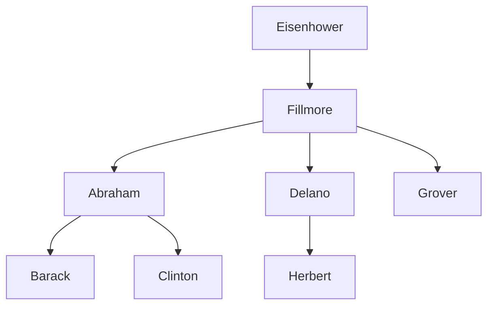

> **英文原课**：CS 61A: Structure and Interpretation of Computer Programs (Fall 2024)  
> **主讲教师**：Prof. John DeNero (UC Berkeley)  
> **图文整理**：VideoBook 视频转图文技术电子书流水线  
> **全书体量**：已收录 37 / 37 讲 ｜ 18.2 小时音视频讲义 ｜ 577 张高清板书截图  
> **在线目录**：[CS61A 专题目录](/notes/topics/CS61A)

---


> **主讲**：John DeNero ｜ **时长**：25:43 ｜ **视频回链**：[B 站对应单集 (P33)](https://www.bilibili.com/video/BV1sy411z7nA/?p=33)

## 1. 关系数据库与表结构 (Databases, Tables & Records)

数据库管理系统（DBMS）是当今软件基础设施中最关键的系统软件之一。关系模型的核心抽象是**表（Table）**：
- **列（Column / Attribute）**：拥有唯一的列名，并定义了该属性的数据类型（如整型、字符串等）；
- **行（Row / Record）**：代表一条具体的实体记录，包含该实体在所有列上的具体取值。


*⏱ 时间戳：00:00:29 · 📷 课堂截图 · [在 B 站观看对应片段 (P33 00:00:29)](https://www.bilibili.com/video/BV1sy411z7nA/?p=33&t=29)*

---

## 2. 编程范式变革：指令式 vs 声明式 (Imperative vs Declarative)


*⏱ 时间戳：00:01:26 · 📷 课堂截图 · [在 B 站观看对应片段 (P33 00:01:26)](https://www.bilibili.com/video/BV1sy411z7nA/?p=33&t=86)*

| 编程范式 | 核心思想 | 程序员的职责 | 系统的职责 |
| :--- | :--- | :--- | :--- |
| **指令式 (Imperative)** | 描述计算过程 (Description of Process) | 编写算法步骤、循环条件与状态变化 | 机械忠实地执行每一步 |
| **声明式 (Declarative)** | 描述计算目标 (Description of Result) | 给出目标结果的数学谓词与逻辑关系 | 自主选择最优执行路径并返回结果 |

在 SQL 中，由于执行路径完全交由数据库引擎决定，执行顺序可能与代码书写顺序完全不同，但这极大地解放了程序员的生产力。

---

## 3. 从零创建表与行级投影 (Creating Tables & `SELECT`)

尽管工业级数据大多来自外部写入，但在 SQL 中我们可以直接使用字面量（Literals）构建数据：

```sql
SELECT 38 AS latitude, 122 AS longitude, "Berkeley" AS name;
```


*⏱ 时间戳：00:03:19 · 📷 课堂截图 · [在 B 站观看对应片段 (P33 00:03:19)](https://www.bilibili.com/video/BV1sy411z7nA/?p=33&t=199)*

- `SELECT` 后面跟逗号分隔的列描述；
- `AS <name>` 用于重命名列标题；
- 字符串必须使用双引号或单引号包围，而列名不需要引号。

### 联合多行：`UNION` 运算符

使用 `UNION` 可以将多个单行结果拼接为一个多行新表：

```sql
CREATE TABLE cities AS
  SELECT 38 AS latitude, 122 AS longitude, "Berkeley" AS name UNION
  SELECT 42,             71,               "Cambridge"        UNION
  SELECT 45,             93,               "Minneapolis";
```


*⏱ 时间戳：00:04:43 · 📷 课堂截图 · [在 B 站观看对应片段 (P33 00:04:43)](https://www.bilibili.com/video/BV1sy411z7nA/?p=33&t=283)*

通过对已有表进行带条件的查询投影，我们可以轻松生成衍生分析表：

```sql
SELECT "West Coast" AS region, name FROM cities WHERE longitude >= 115 UNION
SELECT "Other"      AS region, name FROM cities WHERE longitude < 115;
```

---

## 4. SQL 语言核心：无所不在的 `SELECT` (The Power of `SELECT`)

SQL 标准虽然包含了大量的 DML/DDL 语句（如 `INSERT`、`UPDATE`、`DELETE`、`EXPLAIN` 等），但其最本质、最纯粹的计算内核几乎完全蕴含在 `SELECT` 语句之中：


*⏱ 时间戳：00:06:34 · 📷 课堂截图 · [在 B 站观看对应片段 (P33 00:06:34)](https://www.bilibili.com/video/BV1sy411z7nA/?p=33&t=394)*

- `SELECT` 既是查询语句，又是构建新表的**纯函数式生成器**；
- 一个小巧的 Python 解释器只需百行代码就能实现一个完整的 `SELECT` 引擎内核！

---

## 5. 经典实战主题：小狗家族树 (The Dogs Family Tree)

John DeNero 教授以他最喜欢的狗狗家谱为背景，建立了一组按字母顺序 A 到 H 命名的狗谱数据：


*⏱ 时间戳：00:08:35 · 📷 课堂截图 · [在 B 站观看对应片段 (P33 00:08:35)](https://www.bilibili.com/video/BV1sy411z7nA/?p=33&t=515)*


*⏱ 时间戳：00:10:41 · 📷 课堂截图 · [在 B 站观看对应片段 (P33 00:10:41)](https://www.bilibili.com/video/BV1sy411z7nA/?p=33&t=641)*


*⏱ 时间戳：00:12:08 · 📷 课堂截图 · [在 B 站观看对应片段 (P33 00:12:08)](https://www.bilibili.com/video/BV1sy411z7nA/?p=33&t=728)*



### 建立 `parents` 关系表

```sql
CREATE TABLE parents AS
  SELECT "abraham" AS parent, "barack" AS child UNION
  SELECT "abraham",           "clinton"         UNION
  SELECT "delano",            "herbert"         UNION
  SELECT "fillmore",          "abraham"         UNION
  SELECT "fillmore",          "delano"          UNION
  SELECT "fillmore",          "grover"          UNION
  SELECT "eisenhower",        "fillmore";
```


*⏱ 时间戳：00:13:37 · 📷 课堂截图 · [在 B 站观看对应片段 (P33 00:13:37)](https://www.bilibili.com/video/BV1sy411z7nA/?p=33&t=817)*

---

## 6. 查询投影与条件过滤 (`FROM`, `WHERE`, `ORDER BY`)

`SELECT` 语句的完整单表查询语法结构如下：

```sql
SELECT <column_expressions>
FROM <input_table>
WHERE <filter_condition>
ORDER BY <sort_ordering>;
```


*⏱ 时间戳：00:14:44 · 📷 课堂截图 · [在 B 站观看对应片段 (P33 00:14:44)](https://www.bilibili.com/video/BV1sy411z7nA/?p=33&t=884)*

### 查询示例与字典序比较

1. 查询所有以 `abraham` 为父辈的孩子：
   ```sql
   SELECT child FROM parents WHERE parent = "abraham";
   -- 结果: barack, clinton
   ```

2. 查找父名在字母表中晚于子名的行：
   ```sql
   SELECT parent FROM parents WHERE parent > child;
   -- 结果: fillmore (来自 fillmore > abraham)
   --       fillmore (来自 fillmore > delano)
   ```


*⏱ 时间戳：00:16:17 · 📷 课堂截图 · [在 B 站观看对应片段 (P33 00:16:17)](https://www.bilibili.com/video/BV1sy411z7nA/?p=33&t=977)*

注意：`fillmore` 出现了两次！SQL 表默认是**多重集（Multiset / Bag）**，允许相同的行重复出现。

---

## 7. SQLite 实操演练 (SQLite Interactive Shell)

在 SQLite 交互环境与命令行中直接执行上述语句：


*⏱ 时间戳：00:17:50 · 📷 课堂截图 · [在 B 站观看对应片段 (P33 00:17:50)](https://www.bilibili.com/video/BV1sy411z7nA/?p=33&t=1070)*

使用 `SELECT * FROM parents;` 可以查看整张表，SQLite 默认使用竖线 `|` 分隔各列数据。

---

## 8. 行内算术计算：滑雪场缆车容量分析 (Arithmetic in SQL)

在 `SELECT` 表达式中，不仅可以引用列名，还可以自由进行多项式数学运算。列名会被替换为当前输入行对应的具体数值：

```sql
-- 表 lift: chair (缆车号), single (单人乘客数), couple (双人乘客数)
SELECT chair, single + 2 * couple AS total FROM lift;
```


*⏱ 时间戳：00:19:35 · 📷 课堂截图 · [在 B 站观看对应片段 (P33 00:19:35)](https://www.bilibili.com/video/BV1sy411z7nA/?p=33&t=1175)*

每张缆椅的载客总人数直接通过行内算术运算求出，各行独立并发计算，互不干扰。

---

## 9. 深度思考题：二进制整数表示与声明式排序列行为

给定表 `ints`，用 4 个二进制权重位（1, 2, 4, 8）表示各个整数：


*⏱ 时间戳：00:21:06 · 📷 课堂截图 · [在 B 站观看对应片段 (P33 00:21:06)](https://www.bilibili.com/video/BV1sy411z7nA/?p=33&t=1266)*

```sql
-- 表 ints 列结构: word, one, two, four, eight
-- 如 "seven": 1, 2, 4, 0
```

### 声明式系统的无序性与去重机制

当使用 `UNION` 联合多个 `SELECT` 结果时，许多初学者会发现输出的行顺序与代码书写顺序完全不一致：


*⏱ 时间戳：00:23:08 · 📷 课堂截图 · [在 B 站观看对应片段 (P33 00:23:08)](https://www.bilibili.com/video/BV1sy411z7nA/?p=33&t=1388)*

> **核心原理**：`UNION` 规范要求必须**剔除重复行**。数据库优化器为了最高效地检测重复行，往往会先在内存中按某一列对数据进行字典序排序。因此，**声明式查询的结果行序是不保证保持代码插入顺序的**！若需要严格的顺序，必须显式声明 `ORDER BY`。

---

## 10. 练习解答：位权求和与筛选 2 的幂


*⏱ 时间戳：00:24:08 · 📷 课堂截图 · [在 B 站观看对应片段 (P33 00:24:08)](https://www.bilibili.com/video/BV1sy411z7nA/?p=33&t=1448)*


*⏱ 时间戳：00:25:13 · 📷 课堂截图 · [在 B 站观看对应片段 (P33 00:25:13)](https://www.bilibili.com/video/BV1sy411z7nA/?p=33&t=1513)*

### 题目 1：计算每个单词对应的实际整数值
```sql
SELECT word, one + two + four + eight AS value FROM ints;
```

### 题目 2：筛选出所有为 2 的整数次幂的数字单词
```sql
SELECT word FROM ints
WHERE (one > 0) + (two > 0) + (four > 0) + (eight > 0) = 1;
-- 仅保留恰好只有一个二进制位为 1 的记录！
-- 结果: one, two, four, eight
```

---

## 核心复习要点总结

| 核心组件 / 概念 | 语法与规则 | 核心功能 |
| :--- | :--- | :--- |
| **声明式范式** | 只关注目标，不关注流程 | 由数据库管理系统自动推导底层执行算法 |
| **`CREATE TABLE ... AS`** | `CREATE TABLE name AS SELECT ...` | 保存查询结果并命名为全局持久表 |
| **`SELECT`** | `SELECT expr AS col_name` | 投影与变换输入行，生成新表 |
| **`WHERE`** | `WHERE condition` | 对输入表逐行进行布尔谓词过滤 |
| **`UNION`** | `SELECT ... UNION SELECT ...` | 纵向合并行集，并自动去重（可能改变行序） |

---

