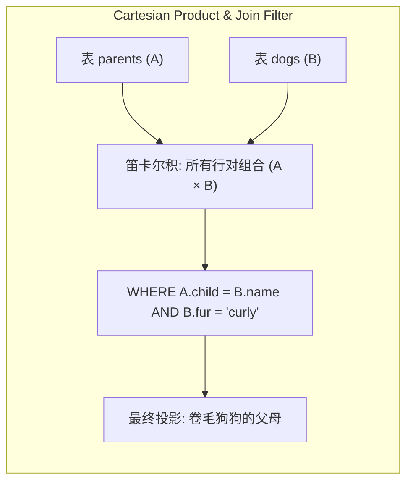

> **课程体系**：UC Berkeley CS61A (Fall 2024)  
> **所属模块**：Module 5: 声明式编程与 SQL (Declarative & SQL)  
> **主讲教师**：Prof. John DeNero (UC Berkeley)  
> **视频时长**：24:54 ｜ **课堂截图**：17 张板书/代码演示  
> **视频直达**：[📺 在 B 站观看本讲原视频 (P34)](https://www.bilibili.com/video/BV1sy411z7nA/?p=34)  
> **快速导航**：[← 上一讲 (P33 Lecture 35 SQL)](/notes/cs61a/lecture-33) ｜ [📚 返回全书目录](/notes/topics/CS61A) ｜ [下一讲 (P35 Lecture 37 Aggregation) →](/notes/cs61a/lecture-35)

---

## 课程核心目标与全景图

在上一讲中，我们掌握了单张表的行级过滤（`WHERE`）与投影（`SELECT`）。然而，现实世界中的信息绝非孤立地存放在单张扁平大表内，而是遵循**数据库规范化（Database Normalization）**分散在多张实体关系表中。

关系数据库最强悍的核心武器，正是**表连接（Joins）**：
- 通过将多张表按关系字段在横向进行关联匹配，能够动态重组出前所未有的全景信息；
- 无论多复杂的关联（如查找“毛发类型与孙辈完全相同的祖父辈狗狗”），都可以用纯声明式的连接查询在一瞬之间优雅求解！



---

### 深入形式化规约与微观求值流程（Operational Semantics）
在「课程核心目标与全景图」模块中，计算机底层运算依赖于严密的形式化求值逻辑：
1. **抽象语法树（AST）的分层解析**：
   - 源代码字符流首先经过词法分析器（Lexer）切分为终结符标记（Tokens），随后由语法解析器（Parser）构造成多叉语法树；
   - 运算符优先级与结合性在语法树构建阶段即已固化，消除了运行期的二义性；
2. **环境序列的动态跃迁**：
   - 每次函数调用产生的新帧，其静态词法环境由函数对象的 `parent` 属性完全决定；
   - 变量查找沿环境链向上单向回溯，直到全局环境帧，若未找到则触发 `NameError` 异常；
3. **状态不变式（State Invariants）**：
   - 编写健壮程序的关键在于明确循环不变式（Loop Invariants）与函数前后置条件（Pre/Post-conditions）；
   - 在复杂控制流跳转中，确保状态变量在每次迭代前均维持合法的业务约束。


## 1. 表连接的本质：笛卡尔积与行对组合 (The Fundamentals of Joins)

在 SQL 中，最基础的连接语法就是在 `FROM` 子句中使用逗号 `,` 分隔多张表：

```sql
SELECT * FROM table_a, table_b;
```

[](https://www.bilibili.com/video/BV1sy411z7nA/?p=34&t=32)
*⏱ 时间戳：00:00:32 · 📷 课堂截图 · [在 B 站观看对应片段 (P34 00:00:32)](https://www.bilibili.com/video/BV1sy411z7nA/?p=34&t=32)*

#### 📸 课堂板书与代码演示深入精读 (00:00:32)

**【现场板书 / 代码演示还原】**：
在此时间节点，DeNero 教授在屏幕上进行了核心演示与重点板书推导：
> *“So far, we've been projecting just one table. But we can do much more powerful operations by joining tables together. Now, if you ask someone what a join is among two tables, they may tell you which kind of join. There are so many. And in fact, database people have been thinking about this problem s...”*

**【底层计算模型与微观执行机制】**：
1. **执行上下文与时序追踪**：
   - 处于当前讨论节点「1. 表连接的本质：笛卡尔积与行对组合 (The Fundamentals of Joins)」，解释器严格遵循核心求值规约；
   - 表达式先求值操作符，随后自左至右严格求值操作数，最终将函数对象施加于实参列表；
   - 若涉及环境模型，局部帧严格记录其静态词法父指针（Parent Pointer 指向函数定义处的环境），与运行时的动态调用栈形成正交架构。
2. **内存拓扑与对象引用**：
   - 变量符号只是哈希表（环境帧）中的键，指针直接指向堆内存中的一等公民对象；
   - 赋值语句是离散时间的瞬时状态快照，绝不会建立隐式的数学依赖监听。

**【避坑指南与高频考点点拨】**：
- **常见思维误区**：在「多表连接过滤、自身连接 (Self-Join) 与递归 CTE」相关考题中，初学者极易根据代码表面形式猜想结果，导致作用域混淆或变量遮蔽（Shadowing）误判；
- **调试排错黄金法则**：遇到嵌套调用与复杂分支时，务必在草稿纸上画出独立的局部帧，标明每个形参的具体绑定值，按部就班推导。


其底层数学本质是**笛卡尔积（Cartesian Product）**：
- 如果表 $A$ 有 $M$ 行，表 $B$ 有 $N$ 行，连接将生成包含 $M \times N$ 行的庞大中间组合集；
- 每一个结果行横向包含了来自表 $A$ 的所有列和来自表 $B$ 的所有列。

---

### 深入形式化规约与微观求值流程（Operational Semantics）
在「1. 表连接的本质：笛卡尔积与行对组合 (The Fundamentals of Joins)」模块中，计算机底层运算依赖于严密的形式化求值逻辑：
1. **抽象语法树（AST）的分层解析**：
   - 源代码字符流首先经过词法分析器（Lexer）切分为终结符标记（Tokens），随后由语法解析器（Parser）构造成多叉语法树；
   - 运算符优先级与结合性在语法树构建阶段即已固化，消除了运行期的二义性；
2. **环境序列的动态跃迁**：
   - 每次函数调用产生的新帧，其静态词法环境由函数对象的 `parent` 属性完全决定；
   - 变量查找沿环境链向上单向回溯，直到全局环境帧，若未找到则触发 `NameError` 异常；
3. **状态不变式（State Invariants）**：
   - 编写健壮程序的关键在于明确循环不变式（Loop Invariants）与函数前后置条件（Pre/Post-conditions）；
   - 在复杂控制流跳转中，确保状态变量在每次迭代前均维持合法的业务约束。


## 2. 案例实战：狗狗特征表与家谱表联合 (The Dogs & Parents Tables)

引入第二张表 `dogs`，记录每只狗的毛发特性（`fur`）：

```sql
CREATE TABLE dogs AS
  SELECT "abraham" AS name, "long"  AS fur UNION
  SELECT "barack",          "short"        UNION
  SELECT "clinton",         "long"         UNION
  SELECT "delano",          "long"         UNION
  SELECT "eisenhower",      "short"        UNION
  SELECT "fillmore",        "curly"        UNION
  SELECT "grover",          "short"        UNION
  SELECT "herbert",         "curly";
```

[](https://www.bilibili.com/video/BV1sy411z7nA/?p=34&t=92)
*⏱ 时间戳：00:01:32 · 📷 课堂截图 · [在 B 站观看对应片段 (P34 00:01:32)](https://www.bilibili.com/video/BV1sy411z7nA/?p=34&t=92)*

#### 📸 课堂板书与代码演示深入精读 (00:01:32)

**【现场板书 / 代码演示还原】**：
在此时间节点，DeNero 教授在屏幕上进行了核心演示与重点板书推导：
> *“In order to do anything interesting, let's create a table called dogs that has a name for each dog and what kind of fur it has. Abraham has long fur. Barack has short fur, which will indicate using dots instead of dashes. Clinton has long fur. Delano has long fur. Eisenhower has short fur. Fillmore ...”*

**【底层计算模型与微观执行机制】**：
1. **执行上下文与时序追踪**：
   - 处于当前讨论节点「2. 案例实战：狗狗特征表与家谱表联合 (The Dogs & Parents Tables)」，解释器严格遵循核心求值规约；
   - 表达式先求值操作符，随后自左至右严格求值操作数，最终将函数对象施加于实参列表；
   - 若涉及环境模型，局部帧严格记录其静态词法父指针（Parent Pointer 指向函数定义处的环境），与运行时的动态调用栈形成正交架构。
2. **内存拓扑与对象引用**：
   - 变量符号只是哈希表（环境帧）中的键，指针直接指向堆内存中的一等公民对象；
   - 赋值语句是离散时间的瞬时状态快照，绝不会建立隐式的数学依赖监听。

**【避坑指南与高频考点点拨】**：
- **常见思维误区**：在「多表连接过滤、自身连接 (Self-Join) 与递归 CTE」相关考题中，初学者极易根据代码表面形式猜想结果，导致作用域混淆或变量遮蔽（Shadowing）误判；
- **调试排错黄金法则**：遇到嵌套调用与复杂分支时，务必在草稿纸上画出独立的局部帧，标明每个形参的具体绑定值，按部就班推导。


现在，家谱信息在 `parents` 表中，毛发信息在 `dogs` 表中。我们希望查询：**所有卷毛（curly）狗狗的父母是谁？**

```sql
SELECT parent FROM parents, dogs
WHERE child = name AND fur = "curly";
```

[](https://www.bilibili.com/video/BV1sy411z7nA/?p=34&t=152)
*⏱ 时间戳：00:02:32 · 📷 课堂截图 · [在 B 站观看对应片段 (P34 00:02:32)](https://www.bilibili.com/video/BV1sy411z7nA/?p=34&t=152)*

#### 📸 课堂板书与代码演示深入精读 (00:02:32)

**【现场板书 / 代码演示还原】**：
在此时间节点，DeNero 教授在屏幕上进行了核心演示与重点板书推导：
> *“f and h are the curly ones, their parents are Eisenhower and Delano. The following select statement will pull those two out. Select the parent from parents joined with dogs, where the child equals name and the fur equals curly. That's the join. What's going on in the where clause? Well, fur equals c...”*

**【底层计算模型与微观执行机制】**：
1. **执行上下文与时序追踪**：
   - 处于当前讨论节点「2. 案例实战：狗狗特征表与家谱表联合 (The Dogs & Parents Tables)」，解释器严格遵循核心求值规约；
   - 表达式先求值操作符，随后自左至右严格求值操作数，最终将函数对象施加于实参列表；
   - 若涉及环境模型，局部帧严格记录其静态词法父指针（Parent Pointer 指向函数定义处的环境），与运行时的动态调用栈形成正交架构。
2. **内存拓扑与对象引用**：
   - 变量符号只是哈希表（环境帧）中的键，指针直接指向堆内存中的一等公民对象；
   - 赋值语句是离散时间的瞬时状态快照，绝不会建立隐式的数学依赖监听。

**【避坑指南与高频考点点拨】**：
- **常见思维误区**：在「多表连接过滤、自身连接 (Self-Join) 与递归 CTE」相关考题中，初学者极易根据代码表面形式猜想结果，导致作用域混淆或变量遮蔽（Shadowing）误判；
- **调试排错黄金法则**：遇到嵌套调用与复杂分支时，务必在草稿纸上画出独立的局部帧，标明每个形参的具体绑定值，按部就班推导。


[](https://www.bilibili.com/video/BV1sy411z7nA/?p=34&t=240)
*⏱ 时间戳：00:04:00 · 📷 课堂截图 · [在 B 站观看对应片段 (P34 00:04:00)](https://www.bilibili.com/video/BV1sy411z7nA/?p=34&t=240)*

#### 📸 课堂板书与代码演示深入精读 (00:04:00)

**【现场板书 / 代码演示还原】**：
在此时间节点，DeNero 教授在屏幕上进行了核心演示与重点板书推导：
> *“To execute all the statements in dogs.sql. So it's loaded those resources, which means I can select star from dogs and get all the different options. Now, if I select all of the columns from parents comma dogs, that's a join over these two tables and we'll see many results. These results are all the...”*

**【底层计算模型与微观执行机制】**：
1. **执行上下文与时序追踪**：
   - 处于当前讨论节点「2. 案例实战：狗狗特征表与家谱表联合 (The Dogs & Parents Tables)」，解释器严格遵循核心求值规约；
   - 表达式先求值操作符，随后自左至右严格求值操作数，最终将函数对象施加于实参列表；
   - 若涉及环境模型，局部帧严格记录其静态词法父指针（Parent Pointer 指向函数定义处的环境），与运行时的动态调用栈形成正交架构。
2. **内存拓扑与对象引用**：
   - 变量符号只是哈希表（环境帧）中的键，指针直接指向堆内存中的一等公民对象；
   - 赋值语句是离散时间的瞬时状态快照，绝不会建立隐式的数学依赖监听。

**【避坑指南与高频考点点拨】**：
- **常见思维误区**：在「多表连接过滤、自身连接 (Self-Join) 与递归 CTE」相关考题中，初学者极易根据代码表面形式猜想结果，导致作用域混淆或变量遮蔽（Shadowing）误判；
- **调试排错黄金法则**：遇到嵌套调用与复杂分支时，务必在草稿纸上画出独立的局部帧，标明每个形参的具体绑定值，按部就班推导。


[](https://www.bilibili.com/video/BV1sy411z7nA/?p=34&t=304)
*⏱ 时间戳：00:05:04 · 📷 课堂截图 · [在 B 站观看对应片段 (P34 00:05:04)](https://www.bilibili.com/video/BV1sy411z7nA/?p=34&t=304)*

#### 📸 课堂板书与代码演示深入精读 (00:05:04)

**【现场板书 / 代码演示还原】**：
在此时间节点，DeNero 教授在屏幕上进行了核心演示与重点板书推导：
> *“Dog's name is the same as the child. So we'd write just child equals name in order to get those cases. Okay. We still have four columns, two columns from the parents, two columns from the dogs, but it's always the case that the child and the name column have the same value. So Abraham is Barack's pa...”*

**【底层计算模型与微观执行机制】**：
1. **执行上下文与时序追踪**：
   - 处于当前讨论节点「2. 案例实战：狗狗特征表与家谱表联合 (The Dogs & Parents Tables)」，解释器严格遵循核心求值规约；
   - 表达式先求值操作符，随后自左至右严格求值操作数，最终将函数对象施加于实参列表；
   - 若涉及环境模型，局部帧严格记录其静态词法父指针（Parent Pointer 指向函数定义处的环境），与运行时的动态调用栈形成正交架构。
2. **内存拓扑与对象引用**：
   - 变量符号只是哈希表（环境帧）中的键，指针直接指向堆内存中的一等公民对象；
   - 赋值语句是离散时间的瞬时状态快照，绝不会建立隐式的数学依赖监听。

**【避坑指南与高频考点点拨】**：
- **常见思维误区**：在「多表连接过滤、自身连接 (Self-Join) 与递归 CTE」相关考题中，初学者极易根据代码表面形式猜想结果，导致作用域混淆或变量遮蔽（Shadowing）误判；
- **调试排错黄金法则**：遇到嵌套调用与复杂分支时，务必在草稿纸上画出独立的局部帧，标明每个形参的具体绑定值，按部就班推导。


- `child = name`：连接条件（Join Condition），将父母表中的子代与狗狗表中的名字对齐；
- `fur = "curly"`：属性过滤条件，仅保留卷毛品种；
- 查询结果精准输出：`delano`（Herbert 的父亲）与 `eisenhower`（Fillmore 的父亲）。

---

### 深入形式化规约与微观求值流程（Operational Semantics）
在「2. 案例实战：狗狗特征表与家谱表联合 (The Dogs & Parents Tables)」模块中，计算机底层运算依赖于严密的形式化求值逻辑：
1. **抽象语法树（AST）的分层解析**：
   - 源代码字符流首先经过词法分析器（Lexer）切分为终结符标记（Tokens），随后由语法解析器（Parser）构造成多叉语法树；
   - 运算符优先级与结合性在语法树构建阶段即已固化，消除了运行期的二义性；
2. **环境序列的动态跃迁**：
   - 每次函数调用产生的新帧，其静态词法环境由函数对象的 `parent` 属性完全决定；
   - 变量查找沿环境链向上单向回溯，直到全局环境帧，若未找到则触发 `NameError` 异常；
3. **状态不变式（State Invariants）**：
   - 编写健壮程序的关键在于明确循环不变式（Loop Invariants）与函数前后置条件（Pre/Post-conditions）；
   - 在复杂控制流跳转中，确保状态变量在每次迭代前均维持合法的业务约束。


## 3. 表别名与点表达式：自连接 (Self-Join & Aliases)

当两张表拥有相同的列名，或者**将同一张表与自身连接（Self-Join）**时，列名就会产生命名冲突。此时必须使用**表别名（Aliases）**和**点表达式（Dot Expressions）**进行消除歧义。

[](https://www.bilibili.com/video/BV1sy411z7nA/?p=34&t=370)
*⏱ 时间戳：00:06:10 · 📷 课堂截图 · [在 B 站观看对应片段 (P34 00:06:10)](https://www.bilibili.com/video/BV1sy411z7nA/?p=34&t=370)*

#### 📸 课堂板书与代码演示深入精读 (00:06:10)

**【现场板书 / 代码演示还原】**：
在此时间节点，DeNero 教授在屏幕上进行了核心演示与重点板书推导：
> *“Which are Eisenhower and Delano. Then we're done. Now we'll have to deal with the interesting case when two different tables have the same column name, and we want to be able to pick out one column in one particular table. For that we have aliases and dot expressions. We can even join a table with i...”*

**【底层计算模型与微观执行机制】**：
1. **执行上下文与时序追踪**：
   - 处于当前讨论节点「3. 表别名与点表达式：自连接 (Self-Join & Aliases)」，解释器严格遵循核心求值规约；
   - 表达式先求值操作符，随后自左至右严格求值操作数，最终将函数对象施加于实参列表；
   - 若涉及环境模型，局部帧严格记录其静态词法父指针（Parent Pointer 指向函数定义处的环境），与运行时的动态调用栈形成正交架构。
2. **内存拓扑与对象引用**：
   - 变量符号只是哈希表（环境帧）中的键，指针直接指向堆内存中的一等公民对象；
   - 赋值语句是离散时间的瞬时状态快照，绝不会建立隐式的数学依赖监听。

**【避坑指南与高频考点点拨】**：
- **常见思维误区**：在「多表连接过滤、自身连接 (Self-Join) 与递归 CTE」相关考题中，初学者极易根据代码表面形式猜想结果，导致作用域混淆或变量遮蔽（Shadowing）误判；
- **调试排错黄金法则**：遇到嵌套调用与复杂分支时，务必在草稿纸上画出独立的局部帧，标明每个形参的具体绑定值，按部就班推导。


### 寻找所有兄弟姐妹对 (Siblings)

两只狗如果拥有相同的父母，则互为兄弟姐妹。由于所有的父母信息都在同一张 `parents` 表中，我们必须将 `parents` 与自身连接：

```sql
SELECT a.child AS first, b.child AS second
FROM parents AS a, parents AS b
WHERE a.parent = b.parent AND a.child < b.child;
```

[](https://www.bilibili.com/video/BV1sy411z7nA/?p=34&t=437)
*⏱ 时间戳：00:07:17 · 📷 课堂截图 · [在 B 站观看对应片段 (P34 00:07:17)](https://www.bilibili.com/video/BV1sy411z7nA/?p=34&t=437)*

#### 📸 课堂板书与代码演示深入精读 (00:07:17)

**【现场板书 / 代码演示还原】**：
在此时间节点，DeNero 教授在屏幕上进行了核心演示与重点板书推导：
> *“Select A.child as first, B.child as second, from parents as A, parents as B, where A.parent is the same as B.parent, and A.child is less than B.child. Here, we're not only joining parents with parents, but we're also giving an alias to this parent as A, and this parent as B. Now, what does this mean...”*

**【底层计算模型与微观执行机制】**：
1. **执行上下文与时序追踪**：
   - 处于当前讨论节点「3. 表别名与点表达式：自连接 (Self-Join & Aliases)」，解释器严格遵循核心求值规约；
   - 表达式先求值操作符，随后自左至右严格求值操作数，最终将函数对象施加于实参列表；
   - 若涉及环境模型，局部帧严格记录其静态词法父指针（Parent Pointer 指向函数定义处的环境），与运行时的动态调用栈形成正交架构。
2. **内存拓扑与对象引用**：
   - 变量符号只是哈希表（环境帧）中的键，指针直接指向堆内存中的一等公民对象；
   - 赋值语句是离散时间的瞬时状态快照，绝不会建立隐式的数学依赖监听。

**【避坑指南与高频考点点拨】**：
- **常见思维误区**：在「多表连接过滤、自身连接 (Self-Join) 与递归 CTE」相关考题中，初学者极易根据代码表面形式猜想结果，导致作用域混淆或变量遮蔽（Shadowing）误判；
- **调试排错黄金法则**：遇到嵌套调用与复杂分支时，务必在草稿纸上画出独立的局部帧，标明每个形参的具体绑定值，按部就班推导。


[](https://www.bilibili.com/video/BV1sy411z7nA/?p=34&t=530)
*⏱ 时间戳：00:08:50 · 📷 课堂截图 · [在 B 站观看对应片段 (P34 00:08:50)](https://www.bilibili.com/video/BV1sy411z7nA/?p=34&t=530)*

#### 📸 课堂板书与代码演示深入精读 (00:08:50)

**【现场板书 / 代码演示还原】**：
在此时间节点，DeNero 教授在屏幕上进行了核心演示与重点板书推导：
> *“And the second column, contents, is the child from B. We join together parents with parents in order to get all pairs of parents. And the where clause says that in the first parent's row, I want the parent to be equal to the parent in the second parent's row. And that makes sure that we only get tog...”*

**【底层计算模型与微观执行机制】**：
1. **执行上下文与时序追踪**：
   - 处于当前讨论节点「3. 表别名与点表达式：自连接 (Self-Join & Aliases)」，解释器严格遵循核心求值规约；
   - 表达式先求值操作符，随后自左至右严格求值操作数，最终将函数对象施加于实参列表；
   - 若涉及环境模型，局部帧严格记录其静态词法父指针（Parent Pointer 指向函数定义处的环境），与运行时的动态调用栈形成正交架构。
2. **内存拓扑与对象引用**：
   - 变量符号只是哈希表（环境帧）中的键，指针直接指向堆内存中的一等公民对象；
   - 赋值语句是离散时间的瞬时状态快照，绝不会建立隐式的数学依赖监听。

**【避坑指南与高频考点点拨】**：
- **常见思维误区**：在「多表连接过滤、自身连接 (Self-Join) 与递归 CTE」相关考题中，初学者极易根据代码表面形式猜想结果，导致作用域混淆或变量遮蔽（Shadowing）误判；
- **调试排错黄金法则**：遇到嵌套调用与复杂分支时，务必在草稿纸上画出独立的局部帧，标明每个形参的具体绑定值，按部就班推导。


### 为什么必须写 `a.child < b.child`？
1. **防止自己与自己配对**：如果不加限制，每只狗都会成为自己的兄弟（`barack` 与 `barack`）；
2. **消除对称重复**：若仅写 `a.child != b.child`，结果中会同时出现 `(barack, clinton)` 和 `(clinton, barack)`；
3. **强制字典序**：通过严格小于号 `<`，保证每对兄弟姐妹只出现一次，且名字按字母表升序整齐排列！

---

### 深入形式化规约与微观求值流程（Operational Semantics）
在「3. 表别名与点表达式：自连接 (Self-Join & Aliases)」模块中，计算机底层运算依赖于严密的形式化求值逻辑：
1. **抽象语法树（AST）的分层解析**：
   - 源代码字符流首先经过词法分析器（Lexer）切分为终结符标记（Tokens），随后由语法解析器（Parser）构造成多叉语法树；
   - 运算符优先级与结合性在语法树构建阶段即已固化，消除了运行期的二义性；
2. **环境序列的动态跃迁**：
   - 每次函数调用产生的新帧，其静态词法环境由函数对象的 `parent` 属性完全决定；
   - 变量查找沿环境链向上单向回溯，直到全局环境帧，若未找到则触发 `NameError` 异常；
3. **状态不变式（State Invariants）**：
   - 编写健壮程序的关键在于明确循环不变式（Loop Invariants）与函数前后置条件（Pre/Post-conditions）；
   - 在复杂控制流跳转中，确保状态变量在每次迭代前均维持合法的业务约束。


## 4. 多表多级关联：构建祖孙表与三表连接 (Multi-Table Joins)

### 第一步：构造祖孙关系表 `grandparents`

祖父是父亲的父亲。我们将 `parents` 表两次自连接：

```sql
CREATE TABLE grandparents AS
  SELECT a.parent AS grandog, b.child AS grandpup
  FROM parents AS a, parents AS b
  WHERE a.child = b.parent;
```

[](https://www.bilibili.com/video/BV1sy411z7nA/?p=34&t=624)
*⏱ 时间戳：00:10:24 · 📷 课堂截图 · [在 B 站观看对应片段 (P34 00:10:24)](https://www.bilibili.com/video/BV1sy411z7nA/?p=34&t=624)*

#### 📸 课堂板书与代码演示深入精读 (00:10:24)

**【现场板书 / 代码演示还原】**：
在此时间节点，DeNero 教授在屏幕上进行了核心演示与重点板书推导：
> *“The sub rows within there are either from the parents A or the parents B, and you want to know which child column or which parent column you want to compare. You can even join multiple tables together. And when you join together multiple tables, you get all possible combinations of a row from each t...”*

**【底层计算模型与微观执行机制】**：
1. **执行上下文与时序追踪**：
   - 处于当前讨论节点「4. 多表多级关联：构建祖孙表与三表连接 (Multi-Table Joins)」，解释器严格遵循核心求值规约；
   - 表达式先求值操作符，随后自左至右严格求值操作数，最终将函数对象施加于实参列表；
   - 若涉及环境模型，局部帧严格记录其静态词法父指针（Parent Pointer 指向函数定义处的环境），与运行时的动态调用栈形成正交架构。
2. **内存拓扑与对象引用**：
   - 变量符号只是哈希表（环境帧）中的键，指针直接指向堆内存中的一等公民对象；
   - 赋值语句是离散时间的瞬时状态快照，绝不会建立隐式的数学依赖监听。

**【避坑指南与高频考点点拨】**：
- **常见思维误区**：在「多表连接过滤、自身连接 (Self-Join) 与递归 CTE」相关考题中，初学者极易根据代码表面形式猜想结果，导致作用域混淆或变量遮蔽（Shadowing）误判；
- **调试排错黄金法则**：遇到嵌套调用与复杂分支时，务必在草稿纸上画出独立的局部帧，标明每个形参的具体绑定值，按部就班推导。


例如 `eisenhower` 是 `fillmore` 的父亲，而 `fillmore` 是 `abraham` 的父亲，因此推导出 `(eisenhower, abraham)` 是祖孙对。

### 第二步：三表连接——寻找毛发相同的祖孙对

**挑战**：找出所有“祖父的毛发类型与其孙辈毛发类型完全一致”的组合。

我们需要同时获取祖父的毛发和孙辈的毛发，因此需要将 `grandparents` 与两张 `dogs` 表连接：

```sql
SELECT grandog, grandpup
FROM grandparents, dogs AS c, dogs AS d
WHERE grandog = c.name AND grandpup = d.name AND c.fur = d.fur;
```

[](https://www.bilibili.com/video/BV1sy411z7nA/?p=34&t=716)
*⏱ 时间戳：00:11:56 · 📷 课堂截图 · [在 B 站观看对应片段 (P34 00:11:56)](https://www.bilibili.com/video/BV1sy411z7nA/?p=34&t=716)*

#### 📸 课堂板书与代码演示深入精读 (00:11:56)

**【现场板书 / 代码演示还原】**：
在此时间节点，DeNero 教授在屏幕上进行了核心演示与重点板书推导：
> *“Which tables do you need to join together in order to get that result? And the answer should be that Fillmore is the grandparent of Herbert, and Eisenhower is the grandparent of Grover. Here's a select statement that will do the work. Select the grand dog, the grandparent. From three different table...”*

**【底层计算模型与微观执行机制】**：
1. **执行上下文与时序追踪**：
   - 处于当前讨论节点「4. 多表多级关联：构建祖孙表与三表连接 (Multi-Table Joins)」，解释器严格遵循核心求值规约；
   - 表达式先求值操作符，随后自左至右严格求值操作数，最终将函数对象施加于实参列表；
   - 若涉及环境模型，局部帧严格记录其静态词法父指针（Parent Pointer 指向函数定义处的环境），与运行时的动态调用栈形成正交架构。
2. **内存拓扑与对象引用**：
   - 变量符号只是哈希表（环境帧）中的键，指针直接指向堆内存中的一等公民对象；
   - 赋值语句是离散时间的瞬时状态快照，绝不会建立隐式的数学依赖监听。

**【避坑指南与高频考点点拨】**：
- **常见思维误区**：在「多表连接过滤、自身连接 (Self-Join) 与递归 CTE」相关考题中，初学者极易根据代码表面形式猜想结果，导致作用域混淆或变量遮蔽（Shadowing）误判；
- **调试排错黄金法则**：遇到嵌套调用与复杂分支时，务必在草稿纸上画出独立的局部帧，标明每个形参的具体绑定值，按部就班推导。


[](https://www.bilibili.com/video/BV1sy411z7nA/?p=34&t=815)
*⏱ 时间戳：00:13:35 · 📷 课堂截图 · [在 B 站观看对应片段 (P34 00:13:35)](https://www.bilibili.com/video/BV1sy411z7nA/?p=34&t=815)*

#### 📸 课堂板书与代码演示深入精读 (00:13:35)

**【现场板书 / 代码演示还原】**：
在此时间节点，DeNero 教授在屏幕上进行了核心演示与重点板书推导：
> *“Next, we wanted to join three tables together, which involves selecting the grand dog from the first table is the grandparents table. The second is the dogs and the third is more dogs. And the reason why we joined all three together is so that we could express that the fur was the same for a dog nam...”*

**【底层计算模型与微观执行机制】**：
1. **执行上下文与时序追踪**：
   - 处于当前讨论节点「4. 多表多级关联：构建祖孙表与三表连接 (Multi-Table Joins)」，解释器严格遵循核心求值规约；
   - 表达式先求值操作符，随后自左至右严格求值操作数，最终将函数对象施加于实参列表；
   - 若涉及环境模型，局部帧严格记录其静态词法父指针（Parent Pointer 指向函数定义处的环境），与运行时的动态调用栈形成正交架构。
2. **内存拓扑与对象引用**：
   - 变量符号只是哈希表（环境帧）中的键，指针直接指向堆内存中的一等公民对象；
   - 赋值语句是离散时间的瞬时状态快照，绝不会建立隐式的数学依赖监听。

**【避坑指南与高频考点点拨】**：
- **常见思维误区**：在「多表连接过滤、自身连接 (Self-Join) 与递归 CTE」相关考题中，初学者极易根据代码表面形式猜想结果，导致作用域混淆或变量遮蔽（Shadowing）误判；
- **调试排错黄金法则**：遇到嵌套调用与复杂分支时，务必在草稿纸上画出独立的局部帧，标明每个形参的具体绑定值，按部就班推导。


数据库引擎将三张表联立扫描，精确匹配出符合条件的两对家族成员：
- `eisenhower` 与 `grover`（两者均为短毛 short）；
- `fillmore` 与 `herbert`（两者均为卷毛 curly）。

---

### 深入形式化规约与微观求值流程（Operational Semantics）
在「4. 多表多级关联：构建祖孙表与三表连接 (Multi-Table Joins)」模块中，计算机底层运算依赖于严密的形式化求值逻辑：
1. **抽象语法树（AST）的分层解析**：
   - 源代码字符流首先经过词法分析器（Lexer）切分为终结符标记（Tokens），随后由语法解析器（Parser）构造成多叉语法树；
   - 运算符优先级与结合性在语法树构建阶段即已固化，消除了运行期的二义性；
2. **环境序列的动态跃迁**：
   - 每次函数调用产生的新帧，其静态词法环境由函数对象的 `parent` 属性完全决定；
   - 变量查找沿环境链向上单向回溯，直到全局环境帧，若未找到则触发 `NameError` 异常；
3. **状态不变式（State Invariants）**：
   - 编写健壮程序的关键在于明确循环不变式（Loop Invariants）与函数前后置条件（Pre/Post-conditions）；
   - 在复杂控制流跳转中，确保状态变量在每次迭代前均维持合法的业务约束。


## 5. 数值表达式与地理距离计算 (Numerical Expressions in Joins)

SQL 支持在 `SELECT`、`WHERE`、`ORDER BY` 中自由使用丰富的数学函数与算术运算符：

[](https://www.bilibili.com/video/BV1sy411z7nA/?p=34&t=916)
*⏱ 时间戳：00:15:16 · 📷 课堂截图 · [在 B 站观看对应片段 (P34 00:15:16)](https://www.bilibili.com/video/BV1sy411z7nA/?p=34&t=916)*

#### 📸 课堂板书与代码演示深入精读 (00:15:16)

**【现场板书 / 代码演示还原】**：
在此时间节点，DeNero 教授在屏幕上进行了核心演示与重点板书推导：
> *“They can also use arithmetic operators such as plus and minus and times. Now, these can occur in any expression within a select statement. There's a where expression, there's an order by expression, and within the columns description, which is a comma separated list, there are expressions there as w...”*

**【底层计算模型与微观执行机制】**：
1. **执行上下文与时序追踪**：
   - 处于当前讨论节点「5. 数值表达式与地理距离计算 (Numerical Expressions in Joins)」，解释器严格遵循核心求值规约；
   - 表达式先求值操作符，随后自左至右严格求值操作数，最终将函数对象施加于实参列表；
   - 若涉及环境模型，局部帧严格记录其静态词法父指针（Parent Pointer 指向函数定义处的环境），与运行时的动态调用栈形成正交架构。
2. **内存拓扑与对象引用**：
   - 变量符号只是哈希表（环境帧）中的键，指针直接指向堆内存中的一等公民对象；
   - 赋值语句是离散时间的瞬时状态快照，绝不会建立隐式的数学依赖监听。

**【避坑指南与高频考点点拨】**：
- **常见思维误区**：在「多表连接过滤、自身连接 (Self-Join) 与递归 CTE」相关考题中，初学者极易根据代码表面形式猜想结果，导致作用域混淆或变量遮蔽（Shadowing）误判；
- **调试排错黄金法则**：遇到嵌套调用与复杂分支时，务必在草稿纸上画出独立的局部帧，标明每个形参的具体绑定值，按部就班推导。


### 城市南北纬度距离分析

每 1 纬度约等于 60 海里（Nautical Miles）。我们将 `cities` 表自连接，计算从起始城市到目的城市的向北航行距离：

```sql
CREATE TABLE distances AS
  SELECT a.name AS first, b.name AS second,
         60 * (b.latitude - a.latitude) AS distance
  FROM cities AS a, cities AS b;
```

[](https://www.bilibili.com/video/BV1sy411z7nA/?p=34&t=1047)
*⏱ 时间戳：00:17:27 · 📷 课堂截图 · [在 B 站观看对应片段 (P34 00:17:27)](https://www.bilibili.com/video/BV1sy411z7nA/?p=34&t=1047)*

#### 📸 课堂板书与代码演示深入精读 (00:17:27)

**【现场板书 / 代码演示还原】**：
在此时间节点，DeNero 教授在屏幕上进行了核心演示与重点板书推导：
> *“Chicago is also cold, so I can use a union in order to get Minneapolis, North Pole, and Chicago all in one table. Now, what about arithmetic? Well, let's say I want to compute the north-south distance between cities. North and south really matters because that affects climate more than east and west...”*

**【底层计算模型与微观执行机制】**：
1. **执行上下文与时序追踪**：
   - 处于当前讨论节点「5. 数值表达式与地理距离计算 (Numerical Expressions in Joins)」，解释器严格遵循核心求值规约；
   - 表达式先求值操作符，随后自左至右严格求值操作数，最终将函数对象施加于实参列表；
   - 若涉及环境模型，局部帧严格记录其静态词法父指针（Parent Pointer 指向函数定义处的环境），与运行时的动态调用栈形成正交架构。
2. **内存拓扑与对象引用**：
   - 变量符号只是哈希表（环境帧）中的键，指针直接指向堆内存中的一等公民对象；
   - 赋值语句是离散时间的瞬时状态快照，绝不会建立隐式的数学依赖监听。

**【避坑指南与高频考点点拨】**：
- **常见思维误区**：在「多表连接过滤、自身连接 (Self-Join) 与递归 CTE」相关考题中，初学者极易根据代码表面形式猜想结果，导致作用域混淆或变量遮蔽（Shadowing）误判；
- **调试排错黄金法则**：遇到嵌套调用与复杂分支时，务必在草稿纸上画出独立的局部帧，标明每个形参的具体绑定值，按部就班推导。


从寒冷的明尼阿波利斯（Minneapolis）出发，按向南最远排序：
```sql
SELECT second FROM distances
WHERE first = "Minneapolis"
ORDER BY distance;
```

[](https://www.bilibili.com/video/BV1sy411z7nA/?p=34&t=1112)
*⏱ 时间戳：00:18:32 · 📷 课堂截图 · [在 B 站观看对应片段 (P34 00:18:32)](https://www.bilibili.com/video/BV1sy411z7nA/?p=34&t=1112)*

#### 📸 课堂板书与代码演示深入精读 (00:18:32)

**【现场板书 / 代码演示还原】**：
在此时间节点，DeNero 教授在屏幕上进行了核心演示与重点板书推导：
> *“B.latitude and A.latitude. And we'll call that the distance. We have our column descriptions, but we still have to say what we're selecting from. We've referred to A and B so far. Those are different versions of the cities table, which we'll have to join with itself in order to compute the latitude ...”*

**【底层计算模型与微观执行机制】**：
1. **执行上下文与时序追踪**：
   - 处于当前讨论节点「5. 数值表达式与地理距离计算 (Numerical Expressions in Joins)」，解释器严格遵循核心求值规约；
   - 表达式先求值操作符，随后自左至右严格求值操作数，最终将函数对象施加于实参列表；
   - 若涉及环境模型，局部帧严格记录其静态词法父指针（Parent Pointer 指向函数定义处的环境），与运行时的动态调用栈形成正交架构。
2. **内存拓扑与对象引用**：
   - 变量符号只是哈希表（环境帧）中的键，指针直接指向堆内存中的一等公民对象；
   - 赋值语句是离散时间的瞬时状态快照，绝不会建立隐式的数学依赖监听。

**【避坑指南与高频考点点拨】**：
- **常见思维误区**：在「多表连接过滤、自身连接 (Self-Join) 与递归 CTE」相关考题中，初学者极易根据代码表面形式猜想结果，导致作用域混淆或变量遮蔽（Shadowing）误判；
- **调试排错黄金法则**：遇到嵌套调用与复杂分支时，务必在草稿纸上画出独立的局部帧，标明每个形参的具体绑定值，按部就班推导。


排在最前面的正是温暖阳光的迈阿密（Miami）和圣地亚哥（San Diego），完美展示了关系投影与排序的现实威力。

---

### 深入形式化规约与微观求值流程（Operational Semantics）
在「5. 数值表达式与地理距离计算 (Numerical Expressions in Joins)」模块中，计算机底层运算依赖于严密的形式化求值逻辑：
1. **抽象语法树（AST）的分层解析**：
   - 源代码字符流首先经过词法分析器（Lexer）切分为终结符标记（Tokens），随后由语法解析器（Parser）构造成多叉语法树；
   - 运算符优先级与结合性在语法树构建阶段即已固化，消除了运行期的二义性；
2. **环境序列的动态跃迁**：
   - 每次函数调用产生的新帧，其静态词法环境由函数对象的 `parent` 属性完全决定；
   - 变量查找沿环境链向上单向回溯，直到全局环境帧，若未找到则触发 `NameError` 异常；
3. **状态不变式（State Invariants）**：
   - 编写健壮程序的关键在于明确循环不变式（Loop Invariants）与函数前后置条件（Pre/Post-conditions）；
   - 在复杂控制流跳转中，确保状态变量在每次迭代前均维持合法的业务约束。


## 6. 字符串操作与反模式警示 (String Expressions & Anti-Patterns)

SQL 提供了双竖线 `||` 字符串拼接操作符：

```sql
SELECT "hello" || ", " || "world"; -- => "hello, world"
```

[](https://www.bilibili.com/video/BV1sy411z7nA/?p=34&t=1180)
*⏱ 时间戳：00:19:40 · 📷 课堂截图 · [在 B 站观看对应片段 (P34 00:19:40)](https://www.bilibili.com/video/BV1sy411z7nA/?p=34&t=1180)*

#### 📸 课堂板书与代码演示深入精读 (00:19:40)

**【现场板书 / 代码演示还原】**：
在此时间节点，DeNero 教授在屏幕上进行了核心演示与重点板书推导：
> *“People from Minneapolis really like to go to Miami and San Diego, not so much the North Pole. So here's an expression that does some sort of manipulation of numerical values, and that's very typical in a SQL expression. There are also combinations involving string values, string expressions. So stri...”*

**【底层计算模型与微观执行机制】**：
1. **执行上下文与时序追踪**：
   - 处于当前讨论节点「6. 字符串操作与反模式警示 (String Expressions & Anti-Patterns)」，解释器严格遵循核心求值规约；
   - 表达式先求值操作符，随后自左至右严格求值操作数，最终将函数对象施加于实参列表；
   - 若涉及环境模型，局部帧严格记录其静态词法父指针（Parent Pointer 指向函数定义处的环境），与运行时的动态调用栈形成正交架构。
2. **内存拓扑与对象引用**：
   - 变量符号只是哈希表（环境帧）中的键，指针直接指向堆内存中的一等公民对象；
   - 赋值语句是离散时间的瞬时状态快照，绝不会建立隐式的数学依赖监听。

**【避坑指南与高频考点点拨】**：
- **常见思维误区**：在「多表连接过滤、自身连接 (Self-Join) 与递归 CTE」相关考题中，初学者极易根据代码表面形式猜想结果，导致作用域混淆或变量遮蔽（Shadowing）误判；
- **调试排错黄金法则**：遇到嵌套调用与复杂分支时，务必在草稿纸上画出独立的局部帧，标明每个形参的具体绑定值，按部就班推导。


### 架构警示：在关系数据库中用字符串存储复杂数据结构是严重的反模式

[](https://www.bilibili.com/video/BV1sy411z7nA/?p=34&t=1300)
*⏱ 时间戳：00:21:40 · 📷 课堂截图 · [在 B 站观看对应片段 (P34 00:21:40)](https://www.bilibili.com/video/BV1sy411z7nA/?p=34&t=1300)*

#### 📸 课堂板书与代码演示深入精读 (00:21:40)

**【现场板书 / 代码演示还原】**：
在此时间节点，DeNero 教授在屏幕上进行了核心演示与重点板书推导：
> *“You could think each row is actually going to represent a linked list in a table called lists, where I'll have one column for the car or the first element in the linked list. And in this case, it's just a string 1. And then the coulder column will have comma-separated elements for the rest of the li...”*

**【底层计算模型与微观执行机制】**：
1. **执行上下文与时序追踪**：
   - 处于当前讨论节点「6. 字符串操作与反模式警示 (String Expressions & Anti-Patterns)」，解释器严格遵循核心求值规约；
   - 表达式先求值操作符，随后自左至右严格求值操作数，最终将函数对象施加于实参列表；
   - 若涉及环境模型，局部帧严格记录其静态词法父指针（Parent Pointer 指向函数定义处的环境），与运行时的动态调用栈形成正交架构。
2. **内存拓扑与对象引用**：
   - 变量符号只是哈希表（环境帧）中的键，指针直接指向堆内存中的一等公民对象；
   - 赋值语句是离散时间的瞬时状态快照，绝不会建立隐式的数学依赖监听。

**【避坑指南与高频考点点拨】**：
- **常见思维误区**：在「多表连接过滤、自身连接 (Self-Join) 与递归 CTE」相关考题中，初学者极易根据代码表面形式猜想结果，导致作用域混淆或变量遮蔽（Shadowing）误判；
- **调试排错黄金法则**：遇到嵌套调用与复杂分支时，务必在草稿纸上画出独立的局部帧，标明每个形参的具体绑定值，按部就班推导。


部分初学者会尝试在单个字符串列中使用逗号分隔符存储类似链表或数组的数据（如 `"1,2,3,4"`），然后用复杂的 `substr` 和 `instr` 手动解析：
- 这彻底破坏了关系数据库的第一范式（1NF，列的原子性）；
- 导致无法建立有效索引，查询性能发生断崖式下跌；
- 正确的做法永远是**将多元素拆分为关系表中的独立多行（Records）**！

---

### 深入形式化规约与微观求值流程（Operational Semantics）
在「6. 字符串操作与反模式警示 (String Expressions & Anti-Patterns)」模块中，计算机底层运算依赖于严密的形式化求值逻辑：
1. **抽象语法树（AST）的分层解析**：
   - 源代码字符流首先经过词法分析器（Lexer）切分为终结符标记（Tokens），随后由语法解析器（Parser）构造成多叉语法树；
   - 运算符优先级与结合性在语法树构建阶段即已固化，消除了运行期的二义性；
2. **环境序列的动态跃迁**：
   - 每次函数调用产生的新帧，其静态词法环境由函数对象的 `parent` 属性完全决定；
   - 变量查找沿环境链向上单向回溯，直到全局环境帧，若未找到则触发 `NameError` 异常；
3. **状态不变式（State Invariants）**：
   - 编写健壮程序的关键在于明确循环不变式（Loop Invariants）与函数前后置条件（Pre/Post-conditions）；
   - 在复杂控制流跳转中，确保状态变量在每次迭代前均维持合法的业务约束。


## 7. 趣味实践：用笛卡尔积自动生成自然语言句子 (Generating Sentences)

利用笛卡尔积枚举所有可能性的特性，我们可以用 SQL 自动生成语法正确的动宾句子：

```sql
CREATE TABLE nouns AS
  SELECT "the dog" AS word UNION
  SELECT "the cat"         UNION
  SELECT "the bird";

SELECT a.word || " chased " || b.word
FROM nouns AS a, nouns AS b
WHERE a.word != b.word;
```

[](https://www.bilibili.com/video/BV1sy411z7nA/?p=34&t=1399)
*⏱ 时间戳：00:23:19 · 📷 课堂截图 · [在 B 站观看对应片段 (P34 00:23:19)](https://www.bilibili.com/video/BV1sy411z7nA/?p=34&t=1399)*

#### 📸 课堂板书与代码演示深入精读 (00:23:19)

**【现场板书 / 代码演示还原】**：
在此时间节点，DeNero 教授在屏幕上进行了核心演示与重点板书推导：
> *“How about a cat? And why not a bird? Okay, now that we have some nouns, we can select a whole sentence by getting the subject phrase concatenated with chased and concatenated with the object phrase. Where are we getting these subjects and objects? Well, those are just nouns. We'll need to join two n...”*

**【底层计算模型与微观执行机制】**：
1. **执行上下文与时序追踪**：
   - 处于当前讨论节点「7. 趣味实践：用笛卡尔积自动生成自然语言句子 (Generating Sentences)」，解释器严格遵循核心求值规约；
   - 表达式先求值操作符，随后自左至右严格求值操作数，最终将函数对象施加于实参列表；
   - 若涉及环境模型，局部帧严格记录其静态词法父指针（Parent Pointer 指向函数定义处的环境），与运行时的动态调用栈形成正交架构。
2. **内存拓扑与对象引用**：
   - 变量符号只是哈希表（环境帧）中的键，指针直接指向堆内存中的一等公民对象；
   - 赋值语句是离散时间的瞬时状态快照，绝不会建立隐式的数学依赖监听。

**【避坑指南与高频考点点拨】**：
- **常见思维误区**：在「多表连接过滤、自身连接 (Self-Join) 与递归 CTE」相关考题中，初学者极易根据代码表面形式猜想结果，导致作用域混淆或变量遮蔽（Shadowing）误判；
- **调试排错黄金法则**：遇到嵌套调用与复杂分支时，务必在草稿纸上画出独立的局部帧，标明每个形参的具体绑定值，按部就班推导。


输出整齐枚举了所有可能的追逐场景：
- "the bird chased the cat"
- "the dog chased the bird"
- "the cat chased the dog" ...

进一步引入连词表 `ands`，还能无限组合出形如 "the dog and the bird chased the cat and the dog" 的复杂长句！

---

### 深入形式化规约与微观求值流程（Operational Semantics）
在「7. 趣味实践：用笛卡尔积自动生成自然语言句子 (Generating Sentences)」模块中，计算机底层运算依赖于严密的形式化求值逻辑：
1. **抽象语法树（AST）的分层解析**：
   - 源代码字符流首先经过词法分析器（Lexer）切分为终结符标记（Tokens），随后由语法解析器（Parser）构造成多叉语法树；
   - 运算符优先级与结合性在语法树构建阶段即已固化，消除了运行期的二义性；
2. **环境序列的动态跃迁**：
   - 每次函数调用产生的新帧，其静态词法环境由函数对象的 `parent` 属性完全决定；
   - 变量查找沿环境链向上单向回溯，直到全局环境帧，若未找到则触发 `NameError` 异常；
3. **状态不变式（State Invariants）**：
   - 编写健壮程序的关键在于明确循环不变式（Loop Invariants）与函数前后置条件（Pre/Post-conditions）；
   - 在复杂控制流跳转中，确保状态变量在每次迭代前均维持合法的业务约束。


## 核心复习要点总结

| 核心技术 | 语法示例 | 关键注意事项 |
| :--- | :--- | :--- |
| **表连接 (Join)** | `FROM A, B WHERE A.id = B.id` | 底层生成笛卡尔积，务必通过 `WHERE` 提供匹配主外键 |
| **自连接 (Self-Join)** | `FROM T AS A, T AS B` | 必须为同名表赋予不同别名，通过 `<` 避免自配对与对称冗余 |
| **多表连接** | `FROM T1, T2 AS A, T2 AS B` | 允许多张甚至相同实体表的多次引用 |
| **排序 (ORDER BY)** | `ORDER BY expr ASC/DESC` | 可依据计算衍生列或表达式直接排序 |
| **字符串拼接** | `str1 \|\| str2` | 专用于拼接文本，严禁用字符串编码复合关系数据 |

### 深入形式化规约与微观求值流程（Operational Semantics）
在「核心复习要点总结」模块中，计算机底层运算依赖于严密的形式化求值逻辑：
1. **抽象语法树（AST）的分层解析**：
   - 源代码字符流首先经过词法分析器（Lexer）切分为终结符标记（Tokens），随后由语法解析器（Parser）构造成多叉语法树；
   - 运算符优先级与结合性在语法树构建阶段即已固化，消除了运行期的二义性；
2. **环境序列的动态跃迁**：
   - 每次函数调用产生的新帧，其静态词法环境由函数对象的 `parent` 属性完全决定；
   - 变量查找沿环境链向上单向回溯，直到全局环境帧，若未找到则触发 `NameError` 异常；
3. **状态不变式（State Invariants）**：
   - 编写健壮程序的关键在于明确循环不变式（Loop Invariants）与函数前后置条件（Pre/Post-conditions）；
   - 在复杂控制流跳转中，确保状态变量在每次迭代前均维持合法的业务约束。


---

## 伯克利 Midterm / Final 经典高频考题深度演练

### 实战考题：环境拓扑与微观状态追踪（WWPD & Environment Diagrams）
考虑以下 Python 代码在交互式环境中的微观执行过程：

```python
# 经典作用域与高阶函数综合考题
x = 10

def outer(x):
    y = x + 2
    def inner(y):
        return x + y
    return inner

f = outer(5)
result = f(3)
```

#### 完整解题思维模型与多帧环境图推导：
1. **全局帧（Global Frame）初始化**：
   - 全局变量 `x` 绑定到整数对象 `10`；
   - 全局函数 `outer` 绑定到新创建的函数对象，其内嵌 `parent = Global`；
2. **执行 `f = outer(5)`**：
   - 开辟局部帧 $f_1$，标注 `f1: outer [parent=Global]`；
   - 形参 `x` 绑定到实参 `5`；
   - 局部变量 `y` 绑定到 `5 + 2 = 7`；
   - 在 $f_1$ 内部执行 `def inner(y):`，创建函数对象 `inner`，其内嵌 **`parent = f1`**；
   - 返回函数对象 `inner`，全局变量 `f` 绑定到该对象；
3. **执行 `result = f(3)`**：
   - 调用函数 `f`（即 `inner`），开辟局部帧 $f_2$；
   - **核心判分点**：帧 $f_2$ 的 parent 指向谁？
   - **铁律**：函数 `inner` 是在帧 $f_1$ 内部被定义的，因此 $f_2$ 的 **`parent = f1`**！
   - 形参 `y` 绑定到实参 `3`；
   - 执行体 `return x + y`：
     - 在当前帧 $f_2$ 查找 `y`：命中局部变量 `y = 3`；
     - 在当前帧 $f_2$ 查找 `x`：未命中，沿 parent 回溯到 **$f_1$ 帧** 查找！
     - 在 $f_1$ 帧中命中 `x = 5`（全局的 `x = 10` 被局部遮蔽！）；
     - 计算 `5 + 3 = 8`，作为返回值；
4. **最终输出结论**：
   - 全局变量 `result = 8`。

---

## 本讲核心概念知识矩阵 (Knowledge Matrix)

| 核心知识维度 | 形式化定义与机制 | 典型代码示例 | 核心工程与算法价值 | 常见易错陷阱 |
| :--- | :--- | :--- | :--- | :--- |
| **基础求值语义** | 表达式求值得到值，语句执行改变内部状态 | `x = 2 + 3` | 建立离散时间状态快照心智模型 | 误将赋值等号当作代数方程动态约束 |
| **环境帧拓扑** | 环境是一系列帧构成的有序链条 | `Global -> f1 -> f2` | 实现词法作用域与变量安全隔离 | 混淆调用者栈帧与定义处父环境指针 |
| **抽象屏障** | 通过函数接口隔离实现细节与调用逻辑 | `def square(x): ...` | 降低大规模系统认知负荷 | 破坏接口直接依赖底层私有数据结构 |
| **控制流决策** | 条件分支短路求值与循环迭代递进 | `if cond: ... while: ...` | 赋予程序非线性决策与大规模数据处理能力 | 遗漏循环递进变量引发死循环 |
| **高阶能力** | 函数作为一等公民（传参、返回、赋值） | `make_adder(3)` | 实现工厂模式、闭包持久状态与柯里化 | 闭包后期绑定引发循环变量捕获错误 |

---

## 课程导航与跳转

| 上一讲 | 目录 | 下一讲 | 原视频 |
| :--- | :---: | :--- | :--- |
| [← 上一讲：Lecture 35 SQL](/notes/cs61a/lecture-33) | [📚 返回 CS61A 全书目录](/notes/topics/CS61A) | [下一讲：Lecture 37 Aggregation →](/notes/cs61a/lecture-35) | [🎬 在 B 站观看本讲 (P34)](https://www.bilibili.com/video/BV1sy411z7nA/?p=34) |
