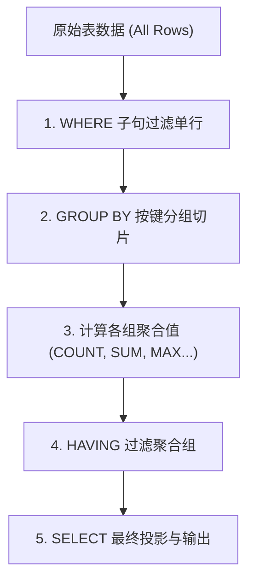

> **课程体系**：UC Berkeley CS61A (Fall 2024)  
> **所属模块**：Module 5: 声明式编程与 SQL (Declarative & SQL)  
> **主讲教师**：Prof. John DeNero (UC Berkeley)  
> **视频时长**：17:30 ｜ **课堂截图**：17 张板书/代码演示  
> **视频直达**：[📺 在 B 站观看本讲原视频 (P35)](https://www.bilibili.com/video/BV1sy411z7nA/?p=35)  
> **快速导航**：[← 上一讲 (P34 Lecture 36 Tables)](/notes/cs61a/lecture-34) ｜ [📚 返回全书目录](/notes/topics/CS61A) ｜ [下一讲 (P36 Lecture 38 Databases (Optional)) →](/notes/cs61a/lecture-36)

---

## 课程核心目标与全景图

在之前的数据库操作中，所有的表达式求值都是**单行（Per-Row）**进行的：无论是进行算术运算还是用 `WHERE` 过滤，计算的上下文始终局限在当前这一行。

然而，数据分析的核心灵魂是**聚合统计（Aggregation）**：
- 如何在数以亿计的记录中求取最大值、平均值或求和？
- 如何将数据按照特定属性分类切片（`GROUP BY`），并针对每个子类别分别进行统计？
- 如何对统计结果施加阈值条件过滤（`HAVING`）？

本讲将系统剖析 SQL 聚合引擎的底层运转模型。



---

### 深入形式化规约与微观求值流程（Operational Semantics）
在「课程核心目标与全景图」模块中，计算机底层运算依赖于严密的形式化求值逻辑：
1. **抽象语法树（AST）的分层解析**：
   - 源代码字符流首先经过词法分析器（Lexer）切分为终结符标记（Tokens），随后由语法解析器（Parser）构造成多叉语法树；
   - 运算符优先级与结合性在语法树构建阶段即已固化，消除了运行期的二义性；
2. **环境序列的动态跃迁**：
   - 每次函数调用产生的新帧，其静态词法环境由函数对象的 `parent` 属性完全决定；
   - 变量查找沿环境链向上单向回溯，直到全局环境帧，若未找到则触发 `NameError` 异常；
3. **状态不变式（State Invariants）**：
   - 编写健壮程序的关键在于明确循环不变式（Loop Invariants）与函数前后置条件（Pre/Post-conditions）；
   - 在复杂控制流跳转中，确保状态变量在每次迭代前均维持合法的业务约束。


## 1. 单行求值 vs 聚合函数 (Row-Level vs Aggregate Functions)

常规 SQL 表达式在每一行上独立运行：

[](https://www.bilibili.com/video/BV1sy411z7nA/?p=35&t=32)
*⏱ 时间戳：00:00:32 · 📷 课堂截图 · [在 B 站观看对应片段 (P35 00:00:32)](https://www.bilibili.com/video/BV1sy411z7nA/?p=35&t=32)*

#### 📸 课堂板书与代码演示深入精读 (00:00:32)

**【现场板书 / 代码演示还原】**：
在此时间节点，DeNero 教授在屏幕上进行了核心演示与重点板书推导：
> *“In the SQL language, you can perform aggregation over multiple rows, using aggregate functions. So, so far, all SQL expressions have referred to the values in a single row at a time. What do I mean by that? Well, if we look at the structure of a SELECT statement, we see that there are expressions in...”*

**【底层计算模型与微观执行机制】**：
1. **执行上下文与时序追踪**：
   - 处于当前讨论节点「1. 单行求值 vs 聚合函数 (Row-Level vs Aggregate Functions)」，解释器严格遵循核心求值规约；
   - 表达式先求值操作符，随后自左至右严格求值操作数，最终将函数对象施加于实参列表；
   - 若涉及环境模型，局部帧严格记录其静态词法父指针（Parent Pointer 指向函数定义处的环境），与运行时的动态调用栈形成正交架构。
2. **内存拓扑与对象引用**：
   - 变量符号只是哈希表（环境帧）中的键，指针直接指向堆内存中的一等公民对象；
   - 赋值语句是离散时间的瞬时状态快照，绝不会建立隐式的数学依赖监听。

**【避坑指南与高频考点点拨】**：
- **常见思维误区**：在「聚合函数 (COUNT, SUM, AVG, MAX, MIN)、GROUP BY 分组与 HAVING 二次筛选」相关考题中，初学者极易根据代码表面形式猜想结果，导致作用域混淆或变量遮蔽（Shadowing）误判；
- **调试排错黄金法则**：遇到嵌套调用与复杂分支时，务必在草稿纸上画出独立的局部帧，标明每个形参的具体绑定值，按部就班推导。


而**聚合函数（Aggregate Function）**接收一组行（Group of Rows）作为输入，将其折叠压缩并计算出一个总结标量值。

### 实战数据集：动物特征表 `animals`

引入一张包含腿数（`legs`）与体重（`weight`）的动物表：

```sql
CREATE TABLE animals AS
  SELECT "dog"     AS kind, 4 AS legs, 20    AS weight UNION
  SELECT "cat",             4,         10              UNION
  SELECT "ferret",          4,         10              UNION
  SELECT "parrot",          2,         6               UNION
  SELECT "penguin",         2,         10              UNION
  SELECT "t-rex",           2,         12000;
```

[](https://www.bilibili.com/video/BV1sy411z7nA/?p=35&t=94)
*⏱ 时间戳：00:01:34 · 📷 课堂截图 · [在 B 站观看对应片段 (P35 00:01:34)](https://www.bilibili.com/video/BV1sy411z7nA/?p=35&t=94)*

#### 📸 课堂板书与代码演示深入精读 (00:01:34)

**【现场板书 / 代码演示还原】**：
在此时间节点，DeNero 教授在屏幕上进行了核心演示与重点板书推导：
> *“Of the latitude, column, for a particular row is above some number, 38. And if so, you keep that row. Otherwise, you get rid of that row. But the expression itself is evaluated per row. Everything we've seen has looked like that so far. But now we're going to look at what's called an aggregate funct...”*

**【底层计算模型与微观执行机制】**：
1. **执行上下文与时序追踪**：
   - 处于当前讨论节点「1. 单行求值 vs 聚合函数 (Row-Level vs Aggregate Functions)」，解释器严格遵循核心求值规约；
   - 表达式先求值操作符，随后自左至右严格求值操作数，最终将函数对象施加于实参列表；
   - 若涉及环境模型，局部帧严格记录其静态词法父指针（Parent Pointer 指向函数定义处的环境），与运行时的动态调用栈形成正交架构。
2. **内存拓扑与对象引用**：
   - 变量符号只是哈希表（环境帧）中的键，指针直接指向堆内存中的一等公民对象；
   - 赋值语句是离散时间的瞬时状态快照，绝不会建立隐式的数学依赖监听。

**【避坑指南与高频考点点拨】**：
- **常见思维误区**：在「聚合函数 (COUNT, SUM, AVG, MAX, MIN)、GROUP BY 分组与 HAVING 二次筛选」相关考题中，初学者极易根据代码表面形式猜想结果，导致作用域混淆或变量遮蔽（Shadowing）误判；
- **调试排错黄金法则**：遇到嵌套调用与复杂分支时，务必在草稿纸上画出独立的局部帧，标明每个形参的具体绑定值，按部就班推导。


---

### 深入形式化规约与微观求值流程（Operational Semantics）
在「1. 单行求值 vs 聚合函数 (Row-Level vs Aggregate Functions)」模块中，计算机底层运算依赖于严密的形式化求值逻辑：
1. **抽象语法树（AST）的分层解析**：
   - 源代码字符流首先经过词法分析器（Lexer）切分为终结符标记（Tokens），随后由语法解析器（Parser）构造成多叉语法树；
   - 运算符优先级与结合性在语法树构建阶段即已固化，消除了运行期的二义性；
2. **环境序列的动态跃迁**：
   - 每次函数调用产生的新帧，其静态词法环境由函数对象的 `parent` 属性完全决定；
   - 变量查找沿环境链向上单向回溯，直到全局环境帧，若未找到则触发 `NameError` 异常；
3. **状态不变式（State Invariants）**：
   - 编写健壮程序的关键在于明确循环不变式（Loop Invariants）与函数前后置条件（Pre/Post-conditions）；
   - 在复杂控制流跳转中，确保状态变量在每次迭代前均维持合法的业务约束。


## 2. 基础聚合函数与算术组合 (`MAX`, `MIN`, `SUM`, `AVG`)

当 `SELECT` 语句中出现聚合函数且没有 `GROUP BY` 时，整个表被默认视为**一个全局大组**，输出结果强制收敛为单行：

```sql
SELECT max(legs) FROM animals; -- => 4
SELECT sum(weight) FROM animals; -- => 12056
```

[](https://www.bilibili.com/video/BV1sy411z7nA/?p=35&t=154)
*⏱ 时间戳：00:02:34 · 📷 课堂截图 · [在 B 站观看对应片段 (P35 00:02:34)](https://www.bilibili.com/video/BV1sy411z7nA/?p=35&t=154)*

#### 📸 课堂板书与代码演示深入精读 (00:02:34)

**【现场板书 / 代码演示还原】**：
在此时间节点，DeNero 教授在屏幕上进行了核心演示与重点板书推导：
> *“Parrot has two legs because it's a bird, and it weighs about 6 pounds. A larger bird would be a penguin, which has two legs and weighs 10 pounds. And then I was trying to think, what's something with two legs and weighs a lot? You might think an ostrich, but I chose a T-Rex, which weighs about 6 ton...”*

**【底层计算模型与微观执行机制】**：
1. **执行上下文与时序追踪**：
   - 处于当前讨论节点「2. 基础聚合函数与算术组合 (`MAX`, `MIN`, `SUM`, `AVG`)」，解释器严格遵循核心求值规约；
   - 表达式先求值操作符，随后自左至右严格求值操作数，最终将函数对象施加于实参列表；
   - 若涉及环境模型，局部帧严格记录其静态词法父指针（Parent Pointer 指向函数定义处的环境），与运行时的动态调用栈形成正交架构。
2. **内存拓扑与对象引用**：
   - 变量符号只是哈希表（环境帧）中的键，指针直接指向堆内存中的一等公民对象；
   - 赋值语句是离散时间的瞬时状态快照，绝不会建立隐式的数学依赖监听。

**【避坑指南与高频考点点拨】**：
- **常见思维误区**：在「聚合函数 (COUNT, SUM, AVG, MAX, MIN)、GROUP BY 分组与 HAVING 二次筛选」相关考题中，初学者极易根据代码表面形式猜想结果，导致作用域混淆或变量遮蔽（Shadowing）误判；
- **调试排错黄金法则**：遇到嵌套调用与复杂分支时，务必在草稿纸上画出独立的局部帧，标明每个形参的具体绑定值，按部就班推导。


[](https://www.bilibili.com/video/BV1sy411z7nA/?p=35&t=207)
*⏱ 时间戳：00:03:27 · 📷 课堂截图 · [在 B 站观看对应片段 (P35 00:03:27)](https://www.bilibili.com/video/BV1sy411z7nA/?p=35&t=207)*

#### 📸 课堂板书与代码演示深入精读 (00:03:27)

**【现场板书 / 代码演示还原】**：
在此时间节点，DeNero 教授在屏幕上进行了核心演示与重点板书推导：
> *“Instead of having a six row output from this six row input, we get only one output row, which takes the maximum value over every value that appears in the legs column. So this thing is called an aggregate function, max. And you can also take the min and the sum and some others. So let's try it out. ...”*

**【底层计算模型与微观执行机制】**：
1. **执行上下文与时序追踪**：
   - 处于当前讨论节点「2. 基础聚合函数与算术组合 (`MAX`, `MIN`, `SUM`, `AVG`)」，解释器严格遵循核心求值规约；
   - 表达式先求值操作符，随后自左至右严格求值操作数，最终将函数对象施加于实参列表；
   - 若涉及环境模型，局部帧严格记录其静态词法父指针（Parent Pointer 指向函数定义处的环境），与运行时的动态调用栈形成正交架构。
2. **内存拓扑与对象引用**：
   - 变量符号只是哈希表（环境帧）中的键，指针直接指向堆内存中的一等公民对象；
   - 赋值语句是离散时间的瞬时状态快照，绝不会建立隐式的数学依赖监听。

**【避坑指南与高频考点点拨】**：
- **常见思维误区**：在「聚合函数 (COUNT, SUM, AVG, MAX, MIN)、GROUP BY 分组与 HAVING 二次筛选」相关考题中，初学者极易根据代码表面形式猜想结果，导致作用域混淆或变量遮蔽（Shadowing）误判；
- **调试排错黄金法则**：遇到嵌套调用与复杂分支时，务必在草稿纸上画出独立的局部帧，标明每个形参的具体绑定值，按部就班推导。


### 聚合函数内部与外部的算术运算

- 聚合函数内部可以嵌套复杂的单行表达式：`max(legs - weight)`；
- 多个聚合函数之间可以直接进行四则运算：
  ```sql
  SELECT max(legs) - min(weight) FROM animals; -- => 4 - 6 = -2
  ```

[](https://www.bilibili.com/video/BV1sy411z7nA/?p=35&t=270)
*⏱ 时间戳：00:04:30 · 📷 课堂截图 · [在 B 站观看对应片段 (P35 00:04:30)](https://www.bilibili.com/video/BV1sy411z7nA/?p=35&t=270)*

#### 📸 课堂板书与代码演示深入精读 (00:04:30)

**【现场板书 / 代码演示还原】**：
在此时间节点，DeNero 教授在屏幕上进行了核心演示与重点板书推导：
> *“Minus the weight. Then I could add 5 to that, and take all these and animals and I'll get 1. Now where did this 1 come from? Well, I computed what's the legs 2 minus the weight 6 is negative 4, which is the biggest value I can get from any row, plus 5 gives me 1. Okay, it's also possible to combine ...”*

**【底层计算模型与微观执行机制】**：
1. **执行上下文与时序追踪**：
   - 处于当前讨论节点「2. 基础聚合函数与算术组合 (`MAX`, `MIN`, `SUM`, `AVG`)」，解释器严格遵循核心求值规约；
   - 表达式先求值操作符，随后自左至右严格求值操作数，最终将函数对象施加于实参列表；
   - 若涉及环境模型，局部帧严格记录其静态词法父指针（Parent Pointer 指向函数定义处的环境），与运行时的动态调用栈形成正交架构。
2. **内存拓扑与对象引用**：
   - 变量符号只是哈希表（环境帧）中的键，指针直接指向堆内存中的一等公民对象；
   - 赋值语句是离散时间的瞬时状态快照，绝不会建立隐式的数学依赖监听。

**【避坑指南与高频考点点拨】**：
- **常见思维误区**：在「聚合函数 (COUNT, SUM, AVG, MAX, MIN)、GROUP BY 分组与 HAVING 二次筛选」相关考题中，初学者极易根据代码表面形式猜想结果，导致作用域混淆或变量遮蔽（Shadowing）误判；
- **调试排错黄金法则**：遇到嵌套调用与复杂分支时，务必在草稿纸上画出独立的局部帧，标明每个形参的具体绑定值，按部就班推导。


### 配合 `WHERE` 预过滤

`WHERE` 子句总是在聚合计算**之前**生效：

```sql
-- 排除霸王龙 (t-rex) 后的最大体重
SELECT max(weight) FROM animals WHERE kind != "t-rex"; -- => 20 (狗)
```

[](https://www.bilibili.com/video/BV1sy411z7nA/?p=35&t=303)
*⏱ 时间戳：00:05:03 · 📷 课堂截图 · [在 B 站观看对应片段 (P35 00:05:03)](https://www.bilibili.com/video/BV1sy411z7nA/?p=35&t=303)*

#### 📸 课堂板书与代码演示深入精读 (00:05:03)

**【现场板书 / 代码演示还原】**：
在此时间节点，DeNero 教授在屏幕上进行了核心演示与重点板书推导：
> *“And the min weight from animals, which would be 4 and 6. Now, there's no animal that has 4 legs and 6 weight, so these are computed independently of each other. I can even combine them. I can take the maximum legs and subtract out the minimum weight, and I'll get negative 2. Now, all of this can be ...”*

**【底层计算模型与微观执行机制】**：
1. **执行上下文与时序追踪**：
   - 处于当前讨论节点「2. 基础聚合函数与算术组合 (`MAX`, `MIN`, `SUM`, `AVG`)」，解释器严格遵循核心求值规约；
   - 表达式先求值操作符，随后自左至右严格求值操作数，最终将函数对象施加于实参列表；
   - 若涉及环境模型，局部帧严格记录其静态词法父指针（Parent Pointer 指向函数定义处的环境），与运行时的动态调用栈形成正交架构。
2. **内存拓扑与对象引用**：
   - 变量符号只是哈希表（环境帧）中的键，指针直接指向堆内存中的一等公民对象；
   - 赋值语句是离散时间的瞬时状态快照，绝不会建立隐式的数学依赖监听。

**【避坑指南与高频考点点拨】**：
- **常见思维误区**：在「聚合函数 (COUNT, SUM, AVG, MAX, MIN)、GROUP BY 分组与 HAVING 二次筛选」相关考题中，初学者极易根据代码表面形式猜想结果，导致作用域混淆或变量遮蔽（Shadowing）误判；
- **调试排错黄金法则**：遇到嵌套调用与复杂分支时，务必在草稿纸上画出独立的局部帧，标明每个形参的具体绑定值，按部就班推导。


---

### 深入形式化规约与微观求值流程（Operational Semantics）
在「2. 基础聚合函数与算术组合 (`MAX`, `MIN`, `SUM`, `AVG`)」模块中，计算机底层运算依赖于严密的形式化求值逻辑：
1. **抽象语法树（AST）的分层解析**：
   - 源代码字符流首先经过词法分析器（Lexer）切分为终结符标记（Tokens），随后由语法解析器（Parser）构造成多叉语法树；
   - 运算符优先级与结合性在语法树构建阶段即已固化，消除了运行期的二义性；
2. **环境序列的动态跃迁**：
   - 每次函数调用产生的新帧，其静态词法环境由函数对象的 `parent` 属性完全决定；
   - 变量查找沿环境链向上单向回溯，直到全局环境帧，若未找到则触发 `NameError` 异常；
3. **状态不变式（State Invariants）**：
   - 编写健壮程序的关键在于明确循环不变式（Loop Invariants）与函数前后置条件（Pre/Post-conditions）；
   - 在复杂控制流跳转中，确保状态变量在每次迭代前均维持合法的业务约束。


## 3. 计数与去重统计 (`COUNT(*)` vs `COUNT(DISTINCT)`)

统计行数时最地道的语法是 `COUNT(*)`：

```sql
SELECT count(*) FROM animals; -- => 6
```

[](https://www.bilibili.com/video/BV1sy411z7nA/?p=35&t=370)
*⏱ 时间戳：00:06:10 · 📷 课堂截图 · [在 B 站观看对应片段 (P35 00:06:10)](https://www.bilibili.com/video/BV1sy411z7nA/?p=35&t=370)*

#### 📸 课堂板书与代码演示深入精读 (00:06:10)

**【现场板书 / 代码演示还原】**：
在此时间节点，DeNero 教授在屏幕上进行了核心演示与重点板书推导：
> *“The average value, so the average number of legs from animals, takes an aggregation over all six rows and comes with up with 3.0. You can also count the number of legs. Now, what does count do? Well, it just tells you how many different rows there are. So there are six rows in animals. It doesn't ma...”*

**【底层计算模型与微观执行机制】**：
1. **执行上下文与时序追踪**：
   - 处于当前讨论节点「3. 计数与去重统计 (`COUNT(*)` vs `COUNT(DISTINCT)`)」，解释器严格遵循核心求值规约；
   - 表达式先求值操作符，随后自左至右严格求值操作数，最终将函数对象施加于实参列表；
   - 若涉及环境模型，局部帧严格记录其静态词法父指针（Parent Pointer 指向函数定义处的环境），与运行时的动态调用栈形成正交架构。
2. **内存拓扑与对象引用**：
   - 变量符号只是哈希表（环境帧）中的键，指针直接指向堆内存中的一等公民对象；
   - 赋值语句是离散时间的瞬时状态快照，绝不会建立隐式的数学依赖监听。

**【避坑指南与高频考点点拨】**：
- **常见思维误区**：在「聚合函数 (COUNT, SUM, AVG, MAX, MIN)、GROUP BY 分组与 HAVING 二次筛选」相关考题中，初学者极易根据代码表面形式猜想结果，导致作用域混淆或变量遮蔽（Shadowing）误判；
- **调试排错黄金法则**：遇到嵌套调用与复杂分支时，务必在草稿纸上画出独立的局部帧，标明每个形参的具体绑定值，按部就班推导。


### `DISTINCT` 关键字消除重复值

如果需要在聚合前剔除重复取值，可以在列名前加上 `DISTINCT`：

```sql
SELECT count(DISTINCT legs) FROM animals; -- => 2 (只有 2 和 4 两种腿数)
SELECT sum(DISTINCT weight) FROM animals; -- => 20 + 10 + 6 + 12000 = 12036 (10 仅计算一次)
```

---

### 深入形式化规约与微观求值流程（Operational Semantics）
在「3. 计数与去重统计 (`COUNT(*)` vs `COUNT(DISTINCT)`)」模块中，计算机底层运算依赖于严密的形式化求值逻辑：
1. **抽象语法树（AST）的分层解析**：
   - 源代码字符流首先经过词法分析器（Lexer）切分为终结符标记（Tokens），随后由语法解析器（Parser）构造成多叉语法树；
   - 运算符优先级与结合性在语法树构建阶段即已固化，消除了运行期的二义性；
2. **环境序列的动态跃迁**：
   - 每次函数调用产生的新帧，其静态词法环境由函数对象的 `parent` 属性完全决定；
   - 变量查找沿环境链向上单向回溯，直到全局环境帧，若未找到则触发 `NameError` 异常；
3. **状态不变式（State Invariants）**：
   - 编写健壮程序的关键在于明确循环不变式（Loop Invariants）与函数前后置条件（Pre/Post-conditions）；
   - 在复杂控制流跳转中，确保状态变量在每次迭代前均维持合法的业务约束。


## 4. 聚合函数与非聚合列混用的语义陷阱 (Mixing Columns with Aggregates)

如果在 `SELECT` 中同时请求一个聚合值和一个普通列（如 `SELECT max(weight), kind FROM animals`），会发生什么？

[](https://www.bilibili.com/video/BV1sy411z7nA/?p=35&t=430)
*⏱ 时间戳：00:07:10 · 📷 课堂截图 · [在 B 站观看对应片段 (P35 00:07:10)](https://www.bilibili.com/video/BV1sy411z7nA/?p=35&t=430)*

#### 📸 课堂板书与代码演示深入精读 (00:07:10)

**【现场板书 / 代码演示还原】**：
在此时间节点，DeNero 教授在屏幕上进行了核心演示与重点板书推导：
> *“Four legs, or there's two legs. What about the distinct values for weight? Well, there's four of them. There's 20, 10, 6, and 12,000. This distinct keyword can also be applied to the sum. So this sums up 12,000, 10, 6, and 20, leaving out the repeats. Now, it's possible to... Come up with a column d...”*

**【底层计算模型与微观执行机制】**：
1. **执行上下文与时序追踪**：
   - 处于当前讨论节点「4. 聚合函数与非聚合列混用的语义陷阱 (Mixing Columns with Aggregates)」，解释器严格遵循核心求值规约；
   - 表达式先求值操作符，随后自左至右严格求值操作数，最终将函数对象施加于实参列表；
   - 若涉及环境模型，局部帧严格记录其静态词法父指针（Parent Pointer 指向函数定义处的环境），与运行时的动态调用栈形成正交架构。
2. **内存拓扑与对象引用**：
   - 变量符号只是哈希表（环境帧）中的键，指针直接指向堆内存中的一等公民对象；
   - 赋值语句是离散时间的瞬时状态快照，绝不会建立隐式的数学依赖监听。

**【避坑指南与高频考点点拨】**：
- **常见思维误区**：在「聚合函数 (COUNT, SUM, AVG, MAX, MIN)、GROUP BY 分组与 HAVING 二次筛选」相关考题中，初学者极易根据代码表面形式猜想结果，导致作用域混淆或变量遮蔽（Shadowing）误判；
- **调试排错黄金法则**：遇到嵌套调用与复杂分支时，务必在草稿纸上画出独立的局部帧，标明每个形参的具体绑定值，按部就班推导。


[](https://www.bilibili.com/video/BV1sy411z7nA/?p=35&t=490)
*⏱ 时间戳：00:08:10 · 📷 课堂截图 · [在 B 站观看对应片段 (P35 00:08:10)](https://www.bilibili.com/video/BV1sy411z7nA/?p=35&t=490)*

#### 📸 课堂板书与代码演示深入精读 (00:08:10)

**【现场板书 / 代码演示还原】**：
在此时间节点，DeNero 教授在屏幕上进行了核心演示与重点板书推导：
> *“And then the kind as another column from animals. You end up getting one row. And the row you get has a maximum weight of 12,000. And what kind do you get? Well, you get the kind t-rex. How does that work? Well, what happens is that when you maximize the weight, it selects this weight, but it also s...”*

**【底层计算模型与微观执行机制】**：
1. **执行上下文与时序追踪**：
   - 处于当前讨论节点「4. 聚合函数与非聚合列混用的语义陷阱 (Mixing Columns with Aggregates)」，解释器严格遵循核心求值规约；
   - 表达式先求值操作符，随后自左至右严格求值操作数，最终将函数对象施加于实参列表；
   - 若涉及环境模型，局部帧严格记录其静态词法父指针（Parent Pointer 指向函数定义处的环境），与运行时的动态调用栈形成正交架构。
2. **内存拓扑与对象引用**：
   - 变量符号只是哈希表（环境帧）中的键，指针直接指向堆内存中的一等公民对象；
   - 赋值语句是离散时间的瞬时状态快照，绝不会建立隐式的数学依赖监听。

**【避坑指南与高频考点点拨】**：
- **常见思维误区**：在「聚合函数 (COUNT, SUM, AVG, MAX, MIN)、GROUP BY 分组与 HAVING 二次筛选」相关考题中，初学者极易根据代码表面形式猜想结果，导致作用域混淆或变量遮蔽（Shadowing）误判；
- **调试排错黄金法则**：遇到嵌套调用与复杂分支时，务必在草稿纸上画出独立的局部帧，标明每个形参的具体绑定值，按部就班推导。


[](https://www.bilibili.com/video/BV1sy411z7nA/?p=35&t=588)
*⏱ 时间戳：00:09:48 · 📷 课堂截图 · [在 B 站观看对应片段 (P35 00:09:48)](https://www.bilibili.com/video/BV1sy411z7nA/?p=35&t=588)*

#### 📸 课堂板书与代码演示深入精读 (00:09:48)

**【现场板书 / 代码演示还原】**：
在此时间节点，DeNero 教授在屏幕上进行了核心演示与重点板书推导：
> *“From animals. That gives you something meaningful. 2009. But if you also try to select what kind is that, it tells you it's the T-Rex. And what does that mean? T-Rex is not average in any way. So you have to be careful about selecting single values in conjunction with aggregations. Some aggregations...”*

**【底层计算模型与微观执行机制】**：
1. **执行上下文与时序追踪**：
   - 处于当前讨论节点「4. 聚合函数与非聚合列混用的语义陷阱 (Mixing Columns with Aggregates)」，解释器严格遵循核心求值规约；
   - 表达式先求值操作符，随后自左至右严格求值操作数，最终将函数对象施加于实参列表；
   - 若涉及环境模型，局部帧严格记录其静态词法父指针（Parent Pointer 指向函数定义处的环境），与运行时的动态调用栈形成正交架构。
2. **内存拓扑与对象引用**：
   - 变量符号只是哈希表（环境帧）中的键，指针直接指向堆内存中的一等公民对象；
   - 赋值语句是离散时间的瞬时状态快照，绝不会建立隐式的数学依赖监听。

**【避坑指南与高频考点点拨】**：
- **常见思维误区**：在「聚合函数 (COUNT, SUM, AVG, MAX, MIN)、GROUP BY 分组与 HAVING 二次筛选」相关考题中，初学者极易根据代码表面形式猜想结果，导致作用域混淆或变量遮蔽（Shadowing）误判；
- **调试排错黄金法则**：遇到嵌套调用与复杂分支时，务必在草稿纸上画出独立的局部帧，标明每个形参的具体绑定值，按部就班推导。


1. **确定性关联（`MAX`/`MIN`）**：在 SQLite 中，`max(weight), kind` 会返回取得最大体重的整行数据（输出 `12000, t-rex`），这在语义上是清晰且有意义的；
2. **多匹配不确定性**：执行 `SELECT max(legs), kind FROM animals` 时，有三只动物（dog, cat, ferret）都是 4 条腿，数据库将随机/任意挑选一只，失去明确指向性；
3. **彻底无意义（`AVG`/`SUM`）**：执行 `SELECT avg(weight), kind FROM animals` 时，平均体重是 2009，但返回的动物却是 `t-rex`——因为平均值由所有行共同产生，没有任何一只单独的动物“代表平均值”！

> **最佳实践**：除非明确利用特定数据库的扩展特性，否则 `SELECT` 列表中应仅包含聚合函数或出现在 `GROUP BY` 中的列。

---

### 深入形式化规约与微观求值流程（Operational Semantics）
在「4. 聚合函数与非聚合列混用的语义陷阱 (Mixing Columns with Aggregates)」模块中，计算机底层运算依赖于严密的形式化求值逻辑：
1. **抽象语法树（AST）的分层解析**：
   - 源代码字符流首先经过词法分析器（Lexer）切分为终结符标记（Tokens），随后由语法解析器（Parser）构造成多叉语法树；
   - 运算符优先级与结合性在语法树构建阶段即已固化，消除了运行期的二义性；
2. **环境序列的动态跃迁**：
   - 每次函数调用产生的新帧，其静态词法环境由函数对象的 `parent` 属性完全决定；
   - 变量查找沿环境链向上单向回溯，直到全局环境帧，若未找到则触发 `NameError` 异常；
3. **状态不变式（State Invariants）**：
   - 编写健壮程序的关键在于明确循环不变式（Loop Invariants）与函数前后置条件（Pre/Post-conditions）；
   - 在复杂控制流跳转中，确保状态变量在每次迭代前均维持合法的业务约束。


## 5. 数据分组切片：`GROUP BY` 子句

默认情况下全表为一个大组。使用 `GROUP BY` 可以将数据按照某个表达式的唯一值**分割成多个相互独立的子组**，并在每个子组内分别执行聚合：

```sql
SELECT legs, max(weight) FROM animals GROUP BY legs;
```

[](https://www.bilibili.com/video/BV1sy411z7nA/?p=35&t=686)
*⏱ 时间戳：00:11:26 · 📷 课堂截图 · [在 B 站观看对应片段 (P35 00:11:26)](https://www.bilibili.com/video/BV1sy411z7nA/?p=35&t=686)*

#### 📸 课堂板书与代码演示深入精读 (00:11:26)

**【现场板书 / 代码演示还原】**：
在此时间节点，DeNero 教授在屏幕上进行了核心演示与重点板书推导：
> *“from all the rows in a group, and does something with them. Takes the max or the sum. Now, by default, all rows that are used to compute the final table, meaning the ones that passed the filter in the where clause, are all in the same group, one big group. And so the result, when you apply an aggreg...”*

**【底层计算模型与微观执行机制】**：
1. **执行上下文与时序追踪**：
   - 处于当前讨论节点「5. 数据分组切片：`GROUP BY` 子句」，解释器严格遵循核心求值规约；
   - 表达式先求值操作符，随后自左至右严格求值操作数，最终将函数对象施加于实参列表；
   - 若涉及环境模型，局部帧严格记录其静态词法父指针（Parent Pointer 指向函数定义处的环境），与运行时的动态调用栈形成正交架构。
2. **内存拓扑与对象引用**：
   - 变量符号只是哈希表（环境帧）中的键，指针直接指向堆内存中的一等公民对象；
   - 赋值语句是离散时间的瞬时状态快照，绝不会建立隐式的数学依赖监听。

**【避坑指南与高频考点点拨】**：
- **常见思维误区**：在「聚合函数 (COUNT, SUM, AVG, MAX, MIN)、GROUP BY 分组与 HAVING 二次筛选」相关考题中，初学者极易根据代码表面形式猜想结果，导致作用域混淆或变量遮蔽（Shadowing）误判；
- **调试排错黄金法则**：遇到嵌套调用与复杂分支时，务必在草稿纸上画出独立的局部帧，标明每个形参的具体绑定值，按部就班推导。


[](https://www.bilibili.com/video/BV1sy411z7nA/?p=35&t=751)
*⏱ 时间戳：00:12:31 · 📷 课堂截图 · [在 B 站观看对应片段 (P35 00:12:31)](https://www.bilibili.com/video/BV1sy411z7nA/?p=35&t=751)*

#### 📸 课堂板书与代码演示深入精读 (00:12:31)

**【现场板书 / 代码演示还原】**：
在此时间节点，DeNero 教授在屏幕上进行了核心演示与重点板书推导：
> *“Group by and having are both new. Let's focus on group by. The number of groups is the number of unique values of some expression which you place here. So here's our animals table. And here's a select statement that says, select the number of legs and the maximum weight from animals group by legs. W...”*

**【底层计算模型与微观执行机制】**：
1. **执行上下文与时序追踪**：
   - 处于当前讨论节点「5. 数据分组切片：`GROUP BY` 子句」，解释器严格遵循核心求值规约；
   - 表达式先求值操作符，随后自左至右严格求值操作数，最终将函数对象施加于实参列表；
   - 若涉及环境模型，局部帧严格记录其静态词法父指针（Parent Pointer 指向函数定义处的环境），与运行时的动态调用栈形成正交架构。
2. **内存拓扑与对象引用**：
   - 变量符号只是哈希表（环境帧）中的键，指针直接指向堆内存中的一等公民对象；
   - 赋值语句是离散时间的瞬时状态快照，绝不会建立隐式的数学依赖监听。

**【避坑指南与高频考点点拨】**：
- **常见思维误区**：在「聚合函数 (COUNT, SUM, AVG, MAX, MIN)、GROUP BY 分组与 HAVING 二次筛选」相关考题中，初学者极易根据代码表面形式猜想结果，导致作用域混淆或变量遮蔽（Shadowing）误判；
- **调试排错黄金法则**：遇到嵌套调用与复杂分支时，务必在草稿纸上画出独立的局部帧，标明每个形参的具体绑定值，按部就班推导。


执行过程：
1. 提取所有行的 `legs` 值，划分为两个组：`legs = 2` 组与 `legs = 4` 组；
2. 在 `legs = 4` 组（dog, cat, ferret）中求最大体重：`20`；
3. 在 `legs = 2` 组（parrot, penguin, t-rex）中求最大体重：`12000`；
4. 输出包含两行聚合统计的全新结果表！

[](https://www.bilibili.com/video/BV1sy411z7nA/?p=35&t=809)
*⏱ 时间戳：00:13:29 · 📷 课堂截图 · [在 B 站观看对应片段 (P35 00:13:29)](https://www.bilibili.com/video/BV1sy411z7nA/?p=35&t=809)*

#### 📸 课堂板书与代码演示深入精读 (00:13:29)

**【现场板书 / 代码演示还原】**：
在此时间节点，DeNero 教授在屏幕上进行了核心演示与重点板书推导：
> *“of the legs for that group. It's really giving us the legs value for some arbitrary row, but they're all the same. So we get 4. And then it computes the maximal weight by maximizing over all the rows in this group. So the maximum weight for a four-legged animal is 20. And the maximum rate for a two-...”*

**【底层计算模型与微观执行机制】**：
1. **执行上下文与时序追踪**：
   - 处于当前讨论节点「5. 数据分组切片：`GROUP BY` 子句」，解释器严格遵循核心求值规约；
   - 表达式先求值操作符，随后自左至右严格求值操作数，最终将函数对象施加于实参列表；
   - 若涉及环境模型，局部帧严格记录其静态词法父指针（Parent Pointer 指向函数定义处的环境），与运行时的动态调用栈形成正交架构。
2. **内存拓扑与对象引用**：
   - 变量符号只是哈希表（环境帧）中的键，指针直接指向堆内存中的一等公民对象；
   - 赋值语句是离散时间的瞬时状态快照，绝不会建立隐式的数学依赖监听。

**【避坑指南与高频考点点拨】**：
- **常见思维误区**：在「聚合函数 (COUNT, SUM, AVG, MAX, MIN)、GROUP BY 分组与 HAVING 二次筛选」相关考题中，初学者极易根据代码表面形式猜想结果，导致作用域混淆或变量遮蔽（Shadowing）误判；
- **调试排错黄金法则**：遇到嵌套调用与复杂分支时，务必在草稿纸上画出独立的局部帧，标明每个形参的具体绑定值，按部就班推导。


---

### 深入形式化规约与微观求值流程（Operational Semantics）
在「5. 数据分组切片：`GROUP BY` 子句」模块中，计算机底层运算依赖于严密的形式化求值逻辑：
1. **抽象语法树（AST）的分层解析**：
   - 源代码字符流首先经过词法分析器（Lexer）切分为终结符标记（Tokens），随后由语法解析器（Parser）构造成多叉语法树；
   - 运算符优先级与结合性在语法树构建阶段即已固化，消除了运行期的二义性；
2. **环境序列的动态跃迁**：
   - 每次函数调用产生的新帧，其静态词法环境由函数对象的 `parent` 属性完全决定；
   - 变量查找沿环境链向上单向回溯，直到全局环境帧，若未找到则触发 `NameError` 异常；
3. **状态不变式（State Invariants）**：
   - 编写健壮程序的关键在于明确循环不变式（Loop Invariants）与函数前后置条件（Pre/Post-conditions）；
   - 在复杂控制流跳转中，确保状态变量在每次迭代前均维持合法的业务约束。


## 6. 多列分组与按任意表达式分组 (Grouping by Multiple Columns & Expressions)

### 多列复合分组

```sql
SELECT legs, weight, count(*) FROM animals GROUP BY legs, weight;
```

[](https://www.bilibili.com/video/BV1sy411z7nA/?p=35&t=872)
*⏱ 时间戳：00:14:32 · 📷 课堂截图 · [在 B 站观看对应片段 (P35 00:14:32)](https://www.bilibili.com/video/BV1sy411z7nA/?p=35&t=872)*

#### 📸 课堂板书与代码演示深入精读 (00:14:32)

**【现场板书 / 代码演示还原】**：
在此时间节点，DeNero 教授在屏幕上进行了核心演示与重点板书推导：
> *“OK, so there are three different animals with two legs and three different animals with four legs. And like I said, I could also compute the maximum weight in each of those categories. 12,000 pounds for a two-legged beast, 20 pounds for a four-legged beast. It is possible to group by more than one c...”*

**【底层计算模型与微观执行机制】**：
1. **执行上下文与时序追踪**：
   - 处于当前讨论节点「6. 多列分组与按任意表达式分组 (Grouping by Multiple Columns & Expressions)」，解释器严格遵循核心求值规约；
   - 表达式先求值操作符，随后自左至右严格求值操作数，最终将函数对象施加于实参列表；
   - 若涉及环境模型，局部帧严格记录其静态词法父指针（Parent Pointer 指向函数定义处的环境），与运行时的动态调用栈形成正交架构。
2. **内存拓扑与对象引用**：
   - 变量符号只是哈希表（环境帧）中的键，指针直接指向堆内存中的一等公民对象；
   - 赋值语句是离散时间的瞬时状态快照，绝不会建立隐式的数学依赖监听。

**【避坑指南与高频考点点拨】**：
- **常见思维误区**：在「聚合函数 (COUNT, SUM, AVG, MAX, MIN)、GROUP BY 分组与 HAVING 二次筛选」相关考题中，初学者极易根据代码表面形式猜想结果，导致作用域混淆或变量遮蔽（Shadowing）误判；
- **调试排错黄金法则**：遇到嵌套调用与复杂分支时，务必在草稿纸上画出独立的局部帧，标明每个形参的具体绑定值，按部就班推导。


仅当两行的 `legs` 与 `weight` 完全相同时才归入同一组（例如 cat 和 ferret 同属一组）。

### 按计算表达式分组：体腿比（Weight / Legs）

```sql
SELECT max(kind), weight / legs FROM animals GROUP BY weight / legs;
```

[](https://www.bilibili.com/video/BV1sy411z7nA/?p=35&t=907)
*⏱ 时间戳：00:15:07 · 📷 课堂截图 · [在 B 站观看对应片段 (P35 00:15:07)](https://www.bilibili.com/video/BV1sy411z7nA/?p=35&t=907)*

#### 📸 课堂板书与代码演示深入精读 (00:15:07)

**【现场板书 / 代码演示还原】**：
在此时间节点，DeNero 教授在屏幕上进行了核心演示与重点板书推导：
> *“By both the legs and the weight. So here's all the unique combinations of a value for legs and a value for weight. Notice there are only five, whereas we had six rows in the beginning, because ferret and cat have both the same attributes. I can actually group by any expression I want. So I could get...”*

**【底层计算模型与微观执行机制】**：
1. **执行上下文与时序追踪**：
   - 处于当前讨论节点「6. 多列分组与按任意表达式分组 (Grouping by Multiple Columns & Expressions)」，解释器严格遵循核心求值规约；
   - 表达式先求值操作符，随后自左至右严格求值操作数，最终将函数对象施加于实参列表；
   - 若涉及环境模型，局部帧严格记录其静态词法父指针（Parent Pointer 指向函数定义处的环境），与运行时的动态调用栈形成正交架构。
2. **内存拓扑与对象引用**：
   - 变量符号只是哈希表（环境帧）中的键，指针直接指向堆内存中的一等公民对象；
   - 赋值语句是离散时间的瞬时状态快照，绝不会建立隐式的数学依赖监听。

**【避坑指南与高频考点点拨】**：
- **常见思维误区**：在「聚合函数 (COUNT, SUM, AVG, MAX, MIN)、GROUP BY 分组与 HAVING 二次筛选」相关考题中，初学者极易根据代码表面形式猜想结果，导致作用域混淆或变量遮蔽（Shadowing）误判；
- **调试排错黄金法则**：遇到嵌套调用与复杂分支时，务必在草稿纸上画出独立的局部帧，标明每个形参的具体绑定值，按部就班推导。


SQLite 默认对整型执行整数除法，根据每只动物的体重除以腿数所得到的唯一比值分别归类分组。

---

### 深入形式化规约与微观求值流程（Operational Semantics）
在「6. 多列分组与按任意表达式分组 (Grouping by Multiple Columns & Expressions)」模块中，计算机底层运算依赖于严密的形式化求值逻辑：
1. **抽象语法树（AST）的分层解析**：
   - 源代码字符流首先经过词法分析器（Lexer）切分为终结符标记（Tokens），随后由语法解析器（Parser）构造成多叉语法树；
   - 运算符优先级与结合性在语法树构建阶段即已固化，消除了运行期的二义性；
2. **环境序列的动态跃迁**：
   - 每次函数调用产生的新帧，其静态词法环境由函数对象的 `parent` 属性完全决定；
   - 变量查找沿环境链向上单向回溯，直到全局环境帧，若未找到则触发 `NameError` 异常；
3. **状态不变式（State Invariants）**：
   - 编写健壮程序的关键在于明确循环不变式（Loop Invariants）与函数前后置条件（Pre/Post-conditions）；
   - 在复杂控制流跳转中，确保状态变量在每次迭代前均维持合法的业务约束。


## 7. 分组后的条件过滤：`HAVING` 子句 (`WHERE` vs `HAVING`)

这是初学者最容易混淆的 SQL 核心考点：**行过滤（`WHERE`）与组过滤（`HAVING`）的本质区别**。

[](https://www.bilibili.com/video/BV1sy411z7nA/?p=35&t=970)
*⏱ 时间戳：00:16:10 · 📷 课堂截图 · [在 B 站观看对应片段 (P35 00:16:10)](https://www.bilibili.com/video/BV1sy411z7nA/?p=35&t=970)*

#### 📸 课堂板书与代码演示深入精读 (00:16:10)

**【现场板书 / 代码演示还原】**：
在此时间节点，DeNero 教授在屏幕上进行了核心演示与重点板书推导：
> *“Kind of an animal for each ratio of weight to legs that I can possibly get within the animals table. So here we've seen a grouping by a particular column value, multiple column values, or an arbitrary expression. Now, sometimes when you group rows together, you want to keep some of those groups arou...”*

**【底层计算模型与微观执行机制】**：
1. **执行上下文与时序追踪**：
   - 处于当前讨论节点「7. 分组后的条件过滤：`HAVING` 子句 (`WHERE` vs `HAVING`)」，解释器严格遵循核心求值规约；
   - 表达式先求值操作符，随后自左至右严格求值操作数，最终将函数对象施加于实参列表；
   - 若涉及环境模型，局部帧严格记录其静态词法父指针（Parent Pointer 指向函数定义处的环境），与运行时的动态调用栈形成正交架构。
2. **内存拓扑与对象引用**：
   - 变量符号只是哈希表（环境帧）中的键，指针直接指向堆内存中的一等公民对象；
   - 赋值语句是离散时间的瞬时状态快照，绝不会建立隐式的数学依赖监听。

**【避坑指南与高频考点点拨】**：
- **常见思维误区**：在「聚合函数 (COUNT, SUM, AVG, MAX, MIN)、GROUP BY 分组与 HAVING 二次筛选」相关考题中，初学者极易根据代码表面形式猜想结果，导致作用域混淆或变量遮蔽（Shadowing）误判；
- **调试排错黄金法则**：遇到嵌套调用与复杂分支时，务必在草稿纸上画出独立的局部帧，标明每个形参的具体绑定值，按部就班推导。


[](https://www.bilibili.com/video/BV1sy411z7nA/?p=35&t=1000)
*⏱ 时间戳：00:16:40 · 📷 课堂截图 · [在 B 站观看对应片段 (P35 00:16:40)](https://www.bilibili.com/video/BV1sy411z7nA/?p=35&t=1000)*

#### 📸 课堂板书与代码演示深入精读 (00:16:40)

**【现场板书 / 代码演示还原】**：
在此时间节点，DeNero 教授在屏幕上进行了核心演示与重点板书推导：
> *“Now, we also have a where clause to filter individual rows, but a having clause can even include aggregation itself. So here is a select statement where we've said we want to keep the result of weight divided by legs and the count of the number of rows that have that weight to leg ratio from the ani...”*

**【底层计算模型与微观执行机制】**：
1. **执行上下文与时序追踪**：
   - 处于当前讨论节点「7. 分组后的条件过滤：`HAVING` 子句 (`WHERE` vs `HAVING`)」，解释器严格遵循核心求值规约；
   - 表达式先求值操作符，随后自左至右严格求值操作数，最终将函数对象施加于实参列表；
   - 若涉及环境模型，局部帧严格记录其静态词法父指针（Parent Pointer 指向函数定义处的环境），与运行时的动态调用栈形成正交架构。
2. **内存拓扑与对象引用**：
   - 变量符号只是哈希表（环境帧）中的键，指针直接指向堆内存中的一等公民对象；
   - 赋值语句是离散时间的瞬时状态快照，绝不会建立隐式的数学依赖监听。

**【避坑指南与高频考点点拨】**：
- **常见思维误区**：在「聚合函数 (COUNT, SUM, AVG, MAX, MIN)、GROUP BY 分组与 HAVING 二次筛选」相关考题中，初学者极易根据代码表面形式猜想结果，导致作用域混淆或变量遮蔽（Shadowing）误判；
- **调试排错黄金法则**：遇到嵌套调用与复杂分支时，务必在草稿纸上画出独立的局部帧，标明每个形参的具体绑定值，按部就班推导。


| 关键字 | 生效时机 | 过滤对象 | 能否使用聚合函数？ |
| :--- | :--- | :--- | :--- |
| **`WHERE`** | 分组 **之前** 执行 | 原始数据单行 (Individual Rows) | **绝对不能** |
| **`HAVING`** | 分组与聚合 **之后** 执行 | 聚合后的组 (Aggregated Groups) | **可以且常用** |

### 案例：仅保留成员数量大于 1 的分组

```sql
SELECT weight / legs, count(*)
FROM animals
GROUP BY weight / legs
HAVING count(*) > 1;
```

- 计算每个动物的 `weight / legs` 并分组；
- 孤立的单只动物组（`count(*) = 1`）在 `HAVING` 阶段被直接过滤丢弃；
- 仅保留拥有多只动物符合该体腿比的分组！

---

### 深入形式化规约与微观求值流程（Operational Semantics）
在「7. 分组后的条件过滤：`HAVING` 子句 (`WHERE` vs `HAVING`)」模块中，计算机底层运算依赖于严密的形式化求值逻辑：
1. **抽象语法树（AST）的分层解析**：
   - 源代码字符流首先经过词法分析器（Lexer）切分为终结符标记（Tokens），随后由语法解析器（Parser）构造成多叉语法树；
   - 运算符优先级与结合性在语法树构建阶段即已固化，消除了运行期的二义性；
2. **环境序列的动态跃迁**：
   - 每次函数调用产生的新帧，其静态词法环境由函数对象的 `parent` 属性完全决定；
   - 变量查找沿环境链向上单向回溯，直到全局环境帧，若未找到则触发 `NameError` 异常；
3. **状态不变式（State Invariants）**：
   - 编写健壮程序的关键在于明确循环不变式（Loop Invariants）与函数前后置条件（Pre/Post-conditions）；
   - 在复杂控制流跳转中，确保状态变量在每次迭代前均维持合法的业务约束。


## 核心复习要点总结

| 核心组件 | 核心功能 | 典型代码示例 |
| :--- | :--- | :--- |
| **聚合函数** | 将多行数值压缩计算为一个标量 | `max(x)`, `min(x)`, `sum(x)`, `avg(x)` |
| **`COUNT(*)`** | 统计组内记录总行数 | `SELECT count(*) FROM table;` |
| **`DISTINCT`** | 聚合前先剔除重复取值 | `count(DISTINCT col)`, `sum(DISTINCT col)` |
| **`GROUP BY`** | 将数据集按指定列或表达式划分为多个子组 | `GROUP BY category, status` |
| **`HAVING`** | 对聚合后的分组施加布尔过滤条件 | `HAVING count(*) > 5 AND avg(score) >= 60` |
| **`WHERE` vs `HAVING`** | 预过滤原始行 vs 过滤汇总后的组 | 先 `WHERE`，再 `GROUP BY`，后 `HAVING` |

### 深入形式化规约与微观求值流程（Operational Semantics）
在「核心复习要点总结」模块中，计算机底层运算依赖于严密的形式化求值逻辑：
1. **抽象语法树（AST）的分层解析**：
   - 源代码字符流首先经过词法分析器（Lexer）切分为终结符标记（Tokens），随后由语法解析器（Parser）构造成多叉语法树；
   - 运算符优先级与结合性在语法树构建阶段即已固化，消除了运行期的二义性；
2. **环境序列的动态跃迁**：
   - 每次函数调用产生的新帧，其静态词法环境由函数对象的 `parent` 属性完全决定；
   - 变量查找沿环境链向上单向回溯，直到全局环境帧，若未找到则触发 `NameError` 异常；
3. **状态不变式（State Invariants）**：
   - 编写健壮程序的关键在于明确循环不变式（Loop Invariants）与函数前后置条件（Pre/Post-conditions）；
   - 在复杂控制流跳转中，确保状态变量在每次迭代前均维持合法的业务约束。


---

## 伯克利 Midterm / Final 经典高频考题深度演练

### 实战考题：环境拓扑与微观状态追踪（WWPD & Environment Diagrams）
考虑以下 Python 代码在交互式环境中的微观执行过程：

```python
# 经典作用域与高阶函数综合考题
x = 10

def outer(x):
    y = x + 2
    def inner(y):
        return x + y
    return inner

f = outer(5)
result = f(3)
```

#### 完整解题思维模型与多帧环境图推导：
1. **全局帧（Global Frame）初始化**：
   - 全局变量 `x` 绑定到整数对象 `10`；
   - 全局函数 `outer` 绑定到新创建的函数对象，其内嵌 `parent = Global`；
2. **执行 `f = outer(5)`**：
   - 开辟局部帧 $f_1$，标注 `f1: outer [parent=Global]`；
   - 形参 `x` 绑定到实参 `5`；
   - 局部变量 `y` 绑定到 `5 + 2 = 7`；
   - 在 $f_1$ 内部执行 `def inner(y):`，创建函数对象 `inner`，其内嵌 **`parent = f1`**；
   - 返回函数对象 `inner`，全局变量 `f` 绑定到该对象；
3. **执行 `result = f(3)`**：
   - 调用函数 `f`（即 `inner`），开辟局部帧 $f_2$；
   - **核心判分点**：帧 $f_2$ 的 parent 指向谁？
   - **铁律**：函数 `inner` 是在帧 $f_1$ 内部被定义的，因此 $f_2$ 的 **`parent = f1`**！
   - 形参 `y` 绑定到实参 `3`；
   - 执行体 `return x + y`：
     - 在当前帧 $f_2$ 查找 `y`：命中局部变量 `y = 3`；
     - 在当前帧 $f_2$ 查找 `x`：未命中，沿 parent 回溯到 **$f_1$ 帧** 查找！
     - 在 $f_1$ 帧中命中 `x = 5`（全局的 `x = 10` 被局部遮蔽！）；
     - 计算 `5 + 3 = 8`，作为返回值；
4. **最终输出结论**：
   - 全局变量 `result = 8`。

---

## 本讲核心概念知识矩阵 (Knowledge Matrix)

| 核心知识维度 | 形式化定义与机制 | 典型代码示例 | 核心工程与算法价值 | 常见易错陷阱 |
| :--- | :--- | :--- | :--- | :--- |
| **基础求值语义** | 表达式求值得到值，语句执行改变内部状态 | `x = 2 + 3` | 建立离散时间状态快照心智模型 | 误将赋值等号当作代数方程动态约束 |
| **环境帧拓扑** | 环境是一系列帧构成的有序链条 | `Global -> f1 -> f2` | 实现词法作用域与变量安全隔离 | 混淆调用者栈帧与定义处父环境指针 |
| **抽象屏障** | 通过函数接口隔离实现细节与调用逻辑 | `def square(x): ...` | 降低大规模系统认知负荷 | 破坏接口直接依赖底层私有数据结构 |
| **控制流决策** | 条件分支短路求值与循环迭代递进 | `if cond: ... while: ...` | 赋予程序非线性决策与大规模数据处理能力 | 遗漏循环递进变量引发死循环 |
| **高阶能力** | 函数作为一等公民（传参、返回、赋值） | `make_adder(3)` | 实现工厂模式、闭包持久状态与柯里化 | 闭包后期绑定引发循环变量捕获错误 |

---

## 课程导航与跳转

| 上一讲 | 目录 | 下一讲 | 原视频 |
| :--- | :---: | :--- | :--- |
| [← 上一讲：Lecture 36 Tables](/notes/cs61a/lecture-34) | [📚 返回 CS61A 全书目录](/notes/topics/CS61A) | [下一讲：Lecture 38 Databases (Optional) →](/notes/cs61a/lecture-36) | [🎬 在 B 站观看本讲 (P35)](https://www.bilibili.com/video/BV1sy411z7nA/?p=35) |
