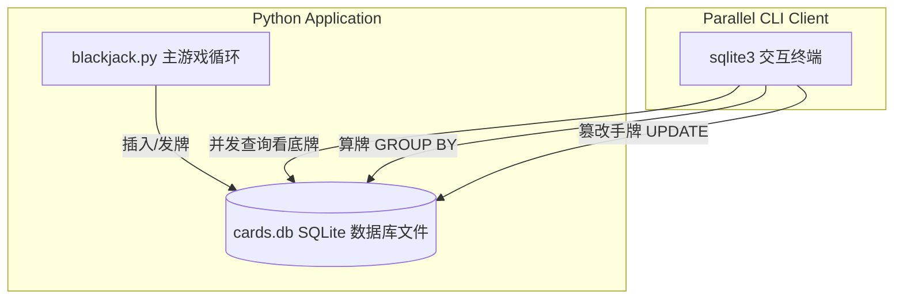

> **课程体系**：UC Berkeley CS61A (Fall 2024)  
> **所属模块**：Module 5: 声明式编程与 SQL (Declarative & SQL)  
> **主讲教师**：Prof. John DeNero (UC Berkeley)  
> **视频时长**：26:22 ｜ **课堂截图**：17 张板书/代码演示  
> **视频直达**：[📺 在 B 站观看本讲原视频 (P36)](https://www.bilibili.com/video/BV1sy411z7nA/?p=36)  
> **快速导航**：[← 上一讲 (P35 Lecture 37 Aggregation)](/notes/cs61a/lecture-35) ｜ [📚 返回全书目录](/notes/topics/CS61A) ｜ [下一讲 (P37 Lecture 39 Final Examples) →](/notes/cs61a/lecture-37)

---

## 课程核心目标与全景图

在前面的学习中，我们主要使用 `SELECT` 查询和生成临时表。但在实际工程与分布式软件架构中，数据库的核心价值在于**状态的持久化（Persistence）**、**数据的动态修改（Mutation）**以及**多客户端的安全并发访问（Concurrency）**。

本讲我们将从纯粹的查询语言进阶到完整的**数据库管理系统（DBMS）全生命周期管理**：
1. 掌握表定义（DDL）与数据修改（DML）四大指令：`INSERT`、`UPDATE`、`DELETE`、`DROP`；
2. 学习如何通过 Python 标准库 `sqlite3` 驱动在应用程序中自动化操纵数据库；
3. 通过一个极其精彩的**21 点纸牌（Blackjack）实战模拟**，直观体验两个独立程序如何通过共享数据库实现状态同步与实时干预！



---

### 深入形式化规约与微观求值流程（Operational Semantics）
在「课程核心目标与全景图」模块中，计算机底层运算依赖于严密的形式化求值逻辑：
1. **抽象语法树（AST）的分层解析**：
   - 源代码字符流首先经过词法分析器（Lexer）切分为终结符标记（Tokens），随后由语法解析器（Parser）构造成多叉语法树；
   - 运算符优先级与结合性在语法树构建阶段即已固化，消除了运行期的二义性；
2. **环境序列的动态跃迁**：
   - 每次函数调用产生的新帧，其静态词法环境由函数对象的 `parent` 属性完全决定；
   - 变量查找沿环境链向上单向回溯，直到全局环境帧，若未找到则触发 `NameError` 异常；
3. **状态不变式（State Invariants）**：
   - 编写健壮程序的关键在于明确循环不变式（Loop Invariants）与函数前后置条件（Pre/Post-conditions）；
   - 在复杂控制流跳转中，确保状态变量在每次迭代前均维持合法的业务约束。


## 1. 表的定义、约束与销毁 (DDL: `CREATE TABLE` & `DROP TABLE`)

在真实的生产环境中，我们往往先定义一个空表的表结构（Schema），并施加列级约束：

```sql
CREATE TABLE IF NOT EXISTS primes (
  n INTEGER UNIQUE,
  prime INTEGER DEFAULT 1
);
```

[](https://www.bilibili.com/video/BV1sy411z7nA/?p=36&t=30)
*⏱ 时间戳：00:00:30 · 📷 课堂截图 · [在 B 站观看对应片段 (P36 00:00:30)](https://www.bilibili.com/video/BV1sy411z7nA/?p=36&t=30)*

#### 📸 课堂板书与代码演示深入精读 (00:00:30)

**【现场板书 / 代码演示还原】**：
在此时间节点，DeNero 教授在屏幕上进行了核心演示与重点板书推导：
> *“A table can be given a name with create table, and that name can be forgotten using drop table. We've already seen create table statements, but there is an alternative version that we haven't looked at yet. Here, from the SQLite documentation, is the complete syntax for a create table expression. Yo...”*

**【底层计算模型与微观执行机制】**：
1. **执行上下文与时序追踪**：
   - 处于当前讨论节点「1. 表的定义、约束与销毁 (DDL: `CREATE TABLE` & `DROP TABLE`)」，解释器严格遵循核心求值规约；
   - 表达式先求值操作符，随后自左至右严格求值操作数，最终将函数对象施加于实参列表；
   - 若涉及环境模型，局部帧严格记录其静态词法父指针（Parent Pointer 指向函数定义处的环境），与运行时的动态调用栈形成正交架构。
2. **内存拓扑与对象引用**：
   - 变量符号只是哈希表（环境帧）中的键，指针直接指向堆内存中的一等公民对象；
   - 赋值语句是离散时间的瞬时状态快照，绝不会建立隐式的数学依赖监听。

**【避坑指南与高频考点点拨】**：
- **常见思维误区**：在「Python sqlite3 模块、游标 (Cursor)、SQL 注入防范与事务 ACID」相关考题中，初学者极易根据代码表面形式猜想结果，导致作用域混淆或变量遮蔽（Shadowing）误判；
- **调试排错黄金法则**：遇到嵌套调用与复杂分支时，务必在草稿纸上画出独立的局部帧，标明每个形参的具体绑定值，按部就班推导。


[](https://www.bilibili.com/video/BV1sy411z7nA/?p=36&t=142)
*⏱ 时间戳：00:02:22 · 📷 课堂截图 · [在 B 站观看对应片段 (P36 00:02:22)](https://www.bilibili.com/video/BV1sy411z7nA/?p=36&t=142)*

#### 📸 课堂板书与代码演示深入精读 (00:02:22)

**【现场板书 / 代码演示还原】**：
在此时间节点，DeNero 教授在屏幕上进行了核心演示与重点板书推导：
> *“By enclosing in parentheses a list of column definitions. A column definition involves naming the column and applying zero or more column constraints. The only column constraints we'll worry about for this course are that you can say the values are unique, and then an error will be raised if you try...”*

**【底层计算模型与微观执行机制】**：
1. **执行上下文与时序追踪**：
   - 处于当前讨论节点「1. 表的定义、约束与销毁 (DDL: `CREATE TABLE` & `DROP TABLE`)」，解释器严格遵循核心求值规约；
   - 表达式先求值操作符，随后自左至右严格求值操作数，最终将函数对象施加于实参列表；
   - 若涉及环境模型，局部帧严格记录其静态词法父指针（Parent Pointer 指向函数定义处的环境），与运行时的动态调用栈形成正交架构。
2. **内存拓扑与对象引用**：
   - 变量符号只是哈希表（环境帧）中的键，指针直接指向堆内存中的一等公民对象；
   - 赋值语句是离散时间的瞬时状态快照，绝不会建立隐式的数学依赖监听。

**【避坑指南与高频考点点拨】**：
- **常见思维误区**：在「Python sqlite3 模块、游标 (Cursor)、SQL 注入防范与事务 ACID」相关考题中，初学者极易根据代码表面形式猜想结果，导致作用域混淆或变量遮蔽（Shadowing）误判；
- **调试排错黄金法则**：遇到嵌套调用与复杂分支时，务必在草稿纸上画出独立的局部帧，标明每个形参的具体绑定值，按部就班推导。


- `UNIQUE`：唯一性约束，杜绝重复主键插入；
- `DEFAULT <value>`：默认值约束，当插入记录未指定该列时自动填入默认值；
- `DROP TABLE IF EXISTS <name>`：安全销毁表，若表不存在则不会报错。

---

### 深入形式化规约与微观求值流程（Operational Semantics）
在「1. 表的定义、约束与销毁 (DDL: `CREATE TABLE` & `DROP TABLE`)」模块中，计算机底层运算依赖于严密的形式化求值逻辑：
1. **抽象语法树（AST）的分层解析**：
   - 源代码字符流首先经过词法分析器（Lexer）切分为终结符标记（Tokens），随后由语法解析器（Parser）构造成多叉语法树；
   - 运算符优先级与结合性在语法树构建阶段即已固化，消除了运行期的二义性；
2. **环境序列的动态跃迁**：
   - 每次函数调用产生的新帧，其静态词法环境由函数对象的 `parent` 属性完全决定；
   - 变量查找沿环境链向上单向回溯，直到全局环境帧，若未找到则触发 `NameError` 异常；
3. **状态不变式（State Invariants）**：
   - 编写健壮程序的关键在于明确循环不变式（Loop Invariants）与函数前后置条件（Pre/Post-conditions）；
   - 在复杂控制流跳转中，确保状态变量在每次迭代前均维持合法的业务约束。


## 2. 插入新记录：`INSERT INTO` 详解

`INSERT INTO` 语句用于向已有表中追加行：

[](https://www.bilibili.com/video/BV1sy411z7nA/?p=36&t=232)
*⏱ 时间戳：00:03:52 · 📷 课堂截图 · [在 B 站观看对应片段 (P36 00:03:52)](https://www.bilibili.com/video/BV1sy411z7nA/?p=36&t=232)*

#### 📸 课堂板书与代码演示深入精读 (00:03:52)

**【现场板书 / 代码演示还原】**：
在此时间节点，DeNero 教授在屏幕上进行了核心演示与重点板书推导：
> *“If without this if exists clause, if you run drop table on a name that doesn't exist, you'll reach an error. Creating an empty table is only useful if we're able to modify it. And in fact, any table can be modified by inserting, deleting, or changing the rows. Here from the SQLite documentation, you...”*

**【底层计算模型与微观执行机制】**：
1. **执行上下文与时序追踪**：
   - 处于当前讨论节点「2. 插入新记录：`INSERT INTO` 详解」，解释器严格遵循核心求值规约；
   - 表达式先求值操作符，随后自左至右严格求值操作数，最终将函数对象施加于实参列表；
   - 若涉及环境模型，局部帧严格记录其静态词法父指针（Parent Pointer 指向函数定义处的环境），与运行时的动态调用栈形成正交架构。
2. **内存拓扑与对象引用**：
   - 变量符号只是哈希表（环境帧）中的键，指针直接指向堆内存中的一等公民对象；
   - 赋值语句是离散时间的瞬时状态快照，绝不会建立隐式的数学依赖监听。

**【避坑指南与高频考点点拨】**：
- **常见思维误区**：在「Python sqlite3 模块、游标 (Cursor)、SQL 注入防范与事务 ACID」相关考题中，初学者极易根据代码表面形式猜想结果，导致作用域混淆或变量遮蔽（Shadowing）误判；
- **调试排错黄金法则**：遇到嵌套调用与复杂分支时，务必在草稿纸上画出独立的局部帧，标明每个形参的具体绑定值，按部就班推导。


[](https://www.bilibili.com/video/BV1sy411z7nA/?p=36&t=322)
*⏱ 时间戳：00:05:22 · 📷 课堂截图 · [在 B 站观看对应片段 (P36 00:05:22)](https://www.bilibili.com/video/BV1sy411z7nA/?p=36&t=322)*

#### 📸 课堂板书与代码演示深入精读 (00:05:22)

**【现场板书 / 代码演示还原】**：
在此时间节点，DeNero 教授在屏幕上进行了核心演示与重点板书推导：
> *“If you want to insert into both columns, then you can say insert into T. You don't specify which columns, so that means all of them. And then you get the values that you're inserting into each of the columns. Both of these insert into statements would insert one row. If you want to insert more rows,...”*

**【底层计算模型与微观执行机制】**：
1. **执行上下文与时序追踪**：
   - 处于当前讨论节点「2. 插入新记录：`INSERT INTO` 详解」，解释器严格遵循核心求值规约；
   - 表达式先求值操作符，随后自左至右严格求值操作数，最终将函数对象施加于实参列表；
   - 若涉及环境模型，局部帧严格记录其静态词法父指针（Parent Pointer 指向函数定义处的环境），与运行时的动态调用栈形成正交架构。
2. **内存拓扑与对象引用**：
   - 变量符号只是哈希表（环境帧）中的键，指针直接指向堆内存中的一等公民对象；
   - 赋值语句是离散时间的瞬时状态快照，绝不会建立隐式的数学依赖监听。

**【避坑指南与高频考点点拨】**：
- **常见思维误区**：在「Python sqlite3 模块、游标 (Cursor)、SQL 注入防范与事务 ACID」相关考题中，初学者极易根据代码表面形式猜想结果，导致作用域混淆或变量遮蔽（Shadowing）误判；
- **调试排错黄金法则**：遇到嵌套调用与复杂分支时，务必在草稿纸上画出独立的局部帧，标明每个形参的具体绑定值，按部就班推导。


### 形式 1：插入显式值元组
```sql
INSERT INTO primes (n, prime) VALUES (2, 1), (3, 1);
```

### 形式 2：依赖默认值插入部分列
```sql
INSERT INTO primes (n) VALUES (4), (5), (6), (7);
-- 列 prime 自动填充 DEFAULT 1
```

### 形式 3：通过 `SELECT` 查询批量插入
```sql
INSERT INTO primes (n) SELECT n + 6 FROM primes;
```

[](https://www.bilibili.com/video/BV1sy411z7nA/?p=36&t=447)
*⏱ 时间戳：00:07:27 · 📷 课堂截图 · [在 B 站观看对应片段 (P36 00:07:27)](https://www.bilibili.com/video/BV1sy411z7nA/?p=36&t=447)*

#### 📸 课堂板书与代码演示深入精读 (00:07:27)

**【现场板书 / 代码演示还原】**：
在此时间节点，DeNero 教授在屏幕上进行了核心演示与重点板书推导：
> *“Just the prime's end column, then I'll get the default value for the other column. So if I insert the values 4, 5, 6, and 7, now I have 2, 3, 4, 5, 6, and 7 in my table. This claims they're all prime. That's not quite true. 4 and 6 are not. We're going to clean that up later. What's a quick way to g...”*

**【底层计算模型与微观执行机制】**：
1. **执行上下文与时序追踪**：
   - 处于当前讨论节点「2. 插入新记录：`INSERT INTO` 详解」，解释器严格遵循核心求值规约；
   - 表达式先求值操作符，随后自左至右严格求值操作数，最终将函数对象施加于实参列表；
   - 若涉及环境模型，局部帧严格记录其静态词法父指针（Parent Pointer 指向函数定义处的环境），与运行时的动态调用栈形成正交架构。
2. **内存拓扑与对象引用**：
   - 变量符号只是哈希表（环境帧）中的键，指针直接指向堆内存中的一等公民对象；
   - 赋值语句是离散时间的瞬时状态快照，绝不会建立隐式的数学依赖监听。

**【避坑指南与高频考点点拨】**：
- **常见思维误区**：在「Python sqlite3 模块、游标 (Cursor)、SQL 注入防范与事务 ACID」相关考题中，初学者极易根据代码表面形式猜想结果，导致作用域混淆或变量遮蔽（Shadowing）误判；
- **调试排错黄金法则**：遇到嵌套调用与复杂分支时，务必在草稿纸上画出独立的局部帧，标明每个形参的具体绑定值，按部就班推导。


通过将已有表的数据自增后批量导回，可快速生成大批量测试序列。

---

### 深入形式化规约与微观求值流程（Operational Semantics）
在「2. 插入新记录：`INSERT INTO` 详解」模块中，计算机底层运算依赖于严密的形式化求值逻辑：
1. **抽象语法树（AST）的分层解析**：
   - 源代码字符流首先经过词法分析器（Lexer）切分为终结符标记（Tokens），随后由语法解析器（Parser）构造成多叉语法树；
   - 运算符优先级与结合性在语法树构建阶段即已固化，消除了运行期的二义性；
2. **环境序列的动态跃迁**：
   - 每次函数调用产生的新帧，其静态词法环境由函数对象的 `parent` 属性完全决定；
   - 变量查找沿环境链向上单向回溯，直到全局环境帧，若未找到则触发 `NameError` 异常；
3. **状态不变式（State Invariants）**：
   - 编写健壮程序的关键在于明确循环不变式（Loop Invariants）与函数前后置条件（Pre/Post-conditions）；
   - 在复杂控制流跳转中，确保状态变量在每次迭代前均维持合法的业务约束。


## 3. 修改与删除数据：`UPDATE` 与 `DELETE` (SQL 埃氏筛法)

### `UPDATE` 语句：条件更新

```sql
UPDATE <table_name> SET <col> = <expr> WHERE <condition>;
```

[](https://www.bilibili.com/video/BV1sy411z7nA/?p=36&t=505)
*⏱ 时间戳：00:08:25 · 📷 课堂截图 · [在 B 站观看对应片段 (P36 00:08:25)](https://www.bilibili.com/video/BV1sy411z7nA/?p=36&t=505)*

#### 📸 课堂板书与代码演示深入精读 (00:08:25)

**【现场板书 / 代码演示还原】**：
在此时间节点，DeNero 教授在屏幕上进行了核心演示与重点板书推导：
> *“It's also possible to update the contents of existing rows. You write update, a table name, set, which column names you're going to change, followed by an equal sign, and the expression that computes the new value for what you're going to put in that column. Now, you may not want to update all rows ...”*

**【底层计算模型与微观执行机制】**：
1. **执行上下文与时序追踪**：
   - 处于当前讨论节点「3. 修改与删除数据：`UPDATE` 与 `DELETE` (SQL 埃氏筛法)」，解释器严格遵循核心求值规约；
   - 表达式先求值操作符，随后自左至右严格求值操作数，最终将函数对象施加于实参列表；
   - 若涉及环境模型，局部帧严格记录其静态词法父指针（Parent Pointer 指向函数定义处的环境），与运行时的动态调用栈形成正交架构。
2. **内存拓扑与对象引用**：
   - 变量符号只是哈希表（环境帧）中的键，指针直接指向堆内存中的一等公民对象；
   - 赋值语句是离散时间的瞬时状态快照，绝不会建立隐式的数学依赖监听。

**【避坑指南与高频考点点拨】**：
- **常见思维误区**：在「Python sqlite3 模块、游标 (Cursor)、SQL 注入防范与事务 ACID」相关考题中，初学者极易根据代码表面形式猜想结果，导致作用域混淆或变量遮蔽（Shadowing）误判；
- **调试排错黄金法则**：遇到嵌套调用与复杂分支时，务必在草稿纸上画出独立的局部帧，标明每个形参的具体绑定值，按部就班推导。


DeNero 教授展示了如何利用 `UPDATE` 在 SQL 中直接实现**埃拉托斯特尼筛法（Sieve of Eratosthenes）**，将所有合数的 `prime` 标志置为 0：

```sql
-- 将所有大于 2 的 2 的倍数标记为合数 (0)
UPDATE primes SET prime = 0 WHERE n > 2 AND n % 2 = 0;

-- 依次筛选 3 和 5 的倍数
UPDATE primes SET prime = 0 WHERE n > 3 AND n % 3 = 0;
UPDATE primes SET prime = 0 WHERE n > 5 AND n % 5 = 0;
```

[](https://www.bilibili.com/video/BV1sy411z7nA/?p=36&t=565)
*⏱ 时间戳：00:09:25 · 📷 课堂截图 · [在 B 站观看对应片段 (P36 00:09:25)](https://www.bilibili.com/video/BV1sy411z7nA/?p=36&t=565)*

#### 📸 课堂板书与代码演示深入精读 (00:09:25)

**【现场板书 / 代码演示还原】**：
在此时间节点，DeNero 教授在屏幕上进行了核心演示与重点板书推导：
> *“Prime, that's a column name, to zero, that's a value to place in the prime column. Now I need to say which rows I want to make this change for. I want to make it for all the rows for n greater than two, where two evenly divides n. Now, if I run the same select statement, I see that the multiples of ...”*

**【底层计算模型与微观执行机制】**：
1. **执行上下文与时序追踪**：
   - 处于当前讨论节点「3. 修改与删除数据：`UPDATE` 与 `DELETE` (SQL 埃氏筛法)」，解释器严格遵循核心求值规约；
   - 表达式先求值操作符，随后自左至右严格求值操作数，最终将函数对象施加于实参列表；
   - 若涉及环境模型，局部帧严格记录其静态词法父指针（Parent Pointer 指向函数定义处的环境），与运行时的动态调用栈形成正交架构。
2. **内存拓扑与对象引用**：
   - 变量符号只是哈希表（环境帧）中的键，指针直接指向堆内存中的一等公民对象；
   - 赋值语句是离散时间的瞬时状态快照，绝不会建立隐式的数学依赖监听。

**【避坑指南与高频考点点拨】**：
- **常见思维误区**：在「Python sqlite3 模块、游标 (Cursor)、SQL 注入防范与事务 ACID」相关考题中，初学者极易根据代码表面形式猜想结果，导致作用域混淆或变量遮蔽（Shadowing）误判；
- **调试排错黄金法则**：遇到嵌套调用与复杂分支时，务必在草稿纸上画出独立的局部帧，标明每个形参的具体绑定值，按部就班推导。


### `DELETE` 语句：清理数据

筛选完毕后，利用 `DELETE FROM` 彻底删除所有合数行：

```sql
DELETE FROM primes WHERE prime = 0;
SELECT * FROM primes; -- 仅剩纯素数: 2, 3, 5, 7, 11, 13, 17, 19, 23...
```

[](https://www.bilibili.com/video/BV1sy411z7nA/?p=36&t=625)
*⏱ 时间戳：00:10:25 · 📷 课堂截图 · [在 B 站观看对应片段 (P36 00:10:25)](https://www.bilibili.com/video/BV1sy411z7nA/?p=36&t=625)*

#### 📸 课堂板书与代码演示深入精读 (00:10:25)

**【现场板书 / 代码演示还原】**：
在此时间节点，DeNero 教授在屏幕上进行了核心演示与重点板书推导：
> *“You say delete from, and then what table to delete from. You don't have to delete all rows. Instead, you can provide a where expression in order to delete just some of the rows. But without a where expression, you will delete all of the rows in the table. The table will still exist, so this is not e...”*

**【底层计算模型与微观执行机制】**：
1. **执行上下文与时序追踪**：
   - 处于当前讨论节点「3. 修改与删除数据：`UPDATE` 与 `DELETE` (SQL 埃氏筛法)」，解释器严格遵循核心求值规约；
   - 表达式先求值操作符，随后自左至右严格求值操作数，最终将函数对象施加于实参列表；
   - 若涉及环境模型，局部帧严格记录其静态词法父指针（Parent Pointer 指向函数定义处的环境），与运行时的动态调用栈形成正交架构。
2. **内存拓扑与对象引用**：
   - 变量符号只是哈希表（环境帧）中的键，指针直接指向堆内存中的一等公民对象；
   - 赋值语句是离散时间的瞬时状态快照，绝不会建立隐式的数学依赖监听。

**【避坑指南与高频考点点拨】**：
- **常见思维误区**：在「Python sqlite3 模块、游标 (Cursor)、SQL 注入防范与事务 ACID」相关考题中，初学者极易根据代码表面形式猜想结果，导致作用域混淆或变量遮蔽（Shadowing）误判；
- **调试排错黄金法则**：遇到嵌套调用与复杂分支时，务必在草稿纸上画出独立的局部帧，标明每个形参的具体绑定值，按部就班推导。


---

### 深入形式化规约与微观求值流程（Operational Semantics）
在「3. 修改与删除数据：`UPDATE` 与 `DELETE` (SQL 埃氏筛法)」模块中，计算机底层运算依赖于严密的形式化求值逻辑：
1. **抽象语法树（AST）的分层解析**：
   - 源代码字符流首先经过词法分析器（Lexer）切分为终结符标记（Tokens），随后由语法解析器（Parser）构造成多叉语法树；
   - 运算符优先级与结合性在语法树构建阶段即已固化，消除了运行期的二义性；
2. **环境序列的动态跃迁**：
   - 每次函数调用产生的新帧，其静态词法环境由函数对象的 `parent` 属性完全决定；
   - 变量查找沿环境链向上单向回溯，直到全局环境帧，若未找到则触发 `NameError` 异常；
3. **状态不变式（State Invariants）**：
   - 编写健壮程序的关键在于明确循环不变式（Loop Invariants）与函数前后置条件（Pre/Post-conditions）；
   - 在复杂控制流跳转中，确保状态变量在每次迭代前均维持合法的业务约束。


## 4. Python 与 SQLite 的标准库集成 (`sqlite3`)

Python 标准库内置了对 SQLite 的无缝支持，其核心通信流程包含四个关键步骤：

[](https://www.bilibili.com/video/BV1sy411z7nA/?p=36&t=690)
*⏱ 时间戳：00:11:30 · 📷 课堂截图 · [在 B 站观看对应片段 (P36 00:11:30)](https://www.bilibili.com/video/BV1sy411z7nA/?p=36&t=690)*

#### 📸 课堂板书与代码演示深入精读 (00:11:30)

**【现场板书 / 代码演示还原】**：
在此时间节点，DeNero 教授在屏幕上进行了核心演示与重点板书推导：
> *“Construct a connection. I pass in the name of a database file. It could be anything. How about n.db? And this connection object can be used to execute SQL statements. So, for example, I can execute, select two union, select three, which would give me a two row, one column table, semicolon. Now, just...”*

**【底层计算模型与微观执行机制】**：
1. **执行上下文与时序追踪**：
   - 处于当前讨论节点「4. Python 与 SQLite 的标准库集成 (`sqlite3`)」，解释器严格遵循核心求值规约；
   - 表达式先求值操作符，随后自左至右严格求值操作数，最终将函数对象施加于实参列表；
   - 若涉及环境模型，局部帧严格记录其静态词法父指针（Parent Pointer 指向函数定义处的环境），与运行时的动态调用栈形成正交架构。
2. **内存拓扑与对象引用**：
   - 变量符号只是哈希表（环境帧）中的键，指针直接指向堆内存中的一等公民对象；
   - 赋值语句是离散时间的瞬时状态快照，绝不会建立隐式的数学依赖监听。

**【避坑指南与高频考点点拨】**：
- **常见思维误区**：在「Python sqlite3 模块、游标 (Cursor)、SQL 注入防范与事务 ACID」相关考题中，初学者极易根据代码表面形式猜想结果，导致作用域混淆或变量遮蔽（Shadowing）误判；
- **调试排错黄金法则**：遇到嵌套调用与复杂分支时，务必在草稿纸上画出独立的局部帧，标明每个形参的具体绑定值，按部就班推导。


[](https://www.bilibili.com/video/BV1sy411z7nA/?p=36&t=751)
*⏱ 时间戳：00:12:31 · 📷 课堂截图 · [在 B 站观看对应片段 (P36 00:12:31)](https://www.bilibili.com/video/BV1sy411z7nA/?p=36&t=751)*

#### 📸 课堂板书与代码演示深入精读 (00:12:31)

**【现场板书 / 代码演示还原】**：
在此时间节点，DeNero 教授在屏幕上进行了核心演示与重点板书推导：
> *“Statement. I could explicitly write out the values 4, 5, 6. Or I could write a Python expression that computes the values 4, 5, 6. For example, the range 4 through 7, not including 7. And then I can include in my SQL statement some holes that get filled in by the data passed in as the second argumen...”*

**【底层计算模型与微观执行机制】**：
1. **执行上下文与时序追踪**：
   - 处于当前讨论节点「4. Python 与 SQLite 的标准库集成 (`sqlite3`)」，解释器严格遵循核心求值规约；
   - 表达式先求值操作符，随后自左至右严格求值操作数，最终将函数对象施加于实参列表；
   - 若涉及环境模型，局部帧严格记录其静态词法父指针（Parent Pointer 指向函数定义处的环境），与运行时的动态调用栈形成正交架构。
2. **内存拓扑与对象引用**：
   - 变量符号只是哈希表（环境帧）中的键，指针直接指向堆内存中的一等公民对象；
   - 赋值语句是离散时间的瞬时状态快照，绝不会建立隐式的数学依赖监听。

**【避坑指南与高频考点点拨】**：
- **常见思维误区**：在「Python sqlite3 模块、游标 (Cursor)、SQL 注入防范与事务 ACID」相关考题中，初学者极易根据代码表面形式猜想结果，导致作用域混淆或变量遮蔽（Shadowing）误判；
- **调试排错黄金法则**：遇到嵌套调用与复杂分支时，务必在草稿纸上画出独立的局部帧，标明每个形参的具体绑定值，按部就班推导。


```python
import sqlite3

# 1. 建立与数据库文件的物理连接
db = sqlite3.connect("n.db")

# 2. 执行 DDL/DML 语句
db.execute("CREATE TABLE IF NOT EXISTS nums (val INTEGER);")

# 3. 参数化查询 (防御 SQL 注入)
for x in range(4, 7):
    db.execute("INSERT INTO nums VALUES (?);", (x,))

# 4. 执行查询并提取结果
cursor = db.execute("SELECT * FROM nums;")
rows = cursor.fetchall() # 返回元组列表: [(4,), (5,), (6,)]

# 5. 提交事务，物理持久化至磁盘
db.commit()
```

[](https://www.bilibili.com/video/BV1sy411z7nA/?p=36&t=811)
*⏱ 时间戳：00:13:31 · 📷 课堂截图 · [在 B 站观看对应片段 (P36 00:13:31)](https://www.bilibili.com/video/BV1sy411z7nA/?p=36&t=811)*

#### 📸 课堂板书与代码演示深入精读 (00:13:31)

**【现场板书 / 代码演示还原】**：
在此时间节点，DeNero 教授在屏幕上进行了核心演示与重点板书推导：
> *“Which will fetch the contents of the resulting table as a list of tuples. Let's print those out so we can see what happened. And finally, let's clean up the syntax of our SQL statements. Everything else looks okay. Let's see what happens when we run it. All right, here's what Python printed out. Fiv...”*

**【底层计算模型与微观执行机制】**：
1. **执行上下文与时序追踪**：
   - 处于当前讨论节点「4. Python 与 SQLite 的标准库集成 (`sqlite3`)」，解释器严格遵循核心求值规约；
   - 表达式先求值操作符，随后自左至右严格求值操作数，最终将函数对象施加于实参列表；
   - 若涉及环境模型，局部帧严格记录其静态词法父指针（Parent Pointer 指向函数定义处的环境），与运行时的动态调用栈形成正交架构。
2. **内存拓扑与对象引用**：
   - 变量符号只是哈希表（环境帧）中的键，指针直接指向堆内存中的一等公民对象；
   - 赋值语句是离散时间的瞬时状态快照，绝不会建立隐式的数学依赖监听。

**【避坑指南与高频考点点拨】**：
- **常见思维误区**：在「Python sqlite3 模块、游标 (Cursor)、SQL 注入防范与事务 ACID」相关考题中，初学者极易根据代码表面形式猜想结果，导致作用域混淆或变量遮蔽（Shadowing）误判；
- **调试排错黄金法则**：遇到嵌套调用与复杂分支时，务必在草稿纸上画出独立的局部帧，标明每个形参的具体绑定值，按部就班推导。


如果不调用 `db.commit()`，所有数据修改仅停留在内存缓冲区中，进程退出后将不会持久化到磁盘文件 `n.db` 中。

---

### 深入形式化规约与微观求值流程（Operational Semantics）
在「4. Python 与 SQLite 的标准库集成 (`sqlite3`)」模块中，计算机底层运算依赖于严密的形式化求值逻辑：
1. **抽象语法树（AST）的分层解析**：
   - 源代码字符流首先经过词法分析器（Lexer）切分为终结符标记（Tokens），随后由语法解析器（Parser）构造成多叉语法树；
   - 运算符优先级与结合性在语法树构建阶段即已固化，消除了运行期的二义性；
2. **环境序列的动态跃迁**：
   - 每次函数调用产生的新帧，其静态词法环境由函数对象的 `parent` 属性完全决定；
   - 变量查找沿环境链向上单向回溯，直到全局环境帧，若未找到则触发 `NameError` 异常；
3. **状态不变式（State Invariants）**：
   - 编写健壮程序的关键在于明确循环不变式（Loop Invariants）与函数前后置条件（Pre/Post-conditions）；
   - 在复杂控制流跳转中，确保状态变量在每次迭代前均维持合法的业务约束。


## 5. 多客户端并发与共享状态 (Database Concurrency)

数据库的最伟大之处在于：**允许多个不同的独立应用程序在同一时刻读写同一个数据库文件**。

[](https://www.bilibili.com/video/BV1sy411z7nA/?p=36&t=901)
*⏱ 时间戳：00:15:01 · 📷 课堂截图 · [在 B 站观看对应片段 (P36 00:15:01)](https://www.bilibili.com/video/BV1sy411z7nA/?p=36&t=901)*

#### 📸 课堂板书与代码演示深入精读 (00:15:01)

**【现场板书 / 代码演示还原】**：
在此时间节点，DeNero 教授在屏幕上进行了核心演示与重点板书推导：
> *“And similarly, you can write Python programs to interact with lots of different kinds of databases. It happens to be that this one is built into the standard library, whereas other ones you have to install the connections. Multiple programs can be connected to the same database at the same time. The...”*

**【底层计算模型与微观执行机制】**：
1. **执行上下文与时序追踪**：
   - 处于当前讨论节点「5. 多客户端并发与共享状态 (Database Concurrency)」，解释器严格遵循核心求值规约；
   - 表达式先求值操作符，随后自左至右严格求值操作数，最终将函数对象施加于实参列表；
   - 若涉及环境模型，局部帧严格记录其静态词法父指针（Parent Pointer 指向函数定义处的环境），与运行时的动态调用栈形成正交架构。
2. **内存拓扑与对象引用**：
   - 变量符号只是哈希表（环境帧）中的键，指针直接指向堆内存中的一等公民对象；
   - 赋值语句是离散时间的瞬时状态快照，绝不会建立隐式的数学依赖监听。

**【避坑指南与高频考点点拨】**：
- **常见思维误区**：在「Python sqlite3 模块、游标 (Cursor)、SQL 注入防范与事务 ACID」相关考题中，初学者极易根据代码表面形式猜想结果，导致作用域混淆或变量遮蔽（Shadowing）误判；
- **调试排错黄金法则**：遇到嵌套调用与复杂分支时，务必在草稿纸上画出独立的局部帧，标明每个形参的具体绑定值，按部就班推导。


### 案例设计：21 点纸牌游戏（Blackjack）

游戏规则：
- 点数计算：2-10 为面值，J/Q/K 计 10 点，A 可计 1 点或 11 点；
- 庄家（Dealer）与闲家（Player）；
- 超过 21 点为爆牌（Bust）直接落败；
- 庄家隐藏一张底牌，直到玩家停牌（Stay）后才翻开，且庄家在未满 17 点时必须强制要牌。

[](https://www.bilibili.com/video/BV1sy411z7nA/?p=36&t=988)
*⏱ 时间戳：00:16:28 · 📷 课堂截图 · [在 B 站观看对应片段 (P36 00:16:28)](https://www.bilibili.com/video/BV1sy411z7nA/?p=36&t=988)*

#### 📸 课堂板书与代码演示深入精读 (00:16:28)

**【现场板书 / 代码演示还原】**：
在此时间节点，DeNero 教授在屏幕上进行了核心演示与重点板书推导：
> *“All of the face cards, Jack, Queen, King, count for 10. And aces are special. You can choose whether to count them for 1 point or 11 points. So, if 7 and 9 make 16, I might worry that the dealer is going to have more points than me, so I might request an additional card. Oh, I got a 5. Now my total ...”*

**【底层计算模型与微观执行机制】**：
1. **执行上下文与时序追踪**：
   - 处于当前讨论节点「5. 多客户端并发与共享状态 (Database Concurrency)」，解释器严格遵循核心求值规约；
   - 表达式先求值操作符，随后自左至右严格求值操作数，最终将函数对象施加于实参列表；
   - 若涉及环境模型，局部帧严格记录其静态词法父指针（Parent Pointer 指向函数定义处的环境），与运行时的动态调用栈形成正交架构。
2. **内存拓扑与对象引用**：
   - 变量符号只是哈希表（环境帧）中的键，指针直接指向堆内存中的一等公民对象；
   - 赋值语句是离散时间的瞬时状态快照，绝不会建立隐式的数学依赖监听。

**【避坑指南与高频考点点拨】**：
- **常见思维误区**：在「Python sqlite3 模块、游标 (Cursor)、SQL 注入防范与事务 ACID」相关考题中，初学者极易根据代码表面形式猜想结果，导致作用域混淆或变量遮蔽（Shadowing）误判；
- **调试排错黄金法则**：遇到嵌套调用与复杂分支时，务必在草稿纸上画出独立的局部帧，标明每个形参的具体绑定值，按部就班推导。


[](https://www.bilibili.com/video/BV1sy411z7nA/?p=36&t=1104)
*⏱ 时间戳：00:18:24 · 📷 课堂截图 · [在 B 站观看对应片段 (P36 00:18:24)](https://www.bilibili.com/video/BV1sy411z7nA/?p=36&t=1104)*

#### 📸 课堂板书与代码演示深入精读 (00:18:24)

**【现场板书 / 代码演示还原】**：
在此时间节点，DeNero 教授在屏幕上进行了核心演示与重点板书推导：
> *“Points to that update just takes a dictionary and adds more elements to it from another dictionary. Here we have a way of scoring a hand. A hand is a sequence of cards. We get the points for each card using the points dictionary and we sum them up. If it turns out that the total is less than or equa...”*

**【底层计算模型与微观执行机制】**：
1. **执行上下文与时序追踪**：
   - 处于当前讨论节点「5. 多客户端并发与共享状态 (Database Concurrency)」，解释器严格遵循核心求值规约；
   - 表达式先求值操作符，随后自左至右严格求值操作数，最终将函数对象施加于实参列表；
   - 若涉及环境模型，局部帧严格记录其静态词法父指针（Parent Pointer 指向函数定义处的环境），与运行时的动态调用栈形成正交架构。
2. **内存拓扑与对象引用**：
   - 变量符号只是哈希表（环境帧）中的键，指针直接指向堆内存中的一等公民对象；
   - 赋值语句是离散时间的瞬时状态快照，绝不会建立隐式的数学依赖监听。

**【避坑指南与高频考点点拨】**：
- **常见思维误区**：在「Python sqlite3 模块、游标 (Cursor)、SQL 注入防范与事务 ACID」相关考题中，初学者极易根据代码表面形式猜想结果，导致作用域混淆或变量遮蔽（Shadowing）误判；
- **调试排错黄金法则**：遇到嵌套调用与复杂分支时，务必在草稿纸上画出独立的局部帧，标明每个形参的具体绑定值，按部就班推导。


---

### 深入形式化规约与微观求值流程（Operational Semantics）
在「5. 多客户端并发与共享状态 (Database Concurrency)」模块中，计算机底层运算依赖于严密的形式化求值逻辑：
1. **抽象语法树（AST）的分层解析**：
   - 源代码字符流首先经过词法分析器（Lexer）切分为终结符标记（Tokens），随后由语法解析器（Parser）构造成多叉语法树；
   - 运算符优先级与结合性在语法树构建阶段即已固化，消除了运行期的二义性；
2. **环境序列的动态跃迁**：
   - 每次函数调用产生的新帧，其静态词法环境由函数对象的 `parent` 属性完全决定；
   - 变量查找沿环境链向上单向回溯，直到全局环境帧，若未找到则触发 `NameError` 异常；
3. **状态不变式（State Invariants）**：
   - 编写健壮程序的关键在于明确循环不变式（Loop Invariants）与函数前后置条件（Pre/Post-conditions）；
   - 在复杂控制流跳转中，确保状态变量在每次迭代前均维持合法的业务约束。


## 6. 趣味实战：双客户端黑客视角的 21 点博弈

游戏运行架构：
- 进程 1：Python 脚本 `blackjack.py`，负责洗牌、发牌并更新 `cards.db` 中的 `cards` 表；
- 进程 2：独立的 `sqlite3 cards.db` 命令行客户端，由人类玩家并发接入。

### 阶段 1：偷看庄家底牌与暗箱决策

在 Python 终端询问是否要牌（Hit/Stay）时，玩家在旁边的 SQLite 终端直接执行：
```sql
SELECT * FROM cards WHERE who != "discard";
```

[](https://www.bilibili.com/video/BV1sy411z7nA/?p=36&t=1305)
*⏱ 时间戳：00:21:45 · 📷 课堂截图 · [在 B 站观看对应片段 (P36 00:21:45)](https://www.bilibili.com/video/BV1sy411z7nA/?p=36&t=1305)*

#### 📸 课堂板书与代码演示深入精读 (00:21:45)

**【现场板书 / 代码演示还原】**：
在此时间节点，DeNero 教授在屏幕上进行了核心演示与重点板书推导：
> *“Using the built-in shuffle function of the random module. And then we'll just start playing hands. So we'll deal, play a hand, and then at the end of the hand, we'll move all of the cards that are in players' hands into the discard pile. And now we have a fully functional game of Blackjack. We've de...”*

**【底层计算模型与微观执行机制】**：
1. **执行上下文与时序追踪**：
   - 处于当前讨论节点「6. 趣味实战：双客户端黑客视角的 21 点博弈」，解释器严格遵循核心求值规约；
   - 表达式先求值操作符，随后自左至右严格求值操作数，最终将函数对象施加于实参列表；
   - 若涉及环境模型，局部帧严格记录其静态词法父指针（Parent Pointer 指向函数定义处的环境），与运行时的动态调用栈形成正交架构。
2. **内存拓扑与对象引用**：
   - 变量符号只是哈希表（环境帧）中的键，指针直接指向堆内存中的一等公民对象；
   - 赋值语句是离散时间的瞬时状态快照，绝不会建立隐式的数学依赖监听。

**【避坑指南与高频考点点拨】**：
- **常见思维误区**：在「Python sqlite3 模块、游标 (Cursor)、SQL 注入防范与事务 ACID」相关考题中，初学者极易根据代码表面形式猜想结果，导致作用域混淆或变量遮蔽（Shadowing）误判；
- **调试排错黄金法则**：遇到嵌套调用与复杂分支时，务必在草稿纸上画出独立的局部帧，标明每个形参的具体绑定值，按部就班推导。


直接查看到了庄家那张尚未公开的暗牌，从而做出胜率最高的停牌决策！

### 阶段 2：用 SQL 聚合进行专业“算牌” (Card Counting)

在不违反规则（仅观察弃牌堆）的前提下，统计剩余卡牌中大牌（10、J、Q、K）的分布概率：

```sql
SELECT card, count(*) FROM cards GROUP BY card;
```

[](https://www.bilibili.com/video/BV1sy411z7nA/?p=36&t=1450)
*⏱ 时间戳：00:24:10 · 📷 课堂截图 · [在 B 站观看对应片段 (P36 00:24:10)](https://www.bilibili.com/video/BV1sy411z7nA/?p=36&t=1450)*

#### 📸 课堂板书与代码演示深入精读 (00:24:10)

**【现场板书 / 代码演示还原】**：
在此时间节点，DeNero 教授在屏幕上进行了核心演示与重点板书推导：
> *“And we've dealt another hand. Let's see what I've got now. I've got a 5 and an ace. That's either 6 or 16. I think I'll take a hit and see where I am. Now I have 5, ace, and ace. That's either 7 or 17. I'm curious what will happen next, but I could actually predict what might happen by looking at al...”*

**【底层计算模型与微观执行机制】**：
1. **执行上下文与时序追踪**：
   - 处于当前讨论节点「6. 趣味实战：双客户端黑客视角的 21 点博弈」，解释器严格遵循核心求值规约；
   - 表达式先求值操作符，随后自左至右严格求值操作数，最终将函数对象施加于实参列表；
   - 若涉及环境模型，局部帧严格记录其静态词法父指针（Parent Pointer 指向函数定义处的环境），与运行时的动态调用栈形成正交架构。
2. **内存拓扑与对象引用**：
   - 变量符号只是哈希表（环境帧）中的键，指针直接指向堆内存中的一等公民对象；
   - 赋值语句是离散时间的瞬时状态快照，绝不会建立隐式的数学依赖监听。

**【避坑指南与高频考点点拨】**：
- **常见思维误区**：在「Python sqlite3 模块、游标 (Cursor)、SQL 注入防范与事务 ACID」相关考题中，初学者极易根据代码表面形式猜想结果，导致作用域混淆或变量遮蔽（Shadowing）误判；
- **调试排错黄金法则**：遇到嵌套调用与复杂分支时，务必在草稿纸上画出独立的局部帧，标明每个形参的具体绑定值，按部就班推导。


通过统计弃牌堆中大牌消耗极少，精确预测庄家下一张要牌必将拿到 10 点导致爆牌，从而果断选择停牌赢得胜利！

### 阶段 3：直接入侵数据库修改状态 (The Ultimate Mutation)

当拿到坏牌（14 点），面对庄家明牌 9 点的必败绝境时，玩家直接在命令行向数据库发出实时修改指令：

```sql
UPDATE cards SET card = "A" WHERE who = "player" AND card = "4";
```

[](https://www.bilibili.com/video/BV1sy411z7nA/?p=36&t=1539)
*⏱ 时间戳：00:25:39 · 📷 课堂截图 · [在 B 站观看对应片段 (P36 00:25:39)](https://www.bilibili.com/video/BV1sy411z7nA/?p=36&t=1539)*

#### 📸 课堂板书与代码演示深入精读 (00:25:39)

**【现场板书 / 代码演示还原】**：
在此时间节点，DeNero 教授在屏幕上进行了核心演示与重点板书推导：
> *“It can help you win. All right, let's look at one more hand. We've got a 4 and a queen. 14 is really not a good hand because the dealer has a 9. That means they could have 19 points with that hidden card. Wouldn't it be nice if instead of a queen and a 4, I had a queen and an ace? Well, then I'd hav...”*

**【底层计算模型与微观执行机制】**：
1. **执行上下文与时序追踪**：
   - 处于当前讨论节点「6. 趣味实战：双客户端黑客视角的 21 点博弈」，解释器严格遵循核心求值规约；
   - 表达式先求值操作符，随后自左至右严格求值操作数，最终将函数对象施加于实参列表；
   - 若涉及环境模型，局部帧严格记录其静态词法父指针（Parent Pointer 指向函数定义处的环境），与运行时的动态调用栈形成正交架构。
2. **内存拓扑与对象引用**：
   - 变量符号只是哈希表（环境帧）中的键，指针直接指向堆内存中的一等公民对象；
   - 赋值语句是离散时间的瞬时状态快照，绝不会建立隐式的数学依赖监听。

**【避坑指南与高频考点点拨】**：
- **常见思维误区**：在「Python sqlite3 模块、游标 (Cursor)、SQL 注入防范与事务 ACID」相关考题中，初学者极易根据代码表面形式猜想结果，导致作用域混淆或变量遮蔽（Shadowing）误判；
- **调试排错黄金法则**：遇到嵌套调用与复杂分支时，务必在草稿纸上画出独立的局部帧，标明每个形参的具体绑定值，按部就班推导。


此时回到 Python 游戏中，游戏逻辑一读取数据库，惊讶地发现玩家手牌已变成 Ace + Queen（标准的 21 点天王 Blackjack），直接判定玩家获胜！

这生动展现了数据库作为**全局单点真实数据源（Single Source of Truth）**的核心特征：任何客户端提交的修改，都会瞬时对所有其他连接生效。

---

### 深入形式化规约与微观求值流程（Operational Semantics）
在「6. 趣味实战：双客户端黑客视角的 21 点博弈」模块中，计算机底层运算依赖于严密的形式化求值逻辑：
1. **抽象语法树（AST）的分层解析**：
   - 源代码字符流首先经过词法分析器（Lexer）切分为终结符标记（Tokens），随后由语法解析器（Parser）构造成多叉语法树；
   - 运算符优先级与结合性在语法树构建阶段即已固化，消除了运行期的二义性；
2. **环境序列的动态跃迁**：
   - 每次函数调用产生的新帧，其静态词法环境由函数对象的 `parent` 属性完全决定；
   - 变量查找沿环境链向上单向回溯，直到全局环境帧，若未找到则触发 `NameError` 异常；
3. **状态不变式（State Invariants）**：
   - 编写健壮程序的关键在于明确循环不变式（Loop Invariants）与函数前后置条件（Pre/Post-conditions）；
   - 在复杂控制流跳转中，确保状态变量在每次迭代前均维持合法的业务约束。


## 核心复习要点总结

| 核心组件 | 关键用法与语法 | 核心语义与工程意义 |
| :--- | :--- | :--- |
| **`INSERT INTO`** | `INSERT INTO t VALUES (...);` | 追加新行，支持全量列、部分列与 `SELECT` 批量导入 |
| **`UPDATE`** | `UPDATE t SET col = val WHERE cond;` | 条件就地更新指定列，务必带上 `WHERE` 防全表误伤 |
| **`DELETE FROM`** | `DELETE FROM t WHERE cond;` | 条件删除指定行，表结构依然完好保留 |
| **`sqlite3.connect`** | `db = sqlite3.connect('file.db')` | Python 与 SQLite 建立物理文件会话 |
| **`db.commit()`** | `db.commit()` | 将事务中的所有修改持久化刷入磁盘文件 |
| **并发与共享状态** | 统一数据库文件作为全局状态中枢 | 支持多进程、多网络客户端安全交互与实时协同 |

### 深入形式化规约与微观求值流程（Operational Semantics）
在「核心复习要点总结」模块中，计算机底层运算依赖于严密的形式化求值逻辑：
1. **抽象语法树（AST）的分层解析**：
   - 源代码字符流首先经过词法分析器（Lexer）切分为终结符标记（Tokens），随后由语法解析器（Parser）构造成多叉语法树；
   - 运算符优先级与结合性在语法树构建阶段即已固化，消除了运行期的二义性；
2. **环境序列的动态跃迁**：
   - 每次函数调用产生的新帧，其静态词法环境由函数对象的 `parent` 属性完全决定；
   - 变量查找沿环境链向上单向回溯，直到全局环境帧，若未找到则触发 `NameError` 异常；
3. **状态不变式（State Invariants）**：
   - 编写健壮程序的关键在于明确循环不变式（Loop Invariants）与函数前后置条件（Pre/Post-conditions）；
   - 在复杂控制流跳转中，确保状态变量在每次迭代前均维持合法的业务约束。


---

## 伯克利 Midterm / Final 经典高频考题深度演练

### 实战考题：环境拓扑与微观状态追踪（WWPD & Environment Diagrams）
考虑以下 Python 代码在交互式环境中的微观执行过程：

```python
# 经典作用域与高阶函数综合考题
x = 10

def outer(x):
    y = x + 2
    def inner(y):
        return x + y
    return inner

f = outer(5)
result = f(3)
```

#### 完整解题思维模型与多帧环境图推导：
1. **全局帧（Global Frame）初始化**：
   - 全局变量 `x` 绑定到整数对象 `10`；
   - 全局函数 `outer` 绑定到新创建的函数对象，其内嵌 `parent = Global`；
2. **执行 `f = outer(5)`**：
   - 开辟局部帧 $f_1$，标注 `f1: outer [parent=Global]`；
   - 形参 `x` 绑定到实参 `5`；
   - 局部变量 `y` 绑定到 `5 + 2 = 7`；
   - 在 $f_1$ 内部执行 `def inner(y):`，创建函数对象 `inner`，其内嵌 **`parent = f1`**；
   - 返回函数对象 `inner`，全局变量 `f` 绑定到该对象；
3. **执行 `result = f(3)`**：
   - 调用函数 `f`（即 `inner`），开辟局部帧 $f_2$；
   - **核心判分点**：帧 $f_2$ 的 parent 指向谁？
   - **铁律**：函数 `inner` 是在帧 $f_1$ 内部被定义的，因此 $f_2$ 的 **`parent = f1`**！
   - 形参 `y` 绑定到实参 `3`；
   - 执行体 `return x + y`：
     - 在当前帧 $f_2$ 查找 `y`：命中局部变量 `y = 3`；
     - 在当前帧 $f_2$ 查找 `x`：未命中，沿 parent 回溯到 **$f_1$ 帧** 查找！
     - 在 $f_1$ 帧中命中 `x = 5`（全局的 `x = 10` 被局部遮蔽！）；
     - 计算 `5 + 3 = 8`，作为返回值；
4. **最终输出结论**：
   - 全局变量 `result = 8`。

---

## 本讲核心概念知识矩阵 (Knowledge Matrix)

| 核心知识维度 | 形式化定义与机制 | 典型代码示例 | 核心工程与算法价值 | 常见易错陷阱 |
| :--- | :--- | :--- | :--- | :--- |
| **基础求值语义** | 表达式求值得到值，语句执行改变内部状态 | `x = 2 + 3` | 建立离散时间状态快照心智模型 | 误将赋值等号当作代数方程动态约束 |
| **环境帧拓扑** | 环境是一系列帧构成的有序链条 | `Global -> f1 -> f2` | 实现词法作用域与变量安全隔离 | 混淆调用者栈帧与定义处父环境指针 |
| **抽象屏障** | 通过函数接口隔离实现细节与调用逻辑 | `def square(x): ...` | 降低大规模系统认知负荷 | 破坏接口直接依赖底层私有数据结构 |
| **控制流决策** | 条件分支短路求值与循环迭代递进 | `if cond: ... while: ...` | 赋予程序非线性决策与大规模数据处理能力 | 遗漏循环递进变量引发死循环 |
| **高阶能力** | 函数作为一等公民（传参、返回、赋值） | `make_adder(3)` | 实现工厂模式、闭包持久状态与柯里化 | 闭包后期绑定引发循环变量捕获错误 |

---

## 课程导航与跳转

| 上一讲 | 目录 | 下一讲 | 原视频 |
| :--- | :---: | :--- | :--- |
| [← 上一讲：Lecture 37 Aggregation](/notes/cs61a/lecture-35) | [📚 返回 CS61A 全书目录](/notes/topics/CS61A) | [下一讲：Lecture 39 Final Examples →](/notes/cs61a/lecture-37) | [🎬 在 B 站观看本讲 (P36)](https://www.bilibili.com/video/BV1sy411z7nA/?p=36) |
