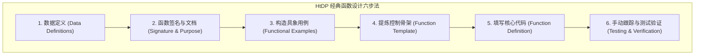

> **课程体系**：UC Berkeley CS61A (Fall 2024)  
> **所属模块**：Module 5: 声明式编程与 SQL (Declarative & SQL)  
> **主讲教师**：Prof. John DeNero (UC Berkeley)  
> **视频时长**：38:48 ｜ **课堂截图**：17 张板书/代码演示  
> **视频直达**：[📺 在 B 站观看本讲原视频 (P37)](https://www.bilibili.com/video/BV1sy411z7nA/?p=37)  
> **快速导航**：[← 上一讲 (P36 Lecture 38 Databases (Optional))](/notes/cs61a/lecture-36) ｜ [📚 返回全书目录](/notes/topics/CS61A) ｜ <span>下一讲：无（全书完结）</span>

---

## 课程核心目标与全景图

从 Lecture 1 到 Lecture 36，我们一同遍历了计算机科学的壮丽山川：高阶函数、环境模型、递归与树形递归、数据抽象、序列与生成器、面向对象体系、解释器架构与 Scheme 元编程，直至声明式数据库与 SQL。

作为全课的终章与毕业典礼，John DeNero 教授不仅带领我们攻克两个难度极高、极富代表性的树形递归经典综合大题（`bigs` 与 `smalls`），更升华传授了享誉学术界的**系统化程序设计六步法（How to Design Programs, HtDP）**。

这是每一位优秀工程师在面对任何未知复杂系统时，化繁为简、从迷茫走向确定性解法的终极思维心法！



---

### 深入形式化规约与微观求值流程（Operational Semantics）
在「课程核心目标与全景图」模块中，计算机底层运算依赖于严密的形式化求值逻辑：
1. **抽象语法树（AST）的分层解析**：
   - 源代码字符流首先经过词法分析器（Lexer）切分为终结符标记（Tokens），随后由语法解析器（Parser）构造成多叉语法树；
   - 运算符优先级与结合性在语法树构建阶段即已固化，消除了运行期的二义性；
2. **环境序列的动态跃迁**：
   - 每次函数调用产生的新帧，其静态词法环境由函数对象的 `parent` 属性完全决定；
   - 变量查找沿环境链向上单向回溯，直到全局环境帧，若未找到则触发 `NameError` 异常；
3. **状态不变式（State Invariants）**：
   - 编写健壮程序的关键在于明确循环不变式（Loop Invariants）与函数前后置条件（Pre/Post-conditions）；
   - 在复杂控制流跳转中，确保状态变量在每次迭代前均维持合法的业务约束。


## 1. 树形抽象的通用性与递归灵魂 (The Universality of Trees)

树形数据结构在计算机科学中无所不在：
- Python 面向对象实现的 `Tree` 类（`label` 属性、`branches` 列表、`is_leaf()` 方法）；
- 嵌套列表与 JSON 数据树；
- 编程语言的抽象语法树（AST）；
- 自然语言句法解析树；
- 现代万维网的基础——HTML DOM 网页节点树。

[](https://www.bilibili.com/video/BV1sy411z7nA/?p=37&t=29)
*⏱ 时间戳：00:00:29 · 📷 课堂截图 · [在 B 站观看对应片段 (P37 00:00:29)](https://www.bilibili.com/video/BV1sy411z7nA/?p=37&t=29)*

#### 📸 课堂板书与代码演示深入精读 (00:00:29)

**【现场板书 / 代码演示还原】**：
在此时间节点，DeNero 教授在屏幕上进行了核心演示与重点板书推导：
> *“In this course, we've discussed trees many times. Tree-structured data could be represented either using a list using the tree data abstraction, which has this constructor and these selectors, and a helper function isLeaf that tells you whether or not a tree is a leaf. Or, later in the course, we di...”*

**【底层计算模型与微观执行机制】**：
1. **执行上下文与时序追踪**：
   - 处于当前讨论节点「1. 树形抽象的通用性与递归灵魂 (The Universality of Trees)」，解释器严格遵循核心求值规约；
   - 表达式先求值操作符，随后自左至右严格求值操作数，最终将函数对象施加于实参列表；
   - 若涉及环境模型，局部帧严格记录其静态词法父指针（Parent Pointer 指向函数定义处的环境），与运行时的动态调用栈形成正交架构。
2. **内存拓扑与对象引用**：
   - 变量符号只是哈希表（环境帧）中的键，指针直接指向堆内存中的一等公民对象；
   - 赋值语句是离散时间的瞬时状态快照，绝不会建立隐式的数学依赖监听。

**【避坑指南与高频考点点拨】**：
- **常见思维误区**：在「四大编程范式融会贯通、期末全景回顾与核心考点终极攻坚」相关考题中，初学者极易根据代码表面形式猜想结果，导致作用域混淆或变量遮蔽（Shadowing）误判；
- **调试排错黄金法则**：遇到嵌套调用与复杂分支时，务必在草稿纸上画出独立的局部帧，标明每个形参的具体绑定值，按部就班推导。


[](https://www.bilibili.com/video/BV1sy411z7nA/?p=37&t=89)
*⏱ 时间戳：00:01:29 · 📷 课堂截图 · [在 B 站观看对应片段 (P37 00:01:29)](https://www.bilibili.com/video/BV1sy411z7nA/?p=37&t=89)*

#### 📸 课堂板书与代码演示深入精读 (00:01:29)

**【现场板书 / 代码演示还原】**：
在此时间节点，DeNero 教授在屏幕上进行了核心演示与重点板书推导：
> *“That's because the notion of a tree in computer science is an abstract one that generalizes over anything that has component parts that are also trees. The key characteristic of a tree is that a tree contains other trees, and importantly, a tree can contain more than one other tree. We see examples ...”*

**【底层计算模型与微观执行机制】**：
1. **执行上下文与时序追踪**：
   - 处于当前讨论节点「1. 树形抽象的通用性与递归灵魂 (The Universality of Trees)」，解释器严格遵循核心求值规约；
   - 表达式先求值操作符，随后自左至右严格求值操作数，最终将函数对象施加于实参列表；
   - 若涉及环境模型，局部帧严格记录其静态词法父指针（Parent Pointer 指向函数定义处的环境），与运行时的动态调用栈形成正交架构。
2. **内存拓扑与对象引用**：
   - 变量符号只是哈希表（环境帧）中的键，指针直接指向堆内存中的一等公民对象；
   - 赋值语句是离散时间的瞬时状态快照，绝不会建立隐式的数学依赖监听。

**【避坑指南与高频考点点拨】**：
- **常见思维误区**：在「四大编程范式融会贯通、期末全景回顾与核心考点终极攻坚」相关考题中，初学者极易根据代码表面形式猜想结果，导致作用域混淆或变量遮蔽（Shadowing）误判；
- **调试排错黄金法则**：遇到嵌套调用与复杂分支时，务必在草稿纸上画出独立的局部帧，标明每个形参的具体绑定值，按部就班推导。


**学习递归最核心、最不可替代的使命，就是自如操纵具有分形特性的树形分层数据！**

---

### 深入形式化规约与微观求值流程（Operational Semantics）
在「1. 树形抽象的通用性与递归灵魂 (The Universality of Trees)」模块中，计算机底层运算依赖于严密的形式化求值逻辑：
1. **抽象语法树（AST）的分层解析**：
   - 源代码字符流首先经过词法分析器（Lexer）切分为终结符标记（Tokens），随后由语法解析器（Parser）构造成多叉语法树；
   - 运算符优先级与结合性在语法树构建阶段即已固化，消除了运行期的二义性；
2. **环境序列的动态跃迁**：
   - 每次函数调用产生的新帧，其静态词法环境由函数对象的 `parent` 属性完全决定；
   - 变量查找沿环境链向上单向回溯，直到全局环境帧，若未找到则触发 `NameError` 异常；
3. **状态不变式（State Invariants）**：
   - 编写健壮程序的关键在于明确循环不变式（Loop Invariants）与函数前后置条件（Pre/Post-conditions）；
   - 在复杂控制流跳转中，确保状态变量在每次迭代前均维持合法的业务约束。


## 2. 解题思维模型：从迷茫到渐进求解 (The Problem-Solving Process)

面对任何复杂编程问题，绝不能在毫无头绪时立即动手堆砌代码。科学的解题流程包括：
1. **彻底读懂题意**：明确输入域（Domain）与输出域（Range）；
2. **绘制具体示例图**：将抽象的文字描述具象化为结构图；
3. **识别边界与不变量**；
4. **寻找核心抓手（Hook）**。

[](https://www.bilibili.com/video/BV1sy411z7nA/?p=37&t=223)
*⏱ 时间戳：00:03:43 · 📷 课堂截图 · [在 B 站观看对应片段 (P37 00:03:43)](https://www.bilibili.com/video/BV1sy411z7nA/?p=37&t=223)*

#### 📸 课堂板书与代码演示深入精读 (00:03:43)

**【现场板书 / 代码演示还原】**：
在此时间节点，DeNero 教授在屏幕上进行了核心演示与重点板书推导：
> *“To really think about what the process is that you go through when you read a problem and you don't know how to solve it right away. Because let's be honest, for most problems, it's not obvious how to solve them right away. That's true on exams. That's also true when you're building software for ind...”*

**【底层计算模型与微观执行机制】**：
1. **执行上下文与时序追踪**：
   - 处于当前讨论节点「2. 解题思维模型：从迷茫到渐进求解 (The Problem-Solving Process)」，解释器严格遵循核心求值规约；
   - 表达式先求值操作符，随后自左至右严格求值操作数，最终将函数对象施加于实参列表；
   - 若涉及环境模型，局部帧严格记录其静态词法父指针（Parent Pointer 指向函数定义处的环境），与运行时的动态调用栈形成正交架构。
2. **内存拓扑与对象引用**：
   - 变量符号只是哈希表（环境帧）中的键，指针直接指向堆内存中的一等公民对象；
   - 赋值语句是离散时间的瞬时状态快照，绝不会建立隐式的数学依赖监听。

**【避坑指南与高频考点点拨】**：
- **常见思维误区**：在「四大编程范式融会贯通、期末全景回顾与核心考点终极攻坚」相关考题中，初学者极易根据代码表面形式猜想结果，导致作用域混淆或变量遮蔽（Shadowing）误判；
- **调试排错黄金法则**：遇到嵌套调用与复杂分支时，务必在草稿纸上画出独立的局部帧，标明每个形参的具体绑定值，按部就班推导。


---

### 深入形式化规约与微观求值流程（Operational Semantics）
在「2. 解题思维模型：从迷茫到渐进求解 (The Problem-Solving Process)」模块中，计算机底层运算依赖于严密的形式化求值逻辑：
1. **抽象语法树（AST）的分层解析**：
   - 源代码字符流首先经过词法分析器（Lexer）切分为终结符标记（Tokens），随后由语法解析器（Parser）构造成多叉语法树；
   - 运算符优先级与结合性在语法树构建阶段即已固化，消除了运行期的二义性；
2. **环境序列的动态跃迁**：
   - 每次函数调用产生的新帧，其静态词法环境由函数对象的 `parent` 属性完全决定；
   - 变量查找沿环境链向上单向回溯，直到全局环境帧，若未找到则触发 `NameError` 异常；
3. **状态不变式（State Invariants）**：
   - 编写健壮程序的关键在于明确循环不变式（Loop Invariants）与函数前后置条件（Pre/Post-conditions）；
   - 在复杂控制流跳转中，确保状态变量在每次迭代前均维持合法的业务约束。


## 3. 经典挑战 1：祖先比较节点计数 (`bigs`)

> **题目规范**：实现函数 `bigs(t)`，接收整数标签的树 `t`，返回树中**标签严格大于其所有祖先节点标签**的节点总数。

[](https://www.bilibili.com/video/BV1sy411z7nA/?p=37&t=306)
*⏱ 时间戳：00:05:06 · 📷 课堂截图 · [在 B 站观看对应片段 (P37 00:05:06)](https://www.bilibili.com/video/BV1sy411z7nA/?p=37&t=306)*

#### 📸 课堂板书与代码演示深入精读 (00:05:06)

**【现场板书 / 代码演示还原】**：
在此时间节点，DeNero 教授在屏幕上进行了核心演示与重点板书推导：
> *“The first sentence looks pretty straightforward, but the second one, it returns the number of nodes in T whose labels are larger than any labels of their ancestor nodes. That's the heart of the question, and it's less straightforward. It's very abstract to talk about labels and ancestor nodes withou...”*

**【底层计算模型与微观执行机制】**：
1. **执行上下文与时序追踪**：
   - 处于当前讨论节点「3. 经典挑战 1：祖先比较节点计数 (`bigs`)」，解释器严格遵循核心求值规约；
   - 表达式先求值操作符，随后自左至右严格求值操作数，最终将函数对象施加于实参列表；
   - 若涉及环境模型，局部帧严格记录其静态词法父指针（Parent Pointer 指向函数定义处的环境），与运行时的动态调用栈形成正交架构。
2. **内存拓扑与对象引用**：
   - 变量符号只是哈希表（环境帧）中的键，指针直接指向堆内存中的一等公民对象；
   - 赋值语句是离散时间的瞬时状态快照，绝不会建立隐式的数学依赖监听。

**【避坑指南与高频考点点拨】**：
- **常见思维误区**：在「四大编程范式融会贯通、期末全景回顾与核心考点终极攻坚」相关考题中，初学者极易根据代码表面形式猜想结果，导致作用域混淆或变量遮蔽（Shadowing）误判；
- **调试排错黄金法则**：遇到嵌套调用与复杂分支时，务必在草稿纸上画出独立的局部帧，标明每个形参的具体绑定值，按部就班推导。


[](https://www.bilibili.com/video/BV1sy411z7nA/?p=37&t=388)
*⏱ 时间戳：00:06:28 · 📷 课堂截图 · [在 B 站观看对应片段 (P37 00:06:28)](https://www.bilibili.com/video/BV1sy411z7nA/?p=37&t=388)*

#### 📸 课堂板书与代码演示深入精读 (00:06:28)

**【现场板书 / 代码演示还原】**：
在此时间节点，DeNero 教授在屏幕上进行了核心演示与重点板书推导：
> *“Probably on an exam, I would define that for you. And then we can check this property. Is it the case that five is larger than four and one? Yes. So that's actually one of the nodes in this tree that we're looking for. Knowing that the answer is four is really not that helpful. We need to figure out...”*

**【底层计算模型与微观执行机制】**：
1. **执行上下文与时序追踪**：
   - 处于当前讨论节点「3. 经典挑战 1：祖先比较节点计数 (`bigs`)」，解释器严格遵循核心求值规约；
   - 表达式先求值操作符，随后自左至右严格求值操作数，最终将函数对象施加于实参列表；
   - 若涉及环境模型，局部帧严格记录其静态词法父指针（Parent Pointer 指向函数定义处的环境），与运行时的动态调用栈形成正交架构。
2. **内存拓扑与对象引用**：
   - 变量符号只是哈希表（环境帧）中的键，指针直接指向堆内存中的一等公民对象；
   - 赋值语句是离散时间的瞬时状态快照，绝不会建立隐式的数学依赖监听。

**【避坑指南与高频考点点拨】**：
- **常见思维误区**：在「四大编程范式融会贯通、期末全景回顾与核心考点终极攻坚」相关考题中，初学者极易根据代码表面形式猜想结果，导致作用域混淆或变量遮蔽（Shadowing）误判；
- **调试排错黄金法则**：遇到嵌套调用与复杂分支时，务必在草稿纸上画出独立的局部帧，标明每个形参的具体绑定值，按部就班推导。


### 实例分析与关键不变量发现
在示例树中：
- 根节点 `1`：由于它没有任何祖先，**根节点永远平凡地大于所有祖先**，必须计数！
- 节点 `4`（1 的子节点）：$4 > 1$，计数；
- 节点 `4`（4 的子节点）：不大于祖先 `4`，不计；
- 节点 `5`（4 的子节点）：$5 > 4$ 且 $5 > 1$，计数；
- 节点 `2`（0 的子节点）：$2 > 0$ 但 $2 < 3$（3 是其上层祖先），因此不计！

**关键障碍**：常规树递归模板（`sum(bigs(b) for b in t.branches)`）在抵达叶子节点时，叶子节点**无法知晓沿途祖先的历史最大值**！

[](https://www.bilibili.com/video/BV1sy411z7nA/?p=37&t=505)
*⏱ 时间戳：00:08:25 · 📷 课堂截图 · [在 B 站观看对应片段 (P37 00:08:25)](https://www.bilibili.com/video/BV1sy411z7nA/?p=37&t=505)*

#### 📸 课堂板书与代码演示深入精读 (00:08:25)

**【现场板书 / 代码演示还原】**：
在此时间节点，DeNero 教授在屏幕上进行了核心演示与重点板书推导：
> *“Like maybe this is one of those problems where you see if t is a leaf, you do one thing. Otherwise, you aggregate recursive calls applied to each of the branches. Well, if I knew how many nodes with this property appeared in all of the branches, then I could just worry about the root node and I'd be...”*

**【底层计算模型与微观执行机制】**：
1. **执行上下文与时序追踪**：
   - 处于当前讨论节点「3. 经典挑战 1：祖先比较节点计数 (`bigs`)」，解释器严格遵循核心求值规约；
   - 表达式先求值操作符，随后自左至右严格求值操作数，最终将函数对象施加于实参列表；
   - 若涉及环境模型，局部帧严格记录其静态词法父指针（Parent Pointer 指向函数定义处的环境），与运行时的动态调用栈形成正交架构。
2. **内存拓扑与对象引用**：
   - 变量符号只是哈希表（环境帧）中的键，指针直接指向堆内存中的一等公民对象；
   - 赋值语句是离散时间的瞬时状态快照，绝不会建立隐式的数学依赖监听。

**【避坑指南与高频考点点拨】**：
- **常见思维误区**：在「四大编程范式融会贯通、期末全景回顾与核心考点终极攻坚」相关考题中，初学者极易根据代码表面形式猜想结果，导致作用域混淆或变量遮蔽（Shadowing）误判；
- **调试排错黄金法则**：遇到嵌套调用与复杂分支时，务必在草稿纸上画出独立的局部帧，标明每个形参的具体绑定值，按部就班推导。


---

### 深入形式化规约与微观求值流程（Operational Semantics）
在「3. 经典挑战 1：祖先比较节点计数 (`bigs`)」模块中，计算机底层运算依赖于严密的形式化求值逻辑：
1. **抽象语法树（AST）的分层解析**：
   - 源代码字符流首先经过词法分析器（Lexer）切分为终结符标记（Tokens），随后由语法解析器（Parser）构造成多叉语法树；
   - 运算符优先级与结合性在语法树构建阶段即已固化，消除了运行期的二义性；
2. **环境序列的动态跃迁**：
   - 每次函数调用产生的新帧，其静态词法环境由函数对象的 `parent` 属性完全决定；
   - 变量查找沿环境链向上单向回溯，直到全局环境帧，若未找到则触发 `NameError` 异常；
3. **状态不变式（State Invariants）**：
   - 编写健壮程序的关键在于明确循环不变式（Loop Invariants）与函数前后置条件（Pre/Post-conditions）；
   - 在复杂控制流跳转中，确保状态变量在每次迭代前均维持合法的业务约束。


## 4. 模式突破：辅助函数与上下文状态传递 (`bigs` 函数式解法)

必须定义双参数辅助函数 `f(a, x)`：
- `a`：当前正在考察的子树节点；
- `x`：从根路径到达当前节点之前，所见过的**最大祖先标签值（Max Ancestor Seen So Far）**。

[](https://www.bilibili.com/video/BV1sy411z7nA/?p=37&t=620)
*⏱ 时间戳：00:10:20 · 📷 课堂截图 · [在 B 站观看对应片段 (P37 00:10:20)](https://www.bilibili.com/video/BV1sy411z7nA/?p=37&t=620)*

#### 📸 课堂板书与代码演示深入精读 (00:10:20)

**【现场板书 / 代码演示还原】**：
在此时间节点，DeNero 教授在屏幕上进行了核心演示与重点板书推导：
> *“I would recognize that as a useful hook, and I would try to figure out whether I can build the rest of the implementation around this idea of tracking the largest ancestor so far, comparing that with the node's label, and somehow incrementing the total account whenever that occurs. Now it's time to ...”*

**【底层计算模型与微观执行机制】**：
1. **执行上下文与时序追踪**：
   - 处于当前讨论节点「4. 模式突破：辅助函数与上下文状态传递 (`bigs` 函数式解法)」，解释器严格遵循核心求值规约；
   - 表达式先求值操作符，随后自左至右严格求值操作数，最终将函数对象施加于实参列表；
   - 若涉及环境模型，局部帧严格记录其静态词法父指针（Parent Pointer 指向函数定义处的环境），与运行时的动态调用栈形成正交架构。
2. **内存拓扑与对象引用**：
   - 变量符号只是哈希表（环境帧）中的键，指针直接指向堆内存中的一等公民对象；
   - 赋值语句是离散时间的瞬时状态快照，绝不会建立隐式的数学依赖监听。

**【避坑指南与高频考点点拨】**：
- **常见思维误区**：在「四大编程范式融会贯通、期末全景回顾与核心考点终极攻坚」相关考题中，初学者极易根据代码表面形式猜想结果，导致作用域混淆或变量遮蔽（Shadowing）误判；
- **调试排错黄金法则**：遇到嵌套调用与复杂分支时，务必在草稿纸上画出独立的局部帧，标明每个形参的具体绑定值，按部就班推导。


```python
def bigs(t):
    """返回标签大于所有祖先标签的节点数。"""
    def f(a, x):
        n = 1 if a.label > x else 0
        m = max(x, a.label)
        return n + sum([f(b, m) for b in a.branches])
    return f(t, t.label - 1)
```

[](https://www.bilibili.com/video/BV1sy411z7nA/?p=37&t=758)
*⏱ 时间戳：00:12:38 · 📷 课堂截图 · [在 B 站观看对应片段 (P37 00:12:38)](https://www.bilibili.com/video/BV1sy411z7nA/?p=37&t=758)*

#### 📸 课堂板书与代码演示深入精读 (00:12:38)

**【现场板书 / 代码演示还原】**：
在此时间节点，DeNero 教授在屏幕上进行了核心演示与重点板书推导：
> *“If these abstract descriptions don't work for you, then write down an example. A is this subtree, 445, and max-ancestor is 1, the largest ancestor of this subtree. All right. Now we need to implement the pattern where Biggs calls f, and then f computes the answer. And that means Biggs is going to ca...”*

**【底层计算模型与微观执行机制】**：
1. **执行上下文与时序追踪**：
   - 处于当前讨论节点「4. 模式突破：辅助函数与上下文状态传递 (`bigs` 函数式解法)」，解释器严格遵循核心求值规约；
   - 表达式先求值操作符，随后自左至右严格求值操作数，最终将函数对象施加于实参列表；
   - 若涉及环境模型，局部帧严格记录其静态词法父指针（Parent Pointer 指向函数定义处的环境），与运行时的动态调用栈形成正交架构。
2. **内存拓扑与对象引用**：
   - 变量符号只是哈希表（环境帧）中的键，指针直接指向堆内存中的一等公民对象；
   - 赋值语句是离散时间的瞬时状态快照，绝不会建立隐式的数学依赖监听。

**【避坑指南与高频考点点拨】**：
- **常见思维误区**：在「四大编程范式融会贯通、期末全景回顾与核心考点终极攻坚」相关考题中，初学者极易根据代码表面形式猜想结果，导致作用域混淆或变量遮蔽（Shadowing）误判；
- **调试排错黄金法则**：遇到嵌套调用与复杂分支时，务必在草稿纸上画出独立的局部帧，标明每个形参的具体绑定值，按部就班推导。


- 当根节点发起调用时，传入 `t.label - 1`，保证根节点必然判定为 True；
- 向下递归每个分支 `b` 时，传递更新后的最大祖先 `max(x, a.label)`；
- 最终通过分支求和将计数结果层层上报返回。

[](https://www.bilibili.com/video/BV1sy411z7nA/?p=37&t=976)
*⏱ 时间戳：00:16:16 · 📷 课堂截图 · [在 B 站观看对应片段 (P37 00:16:16)](https://www.bilibili.com/video/BV1sy411z7nA/?p=37&t=976)*

#### 📸 课堂板书与代码演示深入精读 (00:16:16)

**【现场板书 / 代码演示还原】**：
在此时间节点，DeNero 教授在屏幕上进行了核心演示与重点板书推导：
> *“Or, I could just make it work. For example, I could make it work by passing in some maximal value that's not actually the maximal value, but instead is just something that's less than t.label. That's one way to solve this problem, that the root is different than everything else because we haven't se...”*

**【底层计算模型与微观执行机制】**：
1. **执行上下文与时序追踪**：
   - 处于当前讨论节点「4. 模式突破：辅助函数与上下文状态传递 (`bigs` 函数式解法)」，解释器严格遵循核心求值规约；
   - 表达式先求值操作符，随后自左至右严格求值操作数，最终将函数对象施加于实参列表；
   - 若涉及环境模型，局部帧严格记录其静态词法父指针（Parent Pointer 指向函数定义处的环境），与运行时的动态调用栈形成正交架构。
2. **内存拓扑与对象引用**：
   - 变量符号只是哈希表（环境帧）中的键，指针直接指向堆内存中的一等公民对象；
   - 赋值语句是离散时间的瞬时状态快照，绝不会建立隐式的数学依赖监听。

**【避坑指南与高频考点点拨】**：
- **常见思维误区**：在「四大编程范式融会贯通、期末全景回顾与核心考点终极攻坚」相关考题中，初学者极易根据代码表面形式猜想结果，导致作用域混淆或变量遮蔽（Shadowing）误判；
- **调试排错黄金法则**：遇到嵌套调用与复杂分支时，务必在草稿纸上画出独立的局部帧，标明每个形参的具体绑定值，按部就班推导。


---

### 深入形式化规约与微观求值流程（Operational Semantics）
在「4. 模式突破：辅助函数与上下文状态传递 (`bigs` 函数式解法)」模块中，计算机底层运算依赖于严密的形式化求值逻辑：
1. **抽象语法树（AST）的分层解析**：
   - 源代码字符流首先经过词法分析器（Lexer）切分为终结符标记（Tokens），随后由语法解析器（Parser）构造成多叉语法树；
   - 运算符优先级与结合性在语法树构建阶段即已固化，消除了运行期的二义性；
2. **环境序列的动态跃迁**：
   - 每次函数调用产生的新帧，其静态词法环境由函数对象的 `parent` 属性完全决定；
   - 变量查找沿环境链向上单向回溯，直到全局环境帧，若未找到则触发 `NameError` 异常；
3. **状态不变式（State Invariants）**：
   - 编写健壮程序的关键在于明确循环不变式（Loop Invariants）与函数前后置条件（Pre/Post-conditions）；
   - 在复杂控制流跳转中，确保状态变量在每次迭代前均维持合法的业务约束。


## 5. 解法变体：可变累加器状态更新模式 (Mutable Accumulator Pattern)

除了纯函数式返回值累加外，另一种高频模式是在外层闭包维护一个单元素列表 `n = [0]` 作为可变计数器：

[](https://www.bilibili.com/video/BV1sy411z7nA/?p=37&t=1152)
*⏱ 时间戳：00:19:12 · 📷 课堂截图 · [在 B 站观看对应片段 (P37 00:19:12)](https://www.bilibili.com/video/BV1sy411z7nA/?p=37&t=1152)*

#### 📸 课堂板书与代码演示深入精读 (00:19:12)

**【现场板书 / 代码演示还原】**：
在此时间节点，DeNero 教授在屏幕上进行了核心演示与重点板书推导：
> *“And checking your work is a critical step in solving problems. One thing we've discovered in this course is that there can be multiple ways to solve the same problem, but it's often the case that there are only a few different reasonable ways to deal with an issue that pops up again and again. For e...”*

**【底层计算模型与微观执行机制】**：
1. **执行上下文与时序追踪**：
   - 处于当前讨论节点「5. 解法变体：可变累加器状态更新模式 (Mutable Accumulator Pattern)」，解释器严格遵循核心求值规约；
   - 表达式先求值操作符，随后自左至右严格求值操作数，最终将函数对象施加于实参列表；
   - 若涉及环境模型，局部帧严格记录其静态词法父指针（Parent Pointer 指向函数定义处的环境），与运行时的动态调用栈形成正交架构。
2. **内存拓扑与对象引用**：
   - 变量符号只是哈希表（环境帧）中的键，指针直接指向堆内存中的一等公民对象；
   - 赋值语句是离散时间的瞬时状态快照，绝不会建立隐式的数学依赖监听。

**【避坑指南与高频考点点拨】**：
- **常见思维误区**：在「四大编程范式融会贯通、期末全景回顾与核心考点终极攻坚」相关考题中，初学者极易根据代码表面形式猜想结果，导致作用域混淆或变量遮蔽（Shadowing）误判；
- **调试排错黄金法则**：遇到嵌套调用与复杂分支时，务必在草稿纸上画出独立的局部帧，标明每个形参的具体绑定值，按部就班推导。


[](https://www.bilibili.com/video/BV1sy411z7nA/?p=37&t=1345)
*⏱ 时间戳：00:22:25 · 📷 课堂截图 · [在 B 站观看对应片段 (P37 00:22:25)](https://www.bilibili.com/video/BV1sy411z7nA/?p=37&t=1345)*

#### 📸 课堂板书与代码演示深入精读 (00:22:25)

**【现场板书 / 代码演示还原】**：
在此时间节点，DeNero 教授在屏幕上进行了核心演示与重点板书推导：
> *“It calls itself in some circumstances. However, it never would get called unless I call it on this line. So this is going to be a call to f. And what is f going to do? It's going to correctly set this element at index 0 of n to the number of nodes in t that are larger than all their ancestors. We wi...”*

**【底层计算模型与微观执行机制】**：
1. **执行上下文与时序追踪**：
   - 处于当前讨论节点「5. 解法变体：可变累加器状态更新模式 (Mutable Accumulator Pattern)」，解释器严格遵循核心求值规约；
   - 表达式先求值操作符，随后自左至右严格求值操作数，最终将函数对象施加于实参列表；
   - 若涉及环境模型，局部帧严格记录其静态词法父指针（Parent Pointer 指向函数定义处的环境），与运行时的动态调用栈形成正交架构。
2. **内存拓扑与对象引用**：
   - 变量符号只是哈希表（环境帧）中的键，指针直接指向堆内存中的一等公民对象；
   - 赋值语句是离散时间的瞬时状态快照，绝不会建立隐式的数学依赖监听。

**【避坑指南与高频考点点拨】**：
- **常见思维误区**：在「四大编程范式融会贯通、期末全景回顾与核心考点终极攻坚」相关考题中，初学者极易根据代码表面形式猜想结果，导致作用域混淆或变量遮蔽（Shadowing）误判；
- **调试排错黄金法则**：遇到嵌套调用与复杂分支时，务必在草稿纸上画出独立的局部帧，标明每个形参的具体绑定值，按部就班推导。


```python
def bigs_iter(t):
    n = [0]
    def f(a, x):
        if a.label > x:
            n[0] += 1
        m = max(x, a.label)
        for b in a.branches:
            f(b, m)
    f(t, t.label - 1)
    return n[0]
```

通过原地修改 `n[0]`，避免了 `sum()` 列表推导的中间开销。理解这两种模式的互通等价性是掌握树遍历的关键。

---

### 深入形式化规约与微观求值流程（Operational Semantics）
在「5. 解法变体：可变累加器状态更新模式 (Mutable Accumulator Pattern)」模块中，计算机底层运算依赖于严密的形式化求值逻辑：
1. **抽象语法树（AST）的分层解析**：
   - 源代码字符流首先经过词法分析器（Lexer）切分为终结符标记（Tokens），随后由语法解析器（Parser）构造成多叉语法树；
   - 运算符优先级与结合性在语法树构建阶段即已固化，消除了运行期的二义性；
2. **环境序列的动态跃迁**：
   - 每次函数调用产生的新帧，其静态词法环境由函数对象的 `parent` 属性完全决定；
   - 变量查找沿环境链向上单向回溯，直到全局环境帧，若未找到则触发 `NameError` 异常；
3. **状态不变式（State Invariants）**：
   - 编写健壮程序的关键在于明确循环不变式（Loop Invariants）与函数前后置条件（Pre/Post-conditions）；
   - 在复杂控制流跳转中，确保状态变量在每次迭代前均维持合法的业务约束。


## 6. 《如何设计程序》(HtDP) 六步设计心法

John DeNero 教授隆重推荐了经典名著《How to Design Programs》中的函数设计六步法：

[](https://www.bilibili.com/video/BV1sy411z7nA/?p=37&t=1522)
*⏱ 时间戳：00:25:22 · 📷 课堂截图 · [在 B 站观看对应片段 (P37 00:25:22)](https://www.bilibili.com/video/BV1sy411z7nA/?p=37&t=1522)*

#### 📸 课堂板书与代码演示深入精读 (00:25:22)

**【现场板书 / 代码演示还原】**：
在此时间节点，DeNero 教授在屏幕上进行了核心演示与重点板书推导：
> *“Some first courses focus on applications. Some focus on a programming language. This one focuses on programming paradigms and also programming languages, but with a strong emphasis on problem solving. There's one textbook called How to Design Programs that actually just focuses on the process of cor...”*

**【底层计算模型与微观执行机制】**：
1. **执行上下文与时序追踪**：
   - 处于当前讨论节点「6. 《如何设计程序》(HtDP) 六步设计心法」，解释器严格遵循核心求值规约；
   - 表达式先求值操作符，随后自左至右严格求值操作数，最终将函数对象施加于实参列表；
   - 若涉及环境模型，局部帧严格记录其静态词法父指针（Parent Pointer 指向函数定义处的环境），与运行时的动态调用栈形成正交架构。
2. **内存拓扑与对象引用**：
   - 变量符号只是哈希表（环境帧）中的键，指针直接指向堆内存中的一等公民对象；
   - 赋值语句是离散时间的瞬时状态快照，绝不会建立隐式的数学依赖监听。

**【避坑指南与高频考点点拨】**：
- **常见思维误区**：在「四大编程范式融会贯通、期末全景回顾与核心考点终极攻坚」相关考题中，初学者极易根据代码表面形式猜想结果，导致作用域混淆或变量遮蔽（Shadowing）误判；
- **调试排错黄金法则**：遇到嵌套调用与复杂分支时，务必在草稿纸上画出独立的局部帧，标明每个形参的具体绑定值，按部就班推导。


[](https://www.bilibili.com/video/BV1sy411z7nA/?p=37&t=1639)
*⏱ 时间戳：00:27:19 · 📷 课堂截图 · [在 B 站观看对应片段 (P37 00:27:19)](https://www.bilibili.com/video/BV1sy411z7nA/?p=37&t=1639)*

#### 📸 课堂板书与代码演示深入精读 (00:27:19)

**【现场板书 / 代码演示还原】**：
在此时间节点，DeNero 教授在屏幕上进行了核心演示与重点板书推导：
> *“We've talked about that in this course. It's domain and range. Formulate a concise answer to the question, what the function computes. That's the one sentence docstring that describes the behavior of the function. And they say define a stub that lives up to the signature that's writing the def state...”*

**【底层计算模型与微观执行机制】**：
1. **执行上下文与时序追踪**：
   - 处于当前讨论节点「6. 《如何设计程序》(HtDP) 六步设计心法」，解释器严格遵循核心求值规约；
   - 表达式先求值操作符，随后自左至右严格求值操作数，最终将函数对象施加于实参列表；
   - 若涉及环境模型，局部帧严格记录其静态词法父指针（Parent Pointer 指向函数定义处的环境），与运行时的动态调用栈形成正交架构。
2. **内存拓扑与对象引用**：
   - 变量符号只是哈希表（环境帧）中的键，指针直接指向堆内存中的一等公民对象；
   - 赋值语句是离散时间的瞬时状态快照，绝不会建立隐式的数学依赖监听。

**【避坑指南与高频考点点拨】**：
- **常见思维误区**：在「四大编程范式融会贯通、期末全景回顾与核心考点终极攻坚」相关考题中，初学者极易根据代码表面形式猜想结果，导致作用域混淆或变量遮蔽（Shadowing）误判；
- **调试排错黄金法则**：遇到嵌套调用与复杂分支时，务必在草稿纸上画出独立的局部帧，标明每个形参的具体绑定值，按部就班推导。


| 步骤 | 阶段目标 | 实践指南 |
| :--- | :--- | :--- |
| **1. 数据定义** | 确定信息在程序中的表现形式 | 明确是用类、字典、树还是标量表示现实概念 |
| **2. 签名与注释** | 明确输入输出域与核心契约 | 编写类型签名（Signature）与一行核心 Docstring |
| **3. 功能用例** | 编写代码前先设计测试用例 | 构造典型输入与预期输出（Doctest） |
| **4. 骨架模板** | 提炼控制流主干 | 搭建 `if-else` 分支与预期的关键子调用 |
| **5. 编码实现** | 依据用例与契约填充代码空白 | 顺应数据结构形态写出对应逻辑 |
| **6. 测试验证** | 用用例进行严谨单步追踪与断言 | 发现隐藏的边界缺陷并保证代码可读性 |

---

### 深入形式化规约与微观求值流程（Operational Semantics）
在「6. 《如何设计程序》(HtDP) 六步设计心法」模块中，计算机底层运算依赖于严密的形式化求值逻辑：
1. **抽象语法树（AST）的分层解析**：
   - 源代码字符流首先经过词法分析器（Lexer）切分为终结符标记（Tokens），随后由语法解析器（Parser）构造成多叉语法树；
   - 运算符优先级与结合性在语法树构建阶段即已固化，消除了运行期的二义性；
2. **环境序列的动态跃迁**：
   - 每次函数调用产生的新帧，其静态词法环境由函数对象的 `parent` 属性完全决定；
   - 变量查找沿环境链向上单向回溯，直到全局环境帧，若未找到则触发 `NameError` 异常；
3. **状态不变式（State Invariants）**：
   - 编写健壮程序的关键在于明确循环不变式（Loop Invariants）与函数前后置条件（Pre/Post-conditions）；
   - 在复杂控制流跳转中，确保状态变量在每次迭代前均维持合法的业务约束。


## 7. 经典挑战 2：后代全量比较节点收集 (`smalls`)

> **题目规范**：实现函数 `smalls(t)`，接收整数标签的树 `t`，返回所有**标签严格小于其所有后代节点标签**的**非叶子节点（Non-leaf Nodes）**构成的列表。

[](https://www.bilibili.com/video/BV1sy411z7nA/?p=37&t=1819)
*⏱ 时间戳：00:30:19 · 📷 课堂截图 · [在 B 站观看对应片段 (P37 00:30:19)](https://www.bilibili.com/video/BV1sy411z7nA/?p=37&t=1819)*

#### 📸 课堂板书与代码演示深入精读 (00:30:19)

**【现场板书 / 代码演示还原】**：
在此时间节点，DeNero 教授在屏幕上进行了核心演示与重点板书推导：
> *“To another tree problem. Here's the problem. Implement smalls, which takes a tree instance t containing integer labels. It returns the non-leaf nodes in t whose labels are smaller than any labels of their descendant nodes. And here's a one-line description of the behavior, return the non-leaf nodes ...”*

**【底层计算模型与微观执行机制】**：
1. **执行上下文与时序追踪**：
   - 处于当前讨论节点「7. 经典挑战 2：后代全量比较节点收集 (`smalls`)」，解释器严格遵循核心求值规约；
   - 表达式先求值操作符，随后自左至右严格求值操作数，最终将函数对象施加于实参列表；
   - 若涉及环境模型，局部帧严格记录其静态词法父指针（Parent Pointer 指向函数定义处的环境），与运行时的动态调用栈形成正交架构。
2. **内存拓扑与对象引用**：
   - 变量符号只是哈希表（环境帧）中的键，指针直接指向堆内存中的一等公民对象；
   - 赋值语句是离散时间的瞬时状态快照，绝不会建立隐式的数学依赖监听。

**【避坑指南与高频考点点拨】**：
- **常见思维误区**：在「四大编程范式融会贯通、期末全景回顾与核心考点终极攻坚」相关考题中，初学者极易根据代码表面形式猜想结果，导致作用域混淆或变量遮蔽（Shadowing）误判；
- **调试排错黄金法则**：遇到嵌套调用与复杂分支时，务必在草稿纸上画出独立的局部帧，标明每个形参的具体绑定值，按部就班推导。


[](https://www.bilibili.com/video/BV1sy411z7nA/?p=37&t=1938)
*⏱ 时间戳：00:32:18 · 📷 课堂截图 · [在 B 站观看对应片段 (P37 00:32:18)](https://www.bilibili.com/video/BV1sy411z7nA/?p=37&t=1938)*

#### 📸 课堂板书与代码演示深入精读 (00:32:18)

**【现场板书 / 代码演示还原】**：
在此时间节点，DeNero 教授在屏幕上进行了核心演示与重点板书推导：
> *“It is smaller than all of its descendants. It's smaller than four and five. How about four? That's a leaf. I'm looking for non-leaf nodes. Five is a leaf as well. Three is not smaller than zero. Zero is smaller than all of its descendants. And six is a leaf. One important thing to note is that one i...”*

**【底层计算模型与微观执行机制】**：
1. **执行上下文与时序追踪**：
   - 处于当前讨论节点「7. 经典挑战 2：后代全量比较节点收集 (`smalls`)」，解释器严格遵循核心求值规约；
   - 表达式先求值操作符，随后自左至右严格求值操作数，最终将函数对象施加于实参列表；
   - 若涉及环境模型，局部帧严格记录其静态词法父指针（Parent Pointer 指向函数定义处的环境），与运行时的动态调用栈形成正交架构。
2. **内存拓扑与对象引用**：
   - 变量符号只是哈希表（环境帧）中的键，指针直接指向堆内存中的一等公民对象；
   - 赋值语句是离散时间的瞬时状态快照，绝不会建立隐式的数学依赖监听。

**【避坑指南与高频考点点拨】**：
- **常见思维误区**：在「四大编程范式融会贯通、期末全景回顾与核心考点终极攻坚」相关考题中，初学者极易根据代码表面形式猜想结果，导致作用域混淆或变量遮蔽（Shadowing）误判；
- **调试排错黄金法则**：遇到嵌套调用与复杂分支时，务必在草稿纸上画出独立的局部帧，标明每个形参的具体绑定值，按部就班推导。


### 难点对比分析
- 在 `bigs` 中，状态信息是**从上往下（Top-Down）**流动传递的（祖先最大值传给子代）；
- 在 `smalls` 中，状态信息必须**从下往上（Bottom-Up）**聚合回传（每个节点需要知道其所有后代的最小值）！

---

### 深入形式化规约与微观求值流程（Operational Semantics）
在「7. 经典挑战 2：后代全量比较节点收集 (`smalls`)」模块中，计算机底层运算依赖于严密的形式化求值逻辑：
1. **抽象语法树（AST）的分层解析**：
   - 源代码字符流首先经过词法分析器（Lexer）切分为终结符标记（Tokens），随后由语法解析器（Parser）构造成多叉语法树；
   - 运算符优先级与结合性在语法树构建阶段即已固化，消除了运行期的二义性；
2. **环境序列的动态跃迁**：
   - 每次函数调用产生的新帧，其静态词法环境由函数对象的 `parent` 属性完全决定；
   - 变量查找沿环境链向上单向回溯，直到全局环境帧，若未找到则触发 `NameError` 异常；
3. **状态不变式（State Invariants）**：
   - 编写健壮程序的关键在于明确循环不变式（Loop Invariants）与函数前后置条件（Pre/Post-conditions）；
   - 在复杂控制流跳转中，确保状态变量在每次迭代前均维持合法的业务约束。


## 8. 一箭双雕：双职责辅助函数的设计 (`smalls` 完美实现)

我们定义递归辅助函数 `process(t)`，它同时承担两项关键任务：
1. **返回值**：返回以 `t` 为根的整棵子树中的**绝对最小标签值**；
2. **副作用（收集）**：如果 `t` 是非叶子节点且 `t.label` 小于其所有子树的后代最小值，则将 `t` 追加至闭包的全局结果列表 `result` 中！

[](https://www.bilibili.com/video/BV1sy411z7nA/?p=37&t=2087)
*⏱ 时间戳：00:34:47 · 📷 课堂截图 · [在 B 站观看对应片段 (P37 00:34:47)](https://www.bilibili.com/video/BV1sy411z7nA/?p=37&t=2087)*

#### 📸 课堂板书与代码演示深入精读 (00:34:47)

**【现场板书 / 代码演示还原】**：
在此时间节点，DeNero 教授在屏幕上进行了核心演示与重点板书推导：
> *“It's possible for a function to do two things. And in this case, while we're processing this node to find its smallest label, we can also figure out whether to add it to the resulting list or not. Because when we find its smallest label, that means we're going to find the smallest labels in its bran...”*

**【底层计算模型与微观执行机制】**：
1. **执行上下文与时序追踪**：
   - 处于当前讨论节点「8. 一箭双雕：双职责辅助函数的设计 (`smalls` 完美实现)」，解释器严格遵循核心求值规约；
   - 表达式先求值操作符，随后自左至右严格求值操作数，最终将函数对象施加于实参列表；
   - 若涉及环境模型，局部帧严格记录其静态词法父指针（Parent Pointer 指向函数定义处的环境），与运行时的动态调用栈形成正交架构。
2. **内存拓扑与对象引用**：
   - 变量符号只是哈希表（环境帧）中的键，指针直接指向堆内存中的一等公民对象；
   - 赋值语句是离散时间的瞬时状态快照，绝不会建立隐式的数学依赖监听。

**【避坑指南与高频考点点拨】**：
- **常见思维误区**：在「四大编程范式融会贯通、期末全景回顾与核心考点终极攻坚」相关考题中，初学者极易根据代码表面形式猜想结果，导致作用域混淆或变量遮蔽（Shadowing）误判；
- **调试排错黄金法则**：遇到嵌套调用与复杂分支时，务必在草稿纸上画出独立的局部帧，标明每个形参的具体绑定值，按部就班推导。


[](https://www.bilibili.com/video/BV1sy411z7nA/?p=37&t=2237)
*⏱ 时间戳：00:37:17 · 📷 课堂截图 · [在 B 站观看对应片段 (P37 00:37:17)](https://www.bilibili.com/video/BV1sy411z7nA/?p=37&t=2237)*

#### 📸 课堂板书与代码演示深入精读 (00:37:17)

**【现场板书 / 代码演示还原】**：
在此时间节点，DeNero 教授在屏幕上进行了核心演示与重点板书推导：
> *“Otherwise, we know a T has branches. So we need to find the smallest label in those branches. If the root of T is even smaller than the smallest descendant label, then we need to add it to result. And here we see a confirmation of what we described earlier. That the return value should be the smalle...”*

**【底层计算模型与微观执行机制】**：
1. **执行上下文与时序追踪**：
   - 处于当前讨论节点「8. 一箭双雕：双职责辅助函数的设计 (`smalls` 完美实现)」，解释器严格遵循核心求值规约；
   - 表达式先求值操作符，随后自左至右严格求值操作数，最终将函数对象施加于实参列表；
   - 若涉及环境模型，局部帧严格记录其静态词法父指针（Parent Pointer 指向函数定义处的环境），与运行时的动态调用栈形成正交架构。
2. **内存拓扑与对象引用**：
   - 变量符号只是哈希表（环境帧）中的键，指针直接指向堆内存中的一等公民对象；
   - 赋值语句是离散时间的瞬时状态快照，绝不会建立隐式的数学依赖监听。

**【避坑指南与高频考点点拨】**：
- **常见思维误区**：在「四大编程范式融会贯通、期末全景回顾与核心考点终极攻坚」相关考题中，初学者极易根据代码表面形式猜想结果，导致作用域混淆或变量遮蔽（Shadowing）误判；
- **调试排错黄金法则**：遇到嵌套调用与复杂分支时，务必在草稿纸上画出独立的局部帧，标明每个形参的具体绑定值，按部就班推导。


```python
def smalls(t):
    """返回所有标签小于其所有后代标签的非叶子节点列表。"""
    result = []
    def process(t):
        if t.is_leaf():
            return t.label
        smallest_descendant = min([process(b) for b in t.branches])
        if t.label < smallest_descendant:
            result.append(t)
        return min(t.label, smallest_descendant)
    process(t)
    return result
```

- 基线条件：若 `t` 为叶子，直接返回 `t.label`，绝不追加至 `result`（题目限定非叶子节点）；
- 归纳条件：递归计算所有分支返回的最小值，得到 `smallest_descendant`；
- 条件判定：若当前标签小于后代最小值，命中目标，`result.append(t)`；
- 向上回传：返回 `min(t.label, smallest_descendant)`，供上一层父节点继续判定！

整个解法结构如天工开物，浑然一体。

---

### 深入形式化规约与微观求值流程（Operational Semantics）
在「8. 一箭双雕：双职责辅助函数的设计 (`smalls` 完美实现)」模块中，计算机底层运算依赖于严密的形式化求值逻辑：
1. **抽象语法树（AST）的分层解析**：
   - 源代码字符流首先经过词法分析器（Lexer）切分为终结符标记（Tokens），随后由语法解析器（Parser）构造成多叉语法树；
   - 运算符优先级与结合性在语法树构建阶段即已固化，消除了运行期的二义性；
2. **环境序列的动态跃迁**：
   - 每次函数调用产生的新帧，其静态词法环境由函数对象的 `parent` 属性完全决定；
   - 变量查找沿环境链向上单向回溯，直到全局环境帧，若未找到则触发 `NameError` 异常；
3. **状态不变式（State Invariants）**：
   - 编写健壮程序的关键在于明确循环不变式（Loop Invariants）与函数前后置条件（Pre/Post-conditions）；
   - 在复杂控制流跳转中，确保状态变量在每次迭代前均维持合法的业务约束。


## 结语：计算机程序的结构与解释

随着 Lecture 37 的落幕，CS61A 的 37 讲全部课程圆满收官！

回顾全书：
- 我们见证了如何仅用最朴素的函数组合构建出复杂的抽象世界；
- 我们洞悉了对象系统与环境帧链的物理运行真理；
- 我们在 Scheme 中亲手复刻了图灵完备的解释器，领悟了代码即数据的至高境界；
- 我们在声明式 SQL 中学会了用数学谓词统御海量数据。

愿这套精炼的思维心法，陪伴你在未来的计算机科学与软件工程征途上披荆斩棘，从容创造！

### 深入形式化规约与微观求值流程（Operational Semantics）
在「结语：计算机程序的结构与解释」模块中，计算机底层运算依赖于严密的形式化求值逻辑：
1. **抽象语法树（AST）的分层解析**：
   - 源代码字符流首先经过词法分析器（Lexer）切分为终结符标记（Tokens），随后由语法解析器（Parser）构造成多叉语法树；
   - 运算符优先级与结合性在语法树构建阶段即已固化，消除了运行期的二义性；
2. **环境序列的动态跃迁**：
   - 每次函数调用产生的新帧，其静态词法环境由函数对象的 `parent` 属性完全决定；
   - 变量查找沿环境链向上单向回溯，直到全局环境帧，若未找到则触发 `NameError` 异常；
3. **状态不变式（State Invariants）**：
   - 编写健壮程序的关键在于明确循环不变式（Loop Invariants）与函数前后置条件（Pre/Post-conditions）；
   - 在复杂控制流跳转中，确保状态变量在每次迭代前均维持合法的业务约束。


---

## 伯克利 Midterm / Final 经典高频考题深度演练

### 实战考题：环境拓扑与微观状态追踪（WWPD & Environment Diagrams）
考虑以下 Python 代码在交互式环境中的微观执行过程：

```python
# 经典作用域与高阶函数综合考题
x = 10

def outer(x):
    y = x + 2
    def inner(y):
        return x + y
    return inner

f = outer(5)
result = f(3)
```

#### 完整解题思维模型与多帧环境图推导：
1. **全局帧（Global Frame）初始化**：
   - 全局变量 `x` 绑定到整数对象 `10`；
   - 全局函数 `outer` 绑定到新创建的函数对象，其内嵌 `parent = Global`；
2. **执行 `f = outer(5)`**：
   - 开辟局部帧 $f_1$，标注 `f1: outer [parent=Global]`；
   - 形参 `x` 绑定到实参 `5`；
   - 局部变量 `y` 绑定到 `5 + 2 = 7`；
   - 在 $f_1$ 内部执行 `def inner(y):`，创建函数对象 `inner`，其内嵌 **`parent = f1`**；
   - 返回函数对象 `inner`，全局变量 `f` 绑定到该对象；
3. **执行 `result = f(3)`**：
   - 调用函数 `f`（即 `inner`），开辟局部帧 $f_2$；
   - **核心判分点**：帧 $f_2$ 的 parent 指向谁？
   - **铁律**：函数 `inner` 是在帧 $f_1$ 内部被定义的，因此 $f_2$ 的 **`parent = f1`**！
   - 形参 `y` 绑定到实参 `3`；
   - 执行体 `return x + y`：
     - 在当前帧 $f_2$ 查找 `y`：命中局部变量 `y = 3`；
     - 在当前帧 $f_2$ 查找 `x`：未命中，沿 parent 回溯到 **$f_1$ 帧** 查找！
     - 在 $f_1$ 帧中命中 `x = 5`（全局的 `x = 10` 被局部遮蔽！）；
     - 计算 `5 + 3 = 8`，作为返回值；
4. **最终输出结论**：
   - 全局变量 `result = 8`。

---

## 本讲核心概念知识矩阵 (Knowledge Matrix)

| 核心知识维度 | 形式化定义与机制 | 典型代码示例 | 核心工程与算法价值 | 常见易错陷阱 |
| :--- | :--- | :--- | :--- | :--- |
| **基础求值语义** | 表达式求值得到值，语句执行改变内部状态 | `x = 2 + 3` | 建立离散时间状态快照心智模型 | 误将赋值等号当作代数方程动态约束 |
| **环境帧拓扑** | 环境是一系列帧构成的有序链条 | `Global -> f1 -> f2` | 实现词法作用域与变量安全隔离 | 混淆调用者栈帧与定义处父环境指针 |
| **抽象屏障** | 通过函数接口隔离实现细节与调用逻辑 | `def square(x): ...` | 降低大规模系统认知负荷 | 破坏接口直接依赖底层私有数据结构 |
| **控制流决策** | 条件分支短路求值与循环迭代递进 | `if cond: ... while: ...` | 赋予程序非线性决策与大规模数据处理能力 | 遗漏循环递进变量引发死循环 |
| **高阶能力** | 函数作为一等公民（传参、返回、赋值） | `make_adder(3)` | 实现工厂模式、闭包持久状态与柯里化 | 闭包后期绑定引发循环变量捕获错误 |

---

## 课程导航与跳转

| 上一讲 | 目录 | 下一讲 | 原视频 |
| :--- | :---: | :--- | :--- |
| [← 上一讲：Lecture 38 Databases (Optional)](/notes/cs61a/lecture-36) | [📚 返回 CS61A 全书目录](/notes/topics/CS61A) | 全书完结 | [🎬 在 B 站观看本讲 (P37)](https://www.bilibili.com/video/BV1sy411z7nA/?p=37) |
