> **模块**：M4 CS61A-objects，含 Lecture 15–21（Mutability、Iterators、Generators、Objects、Attributes、Inheritance、Representation）
> **总时长**：03:01:48（37:58 + 29:29 + 17:13 + 17:15 + 17:47 + 31:35 + 30:31）
> **合集**：[CS61A Fall 2024 中文字幕合集](https://www.bilibili.com/video/BV1sy411z7nA)，本模块对应分 P 15–21
> **课件**：`14-Mutability_1pp.pdf`（11 页）、`15-Iterators_1pp.pdf`（12 页）、`16-Generators_1pp.pdf`（11 页）、`17-Objects.pdf`（7 页）、`18-Attributes.pdf`（15 页）、`19-Inheritance.pdf`（24 页）、`20-Representation_1pp.pdf`（11 页），7 份官方 PDF 共 91 页，全部逐页渲染为正文插图
> **字幕**：B 站英文原声字幕；本文是中文书面化重构，不是逐句翻译。有几讲的片源经过剪辑（Lecture 16 的音轨从迭代器分节页开始，Lecture 21 的课堂练习没有讲解），课件中存在而片源未讲的页面按逻辑位置保留，并在正文标注
> **版权**：课程与课件版权归 UC Berkeley CS61A 教学团队（Fall 2024）；本文是学习用途的二次整理，不替代原课程

## 0. 模块导览

*(参考时间: 00:00:01 – 00:00:11｜Lecture 15)*

前三个模块建立的是一门"不变"的手艺。表达式求值、函数调用、递归展开，每一步都在造出新值，而造出来的值从此不再改变。环境图恰好配得上这个世界：它画帧、画帧里的名字、画名字指向的盒子；因为盒子里的内容不会变，一张图可以同时代表整个计算过程的任何时刻。

第 15 讲把这条前提拆了。一个列表可以在计算中途换掉自己的内容，而名字的绑定一次都没动过。这一拆连带拆掉三样东西：值不再等于"它现在装的东西"，而多出一个"它是哪一个"；环境图从"一张图代表全过程"退化成"每改一次就要重画一次"；一旦程序里到处是会各自持着状态的盒子，组织程序的方式也必须换一套。

七讲就是围绕这次拆除之后的七步重建。它们不是七个并列话题，而是一条接力：可变性造出状态，迭代器与生成器把"执行到哪"也变成状态，类把"状态 + 行为"打包，属性查找给这个包配一套读取协议，继承让协议沿类链延长，最后表示让对象能被打印、被求值、被加号连接——也就是能被书写与阅读。

### 0.1 讲次清单

| 讲 | 主题 | 时长 | 课件页数 | 分 P | 在本模块里承担什么 |
| :--- | :--- | :--- | :--- | :--- | :--- |
| 15 | Mutability 可变性与对象标识 | 37:58 | 11 | [P15](https://www.bilibili.com/video/BV1sy411z7nA?p=15) | 立概念：变异、别名、`is` 与 `==`、可变函数 |
| 16 | Iterators 迭代器 | 29:29 | 12 | [P16](https://www.bilibili.com/video/BV1sy411z7nA?p=16) | 把"位置"做成对象：`iter`/`next`、惰性、牌堆 |
| 17 | Generators 生成器 | 17:13 | 11 | [P17](https://www.bilibili.com/video/BV1sy411z7nA?p=17) | 把"暂停"做成语法：`yield`、`yield from` |
| 18 | Objects 对象与类 | 17:15 | 7 | [P18](https://www.bilibili.com/video/BV1sy411z7nA?p=18) | 打包：`class`、实例、方法、`self` 的隐式绑定 |
| 19 | Attributes 属性 | 17:47 | 15 | [P19](https://www.bilibili.com/video/BV1sy411z7nA?p=19) | 协议：两站查找、绑定方法、写不查找 |
| 20 | Inheritance 继承 | 31:35 | 24 | [P20](https://www.bilibili.com/video/BV1sy411z7nA?p=20) | 复用：覆盖、`super`、is-a/has-a、解析顺序 |
| 21 | Representation 表示 | 30:31 | 11 | [P21](https://www.bilibili.com/video/BV1sy411z7nA?p=21) | 接口：`str` 与 `repr`、特殊方法、运算符重载 |

### 0.2 主线图

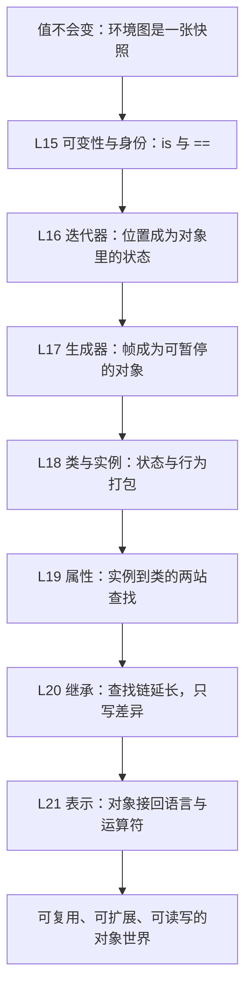

沿链走一遍，会发现同一个动作在反复出现：**把原本藏在解释器内部的东西搬出来，做成一个可以用名字指代、可以传来传去的对象**。可变性把"值的内容"从常量变成可编辑的状态；迭代器把"读到第几个"从循环变量搬进对象；生成器把"执行到哪一行、局部变量是什么"整个帧搬进对象；类把"名字到值"的映射从帧搬到对象上；继承把这张映射表接成一条链；表示把"对象怎么变成字符串"这件解释器内部的事，交给对象自己回答。

### 0.3 每讲的缺口与补给

| 讲 | 上一讲留下的缺口 | 本讲补上的工具 | 新增的代价 |
| :--- | :--- | :--- | :--- |
| 15 | 值一旦算出就固定，无法表达"随时间变化的事物" | 可变对象、别名、身份判据 | 别名扩散、可变默认参数、共享状态难追踪 |
| 16 | 状态能存在对象里，但"读到哪"仍由调用方自己管 | 迭代器：把位置打包成对象 | 只能消费一次，不能回退、索引、重复遍历 |
| 17 | 手写迭代器要把算法压平成一台状态机 | 生成器：可在任意语句处暂停的帧 | 一次性、不可随机访问、每次 `next` 都有切换开销 |
| 18 | 数据抽象只捆住数据，行为散落在外部函数里 | 类与实例、方法、`self` 的隐式绑定 | 属性完全开放，封装只是约定而非强制 |
| 19 | 点号背后发生了什么不清楚，共享与特例分不清 | 两站查找、绑定方法、写不查找 | 读与写方向相反，混用即出错 |
| 20 | 两个类只差一点点，只好复制粘贴 | 继承：只写差异，其余交给查找 | 脆弱的基类、菱形结构与解析顺序 |
| 21 | 对象打印成 `<__main__.Account object at 0x...>` | `repr` 与 `str`、特殊方法、运算符重载 | 契约由写类的人自己守，语言不检查 |

第四列是这张表真正的价值。教材讲新工具通常只讲能力，但工程判断力来自"这个工具会带来什么新的失败模式"：迭代器让每个元素天然只被处理一次，代价是第二次遍历拿不到东西；继承让重复代码消失，代价是子类的行为从此依赖基类；`repr` 让对象可读，代价是写类的人必须保证字符串的语义没有撒谎。

### 0.4 环境图解释不了的三件事

整个模块可以用一句话概括：**环境图解释不了的东西，后面六讲一件一件补**。

- **时间**。环境图画的是"名字指向哪个盒子"，但盒子里内容会不会变，图上没有记号。一旦允许变异，"这张图是哪一刻的"就成了必须先回答的问题；"两个名字是否指向同一个盒子"也从"画在一起就算"变成需要一条可执行判据，这就是 `is`。
- **执行位置**。纯函数的世界里，帧随调用生、随返回灭，谁也不需要保存"执行到哪一行"。迭代器把位置存进对象，生成器把整个帧存进对象：帧的生命周期第一次超出了调用的范围。
- **名字空间**。环境图里查名字只沿父帧一条链走；有了类之后，`obj.attr` 要在实例的属性表里查一次，再到类与基类链里查一次，而**赋值却完全不查**。这条"读沿链走、写只看左边"的分叉，环境图没有现成记法。

### 0.5 章节地图与重复页的处理

| 章 | 覆盖讲次 | 幻灯片 | 这一章回答的问题 |
| :--- | :--- | :--- | :--- |
| 1 | Lecture 15 | 11 | 一个会变的对象，凭什么还是"同一个" |
| 2 | Lecture 16 | 12 | 怎么把"读到哪"变成对象里的状态 |
| 3 | Lecture 17 | 11 | 怎么让一个函数停在半路，下次接着跑 |
| 4 | Lecture 18、19 | 22 | `obj.attr` 到底查了哪些地方，`self` 是谁填的 |
| 5 | Lecture 20 第 1–16 页 | 16 | 子类凭什么只写差异，其余靠什么 |
| 6 | Lecture 20 第 17–24 页 | 8 | 何时该继承、何时该组合，歧义名字先看谁 |
| 7 | Lecture 21 | 11 | 对象怎么被打印、被求值、被加号连接 |
| 8 | 全模块 | 0 | 五组判据、一个陷阱、两张图的对照 |

| 重复的内容 | 出现于 | 本模块的处理 |
| :--- | :--- | :--- |
| 元组的字面量、可哈希性与"与列表的分工" | Lecture 15 的口述与 Lecture 16 第 5–6 页 | §1.4 立判据表，§2.1 只补"两者共享的能力" |
| 可迭代与迭代器的定义 | Lecture 16 第 8–9 页与 Lecture 17 第 3 页 | §2.2 讲协议，§3.1 只讲复习页新增的 `enumerate` |
| 属性术语、点表达式四步、属性赋值 | Lecture 19 第 6、12、13、15 页与 Lecture 20 第 4、5、10、11 页 | §4.6–§4.8 立规则，§5.1 只做一次复习叠 |
| 类与实例的语法 | Lecture 18 第 6 页与 Lecture 21 第 3–4 页 | §4.2 讲构造两步，§7.1 只借邮件系统讲"类型决定下一段" |

## 1. 可变性：对象为什么不等于它的内容

*(参考时间: 00:00:01 – 00:37:55｜Lecture 15)*

第 15 讲的前十二分钟在还上一讲的债：对象、属性、方法、字符串与编码，几乎都是复习。真正的分水岭在 12:44 之后，第一句关于新观念的话是"对象可以改变自己的值"。本章保留前段的一次快速回顾，因为它是后文全部推理的零件；但重心放在值会变之后冒出来的三件事：变异、别名、身份。

### 1.1 对象：像它代表的东西一样行为

课程用标准库里的日期开场。`date` 是一个类，调用它得到一个实例；两个日期相减，得到的不是整数，而是一段间隔。


```python
from datetime import date

today = date(2015, 2, 20)
freedom = date(2015, 5, 12)
freedom - today        # datetime.timedelta(days=81)
today.strftime('%A, %B %d')    # 'Friday, February 20'
```

`strftime` 是绑定在日期对象上的函数，也就是方法。这里有一个容易滑过去的事实：创建日期时从来没有输入过"这一天是星期五"，也没有人告诉程序 February 怎么拼。**知道这些，本身就是"是一个日期"这件事的一部分**。对象把数据（年、月、日）与行为（怎么格式化、怎么相减）捆在一起，形成一个抽象。


> **编者说明**：这段录像没有公告片段，标题页之后直接进入对象回顾，因此这一页只作课程结构标记，不补写任何未发生过的通知。

### 1.2 变异：一个对象，两个名字

前面所有内容都建立在一个隐含前提上：一个值算出来就不会变。这一节把这个前提拆掉——**对象可以在计算过程中改变自己的值**。


纸牌的花色在一次次的传播中改变：万贯在传入欧洲的途中丢失，索子也被删掉；西班牙人添了杯、剑、棒，意大利语把剑叫作 spada，法国人用红桃与方块替换了钱与杯。这段历史正好是一串就地修改：

```python
original_suits = ['coin', 'string', 'myriad']
suits = original_suits

suits.pop()                # 万贯丢失
suits.remove('string')     # 索子丢失，只剩钱
suits.append('cup')        # 西班牙牌加入杯
suits.append('sword')      # 与剑
suits.append('club')       # 与棒
suits[2] = 'spade'         # 意大利语把剑叫 spada
suits[0] = 'heart'         # 法国人用红桃替换钱
suits[1] = 'diamond'       # 用方块替换杯
```

`pop` 删掉并返回最后一个元素，`remove` 删掉任意位置的那个值，`append` 加一个元素，`extend` 一次加一串。故事讲完，讲师回头去看最初那个名字：

```python
original_suits              # ['heart', 'diamond', 'spade', 'club']
original_suits == suits     # True
```

`original_suits` 是在最开头绑定的，中间改的一直是 `suits`，可它现在的内容也变了。原因很简单：**它们从一开始就是同一个对象的两个名字**，任何一次改动都同时体现在两边。讲师把这称为本课程中第一次看到"对象改变状态"——同一份东西在计算过程中换了内容，而名字的绑定关系一次都没动过。他给的类比是"人"：把名字绑定到某个婴儿字符上，婴儿长大，名字仍然指向同一个人，变化发生在这个对象身上。

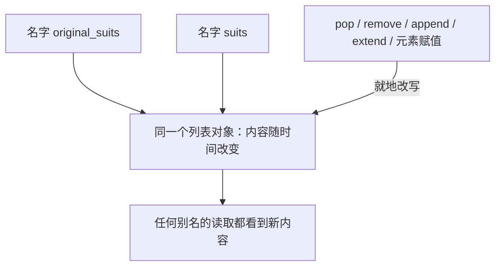

在计算机科学里，**对对象的任何改动都叫变异（mutation）**。只有可变类型（mutable type）的对象才能变异，列表与字典是已经见过的两种。这里要立刻补一句限定：变异改变的是**对象**，不是**名字**。`suits.append('cup')` 里没有任何赋值语句作用于 `suits`，它只是拿 `suits` 的值去调用一个方法，让那个方法去改对象自己。

### 1.3 造新的，还是改旧的

课件第 3 页之后有四页录像没有讲到：它们与本节方向相反，前面是用变异改写一个已存在的列表，这里是**不断造出新列表**，`append` 只加在本次调用新建的 `result` 上。


`sums(n, m)` 要求返回所有"和为 `n`、每个数都是 1 到 `m` 的正整数、且相邻元素不重复"的列表。doctest 把契约写死了：`sums(5, 1)` 是 `[]`，`sums(5, 2)` 只有 `[[2, 1, 2]]`，`sums(6, 3)` 有 8 个解。

```python
def sums(n, m):
    """Return lists that sum to n containing positive numbers up to m that
    have no adjacent repeats, for n > 0 and m > 0.
    """
    result = []
    for k in range(1, min(m + 1, n)):   # k is the first number of a list
        for rest in sums(n - k, m):
            if rest[0] != k:
                result.append([k] + rest)   # build a list out of k and rest
    if n <= m:
        result.append([n])
    return result
```

三处填空是 `min(m + 1, n)`、`sums(n - k, m)` 与 `[k] + rest`。首项 `k` 必须同时不超过 `m` 且小于 `n`，否则 `n - k` 没有下界；拼接用 `+` 而不是 `insert`，是为了造一个新列表而不动 `rest`——"构建"与"变异"在这里必须分开。


从"列表装数字"走到"列表装分支"，问题就变成了树上的操作。`make_path(t, p)` 要求返回一棵与 `t` 同构、但包含路径 `p` 的树，节点尽可能少。三组目标都只在"路径走到的那一格"之后长出新节点，其余原样保留。课件的递归想法有两条：`make_path(b, p[1:])` 应该是返回值里的一个分支；如果没有哪个分支以 `p[1]` 开头，就需要新造一个标签为 `p[1]` 的叶子。


```python
def make_path(t, p):
    "Return a tree like t also containing path p."
    assert p[0] == label(t), 'Impossible'
    if len(p) == 1:
        return t
    new_branches = []
    found_p1 = False
    for b in branches(t):
        if label(b) == p[1]:
            new_branches.append(make_path(b, p[1:]))
            found_p1 = True
        else:
            new_branches.append(b)
    if not found_p1:
        new_branches.append(make_path(tree(p[1]), p[1:]))
    return tree(label(t), new_branches)
```

`assert` 把"`p` 必须从根标签开始"写成可执行检查；`len(p) == 1` 是递归出口；循环处理已有分支，匹配上 `p[1]` 的那一支递归下去，其余原样保留；`found_p1` 记住有没有匹配上，没有就用 `tree(p[1])` 造一个只有标签的叶子再递归补完。返回值用 `tree(label(t), new_branches)` 重新装配，因此**整个函数没有修改 `t`**。

| 判据 | 就地修改（花色演示） | 构造新值（`sums`、`make_path`） |
| :--- | :--- | :--- |
| 动了谁 | 一个已经存在的对象 | 每层造出新对象，旧对象不动 |
| 别名会不会看到 | 会，所有别名同步变化 | 不会，别名仍指向旧对象 |
| 能不能回退 | 不能，旧内容已经消失 | 能，旧对象还在 |
| 空间代价 | 一份 | 每层一份，最坏是输入的倍数 |
| 适合表达的语义 | "这件事发生了变化" | "这件事的另一个版本" |

### 1.4 可变性的地图

| 类型 | 能否就地修改 | 能否作字典键 | 就地修改的手段 |
| :--- | :--- | :--- | :--- |
| `list` | 能 | 不能 | `append`、`extend`、`pop`、`remove`、元素赋值、切片赋值 |
| `dict` | 能 | 不能 | 键赋值、`pop`、`update` |
| `tuple` | 不能 | 能，但元组内不能含列表 | 只能造新的：`+`、切片、`tuple(...)` |
| `str` | 不能 | 能 | 只能造新的：方法、`+`、切片 |
| `int`、`float`、`bool` | 不能 | 能 | 只能重新绑定名字 |

元组有两个坑。第一，决定一个表达式是不是元组的是逗号，不是括号：`3, 4, 5, 6` 就是元组。第二，单元素元组必须留一个逗号：`(2,)` 是"装着 2 的元组"，`(2)` 只是数字 2 加了层括号。因为不可变，元组是可哈希的（hashable），可以作为字典的键；列表不行。而且这个限制会往里传一层：元组里只要藏着一个列表，整个元组就不再可哈希。

反过来，不可变只是一层保护，而且只保护容器这一层。一个元组里装着一个列表时，元组不能被换掉，但里面的列表可以改：

```python
t = ([1, 2], 3)
t[0].append(4)
t        # ([1, 2, 4], 3)
```

于是判断"这个东西会不会变"，不能只看最外层的类型。一条统摄全章的观察是：**一个表达式的值会变，只有两个来源**——名字被重新绑定，或者对象被变异。`x + x` 在 `x = 2` 时是 4、在 `x = 3` 时是 6，这是名字换了；`x` 曾是 `[1, 2]`、被改成 `[1, 2, 3]` 之后同一个表达式给出不同的列表，这是对象换了内容。对不可变值第二条路不存在，但第一条路永远存在。

### 1.5 身份：同样的内容，不同的东西

在从不修改对象的年代，一个复合对象就是它各部分的总和：一个有理数除了分子和分母，没有别的东西可说。一旦允许变化，这句话就不成立了。一个复合数据对象除了"由哪些部分组成"，还有一个**身份（identity）**：同一个列表就算内容被换掉，仍然是"同一个"列表；反过来，两个内容完全相同的列表，也可能是两个不同的东西。


左边：`a = [10]`，然后 `b = a`。两个名字指向同一个列表，`a == b` 为 `True`；往 `a` 追加 20 之后两边都显示 `[10, 20]`。右边：`a = [10]`，然后 `b = [10]`；内容相同，`a == b` 一开始也为 `True`，但往 `b` 追加 20 之后 `a` 还是 `[10]`，`a == b` 变成 `False`。全程没有出现过重新赋值语句——它们只是曾经内容相同，从来不是同一个东西。


判断"是不是同一个"有专门的运算符，写作 `is`，否定是 `is not`：`<exp0> is <exp1>` 在两个表达式求值得到**同一个对象**时为 `True`；`<exp0> == <exp1>` 在得到**相等的值**时为 `True`。由此得到一条不对称的规律：**相同的对象一定相等，相等的值不一定相同**。

```python
a = [10]
b = [10]
a == b        # True
a is b        # False

c = b
c is b        # True
c.pop()
b             # []，c 删的就是 b 的元素
a             # [10]，与 b、c 无关
```

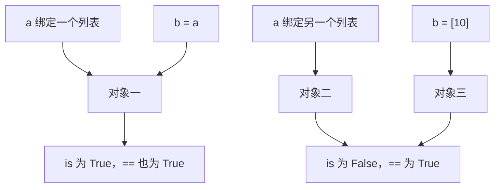

### 1.6 别名的三层与可变默认参数

课件最后一页把规则写成一句话：**如果多个名字（直接或间接地）指向同一个可变对象，那么这个对象的改动会反映到所有这些名字的值上**，随后是一道阅读题。


```python
s = [2, 7, [1, 8]]
t = s[2]
t.append([2])
e = s + t
t[2].append(8)
print(e)
```

这道题同时用到三层机制。第一层是**按下标取元素产生别名**：`t = s[2]` 让 `t` 与 `s` 的第三个元素成为同一个列表，`t.append([2])` 就地改它。第二层是**拼接是浅复制**：`e = s + t` 造出新列表，但元素仍是原来那些对象，`e` 的第 3 个元素就是 `t`，而 `t` 末尾那个 `[2]` 同时是 `e` 的最后一个元素。第三层是**对共享元素的就地修改**：`t[2].append(8)` 把 `[2]` 改成 `[2, 8]`，两个位置一起变。

最终 `e` 是 `[2, 7, [1, 8, [2, 8]], 1, 8, [2, 8]]`，打印出 10 个数字：2、7、1、8、2、8、1、8、2、8。讲师没有现场运行，上述推演全部使用本讲规则。

一旦学会变异，就必须同时学会它的风险，第一条是可变默认参数：

```python
def f(s=[]):
    s.append(5)
    return len(s)

f()    # 1
f()    # 2
f()    # 3
```

看起来每次调用都该拿到一个空列表、返回 1，实际却一路涨到 3。原因是默认参数的值在定义函数时就被计算出来，**它属于函数值本身，而不是每次调用重新生成**：第一次调用把那个空列表改成 `[5]`，第二次绑到的还是同一个列表，于是变成 `[5, 5]`。

这条规则还可以正面利用。设想一个初始余额 100 元的账户，提取动作写成一个函数：参数是要取的钱，返回值是余额。

```python
def make_withdraw_list(balance):
    b = [balance]
    def withdraw(amount):
        if amount > b[0]:
            return 'Insufficient funds'
        b[0] = b[0] - amount
        return b[0]
    return withdraw
```

```python
withdraw = make_withdraw_list(100)
withdraw(25)    # 75
withdraw(25)    # 50
withdraw(60)    # 'Insufficient funds'
withdraw(15)    # 35
```

同一个函数、同样的参数 25，两次调用给出 75 和 50。这已经不是纯函数：调用它会产生副作用，而这个副作用改变的正是它自己的行为。这里的"账户"就是 `withdraw` 这个函数本身，它代表着一份**状态（state）**。`make_withdraw_list` 把初始余额放进单元素列表 `b`；这个列表引用在 `withdraw` 的父帧里，因为它是可变的，每次调用都可以改掉它里面的值。

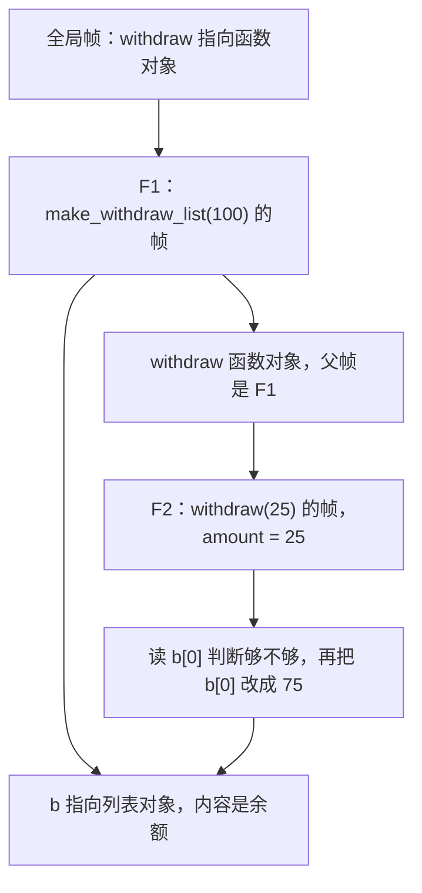

要注意 `withdraw` **没有**在父帧里重新绑定任何名字。Python 的赋值语句总是在当前帧里创建绑定；语言里确实有 `nonlocal` 与 `global` 可以写到外层帧，但这段代码一个都没用。它做的是另一件事：通过名字 `b` 找到那个列表，再改**这个列表的内容**。

本章到此可以收束成一句话：值会变之后，"同一个东西"就不再等于"内容一样"，而只是"是它本身"；而一旦函数也能拥有跨调用存活的状态，程序的时间轴就不再能被一张环境图压平。这是环境图的第一处失效，也是后面六讲所有新记法的起点。

## 2. 迭代器：把"读到哪"做成对象

*(参考时间: 00:00:08 – 00:29:02｜Lecture 16)*

上一章的最后，状态被藏进了一个列表，函数因此有了记忆。但还有一样东西没有搬进对象：**循环走到哪了**。`for` 的进度藏在解释器的执行位置里，任何想把"读了一半"传给别人的尝试，都得靠外部变量重新记录。第 16 讲把这件事也做成对象：一个自带位置的迭代器。

### 2.1 课件复习块：三种序列，一个共同问题


开场第一句就把结论说了：顺序数据可以用迭代器隐式地表示。在它之前，课件用六页把"序列"回顾了一遍。


第 4 页是 Spring 2023 期中第二场第一题：给一个两行的辅助函数与四行赋值，要求推出三个名字最后的值。

```python
def chain(s):
    return [s[0], s[1:]]

silver = [2, chain([3, 4, 5])]
gold = [silver[0], silver[1].pop()]
silver[0] = 1
platinum = chain(chain([6, 7, 8]))
```


`chain([3, 4, 5])` 得 `[3, [4, 5]]`，所以 `silver` 是 `[2, [3, [4, 5]]]`。`gold` 那一行从左到右求值：先取 `2`，再对 `silver[1]` 调用 `pop()` 弹出 `[4, 5]`，于是 `gold` 是 `[2, [4, 5]]`，而 `silver` 变成 `[2, [3]]`；最后 `silver[0] = 1`。`platinum` 是嵌套调用：内层得 `[6, [7, 8]]`，外层再取首项与切片，得 `[6, [[7, 8]]]`。

```python
>>> silver
[1, [3]]
>>> gold
[2, [4, 5]]
>>> platinum
[6, [[7, 8]]]
```

题眼是一行提醒：`s.pop()` 删除并返回最后一个元素。`pop` **就地修改**列表，切片 `s[1:]` 只**造一个新列表**；两者长得像，一个改对象、一个改指向。课件把它画成环境图，两个标注框分别指出"`silver[1]` 求值得到的是哪个列表"与"`pop()` 返回的是哪个列表"。


两者的差别只有四条，其余全部相同。

| 判据 | `tuple` | `list` |
| :--- | :--- | :--- |
| 能不能改元素 | 不可变 | 可变，可以给下标重新赋值 |
| 体积与速度 | 更小、更快 | 更大、更慢 |
| 能不能当字典的键 | 可以 | 不可以 |
| 方法数量 | 少 | 多，例如 `pop()`、`append()` |
| 取下标、切片、同类相加 | 都能，产生新元组 | 都能，产生新列表 |

不可变的元组能当键、列表不能，原因在字典的工作方式：字典要靠"值的指纹"快速定位，一个随时会被改动的对象，指纹会变，键就失效了。上一章已经立过这条联系：**可变性决定了这个值能不能被放进另一个结构里当标识**。


第 7 页把三种容器落在三件真实的事上：图像是像素的序列，每个像素是一个三元组；需要"以后查回来"的数据用字典装；文件是文本的序列，读一个文件最直接的方式就是读成一行一行的列表。

```python
>>> open("textfile.txt").readlines()
['first line in text file', 'second line in file', 'etc']
```

三种形态指向同一个问题：读像素要按下标走，读文件要按行号走，读字典要按键走——**每换一种数据，遍历的写法就得换一套**。写一个"把每个元素都处理一遍"的函数，如果它写死了 `s[i]`，那它只吃得下列表与元组；换成字典视图或 `range` 就崩了。迭代器就是为这件事准备的。

### 2.2 协议：一个位置，而不是一份拷贝


课件给的定义是：**容器可以提供一个迭代器，迭代器按某种顺序提供对容器元素的访问**。这句话里有两个角色：容器是数据的所在，迭代器是"读数据的那只手"。容器不把元素交出去，它交出一只可以不断取下一件东西的手。讲师给的类比是位置而不是拷贝：把迭代器理解成序列里的一个位置——它给出这个位置上的元素，以及这个位置之后的全部元素。


`iter(iterable)` 返回一个覆盖该可迭代值的迭代器；`next(iterator)` 返回迭代器里的下一个元素。参数类型不一样：`iter` 收的是**可迭代值**，`next` 收的必须是**迭代器**。

```python
>>> s = [3, 4, 5]
>>> i = iter(s)
>>> next(i)
3
>>> next(i)
4
>>> u = iter(s)
>>> next(u)
3
>>> next(i)
5
```

`i` 取两次，位置停在 `5` 上；`u` 是对**同一个列表**另造的迭代器，有自己的位置，从头开始。交替取值时 `i` 给出 `5`、`u` 给出 `4`——两个迭代器覆盖同一批值，位置各自独立。

`next` 有一个约定：**越界不是返回空，而是抛异常**。取完最后一个元素之后再要一次，得到 `StopIteration`；`for` 内部就是靠捕获它收尾的。还有一条坑：`next` 不能直接作用在列表上，会报 `TypeError: 'list' object is not an iterator`，必须先 `iter` 一次。转换之后：

```python
>>> t = iter([[1, 2], 3, 4, 5])
>>> next(t)
[1, 2]
>>> next(t)
3
>>> list(t)
[4, 5]
```

`list(t)` 把迭代器里**剩下的**元素全部取出来，所以只得到 `[4, 5]`。讲师在这里说了一句后来反复用的话：**迭代器只能消费一次**。

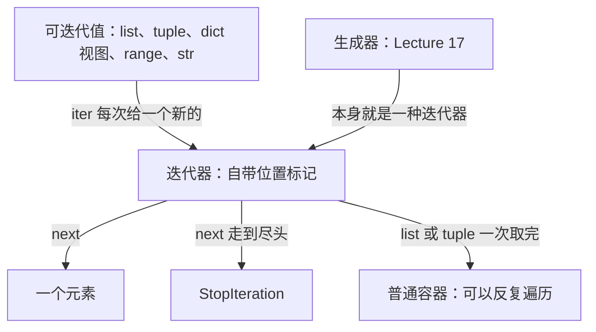

### 2.3 位置也会被别名

迭代器是**可变对象**：`next` 不只是返回一个值，它同时把内部的位置标记改掉了。因此两个名字绑定同一个迭代器时，它们共享同一个位置。


```python
a = [1, 2, 3]
b = [a, 4]
c = iter(a)
d = c
print(next(c))
print(next(d))
print(b)
```

`b` 的第一个元素就是 `a` 本身，`d = c` 让两个名字指向**同一个迭代器对象**。于是 `next(c)` 打印 `1` 并把唯一的位置推到 `2` 上；`next(d)` 读同一个位置，打印 `2`。列表 `a` 从头到尾没被改动过——遍历只是移动标记，最后一行打印 `[[1, 2, 3], 4]`。

题目埋了两个陷阱：把"迭代器可变"误当成"列表可变"（`a` 其实没变），以及把 `d = c` 误当成"又造了一个迭代器"（要另造必须再调用一次 `iter(a)`）。两个陷阱合起来说明：上一章那条别名规则换了个作用对象——被共享的不再是列表内容，而是**一个位置**；而"改位置"这件事长得像一次读取（`next(c)`），其实是变异。

### 2.4 惰性：`map`、`filter` 与短路

对序列做批量处理，Python 提供了几个内置函数：它们收一个（或几个）可迭代值，返回一个**迭代器**。课件的说法是：很多内置的序列操作返回的迭代器**惰性地（lazily）**计算结果——结果只在该被要求时才被计算。


课件的画面是 `l = [2, 4, 6, 8]` 与 `doubler = map(double, l)`，`doubler` 上方一排方框写着 4、8、12、16，一个简笔画小人站在 `l` 前面，脚下箭头标着 `next(doubler)`。那一排方框是"还没算出来的结果"：值存在，但还没有被计算。

```python
def double(x):
    print(f"*** doubling {x} ***")
    return x*2

l = [2, 4, 6, 8]
doubler = map(double, l)
```

`doubler = map(double, l)` 这一行**不会打印任何东西**。`map` 只是把函数和列表记下来；等到 `next(doubler)` 被调用，才取一个元素、调一次 `double`、打印一行、返回结果。讲师把这件事说得很清楚：**函数被应用的时间，从"调用 `map` 时"推迟到了"`next` 时"**。

把 `map` 与 `filter` 接起来，惰性的收益就变成可见的工作量：

```python
>>> m = map(double, range(3, 7))
>>> t = filter(lambda y: y >= 10, m)
>>> next(t)
*** doubling 3 ***
*** doubling 4 ***
*** doubling 5 ***
10
```

造 `filter` 时同样一行打印都没有。第一次 `next(t)` 才开始拉：`3` 加倍得 `6`，不满足；`4` 得 `8`，不满足；`5` 得 `10`，满足，返回。三行打印正好是"为了得到下一个元素所必须做的工作量，一点不多"。如果一开始就要全部结果，写法是把它交给 `list`，代价是把迭代器跑干（to exhaustion）。


课件最后一页把惰性与短路叠在一起：

```python
x = all(map(print, range(-3, 3)))
```

答案只有一行 `-3`，`x` 是 `False`。链条是：`map` 造出来时一行都不打印；`all` 要第一个元素，`map` 才调用 `print(-3)`，屏幕出现 `-3`，产出的值是 `None`；`all` 看到 `None` 是假值，立即返回，不再要下一个。于是后面的 `-2`、`-1`、`0`、`1`、`2` 从未被计算。**惰性 + 短路是一对放大器**：调用方少走一步，生产者就少算一步；反过来，若调用方要求全部结果，惰性也救不了。

| 判据 | 立即求值（列表推导式） | 惰性求值（`map`、`filter`、生成器） |
| :--- | :--- | :--- |
| 什么时候算 | 写下的那一刻全部算完 | 每次 `next` 算一个 |
| 结果存在哪 | 一个新列表里，全部落地 | 不落地，只留"怎么算" |
| 只需要前几个时 | 白算剩下的 | 只算需要的 |
| 反复遍历 | 可以 | 不可以，消费一次就空 |

### 2.5 `for` 的两副面孔，以及字典的三个视图

`for` 能迭代可迭代值，也能迭代迭代器本身，但两种情况行为不一样。

```python
>>> r = range(3, 6)
>>> ri = iter(r)
>>> next(ri)
3
>>> for x in ri:
...     print(x)
...
4
5
```

`ri` 自带位置，`next(ri)` 已经把 `3` 用掉了，所以循环只打印 `4` 和 `5`；循环结束时 `ri` 已耗尽，再循环一次什么也不会打印。`range` 自己没有位置，两遍循环都能看到全部元素。

| 判据 | 可迭代值 `range(3, 6)` | 迭代器 `iter(range(3, 6))` |
| :--- | :--- | :--- |
| 有没有位置 | 没有，只是一段范围的描述 | 有，标记只往前走 |
| 第一次 `for` | 依次得到 3、4、5 | 从当前位置走到末尾 |
| 第二次 `for` | 再来一遍 3、4、5 | 什么也得不到 |

`for` 本身是一层语法糖：先对右边的对象调用一次 `iter`，然后反复 `next`，捕获到 `StopIteration` 就退出。展开之后，"为什么第二次循环什么都没有"就不再是记忆题——退出条件就是用完了。

```python
it = iter(s)
while True:
    try:
        x = next(it)
    except StopIteration:
        break
    print(x)
```

字典有三套内容：键、值、键值对，Python 给出的是三个**视图**——盯在同一个字典上的三个窗口，不是三份拷贝。

```python
>>> d = {1: 1, 2: 2, 3: 3}
>>> d[0] = 0
>>> k = iter(d.keys())
>>> next(k)
1
>>> next(k)
2
```

`d.keys()` 本身不是迭代器，而是可迭代值；`d.items()` 每次给出一个二元组；`iter(d)` 与 `iter(d.keys())` 效果一样，直接迭代字典走的仍然是键。顺序来自插入顺序（**从 Python 3.6 起**字典保持插入顺序）。视图不冻结字典，一边迭代一边加键会报 `RuntimeError: dictionary changed size during iteration`；但只改某个键对应的值则可以继续——键的集合没动，位置标记依然有效。

### 2.6 牌堆：用迭代器保证"每张牌只发一次"

迭代器最实在的用处，是把一条业务规则变成类型层面的保证。二十一点的目标是在不爆的前提下尽量接近 21 点；数字牌按面值，J、Q、K 算 10，A 可以算 1 也可以算 11。

牌怎么来？把 52 张牌做成列表，洗牌，然后**返回这个列表的迭代器**。

```python
def make_deck():
    cards = new_deck()            # 52 张牌，构造细节略
    random.shuffle(cards)
    return iter(cards)
```

这一步是整个案例的关键设计。牌堆给出迭代器之后，调用方只能 `next` 拿下一张，**不可能拿到重复的牌**——列表本身没有"发过"的概念，迭代器有。

```python
player_cards = [next(deck)]
up_card = next(deck)
player_cards.append(next(deck))
dealer_cards = [up_card, next(deck)]

while score(player_cards) <= 21 and strategy(up_card, player_cards):
    player_cards.append(next(deck))
```

发牌是四次 `next`：玩家一张、庄家明牌、玩家再一张、庄家底牌。之后玩家的每一轮由 `strategy` 决定，庄家的回合只需要政策：点数不到 17 就要牌。

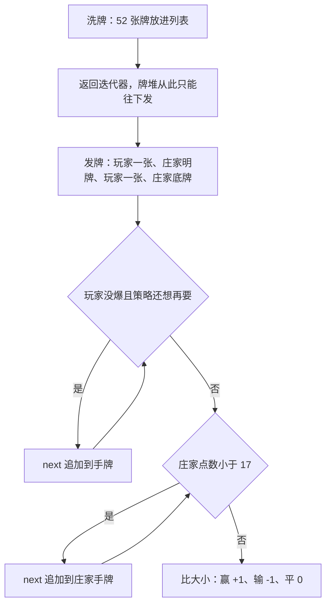

回到迭代器本身，这一段的教学价值是双重的：`iter(cards)` 把一个"不能重复发牌"的约束从注释里搬到了类型上；而"只能消费一次"这条限制，用在错误的场合是 bug，用在正确的场合是保证。

| 判据 | 用具体容器（列表） | 用迭代器 |
| :--- | :--- | :--- |
| 对数据表示的假设 | 要知道它是列表、元组还是字典 | 只有"能取下一个" |
| 换表示要不要改代码 | 要 | 不用 |
| 位置由谁保存 | 调用方自己传下标 | 迭代器自己 |
| 每个元素处理几次 | 可能重复 | 天然一次 |
| 能做的操作 | 全部，包括就地修改 | 只有取下一个 |
| 能不能回头、能不能重复遍历 | 能 | 不能 |

代价全在右列：不能索引、不能 `len`、不能回头、不能重复遍历。选哪种，取决于这段代码是"只想把元素过一遍"，还是"需要反复看、随机看、边看边改"。前者的场景远多于后者；而手写迭代器又要自己维护位置，这正是第 17 讲要还的债。

## 3. 生成器：让函数停在半路

*(参考时间: 00:00:24 – 00:17:10｜Lecture 17)*

手写迭代器有一个隐痛：位置必须由人来维护，而一旦算法里出现嵌套循环或递归，人就得把调用栈压平成一堆字段。第 17 讲的生成器把这个负担整个接过去——`yield` 把函数停在原地，帧连同局部变量一起被保存，下次 `next` 从停下的那一行接着跑。本章的主线因此可以写成一句话：**生成器是"可暂停的帧"这种新对象**。

### 3.1 课件复习块：两页迭代器，一页树练习


开场 23 秒讲的是截止时间：Project 2 周二截止，周一交能拿到提前提交加分；Homework 4 很短，内容是上一周的变异与树。


复习页把两个定义并列：可迭代是"任何能遍历的序列"，判据是能对它调用 `iter()` 并拿回一个迭代器；迭代器是"允许遍历任何可迭代序列的东西"，判据是能对它调用 `next()` 并拿回下一项。两句话互为镜像：可迭代负责"有什么"，迭代器负责"到哪了"。

```python
t = (1,2,3)
i = iter(t)
next(i)

l = ["John", "Jedi", "Shm"]
e = enumerate(l)
next(e)

d = {"apples": 1, "pears": 2}
m = map(lambda x: "yummy " + x, d)
next(m)
```


`map` 的插图与上一讲相同：四个方框、一个标着 `doubler` 的小人、箭头 `next(doubler)`。区别在于这一遍要读出的是"进度存在对象里"：方框是已经算好待取的值，小人是那个被保存的进度。


第 5 页的小题要求返回一个 `map` 对象，把每个三元组的第一项加 `a`、第二项加 `b`、第三项加 `c`：

```python
def add_to_each(p, edit):
    return map(lambda x: ( x[0] + edit[0], x[1] + edit[1], x[2] + edit[2] ), p)
```

`lambda` 的 `x` 是 `p` 里的一个三元组，`edit` 不写在参数表里而是直接从外层拿——这是闭包：`lambda` 的父帧是 `add_to_each` 的帧，`edit` 就躺在那一帧里。返回 `map` 对象而不是列表，所以 `list(...)` 必须由调用者套上。


第 7 页是 Spring 2023 期中 2 的第 4(a) 题：实现 `exclude(t, x)`，保留根节点，以及所有标号不等于 `x` 的非根节点；结果里一个节点的父节点，是它在原树上最近的、没有被排除的祖先。

```python
def exclude(t, x):
    filtered_branches = map(lambda y: exclude(y, x), branches(t))
    bs = []
    for b in filtered_branches:
        if label(b) == x:
            bs.extend(branches(b))
        else:
            bs.append(b)
    return tree(label(t), bs)
```

三处填空是 `exclude(y, x)`、`label(b) == x` 与 `bs.extend(branches(b))`。最后一步是关键：候选孩子本身要被排掉时，不能 `append` 它，而要 `extend` 它的孩子——`append` 把整个列表当成一个元素塞进去，`extend` 把元素逐个接上。课件留着当年的得分率：最后一处只有 24% 写对。

这一题的形状值得记住：**`map` 产生一个迭代器，`for` 立刻把它消费掉**。这是纯函数式写法里的常态——生成器负责"逐个产生"，消费方负责"收集成一个容器"。后面用 `yield` 重写同类递归时，`map` 与 `for` 都会被 `yield` 替掉。

### 3.2 `yield`：交出，而不是返回


讲师的定位很干脆：生成器是一种特殊的迭代器，就像 `map` 对象也是一种特殊的迭代器。特殊之处在于它由**生成器函数**产生；而生成器函数看起来和普通函数一样，唯一的结构差别是用 `yield` 而不是 `return` 给值。判据是：**函数体里只要有 `yield`，它就是生成器函数。**


```python
>>> def plus_minus(x):
...     yield x
...     yield -x

>>> t = plus_minus(3)
>>> next(t)
3
>>> next(t)
-3
>>> t
<generator object plus_minus ...>
```

`t = plus_minus(3)` 得到的是 `<generator object plus_minus ...>`，一个生成器对象，不是一个数。`next(t)` 第一次得到 `3`，第二次得到 `-3`——两个 `yield` 都被执行了，一个函数体里出现两次"给值"，这在普通函数里不可能。第三次 `next(t)` 没有第三个 `yield` 可等，函数体执行完，抛 `StopIteration`。

页面下半部分把定义拆成四句：生成器函数是**用 `yield` 交出值而不是用 `return` 返回**的函数；普通函数只返回一次，生成器函数可以 `yield` 多次；生成器是**调用生成器函数时自动创建**的迭代器；生成器函数被调用时返回一个生成器，这个生成器遍历该函数的各次 `yield`。

| 判据 | 普通函数 | 生成器函数 | 生成器对象 |
| :--- | :--- | :--- | :--- |
| 调用一次得到什么 | 返回值 | 一个生成器对象 | 不适用 |
| 函数体什么时候执行 | 调用时立刻执行完 | 调用时一行都不执行 | 每次 `next` 推进一段 |
| 能交出几个值 | 至多一个 | 任意多个 | 逐个取出 |
| 结束信号 | `return` 或执行到底 | 执行到底 | `StopIteration` |
| 是不是迭代器 | 不是 | 不是 | 是，可直接交给 `for` |

"调用时一行都不执行"是这张表里最反直觉的一格。

### 3.3 执行模型：帧停在 `yield` 上

`next` 到底做了什么？讲师用 `evens` 讲清楚了：给定起点与终点，返回一个只遍历偶数的迭代器，第一个偶数必须不小于 `start`。

```python
def evens(start, end):
    even = start + (start % 2)
    while even < end:
        yield even
        even += 2
```

`even = start + (start % 2)` 算的是"不小于 `start` 的最小偶数"：`start` 是偶数时余 0，加 0 就是自己；是奇数时余 1，加 1 到下一个偶数。循环体里先 `yield even` 把它交出去，然后 `even += 2` 前进。

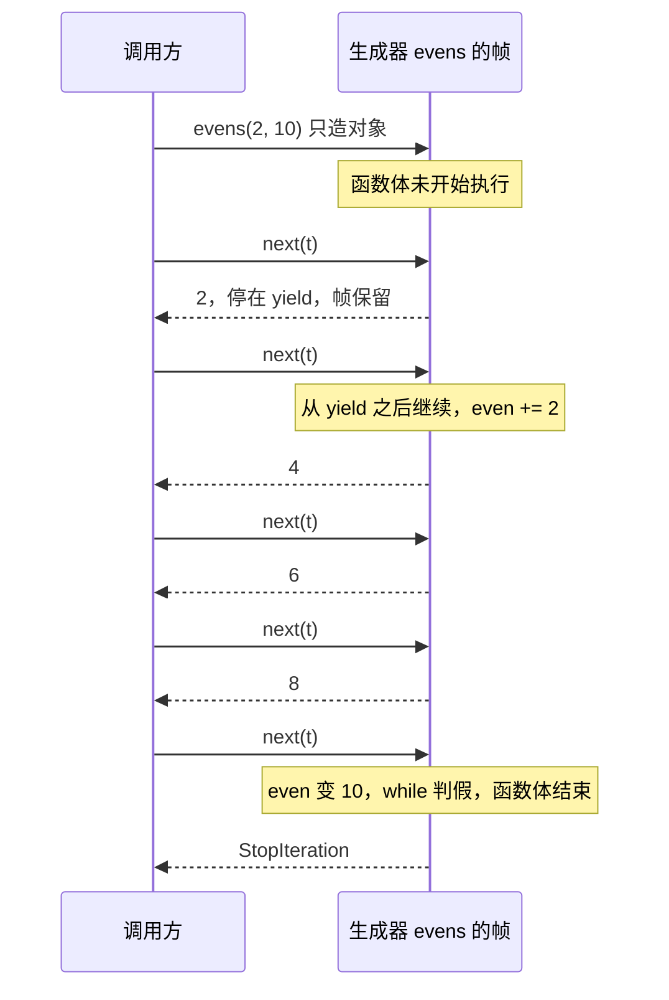

时序图里左右两列不会同时活动：`next` 是一次"交棒"，生成器跑到 `yield` 就把棒交回来，自己停在原地等下一次。普通函数是"进去—出来"的一次往返；生成器是"叫一次—跑一段—停—再叫"的循环。执行暂停在 `yield` 上，但**这次执行的全部环境被记住了**。

局部变量为什么活得过 `yield`？`yield even` 把值交出去之后，到 `even += 2` 真正执行之间隔着一次 `next`，但 `even` 的值没有丢。用环境图的语言说：调用 `evens(2, 10)` 创建了一个生成器帧，帧里有 `start`、`end`、`even`；函数体暂停时这个帧没有被销毁，它被挂在生成器对象上；下一次 `next` 恢复执行，仍然在这个帧里读写 `even`。

这一点与"循环 + 全局变量"有本质差别。若用全局变量记住 `even`，两个 `evens` 调用会互相踩到对方的进度；而生成器帧是**每个生成器对象一份**的：

```python
a = evens(2, 10)
b = evens(2, 10)
next(a)      # 2
next(a)      # 4
next(b)      # 2，b 有自己的帧，不受 a 影响
```

这条性质是后面递归生成器能成立的技术前提：每一层递归调用都会新建一个生成器帧，各层的局部变量天然隔离。

### 3.4 `yield from`：把一条流接上

生成器在执行过程中常常还要处理别的迭代器，这是常态而不是例外。任务：先交出 `a` 的全部元素，再交出 `b` 的全部元素。

```python
def a_then_b(a, b):
    for x in a:
        yield x
    for x in b:
        yield x

def a_then_b(a, b):
    yield from a
    yield from b
```

两种写法完全等价，`yield from` 可以直接理解成 `for` 循环的简写；它唯一多给的东西是省掉了一个名字。第二个例子是倒数：

```python
def countdown(k):
    if k > 0:
        yield k
        yield from countdown(k - 1)
```

`list(countdown(3))` 得 `[3, 2, 1]`。讲师专门演示了写错的样子：把 `yield from countdown(k - 1)` 写成 `yield countdown(k - 1)`，语法完全合法，但 `yield` 会把右边的表达式**原样**交出去，而它的值是一个生成器对象。于是 `list(countdown(3))` 得到 `[3, <generator object countdown ...>]`。修复的写法是把子生成器的元素逐个取出来再交出去：

```python
def countdown(k):
    if k > 0:
        yield k
        for x in countdown(k - 1):
            yield x
```

这段 `for` 加 `yield` 正是 `yield from` 的展开形式。也就是说，`yield from` 在递归结构里承担的是**展平**：把子生成器的流接到当前生成器的流上，而不是把子生成器本身当作一个元素。记住这条对照：`yield` 是"点"，`yield from` 是"线"。给 `countdown` 加一个 `else: yield 'Blast off!'`，还能看到生成器可以在多个出口各自交出一个值，而普通函数只能在一个出口返回一次。

### 3.5 递归生成器与 `partitions` 的四种外壳

有了 `countdown` 的骨架，递归生成器可以直接套在字符串上。所有前缀：`s` 非空时，它的前缀等于"去掉最后一个字符之后的所有前缀"再加上 `s` 自己。

```python
def prefixes(s):
    if s:
        yield from prefixes(s[:-1])
        yield s
```

`list(prefixes('both'))` 得 `['b', 'bo', 'bot', 'both']`——短的先出，因为 `yield from` 写在 `yield s` 之前；把两行对调，得到的就是长前缀在前。所有子串则等于"所有前缀"加上"`s[1:]` 的所有子串"：

```python
def substrings(s):
    if s:
        yield from prefixes(s)
        yield from substrings(s[1:])
```

`list(substrings('tops'))` 得 `['t', 'to', 'top', 'tops', 'o', 'op', 'ops', 'p', 'ps', 's']`。这不会让复杂度变好，但可以让"只取前几个"的调用提前结束。


第 10 页是一道真题：一排 `n` 个停车位，摩托车占 1 格用 `%` 表示，汽车占相邻 2 格用 `<>` 表示，空位用 `.` 表示；要求实现生成器函数 `park(n)`，交出所有可能的停车方案。

```python
def park(n):
    if n == 0:
        yield ''
    if n >= 1:
        for rest in park(n - 1):
            yield '.' + rest
            yield '%' + rest
    if n >= 2:
        for rest in park(n - 2):
            yield '<>' + rest
```

分类依据是"第一个位置怎么放"：空着、停摩托车、停汽车；前两种消耗 1 格，第三种消耗 2 格，每一支都用 `yield from` 把"当前选择"贴到"剩下格子的所有方案"前面。接下来的 `partitions` 把同一个骨架用到整数拆分上。

`partitions` 是本讲最重的例子：把一个整数的拆分全部列出来。定义是：正整数 `n` 用不超过 `m` 的部件做拆分，就是把 `n` 写成若干个不超过 `m` 的正整数之和，按递增顺序排列。经典递归有三个分支：`n` 恰好等于 `m` 时是一种拆法；`n < 0` 或 `m == 0` 时没有拆法；否则"含 `m`"与"不含 `m`"两类相加。

```python
def partitions(n, m):
    if n == 0:
        return [[]]
    if n < 0 or m == 0:
        return []
    with_m = [p + [m] for p in partitions(n - m, m)]
    without_m = partitions(n, m - 1)
    return with_m + without_m
```

换成字符串版，逻辑一个字没变，但种子从 `[]` 变成 `''`，拼接要插入 `' + '`，还得处理空串时的前导分隔符：

```python
    with_m = [p + ' + ' + str(m) if p else str(m)
              for p in partitions(n - m, m)]
```

```python
def partitions(n, m):
    if n > 0 and m > 0:
        if n == m:
            yield str(m)
        for p in partitions(n - m, m):
            yield p + ' + ' + str(m)
        yield from partitions(n, m - 1)
```

最外层 `if n > 0 and m > 0` 是"还有希望往下走"的守卫，否则函数体什么都不交，自然结束——这就是"没有拆法"的出口，不必再写 `return []`。`n == m` 时 `m` 自己就是一个拆分，直接 `yield str(m)`，交出的是字符串本身而不是"装着字符串的列表"。"含 `m`"那一段用 `for` 加 `yield`，"不含 `m`"那一段用一句 `yield from` 接上。函数没有 `return`，讲师的说法是"what do I return? Nothing at all. I'm finished."

| 判据 | 列表版 | 字符串版 | `yield` 版 |
| :--- | :--- | :--- | :--- |
| 每层返回什么 | 列表的列表 | 字符串的列表 | 不返回，直接交出元素 |
| 空结果怎么表示 | `return []` | `return []` | 一行都不交 |
| "贴一个 `m`"怎么写 | `p + [m]` | 要判空、要插分隔符 | `yield p + ' + ' + str(m)` |
| 有没有中间容器 | 每层一个新列表 | 每层一个新列表 | 只有生成器帧 |
| 能否提前停止 | 不能，必须建完全部 | 不能 | 能，不再 `next` 就停 |

### 3.6 无限序列与三条代价


当序列本身无限长时，惰性不再是一种优化，而是唯一的可能。课件最后一页把 `while True` 与 `yield` 放在一起：

```python
def fib_generator():
    a, b = 0, 1
    while True:
        yield a            # Yield the current Fibonacci number
        a, b = b, a + b    # Prepare the next Fibonacci numbers
```

循环体先 `yield a`，再用 `a, b = b, a + b` 把窗口往前挪一格。`next(fib)` 连叫四次依次得到 `0`、`1`、`1`、`2`。这段代码没有任何终止条件，因为它本来就不该终止——**没有 `yield` 的 `while True` 是死循环，有 `yield` 的 `while True` 是一个无限序列的定义**。

`partitions(60, 50)` 的例子把收益量化了：一共约 96.6 万个拆分，全部列出要等一会儿；但只要 `next` 十次就拿到十个，因为生成器只算到第十个 `yield` 就停了。列表版做不到——`return` 之前没有任何东西交得出来，调用方只能先付全款。

代价要记清三条。第一是**一次性**：生成器是迭代器，进度只有一份，遍历完就空；需要多轮遍历，要么重新调用生成器函数，要么先 `list(...)` 落地，而后者又把惰性优势抹掉了。第二是**无法随机访问**：没有下标、不能切片、不能 `len`。第三是**每次 `next` 都有切换开销**：恢复生成器帧、在 `yield` 两侧做上下文切换，比直接跑一段循环慢。

把收益与代价放在一起，判断顺序就清楚了：**先问"是不是只需要一部分结果"，再问"是不是无限"，最后才问"写法是否更短"**。而生成器与手写迭代器的关系可以压成一张表：

| 判据 | 手写迭代器类 | 生成器函数 |
| :--- | :--- | :--- |
| 进度存在哪里 | 实例属性 | 生成器帧里的局部变量 |
| 谁记住"执行到哪" | 写的人，把循环拆成状态机 | Python，帧里连代码位置一起保存 |
| 结束怎么表示 | 手写 `raise StopIteration` | 函数体走完自动抛 |
| 嵌套循环与递归 | 每层都要摊平 | 原样保留 |
| 能不能在任意语句处暂停 | 不能 | 能 |

最后两行解释了为什么生成器不是"代码更短"的语法糖，而是"某些程序能不能写出来"的分界线。

## 4. 对象与属性：从 `class` 语句到绑定方法

*(参考时间: 00:00:11 – 00:17:13｜Lecture 18；00:00:00 – 00:17:45｜Lecture 19)*

第 15 讲已经证明函数可以拥有状态，但那状态是靠一个列表"借"来的，函数的身份仍然是函数。第 18 讲把这层借用关系扶正：用一条 `class` 语句同时声明"每个实例有哪些属性"与"这些实例能做什么"。第 19 讲紧接着把点号拆开，回答一个从第 15 讲起就悬着的问题——`obj.attr` 到底去哪儿找、找到的是什么、写的时候又发生了什么。两讲合成一章，因为 `class` 语句产生的正是两本字典：一本挂在实例上，一本挂在类上；后面所有关于继承的讨论，都是在这两本字典之间加一条链。

### 4.1 从数据抽象到对象

面向对象不是凭空出现的，它建立在两个已经反复使用过的想法上：数据抽象与变异。


复杂的大程序必须被组织成一个个小的模块化组件，每个组件可以单独写出来、单独测试、单独在脑子里一次想清楚，理由是人的心智容量有限。数据抽象做的正是这件事：把描述同一事物的多条信息捆成一个整体，对外只暴露构造它的方式与取出它的方式。面向对象把这一步又往前推了一格：它不只把信息捆起来，还把与这些信息相关的**行为**也捆进同一个整体里。

| 判据 | 数据抽象 | 面向对象 |
| :--- | :--- | :--- |
| 捆住的是 | 只有信息：日期的年、月、日 | 信息加上行为：日期还要能回答"我是星期几" |
| 谁来做计算 | 外部函数取出分量再算 | 对象用自己的方法算 |
| 状态在哪 | 常分散在全局名字或容器里 | 每个对象各有一份局部状态 |
| 复用的单位 | 函数与"构造器/选择器"的约定 | 类与由它造出的实例 |
| 改动的波及范围 | 谁共享那个容器，谁一起被改 | 只有被点名的那个对象被改 |

由此引出三条贯穿全讲的设定：**每个对象有自己的局部状态**，这个状态可以随时间改变；**变异不发生在某个记录全程序信息的全局列表上**，发生变化的那部分信息属于某个特定对象；**每个对象应当知道怎样管理自己的局部状态**。讲师特意强调第二条，因为它决定了"改一个地方会不会波及别处"。

### 4.2 一条 `class` 语句的三段


案例是银行账户。要把与账户有关的信息捆在一起（余额 `balance` 与开户人 `holder`），还要把行为捆在一起（存钱 `deposit`、取钱 `withdraw`）。分工是明确的：**所有银行账户都必须有 balance 和 holder**，所以"给每个新造出来的账户实例装上这两个属性"这件事，必须由 `Account` 类负责。


```python
>>> a = Account('John')
>>> a.holder
'John'
>>> a.balance
0
>>> a.deposit(15)
15
>>> a.withdraw(10)
5
>>> a.balance
5
>>> a.withdraw(10)
'Insufficient funds'
```

课件这一页把两句 "Idea" 落到会话上：任何账户都可以用点号访问 `holder` 与 `balance`，这两个名字叫**属性**；所有银行账户共享一个 `withdraw` 与一个 `deposit`，这叫**方法**。局部（local）指的是：这个 balance 专属于对象 `a`，不写点号就指不到它。


```python
class Account:
    def __init__(self, account_holder):
        self.balance = 0
        self.holder = account_holder
    def deposit(self, amount):
        self.balance = self.balance + amount
        return self.balance
    def withdraw(self, amount):
        if amount > self.balance:
            return 'Insufficient funds'
        self.balance = self.balance - amount
        return self.balance
```

第一段是 `__init__`，前后各两条下划线，它在每次造出新实例时被自动调用；方法体里把新账户称作 `self`，给它装属性：`balance` 恒为 0，`holder` 被赋成传进来的值。注意**属性名可以与参数名不同**：参数叫 `account_holder`，属性叫 `holder`。第二段是方法：`deposit` 接两个参数，第一个是 `self`，也就是 `a.deposit(10)` 里点号左边的 `a`；调用时只给一个实参而定义时写了两个，缺的那个由点号语法补上。`withdraw` 稍复杂：余额不够就返回 `'Insufficient funds'` 直接退出，余额不变。每一次要提到 balance 都必须用点号，因为它是属性。

第三段是一次调用做了什么：

| 时刻 | 实例的属性 | 发生了什么 |
| :--- | :--- | :--- |
| 创建后 | 空白纸 | 实例已被造出，还不知道余额与开户人 |
| 进入 `__init__` | 空白纸 | `self` 指向这个实例，`account_holder` 是 `'Alan'` |
| 执行 `self.balance = 0` | `balance = 0` | 给实例挂上一个绑定到 0 的 balance 属性 |
| 执行 `self.holder = account_holder` | `balance = 0`，`holder = 'Alan'` | 再挂上 holder 属性 |
| 返回 | 两个属性齐备 | 这个实例可以被当作一个账户使用 |

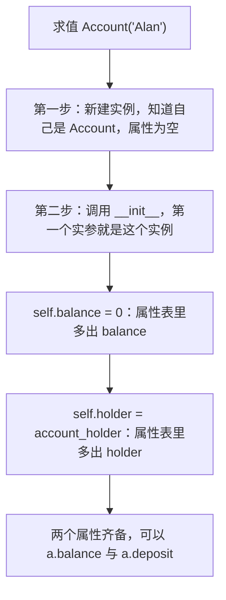

### 4.3 属性是开放的账本

```python
>>> a.balance
5
>>> a.balance = 12
>>> a.balance
12
```

没有调用任何方法，点号赋值直接落到属性本身；方法只是**一条更方便的修改途径**，而不是唯一途径。类并不能强制外部只能通过方法改状态，所以"对象管理自己的局部状态"在这门课里是一条设计约定。

更容易被忽略的是下一条规则：**属性可以被赋值，即使它原来并不存在**。

```python
>>> b = Account('Jack')
>>> b.balance = 20
>>> a.backup = b
>>> a.backup.balance
20
```

两个新事实：**属性的值可以是另一个对象**，不必是数字；新属性可以在任何时刻被加上，不需要事先在类里声明。于是同一个账户有了两种指称方式：`b`，或者 `a.backup`——指向同一个对象的两条箭头。

| 判据 | 属性 | 方法 |
| :--- | :--- | :--- |
| 点号后面取到的是什么 | 一个值：数字、字符串，甚至另一个对象 | 一个绑定了接收者的方法 |
| 还要不要再调用 | 不用，取到就是值 | 要加括号并给实参 |
| 存在哪 | 每个实例各自一份 | 定义在类里，全体实例共享 |
| 能不能中途新增 | 能，任何时刻给任何实例新增 | 不能，方法随类定义固定 |

### 4.4 身份与 `self`

对象的属性会变、对象会变异，所以必须能分清两种情况：**两个对象碰巧属性一样**，还是**它们本来就是同一个对象**。规则很干脆：用户定义类的每一个实例都有唯一的身份；每一次调用 `Account` 都创建一个新实例。

```python
>>> a is a
True
>>> a is not b
True
>>> c = a
>>> c is a
True
```

`a is not b` 为真：即使两者余额相同、连开户人都一样，它们仍然是不同的账户，因为 `Account` 被调用了两次。而 `c = a` 之后 `c is a` 依然为真——赋值把一个对象绑定到新名字，并不会创建新对象。

`class` 语句里最后一块是方法定义。调用方法就是用点号调用类里定义的某个方法，而**所有被调用的方法都能通过 `self` 形参访问到那个对象**。`deposit` 定义时是两个形参，但点号语法会自动提供第一个实参：

```python
t = Account('Tom')
t.deposit(20)        # 定义两个形参，调用只给一个
                     # 另一个实参是 t 本身，绑到 self
```

点号语法做的正是这件事：**它不只负责"找到方法"，还负责"把接收者塞进第一个参数"**，这就是隐式绑定的全部内容。讲师自己提了一个反问：那为什么不干脆定义一个 `deposit` 函数？答案在类型上：**不同类型的对象可能有不同的存入方式**。这个 `deposit` 专属于 `Account`；若有一个投资基金类，往它里面"存钱"可能行为不同，就为那个类另写一个 `deposit`。

> **编者说明**：这段话点出了"同名方法在不同类里有不同实现"这一机制，也就是动态派发与多态（polymorphism）的起点。本讲只把机制摆出来，没有给术语，也没有讨论继承。


> **编者说明**：这是课件的署名页（Animation Demos by Hany Farid），本讲字幕没有对应的讲述；课件第 6 页底部那处 `(Demo)` 指的是课上播放的交互式演示。想复现，把 §4.2 的 `class Account` 定义贴进解释器，再依次输入那七行会话即可。

### 4.5 一条 `class` 语句留下了什么

执行一条 `class` 语句，解释器做三件事：创建一个新的类；把类名绑定到当前环境的第一个帧（交互式会话里就是 Global）；执行类体。类体的执行方式与普通 suite 没有区别，只是名字的去处变了：平时 `=` 与 `def` 会在帧里建名字，在类体里它们全部进入类，成为类的属性。


本段录像开头没有任何公告环节，第一句话就是"类属性是类的属性"；课件第 2 页的公告页不在录音范围内，只作为课件结构保留。


```python
>>> class Clown:
...     nose = 'big and red'
...     def dance():
...         return 'No thanks'
>>> Clown.nose
'big and red'
>>> Clown.dance()
'No thanks'
>>> Clown
<class '__main__.Clown'>
```

`nose` 与 `dance` 都不在 Global 帧里：`nose` 会报名字未定义，而 `Clown.nose` 有值。`Clown.dance()` 之所以能跑，是因为 `dance` 是一个"存着函数"的类属性，用类去取它拿到的就是这个函数本身。最后一行打印 `<class '__main__.Clown'>`：类本身也是一个值，有类型、有地址、可以被绑定、可以被传递。

> **编者说明**：讲师声明这段代码"没有任何用处"，它的全部价值在于让人看见一条 `class` 语句执行完之后留下了什么。另外，`Clown().dance()` 会抛 `TypeError: dance() takes 0 positional arguments but 1 was given`——原因在 §4.6 第四步：用实例查找 `dance` 时命中了类里的函数，于是返回绑定方法并把实例填进 `self`，而 `dance` 一个形参都没声明。

类属性真正的用处是**共享**。如果所有账户的利率都相同，就没有必要在每个实例里各存一份。


```python
class Account:
    interest = 0.02   # A class attribute

    def __init__(self, account_holder):
        self.balance = 0
        self.holder = account_holder
```

`interest` 在类体里被赋值，所以它是类属性；`balance` 与 `holder` 在 `__init__` 里通过 `self.` 赋值，所以它们是实例属性。讲师强调的第一点是"访问处看不出来"：语法上 `tom_account.interest` 与 `tom_account.balance` 长得一模一样，走的是同一条求值规则，区别只在查找停下来时命中的是哪一站。第二点是"它不在实例里"：`interest` 是类的一部分，只是查找过程让你够到了它。第三点是代价：每个实例复制一份共享值在对象很多时是浪费，类属性把成本压到一次。

### 4.6 点表达式：一次查找经过两站


课件把求值过程写成四条规则，顺序即优先级：

1. 先求值点号左边的 `<expression>`，它的值就是点表达式的对象。
2. 把 `<name>` 与这个对象的**实例属性**比对；若存在同名属性，返回它的值。
3. 若不存在，到对象的**类**里查这个名字，得到一个类属性的值。
4. 这个值就是整个表达式的值；除非它是函数——那就返回**绑定方法**，而点表达式的对象已经被填进 `self`。

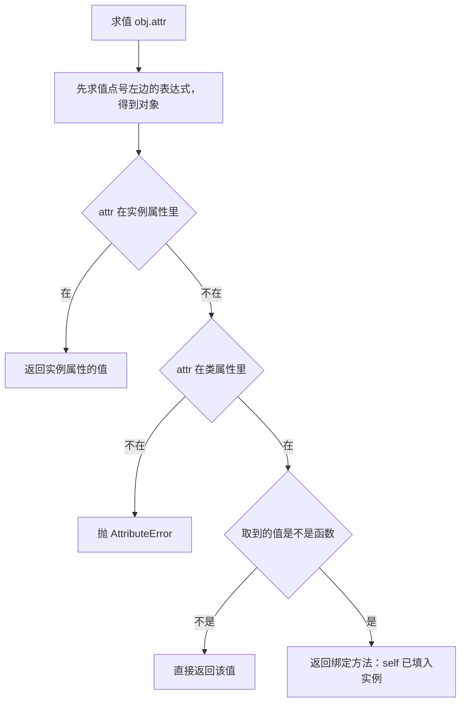

讲师把这条规则归入"需要背下来的机械过程"，类比是环境里的名字查找：查名字要沿父帧一层层往上走，查属性要沿实例到类往上走。一个容易忽略的细节：第四步只在"从实例出发"时起作用；若点号左边是类本身，第二步没有实例属性可比，第三步在类里直接命中，返回的是函数而不是绑定方法。

点表达式不是唯一的入口。`getattr(tom_account, 'balance')` 与 `tom_account.balance` 做的是同一件事；`hasattr` 回答"这个名字是否存在"，判断范围包括实例与它的类。这里藏着一个容易犯的错：既然返回值上看不出区别，就不能靠读代码"猜"某个属性是共享还是独享。


第 7 页是一道讨论题：对两个类，各写一个不含引号、不含 `+` 的表达式，求值得到 `'Waldo'`。课堂上是分组做的，本段录像没有讲，课件直接给了答案。

```python
class Town:
    def __init__(self, w, aldo):
        if aldo == 7:
            self.street = {self.f(w): 'Waldo'}

    def f(self, x):
        return x + 1
```

`Town(1, 7)` 把 `w = 1`、`aldo = 7` 交给 `__init__`，条件成立，于是执行 `self.street = {self.f(w): 'Waldo'}`。字典的键 `self.f(w)` 本身就是点表达式加一次调用：实例里没有 `f`，查到类里命中函数，返回绑定方法，调用得到 `1 + 1 = 2`。于是实例拿到属性 `street`，值是 `{2: 'Waldo'}`，最后 `Town(1, 7).street[2]` 命中实例属性 `street` 再按键取值。另一道 `Beach` 题同理，只是它把**列表的绑定方法** `sand.pop` 存成实例属性，再用一个闭包 `self.wave` 把两次 `pop` 拼起来；`walk` 末尾的 `return self` 让链式写法成立。

### 4.7 属性赋值：写在左边就不查找

前面两节讲的是"读"。写的时候规则完全不同，而且简单得多：赋值语句的左边是点表达式时，它就是一条**属性赋值语句**，只影响点表达式所指的那个对象的属性。


```python
>>> tom_account.interest = 0.08
```

点号左边是一个实例，所以这是一条**实例属性赋值**。求值时不会先到类里找到 `interest`、把类里那份改掉——那个想当然的解读正是误解的来源。实例原本没有 `interest`，赋完就有了自己的一份；类里那份一动不动。反过来，`Account.interest = 0.04` 改的是类里那一格。

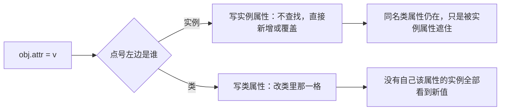


```python
>>> jim_account = Account('Jim')
>>> tom_account = Account('Tom')
>>> tom_account.interest
0.02
>>> Account.interest = 0.04
>>> tom_account.interest
0.04
>>> jim_account.interest = 0.08
>>> tom_account.interest
0.04
>>> Account.interest = 0.05
>>> tom_account.interest
0.05
>>> jim_account.interest
0.08
```

四步走完，规则就清楚了：两个实例刚建好时都没有自己的 `interest`，两次查找都走到类，读到 0.02；`Account.interest = 0.04` 改的是类，两者都看到 0.04——实例**不会**在创建时把类属性"锁"进去；`jim_account.interest = 0.08` 是实例赋值，Jim 从此有了自己的一份；`Account.interest = 0.05` 又改类，Tom 读到 0.05，Jim 仍读到 0.08——**按类赋值不会抹掉特例**。

| 判据 | 读 `obj.attr` | 写 `obj.attr = v` |
| :--- | :--- | :--- |
| 是否沿类往上走 | 是，先实例后类 | 否，只看点号左边 |
| 作用对象 | 命中的那一份（实例或类） | 点号左边那个对象 |
| 同名属性冲突时 | 实例优先，类的那份被遮住 | 直接写实例，不碰类 |
| 是否可能失败 | 两站都没有就抛 `AttributeError` | 总能成功，实例可随时加新属性 |
| 对类的影响 | 永不改变 | 只有 `Cls.attr = v` 才改类 |

把同样位置换成可变对象，共享就会变成陷阱：若 `Account` 类体里写 `tags = []`，那么 `a.tags.append('vip')` 之后 `b.tags` 也会变成 `['vip']`——`a.tags` 与 `b.tags` 经查找得到的是**同一个列表对象**，`append` 是就地修改，没有发生任何属性赋值。要打断这种联系，必须真的写一次 `a.tags = ['vip']`。

### 4.8 方法调用与绑定方法


在一个对象上调用方法，是与对象交互的主要方式；方法调用与普通函数调用的区别只有一处——中间有那个点。点号左边的 `<expression>` 可以是任何合法的 Python 表达式，点号右边的 `<name>` 必须是一个简单名字。


课件真正想说的是下一句：调用表达式 `tom_account.deposit(10)` 里，**operator 位置放着的是一个点表达式**。这整个东西就是一个普通的调用表达式，只不过点表达式作为 operator 先被求值，它给出一个"知道自己在往 Tom 账户里存钱"的方法，然后 10 才作为实参传进去。方法调用没有专门的语法，它是普通调用表达式加上一条属性查找规则的结果。

```python
>>> a = Account('Alan')     # 两笔存款之后，a.balance 为 10
>>> f = a.deposit
>>> f(10)
20
>>> f(10)
30
>>> a.balance
30
```

`f` 这个名字里没有出现 `a`，但两次调用都在往 Alan 的账户里存钱。原因是 `a.deposit` 求值得到的不是一个"需要实例才能调用"的工具，而是一个**已经绑定了** `a` 的方法。


术语清单是五句话：所有对象都有属性，属性是名字与值的配对；类是对象的类型；类本身也是对象，所以类也有属性；**实例属性**是某个实例的属性；**类属性**是实例所属的那个类的属性，但仍然可以从实例访问到。图的意思比清单更进一步：左圈是类属性，右圈是函数，交集写着"方法"——"方法"不是第三种独立的东西，它同时满足两个条件，这也解释了为什么绑定方法不需要在类里另存一份：它是查找过程在第四步**现场生成**的产物。


```python
>>> type(Account.deposit)
<class 'function'>
>>> type(tom_account.deposit)
<class 'method'>
>>> Account.deposit(tom_account, 1001)
1011
>>> tom_account.deposit(1007)
2018
```

用类查方法，得到的是函数；用实例查方法，得到的是绑定方法。两种都能调用，实参写法不同：`Account.deposit(tom_account, 1001)` 把所有实参都写进括号；`tom_account.deposit(1007)` 只写一个，另一个在点号左边已经给出。课件上的两个标注正是这句话：函数是 all arguments within parentheses，方法是 one object before the dot and other arguments within parentheses。

| 判据 | 函数 `Account.deposit` | 绑定方法 `tom_account.deposit` |
| :--- | :--- | :--- |
| `type` 的输出 | `<class 'function'>` | `<class 'method'>` |
| 怎么取到 | 用类查属性 | 用实例查属性 |
| `self` 是否已填 | 未填，是普通形参 | 已绑定为 `tom_account` |
| 调用时要传几个实参 | `self` 与 `amount` 两个 | 只传 `amount` |
| 能否直接交给 `map` | 不能，缺实例 | 能，`self` 已在里面 |

最后一行是这个区别的实际后果：把 `Account.deposit` 交给 `map`，`map` 只会提供序列里的元素，实例无处可给；交给 `a.deposit` 则直接可用，`map(a.deposit, range(10, 20))` 会依次把 10、11、12……存进同一个账户。一个是"函数"，一个是"函数加上一个对象"，后者才是能独立传走的完整行为。

这两讲合起来，回答的其实是同一个问题：**类字典补上了环境图的什么**。环境图里，名字属于帧，值只是盒子；现在多了一本属于对象的属性表、一本属于类的属性表，以及一条"读沿两站走、写只看左边"的规则。环境图仍然能画这张结构，但不能再把"名字"与"属性"混为一谈。

## 5. 继承：只写差异，其余交给查找

*(参考时间: 00:00:02 – 00:09:56｜Lecture 20)*

有了类以后，重复开始以新的形式出现：两个类的属性与方法几乎一样，只差几条。第 20 讲给的办法是继承，但它给的机制比名字朴素得多——**基类的属性并不会被复制进子类**，继承体现在"查名字"的过程里。本章先走课件前十六页。

### 5.1 复习叠与两个新例子


术语与四步规则原样复现，其中第二步与第三步的先后是关键：**实例属性会遮蔽（shadow）同名的类属性**。这条遮蔽规则在本讲会反复出现：`CheckingAccount` 里的 `interest = 0.01` 遮蔽了 `Account` 里的 0.02；WWPD 题里实例上的 `z` 遮蔽了类上的 `z`；某个账户单独设过的手续费遮蔽了类上的 1 美元。


复习叠里唯一新的一页是 `Transaction`。`log` 是类属性（一个列表），每笔交易创建时把自己记进去；题目要求填 `self.prior` 与 `balance` 的返回式，并给出两组期望结果：`ts[1].balance()` 是 17，`ts[2].balance()` 是 13。

```python
class Transaction:
    log = []

    def __init__(self, amount):
        self.amount = amount
        self.prior = list(self.log)
        self.log.append(self)

    def balance(self):
        return self.amount + sum([t.amount for t in self.prior])
```


逐笔核对：`Transaction(20)` 建好时 `log` 还是空的，快照是空列表，`balance()` 得 20；`Transaction(-3)` 快照里有前一笔的 20，于是 -3 + 20 = 17；`Transaction(-4)` 快照里有 20 与 -3，于是 -4 + 17 = 13。

两个细节值得停下来说。第一，`self.prior = list(self.log)` 复制的不是指针而是内容；如果写成 `self.prior = self.log`，`prior` 与 `log` 就是同一个列表，后面每来一笔交易都往这个列表里追加，早先几笔的历史会跟着变——第一笔的 `balance()` 会从 20 变成 17、再变成 13，历史被未来的事件改写。快照买的是"时间点"，代价是每次创建都要复制一份长度为 n 的列表，n 笔交易总共 $O(n^2)$ 的空间。第二，`self.log.append(self)` 不会在实例上留下一个 `log`：这是方法调用而不是赋值，先查 `self.log`（实例上没有，类上有），拿到那个共享列表，再对它调用 `append`。若写成 `self.log = self.log + [self]`，那就成了属性赋值，会在实例上新建一个 `log`，类上的那份从此被遮蔽。


下一页把快照挪到实例自己身上：先 `append` 再复制进 `self.lst`，于是快照包含自己，`balance` 直接对整个 `self.lst` 求和。两种写法结果相同，差别只在"快照是否包含自己"。

| 判据 | 第 7 页的写法 | 第 8 页的写法 |
| :--- | :--- | :--- |
| 快照存在哪个实例属性 | `self.prior` | `self.lst` |
| 复制与追加的先后 | 先复制类日志，再追加自己 | 先追加自己，再复制类日志 |
| 快照里是否包含自己 | 不包含 | 包含 |
| 求和的写法 | `self.amount + sum(...)` | `sum([t.amount for t in self.lst])` |


属性赋值与上一讲同一套规则：点号左边照常求出对象，但右边的**名字不做查找**，而是直接在那个对象上增加或修改属性。`tom_account.interest = 0.08` 只影响这一个实例；`Account.interest = 0.04` 改的是类上那一份。一旦实例有了自己的一份，类属性怎么改都到不了它。


这一页只有标题与一条链接，练习代码编码在链接里：

```python
Foo = 1

class Foo:
    bar = 2

    def __init__(self, baz, qux):
        self.baz = baz
        Foo.bar = qux

    def a(self, x):
        self.bar = x

a = Foo(3, 4)
b = a.a
print(a.bar)
b(5)
print(a.bar)
Foo.bar = 6
print(a.bar)
```

三处输出依次是 `4`、`5`、`5`：`Foo(3, 4)` 把 `Foo.bar` 改成 4，所以第一次 `a.bar` 取类上的 4；`b = a.a` 是绑定方法，`b(5)` 执行 `self.bar = 5`，从此 `a` 有了自己的 `bar`；`Foo.bar = 6` 之后 `a.bar` 仍是 5，实例属性遮蔽了刚改过的类属性。

### 5.2 继承的语法与"只写差异"


继承是 Python 对象系统的一个特性。它要解决的问题很朴素：**类很少孤立存在**。有时一个类只是和另一个类相似，希望把这种关系表达出来，而不是让两份几乎一样的代码各写一遍。


最常见的用法是"两个相似的类在专门化程度上不同"：专门化的那个类拥有一般类的全部属性，再额外加一些特例行为。语法上只多了一对括号：

```python
class <Name>(<Base Class>):
    <suite>
```

括号里写基类，类名后跟的类就是继承它的子类。概念上，子类与基类共享全部属性；子类可以**覆盖**（override）某些继承来的属性来稍微改变行为，没改的部分保持原样。所以"用继承实现一个子类"的意思是：**只写它与基类的差异**。子类的类体越短，说明差异被表达得越干净——如果子类里大段复制基类的代码，那通常不是继承用得不对，而是基类该拆了。

### 5.3 支票账户：共享存款，覆盖取款

支票账户是账户的一种，但它有三处不同：利率比普通账户低（1% 对 2%）；存款行为完全一样；取款要付 1 美元手续费。于是从 20 美元的账户里取 5 美元，实际剩下 14 美元。


```python
class CheckingAccount(Account):
    """A bank account that charges for withdrawals."""
    withdraw_fee = 1
    interest = 0.01
    def withdraw(self, amount):
        return Account.withdraw(self, amount + self.withdraw_fee)
```

`withdraw_fee = 1` 与 `interest = 0.01` 是类属性，所有支票账户共享同一份。只写 `withdraw_fee` 还不够——它只是一个数字，没有任何地方用到它；还要写一个 `withdraw` 方法，把"多扣 1 美元"落到逻辑里。名字与基类相同，于是支票账户的实例查到的是这一份。

方法体里反复出现 `self`，讲师特意停下来解释：`self` 是"这个方法被调用的那个对象"。写 `ch.withdraw(5)` 时，`self` 绑到 `ch`，`amount` 是 5，`self.withdraw_fee` 得 1，于是传给基类的金额是 6。`self.withdraw_fee` 本身也走了一遍四步：`ch` 的实例属性里没有它，于是到类里找。写成 `self.withdraw_fee` 而不是写 1，是为了将来能有"手续费不一样的账户"。

真正干活的还是基类那份取款逻辑：`Account.withdraw(self, amount + self.withdraw_fee)`。从类上取 `withdraw` 得到的是**函数**而不是绑定方法，所以必须自己把 `self` 补进去作为第一个参数。同一个方法如果写成 `self.withdraw(...)`，会无限递归——`self` 是支票账户实例，查到的还是这个覆盖版。

```python
class Account:
    interest = 0.02

    def __init__(self, account_holder):
        self.balance = 0
        self.holder = account_holder

    def deposit(self, amount):
        self.balance = self.balance + amount
        return self.balance

    def withdraw(self, amount):
        if amount > self.balance:
            return 'Insufficient funds'
        self.balance = self.balance - amount
        return self.balance
```

类体里没有 `deposit`，也没有 `__init__`。这不是遗漏：创建 `CheckingAccount('Tom')` 时会去找 `__init__`，本类没有，沿基类找到 `Account.__init__`，于是 `balance` 从 0 开始、`holder` 是 Tom；存款时同理，查到的是 `Account.deposit`。**未写即继承**，这正是继承省下的那部分工作。

### 5.4 基类属性没有被复制


这一页只有一句加粗的结论，却是整讲的枢纽：**基类的属性不会被复制进子类**。`CheckingAccount` 的类体里没有 `deposit`，可是 `ch.deposit` 能用，原因不在"复制"，而在"查找"。

在类上查一个名字，规则只有两条：如果这个名字是该类的属性，返回它的值；否则，如果它有基类，就到基类里查——而基类也是类，于是同一条规则递归地继续往上走。

```python
>>> ch = CheckingAccount('Tom')   # 调用 Account.__init__
>>> ch.interest                   # 在 CheckingAccount 里找到
0.01
>>> ch.deposit(20)                # 在 Account 里找到
20
>>> ch.withdraw(5)                # 在 CheckingAccount 里找到
14
```

这条规则带来三个直接后果：**改基类，子类跟着变**（`Account.deposit` 的逻辑一旦修改，所有没覆盖 `deposit` 的子类立刻用上新逻辑）；**覆盖不销毁原版**（`CheckingAccount.withdraw` 只是在子类里放了另一个同名属性，`Account.withdraw` 仍然原样躺在基类里）；**找不到才报错**（名字沿基类链一路向上都没命中，才抛 `AttributeError`）。

### 5.5 追踪与"复制还是复用"

`ch = CheckingAccount('Tom')` 先求值调用表达式，`CheckingAccount` 是类对象，调用它新建一个实例，然后自动调用 `__init__`——用 §5.4 的两条规则查，`CheckingAccount` 里没有，到 `Account` 里找到。接下来三个表达式，三种落点：`ch.interest` 在 `CheckingAccount` 上得 0.01；`ch.deposit(20)` 在实例与子类上都没有，最后在 `Account` 上找到函数、包成绑定方法，调用后余额 20；`ch.withdraw(5)` 在 `CheckingAccount` 上找到覆盖版，转发给 `Account.withdraw(self, 6)`，余额 20 - 6 = 14。

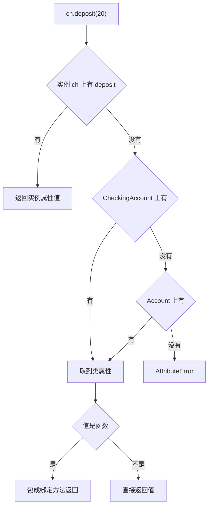

讲师在这里问了一个很实际的问题：既然只是"多扣 1 美元"，把基类的 `withdraw` 抄进子类改一行不是更简单吗？抄过来的版本"能正确一阵子"。问题出在时间轴上：如果日后基类的 `withdraw` 改了，这些改动不会流到抄写过的那份子类代码里。同一个业务规则出现两个版本，早晚会分叉。

```python
>>> a = Account('John')
>>> b = CheckingAccount('Jack')
>>> a.deposit(100)
100
>>> b.deposit(100)
100
>>> a.withdraw(10)
90
>>> b.withdraw(10)
89
```

两次存款结果相同，因为两者用的是同一个 `Account.deposit`；两次取款结果差 1，因为支票账户的 `withdraw` 多扣了 `withdraw_fee`。一行差异、一份共享实现，这就是继承在这个例子里买到的全部东西。

| 判据 | 复制基类代码 | 显式调用 `Account.withdraw` | 调用 `super().withdraw` |
| :--- | :--- | :--- | :--- |
| 基类后来改了，子类跟不跟 | 不跟，两份逻辑分叉 | 跟，改一处生效 | 跟，改一处生效 |
| 是否写死基类名 | 不涉及 | 写死 `Account` | 不写死，跟着解析顺序走 |
| 多重继承时选中谁 | 不参与解析 | 固定在写出来的那个类 | 由解析顺序决定 |
| 主要代价 | 逻辑分叉、回归困难 | 换基类要改代码 | 需要理解解析顺序 |

## 6. 用继承设计：is-a、has-a 与歧义名字

*(参考时间: 00:10:00 – 00:31:33｜Lecture 20)*

上一章证明了继承是"查找"而不是"复制"，但机制正确不等于用法正确：什么时候该继承、什么时候该组合，多重继承下同一个名字有两条路时先看哪一条——这些都不是语法问题。

### 6.1 三条设计规则


课件给出的不是语法，而是三条判断。**第一条，不要重复自己，尽量用已有的实现**——判断方法很具体：子类里出现与基类相同的语句块，就停下来想"这段是不是该留在基类"。**第二条，被覆盖的属性仍然可以通过类对象访问**——覆盖只是"子类里放了另一个同名属性"，同名不等于替换，`Account.withdraw` 依然存在，写 `Account.withdraw` 就能拿到原版。**第三条，尽量在实例上查属性**，即 `amount + self.withdraw_fee` 该写成什么。


| 判据 | 写法 | 能不能改 | 能不能有特例 |
| :--- | :--- | :--- | :--- |
| 字面量 | `amount + 1` | 不能，改要动代码 | 不能 |
| 类名写死 | `amount + CheckingAccount.withdraw_fee` | 能改类属性 | 不能，子类或单个账户的例外都失效 |
| 实例上查 | `amount + self.withdraw_fee` | 能改类属性 | 能，实例属性与更深的子类都生效 |

第三种写法之所以最好，是因为它把"查名字"交给了运行时的规则：`self` 先看实例上有没有 `withdraw_fee`，没有就沿类链找。第二种写法把类名写死，等于宣布"我永远是 `CheckingAccount`"，一旦有人再从它派生出"取款免费的 VIP 账户"，这个写死的地方就选不到新值。

### 6.2 is-a 与 has-a


面向对象之所以好用，很大程度上是因为它允许把对象当成现实里的东西来想。判据只有一条：两个类之间是"是"还是"有"。

| 判据 | 继承（is-a） | 组合（has-a） |
| :--- | :--- | :--- |
| 关系 | 子类是基类的一种特化 | 一个对象持有另一个对象 |
| 判断句式 | "支票账户是一种账户" | "银行有一组账户" |
| 本讲例子 | `CheckingAccount(Account)` | `Bank` 里的 `self.accounts` |
| 复用的是什么 | 属性与方法的实现 | 被持有对象的行为 |
| 改动的影响面 | 改基类会波及所有子类 | 改被持有对象不影响持有者 |
| 典型误用 | 为了复用代码而继承，语义上并不是"一种" | 该用继承表达特化却套了一层包装 |

### 6.3 组合实战：一间银行

课件没有给银行单独一页，这一段是白板演示。

```python
class Bank:
    """A bank that manages a collection of accounts."""

    def __init__(self):
        self.accounts = []

    def open_account(self, holder, amount, kind=Account):
        account = kind(holder)
        account.deposit(amount)
        self.accounts.append(account)
        return account

    def pay_interest(self):
        for account in self.accounts:
            account.deposit(account.balance * account.interest)

    def too_big_to_fail(self):
        return len(self.accounts) >= 2
```

四个要点：构造只做一件事——记住自己管着哪些账户；`open_account` 的 `kind` 参数决定新账户的种类，传 `Account` 是普通账户，传 `CheckingAccount` 就是支票账户；`pay_interest` 遍历所有账户，各存一笔 `balance * interest`；`too_big_to_fail` 是讲师的玩笑，判据只是"至少有两个账户"。

```python
>>> bank = Bank()
>>> john = bank.open_account('John', 10)
>>> jack = bank.open_account('Jack', 5, CheckingAccount)
>>> bank.pay_interest()
>>> john.balance
10.2
>>> bank.too_big_to_fail()
True
```

最后一问是讲师开的玩笑：银行需不需要"大到不能倒"的保护？判据是"至少有两个账户"，而它管着 John 和 Jack 两个人的钱。这一段真正的教学价值在于：**银行没有继承账户，程序照样工作**。`pay_interest` 只依赖 `balance`、`interest`、`deposit` 三个名字，不关心手里拿的是哪种账户。组合把"多样性"交给了对象的接口，而不是类的谱系。

### 6.4 WWPD：三个名字抢一个属性


```python
class A:
    x, y, z = 0, 1, 2

    def f(self):
        return [self.x, self.y, self.z]

class B(A):
    x = 6
    def __init__(self):
        self.z = 'A'
```

`A().f()` 得 `[0, 1, 2]`：三个名字在实例上都没有，全部来自 `A` 类。`B().f()` 得 `[6, 1, 'A']`，三个名字三种来源——`self.x` 在实例上没有、`B` 类上有 6，于是停在 `B`；`self.y` 在实例与 `B` 上都没有，继续到 `A` 取 1；`self.z` 在实例上就有，第一步就命中，根本没机会看类。

画面右侧的四张盒子图就是这题的全部线索：`A` 类里有 `x: 0`、`y: 1`、`z: 2`；`B` 类里只有 `x: 6`；`A` 实例是空的；`B` 实例里只有 `z: 'A'`。做这类题的方法因此固定：先把每个类与每个实例的盒子画出来，再对每个名字从左往右数它落在第几个盒子里。

### 6.5 多重继承：把两个基类同时用上


多重继承是指一个子类有多个基类。先补一个储蓄账户：与普通账户的唯一区别是存款要收 2 美元手续费，所以存 10 美元，账户里只多 8 美元。

```python
class SavingsAccount(Account):
    deposit_fee = 2
    def deposit(self, amount):
        return Account.deposit(self, amount - self.deposit_fee)
```


接着是讲师编的银行高管的点子：利率只有 1%，取款收 1 美元、存款收 2 美元，开户白送 1 美元。这个产品叫"电视购物账户"（As Seen on TV account）。它的定义短得出奇：

```python
class AsSeenOnTVAccount(CheckingAccount, SavingsAccount):
    def __init__(self, account_holder):
        self.holder = account_holder
        self.balance = 1                 # A free dollar!
```


```python
>>> such_a_deal = AsSeenOnTVAccount('John')
>>> such_a_deal.balance
1
>>> such_a_deal.deposit(20)     # SavingsAccount method
19
>>> such_a_deal.withdraw(5)     # CheckingAccount method
13
```

创建时 `__init__` 是它自己的，余额直接是 1。存 20 美元时找到的是 `SavingsAccount.deposit`，扣掉 2 美元手续费，账户里只进 18，加上原来的 1，余额 19。取 5 美元时找到的是 `CheckingAccount.withdraw`，多扣 1 美元手续费，余额 13。讲师在这里的评价是"such a deal indeed"——银行赔得很彻底。这句话对理解多重继承也有用：两个基类的行为被同时继承下来，"最省钱"与"最收费"的两套规则叠加在同一个对象上，程序忠实地执行了写下来的东西，至于商业上是否合理，语言不管。

存款来自储蓄账户、取款来自支票账户、开户余额来自自己的 `__init__`——三个来源混在一个类里，正是下一节要处理的问题。

### 6.6 菱形与解析顺序


`Account`、`CheckingAccount`、`SavingsAccount`、`AsSeenOnTVAccount` 四条边围成一个菱形，同一个名字可能有两条甚至三条路能走到。讲师给的规则只有一句：**先看子类，再看基类**；多个基类时按书写顺序从左到右。

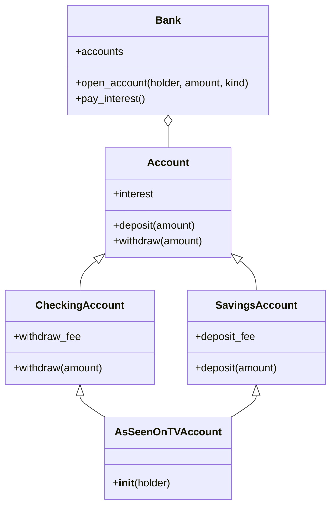

| 名字 | 解析到的位置 | 依据 | 结果 |
| :--- | :--- | :--- | :--- |
| `withdraw` | `CheckingAccount` | 基类列表里它排第一 | 取 5 扣 6，19 → 13 |
| `deposit` | `SavingsAccount` | 本类与 `CheckingAccount` 都没有，先查到它 | 存 20 只进 18，1 → 19 |
| `interest` | `CheckingAccount` | 它定义了 0.01，`SavingsAccount` 没有 | 1% |
| `holder`、`balance` | 实例自身 | 由自己的 `__init__` 赋值 | `'John'`、1 |
| `__init__` | `AsSeenOnTVAccount` | 本类定义了，不再向上找 | 写入 holder 与 balance |

`deposit` 那一行最不显眼、也最容易想错：`CheckingAccount` 自己没有 `deposit`，但它的基类 `Account` 有。如果查找是"一条路走到黑"的深度优先，会先撞上 `Account.deposit`，存款就该得 20 而不是 19。屏幕给出的是 19，说明实际规则并不是"碰到基类就往里钻"。

> **编者说明**：讲师只给了"先子类、后基类"这一条，Python 3 的实际规则叫 **C3 线性化**（C3 linearization），它把每个类的解析顺序（MRO，method resolution order）算成一张列表，查找就沿这张列表从头到尾走。算 `AsSeenOnTVAccount` 时把三个输入交给合并：`CheckingAccount` 的 MRO 是 `[CheckingAccount, Account, object]`、`SavingsAccount` 的是 `[SavingsAccount, Account, object]`，再加上直接基类的书写顺序 `[CheckingAccount, SavingsAccount]`。合并规则是"每次看第一个列表的表头，只要它没有出现在其他列表的尾巴里就取走它"：`CheckingAccount` 合格先取；第一个列表的表头变成 `Account`，而它出现在第二个列表的尾巴里，跳过，改看第二个列表的表头 `SavingsAccount`，合格取走；再取 `Account`，最后是 `object`。整条链于是是 `AsSeenOnTVAccount → CheckingAccount → SavingsAccount → Account → object`。按这张表走，`deposit` 落在 `SavingsAccount`、`withdraw` 落在 `CheckingAccount`，与屏幕上的 19 和 13 一致。早期 Python 的旧式类用"深度优先、从左到右"，会让 `Account` 排在 `SavingsAccount` 前面，从而让子类定义的方法输给祖先。想验证实际顺序，可以打印 `AsSeenOnTVAccount.__mro__`。

## 7. 表示：让对象自己回答

*(参考时间: 00:00:41 – 00:30:28｜Lecture 21)*

到第 20 讲为止，对象已经能存状态、能算、能复用，但当你在交互式会话里敲下一个账户实例，屏幕上出现的是 `<__main__.Account object at 0x7f...>`。这个字符串既不能读，也不能用来重建对象。第 21 讲补上最后一块：让对象自己回答"我该被显示成什么"，并把这条回答接进 `print`、`eval` 与运算符。本章的主线是接口——一组共享的名字，加上每个类对它们语义的承诺。

### 7.1 回顾：表达式、值与类型


课件先用 Lab 6 的第二题把注意力拉回"类与类之间互相调用"：一个 `Client` 把 `Email` 发给它的 `Server`，`Server` 再投递到另一个 `Client` 的收件箱。

```python
class Email:
    def __init__(self, msg, sender, recipient_name):
        self.msg = msg
        self.sender = sender
        self.recipient_name = recipient_name

class Server:
    def __init__(self):
        self.clients = {}

    def send(self, email):
        # Append the email to the inbox of the client it is addressed to.
        self.clients[email.recipient_name].inbox.append(email)

class Client:
    def __init__(self, server, name):
        self.inbox = []
        self.server = server
        self.name = name
```

课件把 `send` 里那一长串属性链逐段拆开，在表达式上方排了四个方框：`Server`、`dict`、`Client`、`list`。方框标出的是每个子表达式求值之后的类型：先得到服务器，再得到字典，再用收件人名字取出客户端，最后取出它的收件箱。一串点号之所以读得懂，是因为每一段都输出一个确定类型的对象，下一段就在这个对象上继续查找。

| 子表达式 | 求值结果 | 类型 |
| :--- | :--- | :--- |
| `self` | 正在执行 `send` 的那个服务器 | `Server` |
| `self.clients` | 名字到客户端的映射 | `dict` |
| `self.clients[email.recipient_name]` | 收件人对应的客户端 | `Client` |
| `self.clients[...].inbox` | 该客户端的收件箱 | `list` |

这张表把前面反复强调的一件事讲透了：**类型决定了你能在值上做哪些操作**。

回顾到此结束，本讲从这个比喻开始：面向对象编程里有一句话——**一个对象应当表现得像它所表示的那一类数据**。数学家写分数时用的是分数线，会计写金额时用的是两位小数，从来不会把"分子分母两个整数"直接甩给人看。对象也一样：内部怎么存是一回事，对外怎么呈现是另一回事。

### 7.2 两种字符串表示


在 Python 里，这个区分不是约定俗成，而是内建在语言里的：**所有对象都产生两个字符串表示**。一个叫 `str` 字符串，设计目标是**对人可读**；另一个叫 `repr` 字符串，设计目标是**对 Python 解释器可读**——换句话说，它应该是一个表达式。很多时候两者一模一样，因为 Python 从设计之初就是一门"人能读"的语言。


```text
>>> from fractions import Fraction
>>> half = Fraction(1, 2)
>>> str(half)
'1/2'
>>> repr(half)
'Fraction(1, 2)'
```

`repr` 是一个内置函数，它的约定是：返回一个 Python 表达式形式的字符串，**对这个字符串求值，得到一个与原对象相等的对象**。`help(repr)` 说得更直白：它返回该对象的 canonical string representation，并且对大多数对象类型来说，`eval(repr(obj))` 会给出一个与原对象等价的对象。`str` 则接受任意对象，返回该对象的人类可读表示；**`print` 打印出来的，正是 `str` 的结果**。

| 判据 | `str` | `repr` |
| :--- | :--- | :--- |
| 设计目标 | 人类可读 | Python 解释器可读 |
| 是否应为合法表达式 | 不要求 | 应当（尽量） |
| `eval` 之后得到 | 不保证 | 与原对象等价的对象 |
| 交互式会话回显 | 否 | 是 |
| `print` 使用哪个 | 是 | 否 |
| f-string 的 `{x}` 使用哪个 | 是 | 否，需显式写 `repr(x)` |
| `Fraction(1, 2)` 的值 | `'1/2'` | `'Fraction(1, 2)'` |

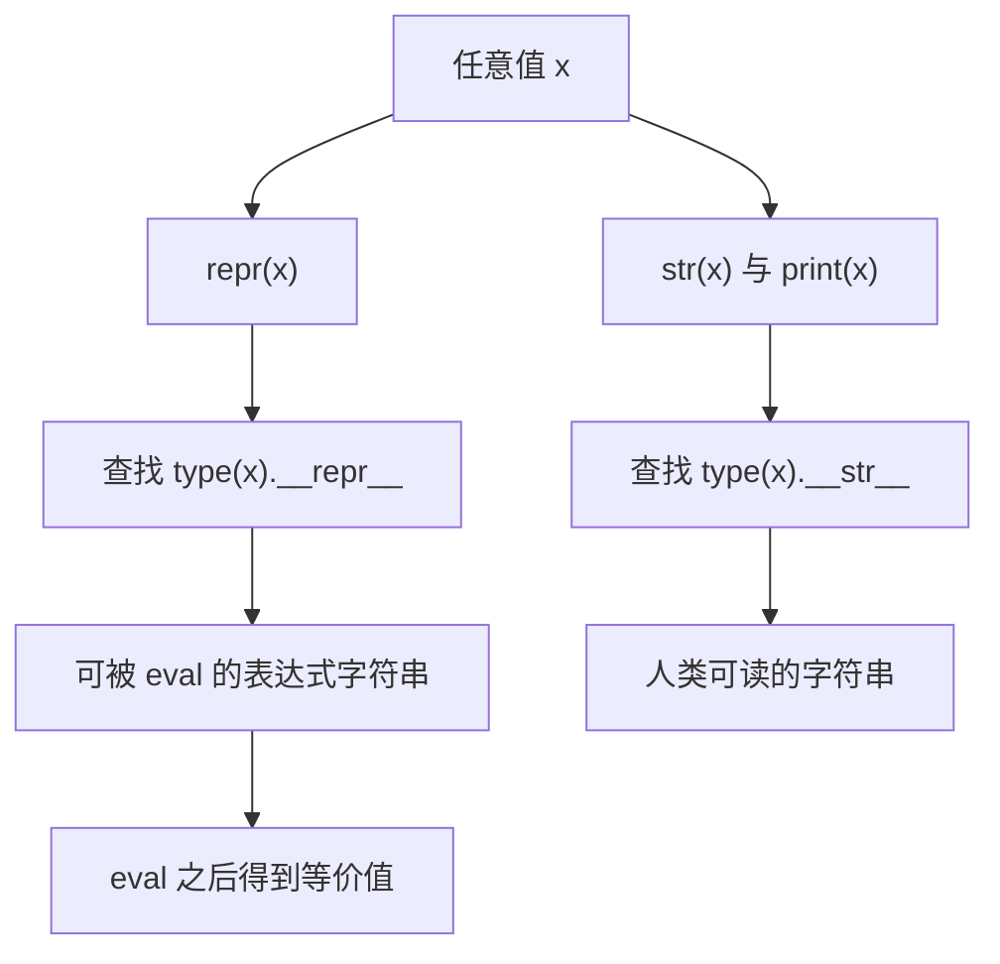

### 7.3 可求值性，以及它失败时的样子

`repr` 的承诺不是硬性保证。函数、类这类复合对象根本没有简单的 Python 写法，内置的 `min` 就是典型：

```text
>>> repr(min)
'<built-in function min>'
```

尖括号是这条约定发出的信号——**这根本不是 Python 表达式**，只是一句人类可读的描述。读代码时可以把尖括号当成"repr 承认失败"的记号。

字符串自己是最干净的实验对象，因为它本身已经是字符串，于是"显示它"被迫多处理一层引号：

```text
>>> s = 'Hello, world'
>>> s
'Hello, world'
>>> print(s)
Hello, world
>>> repr(s)
'"Hello, world"'
```

直接在会话里求值 `s`，屏幕上是 `'Hello, world'`——带引号，因为交互式会话显示的是 `repr`。`print(s)` 让引号消失。`str(s)` 的结果就是 `s` 本身；`repr(s)` 给出的则是"引号套引号"：外层那对引号属于显示，内层那对引号是内容的一部分，因为 `repr` 要给出的是一个**能被求值回原字符串**的表达式。

```text
>>> eval(repr(s)) == s
True
>>> eval(s)
SyntaxError: invalid syntax
```

`Hello, world` 不是合法的 Python 表达式，所以 `eval(s)` 报错，`eval(str(s))` 同样报错，因为 `str(s)` 就是 `s`；加上引号之后一切正常。这一组实验说明：`repr` 不是在给字符串"加个引号好看"，它是在**补上让这段文本重新变成值所必需的那层语法**。分数还给出了另一个对比：

```text
>>> eval(repr(half))
Fraction(1, 2)
>>> eval(str(half))
0.5
```

`eval(repr(half))` 得到的是**等价的新对象**；`eval(str(half))` 求值成功，但得到的是浮点数——`1/2` 之所以能被求值，只是因为它碰巧符合 Python 的除法语法。**`repr` 的字符串是给机器走回去的门，`str` 的字符串是给人看的路牌。**

### 7.4 两页无解说的插图


第 7 页是一组方块：边长按 21、13、8、5 依次递减，拼出一个黄金矩形，再用四段四分之一圆弧接出螺旋线。第 8 页把同一条螺旋线原样叠在一张熊的照片上，熊的轮廓被框进同一个方阵。

### 7.5 f-string：把表达式装进字符串字面量

**f-string** 让字符串字面量里可以嵌表达式，是 Python 目前推荐的字符串插值（string interpolation）写法。这件事用拼接也能做：

```text
>>> from math import pi
>>> 'pi starts with ' + str(pi) + '...'
'pi starts with 3.141592653589793...'
>>> f'pi starts with {pi}...'
'pi starts with 3.141592653589793...'
```

引号前面的 `f` 不能省。省掉之后它就是一个普通字符串，花括号原样保留：

```text
>>> '2 + 2 = {2 + 2}'
'2 + 2 = {2 + 2}'
>>> f'2 + 2 = {2 + 2}'
'2 + 2 = 4'
```

花括号里的表达式在**当前环境**里求值，因此它能看到此刻所有可用的名字：

```text
>>> f'abs(-4) = {abs(-4)}'
'abs(-4) = 4'
>>> abs = float
>>> f'abs(-4) = {abs(-4)}'
'abs(-4) = -4.0'
```

同一行字面量，因为环境变了，结果就变了。插值取的是 `str`，不是 `repr`：`f'{half}'` 得 `'1/2'`。更隐蔽的是求值顺序：花括号里的子表达式按出现顺序求值，而且可以带副作用。把三个花括号写成 `{s.pop()}`、`{s.pop()}`、`{s}`，弹出的顺序就是书写的顺序，最后那个 `{s}` 看到的是前两次已经改完的列表。f-string 不是"纯格式化"，它是一个会执行代码的表达式，副作用发生在它求值的那一刻。

### 7.6 多态：`repr` 只是请对象自己显示

**多态函数（polymorphic function）**是能作用于许多不同类型数据的函数。`str` 与 `repr` 是最好的例子：几乎可以把手边任何对象传给它们，而它们**总是应该做对**。答案是一个反转：`repr` 并不自己去想，它**请求自己的参数把自己显示出来**。

```text
>>> half.__repr__()
'Fraction(1, 2)'
>>> half.__str__()
'1/2'
```

真实实现比"调用参数上的 `__repr__`"略复杂一点：内置的 `repr` 会忽略实例属性，特殊方法按类型查找，实例属性天然不参与。于是正确的形状是：

```python
def repr(x):
    return type(x).__repr__(x)
```

三步：先用 `type(x)` 拿到参数所属的类，**这样就绕过了实例属性**；再取这个类的 `__repr__` 属性；最后，这个类属性是一个普通函数对象，**不是绑定方法**，因此必须显式把 `x` 传进去。

`str` 更麻烦一点：实例属性 `__str__` 同样被忽略；此外，**如果类上根本没有 `__str__`，`str` 就直接返回 `repr` 返回的东西**。

```python
class NoStr:
    def __repr__(self):
        return 'NoStr()'

>>> str(NoStr())
'NoStr()'
```

这条回退规则解释了为什么绝大多数手写类只需要实现 `__repr__` 就够了：交互式会话要它，`print` 也间接要它。

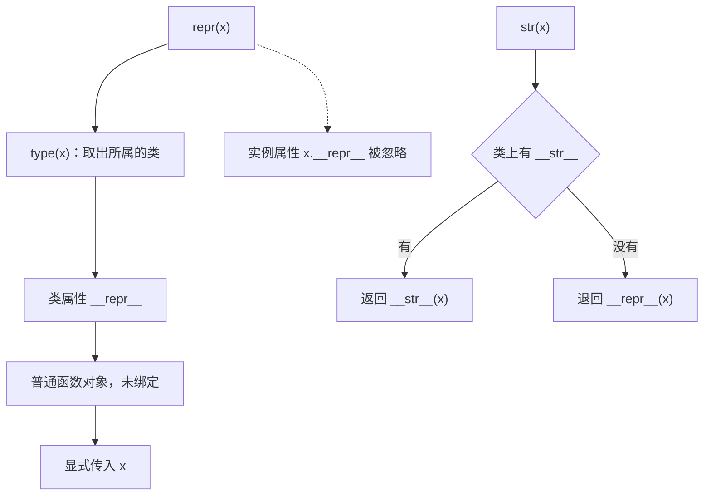

### 7.7 接口与 `Ratio`

到这里可以给这套机制一个正式的名字了：**接口（interface）**。回到第一次讲面向对象时的比喻：对象之间传递消息，这就是它们互动的方式。语言层面的机制其实很朴素——它们只是查找属性或方法，**传消息是比喻，查属性是动作**。

`repr` 与 `str` 就是一个现成的接口：实现 `__repr__` 的类承诺给出 Python 可解释的字符串，实现 `__str__` 的类承诺给出人类可读的字符串。接口不必是语言内建的：任何一组类，只要它们有同名方法、这些方法做相似的事，就已经造出了一个接口。

看懂接口的最好方式是亲手实现一次。已经有一个内建的 `Fraction`，就造一个名字不同的 `Ratio`：

```python
class Ratio:
    def __init__(self, numer, denom):
        self.numer = numer
        self.denom = denom

    def __repr__(self):
        return 'Ratio({0}, {1})'.format(self.numer, self.denom)

    def __str__(self):
        return '{0}/{1}'.format(self.numer, self.denom)
```

```text
>>> half = Ratio(1, 2)
>>> half
Ratio(1, 2)
>>> print(half)
1/2
>>> eval(repr(half))
Ratio(1, 2)
```

直接显示 `half`，得到的是能重建它的表达式；`print` 它，得到人写分数的样子；`eval(repr(half))` 能把对象重新造出来——这就是"可求值"的回报。

### 7.8 特殊方法名与运算符重载

以双下划线开头和结尾的名字，在 Python 里是一类特殊存在：它们与内置行为绑定，形状固定，看到前后两个下划线，就知道这个名字和内置对象系统有交互。这类名字叫特殊方法名。`__init__` 特殊，是因为对象被构造时会自动调用它；`__repr__` 特殊，是因为它被用来产生表示对象的字符串。新出现的是 `__add__`：一个双参数方法；还有两个单参数方法：`__bool__` 把对象转成真或假，`__float__` 试着把对象转成实数。

```text
>>> (1).__add__(2)
3
>>> (0).__bool__()
False
>>> (1).__bool__()
True
```

| 语法或内置调用 | 特殊方法名 | 参数 | 作用 |
| :--- | :--- | :--- | :--- |
| `C(...)` 构造实例 | `__init__` | `self, ...` | 初始化新实例的属性 |
| `repr(x)`、交互式回显 | `__repr__` | `self` | 返回可求值、可辨识的字符串 |
| `str(x)`、`print(x)` | `__str__` | `self` | 返回人类可读的字符串 |
| `x + y` | `__add__` | `self, other` | 左操作数是本类实例时的加法 |
| `y + x` | `__radd__` | `self, other` | 右操作数是本类实例时的加法 |
| `bool(x)`、`if x:` | `__bool__` | `self` | 真值判断 |
| `float(x)` | `__float__` | `self` | 转换成实数 |

给 `Ratio` 加上加法。分数相加的公式是：分子是第一个的分子乘第二个的分母，加上第一个的分母乘第二个的分子；分母是两个分母的乘积。算完还要约分，否则三分之一加六分之一会得到十八分之九。

```python
def gcd(n, d):
    while n != d:
        n, d = min(n, d), abs(n - d)
    return n

class Ratio:
    def __add__(self, other):
        n = self.numer * other.denom + self.denom * other.numer
        d = self.denom * other.denom
        g = gcd(n, d)
        return Ratio(n // g, d // g)
```

```text
>>> (Ratio(1, 3) + Ratio(1, 6))
Ratio(1, 2)
```

`gcd` 用相减的方式求最大公约数：不相等时把两个数换成"较小者"与"两者之差"，相等时那个共同值就是答案。三分之一加六分之一：分子是 1 × 6 + 3 × 1 = 9，分母是 3 × 6 = 18，`gcd(9, 18)` 得 9，于是返回 `Ratio(1, 2)`。`__radd__` 与 `__add__` 的差别只有参数顺序，对可交换的加法可以直接写 `__radd__ = __add__`。

### 7.9 类型分派与类型转换

`__add__` 有一个隐含假设：加号右边也是一个 `Ratio`。三分之一加 1 呢？应该得到三分之四，可代码会去读 `other.denom`，整数身上没有这个属性。一条办法是**检查 `other` 的类型，据此决定做什么**：

```python
    def __add__(self, other):
        if isinstance(other, int):
            n = self.numer * 1 + self.denom * other
            d = self.denom
        elif isinstance(other, Ratio):
            n = self.numer * other.denom + self.denom * other.numer
            d = self.denom * other.denom
        elif isinstance(other, float):
            return float(self) + other
        g = gcd(n, d)
        return Ratio(n // g, d // g)

    __radd__ = __add__

    def __float__(self):
        return self.numer / self.denom
```

`Ratio(1, 3) + 1` 于是能算出三分之四；补一行 `__radd__ = __add__`，反方向的 `1 + Ratio(1, 3)` 也通了——因为 `__add__` 里对 int 与 Ratio 两种情形都做了处理。第三种情况是浮点数：这时结果不该是分数，另一个方案是**把已有的分数也转成浮点数**，再让两个浮点数相加。`__float__` 里只做一件事：分子除以分母。

一个例子里用到了两个各有名字的策略。**类型分派（type dispatching）**：检查参数的类型来决定做什么。**类型转换（type coercion）**：把一个类型的对象转成另一个类型，以便和另一个值结合。

| 判据 | 类型分派 | 类型转换 |
| :--- | :--- | :--- |
| 做法 | 检查 `other` 的类型，选不同分支 | 把一方转成另一方的类型再运算 |
| 结果类型 | 通常与左操作数同类（仍是 `Ratio`） | 常常变成更"宽"的类型（这里是 `float`） |
| 本讲例子 | `Ratio(1, 3) + Ratio(1, 6)`、`Ratio(1, 3) + 1` | `Ratio(1, 3) + 0.2` |
| 适用前提 | 每种类型都有精确的运算定义 | 一方能无损地嵌入另一方 |
| 代价 | 分支数随类型数增长 | 可能损失精度 |

### 7.10 课堂练习：`Letter` 与 `Numbered`


课件最后三页是一组课堂练习，取自 2023 年春季学期期中考试第二题。题目恰好把本讲的两件事绑在一起：`__repr__` 决定对象被 `print` 时显示成什么，而继承让一个子类只改表示、不改行为。


```python
class Letter:
    def __init__(self, contents):
        self.contents = contents
        self.sent = False

    def send(self):
        if self.sent:
            print(self, 'was already sent.')
        else:
            print(self, 'has been sent.')
            self.sent = True
            return Letter(self.contents.upper())

    def __repr__(self):
        return self.contents
```

关键在 `print(self, 'has been sent.')` 这一行。`print` 用的是 `str`，而 `Letter` 没有定义 `__str__`，于是 `str` 按回退规则去找 `repr`，`__repr__` 返回 `contents`，打印出来就是信件正文。**一个类的表示方法，同时决定了它被打印时的样子**。

| 调用 | `sent` 状态 | 打印 | 返回值 |
| :--- | :--- | :--- | :--- |
| `hi.send()` | `False` 变 `True` | `Hello, World! has been sent.` | `Letter('HELLO, WORLD!')` |
| `hi.send()` | `True` | `Hello, World! was already sent.` | `None` |
| `Letter('Hey').send().send()` | 两次新对象 | `Hey has been sent.` 与 `HEY has been sent.` | 最后一封显示 `HEY` |


```python
class Numbered(Letter):
    number = 0

    def __init__(self, contents):
        super().__init__(contents)
        self.number = Numbered.number
        Numbered.number += 1

    def __repr__(self):
        return '#' + str(self.number)
```

两处细节值得停一下。第一，`number = 0` 写在类体里，是**类属性**，所有实例共享同一个计数器；`self.number = Numbered.number` 把当前计数抄进实例属性，然后 `Numbered.number += 1` 推进计数器。如果写成 `self.number += 1`，改的是实例属性，类属性永远不动，下一封信又会拿到同一个编号——这是"属性查找先实例后类"与"属性赋值只看左边"两条规则交叉处的陷阱。第二，子类只换了 `__repr__`，`send`、`__init__` 的行为完全继承，`super().__init__(contents)` 保证父类那部分属性照常建立。

形状与前面一致：`print` 走 `str`，`str` 回退到子类的 `__repr__`，于是屏幕上出现 `#0 has been sent.`；而交互式会话显示 `hey` 时同样走 `__repr__`，屏幕上只有 `#0`。

## 8. 跨讲对照：五组判据与一个陷阱

*(参考时间: 00:25:57 – 00:37:55｜Lecture 15；00:20:56 – 00:29:02｜Lecture 16；00:13:29 – 00:17:10｜Lecture 17；00:12:33 – 00:17:45｜Lecture 19)*

七讲的内容分散在不同场景里，但有几组问题是同一个问题换了外衣。这一章把它们并排放，用来检查自己是否真的把规则记成了一张网，而不是七个孤立的结论。

### 8.1 `is` 与 `==`

```python
a = [10]
b = a
c = [10]

a is b        # True   同一个对象
a == c        # True   相等的值
a is c        # False  两个对象
```

| 判据 | `is` | `==` |
| :--- | :--- | :--- |
| 问的是什么 | 是不是同一个对象 | 值是否相等 |
| 看的是 | 身份（identity） | 内容（equality） |
| 谁来决定 | 由对象的存在本身决定，不可改写 | 由类的 `__eq__` 决定，可自定义 |
| 一个为真能否推出另一个 | 能：`is` 为真则 `==` 必真 | 不能：`==` 为真时 `is` 可能为假 |
| 本模块的典型用途 | 判断别名、`None` 哨兵、`isinstance` 家族 | 比较列表、字符串、分数、自定义数值 |

第五行里"不可改写"与"可自定义"是关键差别：`is` 是语言的底层关系，`==` 是一个可以由类重新定义的方法。这也解释了为什么用 `==` 比较两个自定义对象时，答案取决于写类的人有没有实现比较逻辑。

> **编者说明**：`==` 的行为由类上的 `__eq__` 方法提供，本模块没有讲过这个特殊方法名，这里只作为对"`==` 可自定义"的补充；没有实现时，`==` 退回到身份比较。

### 8.2 迭代器与生成器

| 判据 | 手写迭代器 | 生成器 |
| :--- | :--- | :--- |
| 进度存在哪里 | 实例属性（如 `self.i`） | 生成器帧里的局部变量 |
| 谁负责维护 | 写的人，必须把算法摊平成状态机 | Python，帧里连代码位置一起保存 |
| 结束怎么表示 | 手写 `raise StopIteration` | 函数体走完自动抛 |
| 能否在任意语句处暂停 | 不能，只能在"取下一个"的边界 | 能，`yield` 可以在任何位置 |
| 嵌套循环与递归 | 每层都要手工压平 | 原样保留 |
| 一次性 | 是 | 是 |
| 本模块的例子 | `map` 对象与 `enumerate`（内置） | `plus_minus`、`evens`、`partitions` |

两者在"只能消费一次"上完全一致，因为生成器**就是**一种迭代器；差别只在"谁来记住执行到哪"。这条差别在嵌套结构上会被放大：类版本要把两层循环压成一层状态机，生成器版本可以把两层循环原样写出来。

### 8.3 实例属性与类属性

| 判据 | 实例属性 | 类属性 |
| :--- | :--- | :--- |
| 存在哪里 | 实例自己的属性字典 | 类的属性字典 |
| 谁看得见 | 只有这一个实例 | 所有实例，经查找的第三站 |
| 何时产生 | `__init__` 里 `self.x = ...` 之类的赋值 | 类体里的 `=` 与 `def` |
| 怎么改 | `instance.x = v` | `Cls.x = v` |
| 存储代价 | 每个实例一份 | 只存一份 |
| 适合表达 | 每个对象不同的状态 | 全类共享的常量与行为 |
| 本模块的陷阱 | —— | 可变类属性（`tags = []`）被所有实例共享 |

两栏的差别只有一句话：**实例属性是每个对象自己的账，类属性是全体共享的那一份**。所有关于"读写不对称"的困惑，都源于忘了读会走两站、写只落一站。

### 8.4 继承与组合

| 判据 | 继承 | 组合 |
| :--- | :--- | :--- |
| 关系 | is-a：子类是基类的一种 | has-a：一个对象持有另一个 |
| 复用的方式 | 共享查找链，只写差异 | 把被持有的对象当属性 |
| 改动的影响面 | 改基类会波及所有子类 | 只影响持有者的行为 |
| 表达力 | 表达"特化" | 表达"装配" |
| 本模块的例子 | `CheckingAccount(Account)` | `Bank.self.accounts` |
| 主要风险 | 脆弱的基类、菱形解析 | 委托层次过深、接口膨胀 |

### 8.5 `__repr__` 与 `__str__`

| 判据 | `__repr__` | `__str__` |
| :--- | :--- | :--- |
| 给谁看 | 解释器与开发者 | 最终用户 |
| 是否要求可求值 | 尽量（`eval` 回环） | 不要求 |
| 交互式回显用它吗 | 用 | 不用 |
| `print` 用它吗 | 间接（无 `__str__` 时回退） | 直接用 |
| 默认实现 | `object.__repr__`，尖括号形式 | 回退到 `__repr__` |
| 本模块的例子 | `'Ratio(1, 2)'` | `'1/2'` |

第五行解释了一条实用建议：**先写 `__repr__`，需要时再写 `__str__`**。只写前者，打印与回显会自动一致；只写后者，交互式会话里仍然看到尖括号。

### 8.6 别名陷阱的三种语境

第 1 章说"别名是同一个对象的两个名字"，但"被共享的对象"在不同语境里是不同的东西，失败方式也不同。

| 语境 | 被共享的东西 | 别名怎么产生 | 失败的样子 | 正确写法 |
| :--- | :--- | :--- | :--- | :--- |
| 可变容器 | 列表的内容 | `t = s[2]`、`b = a`、`e = s + t` 的浅复制 | 改一个，另一个跟着变；历史被未来的事件改写 | 需要独立副本时显式复制 |
| 迭代器 | 一个位置标记 | `d = c`，或把同一个迭代器传给两个函数 | 一方消费了，另一方的"下一个"变成再下一个 | 每个消费者各 `iter` 一次 |
| 生成器 | 一个暂停的帧 | `b = a` 共享同一个生成器对象 | 一处 `next` 推进，另一处从中间开始 | 需要从头就再调用一次生成器函数 |
| 对象 | 属性字典 | `c = a`、`a.backup = b` | 改 `c.balance` 等于改 `a.balance` | 用构造器造第二个实例 |
| 类属性 | 类上那一格（可能是可变对象） | 所有实例经查找共享 | `a.tags.append(...)` 影响 `b.tags` | 在 `__init__` 里建实例属性 |

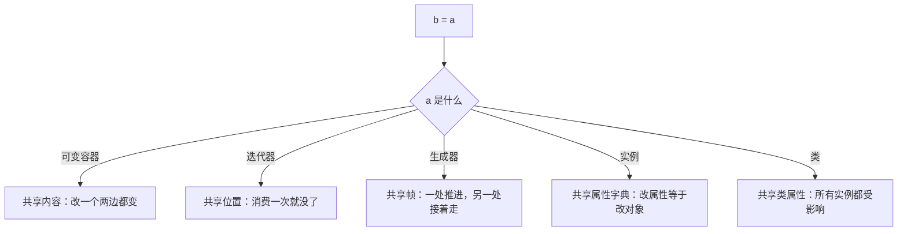

### 8.7 从环境图到类字典

把整模块的两张图并排放，能看清"补上了什么"。

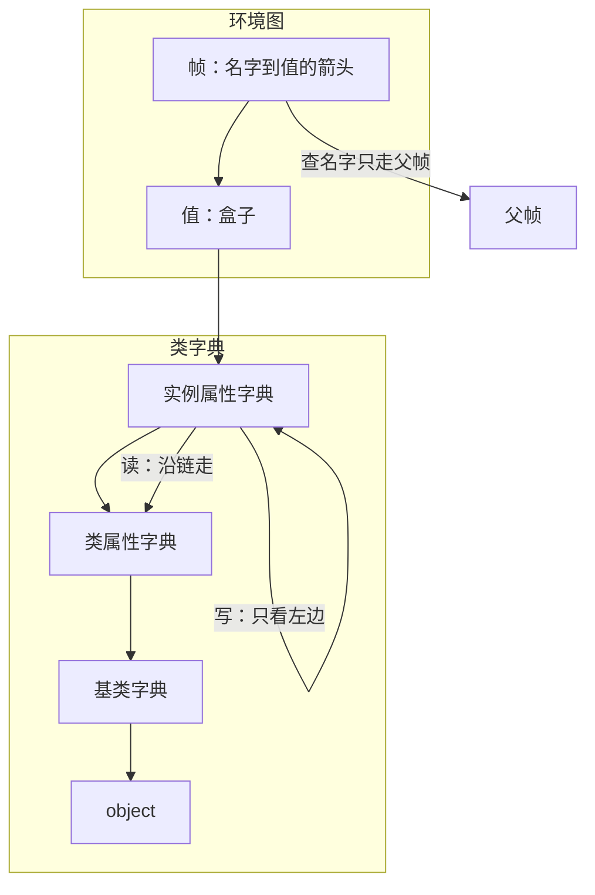

环境图回答"这个名字现在指向哪个值"，类字典回答"这个属性最终落在哪一本字典里"。前者是一条链（帧到父帧），后者是另一条链（实例到类到基类），两条链在一个值身上交汇：值既是一个盒子，也是一个带有自己字典的对象。**读到的是沿链命中的第一份，写到的是点号左边那一份**——这句话是整个模块最后要留下的东西。

## 工程定律与设计清单

*(参考时间: 00:29:39 – 00:31:41｜Lecture 15；00:20:56 – 00:22:38｜Lecture 16；00:15:30 – 00:17:10｜Lecture 17；00:10:00 – 00:12:46｜Lecture 20)*

下面九条是可以背下来、在考场与代码评审里直接用的判据。每条后面的一句话是理由，理由比结论更重要。

- **先问"这个值会不会变"，再问"它是什么类型"。** 列表、字典可变，数字、字符串、元组不可变；不可变容器里装着可变元素时，整体仍会跟着变。
- **赋值复制箭头，不复制对象。** 所以 `b = a` 之后改 `b` 等于改 `a`；要独立副本，必须显式复制，并想清楚复制到第几层。
- **`is` 问身份，`==` 问内容。** 前者为真则后者必真，反之不成立；判断"是不是同一个对象"永远不要用 `==` 代替 `is`。
- **默认参数与类属性都是"求值一次、共享多份"。** 两者都怕可变对象；需要每次新建时用 `None` 哨兵或 `__init__` 里赋实例属性。
- **迭代器只能消费一次。** 需要反复遍历就传可迭代值，或先落地成列表；把迭代器传给两个消费者，等于让它们抢同一个位置。
- **生成器用 `yield` 交出的值不可回退，但可以把无限序列变成有限的工作量。** 判断是否该用生成器，先问"是不是只需要一部分"，再问"是不是无限"。
- **读属性沿"实例 → 类 → 基类"走，写属性只看点号左边。** 两条规则方向相反；混用它们，就会出现"改了类却没生效"或"给一个实例意外加了属性"。
- **继承只写差异，其余交给查找。** 子类里出现与基类重复的语句块，说明这段该留在基类；子类越长，越可能说明基类该拆了。
- **is-a 用继承，has-a 用组合；歧义名字先看子类、多个基类从左到右。** 前者决定类该不该有基类，后者决定多个基类冲突时由谁说话。

## 模块知识总览（Mermaid mindmap）

*(参考时间: 00:12:44 – 00:37:55｜Lecture 15；00:00:08 – 00:29:02｜Lecture 16；00:00:24 – 00:17:10｜Lecture 17；00:00:11 – 00:31:33｜Lecture 18)*

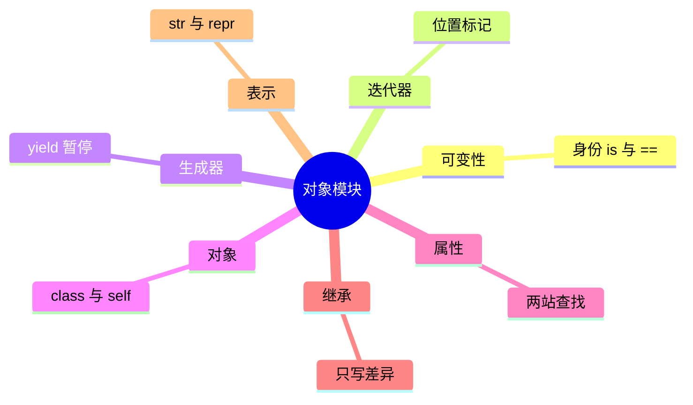

如果只有半小时，建议这样读：先看 §1.5 的 `is` 与 `==`，再看 §2.2 的协议与 §3.3 的执行模型，然后跳到 §4.6 的四步查找、§4.7 的读写不对称、§5.4 的"基类属性不复制"，最后读 §7.2 的两种表示。这六处合起来不到三十页，却覆盖了"对象为什么需要身份、状态如何被打包、查找如何工作"这三个必答问题。

## 出处与许可

*(参考时间: 00:00:01 – 00:00:04｜Lecture 15；00:00:00 – 00:00:02｜Lecture 16；00:00:00 – 00:00:03｜Lecture 21)*

本模块依据 UC Berkeley CS61A（Structure and Interpretation of Computer Programs，Fall 2024）Lectures 15–21 的课堂录像与 B 站英文原声字幕整理；七份官方课件 `14-Mutability_1pp.pdf`（11 页）、`15-Iterators_1pp.pdf`（12 页）、`16-Generators_1pp.pdf`（11 页）、`17-Objects.pdf`（7 页）、`18-Attributes.pdf`（15 页）、`19-Inheritance.pdf`（24 页）、`20-Representation_1pp.pdf`（11 页）共 91 页，正文 91 张插图均为其逐页渲染图。课程主页为 `cs61a.org`，教材为 John DeNero 编写的 *Composing Programs*，示例代码与 `ucb` 模块随课程项目分发。

课程与课件的版权归 UC Berkeley CS61A 教学团队所有；本文是面向中文读者的二次整理，用于学习与教学讨论，不替代原课程。凡讲师口述与课件画面之外的内容，均以 `编者说明` 标出，包括：`getattr` 与 `hasattr` 的等价性、动态派发与多态（polymorphism）的术语、C3 线性化与 `__mro__`、`__eq__` 与 `==` 的关系。这些补充如果与官方材料冲突，以官方材料为准。

排版上，各章开头的时间锚点取自字幕中对应段落的真实起止时间；`mermaid` 图与表格为本文自制，用于替代课堂上的手绘环境图与 Python Tutor 演示。文中代码按课件画面逐字誊写（含课件原有的缩进与注释），录像中现场敲出的代码按字幕口述复原，差异处已在正文标注。

## 附：本模块幻灯片索引

*(参考时间: 00:00:01 – 00:37:55｜Lecture 15；00:00:00 – 00:31:33｜Lecture 20)*

| 页 | 讲次 | 内容 | 出现位置 |
| :--- | :--- | :--- | :--- |
| 1 | lec15 | 标题页：Mutability | §1.1 |
| 2 | lec15 | 公告页 | §1.1 |
| 3 | lec15 | 分节页：就地改写列表 | §1.2 |
| 4 | lec15 | 用 append 构建列表：sums | §1.3 |
| 5 | lec15 | 分节页：用列表装分支 | §1.3 |
| 6 | lec15 | make_path 题目与目标树 | §1.3 |
| 7 | lec15 | make_path 的递归实现 | §1.3 |
| 8 | lec15 | 分节页：变异与身份 | §1.5 |
| 9 | lec15 | 同一个列表与两个列表 | §1.5 |
| 10 | lec15 | `is` 与 `==` 两套判据 | §1.5 |
| 11 | lec15 | 多层别名阅读题 | §1.6 |
| 1 | lec16 | 标题页：Iterators | §2.1 |
| 2 | lec16 | 公告页 | §2.1 |
| 3 | lec16 | 分节页：List Practice | §2.1 |
| 4 | lec16 | 期中真题：chain 环境图 | §2.1 |
| 5 | lec16 | 分节页：Tuples | §2.1 |
| 6 | lec16 | 元组与列表对照 | §2.1 |
| 7 | lec16 | 真实世界中的序列 | §2.1 |
| 8 | lec16 | 分节页：Iterators | §2.2 |
| 9 | lec16 | `iter` 与 `next` | §2.2 |
| 10 | lec16 | 讨论题：共享迭代器位置 | §2.3 |
| 11 | lec16 | `map` 返回迭代器 | §2.4 |
| 12 | lec16 | 讨论题：`all` 与短路 | §2.4 |
| 1 | lec17 | 标题页：Generators | §3.1 |
| 2 | lec17 | 公告页：项目与作业 | §3.1 |
| 3 | lec17 | 复习：可迭代与迭代器 | §3.1 |
| 4 | lec17 | `map` 对象的进度 | §3.1 |
| 5 | lec17 | `map` 练习：三元组相加 | §3.1 |
| 6 | lec17 | 分节页：Tree Practice | §3.1 |
| 7 | lec17 | 期中真题：exclude | §3.1 |
| 8 | lec17 | 分节页：Generators | §3.2 |
| 9 | lec17 | `plus_minus` 与四条定义 | §3.2 |
| 10 | lec17 | 期中真题：park | §3.5 |
| 11 | lec17 | 无限斐波那契生成器 | §3.6 |
| 1 | lec18 | 标题页：Objects | §4.1 |
| 2 | lec18 | 公告页 | §4.1 |
| 3 | lec18 | 分节页：回顾可变性 | §4.1 |
| 4 | lec18 | 分节页：Class Statements | §4.2 |
| 5 | lec18 | Account 实例的点号访问 | §4.2 |
| 6 | lec18 | Account 类定义与会话 | §4.2 |
| 7 | lec18 | 动画演示署名页 | §4.4 |
| 1 | lec19 | 标题页：Attributes | §4.5 |
| 2 | lec19 | 公告页 | §4.5 |
| 3 | lec19 | 分节页：Method Calls | §4.8 |
| 4 | lec19 | 点表达式嵌在调用里 | §4.8 |
| 5 | lec19 | 分节页：Attribute Lookup | §4.6 |
| 6 | lec19 | 属性查找四步 | §4.6 |
| 7 | lec19 | 讨论题：Where's Waldo | §4.6 |
| 8 | lec19 | 分节页：Class Attributes | §4.5 |
| 9 | lec19 | class 语句与 Clown | §4.5 |
| 10 | lec19 | 类属性 interest 共享 | §4.5 |
| 11 | lec19 | 分节页：Bound Methods | §4.8 |
| 12 | lec19 | 术语图：方法与函数 | §4.8 |
| 13 | lec19 | 函数与绑定方法 | §4.8 |
| 14 | lec19 | 分节页：属性赋值 | §4.7 |
| 15 | lec19 | Tom 与 Jim 的利率实验 | §4.7 |
| 1 | lec20 | 标题页：Inheritance | §5.1 |
| 2 | lec20 | 公告页 | §5.1 |
| 3 | lec20 | 分节页：Attributes 复习 | §5.1 |
| 4 | lec20 | 术语对照 | §5.1 |
| 5 | lec20 | 点表达式四步规则 | §5.1 |
| 6 | lec20 | Transaction 待补全 | §5.1 |
| 7 | lec20 | Transaction 快照盒子图 | §5.1 |
| 8 | lec20 | 另一种实现：lst 日志 | §5.1 |
| 9 | lec20 | 分节页：属性赋值 | §5.1 |
| 10 | lec20 | 属性赋值的两种落点 | §5.1 |
| 11 | lec20 | 两次赋值后的状态 | §5.1 |
| 12 | lec20 | 分节页：属性练习 | §5.1 |
| 13 | lec20 | 分节页：继承开场 | §5.2 |
| 14 | lec20 | 继承语法与只写差异 | §5.2 |
| 15 | lec20 | 支票账户示例 | §5.3 |
| 16 | lec20 | 类上查名字 | §5.4 |
| 17 | lec20 | 分节页：面向对象设计 | §6.1 |
| 18 | lec20 | 设计继承的三条规则 | §6.1 |
| 19 | lec20 | 继承与组合 | §6.2 |
| 20 | lec20 | WWPD：三个名字 | §6.4 |
| 21 | lec20 | 分节页：多重继承 | §6.5 |
| 22 | lec20 | 储蓄与电视购物账户 | §6.5 |
| 23 | lec20 | 多重继承的结果 | §6.5 |
| 24 | lec20 | 菱形图与解析顺序 | §6.6 |
| 1 | lec21 | 标题页：Representation | §7.1 |
| 2 | lec21 | 公告页 | §7.1 |
| 3 | lec21 | 分节页：表达式与类型 | §7.1 |
| 4 | lec21 | Lab 6 邮件系统属性链 | §7.1 |
| 5 | lec21 | 分节页：字符串表示 | §7.2 |
| 6 | lec21 | `str` 与 `repr` 的分工 | §7.2 |
| 7 | lec21 | 斐波那契方阵与螺旋 | §7.4 |
| 8 | lec21 | 螺旋叠在熊的照片上 | §7.4 |
| 9 | lec21 | 分节页：Class Practice | §7.10 |
| 10 | lec21 | Letter 类 | §7.10 |
| 11 | lec21 | Numbered 类 | §7.10 |

七份课件合计 91 页，每页在正文出现恰好一次；页号按各自讲次独立编号，因此表中出现七组从 1 开始的页码。
