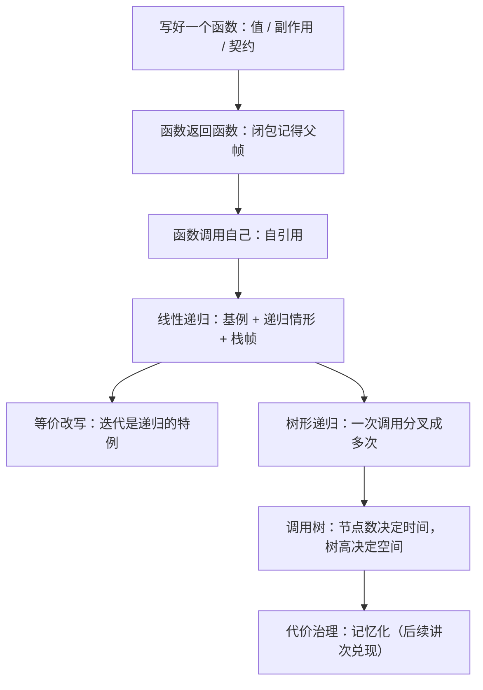
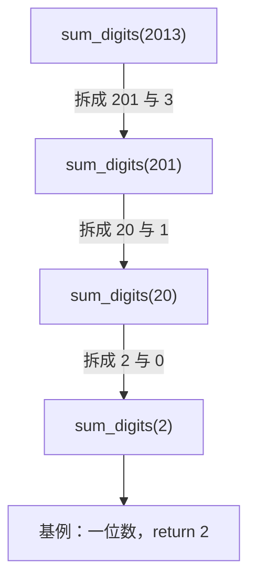
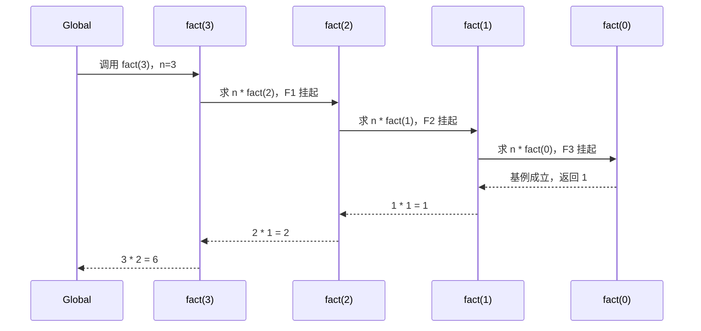
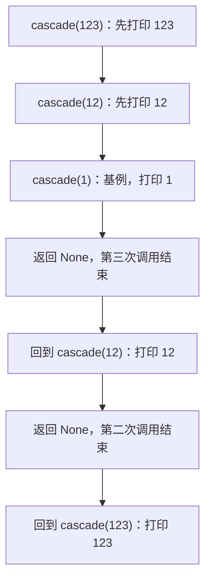
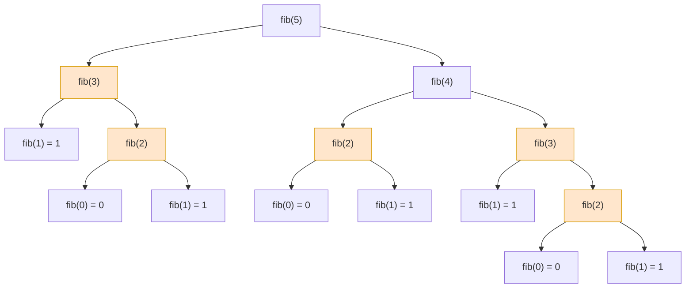
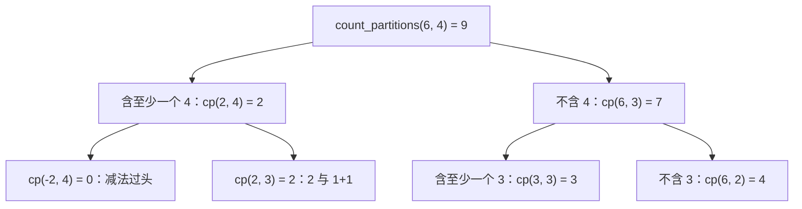
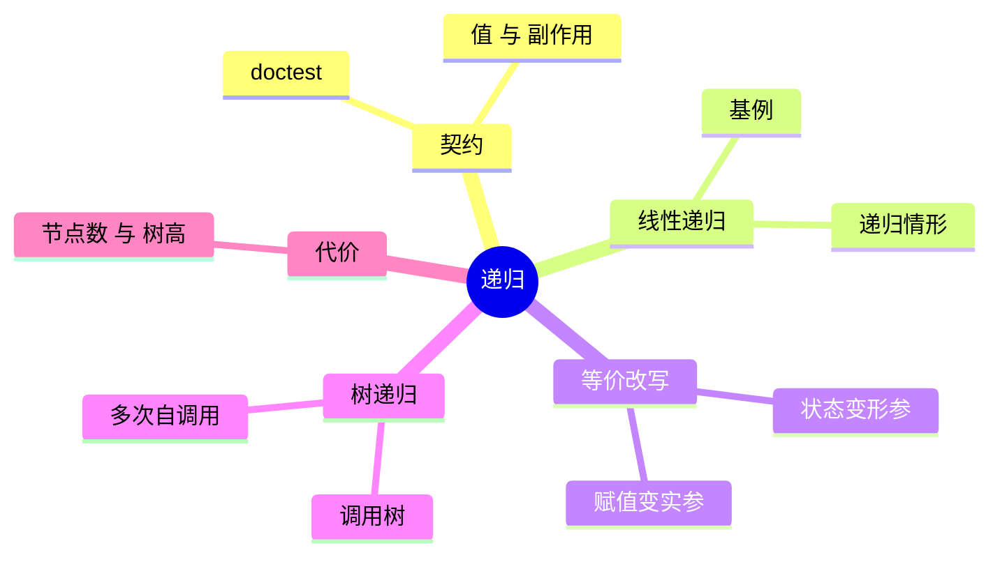

> **课程**：UC Berkeley CS61A · Structure and Interpretation of Computer Programs（Fall 2024）
> **模块**：Module M2 · 递归 ｜ Lecture 8–10 ｜ 总时长 1:44:19（Lecture 8 34:16 ｜ Lecture 9 37:49 ｜ Lecture 10 32:14）
> **视频**：B 站合集 [BV1sy411z7nA](https://www.bilibili.com/video/BV1sy411z7nA)，本模块对应分 P 8–10（[P8](https://www.bilibili.com/video/BV1sy411z7nA?p=8) ｜ [P9](https://www.bilibili.com/video/BV1sy411z7nA?p=9) ｜ [P10](https://www.bilibili.com/video/BV1sy411z7nA?p=10)）
> **课件**：`07-Function_Examples_1pp.pdf`（14 页）｜ `08-Recursion_1pp.pdf`（11 页）｜ `09-Tree_Recursion_1pp.pdf`（14 页），合计 39 页，逐页渲染图见正文插图
> **字幕**：B 站英文原声字幕；本笔记是中文书面化重构，非逐句翻译
> **版权**：课程与课件版权归 UC Berkeley CS61A 教学团队；本文为学习用途的二次整理

## 0. 模块导览

*(参考时间: 00:00:01 – 00:01:53｜Lecture 8；00:00:00 – 00:03:48｜Lecture 9；00:00:00 – 00:01:09｜Lecture 10)*

这三讲是一条链条，不是三个并列的知识点。Lecture 8 回答"怎样才算把一个函数写对了"——屏幕上的输出、名字的绑定、文档里的例子，都是"对"的可观察形态。Lecture 9 回答"函数怎样描述它自己"——一旦允许函数体里出现自己的名字，环境模型立刻要求回答两个新问题：凭什么相信它是对的，那些还没返回的调用存放在哪里。

主线因此只有两句：**递归的信任模型是"假定更简单的情形已经正确"，递归的成本模型是"时间是节点数，空间是树高"。** 前者解决"敢不敢写"，后者解决"值不值得写"。

| 讲次 | 主题 | 时长 | 分 P | 课件 | 本文位置 |
|---|---|---|---|---|---|
| Lecture 8 | Function Examples 函数设计实战 | 34:16 | P8 | 14 页 | §1 |
| Lecture 9 | Recursion 递归 | 37:49 | P9 | 11 页 | §2、§3 |
| Lecture 10 | Tree Recursion 树形递归 | 32:14 | P10 | 14 页 | §4、§5 |



三处衔接各有一个"上一讲的工具不够用了"的时刻：自引用必须靠第一讲讲透的帧链才能解释；把递归改写成迭代时，配方里的"状态"正是第一讲反复练习的"名字绑在哪一帧"；讨论代价时，用的又是第一讲的装饰器——没有 `trace` 这层包装，调用树只是一张图，看不见。

## 1. 函数设计流程与契约：先定义"对"，再写代码

*(参考时间: 00:00:01 – 00:34:11｜Lecture 8)*

上一个模块把函数确立为抽象：只要知道它接收什么、返回什么，就不必关心它内部怎么算。但那只是"使用函数"的视角；轮到自己写函数，抽象就变成一份需要自己履行的承诺。

### 1.1 屏幕上的行不是表达式的值


开场是一段事务性通知：下周一是期中考试，八点入场、八点十分开考。安排得这么早，是为了在选课退课截止日之前把批好的卷子发回；课程还有 exam recovery 政策，期末考得好可以拿回第一次期中最多 90% 的分数。


三项硬技能被点名：会画环境图、能预测 Python 的行为、能实现函数。三者恰好对应本章的三条线索——帧与绑定（§1.2、§1.3）、输出与值（本节）、把描述写成代码（§1.5、§1.6）。


三条规则把它拆干净：`print` 永远返回 `None`，显示实参是副作用而不是返回值；多个实参用空格分隔；解释器只在值**不是** `None` 时回显，想看 `None` 只能显式打印。

| 表达式 | 屏幕上出现 | 表达式的值 |
|---|---|---|
| `5` | `5` | `5` |
| `print(5)` | `5` | `None` |
| `print(print(5))` | `5` 与 `None` 两行 | `None` |

`print(print(5))` 是嵌套调用：求值操作数 `print(5)` 时打印 5 并得到 `None`；外层 `print` 再把这个 `None` 显示出来。整条表达式的值仍是 `None`，所以不再额外回显。

> **编者说明**：交互式解释器"不回显 `None`"由 CPython 的 `sys.displayhook` 决定，不是 `print` 的特性；同一表达式写进脚本运行只会出现 `print` 产生的那些行。

### 1.2 闭包：函数记得自己出生在哪一帧

第二道题只有五行，却是整个 CS61A 最重要的模式之一：

```python
def delay(arg):
    print('delayed')
    def g():
        return arg
    return g
```

它能工作，靠的是已经学过的规则：**函数被创建时，它的父帧就是当时的第一帧**。`g` 的父帧是 `delay` 的帧，`g` 里的 `arg` 沿父帧链找到 `delay` 的形参；等 `g` 被调用时 `delay` 早已返回，但那个帧还在，因为 `g` 一直指着它。

`delay(delay)()(6)()` 是一条调用表达式，操作符本身又是调用表达式，所以必须先算出操作符：`delay(delay)` 在 `f1` 里把 `arg` 绑到函数 `delay` 自身并打印 `delayed`；紧接着的 `()` 调用 `g`，得到函数 `delay`；`delay(6)` 再打印一次 `delayed`；最后的 `()` 返回 `f3` 里的 6。屏幕上是两行 `delayed` 加回显的 6——最后那个 6 是**回显**而不是 `print` 打印的。

第三道题把结构原样搬过来，只改内层函数的体：

```python
def pirate(arg):
    print('matey')
    def plunder(arg):
        return arg
    return plunder
```

讲师特意强调：它与 `delay` 的差别**不是名字不同，而是内层 `def` 语句说的东西不同**。`plunder` 的形参**也叫 `arg`**，而名字查找永远从当前帧开始，于是在 `plunder` 的帧里查 `arg` 会立刻命中形参，永远走不到 `pirate` 帧里的那个 `arg`。

| 判据 | `delay` | `pirate` |
|---|---|---|
| 内层函数返回什么 | 外层帧里的 `arg` | 自己的形参 `arg` |
| 外层 `arg` 是否可达 | 可达，且是唯一通道 | 不可达，被同名形参遮蔽 |
| 实际语义 | 延迟求值的最小模型 | 恒等函数 |

于是 `add(pirate(3)(square)(4), 1)` 打印 `matey` 后得 17；而 `pirate(pirate(pirate))(5)(7)` 打印两个 `matey` 后，恒等函数返回 5，最后 `5(7)` 触发 `TypeError: 'int' object is not callable`。报错发生在最后一步而不是更早——求值过程中不做类型检查，只有当 5 被放到操作符位置上、Python 试图调用它时，问题才暴露。

### 1.3 同名不同帧：`horse mask` 的极限案例

第四道题被讲师称为"自己出过的最喜欢的题之一"：

```python
def horse(mask):
    horse = mask
    def mask(horse):
        return horse
    return horse(mask)

horse(lambda horse: horse(2))
```

模块层执行完之后，全局帧里有两样东西：名字 `horse` 绑定到函数 `horse`；实参里那个 `lambda horse: horse(2)` 在模块层被创建，父帧同样是全局帧。

1. 调用 `horse(λ)`：新建 `f1`（父帧全局），形参 `mask` 绑定到 λ。
2. `horse = mask`：赋值永远修改**当前帧**，于是 `f1` 里的 `horse` 绑到 λ。
3. `def mask(horse)`：先创建新函数 `mask`（父帧 `f1`），再在 `f1` 里把 `mask` 重绑到它，原来指向 λ 的绑定被覆盖。
4. `return horse(mask)`：`f1` 里 `horse` 是 λ、`mask` 是内层函数，于是新建 `f2`（父帧全局）调用 λ；λ 的体 `horse(2)` 再新建 `f3`（父帧 `f1`），`return horse` 返回 2，沿 `f3 → f2 → f1 → 全局` 逐层传回。

| 帧 | 由什么创建 | 关键绑定 | 它证明了什么 |
|---|---|---|---|
| `f1: horse` | `horse(λ)` | `mask → λ`，随后 `horse → λ`，再随后 `mask → 内层 mask` | 赋值与 `def` 都只改当前帧 |
| `f2: λ` | `return horse(mask)` 里的 `horse` | `horse → 内层 mask` | λ 的父帧是全局帧，与它被谁调用无关 |
| `f3: mask` | λ 体内 `horse(2)` | `horse → 2` | 内层 `mask` 的父帧是 `f1`，但它只用到形参 |

结果是 2，而且不报错。这道题把"同名不同帧"推到极限：同一个源码里 `horse` 先后指三个不同的东西（全局函数、λ、整数 2），`mask` 也先后指两个。复盘只需三个动作：`def` 是两步（造函数，父帧 = 当前帧；再在当前帧绑名字）；赋值只改当前帧；函数值上标的父帧是它被**创建**时的帧。


> **编者说明**：本页来自课件，录像字幕里没有对应的讲解段落。`more_chocolate, more_cake = chocolate(), cake` 让 `more_cake` 拿到**函数对象** `cake`，于是 `snake(10, 20)` 里 `cake == more_cake` 为真、返回 `chocolate`；执行 `cake = 'cake'` 之后重新求值，`'cake' == 函数` 为假，走 `else` 返回 30。

### 1.4 策略即函数：Twenty-One 的状态枚举

把函数当成实参，在游戏里有一个自然用法。Twenty-One 的规则只有四条：两名玩家轮流行动，每轮可以把当前总数加 1、加 2 或加 3；总数从 0 开始；总数达到或超过 21 时游戏结束；最后加数的人输。


状态图是本讲的精华：绿色表示"轮到谁走谁赢"，红色表示必输。20 是红色——轮到你时总数已经 20，无论加 1、2 还是 3 都会达到或超过 21，而最后加数的人输；16 也是红色，因为从 16 只能走到 17、18、19，而这三个数都能一步走到 20。

> **编者说明**：把这张图继续往左推，可得 4 的倍数（12、16、20）都是必败位，其余是必胜位。这条通例是从图中两个红色状态归纳出来的；由于总数从 0 开始而 0 是 4 的倍数，双方都不犯错时先手必败。

```python
def play(strategy0, strategy1, goal=21):
    n, who = 0, 0
    while n < goal:
        if who == 0:
            n = n + strategy0(n)
            who = 1
        elif who == 1:
            n = n + strategy1(n)
            who = 0
    return who
```

`play` 的两个参数不是数字而是**策略**——"给定当前总数，返回这一轮加几"的函数。`who` 始终表示"下一个该动的人"；循环退出时，刚加完数的人已经把总数推过线，于是 `who` 就是赢家。

这个例子把契约从返回值扩展到**行为**（策略的契约是"你给我当前总数，我给你一个合法的选择"），也把"跨轮次的状态"摆上台面：`n` 与 `who` 是循环里唯二活过每一轮的东西。

### 1.5 五步流程：`remove_digit` 与位权

真题的另一半是"实现一个函数"：给一段描述、几个例子、一个可能带空格的模板，要求在纸上写出能跑的代码。讲师给了一套流程，价值在于让思考时间变成**有效的**思考时间：


- **读描述**，先弄清"要实现什么"，而不是"怎么写循环"。
- **核对例子**，并挑一个最简单的作为主例。技术描述很容易有歧义，例子是唯一能校准理解的东西。
- **读模板**。模板有帮助就用；如果让人更糊涂，就先按自己的想法写，写对之后再改造成模板的形状。
- **在写代码之前，把主例里每个名字标上具体的值**，包括打算新引入的中间变量。
- **写代码、跑主例、确认返回的东西对**，最后用更长、更容易漏分支的例子回验。

题目是 `remove_digit(n, digit)`：`n` 是非负整数，`digit` 是一位数字；返回由 `n` 中所有不等于 `digit` 的数字组成的新整数，顺序不变。`remove_digit(231, 3)` 得 21，`remove_digit(243132, 2)` 得 4313。模板大致是：

```python
def remove_digit(n, digit):
    kept, digits = 0, 0
    while n > 0:
        last = n % 10
        n = n // 10
        if last != digit:
            ...
    return kept
```

模板本身透露了意图：`kept` 负责攒结果，`digits` 负责记"已经攒了几位"——后者暗示结果要按位权拼装。把 `n = 231`、`digit = 3` 标上去之后，三轮循环分别是：保留 1、跳过 3、保留 2，`kept` 应当是 21。接下来是最有教学价值的部分：四次失败与一次成功。

| 写法 | 前两轮的结果 | 失败原因 |
|---|---|---|
| `kept = kept + last` | 1，然后 3 | 把数字当成和来加，位权丢失 |
| `kept = kept * 10 + last` | 1，然后 12 | 后取到的低位被放到高位，顺序反了 |
| `kept = kept + last * 10` | 10，然后 30 | 位权写死为 10，只有第二位是对的 |
| `kept = kept + last * 10 ** digits` | 1，然后 21 | 正确：位权随已保留位数增长 |

前三次都错在同一个地方：位权。第二次尤其隐蔽，`1 * 10 + 2` 得 12——数字是从右往左取出的，先取到的 1 是低位，却被推到了高位。第四次让位权跟着"已保留位数"走，`1 * 10 ** 0 = 1`、`2 * 10 ** 1 = 20`，相加得 21。

### 1.6 可执行的契约：docstring 与 doctest


> **编者说明**：录像这一段用的例子是 `remove_digit`，课件第 8 页印的却是 Fall 2022 期中一第 3(b) 题的一个变体 `nearest_prime`；两题考的是同一套流程，页面右侧的清单把讲师口述的流程拆得更细。

题目：实现 `nearest_prime(n)`，`n` 是大于 5 的整数，返回离 `n` 最近的素数；如果两个素数一样近，返回较大的那个。假设 `is_prime(n)` 已实现。

```python
def nearest_prime(n):
    """Return the nearest prime number to n.
    In a tie, return the larger one.

    >>> nearest_prime(8)
    7
    >>> nearest_prime(21)
    23
    """
    ___
    while True:
        if ___:
            ___
        if ___:
            k = -k
```

页面清单比口述多一句关键指令：**用英文描述一个计算过程**（只用简单步骤），再读模板、把例子的值标注到名字上、想清楚还需要哪些额外的名字。

> **编者说明**：`doctest` 模块会找出这些片段并真正执行，把"文档里的例子"变成"会自动失败的测试"，运行方式如 `python -m doctest -v 文件名.py`；它比较的是**文本**，所以返回字符串 `'7'` 与返回整数 `7` 都过不了对方的例子——这恰好是"返回类型必须正确"的机器化检查。

doctest 的价值在于它强迫作者先回答"什么叫对"。按骨架可以补全出一份实现：`k` 从 0 开始，于是 `n` 本身是素数时第一轮就返回；先查 `n + k` 再查 `n - k`，于是距离相等时返回较大的那个；`k` 在循环末尾递增，否则两个分支都没命中就会永远停在同一轮。

### 1.7 装饰器：把"包一层"写在定义处

最后一段内容不在考试范围内，却是本章所有工具的汇合。先准备两个普通函数：`square` 与 `sum_squares_up_to`（用 `while` 累加 1 到 `n` 的平方，`sum_squares_up_to(5)` 是 55）。课上的 `trace` 是课程代码提供的装饰器；自己写一个只支持单参数函数的版本：

```python
def trace1(fun):
    def traced(x):
        print('calling', fun, 'on argument', x)
        return fun(x)
    return traced
```

`trace1` 接收函数 `fun`，内部定义 `traced`（只接一个参数，所以叫 `trace1`）；`traced` 先打印，再把 `x` 交给 `fun`，并原样返回结果。`traced` 的父帧是 `trace1` 的帧，所以它记得 `fun` 是哪个函数——这正是它能包住任意函数的原因。

给它加上 `@trace1`，此后 `square(12)` 会先打印 `calling <function square ...> on argument 12`，再回显 144。这个 `@trace1` 与 `square = trace1(square)` **完全等价**：先执行 `def square`，再把同一个名字重绑到 `trace1(原函数)` 的返回值上。从这一刻起，全局帧里已经没有任何名字指向原函数——它只活在 `traced` 的父帧里，被 `fun` 牵着。

这和 `delay`、`pirate` 是同一件事，只是方向反了过来：前面是"把值藏进闭包等着取"，这里是"把函数藏进闭包包起来"。既然 `square = trace1(square)` 也能工作，为什么还要 `@`？讲师给了三条理由：少打字；装饰信息写在定义处，一眼能看到这个函数被谁处理过；还有一条更现实的——并不是所有 Python 程序员都理解高阶函数，但装饰器的"魔法"人人都能看懂。

> **编者说明**：装饰器可以叠加，多个 `@` 从最靠近 `def` 的那个开始、由下往上依次应用；被包装后的函数通常还会用 `functools.wraps` 保留原名与文档字符串。

### 1.8 柯里化：多参数就是一层层返回


课件在函数实现之后插了一页柯里化回顾，代码只有两行：

```python
def make_adder(n):
    return lambda k: n + k
```

`make_adder(2)(3)` 与 `add(2, 3)` 都得到 5，但求值路径不同：前者返回一个"还差一个参数"的函数，第二个括号才真正做加法。页面把这种对应写成一句话：**柯里化（Currying）是把多参数函数变换成单参数高阶函数的过程**。

这一节放在章末，因为它正好是下一章的入口：柯里化让返回值变成一个函数；如果这个返回值可以是**任何**函数，那它也可以是自己。

## 2. 线性递归：基例、递归情形与栈帧

*(参考时间: 00:04:03 – 00:33:43｜Lecture 9)*

§1 里所有函数都只调用"别的"函数——哪怕那个"别的"是自己定义的内层函数，或者被包装了一层的 `traced`。第二章要跨过的线只有一步：**函数体里出现自己的名字，并且真的被调用。** 跨过去之后，环境模型必须回答两个新问题：凭什么相信它算得对（§2.5），以及那些还没返回的调用存放在哪里（§2.4）。

### 2.1 自引用：提到自己不等于调用自己


开场仍是事务性通知：Hog 项目周三截止，24 小时以内的延期自动批准；课程有 exam recovery 政策；对决定留下的人只有一句建议：别掉队。


技术内容从一条推论开始：**函数体里可以引用函数自己的名字。** 执行 `def` 时真正发生的只有一件事：函数体被"收起来"，body 里一句都不求值；等到函数真被调用、body 开始执行时，全局帧里早就有这个名字，而且已经绑定到一个函数对象。

```python
def print_all(k):
    print(k)
    return print_all

print_all(1)(3)(5)
```


第二个例子要难一点：打印**到目前为止的累加和**。它不能返回 `print_all`，而是返回在 body 里定义的内部函数：

```python
def print_sums(n):
    print(n)
    def next_sum(k):
        return print_sums(n+k)
    return next_sum
```

`n` 是到目前为止的和，`k` 是下一个数；求和发生在 `n+k` 里——`print_sums` 只负责打印，`next_sum` 负责把两段接起来。执行 `print_sums(1)(3)(5)` 打印 1、4、9；课件另给的 `print_sums(3)(4)(5)(6)` 打印 3、7、12、18。

| 判据 | `print_all` | `print_sums` |
|---|---|---|
| 返回什么 | 函数自己，同一个函数对象 | 在 body 里新定义的 `next_sum` |
| 状态存在哪 | 无处保存，所有调用共用全局帧 | 每次调用生成一个新帧，`n` 就是累计和 |
| 新函数的父环境 | 不适用 | 调用 `print_sums` 的那一帧 |

> **编者说明**：讲师在字幕里用的词是 memorize（记住），意思是把中间结果记在实参里、随调用往下传；这和计算机科学里常说的 memoization（缓存历史求值结果以免重复计算）不是一回事。

### 2.2 两个互相返回函数的函数


字幕在讲完 `print_sums` 后直接转向"递归函数"，没有讲解这一页。它是一个"最后一行打印什么"的思考题：

```python
def add_next(n):
    print(n)
    return lambda f: subtract_next(n + f)

def subtract_next(n):
    print(n)
    return lambda f: add_next(n - f)

add_next(2500)(500)(1000)(24)
```

课件给的答案是 **2024**。两个函数都不调用自己，而是各自返回一个 lambda，lambda 里再调用**对方**；真正决定链往哪里走的是调用表达式后面挂的那串实参。

> **编者说明**：逐步代入可见：2500、3000、2000、2024 四行依次打印。这个练习说明：**"函数返回函数、函数调用对方"完全可以不经过递归写出有状态的调用链**，递归只是把这条链的构造过程收进了函数体内部。

### 2.3 递归函数的两个部件


递归函数（recursive function）的定义只有一句：**body 里调用自己的函数**，可以直接调用，也可以间接调用。这句话初看像循环定义，但"每次调用一个新帧"让它在环境模型里落了地。

第一个完整例子是求正整数的**数字之和**：2013 的答案是 2 + 0 + 1 + 3 = 6。之所以专门为它写函数，有两个理由：整数 A 能被 9 整除当且仅当它的数字之和也能被 9 整除；信用卡号很长、人手工输入总会出错，所以每个卡号都有一位**校验位（checksum digit）**。

推导分三步。第一步造积木：把正整数拆成"除最后一位之外的部分"与"最后一位"：

```python
def split(n):
    """Split positive n into all but its last digit and its last digit."""
    return n // 10, n % 10
```

`2013` 经 `split` 得到 `(201, 3)`。第二步把问题接起来：如果已经会求 201 的数字之和，那么 2013 的就是它的结果再加 3——注意这里**不能**写 `sum_digits(n)`，那等于把同一个问题原样再问一遍。第三步找最小情形：一位数不需要拆，`n < 10` 时数字之和就是它自己。

```python
def sum_digits(n):
    """Return the sum of the digits of positive integer n."""
    if n < 10:
        return n
    else:
        all_but_last, last = split(n)
        return sum_digits(all_but_last) + last
```



树往上长，答案往下传：`sum_digits(2)` 返回 2；`sum_digits(20)` 得 2；`sum_digits(201)` 得 3；`sum_digits(2013)` 得 6。每一层的 `last` 都留在那一层的帧里，等子调用返回后才加进去。

| 判据 | 基例（base case） | 递归情形（recursive case） |
|---|---|---|
| 何时进入 | 条件命中"最简单的那类问题" | 条件没命中 |
| 如何求值 | 直接算出并返回，不含递归调用 | 含至少一个对自己的调用 |
| 实参规模 | 最小（一位数） | 严格小于当前问题（201 之于 2013） |
| 在整体中的角色 | 提供已知答案，终止递归 | 把大问题换成小问题 |

递归能终止，靠两个条件同时成立：**每次调用的实参都严格变小**，且问题存在**不能再小的下界**（一位数就是尽头）。反过来说，只要破坏第一条，递归立刻变成死循环：把递归情形写成 `sum_digits(n)`，`n < 10` 永远不成立。

> **编者说明**：Python 不会真的"永远"跑下去——解释器对调用深度有上限（CPython 默认约 1000 层），越过就抛 `RecursionError: maximum recursion depth exceeded`；这个上限同时解释了 §2.4 要讲的"递归的空间代价"。

### 2.4 环境图：`fact` 的帧展开与收回

换一个例子：阶乘，$n! = n \times (n-1) \times \cdots \times 1$。

```python
def fact(n):
    if n == 0:
        return 1
    else:
        return n * fact(n - 1)

fact(3)
```

`fact(3)` 应该是 $3 \times 2 \times 1 = 6$。讲师在 Python Tutor 里一步一步走完了这个过程，因为递归的全部机制都藏在这几步里。

1. `fact(3)` 在全局帧里被调用，创建 F1，`n` 绑定 3。
2. 先算乘号左边得 3；再算右边 `fact(n - 1)`，其中 `n - 1` 是 2。这一步要调用 `fact` 本身，而 F1 的 `return` 还没执行完，于是 F1 **挂起**。
3. 依次创建 F2（`n=2`）、F3（`n=1`），各自挂起等子调用的结果。
4. 创建 F4，`n` 绑定 0；`0 == 0` 成立，命中基例，直接返回 1。这是整条链上第一个真正的返回值。
5. 回升：F3 得 `1 * 1 = 1`，F2 得 `2 * 1 = 2`，F1 得 `3 * 2 = 6`。

| 帧 | 绑定的 `n` | 还没算完的表达式 |
|---|---|---|
| F1（`fact`，父环境全局） | 3 | `3 * fact(2)` |
| F2（`fact`，父环境全局） | 2 | `2 * fact(1)` |
| F3（`fact`，父环境全局） | 1 | `1 * fact(0)` |
| F4（`fact`，父环境全局） | 0 | 无：基例，直接返回 1 |



讲师在停在最深处的截图上补了一句关键观察：这时正在从最后一次调用返回，但**前面几个调用都还没返回**。

> **编者说明**：课件与字幕没有使用"调用栈（call stack）"这个词，也没有给出 $O(n)$ 的复杂度记号；上面两句是按环境图的语义补的术语与量级。

### 2.5 信任模型：信仰之跃

基例一眼就能验证：`fact(0)` 直接返回 1，符合 $0! = 1$。可是凭什么相信 `n` 取其它值时它也对？讲师在这里放了一张照片：他的朋友 Kevin 坐在一座很高的悬崖边上——写下一个递归函数时，感觉就是这样。信任是可以按步骤建立的，只有三步。

1. **验证基例**。这一步让后面轻松：至少有一批输入的正确性已经确定。
2. **把 `fact` 当成函数抽象（functional abstraction）**。看到 `fact(n - 1)` 时，不要推演它内部怎么跑；只想它**应该做什么**——对任何 `n`，它返回 $(n-1)!$。
3. **在这个假设下验证当前这一层**。`fact(n)` 返回 `n * fact(n-1)`；若第 2 步成立，返回值就是 $n \cdot (n-1)!$，而这正是 $n!$ 的定义。

拿具体数字走一遍：$4!$ 是不是等于 $4 \times 3!$？是，$24 = 4 \times 6$。一般化的说法是：**先假设函数对递归调用里那个更简单的情形是正确的，再验证"若简单情形正确，则当前问题也正确"**。

> **编者说明**："如果 $P(n-1)$ 成立则 $P(n)$ 成立，且 $P(0)$ 成立，则对所有 $n$ 成立"就是数学归纳法的结构；数学课上的归纳证明、写代码时的抽象屏障、这里的信仰之跃，用的是同一套"分层假设"。

这条策略的实际用法是**写代码之前先用它检查代码**：基例是否覆盖了所有最小输入？递归调用是否真的作用在更小的问题上？假设子调用返回正确答案，本层的组合运算是否给出正确答案？三问都过，函数基本就是对的。§4.5 会给出这三个问题的另一种命名。

### 2.6 互递归：Luhn 算法

**互递归（mutual recursion）**指两个不同的函数互相调用。它正好用来实现本讲开头提到的信用卡校验。课件引用 Wikipedia 对 Luhn 算法的描述：从最右边那位（校验位）开始向左；每隔一位把数字翻倍；如果翻倍结果大于 9，就把这个乘积的各位数字相加；最后把所有数字求和。先用 `1 3 8 7 4 3` 走一遍：

| 从右数第几位 | 原数字 | 本位的操作 | 计入总和的数 |
|---|---|---|---|
| 1（最右，校验位） | 3 | 不翻倍 | 3 |
| 2 | 4 | 翻倍，4 × 2 = 8 | 8 |
| 3 | 7 | 不翻倍 | 7 |
| 4 | 8 | 翻倍，8 × 2 = 16 > 9，再算 1 + 6 | 7 |
| 5 | 3 | 不翻倍 | 3 |
| 6 | 1 | 翻倍，1 × 2 = 2 | 2 |

```python
def luhn_sum(n):
    if n < 10:
        return n
    else:
        all_but_last, last = split(n)
        return luhn_sum_double(all_but_last) + last

def luhn_sum_double(n):
    all_but_last, last = split(n)
    luhn_digit = sum_digits(2 * last)
    if n < 10:
        return luhn_digit
    else:
        return luhn_sum(all_but_last) + luhn_digit
```

`luhn_sum` 处理"不翻倍"的位：把最后一位原样加上去，剩下的交给 `luhn_sum_double`。`luhn_sum_double` 处理"要翻倍"的位：先算 `luhn_digit = sum_digits(2 * last)`——它直接复用了 §2.3 的积木，16 交给 `sum_digits` 得 7——再把这一位加进去，剩下的交回 `luhn_sum`。两个函数互相调用，形成交替接力；基例可以出现在两个函数里，也可以只出现在其中一个里。

> **编者说明**：字幕里的 "LUN algorithm"、"Lund sum" 是语音识别把 Luhn 听错了，正确拼写是 Luhn（IBM 的 Hans Peter Luhn 提出的校验和算法）；课件提到的那个"有效 MasterCard 号码"只落在号段内，本身不生效。

互递归的样子在不同例子里差别很大。这里两个函数平级接力；§4.6 的 `unique_prime_factors` 把其中一个递归藏进了内层函数。共同点只有一句：**没有一个函数能独自走到基例，它们必须把问题交给对方，再由对方交回来。**

## 3. 递归的等价改写：迭代是递归的特例

*(参考时间: 00:23:25 – 00:37:46｜Lecture 9)*

§2 的所有例子都能用循环重写，而且大多写起来更"省事"——但省的是谁的力气？这一章把两个方向的翻译摊开：递归改迭代没有通用配方，迭代改递归却可以机械照做，原因是**迭代是递归的特例**。

### 3.1 一个不对称的翻译问题


有时需要把递归改写成迭代（比如绕开深度限制），这件事偏难，但并非无章可循；反方向几乎可以照搬。两个方向的线索是同一组：**那些跨越每一轮循环保持下来的状态**。

```python
def sum_digits_iter(n):
    digit_sum = 0
    while n > 0:
        n, last = split(n)
        digit_sum = digit_sum + last
    return digit_sum
```

反过来把这个迭代版翻译成递归版：两个跨轮次变化的状态 `n` 与 `digit_sum` 直接变成两个形参；`while n > 0` 取反得到基例 `n == 0`；循环体照抄，只是把两处赋值换成递归调用的实参。

```python
def sum_digits_rec(n, digit_sum):
    if n == 0:
        return digit_sum
    else:
        n, last = split(n)
        return sum_digits_rec(n, digit_sum + last)
```

| 迭代版的部件 | 递归版的对应物 |
|---|---|
| `while n > 0:` | `if n == 0: return digit_sum`（条件取反） |
| 循环前的初始化 `digit_sum = 0` | 初始调用 `sum_digits_rec(n, 0)` |
| 循环体里的 `n, last = split(n)` | 递归调用的第一个实参 `n` |
| `digit_sum = digit_sum + last` | 递归调用的第二个实参 `digit_sum + last` |

把这张表反过来读，就是配方本身：**赋值变成递归调用的实参**。这条规律对几乎任何迭代实现都成立，而反方向没有这样的机械规则——递归把"进度"藏在帧的层数里，而层数是隐式的。

### 3.2 顺序：方框与金字塔

接下来三页把同一套转换用在"有副作用的函数"上。这些函数不返回值，产品全在屏幕上，于是**语句的顺序**成了唯一要小心的事。


`boxes_iter(k)` 用一个计数器数着打；递归版 `boxes_r(k)` 把"打一个方框"和"再打 `k-1` 个方框"接起来，基例是"打 0 个方框时什么也不做"。`print` 的 `end=""` 让方框留在同一行，函数本身没有返回值，副作用就是全部的产品。


```python
def pyramid(k):
    """ prints a pyramid of k height.
    >>> pyramid(4)
    []
    [][]
    [][][]
    [][][][]
    """
    if k == 0:      # base case
        return
    else:
        pyramid(k-1)   # print a pyramid of k-1 height
        print("")      # skip a line,
        boxes_r(k)     # print out k boxes.
    return
```

迭代版从高度 1 数到 `k`，每层换行再打 `i` 个方框。递归版换了个方向想：高度 `k` 的金字塔 = 高度 `k-1` 的金字塔 + 空行 + 一行 `k` 个方框。于是代码变成三步：先递归画小的，再换行，最后打底下一整排。


倒金字塔（最宽的一排在最上面）在迭代版里要求改循环方向：`while k > 0`，每层先打 `k` 个方框再换行，然后 `k -= 1`。递归版则只要交换最后两条语句的顺序。

> **编者说明**：这三页在本次录像的字幕里没有对应讲解（字幕在 00:25:47 之后依次讲信仰之跃、Luhn 算法与迭代/递归互译，全程没有出现 boxes 或 pyramid）；上面的代码与注释按课件画面逐字整理。

### 3.3 把 `play` 改写成递归


课件最后一页是一道讨论题：把 `play` 改写成不含 `while` 的递归函数，并回答两个问题——需要定义一个新的内部函数吗？为什么？基例是什么，基例返回什么？跨轮次保持的状态有两个：累计点数 `n` 和当前该谁出手 `who`。

```python
def play(strategy0, strategy1, goal=21):
    def f(n, who):
        if n >= goal:
            return who
        if who == 0:
            n = n + strategy0(n)
            who = 1
        elif who == 1:
            n = n + strategy1(n)
            who = 0
        return f(n, who)
    return f(0, 0)
```

外层 `play` 只做一件事：用初始状态 `0` 和 `0` 启动内层函数。循环变成了对 `f` 的递归调用，两处赋值变成了 `f(n, who)` 的实参——正是"赋值变实参"。它还回答了"为什么需要内部函数"：`n` 与 `who` 不是调用者该关心的事，闭包把这对状态藏在了内层函数看得见、外层看不见的位置。

### 3.4 迭代的另一副面孔：牛顿法

前三节的迭代都数得清圈数：`while n > 0`、`while k <= n`、`while n < goal` 都有明确的计数变量。迭代还有另一种形态——**不知道要转几圈，只知道什么时候算够好**。课件在 Lecture 8 末尾标着 OPTIONAL 的那段内容正好是这种形态：用牛顿法（Newton's Method）求方程的根。


函数 `f` 的**零点（zero）**是满足 $f(x) = 0$ 的输入 `x`。以 $f(x) = x^2 - 2$ 为例，它的正零点在 $x \approx 1.414213562373095$，也就是 $\sqrt{2}$；一般地，$f(x) = x^2 - a$ 的正零点就是 $\sqrt{a}$。于是"求平方根"被翻译成"解方程 $x^2 = a$"，再翻译成"找零点"。


方法本身出奇地简单。给定函数 `f` 和一个初始猜测 `x`，重复三步：算出 `f(x)`；算出该点切线的斜率 `slope(f, x)`；把 `x` 更新为切线与 x 轴的交点 $x - f(x)/\text{slope}(f, x)$。几何上这是在用一条切线代替曲线，交点通常比原来的猜测更接近真正的零点。


$$
x_{k+1} = x_k - \frac{f(x_k)}{f'(x_k)}
$$


以 $f(x) = x^2 - 2$、初值 $x = 1$ 为例，四轮就把误差压到小数点后十多位（表中的 `f'(x)` 按解析导数 $2x$ 计算，便于手算核对；课程里用的是 `slope(f, x)` 这个数值近似）：

| 轮次 | `x` | `f(x)` | 下一轮的 `x` |
|---|---|---|---|
| 0 | 1.0 | -1.0 | 1.5 |
| 1 | 1.5 | 0.25 | 1.4166666666666667 |
| 2 | 1.4166666666666667 | 0.006944444444444642 | 1.4142156862745099 |
| 3 | 1.4142156862745099 | 6.007304882871267e-06 | 1.4142135623746899 |


最后一页把抽象落到使用现场：`f = lambda x: x*x - 2` 之后调用 `find_zero(f)`，回显 `1.4142135623730951`。函数在这里是纯粹的实参：`find_zero` 不关心传进来的是平方、三次方还是别的什么，它只负责把猜测推向零点。

> **编者说明**：第 11–14 页属于 Lecture 8 的课件，页面上标着 OPTIONAL，两讲录像都没有对应的口播段落；因为"反复改进直到足够好"与本节讨论的两类迭代正好形成对照，所以放在这里按画面复原。

```python
def slope(f, x, dx=1e-8):
    return (f(x + dx) - f(x)) / dx

def find_zero(f, guess=1.0, tolerance=1e-12, limit=100):
    x, n = guess, 0
    while abs(f(x)) > tolerance and n < limit:
        x = x - f(x) / slope(f, x)
        n = n + 1
    return x
```

`slope` 用差商近似导数：取一个极小的 `dx`，用两点连线的斜率冒充切线斜率，这正是"不需要解析求导"的关键。它也说明 `while` 的三种退出方式在这里同时存在：条件不满足（够好了）、循环体内的 `return`（提前收工）、计数器兜底（不收敛）。

## 4. 树形递归：一次调用长成一棵树

*(参考时间: 00:00:00 – 00:15:45｜Lecture 10)*

§2 与 §3 的递归每次只有一个"下一步"：`sum_digits` 交给 201，`fact` 交给 `n-1`，`luhn_sum` 交给对方。那种递归长成一条链，每一节都在等下一节返回。第四章的分叉发生在递归情形内部：**一次调用的 body 里对自己的调用多于一次**，链条就变成树。

### 4.1 为什么树递归值得专门练


开课时只有一件事要交代：**递归作业将在本周五发布**。它分量不轻，而递归是本周才正式登场的技术，通常需要相当多的练习才能掌握，所以第一句建议是尽早开始。

紧接着是一段对"递归到底有什么用"的正面回应：早期例子看起来往往小题大做——打印一串数字、累加一个整数，写个 `while` 三行就能解决，为什么要绕一圈调用自己？讲师承认这种观感，然后给出本讲要兑现的承诺：**今天出现的例子，用递归比不用递归容易得多。** 判断标准也随之浮出水面：递归真正擅长的，是把一次复杂的计算拆成两块或更多块——拆成一块得到线性递归，拆成两块以上得到树形递归。

### 4.2 顺序：`cascade` 的下降与上升


进入树递归之前，课件先退回一步复习一件常被忽略的事：**理解递归调用的顺序**。返回值只是结果；要解释一个递归函数的行为——它先打印什么、后打印什么、什么时候才开始"往上走"——必须依靠调用顺序。

```python
def cascade(n):
    if n < 10:
        print(n)
    else:
        print(n)
        cascade(n // 10)
        print(n)
```

`cascade(5)` 落在基例，屏幕上只出现一个 `5`。换成 12345，输出就变成一座对称的阶梯：

```text
12345
1234
123
12
1
12
123
1234
12345
```

这九行的归属值得逐行清点。中间那个孤零零的 `1` 来自基例里的 `print(n)`；其余八行都来自 `else` 分支里的两个 `print(n)`——下降时每层打印一次，上升时每层再打印一次。之所以能形成漂亮的嵌套结构，原因只有一句：**所有向下的层叠都发生在最后一次打印之前。**

执行 `cascade(123)`：原始调用检查基例，不成立，于是打印 123。递归调用 `cascade(12)` 会**先完成**，然后才轮到原始调用继续——它自己又打印 12、再调 `cascade(1)`、而 1 落在基例上被打印出来。



> **编者说明**：Python 里函数体执行完却没有遇到 `return`，返回值就是 `None`；这正是此处要强调的点——递归函数不一定"返回"有意义的值，它可能只负责产生副作用。

### 4.3 两种 `cascade` 写法与它们的取舍

`cascade` 并不是只能那样写。基例打印 `n`，递归情形也打印 `n`，那就把这次打印提到最前面，两种情形自然合并——基例反而没什么可做了，于是 `if` 只需要处理递归情形。

```python
def cascade(n):
    print(n)
    if n >= 10:
        cascade(n // 10)
        print(n)
```

> **编者说明**：字幕里讲师把条件说成"当 `n` 大于 10 时"，但要让这种写法与原版在边界上等价，条件应当是 `n >= 10`；原版对 `n = 10` 会打印 10、1、10 三行，若写成 `n > 10` 就只会打印一个 10。

运行结果与原版一致，定义更短。那么两版哪个更好？一版把基例与递归情形分开写，明确告诉读者每种情况该做什么；另一版找出两者的共同点，尽量不重复自己。

| 判据 | 分情况版（基例 / 递归分开） | 合并版（先打印，再判断） |
|---|---|---|
| 代码行数 | 6 行 | 5 行 |
| 重复的语句 | `print(n)` 出现三次 | `print(n)` 出现两次 |
| 基例的处理 | 单独一支，显式写出 | 隐含在"不再递归"里 |
| 阅读理解方式 | 先看基例，再看递归 | 必须先看出两分支的共同点 |
| 潜在的边界风险 | 无 | 条件写成 `n > 10` 时少打一行 |

讲师的判断是条件式的：**如果两种实现同样清晰，通常选短的那个**，因为别人读起来更快。但在这个例子里，长的那一版反而更清晰——它按"先基例、后递归"的次序把两件事摊开，而这正是读递归函数的惯常顺序。

### 4.4 `inverse_cascade`：借高阶函数递归

复习的最后一段是一个练习：写一个"逆 `cascade`"。传入 1234 时期望输出 1、12、123、1234，然后逐层缩小：123、12、1。讲师没有要求从零开始写，而是给了一个搭好的骨架，把难点收窄到一处：

```python
def inverse_cascade(n):
    grow(n)
    print(n)
    shrink(n)
```

`grow` 负责打印增长阶段，中间那行打印最长的那条，`shrink` 负责收缩阶段。两者都与下面这个高阶函数有关：它接收两个函数 `f`、`g` 和一个数 `n`，只要 `n` 不是 0（在数字里，0 是唯一的假值），就按顺序先调用 `f`、再调用 `g`。

```python
def f_then_g(f, g, n):
    if n:
        f(n)
        g(n)

def grow(n):
    return f_then_g(grow, print, n // 10)

def shrink(n):
    return f_then_g(print, shrink, n // 10)
```

`grow` 为什么是"先长后打印"？因为打印要从小到大，就必须先把更小的那些做完，所以对更小规模的那次 `grow` 必须排在 `print` 之前——于是 `f` 是 `grow`、`g` 是 `print`。

`grow(1234)` 拿到的 `n // 10` 是 123，它先递归 `grow(123)`（往下还有 `grow(12)`、`grow(1)`、`grow(0)`），再 `print(123)`；打印顺序因此是 1、12、123。`grow(0)` 什么都不做，因为 `f_then_g` 在 `n` 为 0 时直接跳过——`if n:` 这一行就是整个递归的刹车。

最后一个值得留意的点：`grow` 与 `shrink` **在自己体内都没有出现自己的名字**，递归是通过 `f_then_g` 发生的。递归的定义因而可以放宽一点——只要在函数体的求值过程中又调用了该函数，它仍然是递归。

### 4.5 怎么知道它是对的：追踪、归纳与抽象


§2.5 的信仰之跃是一套"动手写之前"的信任流程；课件把"怎么验证一个递归实现是对的"归纳成三种手段。**追踪（Tracing）**把整个计算过程画出来，只对很小的例子可行——`fib(5)` 的 15 次调用还能画，`fib(20)` 的两万多次就不能。

| 判据 | 追踪 Tracing | 归纳 Induction | 抽象 Abstraction |
|---|---|---|---|
| 产出什么 | 一份具体的执行记录 | 一条正确性证明 | 一段可运行的实现 |
| 适用范围 | 极小的输入 | 任意输入 | 任意输入 |
| 依赖什么 | 环境图与调用树的耐心 | 基例与"规模确实变小" | 递归调用的可信度 |
| 主要代价 | 组合爆炸，很快失效 | 需要写出不变量 | 可能掩盖错误的分解方式 |
| 在课程里的位置 | 调试与理解 | 论证 | 设计与写作 |


抽象读法的一个好例子是 Spring 2024 期中一的 A+ 题：判断一个正整数的所有数位是否相同。

```python
def streak(n):
    """Return True if all the digits in positive integer n are the same.

    >>> streak(22222)
    True
    >>> streak(2222322)  # 2 and 3 are different digits.
    False
    """
    return (n >= 0 and n <= 9) or (n > 9 and n % 10 == n // 10 % 10 and streak(n // 10))
```

两处空格分别是 `n % 10 == n // 10 % 10` 与 `streak(n // 10)`。读法是：个位数与十位数如果相等，并且把个位扔掉之后剩下的数仍然是 `streak`，那么整个数就是 `streak`；基例是"0 到 9 的单个数字"，它一定成立。递归调用被放在 `and` 的右侧，所以一旦相邻两位不等，整条 `and` 就短路成 `False`，**不会再做多余的递归**。

### 4.6 互递归：两个函数互相把对方当成"更简单的情形"


§2.6 的 Luhn 是"平级交替"；这一个例子把递归藏进内层函数，形状更接近真实代码。任务：求 `n` 有多少个**不同的**质因数。51 = 3 × 17，有两个；27 = 3 × 3 × 3，只有一个；120 = 2 × 2 × 2 × 3 × 5，有三个。


```python
def unique_prime_factors(n):
    """Return the number of unique prime factors of n."""
    k = smallest_factor(n)
    def no_k(n):
        "Return the number of unique prime factors of n other than k."
        if n == 1:
            return 0
        elif n % k != 0:
            return unique_prime_factors(n)
        else:
            return no_k(n // k)
    return 1 + no_k(n)
```

`smallest_factor` 在课件上只印出函数头与文档字符串，完整实现藏在页面底部 Python Tutor 链接所编码的源码里：偶数直接返回 2，否则从 3 开始逐个试除直到 `n`。

互递归的味道在 `no_k` 里。它是嵌套在 `unique_prime_factors` 帧里的内层函数，因此看得见外层绑定的 `k`。逻辑分三种情况：已经除到 1，返回 0；`n` 已经不被 `k` 整除，问题退化为"从 `n` 重新数一遍不同的质因数"，于是调用 `unique_prime_factors(n)`；还能被 `k` 整除，再除掉一个 `k`，继续用同一个 `k` 检查，也就是 `no_k(n // k)`。外层的 `return 1 + no_k(n)` 把 `k` 本身数作 1。


这一页是同一段代码"作答前"的状态：三个下划线位置分别对应 `return unique_prime_factors(n)`、`return no_k(n // k)` 与 `return 1 + no_k(n)`。填空的价值在于分清**哪一次递归在问哪个问题**——`unique_prime_factors(n)` 是"换个质因数重新数"，`no_k(n // k)` 是"同一个质因数继续除"，两者形状相似、语义相反。


课件右侧把 120 的分解画成一棵树：120 拆成 2 与 60，60 拆成 2 与 30，30 拆成 2 与 15，15 拆成 3 与 5。红色方框标出 15 这一层——它被"能不能被 2 整除"判了一次否，于是整段控制权交回 `unique_prime_factors` 重新开始；框内的小框又标出 5，那是新一任的 `k`。

### 4.7 树递归的定义与 `fib` 的调用树


定义很短：**树形递归（tree recursion）指执行递归函数的函数体时，对该函数自己发起了多于一次的调用。** 这样长出来的计算过程是树形的：有一个根，根下若干条分支，每条分支又各有更细的分支。

```python
def fib(n):
    if n == 0:
        return 0
    elif n == 1:
        return 1
    else:
        return fib(n - 2) + fib(n - 1)
```

两个基例被直接定义，其余全部走"前两个数之和"。它之所以是树递归，只看递归情形就够：要算出 `fib(n)`，body 里对 `fib` 发起了两次调用。



橙色标出的是被重复展开的节点：`fib(3)` 出现了两次，`fib(2)` 出现了三次，`fib(1)` 出现了五次。整棵树一共 15 个节点，也就是 `fib(5)` 需要 15 次 `fib` 调用——这个数字在第五章会被反复用到。

| 判据 | 线性递归（`cascade`、阶乘） | 树形递归（`fib`、`count_partitions`） |
|---|---|---|
| 递归情形里的自我调用次数 | 至多 1 次 | 2 次或更多 |
| 计算过程的形状 | 一条链，外加下降与上升两段 | 一棵树，分支随深度展开 |
| 调用总数与输入的关系 | 线性，约 `n` 次 | 指数级，`fib` 约为 $1.618^{n}$ |
| 同时活跃的帧数（空间） | 约等于深度 `n` | 不超过树高 `n` |
| 主要难点 | 起止条件与语句顺序 | 如何把问题拆成互不相交的几部分 |

## 5. 代价模型：节点数、重复与剪枝

*(参考时间: 00:15:48 – 00:32:11｜Lecture 10)*

§2.4 已经算过一次空间：`fact(3)` 到了最深处，内存里同时有四个帧，所以 `fact(n)` 的空间是 $n+1$ 个帧。树递归把这件事变得隐蔽——它的空间**也**只有树高那么多，但时间会随节点数迅速失控。

### 5.1 时间是节点数

先看数值。基例的结果都符合预期：`fib(2)` 得 1，`fib(3)` 得 2，`fib(5)` 得 5。

> **编者说明**：把每个 `fib(k)` 帧算作一次调用，调用次数满足 $T(0) = T(1) = 1$、$T(n) = T(n-1) + T(n-2) + 1$，解得 $T(n) = 2F(n+1) - 1$，其中 $F$ 为斐波那契数；下表按此式计算。

| `n` | `fib(n)` 的值 | 需要的 `fib` 调用次数 | 直观感受 |
|---|---|---|---|
| 5 | 5 | 15 | 一眼能数完 |
| 10 | 55 | 177 | `trace` 还能贴满一屏 |
| 15 | 610 | 1973 | 输出行已经伸出页面 |
| 20 | 6765 | 21891 | 值仍很小，调用已两万次 |
| 25 | 75025 | 242785 | 开始明显卡顿 |
| 30 | 832040 | 2692537 | 需要等一会儿 |
| 35 | 9227465 | 29860703 | 约三千万次调用 |

看最后一列就能明白问题出在哪：`n` 每加 5，调用次数大约乘 17 倍，数量级上毫无争议——**指数增长**。而 `fib(35)` 的值只有七位数。

### 5.2 空间是树高

把 §2.4 的四个帧与 §4.7 的十五个节点并排看，会发现一件反直觉的事：树递归的空间**并没有**跟着节点数涨。`fib(5)` 的十五次调用不是同时发生的——左子树算完、返回、帧被释放，右子树才开始。

> **编者说明**：从调用树可以直接读出两个量——时间是整棵树的**节点数**（每个节点一次调用），空间是树的**高度**（同时活跃的帧最多等于深度）。

于是可以给两类递归各写一句成本总结。线性递归：时间与空间都是 $O(n)$，两者同步增长，所以"深"是它唯一的风险。树递归：时间可以是指数级，空间仍然是 $O(n)$——**它用时间换来了空间，却没有主动要求换**。

### 5.3 让树显形：`@trace`

上一节算的是期末账；要看清这笔账怎么记出来的，得让调用树显形。讲师提供了 `trace`，从随项目提供的 `ucb` 模块导入，用法是在目标函数定义前加一行 `@trace`：调用时打印一行，返回时打印一行并带上返回值。

到 `fib(5)`，一棵真正的树在眼前展开：先 `fib(3)`（返回 2），再 `fib(4)`（返回 3，而它本身是相当大的一摊工作量）。`fib(10)` 则大得多——它由 `fib(9)` 与 `fib(8)` 组成，而 `fib(8)` 里还有 `fib(6)`、`fib(4)`、`fib(2)`。`fib(15)` 时，输出的行已经伸到页面之外。

> **编者说明**：`ucb.trace` 的真实输出是带缩进的嵌套形式，每深入一层多缩进一级，用来表示"谁在等谁"；具体字符格式以随项目提供的 `ucb.py` 为准，这里只描述形状。

### 5.4 重复的子树与记忆化

问题不在"计算机慢"，而在这棵树**重复**了。`fib` 会被同一个实参调用很多次，每一次都把同样的值重新算一遍；在 `fib(5)` 里，`fib(3)` 那段计算被完整地做了两遍，`fib(2)` 做了三遍。

> **编者说明**：记忆化与 §2.1 的 memorize 是两件不同的事。讲师的 memorize 是"把中间结果当作实参往下传"，人手写、显式可见；记忆化是"函数自己留一张表，遇到算过的实参直接查表"。

```python
def memo(f):
    cache = {}
    def wrapped(n):
        if n not in cache:
            cache[n] = f(n)
        return cache[n]
    return wrapped

fib = memo(fib)
```

`fib` 加上它之后，每个 `n` 只会真正计算一次，调用次数从指数级降到线性，代价是多出一张规模为 $n$ 的表。讲师特意加了一句限定：**不要因为这一节就认为树递归一定慢**，它当然不必慢，只是这一个实现确实慢。

### 5.5 `count_partitions`：用"用不用 m"把集合劈成两半


这个例子在本模块里分量最重，理由是：它是一个**离开树递归就很难写**的树递归过程。正整数 `n` 用**不超过 `m` 的部分**的划分数（partition），是把 `n` 写成若干个正整数之和的方法数，每个部分都不超过 `m`。

> **编者说明**：课件里的定义只写了"sum of positive integer parts up to m"，"递增顺序"是讲师口头补充的；这条约定不能省——没有它，`2 + 4` 与 `4 + 2` 会被当成两种不同的划分，计数立刻翻倍。

`count_partitions(6, 4)` 的全部九种，可以按"含不含一个 4"分成两组：

| 分组 | 具体划分 | 个数 |
|---|---|---|
| 含至少一个 4 | 2 + 4、1 + 1 + 4 | 2，即 `count_partitions(2, 4)` |
| 不含 4（只用不大于 3 的部分） | 3 + 3、1 + 2 + 3、1 + 1 + 1 + 3、2 + 2 + 2、1 + 1 + 2 + 2、1 + 1 + 1 + 1 + 2、1 + 1 + 1 + 1 + 1 + 1 | 7，即 `count_partitions(6, 3)` |


这两类**互不相交**（一个含 4、一个不含 4），合起来又覆盖全部九种，所以可以分别数清再相加。注意两件事：有 `2 + 4`，没有 `4 + 2`（递减顺序不算新方法）；每个部分都不超过 4，所以 `1 + 5` 不在其中。

第一类更好算：既然必有一个 4，把它拿掉之后剩下的就是"用不超过 4 的部分划分 2"，即 `count_partitions(2, 4)`，有两种；第二类是"用不超过 3 的部分划分 6"，共七种。2 + 7 = 9。这两个子问题仍然是同一类问题，可以继续照同样的办法切：




拿到递归计划之后，剩下的只是把它翻译成代码：

```python
def count_partitions(n, m):
    if n == 0:
        return 1
    elif n < 0:
        return 0
    elif m == 0:
        return 0
    else:
        with_m = count_partitions(n-m, m)
        without_m = count_partitions(n, m-1)
        return with_m + without_m
```

两个变量名就是两个分组：`with_m` 数"至少用了一个 `m`"的情况（先把 `m` 拿掉，剩下的 `n - m` 仍可用不超过 `m` 的部分）；`without_m` 数"一个 `m` 都不用"的情况（部分上限降为 `m - 1`）。三条基例各自回答"什么时候不必再往下问"：`n == 0` 返回 1，因为把 0 划分出来有一种方式——什么都不加；`n < 0` 返回 0，因为负数的划分不存在；`m == 0` 返回 0，因为用大小为 0 的部分拼不出任何正数。

`n < 0` 这一条尤其值得停留：它不是数学上的"答案"，而是一条**剪枝判据**——递归分解时总会试探出"想用太大的部件去凑一个太小的数"这种走不通的岔路，`n < 0` 让这些岔路立刻返回 0，而不是在负数上继续展开。

> **编者说明**：这三条基线的**先后顺序**不是随意的。`n == 0` 必须排在 `m == 0` 之前，否则 `count_partitions(0, 0)` 会先撞上 `m == 0` 而返回 0，与"0 有一种划分（空和）"的约定冲突。

| 判据 | `fib` 的调用树 | `count_partitions` 的调用树 |
|---|---|---|
| 子调用朝哪个方向走 | 都朝更小的 `n` | 一支减小 `n`，一支减小 `m` |
| 重复的节点 | 大量（`fib(3)` 在 `fib(5)` 里出现两次） | 少得多（参数对沿两个方向散开） |
| 增长量级 | 指数级 | 大致与合法参数对的数量同阶 |
| 剪枝手段 | 只有两个基例 | 三条基例，其中 `n < 0` 专门砍掉走不通的岔路 |

> **编者说明**：与 `fib` 不同，`count_partitions` 的两个子调用朝两个不同方向走，重复展开同一对参数的情况要少得多，所以它不会像 `fib` 那样指数爆炸；它的递归深度上限是 `n + m`。

### 5.6 `count_park`：三分支与它的递推式


课件最后留了一道 Spring 2023 期中二第 5 题，正好用来检验本讲的模式。题意：一排停车位上，摩托车占 1 个车位（记作 `%`），汽车占相邻 2 个车位（记作 `<>`），空格记作 `.`。

递推的落点是**最左边那一格**。这一格有三种命运：空着、停一辆摩托车，或者作为一辆汽车的前半格。前两种都只消耗 1 格，剩下的 `n - 1` 格照原样继续；第三种一次消耗 2 格，剩下 `n - 2` 格。

```python
def count_park(n):
    if n < 0:
        return 0
    elif n == 0:
        return 1
    else:
        return count_park(n-2) + count_park(n-1) + count_park(n-1)
```

于是 `count_park(2) = 1 + 2 + 2 = 5`；`count_park(3) = 2 + 5 + 5 = 12`，`count_park(4) = 5 + 12 + 12 = 29`，与题面吻合。

> **编者说明**：这条递推式 $f(n) = 2f(n-1) + f(n-2)$（其中 $f(0) = 1$、$f(-1) = 0$）生成的序列是 1、2、5、12、29、70……通常称为佩尔数（Pell numbers）；它比 `fib` 多一个分支，但仍属同一族。

与 `count_partitions` 对照，可以看到"分解"这一动作的两种典型形态：`count_partitions` 用**容量上限**做二分（用不用 `m`），`count_park` 用**最左端占几格**做三分（0 格、1 格、2 格），最后都归结为"把互不相交的几类方案数相加"。

### 5.7 跨讲对照：线性递归、树形递归与迭代

把三讲里出现过的写法并排放在一张表里，代价的差别就一目了然。

| 判据 | 线性递归 | 树形递归 | 迭代 |
|---|---|---|---|
| 递归情形里的自我调用次数 | 1 次 | 2 次或更多 | 0 次（改用循环） |
| 一次调用的总次数 | 约 `n` 次 | 指数级（`fib` 约 $1.618^n$） | 1 次函数调用 + `n` 轮循环 |
| 同时活跃的帧（栈深度） | `n` | 不超过树高 `n` | 1 |
| 是否可记忆化 | 通常无重复子问题，收益小 | 重复子树多，收益最大 | 不适用（没有子问题） |
| 改写方向 | 与迭代可机械互译 | 改成迭代很困难 | 递归是它的超集 |
| 典型代表 | `fact`、`sum_digits`、`streak` | `fib`、`count_partitions`、`count_park` | `fact_iter`、`sum_digits_iter` |
| 主要失败模式 | 实参不变小，无限递归 | 重复子树，指数爆炸 | 状态漏更新，死循环 |

### 5.8 契约的演进：docstring 与 doctest 在三讲中的位置

三讲对"什么叫做对了"的回答，是一层层加厚的。

| 讲次 | 契约的载体 | 代表例子 | 契约靠什么被检验 |
|---|---|---|---|
| Lecture 8 | 描述、模板、docstring、doctest | `remove_digit`、`nearest_prime` | 例子逐条对照，doctest 可自动执行 |
| Lecture 9 | 基例 + 递归情形的结构约定 | `fact`、`sum_digits`、`luhn_sum` | 信仰之跃：假定子调用正确，验证本层 |
| Lecture 10 | 互不相交的分解 + 抽象/归纳 | `count_partitions`、`count_park` | 分解的覆盖性与互斥性；归纳证明 |

三种载体的强度不同，用途也不同。doctest 只能证明"写下来的这几个例子对"，它的价值在于逼作者在动手之前把边界钉死；信仰之跃证明的是"结构对"，只要基例正确、每次调用都在更小的问题上、组合运算正确，那么对所有输入都正确；而分解的互斥性检查证明的是"没数漏也没数重"，它没有机器化的替代品。

## 工程定律与设计清单

*(参考时间: 00:26:23 – 00:28:54｜Lecture 9；00:20:14 – 00:21:02｜Lecture 10)*

下面十条是可以背下来、在考场上直接用的判据。每条后面的一句话是理由，理由比结论更重要——题目一变，能迁移的是理由。

- **先写基例，再写递推。** 基例是唯一可以独立验证的部分；没有它，递归调用链没有出口，程序会一头扎进 `RecursionError`。
- **递归调用的实参必须严格变小，而且问题有下界。** "变小"保证朝基例移动，"有下界"保证有限步内到达；两条缺一，终止性就不成立。
- **把递归调用当成函数抽象，不要推演它。** 只需知道 `fact(n-1)` 该返回 $(n-1)!$；推演内部实现会把注意力从"本层组合对不对"上挪开。
- **写实现之前先写 doctest。** 例子是唯一能校准"什么叫对"的东西；它同时充当回归测试，改代码时不用重新想一遍。
- **语句放在递归调用之前还是之后，决定了它属于下降还是上升。** 这是 `cascade` 与金字塔的全部难点；想颠倒输出顺序，递归版改一行，迭代版要改循环。
- **迭代改递归有配方：状态变形参，赋值变实参，`while` 取反当基例。** 反向没有配方，因为"进度"藏在帧的层数里，显式化它需要重新想清楚不变量。
- **树递归的两个分支必须互不相交、合起来覆盖。** 不重不漏是"相加"这个动作合法的前提；否则数出来的既不是方案数，也不是上界。
- **用节点数估时间，用树高估空间。** 一次调用一个节点，所以时间看整棵树；活着的帧只在一条路径上，所以空间看深度。
- **同一个子问题被反复展开时，记住它。** 重复的子树是纯粹的浪费；记忆化用一张表把指数级压回线性，代价是空间。
- **两版同样清晰时选短的，但学写递归时选显式分情况的那版。** 程序首先是写给人读的；"先基例、后递归"的次序正是别人读代码时的次序。

## 模块知识总览（Mermaid mindmap）

*(参考时间: 00:34:08 – 00:34:11｜Lecture 8；00:37:41 – 00:37:46｜Lecture 9；00:32:09 – 00:32:11｜Lecture 10)*



五个分支对应五章，但地位并不平等。**契约**是入口：没有"什么叫对"，后面的讨论都没有落点。**线性递归**是主干：两个部件加两套解释（栈帧与信仰之跃），构成了后面所有内容的基础。**等价改写**是侧枝：不产生新能力，只改变代价的形状，却是理解"递归到底多了什么"的最佳角度。**树递归**与**代价**是主干的延伸：分叉一旦发生，就必须同时管理正确性（分解是否不重不漏）与成本（节点数、重复、剪枝）。

## 出处与许可

*(参考时间: 00:00:01 – 00:00:04｜Lecture 8；00:00:00 – 00:00:02｜Lecture 9；00:00:00 – 00:00:03｜Lecture 10)*

本模块依据以下材料整理：UC Berkeley CS61A（Structure and Interpretation of Computer Programs，Fall 2024）Lectures 8–10 的课堂录像与 B 站英文原声字幕；三份官方课件 `07-Function_Examples_1pp.pdf`（14 页）、`08-Recursion_1pp.pdf`（11 页）、`09-Tree_Recursion_1pp.pdf`（14 页），正文 39 张插图均为其逐页渲染图。课程主页为 `cs61a.org`，教材为 John DeNero 编写的 *Composing Programs*，其中的示例代码与 `ucb` 模块随课程项目分发。

课程与课件的版权归 UC Berkeley CS61A 教学团队所有；本文是面向中文读者的二次整理，用于学习与教学讨论，不替代原课程。凡讲师口述与课件画面里没有的内容，均以 `编者说明` 标出，包括：调用栈与复杂度记号、CPython 的调用深度上限与 `sys.displayhook` 行为、`doctest` 模块的运行方式、`functools.wraps`、记忆化的实现、佩尔数与斐波那契调用次数的闭式解、以及 `find_zero` 的补全实现。

排版上，各章开头的时间锚点取自字幕中对应段落的真实起止时间；`mermaid` 图与表格为本文自制，用于替代课堂上的手绘环境图与 Python Tutor 演示。文中代码按课件画面逐字誊写（含课件原有的缩进与注释），录像中现场敲出的代码按字幕口述复原，差异处已在正文标注。

## 附：本模块幻灯片索引

*(参考时间: 00:00:01 – 00:34:11｜Lecture 8；00:00:00 – 00:37:46｜Lecture 9；00:00:00 – 00:32:11｜Lecture 10)*

| 页 | 讲次 | 内容 | 出现位置 |
|---|---|---|---|
| 1 | lec08 | 标题页：Function Examples | §1 |
| 2 | lec08 | Announcements：期中安排与三条硬技能 | §1.1 |
| 3 | lec08 | 分节页：Call Expressions | §1.1 |
| 4 | lec08 | Lab 02 Q2：cake、pie、snake | §1.3 |
| 5 | lec08 | 分节页：Twenty-One 环境图 | §1.4 |
| 6 | lec08 | Twenty-One 规则与胜负状态图 | §1.4 |
| 7 | lec08 | 分节页：函数实现练习 | §1.5 |
| 8 | lec08 | nearest_prime 模板与流程清单 | §1.6 |
| 9 | lec08 | 分节页：Currying | §1.8 |
| 10 | lec08 | make_adder 与 add 的对应 | §1.8 |
| 11 | lec08 | 分节页：Newton's Method（OPTIONAL） | §3.4 |
| 12 | lec08 | 牛顿法背景：零点与开方 | §3.4 |
| 13 | lec08 | 牛顿法迭代：切线与更新公式 | §3.4 |
| 14 | lec08 | 用牛顿法求 √2 的结果 | §3.4 |
| 1 | lec09 | 标题页：Recursion | §2.1 |
| 2 | lec09 | 公告页：项目、期中与选课 | §2.1 |
| 3 | lec09 | 分节页：Self-Reference | §2.1 |
| 4 | lec09 | print_sums 与环境图 | §2.1 |
| 5 | lec09 | 练习：add_next 与 subtract_next | §2.2 |
| 6 | lec09 | 分节页：Recursive Functions | §2.3 |
| 7 | lec09 | 分节页：从迭代到递归 | §3.1 |
| 8 | lec09 | boxes_iter 与 boxes_r | §3.2 |
| 9 | lec09 | pyramid_iter 与递归 pyramid | §3.2 |
| 10 | lec09 | 倒金字塔：交换两行语句 | §3.2 |
| 11 | lec09 | 讨论题：把 play 改写成递归 | §3.3 |
| 1 | lec10 | 标题页：Tree Recursion | §4.1 |
| 2 | lec10 | 过渡页：递归作业安排 | §4.1 |
| 3 | lec10 | 分节页：Recursion Review | §4.2 |
| 4 | lec10 | 判断递归正确的三种途径 | §4.5 |
| 5 | lec10 | 真题 streak：数位相同 | §4.5 |
| 6 | lec10 | 分节页：Mutual Recursion | §4.6 |
| 7 | lec10 | 互递归：unique_prime_factors | §4.6 |
| 8 | lec10 | 互递归例题的填空版 | §4.6 |
| 9 | lec10 | 互递归：120 的质因数树 | §4.6 |
| 10 | lec10 | 分节页：Tree Recursion | §4.7 |
| 11 | lec10 | 计数划分：6 的九种划分 | §5.5 |
| 12 | lec10 | 计数划分：含 4 与不含 4 | §5.5 |
| 13 | lec10 | count_partitions 完整实现 | §5.5 |
| 14 | lec10 | 真题 count_park：停车方案计数 | §5.6 |

三份课件合计 39 页，每页在正文出现恰好一次；页号按各自讲次独立编号，因此表中出现三组从 1 开始的页码。
