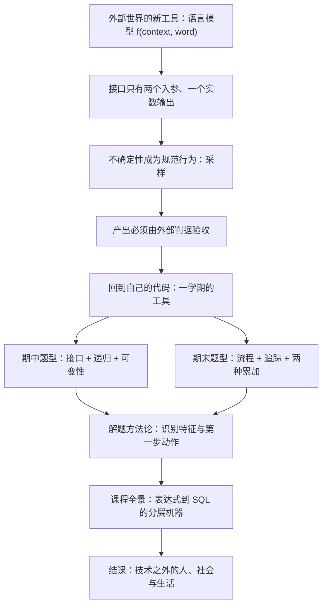
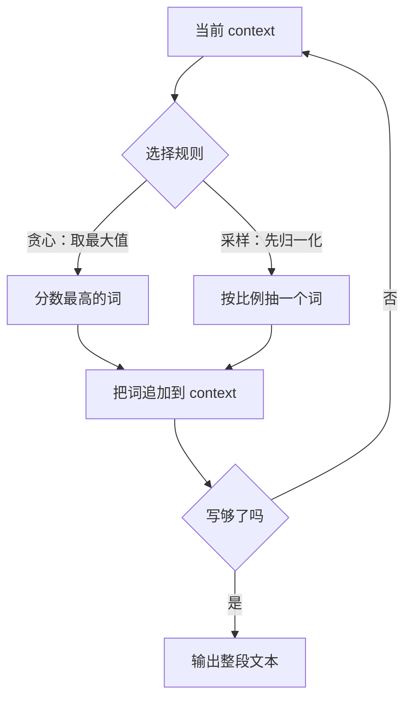
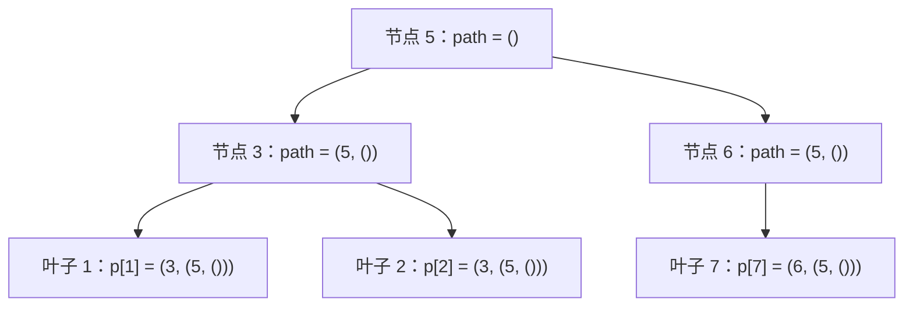
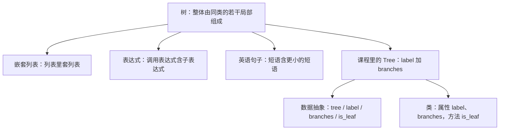
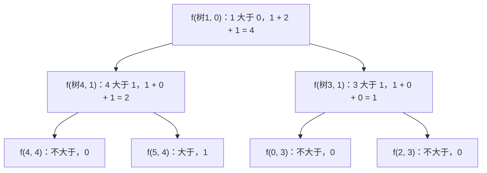
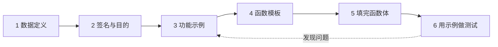
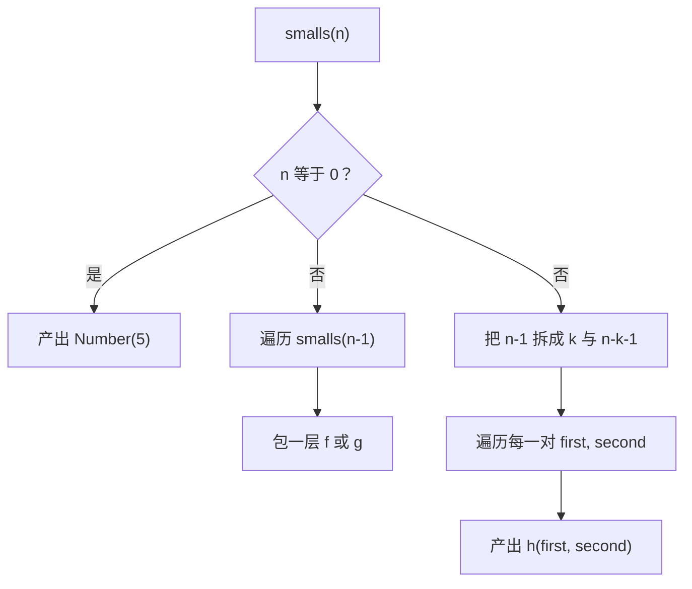
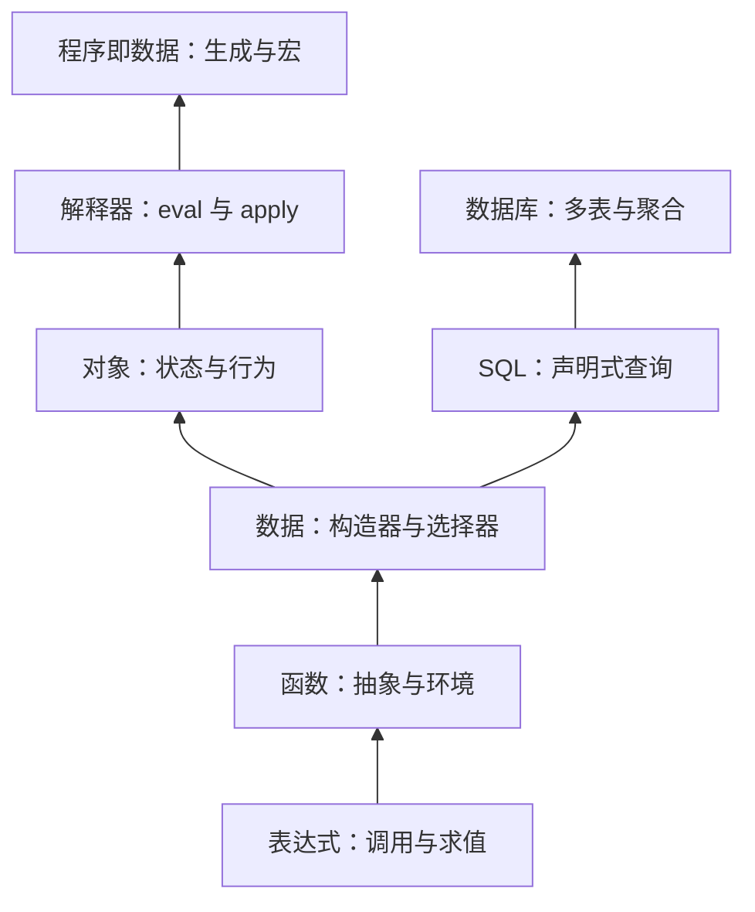
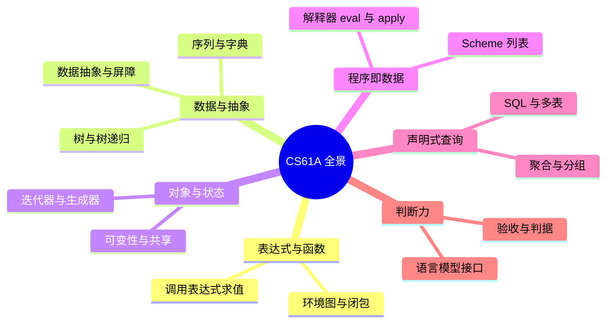

> **模块**：M8 CS61A-review，含 Lecture 26、27、39、40（Language Models、Midterm Examples、Final Examples、Conclusion）
> **录像状态**：四讲中 **3 讲无录像**（Lecture 26、27、40 官方未提供课堂视频，B 站无对应分 P）；只有 Lecture 39 有录像（38:48，B 站分 P 37）。**Lecture 26/27/40 无录像，故相应章节无时间锚点**；全文只有第 3 章（Lecture 39）带一处合规锚点
> **合集**：[CS61A Fall 2024 中文字幕合集](https://www.bilibili.com/video/BV1sy411z7nA)，本模块对应分 P 37（Lecture 39）
> **课件**：`25-Language_Models_1pp.pdf`（10 页）、`26-Midterm_Examples_1pp.pdf`（12 页）、`38-Conclusion_1pp.pdf`（21 页），共 43 页，逐页渲染为正文插图；Lecture 39 无官方课件
> **版权**：课程与课件版权归 UC Berkeley CS61A 教学团队（Fall 2024）；本文是学习用途的中文二次整理，不是逐句翻译

## 0. 模块导览

四讲并不相邻：第 26、27 讲在期中前后，第 39、40 讲在期末。合成一篇的理由不是时间连续，而是它们回答同一个问题的三个侧面——**一学期学到的那套工具能用来做什么、该怎么用、最后长成了什么形状**。第 26 讲把镜头转向外部，语言模型是别人训练出来的、行为不完全确定的函数，于是"验收"第一次成为主题；第 27 与第 39 讲收回镜头，用往年真题把一学期的手段挨个过一遍；第 40 讲拉到最远，把整门课折成一棵表达式树，再折成一台分层的机器。

录像的有无决定了每一章的证据强度：第 26、27、40 讲正文全部来自课件画面，超出画面一步的推断都标 `编者说明`；第 39 讲有录像与字幕，题干、代码与判断按字幕重建并已实跑核对，因此只有这一章有锚点。

### 0.1 讲次清单

| 讲 | 主题 | 录像 | 课件 | 分 P | 在本模块里承担什么 |
| :--- | :--- | :--- | :--- | :--- | :--- |
| 26 | Language Models 语言模型 | 无 | 10 页 | 无 | 外部工具：打分函数的接口、不确定性、边界 |
| 27 | Midterm Examples 期中例题 | 无 | 12 页 | 无 | 把树、递归、可变性、高阶函数放进同一张填空表 |
| 39 | Final Examples 期末例题 | 38:48 | 无 | [P37](https://www.bilibili.com/video/BV1sy411z7nA?p=37) | 把"读题—手算—模板—追踪"显式化成流程 |
| 40 | Conclusion 结课 | 无 | 21 页 | 无 | 回头：五层抽象、课程团队与社会面 |

最容易低估的是第 39 讲：没有课件、没有新语法，却是全课程唯一把解题过程本身当作讲解对象的地方——前面 38 讲教工具，这一讲教"工具不在手边时怎么办"。

### 0.2 主线图



三段不是并列，而是**同一件事在三个尺度上的重复**：接口定义什么叫对，流程保证做对，全景说明为什么值得对。

### 0.3 四讲之间的三处接缝

- **接口在两个尺度上出现**。第 26 讲把模型钉成 `f(context, word) → 实数`，第 27 讲把树钉成 `label`、`branches`、`is_leaf`；一个是黑箱，一个是自己写的类，要求的描述方式却是同一种。
- **"同一段代码两次结果不同"有两个来源**。第 26 讲说它来自采样，第 27 讲说它来自可变对象的共享——`path.append(...)` 会让兄弟分支互相污染。
- **验收的强度层层递进**。第 26 讲只要外部判据，第 27 讲要 doctest 逐字一致，第 39 讲要沿每个节点手工追踪一遍。

### 0.4 跨讲对照表

| 概念 | Lecture 26 | Lecture 27 | Lecture 39 | Lecture 40 |
| :--- | :--- | :--- | :--- | :--- |
| 函数是什么 | 打分函数 `f(context, word)` | `actions` 里的一元函数 | 辅助函数 `f(a, x)` 与 `process` | `Call` 保存的 `self.f` |
| 抽象靠什么 | 接口不变、表示交给训练 | `Tree` 的三条读接口 | 数据抽象版与类版是同一件事 | `Number` 与 `Call` 的 `value` |
| 递归的形状 | 逐个位置的条件概率链 | 树递归与计数递归 | 树递归加横向聚合 | `Call` 套 `Call`，`smalls` 调 `smalls` |
| 可变性在哪 | 参数（训练后固定） | `append` 污染兄弟分支 | `n[0]` 就地累加 | 无，表达式树不可变 |
| 怎么算"对" | 外部判据，一次不算数 | doctest 逐字比对 | 手工追踪整棵树 | 枚举到第一次命中 |

## 1. 语言模型：一个打分函数，以及它带来的验收问题

前 25 讲处理的对象有一个共同点：程序是人写的，行为可以逐行读出来。第 26 讲换掉这个前提——模型的行为是训练出来的，读源码没有用，能读的只有**接口**。这一换，把课程里反复出现的四个词一次性推到台前：接口、表示、不确定性、验收。

### 1.1 十页课件里能复原什么

本讲无录像、无字幕，只有 10 页课件 `25-Language_Models_1pp.pdf`；文件名编号比讲次号小 1，是课件自己的排序编号。分工很干净：第 1 页标题、第 2 页只剩 `Announcements` 一行字的公告页、第 3 页同样只有一行字的分节页，第 4–9 页是全部正文，第 10 页只剩标题加一个 `(Demo)`。


第 4、5、6、7、10 页各有一个居中的 `(Demo)`，标记"这里要现场演示"，而演示只存在于教室里——没有录像，演示里敲了什么、模型输出了什么都无法复原，所以本文**只在画面有字的地方下判断**。

> **编者说明**：第 2 页公告页只有标题，当周公告的具体条目（作业、考试、截止日期）无从得知；第 3 页分节页同理，只表示"下面进入 Large Language Models 这个主题"。

### 1.2 打分函数：两个入参，一个实数


正文第一句就是骨架：语言模型（包括 ChatGPT、Gemini、Claude 这类大型语言模型）是**实值函数** `f(context, word)`，返回一个实数，取值常常落在 0.0 到 1.0 之间。三个限定词都不能漏：输出是数字而不是字符串，所有"生成文本"都只是在这个数字上再叠一层选择规则；两个入参各有职责，少了 `word` 不知道给哪个候选打分，少了 `context` 无从判断合不合理；`often` 而不是 `must`，区间内的取值好读成概率，但定义只承诺"是个实数"。


课件两个例子都在 Berkeley 自己的语境里：`Oski the Bear (Oski) is the official ...` 之后 `mascot` 应当高分，`Oski was suspended for two weeks in January 1990, for throwing a cake towards ...` 则考具体事实——同一个打分函数要同时覆盖常识搭配（熊是吉祥物）与罕见事实。第二句后面还会出现，截短成 `... for throwing a` 并写明期望：模型应给 `cake` 接近 1 的分数，所以**待预测的词是 `cake`，不是 `towards`**。

> **编者说明**：Oski 是 UC Berkeley 的官方吉祥物，第二句对应校史上一则轶事；课件只给了英文原句，背景由编者补出。

第 4 页最后一条把 `context` 推向今天的样子：近年的模型已把 context 扩大到包含其它数据（如图像）与多段文本来源（如 system prompt）。

| 判据 | 早期语境里的 context | 课件所说的现代 context |
| :--- | :--- | :--- |
| 内容类型 | 只有文本 | 文本 + 其它数据（如图像） |
| 来源数量 | 一段连续文本 | 多段来源拼接（如 system prompt） |
| 对读者的含义 | "上文" | "模型这一次看到的全部东西" |

最后一行最有价值：**context 不是"用户说的那句话"，而是模型这一次能看到的全部输入**——同一句话在不同系统里答案不同，变的不一定是模型，而是拼进 context 的那几段。

### 1.3 计数即分数：神经网络之前的 n-gram


课件对历史的概括只有一句：神经网络兴起之前，最有效的语言模型建立在**文本中词序列的出现次数**之上，这类模型叫 n-grams。页面中央是《罗密欧与朱丽叶》的开篇一行，下面压着五条蓝色横线：前四条各盖住两个相邻词（`Two households`、`households ,`、`, both`、`both alike`），整体右移一格；第五条从行首拉到行尾，表示把整行当一个窗口。`n` 就是窗口长度，前 `n−1` 个词是"看得到的历史"。画面上每个词与标点之间都有空格，逗号是独立的一项——在这套计数里标点与单词地位相同。

```text
Two households , both alike in dignity ,
```

页面上那行公式是全讲唯一的具体算法：对 context 与 word，"最简单的分数"就是 `(context[-1], word)` 的出现次数，即 $\mathrm{score}(c, w) = \mathrm{count}\big((c[-1], w)\big)$。它只看一步历史，其余全部丢弃，所以是**二元模型**（bigram）。

```python
from collections import Counter

words = open("corpus.txt", encoding="utf-8").read().split()
bigrams = Counter(zip(words, words[1:]))     # 每一对相邻词的出现次数


def score(context, word):
    return bigrams[context[-1], word]        # 未出现过的组合计为 0
```

`Counter` 对不存在的键返回 0 而不抛异常，恰好与"计数即分数"对得上。代价也在这里：真实语言里合法的词对远多于语料出现过的词对，生成走到"下一步全是 0 分"就无词可选，这是数据稀疏（sparsity）；`n` 增大一格，可能窗口数按候选词规模的幂次增长，"见过的窗口"占比急剧下降。

> **编者说明**：工程上对付稀疏的标准手段是平滑（把一部分概率匀给没见过的组合）与回退（长窗口查不到就退回短窗口）；这两个词都没出现在课件上，把文本切成基本单位通常也叫分词（tokenization）。

### 1.4 从分数到文本：贪心与采样


生成文本的最朴素办法只有两步：挑出对这个 context 得分最高的词，再把它接回 context；两步循环，文本就一个词一个词长出来。这通常叫贪心解码（greedy decoding），性质由规则本身决定：同一个模型、同一个起始 context，输出**完全确定**。失败方式也是机制性的——最高分往往是最常见、最泛的词，于是文本平淡；被写进上下文的短语会抬高自己的分数，于是同一句反复出现；句子还会越写越短，因为收尾标点常常最"安全"。


下一页换掉第二步的规则：从词上的概率分布中采样，意味着**按概率比例**挑选每一个词——概率 0.5 的词被抽中的机会是一半，而不是"必定抽中"。于是同一个 context 每次走出的路可能不同，输出从"一个确定结果"变成"一族可能结果"。但"按比例抽"要求这些数先构成概率分布（非负且总和为 1），而第 4 页只说分数"常常"落在 0 到 1 之间，所以采样前必须先归一化。



| 判据 | 贪心（argmax） | 采样（sampling） |
| :--- | :--- | :--- |
| 选词规则 | 取分数最高的那一个 | 按概率比例随机抽 |
| 同输入同输出 | 是，完全确定 | 否，每次可能不同 |
| 文本形态 | 平稳、保守，容易重复 | 多样，偶尔跑偏 |
| 验证方式 | 一次结果即可复查 | 必须多次抽样看分布 |

最后一行是这一节真正的工程结论：**采样把"同一问题两次回答不同"从缺陷变成了规范行为**。既然输出不确定，"我试了一次，它对了"就不构成证据；验收必须在多次抽样下稳定，或改用与生成过程无关的外部判据。

### 1.5 神经语言模型：把"表示"交给训练


这一页标题后挂着 `(No Math Version)`：只给结构，不给公式。三句话概括——神经网络定义一个函数，从**很大的结构化输入**到**一组固定大小的数字**，行为由**参数**决定；参数可以**训练**；训练第一步是让它能"认出"一个大型文本集合里的文本，而这类集合**总是倾向于包含 wikipedia**。"固定大小"很要紧：不管 context 多长，输出永远是一列分数，长度等于候选词个数。

训练目标被具体化成还是那两句 Oski：`... is the official` 之后应给 `mascot` 接近 1 的分数，`... for throwing a` 之后应给 `cake` 接近 1 的分数——**把大集合里的真实文本当答案，调参数让答案的分数变高**。真正让课件用上 `amazing` 的是下一句：造这些系统的人**并不选择** context 如何被表示，表示由训练过程自己发明；而 n-gram 的表示是**人选**的（`context[-1]` 就是人做的决定）。

> **编者说明**：这与课程反复讲的数据抽象是同一问题的两端：表示可以随便换，只要构造器与选择器（接口）不变。这里换的正是表示，而接口 `f(context, word)` 一字未改。

代价紧随其后：表示既然不是人设计的，人也就读不懂、改不动，出问题只能回到数据与训练目标上找原因。最后一句话给了"相似"一个可操作的定义：两个 context 相似，当且仅当它们后面跟着相似的词——不看字面重叠，而看**后续词的分布**，于是没见过的组合也能拿到合理分数。

| 判据 | n-gram 计数模型 | 神经语言模型 |
| :--- | :--- | :--- |
| 分数从哪来 | 数语料里的出现次数 | 用参数算出来的函数值 |
| 上下文表示 | 人选的窗口（如 `context[-1]`） | 训练过程自己学出来 |
| 没见过的组合 | 计数为 0，可能无词可选 | 仍能给出分数 |
| 相似性 | 只看字面是否相同 | 看后续词分布是否相近 |
| 可解释性 | 高，能查到原始计数 | 低，表示不可读 |

### 1.6 三步对齐：从续写到对话


到这里模型已能"把文本续得像那么回事"，但课件马上泼了盆冷水，只用半句话：用大型文本语料训练出来的语言模型**不是一个好的聊天机器人**。为什么？预训练只要求"下一个词像语料里的下一个词"，而语料里绝大多数文本**不是**对某个提问的回答，于是默认行为是"接着往下写"——你问它一个问题，它最自然的反应是把问题当成一段待续写的文本。课件下一步很轻：用一批好的 prompt-response 对继续训练**有帮助**，这就是指令微调（instruction fine-tuning），不改架构，只改数据。

再往后是课件称为**关键**的一步：把人类对回答的评分纳入训练，也就是对齐（alignment），课件同时给了另一个名字——reinforcement learning from human feedback，RLHF。流程只有三步：

1. 用采样为同一个 context 生成两条回答。
2. 让人来评，哪一条更好。
3. 调整参数，使得给定 context 时，分数高的词倾向于是人类更偏好的那些词。

第一步里"采样"是全讲的暗线：两条都用贪心生成，结果会一模一样，人无从比较——**采样在这里不是为产出好看的文本，而是制造差异**。第二步选"二选一"而不是打绝对分，是因为人对"哪个更好"的判断比"值 7 分还是 8 分"更稳定。

| 阶段 | 数据形态 | 优化的是什么 | 得到的能力 | 典型缺陷 |
| :--- | :--- | :--- | :--- | :--- |
| 预训练 | 大集合里的连续文本 | 真实下一个词的分数要高 | 续写、补全、词的搭配 | 只会接着写，不会回答 |
| 指令微调 | prompt-response 对 | 回答文本里各词的分数 | 按提问作答的格式 | 回答质量参差，会编 |
| 人类反馈对齐 | 同一 context 的两条回答 + 人的偏好 | 被偏好的那条里词的分数 | 更符合人类口味的回答 | 迎合评分者、多样性下降 |

这张表最有用的地方是最后一行：三个阶段优化的是**三种不同的东西**，却共用一个接口。所以"模型说错了"要先判断错在哪一层——是压根不知道，是不会按格式答，还是答得不合口味。

### 1.7 语言模型与代码：一页只有标题的课件


第 10 页只有两样东西：标题 `Large Language Models and Code` 和居中的 `(Demo)`。它是全讲最后一页，主题从"模型怎么工作"转向"模型与代码的关系"；既然没有录像，演示内容无从复原。

> **编者说明**：以下四条纪律是编者按本讲建立的性质整理的，不属于课件内容。

- **规格由人写，代码可以由模型写。** 函数名、参数、返回值、边界条件是 `def` 上方的契约；顺序倒过来，等于把验收权交出去。
- **验收用可执行的东西，不用解释。** 模型对自己代码的解释常常与代码不符，而测试不会撒谎。
- **把它当作非纯函数对待。** 同一个 prompt 两次调用可能不同，测试要在"多次抽样"的意义上稳定。
- **出错时先分层定位。** 按 §1.6 的三阶段表判断是"不知道"、"不会答"还是"不合口味"。

```python
def ways(start, end, k, actions):
    """Return the number of ways of reaching end from start by taking up to k actions.

    >>> ways(-1, 1, 5, [abs, lambda x: x + 2])
    2
    >>> ways(1, 20, 5, [lambda x: x + 1, lambda x: x + 4])
    0
    """
```

这段 `docstring` 是人的工作：它把"该做什么"写成可执行的句子，并用第一个例子钉住最容易读漏的约束（到终点即停）；模型交回来的应该是一个能让 `python -m doctest` 全绿的主体。这个函数在 §2.7 还会出现——它是第 27 讲的原题。

| 判据 | 人写的函数 | 模型"写"的函数 |
| :--- | :--- | :--- |
| 规格从哪来 | 人读题后写下 | 人写在 prompt 与 `docstring` 里 |
| 可复现性 | 完全可复现 | 依赖采样，未必可复现 |
| 典型错误 | 逻辑疏漏、边界漏写 | 看似合理但边界错、编造不存在的 API |
| 绝对不能交出的部分 | 规格与验收判据 | 规格与验收判据 |

## 2. 期中题型：填空位置就是考点位置

第 27 讲没有录像、没有字幕，只有 12 页课件，密度却是全模块最高的。期中卷的出题方式与前 26 讲完全不同——不是"实现一个函数"，而是"在给好的骨架里填三到四个空"，而几乎每个空都对应一个特定的理解缺口。

### 2.1 十二页的骨架与那张"难度表"

12 页按功能分四类：标题页与公告页各一页；`Trees` 与 `Recursion` 两个分节页把课件切成两半；第 4、9 页各是一页接口/方法论回顾；剩下六页是五道题外加一道重做。标题页只有两个词，第二页除标题外整页空白，公告正文没有进入 PDF。五道题的页面上都挂着同一组统计：


| 题目 | 出处 | 平均得分率 | 完全做对的比例 |
| :--- | :--- | :--- | :--- |
| Q5(a) `pile` | Fall 2017 CS 61A Midterm 2 | 49% | 26% |
| Q5(b) `Path` | Fall 2017 CS 61A Midterm 2 | 53% | 24% |
| Q4(c) `ways` | Fall 2017 CS 61A Midterm 2 | 71% | 41% |
| Q7(a) `sums` | Fall 2016 CS 61A Midterm 2 | 39% | 4% |
| Q7(b) `sums`（lambda 版） | Fall 2016 CS 61A Midterm 2 | 17% | 1% |

两列数字放在一起看比单看任何一列都有信息。Q5(a) 平均 49% 却只有 26% 全对：多数人拿到前面几个空的分，最后那个不经意的空（起点 `gather(t, ())`）把大部分人挡在门外。Q7(a) 平均 39%、全对率 4%，Q7(b) 平均 17%、全对率 1%——几乎是"要么全对、要么全错"的形状，必须整条递归链一次想通。

> **编者说明**：这些百分比是 Fall 2017 与 Fall 2016 期中二的原始数据，在 Fall 2024 的复习课上作为"难度标尺"重新展示，不是本学期成绩；课件在第 12 页还加了一句按语——这题放在今天会被标成 A+ 题、值 0 分。

### 2.2 Tree 的接口契约：能读什么，能改什么


第 4 页标题写着 "From Discussion 5 (Updated to be about the Tree class)"，这半句括注是钥匙：这些约定原本讲抽象数据类型（Abstract Data Type）版本的树，现在改写成"类版本的树"，于是树不再是可以用下标拆开的列表，而是只暴露少量操作的实例。六条只读约定可以概括成一句：根标签可以是任意值（`t.label`）；`t.branches` 求值得一个**列表**；没有分支就是叶子（`t.is_leaf()`）；相同的树可以用 `Tree(t.label, t.branches)` 构造；树可以当参数传给 `height(t)`；最后一条是重心——"树不是序列"：没有下标，不可迭代，也没有结构相等。

> **编者说明**：`t[0]`、`x in t`、`list(t)` 分别依赖 `__getitem__`、`__contains__`（或迭代协议）、`__iter__`，`Tree` 一个都没提供，所以是 `TypeError` 而不是"结果不对"。另一处常见事故是 `t.is_leaf` 不带括号：拿到绑定方法对象，在 `if` 里恒为真。

| 判据（想做的事） | 课件允许的写法 | 课件点名禁止的写法与失败原因 |
| :--- | :--- | :--- |
| 读根标签 | `t.label` | `t[0]`：树不是序列，没有下标 |
| 读所有分支 | `t.branches`，得到一个列表 | `list(t)`：树不可迭代 |
| 判断是不是叶子 | `t.is_leaf()` | `t.is_leaf`：方法对象恒为真 |
| 判断某标签是否出现 | 自己写递归，或调用现成函数 | `x in t`：树没有成员检查 |
| 判断两棵树内容相同 | 自己写递归比较 | `t == x`：默认只判"同一个对象" |
| 算派生量（如深度） | 交给 `height(t)` 这类函数 | 在外部把树拆开、自己拼结构 |

`height(t)` 不是随手举例，而是"函数消费抽象"的样板：树只提供三样东西，而深度不在这三样里，必须由外部函数递归算出来。三条**修改**约定都围绕"点号左边的对象"：`t.label = ...`；`t.branches = ...` 或 `t.branches.append(...)`；`t.branches[0].label = ...`。前两条的区别要留意：前者换成一个新列表，后者就地塞进原来那个列表——如果这个列表被别处共享，它也一起变了。

### 2.3 Q5(a) `pile`：把"到根的路径"当成累积参数


Fall 2017 期中二第 5 题 (a) 问，平均得分率 49%、全对率 26%。题面先给一条定义，这定义本身就是递归的：对一棵叶标签互不相同的树 `t`，它的 pile 是一个字典，每个叶子标签是一个键，值是从那个叶子到根的路径；而"从某节点到根的路径"要么是空元组（该节点就是根），要么是二元组，第一个元素是父节点标签，第二个是"从父节点到根的路径"。两处反直觉：路径是**嵌套**的，`(3, (5, ()))` 要念成"父节点 3，剩下的是从 3 到根的路径"；路径**不含起点自己**，叶 1 的值里没有 1，1 只作为键出现。

```python
def pile(t):
    """Return a dict that contains every path from a leaf to the root of tree t.

    >>> pile(Tree(5, [Tree(3, [Tree(1), Tree(2)]), Tree(6, [Tree(7)])]))
    {1: (3, (5, ())), 2: (3, (5, ())), 7: (6, (5, ()))}
    """
    p = {}
    def gather(u, path):
        if u.is_leaf():
            p[u.label] = path
        for b in u.branches:
            gather(b, (u.label, path))
    gather(t, ())
    return p
```

四个空各问一件事。`p[u.label] = path`（气泡 "Base case: Put a leaf label in p"）：能直接存，是因为第二个参数约定为"**从当前节点 `u` 到根的路径**"，走到叶子时手上那条正好是定义要的值。`gather(b, (u.label, path))`（气泡 "u has a label that can be added to the path"）："从 `b` 到根"按定义是"父节点标签 + 从 `u` 到根的路径"，而元组拼接是天然的"造新值"。`gather(t, ())`（气泡 "all paths have ()"）：根到根就是 `()`。`return p`：外层变量通过闭包被内层写入，整道题是"**内层负责遍历，外层负责收集**"。



`if u.is_leaf(): ...` 后面直接跟 `for`，没有 `else`：叶子的 `branches` 是空列表，循环一次也不执行，两个分支天然互斥。失分点相当集中：起点写成 `[]`、`0`、`None`（`path` 必须是元组，doctest 一个字都改不得）；基准写成 `path + (u.label,)`（多存了叶子自己）；递归参数顺序反成 `(path, u.label)`；`u.is_leaf` 少写括号；忘了 `return p`；把 `gather` 改成返回值风格（本题靠闭包累积）。

### 2.4 Q5(b) `Path`：把一张表包装成可打印的对象


第 6 页是同一题的第 (b) 问，平均得分率 53%、全对率 24%。要求实现 `Path` 类，`__init__` 接收一棵树 `t` 与一个 `leaf_label`（假定叶标签唯一）；打印时把从根到该叶的标签用短横线连起来，例如 `print(Path(a, 7), Path(a, 2))` 输出 `5-6-7 5-3-2`。方向是关键：`pile` 的路径是"从叶往上"，而打印要求"从根往下"，所以第 (b) 问不是把字典直接印出来，而要把它**反过来拼**。课件解法很干脆：`__init__` 只做 `self.pile, self.end = pile(t), leaf_label`，所有工作推给 `__str__`——"找路径"是树的操作，"拼字符串"是字符串的操作，混在一起 `while` 循环就要同时处理两者。

```python
def __str__(self):
    path, s = self.pile[self.end], str(self.end)
    while path:
        path, s = path[1], str(path[0]) + '-' + s
    return s
```

初值那行有两个动作：取出路径（气泡 "path is a nested tuple"）与把叶标签变成字符串（气泡 "s is a string"）——前者保证后面能用 `path[0]`、`path[1]` 拆它，后者保证能直接拼。循环体是一句并行赋值：新的 `path` 是 `path[1]`，新的 `s` 把父标签接在已有字符串左边（气泡 "Build s from this"）；循环条件靠"空元组为假"。

| 轮次 | `path` | `s` | 说明 |
| :--- | :--- | :--- | :--- |
| 初值 | `(3, (5, ()))` | `'2'` | 叶子的父是 3 |
| 第 1 轮 | `(5, ())` | `'3-2'` | 把 3 前插 |
| 第 2 轮 | `()` | `'5-3-2'` | 把 5 前插，循环结束 |

`print` 用空格分隔多个参数，每个参数各自调用自己的 `__str__`，那行输出不是某个对象印出了空格。易错点更细：两边写反（`path[0]` 是标签、`path[1]` 是剩余路径）；拼到右边得到 `2-3-5`；忘了 `str()` 直接 `TypeError`；在 `__str__` 里重新调用 `pile(self.t)`；属性名对不上。

> **编者说明**：`print` 走 `__str__`，交互式环境里直接求值 `Path(a, 7)` 走的是 `__repr__`；本题只定义 `__str__`，所以直接求值会看到默认的 `<__main__.Path object at 0x...>`。

### 2.5 列表版 `pile`：表示的改变会改变"什么操作是安全的"


第 7 页把第 5 页的题重做了一遍：定义里那句关键的话被划掉、换成绿色一句 **Represent the path as a list of labels.**，于是路径变成扁平列表，doctest 变成 `{1: [5, 3, 1], 2: [5, 3, 2], 7: [5, 6, 7]}`。方向也翻转了：元组版"从叶往上"（父在前，尾巴是 `()`），列表版"从根往下"（根在前，末元素是叶子）。

```python
def pile(t):
    """Return a dict that contains every path from a leaf to the root of tree t.

    >>> pile(Tree(5, [Tree(3, [Tree(1), Tree(2)]), Tree(6, [Tree(7)])]))
    {1: [5, 3, 1], 2: [5, 3, 2], 7: [5, 6, 7]}
    """
    p = {}
    def gather(u, path):
        if u.is_leaf():
            p[u.label] = path + [u.label]
        for b in u.branches:
            gather(b, path + [u.label])
    gather(t, [])
    return p
```

上面是方案 A：下行时把当前节点的标签压进路径，到叶子才补上叶子自己。方案 B 反过来——`p[u.label] = path`、`gather(b, path + [b.label])`、`gather(t, [t.label])`：起点带上根标签，下行时把**儿子**的标签追加进去。两套的不变量不同，必须整题统一：方案 A 的 `path` **不含 `u`**，方案 B 的 `path` 含 `u` 且以根开头；混用会得到 `[3, 1]`（缺根）或 `[5, 3, 1, 1]`（叶子重复）。

这一页真正想教的东西在加法号上。`path + [u.label]` 与 `path + [b.label]` 都是**造一个新列表**；改成原地追加，代码会安静地错掉：

```python
# 错误示范：就地修改共享的 path
total = path
total.append(b.label)
gather(b, total)
```

同一层的兄弟分支共用同一个 `path` 对象，第一个兄弟追加之后，第二个看到的路径已多一节，四条路径全部被污染，而程序不报任何错。元组版没有这个问题，因为元组不可变。课件把同一道题做两遍的原因就在这里——**表示的改变会改变哪些操作是安全的**。

| 判据 | 元组版（第 5 页） | 列表版（第 7 页） |
| :--- | :--- | :--- |
| 值的形状 | `(3, (5, ()))`，嵌套二元组 | `[5, 3, 1]`，扁平列表 |
| 方向 | 从叶往上，父在前，尾巴恒为 `()` | 从根往下，根在前，末元素是叶子 |
| 下行时怎么延长 | `(u.label, path)`，天然造新元组 | `path + [x]`，必须造新列表 |
| 起点 | `gather(t, ())` | 方案 A `[]`；方案 B `[t.label]` |
| 共享的风险 | 无，元组不可变 | 有，`append` 会污染兄弟分支 |

### 2.6 递归方法论：先把递归情形说出来


`Recursion` 分节页之后，课件没有立刻上题，而是插了一页方法。第一句就是最有用的一句：**不要一上来就写代码**，先把递归情形用文字描述出来——`fib` 是"把前两个斐波那契数加起来"，`count_partitions` 是"用最大不超过 m 的部分去划分 n-m，**以及**用最大不超过 m-1 的部分去划分 n"。两者的共同特征是**一句话里出现两个递归调用**，所以"递归情形"从来不是"调用自己一次"，而是"把问题拆成若干个更小的同类问题，并说清怎么拼起来"。

两个具体办法：**用抽象**（Use abstraction），挑一个例子，问"递归调用在这个例子上会替我做完什么"，而这个答案要去 **docstring 里读**，不要读代码——相信契约，不相信实现；**实现一个选择**（Implement a choice），递归情形只实现众多选择中的**一个**，剩下的交给递归。基准情形的说法很短：递归情形一旦确定，就去找它自然导向的所有简单情形——基准不是"最小的例子"，而是"递归走不下去的样子"。

| 题 | 递归情形的一句话 | 基准情形 |
| :--- | :--- | :--- |
| `ways` | 选一个动作 `f`，从 `f(start)` 出发再走 `k - 1` 步 | `start == end`（算 1 种）；`k == 0`（算 0 种） |
| `sums`（Q7a） | 最后一位放 `x`，剩下 `k - 1` 位去凑 `n - x` | `k == 1`（只剩一位，只能是 `n`） |
| `sums`（Q7b） | 前缀取 `x`，其余位置继续用不超过 `x` 的数填 | `x == 0` 时无候选；`w == 0` 时只有空列表 |

三行写下来能看出方法论的实用处：**基准情形的个数由递归情形决定**——`ways` 同时受"是否到达终点"与"是否还有步数"约束，所以有两个基准；`sums` 只受"还剩几位"约束，所以只有一个。

### 2.7 三道计数题：`ways` 与 `sums` 的两副面孔


Fall 2017 期中二第 4 题 (c) 问，平均得分率 71%、全对率 41%。要求实现 `ways(start, end, k, actions)`：从 `actions` 里挑一串函数（可重复）使得 `f1(f2(...(fj(start))))` 等于 `end` 且 `j ≤ k`，返回方式数。题面最后一句是灵魂——**如果一个动作序列到达了 `end`，就不能再往下施加动作**：`abs(-1)` 到达终点就停，所以 `abs(abs(-1))` 不构成"另一种方式"；漏读这句，第一个 doctest 的答案会从 2 变成 4 以上。

```python
def ways(start, end, k, actions):
    """Return the number of ways of reaching end from start by taking up to k actions.

    >>> ways(-1, 1, 5, [abs, lambda x: x+2])   # abs(-1) or -1+2, but not abs(abs(-1))
    2
    >>> ways(1, 10, 5, [lambda x: x+1, lambda x: x+4])  # 1+1+4+4, 1+4+4+1, or 1+4+1+4
    3
    >>> ways(1, 20, 5, [lambda x: x+1, lambda x: x+4])
    0
    >>> ways([3], [2, 3, 2, 3], 4, [lambda x: [2]+x, lambda x: 2*x, lambda x: x[:-1]])
    3
    """
    if start == end:
        return 1
    elif k == 0:
        return 0
    return sum([ways(f(start), end, k - 1, actions) for f in actions])
```

三个空：`start == end` 返回 1——到达终点意味着序列到此为止，这一件事本身构成**一种**方式，`j = 0` 也算一种；`k == 0` 返回 0——步数用完仍未到达；`sum(...)` 加列表推导——气泡在 `for f in actions` 旁写 "Choose an action"（这一层做的那**一个**选择），在递归调用旁写 "# of ways starting with that action"。两个基准的顺序不能交换：若先判 `k == 0`，"起点恰好等于终点且 `k` 已为 0"会被判成 0 种——**先判成功，再判失败**。

第二个 doctest 说明"数的是序列不是和式"：从 1 到 10 要加 9，每次加 1 或 4，`x + 4y = 9` 且 `x + y ≤ 5`，唯一可行的是"一次 +1、两次 +4"，三种排列各算一种，答案是 3。第四个例子把 `start` 与 `end` 换成**列表**——`ways` 不关心值的类型，只要求能用 `==` 比较、能被 `actions` 变换。

| 方式 | 动作序列（从先到后） | 状态变化 |
| :--- | :--- | :--- |
| 一 | `[2]+x`，`2*x` | `[3] → [2, 3] → [2, 3, 2, 3]` |
| 二 | `2*x`，`[2]+x`，`x[:-1]`，`2*x` | `[3] → [3, 3] → [2, 3, 3] → [2, 3] → [2, 3, 2, 3]` |
| 三 | `2*x`，`x[:-1]`，`[2]+x`，`2*x` | `[3] → [3, 3] → [3] → [2, 3] → [2, 3, 2, 3]` |

> **编者说明**：上面三条路径照着 doctest 与代码手工推出，课件只给答案 3；`[2]+x` 往头部加 2，`2*x` 在列表上表示"重复两遍"，`x[:-1]` 砍掉最后一个元素。第三条"浪费"了一步，但 `k = 4` 有余量，绕路仍合法——只要序列在**第一次**命中 `end` 时停下，走了几步都只影响"是不是同一种方式"。


第 11 页是 Fall 2016 期中二第 7 题 (a)，平均得分率 39%、全对率 4%。要求实现 `sums(n, k)`：返回"把 n 拆成 k 个正整数之和"的**所有**方式（顺序不同算不同方式）。`sums(5, 3)` 的六种排列全部列出，而**顺序**也是考点：按最后一位从 1 到 3 分组，组内按递归返回的顺序，doctest 逐字比对。

```python
def sums(n, k):
    """Return the ways in which K positive integers can sum to N.

    >>> sums(2, 2)
    [[1, 1]]
    >>> sums(2, 3)
    []
    >>> sums(4, 2)
    [[3, 1], [2, 2], [1, 3]]
    >>> sums(5, 3)
    [[3, 1, 1], [2, 2, 1], [1, 3, 1], [2, 1, 2], [1, 2, 2], [1, 1, 3]]
    """
    if k == 1:
        return [[n]]
    y = []
    for x in range(1, n):
        y.extend([s + [x] for s in sums(n - x, k - 1)])
    return y
```

四个空是 `k == 1`、`[[n]]`、`range(1, n)`，以及 `s + [x]` 与 `sums(n - x, k - 1)`。页面下缘三个气泡把这一行拆成三段：`s + [x]` 是 "Build the list"，`for s in ...` 是 "Choose a way"，`sums(n - x, k - 1)` 是 "Ways of completing the list"。递归情形因此是"最后一位放 `x`，前面 `k - 1` 位去凑 `n - x`"；`x` 被**接在末尾**，所以整张表按"最后一位"分组。`x` 的取值范围只需两个理由就定死：下界 1（正整数），上界取不到 `n`（前面还要留 `k - 1` 个正整数）。"无解"由空的 `range` 处理：`sums(2, 3)` 递归到 `sums(1, 2)` 时 `range(1, 1)` 为空，循环不进，`y` 保持 `[]` 返回——**没有专门的"无解"基准**。

失分点集中在形状与名字：`append` 与 `extend` 混用（多套一层）；`s + [x]` 写成 `s.append(x)`；`range(1, n)` 写成 `n + 1`；漏掉 `k == 1`（`RecursionError`）；两个参数调换（"答案总是空表"）；忘记 `return y`。


第 12 页是同一题的第 (b) 问，平均得分率 17%、全对率 1%；课件加了一句按语：这题放在今天会被标成 A+ 题、值 0 分。它考察的不是"会不会写递归"，而是"能不能读懂别人用表达式写出来的递归"。

```python
f = lambda x, y: (x and [[x] + z for z in y] + f(x - 1, y)) or []


def sums(n, k):
    """Return the ways in which K positive integers can sum to N."""

    g = lambda w: (w and f(n, g(w - 1))) or [[]]

    return [v for v in g(k) if sum(v) == n]
```

`f(x, y)` 接收"最大可用数" `x` 与"一批列表" `y`：`[[x] + z for z in y]` 把 `x` 加到 `y` 里每个列表前面，`f(x - 1, y)` 把前缀取 `x-1`、…、1 的结果接在后面——页面左侧方框写的正是 "Put each number up to x at the front of each list in y"。`g(w)` 则归纳出长度：`g(0)` 是 `[[]]`，`g(w)` 等于 `f(n, g(w - 1))`，于是 `g(w)` 是"所有长度为 `w`、元素在 1 到 `n` 之间的列表"；最后一行筛选出和为 `n` 的那些。两件事等价，因为正整数之和恰为 `n` 时每一项必然不超过 `n`。

两个 lambda 都用 `(条件 and 结果) or 兜底`，读成三行 `if` 就通了。两处兜底的价值不对称，这是最容易读错的地方：`f` 的 `or []` 是真正的基准，而 `g` 的 `or [[]]` 既是 `w == 0` 的基准，又是"上一层算出来为空"的安全网；`g` 的递归调用出现在**实参位置**，必须先算它，再进 `f`。代价也值得看一眼：`g(k)` 会先把 `n^k` 个候选全部造出来再筛选，而 Q7(a) 每步都在"凑得下去"的分支上。

| 判据 | Q7(a) 构造式 | Q7(b) 生成-筛选式 |
| :--- | :--- | :--- |
| 主要工具 | 循环、列表推导、`extend` | 两个 lambda 与 `and/or` |
| 何时剪枝 | 由 `range(1, n)` 隐含剪枝 | 不剪枝，最后用 `sum(v) == n` 筛 |
| 候选规模 | 与答案数量同量级 | 每个位置 `n` 种可能，`n^k` 量级 |
| 结果顺序 | 按最后一位从 1 起分组 | 按第一位从大到小排列 |
| 可读性 | 一眼能懂 | 先认出 `and/or` 惯用法才读得动 |

两版都正确，doctest 也都过，区别只在"什么时候排除不可能"：Q7(a) 一边构造一边排除，Q7(b) 先全部生成再排除。考试里遇到带骨架的题照骨架填就是 (a) 的形状；只有题目明确要求"用表达式写"时，才需要 (b) 这种写法。

## 3. 期末题型：把"不会做"变成一套流程

*(参考时间: 00:02:56 – 00:38:33｜Lecture 39)*

第 27 讲假定你知道该用哪个工具，只考能不能把空填对；第 39 讲撤掉这个假定，给两道没见过的题，演示如何在完全没有思路时逼近答案。这一讲没有课件（`pdf_pages = 0`），内容全部来自 38:48 的录像与 491 段字幕，所以也是本模块唯一能标锚点的地方。为了让示例能跑，还需要一份最小的 `Tree` 类。

```python
class Tree:
    def __init__(self, label, branches=()):
        self.label = label
        for branch in branches:
            assert isinstance(branch, Tree)
        self.branches = list(branches)

    def is_leaf(self):
        return not self.branches
```

### 3.1 树为什么年年出现在期末题里

同一棵抽象意义上的树，在课程里出现过两种表示：一种用列表，配构造函数、两个选择器与一个判叶辅助函数；另一种用类，用属性记录标签与分支。两者描述同一个东西，只是把"怎么取到"从函数调用换成了属性访问。

| 判据 | 数据抽象表示 | 类表示 |
| :--- | :--- | :--- |
| 构造 | `tree(label, branches)` | `Tree(label, branches)` |
| 取标签 | `label(t)` | `t.label` |
| 取分支 | `branches(t)` | `t.branches` |
| 判断叶子 | `is_leaf(t)` | `t.is_leaf()` |
| 需要选择器吗 | 需要，四个名字都要记 | 不需要，属性名就是表示 |

树既不是 Python 的内置类型，也不是某门语言的特性。计算机科学里的"树"是一个抽象概括：任何"自身由若干更小的自身组成"的东西都是树，要点有二——**树里装着别的树**，而且**可以装不止一棵**；所以嵌套列表、调用表达式、英语句子的句法分析、网页的 HTML 布局都是树。



形状之所以重要，是因为**处理树的代码形状会被它决定**：函数拿到一个节点，对它每一棵子树再调用自己。这也是课程花大力气讲递归的首要理由——不是为了炫技，而是为了能操作这种数据。

### 3.2 `bigs` 第一步：读懂题，再动手

第一道题的题面只有两句：实现 `bigs`，接收一个标签为整数的树实例 `t`，返回 `t` 中"标签大于其所有祖先节点标签"的节点个数。最重要的一句提醒是：**不要一上来就写代码**，也不要去猜"模板里可能已经有什么"。第二句才是题眼，也最抽象，没有具体例子时很难把握；题面恰好没给例子，于是接下来的动作是——一边读一边做笔记（`t` 是一棵树，`bigs` 返回一个数），然后**自己造例子**，并在动手写代码之前研究一会儿。

```text
1
├── 4
│   ├── 4
│   └── 5
└── 3
    ├── 0
    └── 2
```

接着逐个位置检查这条性质。标签 5 的祖先是父节点 4 与 4 的父节点 1，5 大于两者，所以确实要数；答案是不是 4 其实用处不大，有用的是搞清楚**是哪四个**：

| 节点标签 | 祖先标签 | 是否计数 | 理由 |
| :--- | :--- | :--- | :--- |
| 1（根） | 无 | 是 | 没有祖先可比，条件在空集上成立 |
| 4（左子） | 1 | 是 | 4 大于 1 |
| 4（左子的第一个子节点） | 1、4 | 否 | 4 不大于 4 |
| 5 | 1、4 | 是 | 5 大于 4，也大于 1 |
| 3（右子） | 1 | 是 | 3 大于 1 |
| 0 | 1、3 | 否 | 0 小于 3 |
| 2 | 1、3 | 否 | 2 大于兄弟 0，却小于祖先 3 |

这一遍走下来有两条结论。第一条是警告：**不能只看父节点**，2 就是反例——它赢了兄弟却输给了祖先。第二条是事实：根标签总是大于它所有祖先，因为它根本没有祖先；这条"空真"的观察看似琐碎，却决定了递归初值怎么取。

### 3.3 落笔之前：列出解里必须出现什么

落笔之前值得先猜一猜解里应该出现什么。最自然的猜测是树处理的标准套路：如果 `t` 是叶子，做一件事；否则把对每棵分支的递归调用聚合起来。但这个套路在这里行不通：一路递归到叶子时，函数手上只有一个叶子，而**叶子并不知道自己上面有什么**；同样的叶子有的该数、有的不该数。

讲师对这一点的处理值得记住：一个方案想不通不是问题，**只要快速把它走完、看出问题在哪、然后换下一个**。排除标准套路之后，改为列出"解里必须有什么"：一个递增的计数器；一条判定语句（形如"某节点标签大于它所有祖先标签的最大值"）；一份祖先信息——要么把见过的祖先都记下来，要么**只记目前为止见过的最大祖先**。后者就是讲师所说的"有用的钩子"：它把"与所有祖先比较"压缩成"与一个数比较"，代价是要一路把这份信息带下去。

| 判据 | 记录全部祖先标签 | 只记录祖先最大值 |
| :--- | :--- | :--- |
| 额外参数 | 一个列表 | 一个数字 |
| 判定写法 | `t.label > max(祖先列表)` | `t.label > x` |
| 每次递归的准备工作 | 复制列表并追加一个标签 | 一次比较 |
| 空间占用 | 与深度成正比 | 常数 |
| 出错机会 | 列表顺序、拷贝、空列表各一处 | 只需保证最大值传对 |

### 3.4 读模板：双参数辅助函数 `f(a, x)`

到这里才去看题面给的模板。模板里有一个辅助函数 `f`，收两个参数，含义几乎不用猜：第一个说明"现在看的是哪个节点"，第二个说明"这个节点的祖先里最大的标签是多少"。上一节卡住的地方正好被它解开——函数现在能携带那份关键信息。这是递归函数里反复出现的模式：外层函数自带的参数不够用，于是另写一个函数，把缺的信息补进参数表。

模板里的 `a` 和 `x` 是题目指定的名字。应对办法是**立刻在旁边记下含义**：`a` 是 `t` 里的某个节点，`x` 是到目前见过的祖先标签最大值；抽象描述不顶用就写具体例子——`a` 是 `4, 4, 5` 那棵子树，`x` 是 1。先搭框架再想细节：`bigs` 写成 `return f(t, ...)`，只留初值空着——**把格式摆对本身就在靠近正确答案**。下面的 `...` 是还没想好的空缺，不是可运行代码。

```python
def bigs(t):
    def f(a, x):
        if a.label > x:
            return 1 + sum([f(b, ...) for b in a.branches])   # 传给下一层的最大值是什么？
        else:
            return sum([f(b, ...) for b in a.branches])
    return f(t, ...)                                          # 根节点的初始值取什么？
```

计数这一行是 `1 +` 加上"`a` 的子树里除根以外的命中数"，用经典套路：对每棵分支递归调用再求和；这里的问题是 `a` 而不是 `t`——`bigs` 在整棵树上调用 `f`，`f` 再对分支调用 `f`，整棵树才被走遍。递归调用里传什么，是写递归函数最费神的一步；但因为有笔记，这一步可以推出来：`x` 是"看 `a` 之前"的最大祖先，若 `a.label` 比 `x` 大，看完 `a` 之后最大值就变成 `a.label`，下一层传它；若不大于，仍传 `x`。还有一条容易漏的正当性理由：即使当前节点不满足条件，也必须继续往分支里看——设想树下面藏着一个 12，它大于上面所有标签，必须被数进去，所以 `else` 不是"兜底"而是逻辑必需。

```python
def bigs(t):
    """Return the number of nodes in t whose labels are larger than
    any labels of their ancestor nodes.

    >>> t = Tree(1, [Tree(4, [Tree(4), Tree(5)]), Tree(3, [Tree(0), Tree(2)])])
    >>> bigs(t)
    4
    """
    def f(a, x):
        if a.label > x:
            return 1 + sum([f(b, a.label) for b in a.branches])
        else:
            return sum([f(b, x) for b in a.branches])
    return f(t, t.label - 1)
```

### 3.5 收尾、追踪与"检查你的作业"

只剩最开始记下的那条事实：根标签总是大于它所有祖先，也就是说 `f` 在根上被调用时 `if` 条件必须成立。有两条路：给 `f` 加第三个参数告诉它"这是不是根"（能用，但参数表多出一个只与根有关的信息）；或者让它自然成立，初始的 `x` 传一个比 `t.label` 小的值。题目限定标签为整数，`t.label - 1` 就合格。

> **编者说明**：`t.label - 1` 依赖"标签是整数"。若标签可以是任意实数，安全写法是传负无穷，例如 `float("-inf")`。

讲师把收获压成几条操作建议：手算一个例子并画出来；担心忘记 `a` 和 `x` 指什么，就给它们贴标签；递归调用时传给下一层的必须是**有意义**的值；最后一定要检查，沿着每个节点走一遍看结果是否仍是 4。追踪如下：`f(t, 0)` 的根标签 1 大于 0，返回 `1 + 后面那些`；左分支 `f(4节点, 1)` 里 4 大于 1 加一，子节点 4 不大于 4 不加、5 大于 4 加一，贡献 2；右分支 `f(3节点, 1)` 里 3 大于 1 加一，子节点 0 和 2 都不大于 3，贡献 1——总数 `1 + 2 + 1 = 4`。

| 调用 | 传下去的 `x` | 本节点是否计数 | 返回值 |
| :--- | :--- | :--- | :--- |
| `f(根1, 0)` | 0 | 是（1 大于 0） | 4 |
| `f(4节点, 1)` | 1 | 是（4 大于 1） | 2 |
| `f(4叶子, 4)` | 4 | 否（4 不大于 4） | 0 |
| `f(5叶子, 4)` | 4 | 是（5 大于 4） | 1 |
| `f(3节点, 1)` | 1 | 是（3 大于 1） | 1 |
| `f(0叶子, 3)` | 3 | 否（0 不大于 3） | 0 |
| `f(2叶子, 3)` | 3 | 否（2 不大于 3） | 0 |

走到叶子时 `sum` 作用在空的分支序列上，结果是 0；这个 0 恰好就是"没有子树可贡献"的正确含义，于是**基准情形不必显式写出**，叶子自动被处理掉——用一个聚合的单位元吃掉边界，是树递归里很省事的一招。



讲到这里，讲师说了一段关于环境图的话，值得完整保留：这正是为什么课上反复强调"这段代码在 Python 里会显示什么"。有人觉得既然有计算机，这类手算就没必要了；但**要弄清楚一个函数为什么没有按预期工作，几乎总是要手工追踪它的执行过程**，而手工追踪的前提是确切知道表达式与语句怎么被求值。检查作业因此不是走过场，而是解题流程里不可省的一步。

### 3.6 第二种模板：把累加值放进可变容器

同一道题还有另一种解法。面对反复出现的同一类需求，可用的手段其实只有少数几种，**累加**就是这样一个需求，它有两种形态：把结果作为返回值一路上传；或者先初始化一个值，在遍历过程中就地把这个值改大。第一道题用的是第一种；换一个模板，它强制使用第二种：函数里先建一个只含 `0` 的列表 `n`，最后返回 `n[0]`。为什么必须是列表而不是整数？因为要在内部函数里改动它，就必须有可变值可改。差别还在表达方式：写 `node.label > max_ancestor` 是不行的，因为没有叫这两个名字的东西；必须使用**手头已有的名字**——把节点叫 `a`、祖先最大值叫 `x`，那句话就变成 `a.label > x`。

```python
def bigs(t):
    n = [0]
    def f(a, x):
        if a.label > x:
            n[0] = n[0] + 1
        for b in a.branches:
            f(b, max(x, a.label))
    f(t, t.label - 1)
    return n[0]
```

遍历部分和上一版用同一份推理：`a` 本身也是一棵树，有 `branches`，对每棵分支调用 `f`；新的最大祖先取"此前见过的最大值"与 `a.label` 的较大者。初值同样要在调用前想清楚：必须在根上调用 `f` 并传一个比根标签小的值。

> **编者说明**：这一版不能写成 `n = n + 1`。那样写会让 `n` 在 `f` 内部变成新的局部变量，执行到该行抛 `UnboundLocalError`；列表可以就地改写，正因为无需重新绑定名字。若坚持用整数计数，就必须写 `nonlocal n`。

| 子目标 | 模板一：返回值累加 | 模板二：可变容器累加 |
| :--- | :--- | :--- |
| 知道祖先最大值 | 参数 `x` | 参数 `x`，下一层传 `max(x, a.label)` |
| 计数 | 写进返回值：`1 + ...` | 写进容器：`n[0] = n[0] + 1` |
| 汇总子树 | `sum([...])` 一次折完 | `for` 循环逐个调用，无返回值 |
| 交付结果 | `return f(t, t.label - 1)` | 先调用，再 `return n[0]` |
| 辅助函数的返回值 | 一个整数 | `None`，只靠副作用 |
| 出错时的表现 | 返回值偏小或偏大，容易定位 | 忘记调用或漏改容器，结果静默为 0 |

风险也在这里：`f` 不返回任何东西，正确性完全依赖"每个节点恰好被访问一次、每次命中恰好加一"。漏掉末尾那行调用，函数会安静地返回 0；把 `max(x, a.label)` 误写成 `x`，更深处的节点就会拿过期的最大值去比较。

### 3.7 六步设计法：把"想"和"写"分开

话题转到方法本身。有一本叫《How to Design Programs》的教材，通篇只讨论一件事——怎样正确地定义一个函数；它的技术内容远没有 CS61A 多，但作者对"如何教解题过程"下过功夫，而且这本书在网上免费。

| 步骤 | 要做的事 | 在这两道题上的对应 |
| :--- | :--- | :--- |
| 1 数据定义 | 找出必须表示的信息，决定怎么表示，并用例子说明 | 树已由题面给定，直接用 `label` 与 `branches` |
| 2 文档与函数头 | 写签名、一句话说明函数算什么、写出 `def` 头 | `bigs(t)` 吃树吐整数；`smalls(t)` 吃树吐一串树 |
| 3 功能示例 | 用例子说明函数的目的，写在任何代码之前 | 逐个节点判定 1、4、4、5、3、0、2 |
| 4 函数模板 | 把数据定义翻译成骨架：控制结构、条件、打算发哪些调用 | `if a.label > x` 的两个分支；`sum([f(b, ...) ...])` |
| 5 函数定义 | 填模板的空，用目的说明和示例作依据 | 递归参数传 `a.label` 还是 `x`；追加 `t` 还是 `t.label` |
| 6 测试 | 把示例变成测试，确保全部通过 | `bigs(t) == 4`；沿每个节点追踪 |



这套流程有一个贯穿性特征：**示例驱动**。不是先决定写什么函数再写代码，而是很早就弄清数据代表什么，然后在实现阶段盯着算过的例子。第六步的理由也值得记住：测试不仅发现错误，还让示例成为别人读代码时的说明书——**写程序不只是给机器执行，也是给人阅读**。

> **编者说明**：书中的六步原文用英文表述，上表是按字幕转述的中文要点；教材主页为 `htdp.org`，可免费阅读。

### 3.8 `smalls`：规格就是一半答案

第二道题换了方向：实现 `smalls`，接收一个标签为整数的树实例 `t`，返回 `t` 中"标签小于其所有后代节点标签"的**非叶子**节点。数据定义几乎不用做，题目直接工作在树上。第二步写文档，题面给了一部分，但有一件关键的事必须自己确认：签名。吃进一棵树题面已写明；吐出什么要从示例里读——示例中结果被逐项取 `.label`，每一项都是有标签的东西，这说明它返回的是一串**树**，不是标签数字。第三步手算，同样先画图：

```text
1
├── 2
│   ├── 4
│   └── 5
└── 3
    └── 0
        └── 6
```

| 节点 | 是否叶子 | 后代标签 | 是否计入 | 理由 |
| :--- | :--- | :--- | :--- | :--- |
| 1 | 否 | 2、4、5、3、0、6 | 否 | 有后代 0，1 并不小于它 |
| 2 | 否 | 4、5 | 是 | 2 小于 4 和 5 |
| 4 | 是 | 无 | 否 | 叶子不是候选 |
| 5 | 是 | 无 | 否 | 叶子不是候选 |
| 3 | 否 | 0、6 | 否 | 3 不小于 0 |
| 0 | 否 | 6 | 是 | 0 小于 6 |
| 6 | 是 | 无 | 否 | 叶子不是候选 |

这里藏着一个必须记下的细节：1 其实小于 2 和 3，它只是不小于 0。所以判断一个节点时不能只看直接孩子，必须知道**以该节点为根的整棵子树里的最小值**。手算还没结束：要建的列表里装的是树，所以答案是以 2 为根的子树和以 0 为根的子树；题面示例只列了根标签（0 与 2），**读示例时要能把它还原成"一串树"**，否则后面很容易写成返回数字。

> **编者说明**：字幕里讲师逐节点判定的顺序是 1、2、4、5、3、0、6，据此可还原出上图这棵树；示例按升序给出 0 与 2，而按本节实现实跑得到的是先 2 后 0，两者装的是同一组子树。

第四步写模板：建一个空列表，用一个名为 `process` 的递归函数往列表里填。写到这一步，新函数出现了，于是流程要**对它再来一遍**：`process` 应该做什么？答案是：对树里的每个节点，算出以它为根的子树中最小的标签——要判断 1 是否达标，需要知道左右两棵子树各自的最小值。这个需求不是凭空出现的，而是"实现 `smalls`"逼出来的。

有意思的是，`process` 可以**一次做两件事**：为求最小值而递归检查各分支时，恰好会得到"后代里的最小标签"，拿它和当前节点标签一比，就知道当前节点该不该进结果列表；不合并就得把树遍历两遍。以 `2` 为根的子树 `2, 4, 5` 为例：分别算出每棵分支的最小值（4 和 5），取其中最小值 4，与根标签 2 比较，2 更小，于是把以 2 为根的树加进结果；整棵子树的最小标签则是根标签与分支最小值中的较小者，即 2。

```python
def smalls(t):
    """Return the non-leaf nodes in t whose labels are smaller
    than any labels of their descendant nodes.

    >>> t = Tree(1, [Tree(2, [Tree(4), Tree(5)]),
    ...              Tree(3, [Tree(0, [Tree(6)])])])
    >>> [node.label for node in smalls(t)]
    [2, 0]
    """
    result = []
    def process(t):
        if t.is_leaf():
            return t.label
        smallest = min([process(b) for b in t.branches])
        if t.label < smallest:
            result.append(t)
        return min(t.label, smallest)
    process(t)
    return result
```

几处细节对应前面的推理：追加的是 `t` 本身而不是 `t.label`；`smallest` 是"后代中的最小标签"，所以 `t.label < smallest` 就是"根小于所有后代"；`min([process(b) for b in t.branches])` 与 `bigs` 里的 `sum([...])` 是同一套路，只是聚合算子换成取最小；返回值 `min(t.label, smallest)` 是因为整棵子树的最小值要么是根、要么在分支里。

`process` 对每个节点恰好调用一次，追加发生在递归返回之后，也就是后序位置——一棵子树的后代全处理完了，它自己才进列表。所以列表顺序反映的是"子树完成的顺序"，不是标签大小：本例先追加以 2 为根的子树，再追加以 0 为根的，与示例按升序显示的 0、2 恰好相反。实跑一遍，`[node.label for node in smalls(t)]` 输出 `[2, 0]`，与手算一致。最容易出现的几种错误如下：

| 易错点 | 错误写法 | 症状 | 原因 |
| :--- | :--- | :--- | :--- |
| 只比较直接孩子 | 用 `min([b.label for b in t.branches])` | 结果为 `[2, 0, 1]`，根 1 被误加 | 1 小于孩子 2、3，却大于后代 0 |
| 追加标签而不是树 | `result.append(t.label)` | 打印仍是 `[2, 0]`，但调用方一取 `.label` 就报错 | 签名要求返回树 |
| 返回时漏掉根标签 | 返回 `smallest` | 结果为 `[2, 0, 3, 1]` | 整棵子树的最小值可能在根上 |
| 把叶子当候选 | 去掉 `is_leaf` 那一支 | `min([])` 抛 `ValueError` | 叶子没有分支，也没有候选资格 |

两道题至此闭环。它们的骨架完全一致：都是"对每个节点做判断，对每棵分支递归，用一个聚合把子树的结果收上来"；变的只是聚合算子（求和得计数、取最小得极值）和交付方式（返回值还是就地追加）。

## 4. 解题方法论：题型、识别特征与第一步动作

第 27 与第 39 讲加起来只讲了七道题，但覆盖的题型远多于七种：每道题都不是孤例，而是一类题的代表——`pile` 代表路径类树递归，`ways` 代表选择序列计数，`bigs` 代表需要祖先信息的树递归。把这些代表抽象成"看到什么特征就做什么动作"，是复习阶段最值钱的一份材料。

### 4.1 题型识别表

| 题型 | 识别特征 | 第一步动作 | 常见失分点 |
| :--- | :--- | :--- | :--- |
| 路径类树递归 | 要求"从叶到根"或"从根到叶"的信息，答案是字典或列表 | 先定路径的方向与端点（含不含自己、谁在前） | 起点写错；路径里多存了节点自己 |
| 形状属性类树递归 | 题干出现"所有祖先""所有后代""大于任何"这类全称量词 | 手算时逐节点列出祖先或后代，找一个必须携带的量 | 只比较直接父子；`else` 分支漏递归 |
| 计数递归 | 问"有多少种方式"，参数里有剩余步数或剩余额度 | 用一句话写出递归情形，再数清它依赖几个量 | 基准顺序反了；1 与 0 的语义搞混 |
| 枚举构造 | 要求返回"所有"方案，答案是列表的列表 | 确定这一层做哪个选择，以及值域的两端怎么卡 | `append` 与 `extend` 混用；就地改列表 |
| 生成-筛选 | 题目禁止 `def`，或要求用 lambda / 表达式写 | 先把 `(条件 and 结果) or 兜底` 读成 `if` | 认不出 `and/or`；删掉 `or [[]]` |
| 可变性与共享 | 列表作为累积参数，或同一对象被多处引用 | 标出每个"可能被共享"的对象，问它会不会被就地改 | 用 `append` 污染兄弟分支 |
| 类与表示 | 要求实现 `__init__`、`__str__`、`__repr__`，或给"可打印"约束 | 先决定构造函数里缓存什么，再写打印方法 | `path[0]`/`path[1]` 用反；`__str__` 里重算 |
| 环境图与求值顺序 | 题干问"屏幕显示什么"或"第几行报错" | 画帧：每一步新建哪一帧、哪个名字指向哪个值 | 把闭包捕获的名字当成全局 |
| 迭代器与生成器 | 出现 `yield`、`next`、`iter`，或要求惰性序列 | 先写出"状态"是什么，再让每次 `yield` 推进一格 | 把生成器当列表反复遍历（第二次为空） |
| Scheme / 解释器 | 题干给 S 表达式、`eval`/`apply`，或要求写宏 | 先区分"被引用"与"被求值"，再按 `eval` 的分支走 | 漏掉 special forms；混淆 `quote` 与准引用 |
| SQL | 给若干表与一个自然语言问题 | 先写"要哪些列、从哪些表、怎么连"，最后才加聚合 | `JOIN` 条件漏写导致笛卡尔积 |
| 语言模型类概念题 | 题干出现"打分""采样""为什么输出不同""如何验收" | 翻译成接口：输入、输出、谁在选择 | 把分数当概率；用一次输出证明"会" |

前五行来自第 27 与第 39 讲，后七行是这一学期其它模块的高频题型。复习时应该把它们放在同一张表里看，因为考场上不会告诉你"这是第几讲的内容"。

### 4.2 三套流程，一个形状

把三讲给出的流程并排放，会发现它们是同一个形状的三次实例化。


第 27 讲的版本叫"先说出递归情形"：一句话写清拆分方式，基准随后浮现，最后只剩三处填空（基准、选择、组合）。第 39 讲的版本叫六步设计法：数据定义、签名与目的、功能示例、函数模板、填完函数体、用示例做测试。第 26 讲的版本叫使用纪律：规格由人写、实现可以是候选、验收必须可执行、出错先分层定位。三者差别在措辞，共同点在顺序：**都是先确定"什么叫对"，再写代码，最后用可执行的东西验收**。反过来做——先写代码、再回头猜题意、最后凭感觉判断对不对——在三种场景里都会失败：考试里丢分，项目里返工，用模型时是把验收权交出去。

### 4.3 时间分配与三种检查

考场上稀缺的不是知识，是检查的时间。把两讲里散落的检查动作归并，只有三种，成本依次上升：

- **形状检查**（十秒）：返回值的形状对不对。`sums` 的基准返回 `[[n]]` 而不是 `[n]`；`smalls` 追加的是树而不是标签；`pile` 的值是元组而不是列表。形状错了后面全错，所以最先做。
- **边界检查**（一分钟）：把基准情形逐个代进去——`k == 0`、`n == 0`、空树、单节点树、`start == end`。第 27 讲那五道题全对率低，很大一部分就低在"最后一个空是不是边界"。
- **追踪检查**（五分钟）：拿一个三到七节点的小例子，沿每个节点走一遍，把参数值写在纸上。程序能告诉你结果是错的，但不能告诉你为什么错。

时间不够时的取舍也很清楚：先做能立刻画出例子的题，因为画图本身就是最有效的读题；填空只盯三处——递归调用传什么、基准怎么写、返回值什么形状。

## 5. 课程全景：一台由抽象搭起来的机器

第 39 讲把两道题闭合了，但只覆盖树这一种结构。第 40 讲的任务是另一种闭合：把 40 讲按依赖关系叠起来，看整门课长成了什么形状。这一讲同样没有录像，21 页课件里只有 4 页技术内容、17 页讲人——这个比例本身就是结论：结课要说的不是知识点，而是这套能力会被用到哪里去。

### 5.1 二十一页的结构

第一页只有一个词：Conclusion；第二页是公告页，标题居中，页面没有正文——课件把公告的具体事项留给了课堂。第三页是一张整页图：黑底之上，成千上万条细线以红、橙、黄、绿、蓝、紫的颜色从两侧向中间汇聚，收成一个很窄的"腰"，再向另一侧散开；画面没有文字，也没有图注。


> **编者说明**：第三页没有标题与说明文字，无法确认这张图的生成方式与用途。本文只按画面本身描述；把它读成"一学期走过的许多条路径"是笔者的联想，不是课件给出的解释。

21 页的顺序是：第 1–3 页开场，第 4–7 页是唯一的技术段落，用一个调用表达式的老题复习"表达式—对象—递归"；第 8–13 页转向课程团队与教学岗位；第 14–17 页讲两位授课者的本科经历与选课地图；第 18–21 页把话题推到社会、生活与致谢。

### 5.2 一道讨论课老题：2024 与七次调用


第 4 页是分节页。结课不讲新语法，而是回到课程里最早出现、也最耐看的表达式形式：调用表达式（call expression）。它同时包含三件事——子表达式如何求值、函数如何作为值被传递、递归结构如何被遍历；后面所有章节都是在这三件事上不断加东西。


第 5 页的题目来自 Discussion 0。三个函数：`f(x)` 把 `x` 减一；`g(x)` 把 `x` 乘二；`h(x, y)` 把 `x` 与 `y` 的十进制数字拼接，例如 `h(8, 5)` 得到 `85`。要求只用 `f`、`g`、`h` 和数字 `5`，写出值为 2024 的最短表达式。课件给出的答案是 `g(h(g(5),g(g(f(f(5))))))`，共 7 次调用，并画了一条验算链：

1. `g(5)` 得 10，这是 `h` 的第一个操作数。
2. `f(5)` 得 4，再 `f` 一次得 3。
3. `g(3)` 得 6，再 `g` 一次得 12，这是 `h` 的第二个操作数。
4. `h(10, 12)` 把 "10" 与 "12" 拼成 "1012"。
5. 最外层 `g(1012)` 得 2024。

数一数调用：最外层 `g` 一次，`h` 一次，左边的 `g(5)` 一次，右边的 `g`、`g`、`f`、`f` 四次，合计 7 次。为什么 7 次就是最短？课件只写了 "has 7 calls"，没有给证明；要真正确认"不存在 6 次调用的解"，只能把所有不超过 6 次的表达式都列出来逐一求值——这恰好是下一页要做的事。

### 5.3 把表达式变成对象：`Number` 与 `Call`


第 6 页换了思路：不再直接写 Python 调用，而是用两个类把"表达式"本身变成对象；左侧是完整定义，右侧是 REPL 里的行为。

```python
def f(x):
    return x - 1
def g(x):
    return 2 * x
def h(x, y):
    return int(str(x) + str(y))

class Number:
    def __init__(self, value):
        self.value = value

    def __str__(self):
        return str(self.value)

    def calls(self):
        return 0

class Call:
    """A call expression."""
    def __init__(self, f, operands):
        self.f = f
        self.operands = operands
        self.value = f(*[e.value for e in operands])

    def __str__(self):
        return f'{self.f.__name__}({",".join(map(str, self.operands))})'

    def calls(self):
        return 1 + sum(o.calls() for o in self.operands)
```

右侧的 REPL 记录了四个关键行为：

```python
>>> n = Number(5)
>>> print(n)
5
>>> Call(f, [n]).value
4
>>> c = Call(h, [Call(g, [Call(f, [n])]), n])
>>> print(c)
h(g(f(5)),5)
>>> c.value
85
>>> c.calls()
3
```

`Number` 是叶子：只保存一个 `value`，`__str__` 返回数字的文本，`calls()` 返回 0。`Call` 是内部节点：保存函数 `f`、操作数列表 `operands`，并在构造时递归读出每个操作数的 `value`。`c` 的三次调用来自 `h`、`g`、`f`，所以 `c.calls()` 是 3，而 `n` 作为叶子贡献 0。

这棵树上有三种彼此独立的递归：求值（`__init__` 那一行）、打印（`__str__`）、计数（`calls()`）。三者都只依赖"叶子/节点"这一个结构事实，因此可以各自写成独立的递归方法，互不干扰——这正是数据抽象的红利：表示一旦固定，新操作可以不断加上去。

| 判据 | `Number` | `Call` |
| :--- | :--- | :--- |
| 在表达式树中的位置 | 叶子 | 内部节点 |
| 保存的核心数据 | 一个整数 `value` | 函数 `f`、操作数列表 `operands`、结果 `value` |
| `calls()` 的返回值 | `0` | `1 + sum(o.calls() ...)` |

`Call.__init__` 里的 `self.value = f(*[e.value for e in operands])` 是"构造即求值"（eager evaluation）：对象一旦被创建，值就已经算好。好处是简单，后面的枚举可以随手用 `e.value` 过滤；代价是无法表示"尚未求值的表达式"，也无法把求值过程本身当作数据来操作。

### 5.4 `smalls`：生成而不是搜索


第 7 页给出完整的搜索程序：在两个类之上加一个生成器 `smalls(n)`，语义是"产出所有恰好有 n 次调用的 `Call` 与 `Number` 对象"。

```python
def smalls(n):
    "Yield all Calls and Numbers with n calls."
    if n == 0:
        yield Number(5)
    else:
        for operand in smalls(n-1):
            yield Call(f, [operand])
            yield Call(g, [operand])
        for k in range(n):
            for first in smalls(k):
                for second in smalls(n-k-1):
                    if first.value > 0 and second.value > 0:
                        yield Call(h, [first, second])

result = []
for i in range(8):
    result.extend([e for e in smalls(i) if e.value == 2024])
print(result[0])  # prints g(h(g(5),g(g(f(f(5))))))
```

递归分三种情况，正好对应表达式树的三种形状：`n == 0` 时唯一的零调用表达式是叶子 `Number(5)`；一元调用时，任何 n-1 次调用的表达式外面包一层 `f` 或 `g` 就得到 n 次；二元调用时，`h(first, second)` 本身占一次，剩下的 n-1 次分给两个操作数——`first` 用 k 次，`second` 就必须用 n-k-1 次，k 从 0 走到 n-1 恰好覆盖所有拆法。三条合起来是一个结构归纳：每个表达式要么是叶子，要么最外层是一次一元调用，要么最外层是一次二元调用；三种情况都被枚举到，且不重复。



`if first.value > 0 and second.value > 0` 这一行没有注释。它排除零与负数：`h` 用十进制字符串拼接，操作数一旦不是正数，拼接结果就不再等于"两个数并排写"——`h(0, 5)` 得 5，`h(-1, 5)` 得 -15，打印形式与求值结果对不上。

> **编者说明**：课件只写了这个判断，没解释原因；上面的理由按 `h` 的定义推出。加上正值限制后搜索空间变小，也保证"表达式的字符串形式"与"它算出的数"一一对应。

驱动部分是三层循环的朴素写法：`i` 从 0 到 7，收集本层所有值为 2024 的表达式；`i` 从小到大，所以 `result[0]` 就是调用次数最少的解。课件注释写明它输出 `g(h(g(5),g(g(f(f(5))))))`，与第 5 页一致——这补上了第 5 页缺的那半句话：7 次不是猜的，而是从 0 层逐层枚举、第一次出现 2024 时的层数。代价是 `smalls` 没有缓存，`smalls(k)` 在 k 循环里被反复重新生成；生成器省下的是内存，不是时间。

### 5.5 五层抽象：这台机器的传动轴

把 40 讲按依赖关系叠起来，会看到一台分层的机器：最底层是表达式，`Call` 对象只有三件事——函数、操作数、值；往上是函数，函数成为值才能被 `Call` 当作 `self.f` 保存；再往上是数据抽象，`Number` 与 `Call` 互为构造器与选择器；再往上是对象，`Call` 把数据与行为绑在同一个值上；再往上是解释器，`Call.__init__` 里的 `f(*[e.value for e in operands])` 就是 eval 的雏形；最后是 SQL，它换了方向——不描述怎么算，只描述要什么。



> **编者说明**：这张图与下表是本笔记对课程结构的整理，不是课件原图。课件这一页并没有画知识地图，它只提供了一条线索——用 `Call` 的三种递归把整门课串起来。

| 层 | 这一层回答的问题 | 本讲中的具体物件 | 换一种表示会怎样 |
| :--- | :--- | :--- | :--- |
| 表达式 | 一段代码怎么变成一个值 | `Call.value` | 换成后缀式，求值顺序变，结果不变 |
| 函数 | 名字怎么找到值 | `f`、`g`、`h` 作为 `Call` 的参数 | 换成闭包或对象，调用协议变 |
| 数据 | 复合值怎么造、怎么拆 | `Number` 与 `Call` 的构造器 | 换成元组或字典，接口不变 |
| 对象 | 状态与行为怎么绑在一起 | `Call.calls()`、`Call.__str__` | 换成普通函数分派，行为不变 |
| 解释器 | 程序怎么解释程序 | `Call.__init__` 里的递归求值 | 加上环境，就能解释带名字的语言 |
| SQL | 怎么只描述结果 | 本讲未出现，属于课程后段 | 换成过程式循环，结果一样但更长 |

抽象层之间靠接口连接，而不靠实现细节：`smalls` 不关心 `Call` 内部怎么存值，只要求它暴露 `.value`；`__str__` 不关心树怎么建，只要求子节点能被 `str` 转换。只要接口不变，底下换一种表示，上面的程序一行都不用改——这就是"一台机器"的含义：一组可以互相替换、互相支撑的零件。贯穿所有层的是递归：`Call` 里套 `Call`，`smalls(n)` 调 `smalls(k)`，解释器的 `eval` 调 `eval`。

### 5.6 课程团队：一门课的隐藏依赖


第 8 页是分节页 Course Staff，第 9–11 页分别是三组人的致谢：TA（助教）、tutor（辅导教师）、academic intern（学术实习生）。三页标题句式几乎一样："Thank you …!!! We couldn't have done it without you"，句尾带一个爱心符号。这不是客套话——第 13 页自己列出了课程团队做的事：学生支持、写基础设施、迭代项目。


TA 页用十几张生活照拼成照片墙，没有统一的证件照风格；这个细节本身就是结课页的语气：先把人当人，再当助教。


Tutor 页结构与 TA 页相同，照片更多；Academic intern 页没有照片，只有一份二十四人的名单——三个群体、三种致谢方式，顺序从责任最重的 TA 到辅导岗 tutor，再到实验课里帮忙的实习生。


第 12 页回答"为什么要参与教学"，理由可以归成五条：教学是"magical"的（课件自己也说找不到更好的词）；支持后来的人，"We're all in this together"；遇见 Berkeley 最酷的一批人；打磨自己对课程概念的技术理解；以及自主探索——课堂是一个小型实验室。第二条与第四条其实是一件事的两面：把概念讲给别人听会立刻暴露理解里的空洞。


第 13 页回答"怎么开始"，给出三条路径：申请做 Academic Intern，在实验课里帮忙，由 TA 指导，CS365 是试图把这段经历标准化的新项目；直接申请课程团队，UCS1（tutor）是温和的入口，主要通过办公时间与小组辅导打磨教学法，课件在这里加了一句很直接的话——"You are qualified."；想更快就在暑期教学，直接进入 UCS2（teaching assistant）带自己的讨论课。页面最后还给了第四条路：Computer Science Mentors（CSM）是校内社团，同样做小组辅导。

| 岗位 | 入口 | 主要工作 | 课件里的说法 |
| :--- | :--- | :--- | :--- |
| Academic Intern | 申请后跟随 TA | 在实验课里帮忙 | 由助教指导的入门岗位 |
| UCS1 tutor | 直接申请课程团队 | 办公时间与小组辅导 | 温和的入口，用来打磨教学法 |
| UCS2 TA | 暑期教学项目 | 独立带一个讨论课 | 想快速进入主讲位置就走这条 |

> **编者说明**：暑期申请时间、CS365 与 EECS 101 EdStem 都是 2024 年秋季课件上的信息，具体安排应以当年课程公告为准；这一页值得注意的不是信息，而是语气——"You are qualified." 直接把"你也可以成为这门课的一部分"说成事实而非邀请。

### 5.7 本科地图：预测与实际的四象限


第 14 页把话题从课程转向人。两位授课者在课件里以 Jedi 与 shm 指代，各自回顾了一遍本科选课。


Jedi 的页面是一张时间表。左侧 Junior Spring：COMPSCI 61C（计算机体系结构）、PBHLTH C160（环境健康与发展）、POLSCI 103（国会）、POLSCI 171（加州政治），另有一个单位留给 CSM 与 URAP。右侧 (super senior) Fall：COMPSCI 170（有效算法与难解问题）、MATH 54（线性代数与微分方程）、PE 1（嘻哈舞）、PE 3（中级排球）。页面下半部分写 "Most of my time"：本科前三年在 ASUC、做 City of Berkeley 的委员、在 Berkeley Law 做学生工；后两年是教学（CSM、CS61B）。这张表把"CS 学位"拆成三类时间：专业课、通识与兴趣、以及占掉大部分时间的课外工作。


第 16 页是 shm 的版本，画成一张二维地图：横轴是"预测的职业重要性"（毕业前评估），纵轴是"实际的职业重要性"（毕业后回看）。

| 象限 | 预测（毕业前） | 实际（毕业后） | 课件里的课 |
| :--- | :--- | :--- | :--- |
| 左上 | 只是为了好玩 | 对职业重要 | 艺术史、绘画、社会学 101、哲学 101、人机交互 |
| 右上 | 对职业重要 | 对职业重要 | 数据结构、软件工程、算法、离散结构 |
| 左下 | 只是为了好玩 | 主要还是好玩 | 美国手语、文学中的女巫、管乐团 |
| 右下 | 对职业重要 | 主要变成了 networking | 计算机网络、高级算法 |

右上角是"预测准确"的部分：数据结构、软件工程、算法、离散结构都是 CS 核心课，猜对并不奇怪。左上角是"低估"的部分：艺术史、绘画、社会学、哲学，以及人机交互——课件把 HCI 放在这一格，说明"人如何与计算机互动"这类课在毕业后的价值高于读书时的预期。右下角是"高估"的部分：networking 与 advanced algorithms 被标成后来主要用于 networking 或好玩，这是自嘲，也提醒读者课程价值不只由职业相关性决定。左下角是纯粹的好玩，课件在旁边补了一句 "may come in handy one day"。画面上的位置本身也在表达"这条预测说不准"；页面底部另起一行："also super valuable & fun: research, tutoring, game design club, poetry club"。

> **编者说明**：把坐标轴读成"预测误差"是本笔记的解读。课件只画了四个格子与课程名，没有给出统计或结论；这张图更像一次个人复盘，而不是选课建议。

### 5.8 编程之外：语言与决策的两组学科


第 17 页换成另一位授课者 John 的视角。他先列了 "Intro courses galore"：哲学、语言学、经济学、计算机科学、数学，等等，然后给出两组他眼中最酷的问题。第一组是语言：语言学（Linguistics）研究语言及其使用；哲学（Philosophy）试图回答科学方法回答不了的问题；计算机（Computers）可以执行"使用与理解语言"的模拟。第二组是决策：经济学（Economics）描述个体与集体的决策；人工智能（Artificial Intelligence）实现自动决策的策略；概率论（Probability）为不确定性提供精确陈述的语言；文学（Literature）描述复杂的人及其决定实际上有多复杂。

| 学科 | 它提供什么 | 与计算的接口 |
| :--- | :--- | :--- |
| Linguistics 语言学 | 语言的结构与使用 | 语法、语义、自然语言处理 |
| Philosophy 哲学 | 科学方法回答不了的问题 | 逻辑、伦理、心智 |
| Economics 经济学 | 个体与集体的决策 | 机制设计、博弈 |
| Artificial Intelligence 人工智能 | 自动决策的策略 | 搜索、学习、规划 |
| Probability 概率论 | 不确定性的精确语言 | 推断、风险评估 |
| Literature 文学 | 复杂的人与决定 | 叙事、价值冲突 |

这一页的论证结构值得学：先给出一个"最酷的事"，再用三个学科从三个角度逼近它；换一个主题，再用四个学科逼近。每个学科只回答一部分，计算是把"模拟"与"实现"接起来的那一环——这也解释了为什么课程在讲完 Python 之后还要讲 Scheme、解释器与 SQL：它们都是"用计算描述世界"的不同方言。

### 5.9 社会、生活与收束


第 18 页只有一个词：Society。第 19 页把它具体化成一个问题——自动驾驶汽车应该怎么做？


左半页是两幅俯视示意图：同一辆车、同一条路、同一群行人，直行会撞上前方一组人，转向会撞上另一组人；路面上还有一辆蓝色推车。标题是 "What should the self-driving car do?"——课件没有给答案。右半页是两张工程图："Self Driving Vehicle (SDV) Overview" 标出顶置激光雷达（lidar）、前向摄像头、360° 雷达覆盖、侧后摄像头、车顶天线与定制计算单元；"Self-Driving System Sensors" 标出后向摄像头、广角摄像头、环视摄像头、前向立体摄像头、超声波传感器、中央激光雷达与长距雷达。

左边是伦理问题，右边是工程问题；放在同一页是在说：自动驾驶的"应该"不能脱离"能看见什么"。传感器给出一份表示（representation），决策策略在这份表示上做选择；但表示永远不完整——传感器有盲区、有距离限制，行人也没有被标注身份、年龄之类的属性。电车难题之所以难，一部分原因是它把不可通约的价值压成了一个标量目标函数，而工程实现必须选一个目标。

> **编者说明**：图右下角的 "UBER_NTSB_000435" 与 "Confidential Treatment Requested / Exempt from Disclosure under FOIA" 表明，这套传感器图来自美国国家运输安全委员会（NTSB）的调查档案。课件用它做教学示例，不代表对任何事故的结论。


第 20 页只有一个词：Life。第 21 页是 "That's all. Thanks!"——从 Society 到 Life 再到 Thanks，最后三页没有技术内容，却给出了一个顺序：先看社会，再看生活，最后说谢谢。


如果把 CS61A 压缩成一句话，大概是：**把复杂问题拆成可组合的小块，再用递归把它们拼起来**。表达式是递归的，数据是递归的，解释器是递归的，连"找最短表达式"也是递归的。这门课从头到尾只在训练一种动作：先定义表示与接口，再让递归去覆盖所有情况。结课页没有总结知识点，而是把镜头拉远：课程团队、教学岗位、选课、社会、生活——技术能力只是本科教育的一部分。

## 工程定律与设计清单

下面十条是可以背下来、在考场与调试现场直接用的判据。每条后面一句话是理由，理由比结论更重要——题目一变，能迁移的是理由。

- **先定接口，再谈智能。** 语言模型是 `f(context, word)`，树是 `label`、`branches`、`is_leaf`；接口钉死之后，"它内部是什么"不再影响怎么用。
- **分数不是概率。** 0 到 1 之间的实数只保证单个值落在区间内，采样前必须归一化。
- **选择规则决定输出性格。** 同一组分数，取最大值得到确定而呆板的文本，按比例抽得到多样而容易跑偏的文本。
- **一次成功不算证据。** 不可控的输出必须在多次抽样下稳定，或改用与生成过程无关的判据。
- **树只用三条接口，出现下标就是越界。** `t[0]`、`x in t`、`list(t)`、`t == x` 在 `Tree` 上都是 `TypeError`；越界的代码要等换表示那天才爆炸。
- **递归参数 = 下一层需要的全部状态。** 填空其实在问"儿子需要知道什么"：父到根的路径、还差多少、还剩几位。
- **基准情形 = 递归走不下去的样子。** 不是"最小的输入"，而是"递归情形在这里失效"的地方；它的个数由递归情形依赖几个量决定。
- **累积值必须造新的。** `(u.label, path)`、`path + [x]` 都在造新值；换成 `append`，兄弟分支就会互相看见对方的修改，而程序不会报错。
- **计数题的基准顺序承载语义。** 先判"到达终点"再判"步数耗尽"：前者的 1 表示"算一种方式"，后者的 0 表示"走不通"。
- **检查作业要手工追踪一遍全树。** 程序能算出结果却不能解释为什么错；把一个七节点的小例子逐节点走完，比重读一遍代码有用得多。

## 模块知识总览（Mermaid mindmap）



六个分支对应六层内容，地位并不平等。**表达式与函数**是入口：没有"表达式怎么求值"，后面所有内容都没有落点。**数据与抽象**是主干的第一段：抽象屏障让"表示可换、接口不变"从口号变成可以演示的性质。**对象与状态**把时间引进来——对象的值会变，共享与别名随之出现。**程序即数据**是整门课的转折：解释器让程序成为可以被操作的数据。**声明式查询**换了一个方向：不描述怎么算，只描述要什么。最后那个分支**判断力**是本篇要额外强调的一层：工具越强，越需要外部判据。

如果只有一小时复习，建议这样读：先看 §2.6 的递归方法论与 §2.7 的两个基准，再看 §3.4 的双参数辅助函数与 §3.5 的追踪表，然后跳到 §4.1 的题型表，最后用 §5.5 的分层机器把碎片串起来。

## 出处与许可

本模块依据以下材料整理：UC Berkeley CS61A（Structure and Interpretation of Computer Programs，Fall 2024）Lectures 26、27、39、40。其中 Lecture 39 有课堂录像（38:48）与 B 站英文原声字幕，题干、代码与课堂判断按字幕重建并实跑核对；Lecture 26、27、40 无录像、无字幕，正文依据三份官方课件整理：`25-Language_Models_1pp.pdf`（10 页）、`26-Midterm_Examples_1pp.pdf`（12 页）、`38-Conclusion_1pp.pdf`（21 页），正文 43 张插图均为其逐页渲染图。课程主页为 `cs61a.org`，教材为 John DeNero 编写的 *Composing Programs*。

课程与课件的版权归 UC Berkeley CS61A 教学团队所有；本文是面向中文读者的二次整理，用于学习与教学讨论，不替代原课程。凡课件画面与字幕里没有的内容，均以 `编者说明` 标出，包括：分词与平滑/回退、贪心解码的失败模式、`__getitem__` 与 `__iter__` 等协议细节、`__str__` 与 `__repr__` 的差别、`UnboundLocalError` 与 `nonlocal`、`float("-inf")` 作为初始上界，以及第 5 章的分层机器图与知识地图。这些补充如果与官方材料冲突，以官方材料为准。

排版上，全文只有第 3 章带一个时间锚点，取自字幕中对应段落的真实起止时间；其余三讲无录像，故不设锚点。`mermaid` 图与表格为本文自制，用于替代课堂上的手绘环境图与 Python Tutor 演示。

## 附：本模块幻灯片索引

| 页 | 讲次 | 内容 | 出现位置 |
| :--- | :--- | :--- | :--- |
| 1 | lec26 | 标题页：Large Language Models | §1.1 |
| 2 | lec26 | 公告页 Announcements（仅一行标题） | §1.1 |
| 3 | lec26 | 分节页：Large Language Models | §1.2 |
| 4 | lec26 | 语言模型定义：`f(context, word)`、两个 Oski 例子、context 的扩张 | §1.2 |
| 5 | lec26 | 神经网络之前的 n-gram 计数与窗口示意 | §1.3 |
| 6 | lec26 | 贪心生成：取最高分并追加到 context | §1.4 |
| 7 | lec26 | 采样：按概率比例选词 | §1.4 |
| 8 | lec26 | 神经语言模型：参数、语料、学出来的表示与相似性 | §1.5 |
| 9 | lec26 | 指令微调与人类反馈：三步对齐 | §1.6 |
| 10 | lec26 | Large Language Models and Code（仅标题与演示标记） | §1.7 |
| 1 | lec27 | 标题页：Midterm Examples | §2.1 |
| 2 | lec27 | 公告页 Announcements（空白） | §2.1 |
| 3 | lec27 | 分节页：Trees | §2.2 |
| 4 | lec27 | `Tree` 类的六条读约定与三条改约定 | §2.2 |
| 5 | lec27 | Q5(a) `pile`：嵌套元组路径与四个空 | §2.3 |
| 6 | lec27 | Q5(b) `Path`：`__init__` 缓存与 `__str__` 拼接 | §2.4 |
| 7 | lec27 | Q5(a) 重做：列表表示的两种写法 | §2.5 |
| 8 | lec27 | 分节页：Recursion | §2.6 |
| 9 | lec27 | Discussion 4 的递归方法：递归情形与基准情形 | §2.6 |
| 10 | lec27 | Q4(c) `ways`：选择序列计数与两个基准 | §2.7 |
| 11 | lec27 | Q7(a) `sums`：循环构造 k 元分解 | §2.7 |
| 12 | lec27 | Q7(b) `sums`：两个 lambda 的生成筛选 | §2.7 |
| 1 | lec40 | 标题页：Conclusion | §5.1 |
| 2 | lec40 | 公告页 Announcements（无正文） | §5.1 |
| 3 | lec40 | 整页黑底彩色轨迹过渡图 | §5.1 |
| 4 | lec40 | 分节页：Call Expressions | §5.2 |
| 5 | lec40 | Problem Definition：用 `f`、`g`、`h` 与 `5` 拼出 2024 | §5.2 |
| 6 | lec40 | `Number` 与 `Call` 类及 REPL 行为 | §5.3 |
| 7 | lec40 | `smalls` 生成器与三层驱动循环 | §5.4 |
| 8 | lec40 | 分节页：Course Staff | §5.6 |
| 9 | lec40 | 致谢 TA：照片墙 | §5.6 |
| 10 | lec40 | 致谢 tutor：照片墙与感谢语 | §5.6 |
| 11 | lec40 | 致谢 academic intern：二十四人名单 | §5.6 |
| 12 | lec40 | 为什么参与教学：五条理由 | §5.6 |
| 13 | lec40 | 如何开始：三条教学岗位路径 | §5.6 |
| 14 | lec40 | 分节页：How Did We Get Here? | §5.7 |
| 15 | lec40 | Jedi 的本科课表与时间分配 | §5.7 |
| 16 | lec40 | Shmundergrad 选课四象限 | §5.7 |
| 17 | lec40 | Undergrad John：语言与决策两组学科 | §5.8 |
| 18 | lec40 | 分节页：Society | §5.9 |
| 19 | lec40 | 自动驾驶：电车难题与传感器套件 | §5.9 |
| 20 | lec40 | 分节页：Life | §5.9 |
| 21 | lec40 | 结课页：That's all. Thanks! | §5.9 |

三份课件合计 43 页（10 + 12 + 21），每页在正文出现恰好一次；页号按各自讲次独立编号，因此表中出现三组从 1 开始的页码。Lecture 39 无课件，正文不引用任何 `slide_*.png`。
