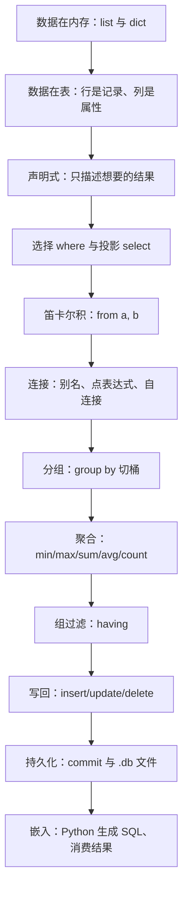
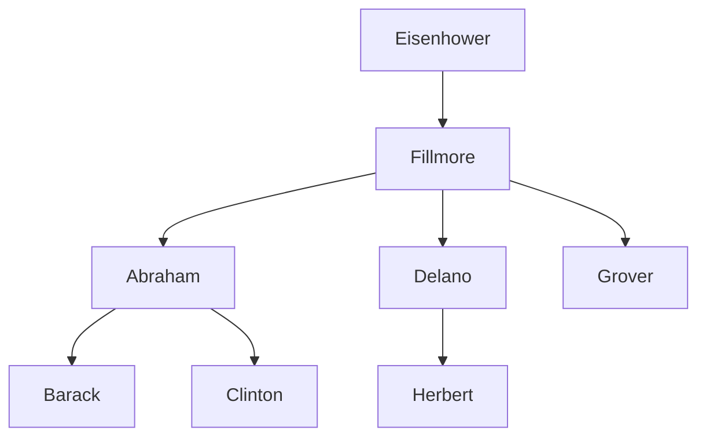
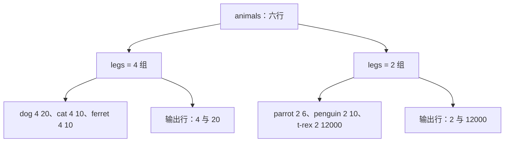
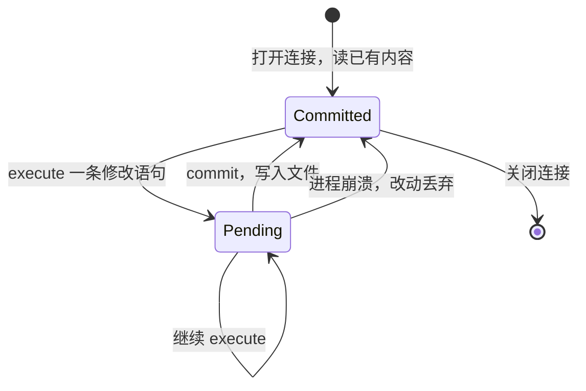
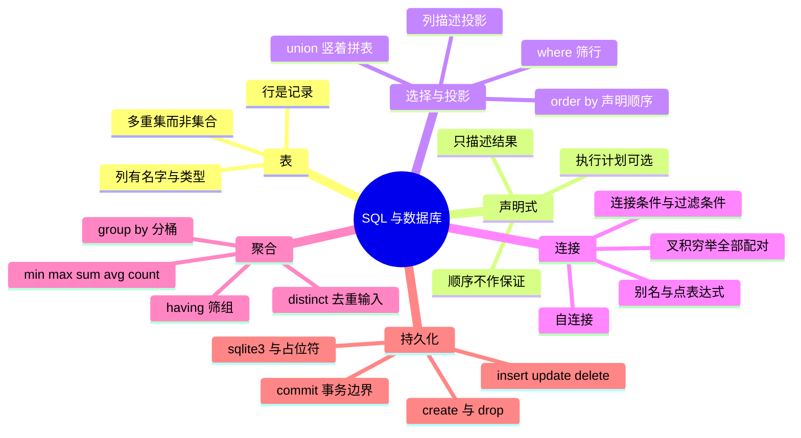

> **模块**：M7 CS61A-sql，含 Lecture 35–38（SQL、Tables、Aggregation、Databases）
> **总时长**：01:34:29（25:43 + 24:54 + 17:30 + 26:22），对应 B 站分 P 33–36
> **合集**：[CS61A Fall 2024 中文字幕合集](https://www.bilibili.com/video/BV1sy411z7nA)，本模块从分 P 33 起
> **课件**：`33-SQL_1pp.pdf`（17 页）、`34-Tables_1pp.pdf`（22 页）、`35-Aggregation_1pp.pdf`（13 页）、`36-Databases_1pp.pdf`（13 页），四份官方 PDF 共 65 页，全部逐页渲染为正文插图
> **字幕**：B 站英文原声字幕；四讲片源完整，但 Lecture 37 的课件后八页、Lecture 38 的语法铁路图页没有对应口播，正文按逻辑位置收录并逐处标注
> **版权**：课程与课件版权归 UC Berkeley CS61A 教学团队（Fall 2024）；本文是学习用途的中文二次整理，不是逐句翻译

## 0. 模块导览

*(参考时间: 00:00:01 – 00:00:16｜Lecture 35；00:00:01 – 00:00:04｜Lecture 36；00:00:01 – 00:00:11｜Lecture 37；00:00:01 – 00:00:07｜Lecture 38)*

前六个模块里，数据始终活在程序自己的内存里：列表、字典、对象，进程一退，一切归零。这个模块把数据搬出去，放进一个由名字指称、被独立系统管理的容器——**表（table）**。搬出去之后有两个变化。第一是归属：数据不再属于某个程序，而属于那个能打开它的地方，于是两个进程可以看着同一批行做事。第二是语言：操作这份数据的不再是 Python 语句，而是一门只描述结果、不描述过程的语言。

四讲排成一条从"说"到"做"、再到"存住"的链：35 讲建立语法与世界观，36 讲把表的数量从一张加多，37 讲换掉"行"这个统计单位，38 讲把前面所有查询落到磁盘。贯穿四讲的问题只有一个：**关系代数里的四种操作——选择、投影、笛卡尔积、分组——各自对应 SQL 的哪个子句，以及写下来的语句顺序为什么不是求值顺序。** 前者决定你读不读得懂别人写的查询，后者决定你会不会写出"看起来对、结果不对"的查询。

### 0.1 四讲清单

| 讲 | 主题 | 时长 | 课件 | 分 P | 在本模块里承担什么 |
| :--- | :--- | :--- | :--- | :--- | :--- |
| 35 | SQL 结构化查询语言 | 25:43 | 17 页 | [P33](https://www.bilibili.com/video/BV1sy411z7nA?p=33) | 表的结构、声明式与命令式、`select` 四部件、`union` |
| 36 | Tables 多表查询 | 24:54 | 22 页 | [P34](https://www.bilibili.com/video/BV1sy411z7nA?p=34) | 叉积、别名与点表达式、自连接、多表连接、表达式 |
| 37 | Aggregation 聚合 | 17:30 | 13 页 | [P35](https://www.bilibili.com/video/BV1sy411z7nA?p=35) | 五个聚合函数、`group by`、`having`、聚合与单值列 |
| 38 | Databases 数据库 | 26:22 | 13 页 | [P36](https://www.bilibili.com/video/BV1sy411z7nA?p=36) | 建表删表、三种修改、`sqlite3`、事务与多连接 |

四份课件的封面都是白底一行标题，页面上没有知识点：


### 0.2 主线图



这张图有两条轴。竖着看是**位置**：数据从进程内存走到表、再从表走到磁盘文件。横着看是**单位**：选择与投影以"一行"为单位，笛卡尔积把两行拼成一行，分组与聚合把"一组行"当成单位，写回又把单位还原成一行。越往下走，程序员能控制的东西越少、能表达的东西越多。

图里最容易读错的是中间那一段：`from a, b` 与 `where …` 不是"先查两张表再筛选"，而是"先造出全部配对，再逐个判断"。这个误读是第 36 讲全部困惑的来源，也是本篇 §3 要拆掉的第一块砖。

### 0.3 每一讲留下的账

| 讲 | 它给出的工具 | 它留下的问题 | 谁接住了 |
| :--- | :--- | :--- | :--- |
| 35 | 表与列、`select`/`from`/`where`/`order by`、`create table as`、`union` | 只能查一张表，一次只能看一行 | 36 |
| 36 | 叉积、别名与点表达式、自连接、多表连接、表达式 | 输出永远是"一行一行"，无法回答"一共多少" | 37 |
| 37 | 五个聚合函数、`group by`、`having` | 表只活在一次会话里，关掉就没了 | 38 |
| 38 | 建表删表、三种修改、`sqlite3`、`commit` | 并发、索引、查询优化，留给数据库课程 | 本篇 §6 与工程清单 |

第三列比前两列重要：每一讲都在**留下一笔没结的账**，下一讲不是"新章节"，而是"来结账的"。记住这条因果链，四讲的顺序就不必死背——"单表 → 多表 → 分组 → 落盘"这个顺序是被问题逼出来的。

### 0.4 关于这 65 页课件

四份 PDF 与课堂讲述并不同步，必须先交代清楚，否则读者会对不上号：

- Lecture 35 的第 3–7 页是五个学年的封面素材，只有画面没有讲解；第 16–17 页的"UC Salary Data"分节页与拨款柱状图也没有口播，录像在 25:41 就停了。
- Lecture 36 的 22 页基本都讲到了；第 18 页的三只狗练习是纯演示，讲师没有念出答案。
- Lecture 37 的第 6–13 页没有口播：录像在 `having` 演示后结束（全长 17:30），`cal` 表案例、拨款背景图、两组练习都只能靠课件画面。
- Lecture 38 的第 4、5、7、8、9 页是 SQLite 官方语法铁路图，讲课只用到被画成黑色的那几条骨架路径。

编排原则因此是**页随内容走，不随讲次走**：65 页里每一页只在它最能说明问题的那一节出现一次；没讲到的页面，正文用 `编者说明` 标明"画面取自课件，评述由编者补写"。

### 0.5 阅读路线

- 只想知道 SQL 怎么写：读 §1 与 §2，两章合起来就是 `select` 的完整语法与语义。
- 卡在多表查询上：直接读 §3，重点看 §3.2 的叉积规模与 §3.5 的两种条件之分。
- 被 `group by` 绕晕：读 §4，重点看 §4.4 的行集阶段表与 §4.5 的 `where`/`having` 分工。
- 要写一个真能跑的数据库程序：读 §5，重点是 §5.6 的占位符与 §5.7 的事务边界。
- 想一次看懂四讲怎么咬合：读 §6 那条十步演进链。

## 1. 声明式：SQL 只说你想要什么

*(参考时间: 00:00:01 – 00:02:49｜Lecture 35)*

第 35 讲的第一句话不是语法，而是位置：数据库把数据放在结构化的表里。前面六个模块里，数据的形状一直由程序员设计，随手就能造一个列表或对象；这个模块里，形状由**表**规定，而表归另一套软件管。写 SQL 时你不再是在"造数据结构"，而是在"向一个已有的数据结构提要求"。


课件接着插入五张历年封面。它们是同一门课在不同学年的标题素材，不承载知识，但放在一起能看出时间尺度：SQL 这部分的骨架十来年没有变过，变的只是例子里的歌单和狗的名字。


### 1.1 一张表：行是记录，列是属性

数据库管理系统（Database Management System，DBMS）被讲师称为"最大、最常被使用、也最值得研究"的一类软件。它要解决的从来不是"算出一个数"，而是"数据很多、使用者很多、时间很长时，怎样仍然能准确地取出想要的那一部分"。机构愿意为它支付高昂费用，同时这个领域也有质量很高的开源实现——两件事同时成立，说明它既难又重要。

课件用三条论据说明数据为什么值钱：AI 由数据训练出来；数字图像由像素数值构成；大公司最看重的资源是关于用户的数据。三条指向同一个结论：数据本身不是答案，**能被结构化地存放、被准确地查询，数据才产生价值**。


表就是最常见的那种结构。一张表是记录的集合；记录就是行，每一行对表中的每一列都有一个值；列有名字，名字说明它装的是哪个属性，通常还带类型，类型决定这一列能放什么、能怎样比较。


课件用一张三行三列的城市表：Latitude、Longitude、Name，三行分别是 Berkeley（38, 122）、Cambridge（42, 71）、Minneapolis（45, 93）。表头不是记录，它只是列名。

行与列的分工可以用一句话记住：**行描述"一个东西"，列描述"所有东西的同一个属性"**。增加一座城市是加一行；增加"人口"是加一列，而这一列必须对已有的每一行都有值。这个约束看起来死板，正是它让查询变得可预测：任何一行的任何一列都可以被引用。

| 判据 | 行（row / record） | 列（column） |
| :--- | :--- | :--- |
| 表示什么 | 一个完整的对象 | 所有对象共有的一个属性 |
| 增长方式 | 增加记录 | 增加属性，旧行必须补值 |
| 查询时的作用 | 被过滤、被投影的单位 | 被引用、被比较的单位 |

SQL 全称 Structured Query Language，可能是世界上使用最广的编程语言。它确实是一门编程语言：能由已有的表生成新的表，也能改动表的内容。特别之处只在于"程序"长得像英语句子，读起来几乎就是一句需求。一个只在内存里成立的类比是把表想成"键相同的字典组成的列表"；它解释不了数据库真正的价值——几百万行放在磁盘上，还能借索引跳过其中绝大多数。

### 1.2 声明式与命令式：食谱与点单

SQL 是一门**声明式（declarative）**语言：程序是对期望结果的描述，解释器自己想办法生成这个结果；Prolog 是另一个例子。**命令式（imperative）**语言相反：程序描述一个计算过程，解释器按写好的求值规则把过程走一遍，Python 与 Scheme 都属于这一侧。

| 判据 | 命令式（imperative） | 声明式（declarative） |
| :--- | :--- | :--- |
| 程序描述的对象 | 计算过程：先做什么、再做什么 | 期望的结果：要什么 |
| 谁决定执行步骤 | 程序员写下的规则，解释器照做 | 解释器或 DBMS 自行选择 |
| 课程中的代表 | Python、Scheme | SQL、Prolog |
| 可预测性 | 求值顺序基本可预期 | 取决于数据分布与执行计划 |
| 写程序的成本 | 高：步骤要写全 | 低：只写结果 |


课件用做饭打这个比方。命令式是一份写死每一步的食谱：两茶匙盐、两茶匙酵母、三杯面粉、两大勺橄榄油、四分之一杯水、开始搅拌、把面团放到案板上。声明式的点单只有一句："给我做一个披萨。"面团怎么揉、烤箱多少度、先放芝士还是先放酱，是店里的自由。

这门课此前大部分时间在训练一件事：写下一行程序时，能在脑子里预演解释器会做什么。声明式语言把这件事变难了。同一条查询往往有多种执行方式，DBMS 会挑它认为最快的那一种，而"最快"取决于表有多大、有没有索引、数据怎么分布。代价换来的是省力，而且这是一笔明确的交换：写查询的工作量下降，理解查询的难度上升。后面三讲里反复出现的"输出顺序不对""结果行数比预期多"，都是这笔交易的账单。

### 1.3 执行计划：那句"一句话"背后的算子


课件贴了一张 SQL Server 的真实执行计划。同一条查询被拆成一棵算子树：Hash Match、Index Scan、Compute Scalar 各自带着代价估计与行数估计。换一种计划，快慢可能差出几个数量级；选哪一种，取决于表有多大、有没有索引、数据怎么分布。

三个算子对应三个"怎么做"的决定：先扫哪张表、怎样把两侧的行对上、什么时候算表达式。这也是本模块标题里"代价模型"的意思：SQL 把代价的**决策权**换成了书写的简洁，代价本身没有消失，只是转移到了系统的临时决定里。

### 1.4 标准、方言与两条骨架语句


SQL 有标准，由一套被广泛接受的规范定义；唯一不完全接受它的人，是那些真正实现 DBMS 的厂商——每家都想让自家产品多几个别人没有的功能。于是 SQL 有很多方言：基本语法一致，边缘功能各说各话。本课程只取交集，也就是所有 DBMS 都同意的那一部分。

两条语句撑起前半模块。`select` 创建一张新表，可以从零创建，也可以从已有的表投影；`create table` 给一张表一个全局的名字，让它可以被后来的语句引用。`select` 单独使用时结果只显示、不保存；要反复使用，就必须 `create table ... as`。至于 `insert`、`update`、`delete` 这三条改动表内容的语句，以及 `analyze`、`explain` 这两条诊断语句，前半模块只点名，第 5 章再展开。

想动手有三条路：装一个 SQLite（最简单，也免费）；用在线版 SQLite；或者用教材附带的 SQL Example 程序。最后一个不是完整的 DBMS，只演示 `select` 的解释过程，但前两讲的例子它都能跑。课程网的 `code.cs61a.org` 上也带一个 SQL 解释器，§3 那两张狗的血统表就是内置在那里的。

> **编者说明**：`explain` 显示执行计划、`analyze` 收集统计信息，这两条与 §1.3 那张执行计划图直接相关，但课程只点名，没有展开。

## 2. 投影与拼表：一条 SELECT 的全部部件

*(参考时间: 00:02:50 – 00:25:41｜Lecture 35)*

上一章回答"SQL 是一门什么样的语言"，这一章回答"它到底能做什么"。两者之间隔着一个很具体的动作：先造一张表，再把它投影成另一张表。这一章按"造表 → 拼表 → 过滤 → 逐行算术"走一遍，最后停在两个容易被忽略的结论上：投影不去重，输出不保序。

### 2.1 create table ... as：给一次查询一个名字

表通常不是凭空造出来的：它由别的应用写入——日志、表单、传感器，一行一行积累。SQL 也允许从零建表，课程先用这个办法造几张很小的表，好让后面的查询有东西可查。

```sql
create table cities as
  select 38 as latitude, 122 as longitude, "Berkeley" as name union
  select 42, 71, "Cambridge" union
  select 45, 93, "Minneapolis";
```

这段语句做了三件事：`create table cities as` 声明"把后面的查询结果存成 `cities`"；第一条 `select` 描述一行三列并给列名；两条 `union` 把另外两行接上。引号区分了值与名字——`"Berkeley"` 带引号因为它是值，`latitude` 不带引号因为它是列名；缺了引号，Berkeley 会被当成列名去找。

> **编者说明**：SQLite 允许用双引号写字符串；标准 SQL 更严格，字符串用单引号，双引号留给标识符。课件统一用双引号，本文照此转写。后文 `ints` 表里带双引号的 `"1"`、`"2"` 是列名，因为那张表确实有这些列。

`union` 有三条规则：两边列数相同；对应列类型相容；列名取第一段的写法。前两条是硬约束，第三条只是命名习惯。一段只含字面量的 `select` 生成一行，接两次就是三行——这显然不是建表的常规方式，只有在真的一无所有时才会这样写。有了表，就可以问问题了：

```sql
select "west coast" as region, name from cities where longitude >= 115
union
select "other", name from cities where longitude < 115;
```

结果三行，而查询里只写了两段 `select`：第二段描述的不是一行，而是所有经度小于 115 的行。

| region | name |
| :--- | :--- |
| west coast | Berkeley |
| other | Cambridge |
| other | Minneapolis |

查询的输出由数据决定，这正是它有用的地方。顺带一个细节：Cambridge 是马萨诸塞州的 Cambridge，纬度 42、经度 71 说明它在北美——坐标不只是装饰，它们是判断的依据。

### 2.2 union：竖着拼表，顺带去重

把主题换成狗。讲师喜欢狗，也喜欢美国总统，于是他的狗按字母顺序取名：Abraham、Barack、Clinton、Delano、Eisenhower、Fillmore、Grover、Herbert。名字从 A 排到 H，是为了让后面的字符串比较一眼能看懂。这些狗构成一棵家谱，用一张两列的表就能表示：每一行是一条父子边。

```sql
select "Abraham" as parent, "Barack" as child union
select "Abraham", "Clinton" union
select "Delano", "Herbert" union
select "Fillmore", "Abraham" union
select "Fillmore", "Delano" union
select "Fillmore", "Grover" union
select "Eisenhower", "Fillmore";
```

七行两列。第一段的 `as parent`、`as child` 给结果定了列名，后面六段只写值；所有语句都以分号结束。

| parent | child |
| :--- | :--- |
| Abraham | Barack |
| Abraham | Clinton |
| Delano | Herbert |
| Eisenhower | Fillmore |
| Fillmore | Abraham |
| Fillmore | Delano |
| Fillmore | Grover |

把这张表按父子关系画出来，就是课件右侧手绘的那棵树：



表与树是同一份数据的两种视角：表是扁平的行集合，树是这些行按 parent-child 关系连起来的样子。存储格式只有一种，解读方式可以有很多种。这一点在下一章会变成威力：一张表可以和自己连接，于是"兄弟""祖孙"这类关系不必另存一张表就能算出来。

`create table` 再把一次查询的结果变成可以积累的数据：

```sql
create table [name] as [select statement];
```


课件的演示是一张歌单：`spotify` 记录讲师最常听的几首歌，每行一首，两列是曲名与歌手。

```sql
create table spotify as
  select "wildflower" as track, "billie eilish" as artist union
  select "birds of a feather" , "billie eilish"          union
  select "360"                , "charli xcx"              union
  select "pasilyo"            , "sunkissed lola"          union
  select "cinderella"         , "remi wolf"               union
  select "good luck babe!"    , "chappell roan"           union
  select "meow"               , "anamanaguchi";
```

缩进与对齐只是给人看的。SQL 对空格与大小写不敏感，整条语句写在一行也完全正确；课件把 `union` 与逗号对齐，是为了让"哪一列对哪一列"一眼可见。这张表在后面会被反复查询，它同时也是"第一段决定列名"的例子。

### 2.3 from、where、order by：投影的三件套


投影（projection）的意思很直接：对输入表的每一行，按列描述算出一个输出行。

```sql
select [columns] from [table] where [condition] order by [order];
```

四个部分各管一件事：`from` 说从哪张表取行，`where` 说哪些行留下，`order by` 说留下的行按什么排，列描述说每个留下的行怎样变成输出行。课件里的两个查询都很短：

```sql
select child from parents where parent = "Abraham";
```

先在 `parents` 里找 `parent` 等于 `Abraham` 的行，有两行；再把每行的 `child` 投出来，得到 Barack 与 Clinton。

```sql
select parent from parents where parent > child;
```

字符串比较按字母序：F 在 A、D 之后，所以 Fillmore 作父亲的三行里，Abraham 与 Delano 两行满足，Grover 那行不满足；其余行同样不满足。结果是 Fillmore 出现两次。

| parent |
| :--- |
| Fillmore |
| Fillmore |

两行完全相同的值可以同时存在于一张表里。表不是集合，而是多重集（multiset）：投影只负责算值，不负责去重。这一点与 `union` 正好相反：`union` 去重，`select` 不去重。

> **编者说明**：`order by` 在课件里只出现了语法，没有演示。它的写法是 `order by 列名`，默认升序，加 `desc` 降序；`limit N` 只取前 N 行。三者常常成对出现：先排序，再取前几名。这段补充不在录像里。

### 2.4 表达式的作用域是一行

`select` 的表达式里可以做算术：列名在表达式里代表当前行的值。课件用滑雪场的缆车做例子——每把椅子有一个编号，记录单独乘客的人数与情侣的对数，一对情侣占两个座位。

> **编者说明**：缆车表没有出现在课件里，列名与各行数字按讲师口述复原（101 号两个单独乘客和两对情侣、102 号三对情侣、103 号几乎都是单独乘客，且每行合计 6 人）。

| chair | single | couple |
| :--- | :--- | :--- |
| 101 | 2 | 2 |
| 102 | 0 | 3 |
| 103 | 6 | 0 |

```sql
select chair, single + 2 * couple as total from chairs;
```

每一行算一次：101 是 2 + 2×2 = 6，102 是 0 + 2×3 = 6，103 是 6 + 2×0 = 6。三行都坐满六个人，只是配置不同。

| chair | total |
| :--- | :--- |
| 101 | 6 |
| 102 | 6 |
| 103 | 6 |

关键在"没有跨行"：算 101 的 `total` 时，表达式只读 101 这一行的 `single` 与 `couple`；102、103 各算各的。讲师特意强调这一点，因为它是后面聚合的分界线——一旦表达式里出现"把多行合起来"的函数，行的边界就被打破了。列名在这里的作用像局部变量：作用域是当前这一行，所以同一个列名在每一行取不同的值，表达式却只写一次。

### 2.5 讨论题：ints 表与 2 的幂

讨论题的素材是一张 `ints` 表，描述每个整数怎样写成 2 的幂之和。每个正整数都有且只有一种写法，所以这张表其实是在枚举二进制；四个幂分别是 1、2、4、8。

| word | 1 | 2 | 4 | 8 |
| :--- | :--- | :--- | :--- | :--- |
| one | 1 | 0 | 0 | 0 |
| two | 0 | 2 | 0 | 0 |
| three | 1 | 2 | 0 | 0 |
| four | 0 | 0 | 4 | 0 |
| five | 1 | 0 | 4 | 0 |
| six | 0 | 2 | 4 | 0 |
| seven | 1 | 2 | 4 | 0 |
| eight | 0 | 0 | 0 | 8 |

> **编者说明**：课件没有给出 `ints` 的建表语句，表结构与查询按讲师口述复原。他把四列称作"the 4 column""these 1, 2, 4, and 8 up here"，因此列名取 `1`、`2`、`4`、`8` 并加双引号——标识符不能以数字开头，加引号才能被当作列名。

第一问：给每个整数两列，`word` 与 `value`，后者是四个幂的和。

```sql
select word, "1" + "2" + "4" + "8" as value from ints;
```

结果恰好是 1 到 8。`"1"` 看起来像数字，但它在表达式里是列名——`select` 的表达式里出现的名字，永远先按列名解释。这也是建表时要把这些列名括起来的原因：不加引号，`1` 就只是数字字面量，四个常量相加对每一行都等于 15。

第二问：只留下 2 的幂。判断方法是"恰好一个二进制位是 1"：把每一列除以它自己的幂，四个列就都变成 0 或 1，四个 0/1 相加等于 1 即满足。

```sql
select word from ints where "1" + "2"/2 + "4"/4 + "8"/8 = 1;
```

结果是 `one`、`two`、`four`、`eight` 四行。这段 `where` 里的除法是在把"这一列有没有被选中"归一化成 0/1：`"2"/2` 在值为 2 时得 1、在值为 0 时得 0，其余同理。真正值得停下来的是执行时看到的现象：在 SQLite 里 `select * from ints;`，行的顺序和建表时写的并不一样，变成了按 `word` 的字母序。原因在 `union`：它要去掉重复行，而去重的一种实现是先把所有行排序、再扫描相邻行；顺序是去重的副产品。

| 操作 | 是否去重 | 顺序是否有保证 |
| :--- | :--- | :--- |
| `select` 投影 | 不去重 | 不保证 |
| `union` | 去重 | 不保证，可能被排序打乱 |
| `order by` | 不去重 | 按声明的键排序 |

这是声明式语言的第一个真实代价：同一条查询，系统可以按它认为最快的方式执行，输出的顺序可能随数据、版本、计划而变。把"顺序"当成查询的一部分写下来，结果才是可复现的。

### 2.6 从演示到真实数据


录像到"2 的幂"就结束了，课件最后两页没有讲解。第 16 页是分节页 Example: UC Salary Data, Passwords，页脚给出两个数据来源——Transparent California 的 UC 薪资数据与 Kaggle 上的泄漏密码数据集。


第 17 页是一张柱状图，标题为 State Educational Appropriations，横轴 FY01 到 FY21，纵轴是百万美元。图上标出 2001 与 2008 两次衰退以及 COVID-19；两条注释给出换算：2001 年的 1 美元相当于 2021 年的 1.53 美元；按通胀调整，州政府对 UC 的支持自 2001 年以来下降 46%。美国加州 2001 年秋季 32,128 名学生对应生均 23,811 美元，2021 年秋季 45,057 名学生对应生均 7,857 美元。

这两页不教语法，却说明 SQL 的用武之地：真实的表往往又大又杂，查询的价值在于把"拨款、学生数、年份"这些列组合成能回答问题的结果。同一个动机在第 37 讲又出现了一次，那时它换来的是一个能落地的查询（§4.6 会给出 `cal` 表案例）。

> **编者说明**：这两页在录像中没有出现，以上内容按课件画面记录，不代表课堂讲解。

## 3. 多表：叉积是一切的起点

*(参考时间: 00:00:01 – 00:24:53｜Lecture 36)*

上一章的查询有一个隐含限制：输出行数不会超过输入行数。`where` 只会删行，列描述只会改行。多表连接是第一个能改变行数的操作，而且它先做乘法、再做减法——`from a, b` 造出全部配对，`where` 才决定哪些配对算数。多表查询的疑惑因此只剩两问：叉积有没有穷举对，条件有没有把两种条件分清。

### 3.1 复习：一条 select 只是在投影


上一讲的工具可以用一行语法概括，每个方括号都是可替换的部件：

```sql
SELECT [columns] FROM [table] WHERE [condition] ORDER BY [order];
```

`FROM` 指定输入表；列描述决定每一行输入怎么投影成输出；`WHERE` 挑出行的子集；`ORDER BY` 声明顺序；`[column] AS [name]` 只改输出表头，不改原来的表。


值得单独强调一次的是：**列描述是逐行作用的**。输入多少行，输出就有多少行（除非 `WHERE` 先筛掉一些）。这条"行数不变"的性质是理解连接的基础——连接之所以特殊，正是因为它会先改变行数。页面底部还有三条工程约定：SQL 对大小写与缩进不敏感；分号标记语句结束；一条语句可以写在很多行里。

### 3.2 连接的第一种视角：穷举全部配对


录像里讲师先打预防针：随便找个人问"什么是 join"，对方多半会反问"你说的是哪种 join"。数据库领域琢磨这个问题的时间太长，发明出来的连接方式多到连专业人士也嫌复杂。本讲只讲最基础的一种，其余种类都可以看成在它之上加条件或补行。定义只有一句话：**表 A 与表 B 用逗号（或关键字 `JOIN`）连接，得到"A 的一行"与"B 的一行"组成的全部组合。** 重点不在"组合"，而在"全部"。

课件用两张朋友圈歌单当例子：

```sql
CREATE TABLE shm_tracks AS
SELECT "360" AS track, "charli" AS artist UNION
SELECT "cinderella"     , "remi"             UNION
SELECT "wildflower"     , "billie";

CREATE TABLE anya_tracks AS
SELECT "apple" AS track, "charli" AS artist UNION
SELECT "taste"         , "sabrina"          UNION
SELECT "wildflower"    , "billie";
```


`CREATE TABLE … AS` 后面跟的不是字面数据，而是三条不带 `FROM` 的 `SELECT`——它们没有输入表，只凭空造一行。两张表结构完全一样：两列，`track` 与 `artist`。这类"同构的两张表"是连接最常见也最容易出错的场景。


挑战是：写一条 `SELECT` 找出两人共同拥有的曲目，而且歌多到几百首时还能用。手工做会怎么做？**拿第一张表的每一行，去和第二张表的每一行比一遍**——这不是算法技巧，而是连接的定义本身。三行乘三行，九次；一般情况是 $N \times M$ 次。手写九行不可能推广，所以要让 SQL 去穷举。


```sql
SELECT * FROM shm_tracks, anya_tracks;
```

九行、四列。列的顺序是"先 A 的全部列，再 B 的全部列"，行的顺序是"A 的第一行配 B 的三行，然后 A 的第二行配 B 的三行……"——外层循环走 A，内层循环走 B。讲师的关键点评是：这里很多行彼此毫无关系，比如"360"被配给了"taste"。**它们出现在结果里不是因为有任何联系，而是因为穷举。** 叉积不假装懂业务，它只负责把所有可能性摆上桌；哪一种配对才算数，是 `WHERE` 的工作。

想挑一列，重名问题立刻暴露：

```sql
SELECT track FROM shm_tracks, anya_tracks;
```

```text
Parse error: ambiguous column name: track
```

两张表都有一列叫 `track`，解析器无法判断你说的是哪一个。

值得记住的是：**行数在 `FROM` 里就已经确定**，后面的 `WHERE` 只会减少、不会增加。结果行数比预期多，问题多半在叉积，而不在 `WHERE` 漏写了什么。

同一个连接有两种读法，这一节讲的是第一种：

| 判据 | 视角 A：先叉积、后过滤 | 视角 B：边匹配、边合并 |
| :--- | :--- | :--- |
| 语句写法 | `FROM a, b WHERE 条件` | `FROM a JOIN b ON 条件` |
| 中间行的存在性 | 概念上真实存在，可能非常大 | 概念上不存在，由算法直接产出合法行 |
| 行数何时确定 | 在 `FROM` 那一刻就是 $N \times M$ | 由匹配过程逐行累积 |
| 实现手段 | 嵌套循环（外层 A、内层 B） | 嵌套循环、哈希连接、排序归并、索引查找 |
| 教学用途 | 解释"为什么多表查询行数会爆炸" | 解释"为什么真实系统扛得住" |

**验算时用视角 A**，因为中间表能一行一行列出来；**判断性能时用视角 B**，因为优化器改的正是匹配顺序与算法。这个分裂就是 §1 那句"声明式把代价的决策权拿走"在多表查询上的具体表现。

### 3.3 别名与点表达式：把重名列说清楚


讲师先做了个临时约定：假装"每一列的名字在所有表里都不一样"，把叉积和 `WHERE` 用熟，等撞上重名再回来处理。消歧语法本身很轻，难的是先想清楚"连接之后，一行里混着两张表的列"。解法有两半，合起来才完整：**点表达式** `表名.列名` 指明这一列来自哪张表；**别名** `FROM shm_tracks AS s` 给表起短名，之后用 `s.track` 指代它。


```sql
SELECT shm_tracks.track AS s_track, shm_tracks.artist AS s_artist,
       anya_tracks.track AS a_track, anya_tracks.artist AS a_artist
FROM shm_tracks, anya_tracks;
```

结果仍是九行四列，但四个表头互不相同。这是本节最重要的产出——**给列改名不是美化，而是让后续的 `WHERE` 有名字可用**：原来那两个 `track` 是同一个字符串，SQL 无法区分；改名之后，`s_track` 与 `a_track` 是两个不同的标识符，条件才写得出来。


```sql
... WHERE s_track = a_track;
```

九行里只有一行满足：wildflower 在两边都是 billie 唱的。注意"共同歌曲"本身有歧义——曲名相同就算，还是曲名与歌手都相同才算？这个数据集里两种定义给出同一行，真实数据里会分道扬镳，写查询前必须先决定。把 `WHERE` 换成 `s_track = a_track OR s_artist = a_artist`，九行里留下两行（`360` 配 `apple` 因歌手相同，`wildflower` 因曲子相同）。改动虽小，却暴露了连接的本质：`WHERE` 里的条件是对**每一个配对**独立求值的布尔表达式。

### 3.4 自连接：让一张表同时出现两次


新问题需要更多数据：同一歌手的"成对曲目"。原来的歌单里每位歌手只出现一次，所以先插两行：

```sql
INSERT INTO shm_tracks VALUES ("bad guy", "billie");
INSERT INTO shm_tracks VALUES ("apple", "charli");
```

`INSERT INTO` 的模板里没有列名，只有值，这意味着**值的个数与顺序必须与表的列一一对应**。写反了不会报错，只会静默地把歌手写进曲名那一列。


要造一张"两列曲名"的表，需要两行数据同时在场，而表里每行只有一个曲名——**唯一的办法是让这张表出现两次**：

```sql
SELECT a.track AS track1, b.track AS track2
FROM shm_tracks AS a, shm_tracks AS b;
```

课件停在这里问：会显示多少行多少列？25 行、2 列。五行的表与自身叉积，得到 $5 \times 5 = 25$ 个配对。**自连接不会因为"是同一张表"而变小，它照样是完整的笛卡尔积。** 别名 `a`、`b` 就是把"同一张表的两个角色"变成两个可区分的名字。


```sql
SELECT a.track AS track1, b.track AS track2
FROM shm_tracks AS a, shm_tracks AS b
WHERE a.artist = b.artist AND a.track < b.track;
```

结果两行：`360` 与 `apple`（charli）、`bad guy` 与 `wildflower`（billie）。`a.artist = b.artist` 是**连接条件**，把两张副本里同一位歌手的行缝在一起；`a.track < b.track` 是**去重条件**，决定一对歌只保留一个方向。

为什么用小于号而不是不等号？把 `<` 换成 `<>`，功能上也能出结果，但会变丑：25 个配对里 `<>` 留下 20 行，而这 20 行两两互为反向写法，真正的歌对只有 10 组；再叠上"同歌手"，`<>` 给 4 行，`<` 只给 2 行。根本原因是 `<>` 对称（$(x, y)$ 成立则 $(y, x)$ 必然成立），而 `<` 反对称（一对里恰好一条满足）。讲师的原话是：如果用"不等"，就会既说"Barack 是 Clinton 的兄弟"又说"Clinton 是 Barack 的兄弟"，同一件事说了两遍。

这条经验可以推广成一句判据：**当答案是无序对时，用 `<` 或 `>` 挑代表；当答案是有序对时，用 `<>` 保留两个方向。**

### 3.5 两张表与一棵树：连接条件与过滤条件


CS61A 的经典数据集：一张 `dogs` 记名字与毛色，一张 `parents` 记亲子关系。课件右侧画了两次这棵树，左边用名字，右边用代号 E、F、A、D、G、B、C、H；八个代号同时是课件名与录像名的首字母（ellie／Eisenhower 都是 E），所以两套名字能一一对上。

问题是：显示卷毛狗的父母。

```sql
SELECT parent FROM parents, dogs WHERE child = name AND fur = "curly";
```

一条语句包含本章全部要点：`FROM parents, dogs` 是叉积（七行乘八行，五十六行胡乱配对）；`child = name` 是**连接条件**，跨两张表，说"`parents` 里那个孩子就是 `dogs` 里那只狗"；`fur = "curly"` 是**过滤条件**，只涉及一张表；`SELECT parent` 是投影。结果 `ellie` 与 `daisy`（录像里是 Eisenhower 与 Delano）。

| 判据 | 连接条件（join condition） | 过滤条件（filter condition） |
| :--- | :--- | :--- |
| 涉及几张表 | 两张（或多张）表的列 | 通常只有一张表 |
| 本例 | `child = name` | `fur = "curly"` |
| 若删掉它 | 叉积照旧，但配对全是错配 | 行数变多，留下的仍是正确配对 |
| 回答的问题 | 这两行说的是不是同一件事 | 这些行我要不要 |
| 写错的后果 | 得到"数量对、内容错"的答案 | 只是多几行或少几行 |

这就是为什么连接条件写错比过滤条件写错危险得多：后者让你看到数量不对，前者让你看到数量对、内容错的答案，而数据集小的时候往往分辨不出来。

录像里讲师没有一次写完，而是分两步逼近：先写 `SELECT * FROM parents, dogs WHERE child = name` 得到七行（每条亲子关系恰好配上一只狗），再追加 `AND fur = "curly"` 降到两行，最后把列描述改成 `SELECT parent`。这三步正好是"叉积 → 过滤 → 投影"。他说了一句很朴素的话：先看看我们进行到哪一步了——多表查询不要一次写完，先跑连接看行数，再加条件、再收列。

为什么分成两张表？把毛色直接写进 `parents` 也能用，代价是同一只狗的毛色被反复存储：`finn` 有三个孩子，"curly"就要写三遍，任何一处写错同一只狗就有了两种毛色。拆开之后每只狗的毛色只存一次，代价是每次都要多写一次连接。这就是关系数据库的基本取舍——**用连接的开销换数据的一致**。演示时还有个实用细节：建表语句放在 `dogs.sql` 里，启动 SQLite 时用 `-init` 旗标先执行一遍，把"建数据"与"查数据"分开。

### 3.6 三张表：祖父母与同毛色


多张表的语义完全一样：**每张表各取一行，所有组合。** 三表就是立体的三元组，行数是各表行数之积。课件先给了一道选择题，用一张表连接自身找祖父母，五个候选只有第 3 个正确：

```sql
SELECT a.parent, b.child FROM parents AS a, parents AS b
WHERE b.parent = a.child;
```

错项各有各的错法：选项 1 与 4 引用了不存在的 `grandparent` 列；选项 2 把条件写成 `a.parent = b.child`，方向反了，得到"自身配自身"一类的行。第 3 个读起来像绕口令：`b.parent = a.child` 的意思是——`a` 这一行里有个孩子，`b` 这一行里有个父母，如果这两个名字是同一个人，那么 `a` 的父母就是 `b` 的孩子的祖父母。行内人把这叫"中间人"：祖父与孙子要通过中间那一代才连得起来，而表里没有"祖父"列，只有"父—子"关系，所以必须把表用两次。


```sql
CREATE TABLE grandparents AS
  SELECT a.parent AS grandog, b.child AS granpup
  FROM parents AS a, parents AS b
  WHERE b.parent = a.child;
```

列名 `grandog`（祖狗）与 `granpup`（孙狗）是课件自造的词，但命名有意义：列名应当说明这一列在**结果里的角色**，而不是它原来在哪张表里叫什么。六行结果按祖狗验算：`ellie` 的三个孙辈正好是 `finn` 的三个孩子（`ace`、`daisy`、`ginger`）。这一步值得做，因为**三张表的查询出错，很少是语法错，多半是中间表算错了**。

下一个问题是"祖孙同毛色"，出现了全讲唯一的三表连接。为什么需要三张？因为 `grandparents` 只有名字没有毛色，要把两端的毛色比出来，必须回到 `dogs` 查两次，于是需要两个别名：

```sql
SELECT grandog FROM grandparents, dogs AS c, dogs AS d
WHERE grandog = c.name AND
      granpup = d.name AND
      c.fur = d.fur;
```

三个 `AND` 读成三句话：`c` 这份副本负责祖狗，`d` 负责孙狗，两端毛色要相同。行数：六行 × 八行 × 八行 = 384 行叉积，筛成两行（`ellie`、`finn`）。三次表引用不是浪费，而是**每一次引用都在为一次"查毛色"付费**。验算：`ellie`（short）的三个孙辈里只有 `ginger`（short）同毛色，`finn`（curly）的三个孙辈里只有 `hank`（curly）同毛色。


最后一页是 2014 年秋季小测改编题：选出**三只互不相同、毛色相同**的狗的所有组合，每组按逆字母序排列，期望输出两行（`daisy|charlie|ace` 与 `ginger|ellie|bella`，竖线是 SQLite 的列分隔符）。难点在"互不相同"——叉积会给出大量含重复的组合。期望输出给了提示：每组按逆字母序书写，这正好可以用 §3.4 那个技巧的推广。

> **编者说明**：课件只给了题目与期望输出，没有给答案，录像这一段也是纯演示。下面的语句是编者按题意重建的，用三次表引用加三个不等式同时表达"同毛色"与"互不相同、且只出现一个方向"。

```sql
SELECT a.name, b.name, c.name
FROM dogs AS a, dogs AS b, dogs AS c
WHERE a.fur = b.fur AND b.fur = c.fur
      AND a.name > b.name AND b.name > c.name;
```

三个不等式连起来等于要求 $a > b > c$：既排除任意两只相同，也保证每组只按一种顺序出现。行数变化很能说明问题：完全不筛是 $8^3 = 512$ 行，只保留毛色条件剩 $3^3 + 3^3 + 2^3 = 62$ 行，再加三个不等式只剩两行。核对毛色：`long` 三只、`short` 三只、`curly` 只有两只——凑不满三个，所以 `curly` 组一行也没有，这不是错误。

### 3.7 数值表达式：能写在哪，比能写什么更重要


连接把列凑到一起，表达式决定这些列能做什么。SQL 的数值表达式与 Python 几乎同一套，难点不在语法，而在**它能出现在哪里**：列描述里、`WHERE` 里、`ORDER BY` 里，三处规则相同。


课件把算子分成三类：合并（`+` `-` `*` `/` `%` `and` `or`）、变换（`abs` `round` `not` 一元 `-`）、比较（`<` `<=` `>` `>=` `<>` `!=` `=`）。比较类有两处与 Python 不同：**不等于有两种写法** `<>` 与 `!=`，完全等价；**等号只有一个 `=`**。讲师的理由很干脆：这里没有"赋值"这回事，所以单个等号没有别的用途。

录像里的演示从一张 `cities` 表开始（Berkeley、Cambridge、Minneapolis、San Diego、Miami，外加一只"其实不算城市但先放着吧"的 North Pole）。第一段演示是 `UNION`：`SELECT name FROM cold;` 得到 Minneapolis 与 North Pole，但 Chicago 也冷，于是把 `SELECT "Chicago"` 并进来。第二段是算术表达式——算两座城市之间的南北向距离：

```sql
CREATE TABLE distances AS
  SELECT a.name AS first, b.name AS second,
         60 * (b.latitude - a.latitude) AS distance
  FROM cities AS a, cities AS b;
```

又是自连接：`a` 与 `b` 是两个版本的 `cities`，所以能在同一行里放下两座城市的纬度。乘 60 是因为一度纬度约合 60 海里。讲师给的理由是业务判断：**气候主要由纬度决定，东西向的经度差别远没有南北向重要**——先想清楚"什么量对问题有意义"，再写 SQL。

```sql
SELECT second FROM distances WHERE first = "Minneapolis" ORDER BY distance;
```

`ORDER BY distance` 默认升序，于是负得最多的排最前，也就是往南走得最远的：最前是 Miami 与 San Diego，最后是 North Pole。这个例子的隐含教学点是：`ORDER BY` 里可以用表达式，甚至可以用列描述里刚起的别名——排序依据不必是输入的某一列。

> **编者说明**：这一段的字幕写的是"一度纬度有 16 海里"，但紧接着写出的表达式是 `60 * …`。按定义一度纬度约 60 海里（1 海里 = 1 分纬度），表达式与定义一致，字幕那个 16 应是口误或识别错误，本文以表达式为准。

### 3.8 字符串表达式：拼接、子串与"别用字符串存结构"


字符串的组合方式是拼接，算子是两条竖线：`SELECT "hello," || " world";` 得到 `hello, world`。讲师在这里语气明显轻松，说这是一件非常常见的事，所以"给它开了绿灯"。


但接下来的语气就变了。SQL 内置的字符串函数与 Python 的同名功能不同，而且讲师直说：**这门语言对字符串处理的支持并不算好**。

```sql
CREATE TABLE phrase AS SELECT "hello, world" AS s;
SELECT substr(s, 4, 2) || substr(s, instr(s, " ")+1, 1) FROM phrase;
```

结果是 `low`：`substr(s, 4, 2)` 从第 4 个字符取 2 个得到 `lo`；`instr(s, " ")` 找到空格在第 7 位，加 1 得 8，`substr(s, 8, 1)` 取到 `w`；两段拼起来就是 `low`。最容易踩的坑是**下标从 1 开始**：Python 里写 `s[3:5]`，SQL 里要写 `substr(s, 4, 2)`——起始位置加一，第二位是长度。习惯 0-based 的人写 SQL 字符串函数，第一个 bug 几乎总在这里。

真正让讲师摇头的是用字符串表示结构化数据：

```sql
CREATE TABLE lists AS SELECT "one" AS car, "two,three,four" AS cdr;
SELECT substr(cdr, 1, instr(cdr, ",")-1) AS cadr FROM lists;
```

得到 `two`——把一行当成链表：`car` 是第一个元素，`cdr` 是剩下元素用逗号拼起来的一串；取 `cadr` 就是找到第一个逗号，把前面那段切出来。讲师说这样做当然可以，但**通常不是好主意**：逗号分隔的约定没有任何约束力，元素里本身含逗号怎么办？空列表怎么表示？嵌套怎么办？每多一个边界情况就要多一层手写的 `instr` 判断，而关系数据库提供了"另开一张表"这个更直接的选项。**在表里塞字符串，等于把结构信息藏进文本，让数据库再也帮不上忙。**

| 运算 | SQL 写法 | Python 对照 | 差异 |
| :--- | :--- | :--- | :--- |
| 拼接 | 两条竖线 | `a + b` | 运算符不同 |
| 取子串 | `substr(s, 4, 2)` | `s[3:5]` | SQL 是 1-based，第二位是长度 |
| 找位置 | `instr(s, " ")` | `s.find(" ")` | SQL 返回 1-based，找不到返回 0 |
| 相等 / 不等 | `=` / `<>` 或 `!=` | `==` / `!=` | SQL 用单个等号 |
| 布尔值 | 没有独立类型，用 0/1 | `True` / `False` | 表达习惯不同 |

最后一个演示把本章两条线接在一起：**自连接提供组合，拼接把组合说成句子。** 一张 `nouns` 表（dog、cat、bird）一行一个名词，造句需要主语与宾语两个位置，于是又把 `nouns` 用了两次：

```sql
SELECT "the " || a.phrase || " chased the " || b.phrase AS sentence
FROM nouns AS a, nouns AS b
WHERE a.phrase <> b.phrase;
```

九个配对里筛掉三个"自己追自己"，剩下六句。这里用的是 `<>` 而不是 `<`，因为**"狗追猫"与"猫追狗"是两个不同的事实**，都要保留——与 §3.4 的成对曲目恰好相反。再进一步，把两个名词用 `and` 连成 `ands` 表，然后从 `ands` 而不是 `nouns` 取主语，语句形状一点没变，于是得到三十个合法句子。

> **编者说明**：课件没有这一段的 SQL，录像里讲师是一边敲一边讲，字幕没有记录完整语句。上面的写法按口述重建：`nouns` 存裸名词，句子模板里补上冠词 `the`，`ands` 的短语用 `and the`，这样输出正好与录像念出的句子一致。

讲师最后说的是：这就是语言组合的所有方式。名词表是一个集合，自连接产生**组合**，拼接把组合**渲染成字符串**——一个语法上无穷的句子集合，就这样从一张三行的表里长出来。用 CS61A 的话说，这又是一次"用小的、可组合的部件造出大的行为"。

## 4. 聚合：把一组行压成一个值

*(参考时间: 00:00:01 – 00:17:27｜Lecture 37)*

到第 3 章为止，所有查询都还在"一行进、一行出"的世界里：`where` 删行、列描述改行、连接把两行拼成一行，没有哪个操作能让输出行数少于输入行数。这一章换掉这个统计单位。聚合函数看的不再是一行，而是某一列在一组行上的全部取值；`group by` 则决定"一组"到底有多大。行数第一次可以在查询里**减少**，而减少的规则由组数决定。

### 4.1 聚合打破的参照系


此前每一个 SQL 表达式都只在**一行之内**取值。表达式出现在三处——列描述、`WHERE`、`ORDER BY`；这三处写的都是列名，而列名本身没有值，它指的是"某一行在这一列上的值"。于是 `WHERE latitude > 38` 的执行方式是逐行扫描：取出当前行的 `latitude`，与 38 比较，成立就留下。表达式本身是**按行求值**的，一个表达式只看得见当前这一行。

聚合函数打破的正是这个参照系：它看的不是一行，而是某个表达式在**多行**上的全部取值。换句话说，标量表达式的作用范围是一行，聚合表达式的作用范围是一组行。

| 判据 | 标量表达式 | 聚合表达式 |
| :--- | :--- | :--- |
| 求值单位 | 一行 | 一组行（默认整张表） |
| 典型写法 | `weight`、`latitude > 38`、`legs - weight` | `MAX(weight)`、`SUM(weight)`、`COUNT(*)` |
| 输出粒度 | 输入几行就输出几行 | 一组只输出一个值 |
| 直觉 | "这一行怎么样" | "这一列整体怎么样" |

### 4.2 animals 表与五个函数

为了研究聚合，课堂换掉此前的数据集，引入一张三列六行的小表：`kind`（种类）、`legs`（腿数）、`weight`（体重，单位是磅）。

| kind | legs | weight |
| :--- | ---: | ---: |
| dog | 4 | 20 |
| cat | 4 | 10 |
| ferret | 4 | 10 |
| parrot | 2 | 6 |
| penguin | 2 | 10 |
| t-rex | 2 | 12000 |

六行的来历讲得很随意，但每行都在埋伏笔：`legs` 只有 4 与 2 两种取值，天然适合演示分组；`weight` 有重复值（猫、雪貂、企鹅都是 10），会在按体重分组时被合并；12000 这个离群值（讲师原本想举鸵鸟，最终选了暴龙）则保证"最大值"与"平均值"给出截然不同的答案。

```sql
SELECT MAX(legs) FROM animals;      -- 4
SELECT SUM(weight) FROM animals;    -- 12056
SELECT MAX(legs - weight) + 5 FROM animals;   -- 1
```

第一句没有 `WHERE`，按以往经验该输出六行，却只输出一行 4——**聚合本身**就把多行压成了一行，与过滤无关。第三句值得手算：逐行算 `legs - weight` 得 -16、-6、-6、-4、-8、-11998，最大值出现在鹦鹉（-4），再在结果上加 5 得 1。加 5 发生在聚合**之后**，它是对"一个数"做的算术；写成 `MAX(legs - weight + 5)` 结果相同，但求值顺序不同。

```sql
SELECT MAX(legs), MIN(weight) FROM animals;        -- 4 | 6
SELECT MAX(legs) - MIN(weight) FROM animals;       -- -2
SELECT MIN(legs), MAX(weight) FROM animals WHERE kind <> 't-rex';   -- 2 | 20
```

第二行里的 `4` 与 `6` 很容易被误读成"有一只动物四条腿、六磅重"，但表里没有这样一只动物——六磅的鹦鹉只有两条腿。**两个聚合是彼此独立计算的**，值来自不同的行，SQL 只是把它们拼进同一个输出行。第三组对比说明 `WHERE` 改变的是"参与聚合的行集合"：去掉暴龙后 `legs` 的最小值仍是 2，而 `weight` 的最大值从 12000 落到 20。

`AVG` 与 `COUNT` 语义略有不同：`AVG(weight)` 等于 12056 除以 6，约 2009.3；`COUNT` 只回答"有多少行"，与参数是哪一列无关，所以惯用 `COUNT(*)`。真正需要写列名的是配合 `DISTINCT`：

```sql
SELECT COUNT(DISTINCT legs) FROM animals;     -- 2
SELECT COUNT(DISTINCT weight) FROM animals;   -- 4
SELECT SUM(DISTINCT weight) FROM animals;     -- 12036
```

`SUM(DISTINCT weight)` 先把重复的 10 合并成一个再去加，比不去重少 20——正好是被去掉的两个 10。这说明 `DISTINCT` 修饰的是**聚合的输入**，它在聚合之前去重，而不是在结果上去重。

> **编者说明**：多数 SQL 实现里 `COUNT(列名)` 只数该列非空的行，而 `COUNT(*)` 数所有行；`AVG` 的分母也是非空行数。本讲数据没有空值，六行全非空，所以两种写法结果一致。判断空值要用 `IS NULL`，不能写 `= NULL`——与空值做比较得到的是"未知"，`WHERE` 不会保留这样的行。

### 4.3 那个"被选中的行"

课件允许在同一份列描述里混写聚合与不带聚合的列名：

```sql
SELECT MAX(weight), kind FROM animals;   -- 12000 | t-rex
```

输出一行：最大体重 12000，以及 `kind` 的 `t-rex`。这就是本节要解释的现象——**聚合函数除了算出一个值，还顺带选中了某一行**。取最大体重时那一行是暴龙，于是同行的 `kind`、`legs` 也有了值，所以这句话可以读成"谁有 12000 磅？"。同样的机制在 `MIN(weight), kind` 给出 6 与 parrot，在 `MIN(kind), kind` 给 cat 与 cat（`MIN` 在字符串上按字典序比较，`cat` 排最前）。

但机制并不保证答案有意义：

| 查询 | 输出 | 单值列的含义 |
| :--- | :--- | :--- |
| `SELECT MAX(weight), kind` | 12000、t-rex | 有意义：最大值唯一，行被唯一确定 |
| `SELECT MIN(weight), kind` | 6、parrot | 有意义：最小值唯一 |
| `SELECT MAX(legs), kind` | 4、cat | 任意：三只动物并列最大，结果不可依赖 |
| `SELECT AVG(weight), kind` | 2009.3、t-rex | 无意义：平均值不属于任何一行 |

四条腿的动物有三只，最大腿数 4 无法唯一确定一行，所以 `kind` 取谁都是"合法的"——SQLite 恰好给了 `cat`，但 `dog` 与 `ferret` 同样说得通。平均值更彻底：2009.3 不对应任何一行，可查询照样输出，还把暴龙的名字写在旁边，看上去像"平均体重的那只动物是暴龙"，这是**纯粹的误导**。结论可以写得很短：`MIN` 与 `MAX` 这类"挑出一行"的聚合有可能给出有意义的答案，`AVG`、`SUM`、`COUNT` 这类"造出一个新数"的聚合永远不能。

> **编者说明**：至于"顺手带出来"的到底是哪一行，SQL 标准没有规定，不同实现与执行计划可能给出不同结果；SQLite 在本次演示里返回了扫描过程中最后被聚合的那一行。可依赖的做法是不写这种查询，而是显式地用子查询或分组把"哪一行"说清楚。

### 4.4 GROUP BY：按表达式的取值分桶

默认情况下，通过 `WHERE` 过滤的所有行属于同一个组，所以不带 `GROUP BY` 的聚合查询结果恒为一行。`GROUP BY` 把这个默认设定改掉：按某种规则把行分成多个组，每组各聚合一次。

```sql
SELECT [columns] FROM [table] GROUP BY [expression] HAVING [expression];
```


它的一句话语义是：**组的数量等于该表达式不同取值的数量**。表达式在每一行上求值，取值相同的行落进同一个桶；随后聚合在每个桶里各做一次，一个桶产出一行。

```sql
SELECT legs, MAX(weight) FROM animals GROUP BY legs;
```

`legs` 只有 4 与 2 两种取值，于是六行被切成两个桶：四腿桶里是狗、猫、雪貂（最大体重 20），两腿桶里是鹦鹉、企鹅、暴龙（最大体重 12000）。输出两行。



未聚合的 `legs` 凭什么出现在输出里？因为分组依据就是它，同一组内所有行的 `legs` 必然相等，"取哪一行的 `legs`"失去了意义。这与 §4.3 的困境正好相反——那里并列导致不确定，这里分组保证了一致。

> **编者说明**："组内取值必然相同"正是标准 SQL 限制分组查询投影的来源：`SELECT` 里不带聚合的列必须出现在 `GROUP BY` 中。SQLite 比标准宽松，允许 `SELECT MAX(weight), kind` 并返回任意一行——§4.3 踩的正是这个宽松带来的坑。

| 阶段 | 行集 | 行数 |
| :--- | :--- | ---: |
| ① `FROM animals` | 六行原封不动 | 6 |
| ② `WHERE` 过滤 | 本查询没有 `WHERE`，六行全留 | 6 |
| ③ `GROUP BY legs` | `legs=4`：dog、cat、ferret；`legs=2`：parrot、penguin、t-rex | 2 组 |
| ④ 组内聚合 | 四腿桶得 20，两腿桶得 12000 | 2 |
| ⑤ `SELECT` 输出 | 两行 | 2 |

这张表要读出的是：**行数在聚合这一步跳变，跳变幅度由组数决定，不由行数决定**。六行可以压成一行（不分组）、两行（按 `legs`）、五行（按 `legs` 与 `weight` 的组合）。粒度越细，被合并的行越少，输出越接近原表行数。

分组的依据可以是任意表达式。`GROUP BY weight / legs` 先逐行算比值（整数除法：5、2、2、3、5、6000），再按比值分桶，得到四组；注意比值 5 这一组跨了腿数——狗是 20 除以 4，企鹅是 10 除以 2，两者腿数不同却因比值相同落进同一个桶。这再次说明分组的依据是**表达式的计算结果**，不是某一列的原始值。

### 4.5 HAVING：在分组之后按组过滤

`HAVING` 过滤的是组的集合，决定哪些组还能出现在结果里；`WHERE` 过滤的是单个输入行。`HAVING` 里还可以写聚合函数，这是它与 `WHERE` 最关键的区别。


课件把写 `SELECT` 的过程压成三步，恰好对应三组子句：确定需要哪些已有的行（`FROM` 与 `WHERE`）；形成分组并确定哪些组应成为输出行（`GROUP BY` 与 `HAVING`）；格式化输出行（`SELECT`）。

| 子句 | 回答的问题 | 作用于 |
| :--- | :--- | :--- |
| `SELECT` | 每个输出行包含哪些值（以及列名） | 输出行 |
| `FROM` | 输入行来自哪里 | 表 |
| `WHERE` | 哪些输入行 | 行 |
| `GROUP BY` | 怎么分组 | 行 → 组 |
| `HAVING` | 哪些组留下 | 组 |

最后一个演示是"按体重除以腿数分组，只保留行数大于一的组"：

```sql
SELECT weight / legs, COUNT(*)
  FROM animals
 GROUP BY weight / legs
HAVING COUNT(*) > 1;
```

逐行求值得到比值 5、2、2、3、5、6000，分桶得到四组：比值 5 的组有两只（狗与企鹅），比值 2 的组有两只（猫与雪貂），比值 3 与 6000 各一只。`HAVING COUNT(*) > 1` 留下前两组，输出两行。最关键的一点是 `HAVING` 里的 `COUNT(*)`：它是聚合值，只有组形成之后才算得出来，所以不可能写在 `WHERE` 里。

| 判据 | `WHERE` | `HAVING` |
| :--- | :--- | :--- |
| 作用对象 | 单个输入行 | 已经形成的组 |
| 执行时机 | 分组之前 | 分组之后 |
| 能否含聚合函数 | 不能 | 能，例如 `HAVING COUNT(*) > 1` |
| 典型问题 | "哪些行参与计算" | "哪些组出现在结果里" |
| 引用的值 | 行内的列 | 分组表达式与聚合值 |

"不能"这一条有现成的语法证据：

```sql
sqlite> SELECT * FROM animals WHERE legs = MAX(legs);
Parse error: misuse of aggregate function MAX()
```

报错用的是 `misuse`（误用）而不是"找不到值"，因为 `WHERE` 的逻辑先于分组执行，而聚合函数要求分组已经存在。这个顺序约束不是实现细节，而是查询语言的语义结构。

### 4.6 案例：cal 表与拨款背景


> **编者说明**：录像在 `HAVING` 演示后就结束了（全长 17:30），课件第 6 至 13 页没有对应讲解。以下两节依据课件画面整理。

`cal` 表记录伯克利历年的人数统计，列为 `source`（员工还是学生）、`type`（类别）、`role`（具体职位或身份）以及四个学年的数字 `fa08`、`fa13`、`fa18`、`fa23`。


题目的要求分两半：对每一种**员工**类别，算出 `fa23` 与 `fa18` 的总人数之差；只保留人数增加的那几类。注意"总人数"这个词——同一类别下有多个 `role` 行，必须先按类别把行聚起来再相减。

```sql
SELECT type, SUM(fa23) - SUM(fa18) AS increase
  FROM cal
 WHERE source = "employee"
 GROUP BY type
HAVING SUM(fa23) > SUM(fa18);
```

把子句与三步法对齐：`WHERE` 只留下 `source` 为 `employee` 的行；`GROUP BY type` 让同一类别的多个 `role` 行落进同一桶；`HAVING` 只保留 `fa23` 总数大于 `fa18` 总数的桶。输出四行：

| type | increase |
| :--- | ---: |
| Grad Student Titles | 327 |
| Other Faculty | 352 |
| Regular Faculty | 48 |
| Staff | 454 |

`SUM` 把同一类别下多行的数字合起来，`GROUP BY` 把行按类别切桶，`HAVING` 按聚合结果筛桶——缺任何一环都写不出这个查询：只用 `WHERE` 无法比较"总数"，只用 `GROUP BY` 无法排除下降的类别，而不分组则只能得到全校一个总差值。


第 8 页是一张背景图，解释为什么值得分析这张表。伯克利是公立大学，经费的一部分来自加州纳税人经由州政府的拨款；三十年前这笔钱占学校收入的一半，如今只有 14%。图表标题是"州教育拨款（百万美元）"，横轴 FY01 到 FY21：FY01 是 500，FY08 回到 506，FY09 跌到 319，FY12 只剩 269，FY21 是 354；图上标出 2001 年衰退、2008 年衰退与 COVID-19 三个时点。名义金额会骗人，所以图上还有两条换算：2001 年的 1 美元相当于 2021 年的 1.53 美元，按不变价折算州政府支持实际下降 46%；2001 年秋季 32128 名学生对应生均 23811 美元，2021 年秋季 45057 名学生只剩 7857 美元。

这张图与 SQL 的关系在"每生经费"的算法：把一年的拨款总额除以同一年的人数，而拨款与人数是两组行。聚合正是做这件事的工具——先按年份把行聚成一组，再在组内做除法。§2.6 那张来自第 35 讲的同一张图，到这里终于等到了它的查询。

> **编者说明**：这一页是课件的背景材料，画面上的文字与数字如上所述，但录像没有讲到它；图中各年份的具体数值只在柱顶标注，正文按画面转录，未引入课件之外的统计口径。

### 4.7 练习：连接与分组的两条路


题目：体重相同的两只动物之间，腿数的最大差值是多少？


第一种解法把 `animals` 与它自己连接，用体重相等作为连接条件，让每一对同体重的动物成为一行，再取腿数差的最大值：

```sql
SELECT MAX(a.legs - b.legs) AS difference
  FROM animals AS a, animals AS b
 WHERE a.weight = b.weight;
```

第二种解法换角度：既然比的是"同体重内部"的差异，就按体重分组，在每组内取最大腿数减最小腿数，再把结果排序取第一个：

```sql
SELECT MAX(legs) - MIN(legs) AS difference
  FROM animals
 GROUP BY weight
 ORDER BY difference DESC
 LIMIT 1;
```

两种解法都输出 `2`。验算：体重 10 磅的三只动物里，猫与雪貂四条腿、企鹅两条腿，最大差 4 减 2 等于 2；其余体重的组都只有一只动物，组内差为 0。

| 判据 | 自连接 | 分组 |
| :--- | :--- | :--- |
| 处理单位 | 一对行 | 一个组 |
| 连接条件 | `a.weight = b.weight` | 分组表达式 `GROUP BY weight` |
| 计算量 | 行数的平方级配对 | 行数级分组 |
| 是否需要排序取首 | 否，聚合直接给出最大值 | 是，`ORDER BY` 加 `LIMIT 1` |
| 结果 | 2 | 2 |

这道题正好可以拿来对照本模块的两门语言。用 Python 做同一件事，得先把数据取进内存（`fetchall()` 回来的是 `list` of `tuple`），再写两层循环遍历所有配对、用 `if` 判断体重是否相同、用 `max` 更新答案——规模是行数的平方，"同体重"要程序员自己记着，而"分组"这个动作在代码里根本不存在，它被折叠进了 `if`。

| 判据 | Python 循环 | SQL 聚合 |
| :--- | :--- | :--- |
| 描述的对象 | 步骤：初始化、遍历、比较、更新 | 结果：每组的极值之差 |
| 谁决定遍历顺序 | 程序员写的 `for` | DBMS 选的执行计划 |
| 代码量与什么成正比 | 判断条件的个数 | 与行数无关，只与"要几列"有关 |
| 数据规模 | 必须全部装进内存 | 可以在磁盘上先筛选再聚合 |
| 出错方式 | 循环边界、初值、漏掉空组 | 组键写错、`where` 与 `having` 分层错 |
| 调试手段 | 打印中间变量 | 单独跑子查询、看中间表行数 |

判据不是语言好坏，而是任务形状：**一个任务可以写成"对每一组做同一件事"时，SQL 一定比循环短；需要"按顺序、带状态地处理每一行"时，SQL 几乎一定比循环难写。**

题目二：腿数最多的动物都有哪些？最自然的写法是把最大值直接当条件，但 §4.5 的层级问题让它行不通。


第一条路把最大值先物化成一张只有一行的临时表，再与 `animals` 连接：

```sql
CREATE TABLE m AS SELECT MAX(legs) AS max_legs FROM animals;
SELECT kind FROM animals, m WHERE legs = max_legs;
```

第二条路用两次绑定同一张表，再借分组把"每只动物"变成一个组，然后在 `HAVING` 里比较：

```sql
SELECT a.kind
  FROM animals AS a, animals AS b
 GROUP BY a.kind
HAVING a.legs = MAX(b.legs);
```

两条路都输出三行：`dog`、`cat`、`ferret`。第二条路的巧妙之处在于分组粒度被选成了"种类"——每种动物自成一个组，组内只有一行，于是 `a.legs` 就是这个组的腿数，而 `MAX(b.legs)` 因为 `b` 没有跟着分组，仍然在整张表上取最大值。一个查询里同时出现"按组取值"与"跨组取值"，正是 `HAVING` 能访问聚合值这一特性的直接应用。


最后一页是 2023 年春季期末第 7 题，把多表连接、分组与组过滤压进一道题。


`finals` 记录每门课的期末考试在哪些考场举行（`hall` 与 `course`，一门课用几个考场就有几行）；`sizes` 记录校园里每个房间的座位数（`room` 与 `seats`，每个房间一行）。要求建一张两列的表：`course` 与 `seats`，每行是一门课的名字与这门课所有期末考场的座位总数，只保留用了至少两个考场的课程。题面数据是：`finals` 里 RSF 配 61A、Wheeler 配 61A、RSF 配 61B 三行；`sizes` 里 RSF 900 座、Wheeler 700 座、310 Soda 40 座三行。

```sql
SELECT course, SUM(seats) AS seats
  FROM finals, sizes
 WHERE hall=room
 GROUP BY course
HAVING COUNT(*) > 1;
```

五步拆开：`FROM finals, sizes` 先做笛卡尔积；`WHERE hall=room` 只留下"考场就是该房间"的配对，于是每门课的每一行都带上了座位数；`GROUP BY course` 让 61A 的两行落进同一个桶；`HAVING COUNT(*) > 1` 只保留桶内行数大于一的课程；`SELECT SUM(seats)` 把桶内座位数相加，得到 900 加 700 等于 1600。结果一行：`61A` 与 `1600`。`310 Soda` 虽然出现在 `sizes` 里，却没有考试安排在那里，连接之后没有它的行，自然不会影响任何总数。

最后一行 `HAVING COUNT(*) > 1` 与题面"至少使用两个考场"能对上，是因为连接之后每一行恰好对应"一门课的一个考场"：桶内行数就是考场数。如果 `finals` 允许同一门课在同一考场出现多行，这个等价关系就不成立了，那时应当写 `HAVING COUNT(DISTINCT hall) > 1`。

> **编者说明**：最后这段推敲课件与字幕都没有涉及，题面数据也不存在重复行。它的用处是提醒：`COUNT(*)` 数的是行，题目问的常常是"多少个不同的东西"，两者只有在数据满足唯一性时才等价。

## 5. 持久化：建表、改表、事务与 Python

*(参考时间: 00:00:01 – 00:26:20｜Lecture 38)*

前四章的表都有一个共同的命运：会话一关，什么也不剩。第 38 讲把表搬到磁盘上，于是它成为进程之间共享、断电之后仍在的**持久状态**。这一章补三块拼图：表可以被造出来、被改掉、被删掉；表可以被写回文件；Python 可以生成 SQL、消费结果。

### 5.1 建表：两条路径与两个约束


`CREATE TABLE` 给一张表名字，`DROP TABLE` 让这个名字被忘掉。这两件事共同定义了"表"在数据库里的身份：一个由名字指称、可以被反复找到的对象。前四章写过的查询都只在一次会话里存在，查询结束，那张表就没有名字了。

课件把建表拆成两部分：完整语法取自 SQLite 官方文档的铁路图，课程只保留图上被画成黑色的那几条路径。


铁路图里成分很多：`column-def` 由列名、类型名与若干列约束组成，类型名可以省略；`column-constraint` 可以是给约束起名，也可以是主键、非空、唯一、检查、默认值、排序规则与外键。讲师处置得很干脆——这些细节属于数据库课程，本讲不铺开。于是课程子集只剩两条路径：

```text
CREATE TABLE [IF NOT EXISTS] table-name AS select-stmt
CREATE TABLE [IF NOT EXISTS] table-name ( column-name [column-constraint ...], ... )
```

第一条是"用一条查询的结果建表"，价值在于不必先声明列，列名与类型由查询结果决定；第二条是"声明一张空表"，括号里写一串列定义。`IF NOT EXISTS` 是个小开关：只有名字还没被占用时才真正建表，用处是让脚本可以重复执行。

本课程关心的列约束只有两个。`UNIQUE` 表示这一列不允许重复值，违反时插入报错；`DEFAULT` 给一列指定默认值，插入时没给这一列就用它补上。

```sql
CREATE TABLE numbers (n, note);
CREATE TABLE numbers (n UNIQUE, note);
CREATE TABLE numbers (n UNIQUE, note DEFAULT 'no comment');
```

第二句把 `n` 声明成唯一，于是"每个数字只能有一条备注"这条规则不用写进任何 Python 代码，而是由数据库自己执行。第三句再进一步：插入时只给 `n`，`note` 自动变成 `'no comment'`，于是"每个数字总有备注"由数据库保证，而不是由调用方保证。**把规则写进 schema，比在每个调用点重复检查更可靠。**

> **编者说明**：铁路图把 `DEFAULT` 画成灰色，而 §5.4 的演示又确实用了 `prime DEFAULT 1`，原因在于着色标准是"课程是否展开讲解"，不是"语句是否合法"。另外，`type-name` 在 SQLite 里只是亲和性提示，写不写都不强制——这是 SQLite 的特殊之处，标准 SQL 要求列有类型。

### 5.2 删表与空表：两种截然不同的"没有"


```text
DROP TABLE [IF EXISTS] [schema-name .] table-name
```

`DROP TABLE` 只做一件事：把一个已经存在的名字连同它指向的表从数据库里移除。`IF EXISTS` 与建表时的 `IF NOT EXISTS` 对称：只有名字确实存在时才执行删除。省略它而删一个不存在的名字，得到的是错误而不是静默无事——这个错误其实有用，它说明脚本对数据库状态的假设错了。

需要提前记住一个区分：`DROP TABLE` 删的是**表本身**（名字、列、所有行一起消失），§5.5 的 `DELETE` 删的是**表里的行**（表还在，只是空了）。

### 5.3 INSERT 的三种形态


任何表都可以被三种方式修改：插入新行、删除旧行、修改已有行中的值。`INSERT` 的完整语法同样有一大片被涂灰的分支——`REPLACE`、`OR ROLLBACK`、`OR IGNORE` 等冲突处理策略，本讲不展开。


留下来的骨架是 `INSERT INTO` 表名，后面三选一：直接跟 `VALUES`（对所有的列按顺序给值）、括号里列出要填的列名再跟 `VALUES`、或者跟一个 `SELECT` 语句。

| 判据 | `INSERT INTO t VALUES (...)` | `INSERT INTO t (列, ...) VALUES (...)` | `INSERT INTO t SELECT ...` |
| :--- | :--- | :--- | :--- |
| 值的来源 | 字面量 | 字面量 | 另一条查询的结果 |
| 是否写列名 | 不写，按位置对应全部列 | 要写，只列要填的列 | 不写，按位置对应 |
| 未提到的列 | 不存在这种情形 | 用 `DEFAULT` 补上 | 不存在这种情形 |
| 一次插入多行 | 括号、逗号、括号 | 括号、逗号、括号 | 查询返回几行就插几行 |
| 典型用途 | 手工录入几行 | 只关心部分列 | 批量复制或变换已有数据 |

第一种形态最容易出错：不写列名就意味着所有列都要给值，一列也不能漏；`INSERT INTO shm_tracks VALUES ("bad guy", "billie")` 里值的顺序必须与建表时的列顺序一致，写反了不会报错，只会静默地把歌手写进曲名那一列。

### 5.4 primes：用 UPDATE 修一张粗建的表


演示从命令行建一张记录"正整数是不是素数"的表开始，两列：`n` 与 `prime`。

```text
sqlite> CREATE TABLE primes (n, prime);
sqlite> DROP TABLE primes;
sqlite> SELECT * FROM primes;
Error: no such table: primes
sqlite> CREATE TABLE primes (n UNIQUE, prime DEFAULT 1);
```

要改成带约束的版本，最快的办法不是修改，而是删掉重来。`n UNIQUE` 保证每个数字只有一行，`prime DEFAULT 1` 给出一件有倾向性的默认值——讲师的说法是"先假设它是素数，再用证据去推翻"。**默认值不只补数据，它还编码了一个立场。** 这里还有一个 SQLite 细节：它没有布尔类型，习惯上用 `1` 表示真、`0` 表示假。

```text
sqlite> INSERT INTO primes VALUES (2, 1), (3, 1);
sqlite> INSERT INTO primes (n) VALUES (4), (5), (6), (7);
sqlite> INSERT INTO primes SELECT n + 6 FROM primes;
sqlite> INSERT INTO primes SELECT n + 12 FROM primes;
```

第二条只给 `n` 给值，`prime` 交给数据库补，于是 4、5、6、7 全被标成素数——这个"先都标成素数"的脏状态是故意留下的。第三、四条演示 `INSERT ... SELECT`：查询先算完、结果集先形成，然后才逐行插入，所以第二次操作把 2 到 13 整体复制成 14 到 25，而不会形成自我增殖的失控。表于是覆盖 2 到 25，共 24 行。

修改已有行的语法是 `UPDATE` 表名、`SET` 列名 `=` 表达式，可选一个 `WHERE`：

```sql
UPDATE primes SET prime = 0 WHERE n > 2 AND n % 2 = 0;
UPDATE primes SET prime = 0 WHERE n > 3 AND n % 3 = 0;
UPDATE primes SET prime = 0 WHERE n > 5 AND n % 5 = 0;
UPDATE primes SET prime = 0 WHERE n > 7 AND n % 7 = 0;
```

省略 `WHERE`，改的就是表里所有行；加上 `WHERE`，只有满足条件的行被改。这是三种修改语句共享的约定：**`WHERE` 决定波及范围，没有它就意味着全表。** 四句跑完，2 到 25 里保持 `prime = 1` 的正好是 2、3、5、7、11、13、17、19、23 这九个素数。

> **编者说明**：只用"2 的倍数"与"5 的倍数"两条筛子并不能把 2 到 25 全部标对——9 与 21 既不是偶数也不是 5 的倍数，会被错误地留在"素数"一侧。讲师口述"2 到 25 都标对了"，前提是演示时还跑了 3 的倍数与 7 的倍数这两条筛子。

这个演示传达了一个方法论：表不必一次建对。先粗建、再批量填、再逐条纠正，比试图用一条语句把正确状态一次写出来要容易得多。讲师把这一点明确说出来：有时候"不是一口气把表建好，而是建完之后操纵它的值"更容易。

### 5.5 DELETE：删行不是删表


```text
DELETE FROM table-name [WHERE expression]
```

`WHERE` 的效果与 `UPDATE` 一样，决定哪些行被删；不给 `WHERE`，表里所有行都会被删。回到演示：`DELETE FROM primes WHERE prime = 0` 之后，剩下的只有素数。这里必须分清：`DELETE` 之后表依然存在，只是没有任何行——列还在、名字还在，还能继续插新行；而 `DROP TABLE` 之后连表都不存在了，再查询会报 `no such table`。空表与不存在的表是两种完全不同的状态，很多脚本出错都源于把两者混为一谈。

### 5.6 Python 与 SQL：把字符串交给 sqlite3


真实用法不是在数据库自带的交互环境里手敲 SQL：语句通常由程序生成，然后交给数据库执行。Python 能做这件事，因为标准库里带着一个驱动 `sqlite3`。


```python
import sqlite3

db = sqlite3.Connection('number.db')
db.execute('CREATE TABLE nums AS SELECT 2, 3 UNION SELECT 4, 5;')
db.execute('INSERT INTO nums VALUES (?, ?), (?, ?);', range(6, 10))
print(db.execute('SELECT * FROM nums;').fetchall())
db.commit()
```

`sqlite3.Connection('number.db')` 的参数是**数据库文件名**：指向磁盘上的一个文件，文件不存在时 SQLite 会创建一个空库。所以"连接到数据库"在 SQLite 里就是"打开一个文件"——这是理解 `commit` 的关键。第三条把查询结果直接命名成表 `nums`：`SELECT 2, 3 UNION SELECT 4, 5` 本身也能执行，但那张表没有名字，用完就没了，`CREATE TABLE ... AS` 的全部作用就是给它一个名字。

第四条最值得注意。SQL 字符串里留了四个 `?`，它们是**占位符**，不是要执行的内容；真正的值由第二个参数提供。这里传 `range(6, 10)`，四个数按顺序填进空洞，得到两行 `(6, 7)` 与 `(8, 9)`。讲师强调的正是这种分工：值可以在 Python 里用任何方式算出来，只要能构成一个序列，就能塞进 SQL 语句的空洞里。

`execute` 执行 `SELECT` 时返回的是**游标**而不是结果本身；对游标调用 `fetchall()` 才把结果表的全部内容取出来，形状是 `list` of `tuple`，每个元组是一行：

```text
[(2, 3), (4, 5), (6, 7), (8, 9)]
```

这个形状很重要：它就是 Python 里最普通的数据结构，可以直接 `for` 循环、可以索引、可以求和。数据库查询的结果到了 Python 这一侧，就变成了内存里的表。

> **编者说明**：字幕里讲师说"打印出五个元组，每个只有一个元素"，并说 `nums` 的内容是 2、3、4、5、6。这与课件定稿的六行代码不同：课件用 `SELECT 2, 3 UNION SELECT 4, 5` 建了**两列**的表，再用 `range(6, 10)` 填两个二元组，结果是四个二元组；演示会话里用的是**单列**变体，于是得到五个单元素元组。两种版本演示的是同一套机制，本文以课件代码为准。

> **编者说明**：`?` 还有一个讲师没有点明的价值：它把"值"与"语法"彻底分开。若图省事写成字符串拼接，把用户输入直接格式化进 SQL 文本，那么输入里只要带一个单引号或分号，就足以改变整条语句的结构——这就是 SQL 注入（SQL injection）。用占位符时，驱动把参数当数据送进数据库，而不是当 SQL 文本解析，注入的入口因此被关掉。

### 5.7 commit：内存表与磁盘表的分界

上面六行代码跑完，屏幕上有输出，但磁盘上可能什么都没有。要让改动真正落进数据库文件，必须再调用 `db.commit()`。讲师的说明很短但很关键：提交成功之后，这个文件里就包含了全部内容，而且正是"通过执行这一系列 SQL 语句构造出来的"那个数据库。换句话说，`commit` 之前，那些改动只属于当前这个连接；`commit` 之后，它们才属于文件。

演示里紧接着做了验证：用 SQLite 命令行以 `n.db` 为数据库启动，`SELECT * FROM nums` 得到的结果正是 Python 侧打印出来的那些行——表和行都在文件里。这一步是整讲的转折点：在此之前，表都在一次性的会话里用完即弃；此刻，表成了独立于任何进程存在的东西。

| 判据 | 程序里的表（`list` of `tuple`） | 磁盘上的数据库表 |
| :--- | :--- | :--- |
| 生存期 | 进程结束即消失 | 文件还在，断电之后仍在 |
| 谁能看见 | 只有持有它的进程 | 任何能打开该文件的连接 |
| 改动的可见性 | 立即 | `commit` 之后才对其它连接可见 |
| 失败模式 | 内存丢失，数据全没 | 未提交的改动丢弃，已提交的保留 |
| 能存什么 | 任意 Python 对象 | 数据库支持的列值（整数、实数、文本、二进制、空值） |
| 访问代价 | 内存速度 | 有磁盘与加锁的开销，换来持久与共享 |

`commit` 划出的这条线在数据库术语里叫**事务**（transaction）的边界：一次 `commit` 之前的所有修改构成一个工作单元，要么全部生效，要么全部不生效。讲师没有用"事务"这个词，但那条界线就是他描述的东西。



> **编者说明**：下面三点是补充，课件与字幕都没有展开。一是隐式事务：CPython 的 `sqlite3` 默认会在执行修改语句之前自动开启一个事务，所以"忘记 begin"不会出错，但"忘记 commit"会让改动悬在那里；Python 3.6 之前 DDL 不纳入隐式事务，3.6 之后也被包进同一个事务，3.12 起可以用 `autocommit` 显式控制。二是原子性：`commit` 之前进程被杀掉，SQLite 依靠日志把文件恢复到上一个已提交的状态。三是回滚：`db.rollback()` 主动放弃未提交的改动，它是事务边界的另一半。同样的写法可以对接各种数据库，只是 SQLite 恰好在标准库里。

### 5.8 两个连接：一局黑杰克


数据库一旦变成文件，一件在内存表时代不可能的事情就发生了：多个程序可以同时连到同一个数据库上，一起读、一起改同一批表。若表只是某个程序里的一个 `dict`，另一个程序想看一眼，唯一的办法是让第一个程序把数据导出来；数据库把"表"放在两者都能打开的地方，于是两个进程有了共享的、可协商的状态。

课件用一局黑杰克演示这件事：一个 Python 写的模拟器负责发牌与规则，一个 `sqlite3` 命令行负责观察（以及作弊）。两者之间没有任何直接通信，唯一的接口是 `cards.db` 文件。

> **编者说明**：SQLite 的并发模型是"多读单写"：可以有任意多个连接在读，但写会锁住整个数据库文件，写事务没结束时另一个连接写入会得到 `database is locked`。本讲演示是一个程序写、另一个程序读，恰好落在 SQLite 最擅长的场景里。


规则不复杂：玩家与庄家各两张牌，庄家一张明牌一张暗牌；目标是点数比庄家大，但超过 21 点就输；玩家可以不断要牌（hit）或停手（stay）。花色不影响点数（演示里全部用黑桃），2 到 10 按面值，J、Q、K 算 10 点，A 可以算 1 或 11，由持牌者选一个对自己有利的算法。

讲师用一手具体的牌走了一遍。玩家 7、庄家明牌 J，玩家再拿 9 合计 16，嫌不够要一张得 5，合计 21。庄家翻暗牌合计 13，赌场规则要求庄家要牌到 17 至 21，于是要一张 A：算 11 就成了 24 当场爆牌，只能算 1，停在 14；再要一张 10，24 点爆牌，庄家输。这个"如果那张不是 10"的假设很重要——结局不只取决于自己手里的牌，还取决于牌堆里还剩什么牌，而后一件事正是一个数据库能回答的问题。

程序把"牌在哪里"完全交给数据库：桌面上唯一的事实来源是一张 `cards` 表，两列 `card` 与 `who`（`dealer`、`player` 或弃牌堆）。点数用字典记录，A 先记 1 点；算分函数把一手牌的点数加起来，如果总和不超过 11 且手里有 A，就多加 10——J 加 A 本来只有 11，加 10 变成 21。

```python
points = {'A': 1, 'J': 10, 'Q': 10, 'K': 10}
points.update({str(n): n for n in range(2, 11)})

def score(hand):
    total = sum(points[card] for card in hand)
    if total <= 11 and 'A' in hand:
        total += 10
    return total

db = sqlite3.Connection('cards.db')
sql = db.execute
sql('DROP TABLE IF EXISTS cards')
sql('CREATE TABLE cards (card, who)')
```

`sql = db.execute` 是为少打字起的别名；`DROP TABLE IF EXISTS` 是 §5.2 那个小开关的真实用途——程序会被反复运行，第一次运行时表还不存在，带 `IF EXISTS` 就不会报错。发牌与查询都是几条短语句：`deal` 用 `INSERT INTO cards VALUES (?, ?)` 把牌交给某一方；`cards_of(who)` 用 `SELECT card FROM cards WHERE who = ?` 取回一手牌，再写成 `[card for card, in rows.fetchall()]` ——结果每行是单元素元组，所以列表推导要写成 `for card, in ...` 把它拆开。主流程按固定顺序发牌（第一张给玩家、第二张给庄家、第三张给玩家、第四张是庄家暗牌），玩家阶段用 `input` 循环问要不要牌，庄家阶段一直发到点数不小于 17；每局结束把还在双方手里的牌移进弃牌堆，再 `commit`。

> **编者说明**：课件没有给出这段程序的完整画面，上面的代码按字幕里讲师逐段口述的顺序复原：字典积分与 `points.update`、`score` 的"A 加 10"规则、连接与 `sql` 别名、`DROP TABLE IF EXISTS`、`WHERE who = ?` 的查询、爆牌判据、每个点数四张牌与 `random.shuffle` 洗牌、每局结束移入弃牌堆。变量名与具体写法可能与屏幕原代码有出入，逻辑顺序与关键字则依字幕。

程序跑起来之后，屏幕停在"要牌还是停手"的提问上，而身处其中的人看不到自己手里是什么牌。解决办法是另开一个终端，用同一个数据库文件名再建一个连接：

```text
$ sqlite3 cards.db
sqlite> SELECT * FROM cards;
```

于是桌面上的牌全部可见。第一手玩家是 3 和 4、庄家明牌 7：玩家 7 点显然要牌，来一张 J 合计 17，停手；庄家翻暗牌 Q 也是 17，平局。第二手玩家 J 和 6（16 点）对庄家明牌 6，停手，庄家做到 18，玩家输。第三手时弃牌堆已经堆得太厚，`SELECT *` 的输出里混着十来张打完的牌，于是加过滤条件只看还在场上的：`SELECT * FROM cards WHERE who <> 'discard';` 这一手玩家 4 和 A，要牌得 9，再要就爆了。

第四手玩家开始好奇下一张是什么，但更聪明的办法是回头数牌——所有出过的牌都留在表里，正是第 37 讲的分组聚合：

```sql
SELECT card, COUNT(*) FROM cards GROUP BY card;
```

统计结果是十出过一张、J 三张、Q 一张、K 一张没出，也就是说牌堆里还剩大量 K 和十。此时玩家 17 点、庄家明牌 6 点，庄家必须一直要牌到 17 以上，而剩下的大牌居多，庄家爆牌的概率不低——于是停手，庄家果然爆牌。讲师补了一句场外点评：在赌场里靠记住弃牌堆推算剩余牌是违规的，但它确实能帮你赢。

最后一手示范了另一种违规操作：直接改牌。玩家 4 和 Q、庄家明牌 9，只要一句 `UPDATE cards SET card = 'A' WHERE who = 'player' AND card = '4';`，玩家就变成 A 加 Q 的 21 点。

| 局 | 玩家手牌 | 庄家明牌 | 玩家选择 | 结果 |
| :--- | :--- | :--- | :--- | :--- |
| 1 | 3、4，要牌得 J（17 点） | 7 | 停手 | 庄家 7 加暗牌 Q 得 17，平局 |
| 2 | J、6（16 点） | 6 | 停手 | 庄家 18 点，玩家输 |
| 3 | 4、A，要 9 后再要 | — | 连续要牌 | 超过 21 点，爆牌输 |
| 4 | 5、A，再要一张 A（17 点） | 6 | 停手 | 庄家爆牌，玩家赢 |
| 5 | 4、Q，用 `UPDATE` 把 4 改成 A | 9 | 不必再要 | 21 点，玩家赢 |

五局下来，数据库扮演的角色始终是同一个：一份两个进程都能读写的共享状态。Python 程序按规则改它，`sqlite3` 命令行则读它、统计它，甚至绕过规则改它——两者之间没有任何函数调用，唯一的耦合是那个 `cards.db` 文件与 `cards` 表的列名。`SELECT ... WHERE` 是观察接口，`UPDATE ... WHERE` 是干涉接口，二者用的是同一种语言。

## 6. 演进链：从一张表到多表聚合

*(参考时间: 00:02:50 – 00:25:41｜Lecture 35；00:00:01 – 00:24:53｜Lecture 36；00:00:13 – 00:17:27｜Lecture 37；00:00:01 – 00:26:20｜Lecture 38)*

前五章按讲次组织，每一章解决上一章留下的问题。但真实写查询不是这个顺序：没有人先想"我要用 `group by`"，再去找一个能用它的表。真实顺序是先有一份数据，先问一个最小的问题，得到一个能跑的结果，然后问题变难一点，查询就长一节。这一章用一个数据集把四讲的工具串成一条可执行的链。

> **编者说明**：下面三张表是编者构造的，四讲讲义里没有。选它们是因为每一列都能对上前面出现过的事实（学生、专业、课程、考场座位），而且刚好能覆盖"选择、投影、连接、分组、聚合、组过滤、排序、写回"八类操作；全部语句在 SQLite 里可直接执行。

```sql
create table students as
  select 1 as sid, "ada" as name, "eecs" as major union
  select 2, "bob", "eecs" union
  select 3, "cy",  "math" union
  select 4, "dee", "math" union
  select 5, "eli", "cs";

create table courses as
  select "61a" as course, "Soda 1" as room, 900 as seats union
  select "61b", "Wheeler", 700 union
  select "61c", "Soda 1", 900;

create table enroll as
  select 1 as sid, "61a" as course union
  select 2, "61a" union
  select 3, "61a" union
  select 4, "61b" union
  select 5, "61c" union
  select 1, "61c";
```

目标只有一个：**算出每个专业占用的考场座位数，只保留报了两门以上的专业。** 听起来像一道期末题，其实是前四讲所有工具的最小公倍数——需要连接三张表、分组、聚合、组过滤，还需要排序。下面每次只加一个子句。

| 步 | 语句里新增的东西 | 它回答的问题 | 输出行数 |
| ---: | :--- | :--- | ---: |
| 1 | `select * from enroll` | 数据的最小粒度是什么 | 6 |
| 2 | `where sid = 1` | 某个学生选了哪些课 | 2 |
| 3 | `group by course` | 出现过哪几门课 | 3 |
| 4 | `count(*) as n` | 每门课多少人选 | 3 |
| 5 | `having count(*) > 1` | 哪些课不止一人选 | 2 |
| 6 | `from students s, enroll e` + `s.sid = e.sid` | 谁选了这些课 | 6 |
| 7 | `group by s.major` | 每个专业多少人次 | 3 |
| 8 | `having count(*) >= 2` + `order by n desc` | 哪些专业排在前 | 2 |
| 9 | 第三张表 `courses` + `sum(c.seats)` | 每个专业多少座位 | 3 |
| 10 | `update` / `insert` / `commit` | 改完之后查询怎么变 | 不变 |

```sql
select * from enroll;
select course from enroll where sid = 1;
select course from enroll group by course;
select course, count(*) as n from enroll group by course;
select course, count(*) as n from enroll group by course having count(*) > 1;
```

前五步的全部内容就是这五行。第 1 步的输出本身就是答案的一半——它告诉你数据的最小粒度是"一次选课"，而不是"一个学生"或"一门课"。这个粒度后面会反复用到：**凡是想数的东西，必须先说清数的是哪种行。** 第 2 步是全部查询的骨架：`from` 给行、`where` 删行、列描述投影。第 3 步换成回答"有哪些"，就不该用 `where`（你不知道要筛哪一门），而要用分组；它看上去和 `distinct` 一样，但已经是分组查询——每个组一行，只是组里还没算任何东西。第 4 步在组里数行，六行变成三行，跳变幅度由"不同课程数"决定。第 5 步开始筛组，而不是筛行。

```sql
select s.name, e.course from students as s, enroll as e
 where s.sid = e.sid;

select s.major, count(*) as n from students as s, enroll as e
 where s.sid = e.sid group by s.major;

select s.major, count(*) as n from students as s, enroll as e
 where s.sid = e.sid group by s.major
having count(*) >= 2 order by n desc;
```

第 6 步加入第二张表：五行的学生表与六行的选课表先做叉积（30 行），再由 `s.sid = e.sid` 筛成 6 行。结果里 ada 出现两次——这不是错误，因为 ada 确实选了两门课：**连接不会合并重复的人，它只合并两张表里指向同一个人的行。** 第 7 步连接之后分组，得到 `cs` 1、`eecs` 3、`math` 2；这里 `where` 只有一个条件，它是连接条件而不是过滤条件，一旦误写成 `where s.sid = 1`，得到的就是"ada 一个人的选课数"。第 8 步同时用了两个知识点：`having` 里的聚合在分组之后求值，`order by` 可以直接引用列描述里刚起的别名 `n`。

```sql
select s.major, sum(c.seats) as seats
  from students as s, enroll as e, courses as c
 where s.sid = e.sid and e.course = c.course
 group by s.major;
```

第 9 步是最长的一句，也是本模块的"全家桶"：三张表、两个连接条件、一个聚合、一个分组。6 × 5 × 3 = 90 行叉积被两个连接条件筛回 6 行，再按专业聚成 3 组。输出 `cs` 900、`eecs` 2700、`math` 1600——**这三个数里有一个是错的**。

### 6.1 两个收尾：座位数的口径与写回

`eecs 2700` 看上去合理，其实错了。eecs 有三人次选课，其中 ada 选了 61a 与 61c，两门课的 900 份座位各被加一次。2700 的含义是"eecs 学生选课人次对应的座位之和"，而不是"eecs 学生占用的座位数"——后者根本不能这样算，因为同一门课的座位会被同班的每个学生重复计入。

这不是 SQL 的 bug，而是**聚合把"行"当成"次数"**这一事实的必然后果。`sum(c.seats)` 数的是"行数 × 每行座位数"，而每一行的语义是"一次选课"；只要连接之后的行与你要统计的东西不是一一对应，聚合就会给出"算术正确、语义错误"的答案。修法有三种：先去重再求和（子查询里 `select distinct sid, course`），只数门数（`count(distinct e.course)`），或者换粒度——先按课程分组求 `sum(seats)`，再与专业连接。第三种才对，而它恰好要求"先把中间结果算成一张表，再往上叠"，正是 §3.6 那句"三张表出错，多半是中间表算错了"的另一种说法。

第 10 步是写回的演示。查询只能读，要改数据还得用第 5 章的三板斧：`update courses set seats = 800 where course = "61b"` 改一行（`61b` 的座位从 700 变 800），`insert into enroll values (5, "61b")` 加一行选课（eli 又选了 61b），最后 `commit` 把改动写进文件。重跑第 9 步，`math` 会变成 1700，`cs` 会变成 1500——查询的输出随数据变化，这正是它作为"视图"的价值。

> **编者说明**：SQL 里管这件事叫"聚合的粒度（grain）"，也叫"多对一连接后的重复计数问题"。CS61A 没有用这些术语，但第 37 讲关于"单值列与聚合混写"的讨论、以及那道期末题里 `count(*)` 与 `count(distinct hall)` 的区别，讲的是同一件事：**先想清楚一行代表什么，再决定用什么函数数它。**

### 6.2 四种操作与四个子句

四讲讲到底只教了四种操作。把它们与 SQL 子句、与 Python 里的对应物放在一张表里，位置就固定了：

| 关系代数 | SQL 子句 | 作用的对象 | 输出行数 | Python 里的对应物 |
| :--- | :--- | :--- | :--- | :--- |
| 选择 $\sigma$ | `where` | 行 | 只减不增 | `if` 过滤加列表推导 |
| 投影 $\pi$ | 列描述（`select` 后的表达式） | 行 | 不变 | 字典推导、元组重排 |
| 笛卡尔积 $\times$ | `from a, b`（逗号或 `join`） | 两张表的行 | 变成 $N \times M$ | 两层嵌套 `for` |
| 分组聚合 $\gamma$ | `group by` 加聚合函数加 `having` | 一组行 | 等于组数 | `dict` 累积加求值 |

有一处不对称值得注意：前三种操作各自只用到一条子句，而分组聚合要用三条。这不是语法冗余，而是因为分组是唯一一种"同时改变行数与列含义"的操作——一行输出不再对应一行输入，所以它需要额外的两处说明。四讲的顺序由此有了第二种解释：35 讲教 $\sigma$ 与 $\pi$，36 讲教 $\times$，37 讲教 $\gamma$，38 讲把这些操作从内存搬到磁盘。**语法是四讲的内容，关系代数是四讲的结构。**

## 工程定律与设计清单

*(参考时间: 00:01:36 – 00:02:49｜Lecture 35；00:15:47 – 00:17:27｜Lecture 37；00:13:31 – 00:14:41｜Lecture 38)*

下面十条覆盖了本模块全部可背的判据。遇到一条看不懂或结果不对的查询，先找它违反了哪一条。

| # | 判据 | 理由 |
| :--- | :--- | :--- |
| 1 | 先数行，再看值 | `from` 一刻就决定了基数，之后所有子句只能减不能增；行数不对，问题几乎总在叉积上 |
| 2 | 连接条件跨表，过滤条件单表 | 前者写错得到"数量对、内容错"的答案，后者写错只是多少几行，前者难发现得多 |
| 3 | 无序对用小于号挑代表，有序对用不等号保方向 | 对称谓词天生成对，反对称谓词一对只留一个；兄弟用不等号会重复，追咬用小于号会丢一半 |
| 4 | 自连接必起别名，投影必点名列表 | 同一张表的两个副本列名全同，点表达式是唯一的消歧手段；星号会把将来新增的列也带出去 |
| 5 | 聚合改变粒度：输出行数等于组数 | 不是输入行数的函数；六行可以压成一行、两行或五行，只由分组键的不同取值数决定 |
| 6 | `where` 管行，`having` 管组 | 聚合值在分组之后才存在，所以 `where legs = max(legs)` 在解析阶段就被拒绝 |
| 7 | 聚合与单值列混写，先问"能否唯一确定那一行" | `min`/`max` 在取值唯一时才能指认一行；`avg`、`sum`、`count` 永远不能，输出里的列只是副产品 |
| 8 | 要顺序就写 `order by` | 排序是去重的副产品、是执行计划的副产品，没有声明就没有保证 |
| 9 | 值走占位符，不拼字符串 | `?` 让驱动把参数当数据送进去，拼接会让一个引号改变整条语句的结构 |
| 10 | `commit` 之前，一切只属于当前连接 | 未提交的改动对其他连接不可见，崩溃时整体丢弃；提交之后才属于文件 |

十条里有四条（第 1、2、5、6 条）其实是同一条：**每个子句只在它那一层有效，跨层的引用必须先问"这一层的东西存在了吗"**。`where` 引用聚合、`having` 引用原始行、`select` 引用未定义的别名，都属于同一类错误。

除了判据，还有三条操作习惯值得一起记：**多表查询不要一次写完**，先跑连接看行数，再加条件、再收列；**调试时先多选几列**，`select *` 看清中间表，再收到最终答案；**改表之前先备份成一张表**，`create table bak as select * from t` 是 SQL 里最便宜的救命手段。

## 模块知识总览（Mermaid mindmap）

*(参考时间: 00:02:50 – 00:25:41｜Lecture 35；00:11:38 – 00:13:30｜Lecture 37)*



这张图的骨架只有三层：**结构**（表、行、列、多重集）、**操作**（选择、投影、积、分组）、**位置**（内存、磁盘、两个进程）。声明式、`order by`、`commit` 这些看似散落的条目全都可以挂到第三层上——它们处理的都是"程序与系统之间的边界"，而边界正是本模块所有反直觉现象的发源地。

## 附：本模块幻灯片索引

*(参考时间: 00:00:01 – 00:25:41｜Lecture 35；00:00:01 – 00:26:20｜Lecture 38)*

65 页幻灯片按讲次列出，每页只出现一次，位置即正文中的实际插入点。

| 讲 | 页 | 内容 | 所在章节 |
| ---: | ---: | :--- | :--- |
| 35 | 1 | 标题页 SQL | §0.1 |
| 35 | 2 | 公告页 Announcements | §1 |
| 35 | 3 | Fall 2012–2013 标题页 | §1 |
| 35 | 4 | Fall 2015 标题页（球体） | §1 |
| 35 | 5 | Fall 2015 标题页（人像） | §1 |
| 35 | 6 | Fall 2018 标题页 | §1 |
| 35 | 7 | Fall 2023 Featherweight 标题页 | §1 |
| 35 | 8 | 分节页 Databases | §1 |
| 35 | 9 | 数据的力量 | §1.1 |
| 35 | 10 | 数据库管理系统与表的解剖 | §1.1 |
| 35 | 11 | 声明式编程与披萨比喻 | §1.2 |
| 35 | 12 | SQL Server 执行计划 | §1.3 |
| 35 | 13 | 分节页 Structured Query Language | §1.4 |
| 35 | 14 | Naming Tables 给表命名 | §2.2 |
| 35 | 15 | Select 投影与 where | §2.3 |
| 35 | 16 | 例题：UC 薪资数据与密码表 | §2.6 |
| 35 | 17 | 加州拨款柱状图 | §2.6 |
| 36 | 1 | 标题页 Tables | §0.1 |
| 36 | 2 | 公告页 Announcements | §3.1 |
| 36 | 3 | 复习：SELECT 四部件与建表 | §3.1 |
| 36 | 4 | 分节页 Joining Tables | §3.2 |
| 36 | 5 | 用 UNION 建 shm_tracks | §3.2 |
| 36 | 6 | 第二个歌单 anya_tracks | §3.2 |
| 36 | 7 | 挑战：两个歌单的共同曲目 | §3.2 |
| 36 | 8 | 叉积九行四列与重名报错 | §3.2 |
| 36 | 9 | 分节页 Aliases and Dot Expressions | §3.3 |
| 36 | 10 | 点表达式与 AS 改名 | §3.3 |
| 36 | 11 | WHERE 筛选共同歌曲与共同歌手 | §3.3 |
| 36 | 12 | INSERT 加行与成对曲目目标 | §3.4 |
| 36 | 13 | 自连接：25 行 2 列 | §3.4 |
| 36 | 14 | 同歌手配对：artist 与 track | §3.4 |
| 36 | 15 | 狗场数据：parents 与 dogs | §3.5 |
| 36 | 16 | 祖父母选择题 | §3.6 |
| 36 | 17 | grandparents 表与三表同毛色 | §3.6 |
| 36 | 18 | 狗三元组：2014 小测改编题 | §3.6 |
| 36 | 19 | 分节页 Numerical Expressions | §3.7 |
| 36 | 20 | 数值表达式：三类算子 | §3.7 |
| 36 | 21 | 分节页 String Expressions | §3.8 |
| 36 | 22 | 字符串拼接、substr 与存结构 | §3.8 |
| 37 | 1 | 标题页 Aggregation | §0.1 |
| 37 | 2 | 公告页 Announcements | §4.1 |
| 37 | 3 | 分节页 Select Statements | §4.1 |
| 37 | 4 | Grouping Rows 分组示意 | §4.4 |
| 37 | 5 | 写 SELECT 的三步法 | §4.5 |
| 37 | 6 | 分节页 UC Berkeley 员工人数 | §4.6 |
| 37 | 7 | cal 表查询与子句分工 | §4.6 |
| 37 | 8 | 州政府拨款与每生经费 | §4.6 |
| 37 | 9 | 分节页 Joins Practice | §4.7 |
| 37 | 10 | 同体重最大腿数差的两种解法 | §4.7 |
| 37 | 11 | 腿数最多的动物：两种替代写法 | §4.7 |
| 37 | 12 | 分节页 Group By Practice | §4.7 |
| 37 | 13 | 2023 春季期末第 7 题 | §4.7 |
| 38 | 1 | 标题页 Databases | §0.1 |
| 38 | 2 | 公告页 Announcements | §5.1 |
| 38 | 3 | 分节页 Create Table 与 Drop Table | §5.1 |
| 38 | 4 | CREATE TABLE 铁路图与例子 | §5.1 |
| 38 | 5 | DROP TABLE 铁路图 | §5.2 |
| 38 | 6 | 分节页 Modifying Tables | §5.3 |
| 38 | 7 | INSERT 铁路图与插入一行 | §5.3 |
| 38 | 8 | UPDATE 铁路图与 SET | §5.4 |
| 38 | 9 | DELETE 铁路图与可选 WHERE | §5.5 |
| 38 | 10 | 分节页 Python and SQL | §5.6 |
| 38 | 11 | 六行 sqlite3 代码 | §5.6 |
| 38 | 12 | 分节页 Database Connections | §5.8 |
| 38 | 13 | 黑杰克牌面示例 | §5.8 |

最后交代出处与许可。课程主页是 UC Berkeley 的 CS61A（Structure and Interpretation of Computer Programs，Fall 2024），本模块对应的官方课件为 `33-SQL_1pp.pdf`、`34-Tables_1pp.pdf`、`35-Aggregation_1pp.pdf`、`36-Databases_1pp.pdf`，均发布于课程网站；视频与课件版权归 UC Berkeley CS61A 教学团队所有。本文是学习用途的中文二次整理，正文中的评述、补充数据与重建代码均已用 `编者说明` 标注，不构成官方教材。引用 SQL 语法细节时，应以所用数据库产品的官方文档为准——本模块取的是各产品都接受的那一小块交集。
