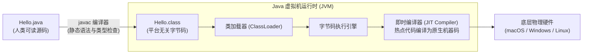

> **课程体系**：UC Berkeley CS61B: Data Structures (Spring 2024)  
> **所属模块**：Module 1: Java 语言基石与链表结构 (Java Fundamentals & Lists)  
> **主讲教师**：Prof. Justin Yokota & Prof. Peyrin Kao (UC Berkeley)  
> **视频时长**：48:50 ｜ **官方原版**：Lecture 1 - Introduction  
> **视频直达**：[📺 在 B 站观看本讲原视频 (P1)](https://www.bilibili.com/video/BV1hJ4m1M7ZA/?p=1) ｜ [📑 官方课件 Slides (Google Presentation)](https://docs.google.com/presentation/d/19NEzpJJ-a0lI-tdz9yC1kP-8Apt2oZm-918IsDiqgYQ) ｜ [📖 官方教材章节](https://cs61b-2.gitbook.io/cs61b-textbook/1.-introduction)  
> **快速导航**：<span>上一讲：无（第一讲）</span> ｜ [📚 返回全书目录](/notes/topics/CS61B) ｜ [下一讲 (P02 类与对象的定义与使用) →](/notes/cs61b/lecture-02)

---

## 1. CS 61B 课程愿景与学习路径：从 61A 到 61B 的范式跃迁

*(参考时间：00:01:15 · [视频跳转 (P01 00:01:15)](https://www.bilibili.com/video/BV1hJ4m1M7ZA/?p=1&t=75))*

加州大学伯克利分校（UC Berkeley）的 CS 61 系列课程构成了世界顶级计算机科学本科教学的核心基石。如果说 CS 61A 带领初学者通过 Python 与 Scheme 领略了**计算抽象、高阶函数、解释器与编程范式**的智力之美，那么 CS 61B 则是一次根本性的范式跃迁——它将视角从“如何让计算机理解人类意图”转移到**“如何组织数以万计行代码的大规模软件，并确保其在时间与空间维度上达到极致的高效”**。

主讲教师 Peyrin Kao 与 Justin Yokota 在开篇明确指出了 61B 教学体系的两大核心支柱：

### 支柱一：编写运行高效的代码（Writing code that runs efficiently）
- **核心数据结构**：从最基础的线性表（单向链表、双向链表、动态数组），逐步深入到非线性与层次化结构（二叉搜索树、自平衡 2-3 树、红黑树、散列表、二叉堆与优先队列、并查集、有向/无向图、前缀树 Tries）。
- **算法设计与渐进复杂度分析**：掌握形式化的渐进符号体系（$\Theta, O, \Omega$），学会从最坏、最好、平均情况分析程序的时空复杂度，掌握分治、贪心、剪枝、图遍历（DFS/BFS/Dijkstra/A*/Prim/Kruskal）以及外部排序与基数排序。
- **空间与时间的永恒权衡（Space-Time Trade-off）**：深刻理解内存占用、CPU 缓存局部性（Cache Locality）与运算指令数之间的博弈，学会在现实工程约束下做出最优架构权衡。

### 支柱二：高效地编写工程级代码（Writing code efficiently）
- **工业级工具链**：全面脱离玩具式的在线编辑器，深入掌握版本控制工具 `git` 的分支与重置哲学、工业级 IDE `IntelliJ IDEA` 的静态分析与重构工具、以及 `JUnit 5` 自动化单元测试框架。
- **防御性编程与模块化抽象**：理解接口（Interface）、抽象类、封装（Encapsulation）、访问控制（Access Modifiers）与类不变量（Class Invariants），具备设计复杂面向对象系统的架构能力。
- **排错与测试驱动开发（TDD）**：掌握科学的排错方法论（Mental Model Tracing），告别无目的的盲目试错。

> **编者深入解析**：很多初学者会疑惑：“为什么 61B 必须使用 Java，而不是继续使用 Python 或转向 C++？”  
> 答案在于：Java 是一门经过全球工业界数十载验证的**强类型静态编译面向对象语言**。相比 Python 的动态弱约束，Java 强制显式声明类型与作用域，使得内存指针与堆栈模型清晰可见；相比 C++ 极其繁复的手工内存管理与指针算术，Java 拥有现代垃圾回收器（Garbage Collector），让学生能够专注于数据结构拓扑本身，而不会陷入悬垂指针或段错误（Segmentation Fault）的底层泥潭。

## 2. 计算机底层与 Java 执行架构：从源码到机器指令

*(参考时间：00:09:40 · [视频跳转 (P01 00:09:40)](https://www.bilibili.com/video/BV1hJ4m1M7ZA/?p=1&t=580))*

为了透彻理解 Java 程序的运行过程，必须厘清解释型语言（如原生 Python）、编译型语言（如 C/C++）与 Java 所采用的**混合执行架构（Hybrid Execution Architecture）**之间的本质差异。

### 传统模型的困境
- **纯解释执行（Pure Interpretation）**：解释器逐行读取文本源码，实时解析语法树并翻译为机器指令执行。优点是跨平台且无需编译，但由于运行时必须反复进行动态类型推断与语法解析，执行效率通常极低（比编译语言慢 10 到 100 倍）。
- **纯静态编译（Ahead-Of-Time Compilation）**：编译器直接将源码编译为特定硬件架构（如 x86-64 或 ARM64）的二进制机器码。虽然运行速度极致，但生成的可执行文件完全不具备跨平台兼容性——在 macOS 上编译的二进制文件无法直接在 Linux 或 Windows 上运行。

### Java 的破局之道：虚拟机与字节码
Java 创造性地引入了 **Java 虚拟机（JVM, Java Virtual Machine）** 与平台中立的 **字节码（Bytecode）**：



1. **编译期（Compile Time）**：通过执行 `javac Hello.java`，编译器会对源码进行极其严密的语法检查与静态类型验证。若检查通过，生成扩展名为 `.class` 的字节码文件。字节码是一组高度优化的伪指令集，完全与物理 CPU 无关。
2. **运行期（Runtime）**：通过执行 `java Hello`，对应操作系统平台特定的 JVM 启动，加载字节码。JVM 内部的执行引擎最初解释执行字节码；当检测到某些循环或频繁调用的方法为“热点代码（Hotspot）”时，内置的 **JIT 编译器（Just-In-Time Compiler）** 会在毫秒级时间内将这部分字节码就地编译为底层处理器的原生机器指令，并执行深度优化（如内联、循环展开、分支预测）。

这一精妙架构赋予了 Java 核心传奇特性：**“一次编写，到处运行（Write Once, Run Anywhere, WORA）”**。只要目标操作系统安装了对应平台的 JRE/JDK，相同的 `.class` 字节码文件就能获得近乎原生 C++ 性能的高速执行。

## 3. 静态类型系统（Static Typing）与类型安全哲学

*(参考时间：00:15:30 · [视频跳转 (P01 00:15:30)](https://www.bilibili.com/video/BV1hJ4m1M7ZA/?p=1&t=930))*

在 CS 61A 中，Python 变量如同可以贴在任何对象上的便签纸：
```python
x = 5        # x 此时指向整数
x = "Berkeley" # 合法！x 此时改指向字符串
```

而在 Java 中，类型不是属于对象的附属品，而是**变量本身的不可分割的物理契约**。

### 静态类型的核心规则
1. **类型绑定前置**：每一个变量在首次声明时，必须明确指定其数据类型。
2. **内存尺寸固定**：编译器会根据变量的声明类型，在栈内存或堆内存中预先划定精确的比特（Bit）位数。
3. **类型不兼容拦截**：类型一旦确定，该变量便永远只能存储符合该类型契约的值，任何非法赋值都将在编译期被直接拦截：

```java
int score = 95;
// score = "Excellent"; // 编译阶段报错：incompatible types: String cannot be converted to int
```

### 为什么静态类型对大型软件至关重要？
许多初学者习惯了 Python 的自由，初次接触 Java 时会觉得类型声明繁琐沉重。但随着工程规模从百行扩展到几十万行，静态类型系统的巨大价值便淋漓尽致地展现出来：

| 维度 | Python (动态类型) | Java (静态类型) |
| :--- | :--- | :--- |
| **错误暴露时机** | 运行时（可能在生产环境运行 3 天后执行到特定分支才崩溃） | 编译时（保存代码瞬间或 `javac` 阶段立即报错） |
| **重构安全性** | 重命名或修改函数签名可能导致深层隐蔽 bug | IDE 可自动分析全工程类型依赖，100% 安全自动重构 |
| **代码自解释性** | 必须依赖文档或类型注解，否则难以确定参数类型 | 变量与方法签名本身就是最精确、无法过期的机器级文档 |
| **运行时性能** | 解释器需在每次操作时动态查询对象类型与分派表 | 编译器已知确切内存偏移，可直接发射高效原生跳转指令 |

> **深度思考**：静态类型能否完全消除运行时错误？  
> 不能。静态类型只能保证“类型的合法性”（比如不能把字符串除以整数），但无法在编译期预测所有的逻辑边界条件（例如除以零 `ArithmeticException`、数组下标越界 `ArrayIndexOutOfBoundsException` 或空指针调用 `NullPointerException`）。这些异常属于运行时语义范畴。

## 4. 深度剖析 Hello World：每一行代码背后的语言规范

*(参考时间：00:22:15 · [视频跳转 (P01 00:22:15)](https://www.bilibili.com/video/BV1hJ4m1M7ZA/?p=1&t=1335))*

学习任何一门语言的经典第一课都是 Hello World。但在 Java 中，即便只有短短五行代码，也浓缩了面向对象语言最底层的规则体系：

```java
public class HelloWorld {
    public static void main(String[] args) {
        System.out.println("Hello, 61B!");
    }
}
```

我们以极其严谨的态度，逐个拆解其中的每个词汇与语法要素：

### 1. `public class HelloWorld`
- `class`：Java 的最基础代码组织单元。在 Java 中，**绝对不允许存在游离在类之外的全局函数或全局变量**。一切状态与逻辑都必须依附于某一个类。
- `HelloWorld`：类名。Java 社区约定使用大驼峰命名法（UpperCamelCase）。
- **源文件命名铁律**：如果一个类被声明为 `public`，那么保存该类的源文件名必须与类名**分毫不差地完全一致**（大小写严格敏感）。即必须保存为 `HelloWorld.java`，否则 `javac` 编译器将报出编译错误：`class HelloWorld is public, should be declared in a file named HelloWorld.java`。

### 2. `public static void main(String[] args)`
这是 Java 虚拟机约定的**标准唯一程序启动入口**：
- `public`：访问控制修饰符。表示此方法对整个系统公开，JVM 运行时必须具备从外部访问该方法的权限。
- `static`：静态修饰符。关键所在！表明 `main` 方法依附于 `HelloWorld` 类本身，而非类的某个具体实例。JVM 在程序刚启动时，内存中尚未创建任何 `HelloWorld` 对象，因此入口方法必须是 `static`，无需 `new` 即可直接调用。
- `void`：返回值类型。表示该方法执行完毕后不向调用方返回任何数据（在 C 语言中通常返回 `int` 作为状态码，而 Java 通过 `System.exit(status)` 处理非正常退出）。
- `String[] args`：命令行参数。是一个字符串数组，用于接收用户在终端启动程序时传递的所有附加参数。例如执行 `java HelloWorld berkeley cs61b` 时，`args[0]` 即为 `"berkeley"`，`args[1]` 为 `"cs61b"`。

### 3. `System.out.println("Hello, 61B!");`
- `System`：Java 标准类库 `java.lang` 包中预置的系统管理类。
- `out`：`System` 类内部定义的一个静态成员变量，它是一个代表系统标准输出流（Standard Output Stream）的 `PrintStream` 对象。
- `println`：`PrintStream` 提供的一个实例方法，用于将传入的参数打印到终端，并在末尾自动附加一个平台特定的换行符（Newline）。如果不需要换行，可以使用 `System.out.print(...)`。
- `;`：分号是 Java 语句的法定终结符，漏写分号是初学者最常见的编译错误。

## 5. 基础语法与流程控制：变量、循环与方法定义

*(参考时间：00:30:40 · [视频跳转 (P01 00:30:40)](https://www.bilibili.com/video/BV1hJ4m1M7ZA/?p=1&t=1840))*

在深入类与对象之前，我们需要快速掌握 Java 的基础控制流机制。

### 变量声明与基本运算
在计算累加和的经典程序 `HelloNumbers` 中，观察变量的生命周期与循环演进：

```java
public class HelloNumbers {
    public static void main(String[] args) {
        int x = 0;
        int total = 0;
        while (x < 10) {
            total = total + x;
            System.out.print(total + " ");
            x = x + 1;
        }
        System.out.println();
    }
}
```

程序输出：
```text
0 1 3 6 10 15 21 28 36 45 
```

**关键机制分析**：
- 强类型声明：`int x = 0;` 同时完成了变量类型的指定与初值赋予。未赋初值的局部变量在读取时会导致编译报错。
- 循环条件控制：`while (x < 10)` 括号内的表达式必须严格是布尔类型（`boolean`，取值为 `true` 或 `false`）。在 C/C++ 或 Python 中非零整数会被隐式当作真值，但在 Java 中 `while (1)` 将无法通过编译！

### 静态辅助方法的抽取与抽象
在大型项目中，绝不能将所有逻辑都塞在 `main` 方法中。我们需要将可复用的逻辑封装为独立的方法。以求两数最大值为例：

```java
public class LargerDemo {
    /** 
     * 返回两个整数 a 和 b 中的较大者。
     * 这是一个静态工具方法，无需实例化类即可直接调用。
     */
    public static int larger(int a, int b) {
        if (a > b) {
            return a;
        }
        return b;
    }

    public static void main(String[] args) {
        int x = -5;
        int y = 12;
        int maxVal = larger(x, y);
        System.out.println("Max of " + x + " and " + y + " is: " + maxVal);
    }
}
```

### 方法签名（Method Signature）与重载（Overload）预览
在 Java 中，方法由其名称与形参列表共同定义：
- 返回类型虽然是方法声明的一部分，但不属于签名。
- Java 允许在同一个类中定义多个名称相同但参数列表不同（类型、个数或顺序不同）的方法，这被称为**方法重载（Method Overloading）**。例如，我们可以同时定义 `larger(int a, int b)` 与 `larger(double a, double b)`。

## 6. 官方课件讨论题与 HW0 算法实战精讲

*(参考时间：00:38:00 · [视频跳转 (P01 00:38:00)](https://www.bilibili.com/video/BV1hJ4m1M7ZA/?p=1&t=2280))*

在 Lecture 1 的官方课件与课后作业 HW0 中，Josh Hug 与 Peyrin Kao 设计了若干经典的思维挑战题，旨在检验学生对基础控制流与循环边界的掌握程度。

### 挑战题一：打印星号直角三角形（Drawing Triangles）
**题目要求**：编写程序，使用循环输出一个由星号组成的 5 行直角三角形：
```text
*
**
***
****
*****
```

**解题思路演进**：
初学者往往尝试写 5 行 `println`，但这无法根据输入规模扩展。我们需要双重嵌套循环：外层控制行数，内层控制当前行的星号个数。

```java
public class TriangleDrawer {
    public static void drawTriangle(int N) {
        int row = 1;
        while (row <= N) {
            int col = 1;
            while (col <= row) {
                System.out.print("*");
                col = col + 1;
            }
            System.out.println();
            row = row + 1;
        }
    }

    public static void main(String[] args) {
        drawTriangle(5);
    }
}
```

### 挑战题二：寻找数组最大值（Array Max）
**题目要求**：编写一个静态方法 `max(int[] m)`，返回传入非空整型数组中的最大值。

```java
public class ArrayOps {
    public static int max(int[] m) {
        int maxSoFar = m[0]; // 假设第一个元素最大
        for (int i = 1; i < m.length; i = i + 1) {
            if (m[i] > maxSoFar) {
                maxSoFar = m[i];
            }
        }
        return maxSoFar;
    }
}
```

### 挑战题三：HW0 核心进阶题 `windowPosSum`
**题目要求**：给定一个整型数组 `a` 和一个整数 `n`。对于数组中的每个正数 `a[i]`，将其替换为从索引 `i` 开始往后最多 `n + 1` 个元素的和（即 `a[i] + a[i+1] + ... + a[i+n]`）。若向后累加触及数组末尾，则仅累加到最后一个可用元素即可；如果 `a[i]` 本身是负数或零，则跳过不处理。

**测试用例**：
输入 `a = {1, 2, -3, 4, 5, 4}`, `n = 3`  
预期输出：`{7, 8, -3, 13, 9, 4}`

**代码实现与逐行解析**：
```java
public class BreakContinue {
    public static void windowPosSum(int[] a, int n) {
        for (int i = 0; i < a.length; i = i + 1) {
            // 条件一：如果当前数字不为正数，直接跳过本轮循环
            if (a[i] <= 0) {
                continue;
            }

            int sum = 0;
            // 条件二：从 i 开始累加 n 个后续元素
            for (int j = i; j <= i + n; j = j + 1) {
                // 防越界守护：若 j 超过数组最大索引，立即中断内层累加
                if (j >= a.length) {
                    break;
                }
                sum = sum + a[j];
            }
            // 更新原数组当前位置的值
            a[i] = sum;
        }
    }

    public static void main(String[] args) {
        int[] a = {1, 2, -3, 4, 5, 4};
        int n = 3;
        windowPosSum(a, n);
        System.out.println(java.util.Arrays.toString(a));
    }
}
```

**陷阱提示**：
1. **就地修改的时序问题**：如果我们在外层循环一边修改 `a[i]`，内层循环后继元素会不会读取到已经被修改的新值？仔细观察内层循环：当前位置 `i` 计算时，它只往后读取 `j = i, i+1, ...`。但后续的 `a[i+1]` 在处理时，只会往后读取 `i+1, i+2...`，并不会倒回去读取已经修改过的 `a[i]`，因此直接就地修改是安全的！
2. **越界防护**：`break` 的作用是仅跳出内层 `for (int j...)` 循环，然后执行 `a[i] = sum;`，绝不能错用 `return`。

## 7. 工程环境搭建、Git 工作流与代码规范

*(参考时间：00:42:00 · [视频跳转 (P01 00:42:00)](https://www.bilibili.com/video/BV1hJ4m1M7ZA/?p=1&t=2520))*

在 CS 61B 的工程实践中，编写代码只是软件生命周期的一部分，现代软件工程师必须严格遵循工程规范。

### IntelliJ IDEA 与终端工作流
课程官方推荐的工作流分为两种模式：
1. **命令行原生模式**：
   ```bash
   javac -g LargerDemo.java   # 编译时携带调试符号
   java LargerDemo            # 运行编译后的类
   ```
2. **IntelliJ 工业级集成开发环境**：
   - 自动在后台进行增量编译（Incremental Compilation），实时标红语法与类型错误；
   - 强大的自动重构工具（Refactor -> Rename / Extract Method）；
   - 内置强大的可视化断点调试器，支持条件断点与变量监视。

### Berkeley 61B 代码风格规范（Style Guide）
为了培养工程级编程素养，课程制定了严格的自动代码风格检查（Style Checker）：
- **缩进标准**：强制使用 4 个空格缩进，严禁使用 Tab 制表符；
- **行宽限制**：单行代码长度不得超过 100 个字符；
- **大括号风格**：采用 K&R 风格，即左大括号 `{` 不另起一行，紧随语句末尾；
- **命名规范**：类名使用 `UpperCamelCase`，方法名与变量名使用 `lowerCamelCase`，常量使用全大写加下划线 `UPPER_SNAKE_CASE`；
- **注释要求**：所有 public 方法与类必须编写符合 Javadoc 规范的文档注释 `/** ... */`。

## 8. 编译期错误 vs 运行期错误与工程调试思维

*(参考时间：00:45:15 · [视频跳转 (P01 00:45:15)](https://www.bilibili.com/video/BV1hJ4m1M7ZA/?p=1&t=2715))*

在 61B 的整个学期中，你将无数次面对程序的崩溃与报错。优秀的工程师与新手之间的本质差异，在于能否建立精准的心智模型（Mental Model）来定位与排查错误。

### 两类截然不同的错误世界
1. **编译期错误（Compile-Time Errors）**：
   - 触发时机：`javac` 正在分析源码文本。
   - 产生原因：违反了 Java 的语法规则、静态类型约束或符号可见性。
   - 常见案例：
     - `error: cannot find symbol`（拼写错误、变量未声明、作用域不可见）。
     - `error: incompatible types`（尝试把 `String` 赋给 `int`）。
     - `error: missing return statement`（方法声明了返回值，但某些分支没有 `return`）。
   - **应对策略**：仔细阅读编译报错指示的行号与符号提示，编译器通常会极其明确地指出错误原因。

2. **运行期错误（Runtime Errors / Exceptions）**：
   - 触发时机：代码语法合法，已成功生成 `.class`，但在 JVM 解释/执行时抛出异常崩溃。
   - 常见案例：
     - `NullPointerException`（尝试解引用一个指向 `null` 的对象变量）。
     - `ArrayIndexOutOfBoundsException`（访问了负数下标或 $\ge length$ 的数组位置）。
     - `StackOverflowError`（递归缺少基线条件，调用栈无限膨胀爆栈）。
   - **应对策略**：分析控制台输出的**异常堆栈追踪（Stack Trace）**，从栈顶定位最内层引发崩溃的代码行号，利用 IntelliJ 断点调试器单步跟踪（Step Over / Step Into）。

### 编码黄金法则：小步快跑与心智追踪
初学者最致命的编码习惯是“一口气写完 200 行代码，然后一次性编译运行”，结果遭遇 30 个报错，手足无措。  
**正确的工程实践**：
- 每次只写 5 到 10 行代码；
- 立即执行编译与简单测试；
- 验证无误后再编写下一个功能片段。

## 9. 模块全景小结与课后深化自测

*(参考时间：00:48:00 · [视频跳转 (P01 00:48:00)](https://www.bilibili.com/video/BV1hJ4m1M7ZA/?p=1&t=2880))*

### 核心概念全景对照表

| 概念要素 | 关键技术内涵 | 常见易错点 |
| :--- | :--- | :--- |
| **Java 编译模型** | 源码 `.java` $\to$ 字节码 `.class` $\to$ JVM 执行 | 误以为直接生成物理机器码，忽略 JVM 的存在 |
| **静态强类型** | 变量声明时必须锁定类型，编译期验证全部类型流向 | 混淆类型强制转换与动态类型分配 |
| **类与文件对应** | `public class Foo` 必须存放于 `Foo.java` | 文件名与类名大小写不一致在 macOS/Linux 下引发诡异报错 |
| **程序主入口** | `public static void main(String[] args)` 缺一不可 | 遗漏 `static` 导致运行时无法被 JVM 识别为入口 |
| **循环与分支** | 条件表达式必须是严格的 `boolean` | 写入 `while(1)` 或 `if(x = 5)` 造成编译无法通过 |

---

### 课后综合自测题

#### 题目 1（概念辨析）
如果一个类中没有显式定义 `public static void main` 方法，能够通过 `javac` 编译吗？能够在终端通过 `java` 命令运行吗？  
**答案与解析**：  
- **能够通过编译**！在实际工程中，绝大多数类（如数据结构类、工具库、数据模型）都是供其他模块调用的库代码，并不需要作为主入口启动，`javac` 完全允许没有 `main` 的类编译生成 `.class`。  
- **不能通过 `java` 命令直接启动**。若强行执行 `java MyLib`，JVM 会抛出运行时错误：`Main method not found in class MyLib, please define the main method as: public static void main(String[] args)`。

#### 题目 2（语法陷阱）
观察下列代码片段，它是否能通过编译？如果能，输出什么？如果不能，哪一行报错？
```java
public class Mystery {
    public static void main(String[] args) {
        int a = 5;
        int b;
        if (a > 3) {
            b = 10;
        }
        System.out.println(b);
    }
}
```
**答案与解析**：  
- **无法通过编译！报错于 `System.out.println(b);`**：`error: variable b might not have been initialized`。
- **深层原因**：Java 编译器具有明确赋值检查（Definite Assignment Analysis）机制。虽然从人类思维来看，`a = 5` 必然使 `a > 3` 成立，因此 `b` 必然被赋值为 10；但 Java 编译器的分支分析器在判断时，只分析控制流图（Control Flow Graph），认为 `if` 存在不进入的可能性。一旦不进入，局部变量 `b` 就没有确定的初值。Java 严禁读取未赋初值的局部变量！修正方法为显式赋予默认初值：`int b = 0;`。

#### 题目 3（算法拓展）
编写一个方法 `public static int[] fibonacci(int n)`，返回包含前 `n` 个斐波那契数（从 0, 1 开始）的数组。如果 `n <= 0`，返回空数组。
**答案与解析**：
```java
public class Fib {
    public static int[] fibonacci(int n) {
        if (n <= 0) {
            return new int[0];
        }
        int[] res = new int[n];
        res[0] = 0;
        if (n == 1) {
            return res;
        }
        res[1] = 1;
        for (int i = 2; i < n; i++) {
            res[i] = res[i - 1] + res[i - 2];
        }
        return res;
    }
}
```
该解法通过动态规划的思想，在线性时间 $O(n)$ 内完成了数列的递推，避免了朴素双递归引起的指数级爆炸 $O(2^n)$。

---

## 附录：UC Berkeley 官方教材深度研读 (Official Textbook In-Depth Chapters)

> **导读说明**：本节内容整合自 UC Berkeley CS61B 官方教材库（GitBook Textbook），针对本讲的核心数据结构与算法提供原汁原味的英文理论推导、形式化代码范例与配套章节习题，与前文视频精讲相互补充印证。

## 1. Introduction

This section covers basic features of Java and how to run programs on the command line.

---

## 1.1 Your First Java Program

The classic first program when introducing any new language is **Hello World**, or a program that prints `Hello World` to the console. In Java, **Hello World** can be written as such:

```java

public class HelloWorld {

    public static void main(String[] args) {

        System.out.println("Hello world!");

    }

}

```

As compared to other languages like Python, this may seem needlessly verbose. However, there are several reasons for the verbosity of Java, which will be covered in the next few chapters. For now, notice some key syntatical features of the code snippet above:

* The **class declaration** `public class HelloWorld`: in Java, all code lives within classes. 

* The **`main`** function: all the code that runs must be inside of a method declared as `public static void main(String[] args)`. Future chapters will cover the exact meaning of this declaration.

* **Curly braces** `{}` enclose sections of code (functions, classes, and other types of code that will be covered in future chapters).

* All statements must end with a **semi-colon**. 

For fun, see [Hello world! in other languages](https://www.rosettacode.org/wiki/Hello_world/Text).

---

## 1.2 Java Workflow

Taking a program from a `.java` file into an executable has two main steps in Java: **compilation** and **interpretation**. 

<figure><figcaption></figcaption></figure>

To run the code in `Hello.java`, we would first **compile** the code into a `.class` file using the command `javac HelloWorld.java`. Then, to run the code, we would use the command `java HelloWorld`. 

In your terminal, the result would look like the following:

```

$ javac HelloWorld.java

$ java HelloWorld

Hello World!

```

### Class Files

There are several reasons for the usage of `.class` files, which we will only cover briefly here. First of all, `.class` files are guaranteed to have been type-checked, making the distributed code safer. They are also more efficient to execute, and protect the actual source code in cases of intellectual property. We will not go into the details of `.class` files in this textbook beyond knowing that they are created after compilation.

---

## 1.3 Basic Java Features

##### Variables and Loops 

The program below will print out the integers from 0 through 9.

```java

public class HelloNumbers {

    public static void main(String[] args) {

        int x = 0;

        while (x < 10) {

            System.out.print(x + " ");

            x = x + 1;

        }

    }

}

```

When we run this program, we see:

```

$ javac HelloNumbers.java

$ java HelloNumbers

$ 0 1 2 3 4 5 6 7 8 9 

```

Some interesting features of this program that might jump out at you:

* Our variable x must be declared before it is used, *and it must be given a type!*

* Our loop definition is contained inside of curly braces, and the boolean expression that is tested is contained inside of parentheses.

* Our print statement is just `System.out.print` instead of `System.out.println`. This means we should not include a newline (a return).

* Our print statement adds a number to a space. This makes sure the numbers don't run into each other. Try removing the space to see what happens.

* When we run it, our prompt ends up on the same line as the numbers (which you can fix in the following exercise if you'd like).

Of these features the most important one is the fact that variables have a declared type. We'll come back to this in a bit, but first, an exercise.

**Exercise 1.1.2.** Modify `HelloNumbers` so that it prints out the cumulative sum of the integers from 0 to 9. For example, your output should start with 0 1 3 6 10... and should end with 45.

Also, if you've got an aesthetic itch, modify the program so that it prints out a new line at the end.

The program below will print out the integers from 0 through 9.

```java

public class HelloNumbers {

    public static void main(String[] args) {

        int x = 0;

        while (x < 10) {

            System.out.print(x + " ");

            x = x + 1;

        }

    }

}

```

When we run this program, we see:

```

$ javac HelloNumbers.java

$ java HelloNumbers

$ 0 1 2 3 4 5 6 7 8 9 

```

Some interesting features of this program that might jump out at you:

* Our variable x must be declared before it is used, *and it must be given a type!*

* Our loop definition is contained inside of curly braces, and the boolean expression that is tested is contained inside of parentheses.

* Our print statement is just `System.out.print` instead of `System.out.println`. This means we should not include a newline (a return).

* Our print statement adds a number to a space. This makes sure the numbers don't run into each other. Try removing the space to see what happens.

* When we run it, our prompt ends up on the same line as the numbers (which you can fix in the following exercise if you'd like).

Of these features the most important one is the fact that variables have a declared type. We'll come back to this in a bit, but first, an exercise.

**Exercise 1.1.2.** Modify `HelloNumbers` so that it prints out the cumulative sum of the integers from 0 to 9. For example, your output should start with 0 1 3 6 10... and should end with 45.

Also, if you've got an aesthetic itch, modify the program so that it prints out a new line at the end.

##### Static Typing 

Java is a **statically typed language**, which means that all variables, parameters, and methods must have a declared type. After declaration, *the type can never change*. Expressions also have an implicit type; for example, the expression `3 + 5` has type `int`. 

Because all types are declared statically, the compiler checks that types are compatible before the program even runs. This means that expressions with an incompatible type will fail to compile instead of crashing the program at runtime. 

The advantages of static typing include:

* catching type errors earlier in the coding process, reducing the debugging burden on the programmer.

* avoiding type errors for end users.

* making it easier to read and reason about code.

* avoiding expensive runtime type checks, making code more efficient.

However, static typing also has several disadvantages; namely:

* more verbose code.

* less generalizable code. 

One of the most important features of Java is that all variables and expressions have a so-called `static type`. Java variables can contain values of that type, and only that type. Furthermore, the type of a variable can never change.

One of the key features of the Java compiler is that it performs a static type check. For example, suppose we have the program below:

```java

public class HelloNumbers {

    public static void main(String[] args) {

        int x = 0;

        while (x < 10) {

            System.out.print(x + " ");

            x = x + 1;

        }

        x = "horse";

    }

}

```

Compiling this program, we see:

```

$ javac HelloNumbers.java 

HelloNumbers.java:9: error: incompatible types: String cannot be converted to int

        x = "horse";

                ^

1 error

```

The compiler rejects this program out of hand before it even runs. This is a big deal, because it means that there's no chance that somebody running this program out in the world will ever run into a type error!

This is in contrast to dynamically typed languages like Python, where users can run into type errors during execution!

In addition to providing additional error checking, static types also let the programmer know exactly what sort of object he or she is working with. We'll see just how important this is in the coming weeks. This is one of my personal favorite Java features.

To summarize, static typing has the following advantages:

* The compiler ensures that all types are compatible, making it easier for the programmer to debug their code.

* Since the code is guaranteed to be free of type errors, users of your compiled programs will never run into type errors. For example, Android apps are written in Java, and are typically distributed only as .class files, i.e. in a compiled format. As a result, such applications should never crash due to a type error since they have already been checked by the compiler.

* Every variable, parameter, and function has a declared type, making it easier for a programmer to understand and reason about code.

However, static typing also has several disadvantages, which will be discussed further in later chapters. To name a few:

* More verbose code.

* Less generalizable code. 

**Extra Thought Exercise**

In Java, we can say `System.out.println(5 + " ");`. But in Python, we can't say `print(5 + "horse")`, like we saw above. Why is that so?

Consider these two Java statements:

```java

String h = 5 + "horse";

```

and

```java

int h = 5 + "horse";

```

The first one of these will succeed; the second will give a compiler error. Since Java is strongly typed, if you tell it `h` is a string, it can concatenate the elements and give you a string. But when `h` is an `int`, it can't concatenate a number and a string and give you a number.

Python doesn't constrain the type, and it can't make an assumption for what type you want. Is `x = 5 + "horse"` supposed to be a number? A string? Python doesn't know. So it errors.

In this case, `System.out.println(5 + "horse");`, Java interprets the arguments as a string concatentation, and prints out "5horse" as your result. Or, more usefully, `System.out.println(5 + " ");` will print a space after your "5".

What does `System.out.println(5 + "10");` print? 510, or 15? How about `System.out.println(5 + 10);`?

##### Defining Functions in Java 

In languages like Python, functions can be declared anywhere, even outside of functions. For example, the code below declares a function that returns the larger of two arguments, and then uses this function to compute and print the larger of the numbers 8 and 10:

```python

def larger(x, y):

    if x > y:

        return x

    return y

print(larger(8, 10))

```

Since all Java code is part of a class, we must define functions so that they belong to some class. Functions that are part of a class are commonly called "methods". We will use the terms interchangably throughout the course. The equivalent Java program to the code above is as follows:

```java

public class LargerDemo {

    public static int larger(int x, int y) {

        if (x > y) {

            return x;

        }

        return y;

    }

    public static void main(String[] args) {

        System.out.println(larger(8, 10));

    }

}

```

The new piece of syntax here is that we declared our method using the keywords `public static`, which is a very rough analog of Python's `def` keyword. We will see alternate ways to declare methods in the next chapter.

The Java code given here certainly seems much more verbose! You might think that this sort of programming language will slow you down, and indeed it will, in the short term. Think of all of this stuff as safety equipment that we don't yet understand. When we're building small programs, it all seems superfluous. However, when we get to building large programs, we'll grow to appreciate all of the added complexity.

As an analogy, programming in Python can be a bit like [Dan Osman free-soloing Lover's Leap](https://www.youtube.com/watch?v=NCByLWtM7y4). It can be very fast, but dangerous. Java, by contrast is more like using ropes, helmets, etc. as in [this video](https://www.youtube.com/watch?v=tr6UIfPEuI0).

##### Code Style, Comments, Javadoc 

Code can be beautiful in many ways. It can be concise. It can be clever. It can be efficient. One of the least appreciated aspects of code by novices is code style. When you program as a novice, you are often single mindedly intent on getting it to work, without regard to ever looking at it again or having to maintain it over a long period of time.

In this course, we'll work hard to try to keep our code readable. Some of the most important features of good coding style are:

* Consistent style (spacing, variable naming, brace style, etc)

* Size (lines that are not too wide, source files that are not too long)

* Descriptive naming (variables, functions, classes), e.g. variables or functions with names like `year` or `getUserName` instead of `x` or `f`.

* Avoidance of repetitive code: You should almost never have two significant blocks of code that are nearly identical except for a few changes.

* Comments where appropriate. Line comments in Java use the `//` delimiter. Block (a.k.a. multi-line comments) comments use `/*` and `*/`.

The golden rule is this: Write your code so that it is easy for a stranger to understand.

Here is the course's official [style guide](https://sp19.datastructur.es/materials/guides/style-guide.html). It's worth taking a look!

Often, we are willing to incur slight performance penalties, just so that our code is simpler to [grok](https://en.wikipedia.org/wiki/Grok). We will highlight examples in later chapters.

**Comments**

We encourage you to write code that is self-documenting, i.e. by picking variable names and function names that make it easy to know exactly what's going on. However, this is not always enough. For example, if you are implementing a complex algorithm, you may need to add comments to describe your code. Your use of comments should be judicious. Through experience and exposure to others' code, you will get a feeling for when comments are most appropriate.

One special note is that all of your methods and almost all of your classes should be described in a comment using the so-called [Javadoc](https://en.wikipedia.org/wiki/Javadoc) format. In a Javadoc comment, the block comment starts with an extra asterisk, e.g. `/**`, and the comment often (but not always) contains descriptive tags. We won't discuss these tags in this textbook, but see the link above for a description of how they work.

As an example without tags:

```java

public class LargerDemo {

    /** Returns the larger of x and y. */           

    public static int larger(int x, int y) {

        if (x > y) {

            return x;

        }

        return y;

    }

    public static void main(String[] args) {

        System.out.println(larger(8, 10));

    }

}

```

The widely used [javadoc tool](http://docs.oracle.com/javase/8/docs/technotes/tools/windows/javadoc.html) can be used to generate HTML descriptions of your code. We'll see examples in a later chapter.

---

## 1.4 Exercises

1. **True/False**: All variables, parameters, and methods must have a declared type in Java, and the type can never change.

2. Suppose we have a function `smaller(a, b)` that takes in two `int` arguments `a` and `b` and returns the smaller of the two. What would the expression `String x = smaller(10, 20) + 3;` output?

3. Choose all statements that are true in Java: 

   * All code must be part of a class.

   * The end and beginning of code segments are delimited using curly brackets `{}`. 

   * All statements in Java end with a semi-colon `;`.

   * Any code we want to run must be inside of a function `public static void main(String[] args)`. 

<details>

<summary>Solutions</summary>

1. True. See "Static Typing" for more information.

2. This line of code would cause a compilation error because the declared type `String` is incompatible with the type returned by `smaller` and adding `3`, which would be an `int.`

3. All the following statements are true.

</details>


---

## 课程导航与跳转

| 上一讲 | 目录 | 下一讲 | 原视频 |
| :--- | :---: | :--- | :--- |
| 第一讲 | [📚 返回 CS61B 全书目录](/notes/topics/CS61B) | [下一讲：类与对象的定义与使用 →](/notes/cs61b/lecture-02) | [🎬 在 B 站观看本讲 (P01)](https://www.bilibili.com/video/BV1hJ4m1M7ZA/?p=1) |
