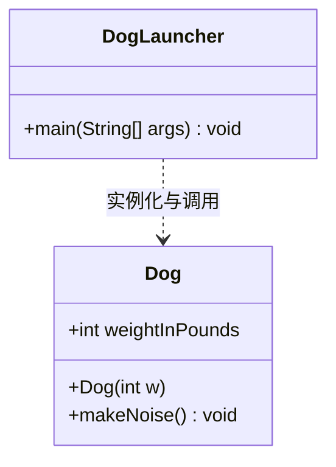

> **课程体系**：UC Berkeley CS61B: Data Structures (Spring 2024)  
> **所属模块**：Module 1: Java 语言基石与链表结构 (Java Fundamentals & Lists)  
> **主讲教师**：Prof. Justin Yokota & Prof. Peyrin Kao (UC Berkeley)  
> **视频时长**：51:18 ｜ **官方原版**：Lecture 2 - Defining and Using Classes  
> **视频直达**：[📺 在 B 站观看本讲原视频 (P2)](https://www.bilibili.com/video/BV1hJ4m1M7ZA/?p=2) ｜ [📑 官方课件 Slides (Google Presentation)](https://docs.google.com/presentation/d/1zt0yh_gzmfjCdB1y7DzTdwNSfTtepnQAtORH7PqebQM) ｜ [📖 官方教材章节](https://cs61b-2.gitbook.io/cs61b-textbook/2.-defining-and-using-classes)  
> **快速导航**：[← 上一讲 (P01 课程导论与 Java 初探)](/notes/cs61b/lecture-01) ｜ [📚 返回全书目录](/notes/topics/CS61B) ｜ [下一讲 (P03 链表 I：引用传递、内存模型与递归链表) →](/notes/cs61b/lecture-03)

---

## 1. 面向对象编程（OOP）核心哲学：从过程式到对象建模

*(参考时间：00:02:20 · [视频跳转 (P02 00:02:20)](https://www.bilibili.com/video/BV1hJ4m1M7ZA/?p=2&t=140))*

在 CS 61A 的前期以及上一讲中，我们编写的代码主要是**过程式（Procedural）**的：通过一系列独立的静态函数（Static Functions）去操作裸露的数据（如整数、浮点数、数组）。

然而，当软件系统的复杂度成百上千倍增长时，过程式编程的弊端便暴露无遗：
- **数据与逻辑割裂**：数据结构（如保存狗体重的整型变量）与操作该数据的函数（如让狗叫的函数）相互分离，任何代码都可以肆意篡改数据；
- **状态失控**：系统中到处充斥着全局变量或在各个函数之间层层传递的散落参数，一旦某个字段语义变更，整个系统的所有函数都必须同步修改。

面向对象编程（Object-Oriented Programming, OOP）提出了一种全新的认知世界的模型：**类（Class）是创建对象（Object）的蓝图（Blueprint），而对象是封装了内部状态（State / Attributes）与行为（Behavior / Methods）的自洽实体**。

## 2. 类的双重身份：功能模块（Module）vs 自定义数据类型（Type Blueprint）

*(参考时间：00:08:45 · [视频跳转 (P02 00:08:45)](https://www.bilibili.com/video/BV1hJ4m1M7ZA/?p=2&t=525))*

在 Java 语言中，`class` 承担着两种截然不同但又相辅相成的角色：

### 角色一：模块与工具箱（Module / Library）
- 典型的例子是 Java 标准库中的 `java.lang.Math` 类。
- 我们不需要也不能创建 `Math` 的实例对象（例如我们从不写 `new Math()`）。
- 它仅仅作为一个命名空间（Namespace），将一组相关的纯数学工具函数组织在一起：`Math.sqrt(x)`, `Math.max(a, b)`, `Math.PI`。
- 在这种角色下，类中的所有成员通常都是 **`static`（静态的）**。

### 角色二：自定义数据类型的蓝图（Custom Data Type Blueprint）
- 这是面向对象最强大的核心能力。
- 此时，类定义了一种新的数据类型（比如 `Dog`、`BankCustomer`、`LinkedList`）。
- 每一个通过该蓝图创建出来的具体个体被称为**对象（Object）**或**实例（Instance）**。
- 每个实例对象都拥有自己独立的**实例变量（Instance Variables）**，并能够响应**实例方法（Instance Methods）**的调用。



## 3. 实例变量、构造器与对象实例化机制

*(参考时间：00:14:10 · [视频跳转 (P02 00:14:10)](https://www.bilibili.com/video/BV1hJ4m1M7ZA/?p=2&t=850))*

让我们跟随 Josh Hug 教授的经典教学案例，完整构建一个表示“狗”的类 `Dog`：

```java
public class Dog {
    // 1. 实例变量（Instance Variable）：描述狗的状态
    public int weightInPounds;

    // 2. 构造器（Constructor）：初始化新创建的对象
    public Dog(int w) {
        weightInPounds = w;
    }

    // 3. 实例方法（Instance Method）：描述狗的行为
    public void makeNoise() {
        if (weightInPounds < 10) {
            System.out.println("yipyipyip!");
        } else if (weightInPounds < 30) {
            System.out.println("bark. bark.");
        } else {
            System.out.println("woof!");
        }
    }
}
```

### 核心要素深度解析
1. **实例变量（Instance Variables）**：
   - 声明在类体内部，但在任何方法之外；
   - **非静态**：没有 `static` 关键字修饰；
   - **独享内存**：每当我们创建一个新的 `Dog` 对象，JVM 都会在堆内存中为该对象分配独立的存储空间来保存其 `weightInPounds`。两只不同的狗，它们的体重互不相干。

2. **构造器（Constructors）**：
   - **名称必须与类名完全相同**（大小写严格一致）；
   - **绝对不能有任何返回值类型声明**（连 `void` 也不能写！如果写了 `public void Dog(int w)`，编译器会将其视为一个普通方法而非构造器）；
   - 构造器的职责是在对象诞生之际，为其实例变量设置合理的初始值。

3. **使用 `new` 关键字进行实例化**：
   ```java
   public class DogLauncher {
       public static void main(String[] args) {
           Dog d = new Dog(51); // 诞生一只 51 磅的大狗
           d.makeNoise();        // 打印 "woof!"
           
           Dog smallDog = new Dog(8); // 诞生一只 8 磅的茶杯犬
           smallDog.makeNoise();       // 打印 "yipyipyip!"
       }
   }
   ```

## 4. 堆栈内存剖析：对象在计算机内存中到底长什么样？

*(参考时间：00:20:30 · [视频跳转 (P02 00:20:30)](https://www.bilibili.com/video/BV1hJ4m1M7ZA/?p=2&t=1230))*

理解 Java 的核心门槛，在于建立精准的**堆栈内存模型（Stack vs Heap Memory Model）**。

当执行 `Dog d = new Dog(51);` 时，底层物理内存中究竟发生了什么？

```text
栈内存 (Call Stack / Local Variables)          堆内存 (Heap / Objects)
+-----------------------+                    +-------------------------+
| DogLauncher.main      |                    | Dog 实例对象             |
|                       |                    |                         |
| d: 0x4A2F0 ----------+-------------------> | weightInPounds: 51      |
+-----------------------+                    +-------------------------+
```

### 内存两阶段拆解
1. **栈内存（Stack）分配引用变量**：
   - 声明 `Dog d;` 并不创建任何狗对象！
   - JVM 仅在当前方法的栈帧（Stack Frame）中开辟一个固定大小（通常为 64 位）的内存槽位，名为 `d`。
   - 此时 `d` 的初值为未初始化或 `null`（空指针），它并不包含狗的数据，而是一个**内存地址引用（Reference）**。
2. **堆内存（Heap）分配具体对象**：
   - 执行 `new Dog(51)` 时，JVM 在全局动态堆内存中寻找一块连续空闲空间，容纳 `Dog` 类的所有实例变量（此处为一个 32 位整型 `weightInPounds`）以及 JVM 对象头（Object Header）；
   - 执行构造器，将 51 写入 `weightInPounds` 字段；
   - `new` 表达式计算完毕后，返回新创建对象在堆中的物理内存起始地址（如 `0x4A2F0`）；
   - 最后，赋值运算符 `=` 将该内存地址写入栈变量 `d` 的槽位中。

> **黄金法则**：在 Java 中，所有用 `new` 关键字创建出来的对象实体，**永远存放在堆内存（Heap）中**；而方法内的局部变量与形参，**永远存放在栈内存（Stack）中**。

## 5. 实例方法 vs 静态方法：`static` 关键字的本质

*(参考时间：00:27:50 · [视频跳转 (P02 00:27:50)](https://www.bilibili.com/video/BV1hJ4m1M7ZA/?p=2&t=1670))*

`static` 是 Java 语言中最核心、也最容易让初学者困惑的修饰符。它的本质含义是：**“属于类本身，而非属于具体实例”**。

### 静态方法（Static Methods）
- 声明中带有 `static` 修饰符；
- **调用方式**：通过类名直接点调，例如 `Math.sqrt(16)` 或 `Dog.doSomething()`；
- **执行上下文**：由于调用时可能根本没有任何实例对象存在，因此在静态方法内部，**绝对不能访问任何非静态的实例变量或实例方法**，也**绝对不存在 `this` 指针**！

### 实例方法（Instance Methods）
- 声明中**没有** `static` 修饰符；
- **调用方式**：必须先创建对象实例，通过具体对象引用点调，例如 `d.makeNoise()`；
- **执行上下文**：实例方法被调用时，必然绑定了一个具体的调用者对象。在方法体内部，可以通过隐式关键字 `this` 访问当前调用者的一切状态。

```java
public class StaticVsInstance {
    public int instanceVal = 10;
    public static int staticVal = 20;

    public void instanceMethod() {
        // 合法！实例方法可以自由访问实例变量和静态变量
        System.out.println(instanceVal + staticVal);
    }

    public static void staticMethod() {
        // 合法！静态方法访问静态变量
        System.out.println(staticVal);

        // 编译报错！non-static variable instanceVal cannot be referenced from a static context
        // System.out.println(instanceVal);
    }
}
```

## 6. 官方研讨案例：`maxDog` 的四种设计模式对比与权衡

*(参考时间：00:34:15 · [视频跳转 (P02 00:34:15)](https://www.bilibili.com/video/BV1hJ4m1M7ZA/?p=2&t=2055))*

Josh Hug 教授在课件中提出了一个极具启发性的面向对象设计问题：**“如何设计一个比较两只狗体重并返回较大狗的方法？”**

### 设计一：静态方法，显式接收两个参数
```java
public class Dog {
    public int weightInPounds;
    public Dog(int w) { weightInPounds = w; }

    public static Dog maxDog(Dog d1, Dog d2) {
        if (d1.weightInPounds > d2.weightInPounds) {
            return d1;
        }
        return d2;
    }
}
```
- **客户端调用语法**：
  ```java
  Dog d1 = new Dog(15);
  Dog d2 = new Dog(100);
  Dog bigger = Dog.maxDog(d1, d2); // 通过类名调用
  ```
- **语义分析**：类就像一个公正的第三方裁判，平等待遇 `d1` 和 `d2`，逻辑对称，语义非常清晰。

### 设计二：实例方法，隐式使用 `this`
```java
public class Dog {
    public int weightInPounds;
    public Dog(int w) { weightInPounds = w; }

    public Dog maxDog(Dog d2) {
        if (this.weightInPounds > d2.weightInPounds) {
            return this;
        }
        return d2;
    }
}
```
- **客户端调用语法**：
  ```java
  Dog d1 = new Dog(15);
  Dog d2 = new Dog(100);
  Dog bigger = d1.maxDog(d2); // d1 问自己：我和 d2 谁更大？
  ```
- **语义分析**：此时 `d1` 是主语（调用者），`d2` 是宾语。方法内部通过 `this.weightInPounds` 获取调用者自己的体重。

### 关键架构启示
两种设计都能完美达成功能，但展现了不同的设计倾向：
- 如果操作在逻辑上是**对称的、不偏袒任何一方的**（如数学上的比较），设计为 `static Dog.maxDog(d1, d2)` 往往更加自然且不易引起歧义；
- 如果操作在逻辑上是**当前对象的固有能力**（例如狗和其他狗打架 `d1.fight(d2)`），则设计为实例方法更为契合面向对象思维。

## 7. 引用类型数组（Arrays of Objects）与堆内存两阶段分配陷阱

*(参考时间：00:41:20 · [视频跳转 (P02 00:41:20)](https://www.bilibili.com/video/BV1hJ4m1M7ZA/?p=2&t=2480))*

在基本类型数组中，声明并分配数组即可直接存放数值：
```java
int[] numbers = new int[3]; // 内存中立即创建了包含 3 个 0 的整型数组
numbers[0] = 42;            // 完美执行
```

但在面向对象编程中，处理**对象引用数组**时，初学者几乎 100% 会掉入一个极其严重的陷阱！

### 惊心动魄的 NullPointerException 现场
观察下列看似理所当然的代码：
```java
public class DogArrayTrap {
    public static void main(String[] args) {
        Dog[] dogs = new Dog[2]; // 创建一个长度为 2 的狗数组
        dogs[0].weightInPounds = 30; // 运行时瞬间崩溃！NullPointerException！
    }
}
```

### 为什么会崩溃？揭秘“两阶段分配（Two-Step Allocation）”
我们来看此时的内存实际状态：
```text
栈内存 (Stack)                       堆内存 (Heap)
+--------------+                   +-------------------------------+
| dogs: 0x888  | ----------------> | 数组容器 (Dog[2])              |
+--------------+                   | index 0: null (空引用！)       |
                                   | index 1: null (空引用！)       |
                                   +-------------------------------+
```

1. **第一阶段：分配容器**  
   执行 `Dog[] dogs = new Dog[2];` 时，JVM 在堆中创建的**仅仅是一个能够容纳 2 个引用地址的数组容器**！它**不会自动创建任何 Dog 对象**！数组初始化的默认值是 `null`。
2. **解引用崩溃**  
   当执行 `dogs[0].weightInPounds` 时，`dogs[0]` 的值是 `null`。尝试向一个不存在的对象询问它的体重，JVM 只能无情抛出 `NullPointerException`。
3. **第二阶段：逐个实例化对象**  
   正确的做法必须进行两阶段显式初始化：
   ```java
   Dog[] dogs = new Dog[2];      // 阶段 1：开辟容纳引用的数组
   dogs[0] = new Dog(30);        // 阶段 2：显式创建第 0 个 Dog 对象并关联引用
   dogs[1] = new Dog(50);        // 阶段 2：显式创建第 1 个 Dog 对象并关联引用
   dogs[0].makeNoise();          // 成功输出：bark. bark.
   ```

## 8. 静态变量（Static Variables）与类级别共享状态

*(参考时间：00:46:10 · [视频跳转 (P02 00:46:10)](https://www.bilibili.com/video/BV1hJ4m1M7ZA/?p=2&t=2770))*

除了静态方法，类还可以拥有**静态变量（Static Variables / Class Variables）**。

### 静态变量的定义与特性
- 静态变量使用 `public static String binomen = "Canis lupus familiaris";` 声明；
- **全类共享唯一副本**：无论创建了 0 个还是 10,000 个 `Dog` 对象，静态变量在 JVM 方法区（Method Area / Metaspace）中**永远只有一份物理内存**；
- 任何一个实例修改了静态变量，所有其他实例读取到的值都会同步改变！

```java
public class Dog {
    public int weightInPounds;
    public static String binomen = "Canis lupus familiaris"; // 学名：犬

    public Dog(int w) {
        weightInPounds = w;
    }
}
```

### 调用规范与不良代码预警
```java
Dog d1 = new Dog(10);
Dog d2 = new Dog(100);

// 推荐规范：通过类名直接访问静态变量
System.out.println(Dog.binomen);

// 极差规范（虽然编译器允许，但强烈禁止！）：通过实例引用访问静态变量
System.out.println(d1.binomen); // 误导读者以为 binomen 是 d1 独有的属性
```

> **黄金法则**：在编写 Java 代码时，**永远使用类名访问静态成员（`ClassName.staticMember`）**，绝对不要使用实例变量访问静态成员！

## 9. 本讲核心概念梳理与进阶自测题

*(参考时间：00:50:00 · [视频跳转 (P02 00:50:00)](https://www.bilibili.com/video/BV1hJ4m1M7ZA/?p=2&t=3000))*

### 核心概念全景对比矩阵

| 概念维度 | 实例成员 (Instance) | 静态成员 (Static) |
| :--- | :--- | :--- |
| **修饰符** | 无 `static` | 显式声明 `static` |
| **内存存在形式** | 每个对象实例独享一份，随对象诞生于 Heap | 全类共享一份，随类加载诞生于方法区/元空间 |
| **访问方式** | `instanceName.member` | `ClassName.member` |
| **互访权限** | 可直接访问实例成员与静态成员 | **只能**访问静态成员，不可直接访问实例成员 |
| **`this` 指针** | 存在隐式 `this` 指向当前调用者 | **不存在** `this` |

---

### 课后综合自测题

#### 题目 1（编译诊断）
下列代码能否通过编译？如果不能，指出错误原因；如果能，分析其运行输出：
```java
public class Cat {
    public String name;
    public static int catCount = 0;

    public Cat(String n) {
        name = n;
        catCount++;
    }

    public static void printInfo() {
        System.out.println("Total cats: " + catCount);
        System.out.println("Current name: " + name);
    }
}
```
**答案与解析**：  
- **无法通过编译！** 错误发生在 `printInfo()` 方法的第二行：`System.out.println("Current name: " + name);`。
- **编译器报错**：`non-static variable name cannot be referenced from a static context`。
- **核心机理**：`printInfo` 是一个 `static` 静态方法，意味着可以通过 `Cat.printInfo()` 在没有创建任何猫对象的情况下调用。此时内存中根本不存在任何具体的猫对象，JVM 无法得知该打印哪只猫的名字。静态方法中严禁直接引用实例变量。

#### 题目 2（内存追踪与两阶段分配）
画出并追踪下列代码执行到末尾时堆栈内存的状态，求输出结果：
```java
public class MysteryArray {
    public static void main(String[] args) {
        Dog[] dogs = new Dog[3];
        dogs[0] = new Dog(10);
        dogs[1] = dogs[0];
        dogs[1].weightInPounds = 25;
        System.out.println(dogs[0].weightInPounds);
        System.out.println(dogs[2]);
    }
}
```
**答案与解析**：  
- **输出结果**：
  ```text
  25
  null
  ```
- **内存追踪解析**：
  1. `Dog[] dogs = new Dog[3];` 创建一个长度为 3 的数组，所有元素默认初始化为 `null`；
  2. `dogs[0] = new Dog(10);` 在堆中创建一个体重为 10 的狗对象，将其引用存入 `dogs[0]`；
  3. `dogs[1] = dogs[0];` 执行等号赋值时，是将 `dogs[0]` 中保存的内存地址复制给 `dogs[1]`。**此时 `dogs[0]` 与 `dogs[1]` 指向堆中完全相同的同一个 Dog 实例（发生别名现象 Aliasing）**！
  4. `dogs[1].weightInPounds = 25;` 通过 `dogs[1]` 引用修改了该共享狗对象的体重为 25；
  5. 打印 `dogs[0].weightInPounds` 自然观察到了 25；
  6. `dogs[2]` 从未被赋值，保持默认初值 `null`。

---

## 附录：UC Berkeley 官方教材深度研读 (Official Textbook In-Depth Chapters)

> **导读说明**：本节内容整合自 UC Berkeley CS61B 官方教材库（GitBook Textbook），针对本讲的核心数据结构与算法提供原汁原味的英文理论推导、形式化代码范例与配套章节习题，与前文视频精讲相互补充印证。

## 2. Defining and Using Classes

If you do not have prior Java experience, we recommend that you work through the exercises in [HW0](http://sp19.datastructur.es/materials/hw/hw0/hw0.html) before reading this chapter. It will cover various syntax issues that we will not discuss in the book.

##### Static vs. Non-Static Methods 

**Static Methods**

All code in Java must be part of a class (or something similar to a class, which we'll learn about later). Most code is written inside of methods. Let's consider an example:

```java

public class Dog {

    public static void makeNoise() {

        System.out.println("Bark!");

    }

}

```

If we try running the `Dog` class, we'll simply get an error message:

```

$ java Dog

Error: Main method not found in class Dog, please define the main method as:

       public static void main(String[] args)

```

The `Dog` class we've defined doesn't do anything. We've simply defined something that `Dog` **can** do, namely make noise. To actually run the class, we'd either need to add a main method to the `Dog` class, as we saw in chapter 1.1. Or we could create a separate [`DogLauncher`](https://www.youtube.com/watch?v=Q-LE-jJQLTM) class that runs methods from the `Dog` class. For example, consider the program below:

```java

public class DogLauncher {

    public static void main(String[] args) {

        Dog.makeNoise();

    }

}

```

```

$ java DogLauncher

Bark!

```

A class that uses another class is sometimes called a "client" of that class, i.e. `DogLauncher` is a client of `Dog`. Neither of the two techniques is better: Adding a main method to `Dog` may be better in some situations, and creating a client class like `DogLauncher` may be better in others. The relative advantages of each approach will become clear as we gain additional practice throughout the course.

**Instance Variables and Object Instantiation**

Not all dogs are alike. Some dogs like to yap incessantly, while others bellow sonorously, bringing joy to all who hear their glorious call. Often, we write programs to mimic features of the universe we inhabit, and Java's syntax was crafted to easily allow such mimicry.

One approach to allowing us to represent the spectrum of Dogdom would be to create separate classes for each type of Dog.

```java

public class TinyDog {

    public static void makeNoise() {

        System.out.println("yip yip yip yip");

    }

}

public class MalamuteDog {

    public static void makeNoise() {

        System.out.println("arooooooooooooooo!");

    }

}

```

As you should have seen in the past, classes can be instantiated, and instances can hold data. This leads to a more natural approach, where we create instances of the `Dog` class and make the behavior of the `Dog` methods contingent upon the properties of the specific `Dog`. To make this more concrete, consider the class below:

```java

public class Dog {

    public int weightInPounds;

    public void makeNoise() {

        if (weightInPounds < 10) {

            System.out.println("yipyipyip!");

        } else if (weightInPounds < 30) {

            System.out.println("bark. bark.");

        } else {

            System.out.println("woof!");

        }

    }    

}

```

As an example of using such a Dog, consider:

```java

public class DogLauncher {

    public static void main(String[] args) {

        Dog d;

        d = new Dog();

        d.weightInPounds = 20;

        d.makeNoise();

    }

}

```

When run, this program will create a `Dog` with weight 20, and that `Dog` will soon let out a nice "bark. bark.".

Some key observations and terminology:

* An `Object` in Java is an instance of any class.

* The `Dog` class has its own variables, also known as *instance variables* or *non-static variables*. These must be declared inside the class, unlike languages like Python or Matlab, where new variables can be added at runtime.

* The method that we created in the `Dog` class did not have the `static` keyword. We call such methods *instance methods* or *non-static methods*.

* To call the `makeNoise` method, we had to first *instantiate* a `Dog` using the `new` keyword, and then make a specific `Dog` bark. In other words, we called `d.makeNoise()` instead of `Dog.makeNoise()`.

* Once an object has been instantiated, it can be *assigned* to a *declared* variable of the appropriate type, e.g. `d = new Dog();`

* Variables and methods of a class are also called *members* of a class.

* Members of a class are accessed using *dot notation*.

**Constructors in Java**

As you've hopefully seen before, we usually construct objects in object oriented languages using a *constructor*:

```java

public class DogLauncher {

    public static void main(String[] args) {

        Dog d = new Dog(20);

        d.makeNoise();

    }

}

```

Here, the instantiation is parameterized, saving us the time and messiness of manually typing out potentially many instance variable assignments. To enable such syntax, we need only add a "constructor" to our Dog class, as shown below:

```java

public class Dog {

    public int weightInPounds;

    public Dog(int w) {

        weightInPounds = w;

    }

    public void makeNoise() {

        if (weightInPounds < 10) {

            System.out.println("yipyipyip!");

        } else if (weightInPounds < 30) {

            System.out.println("bark. bark.");

        } else {

            System.out.println("woof!");

        }    

    }

}

```

The constructor with signature `public Dog(int w)` will be invoked anytime that we try to create a `Dog` using the `new` keyword and a single integer parameter. For those of you coming from Python, the constructor is very similar to the `__init__` method.

**Terminology Summary**

**Array Instantiation, Arrays of Objects**

As we saw in HW0, arrays are also instantiated in Java using the new keyword. For example:

```java

public class ArrayDemo {

    public static void main(String[] args) {

        /* Create an array of five integers. */

        int[] someArray = new int[5];

        someArray[0] = 3;

        someArray[1] = 4;

    }

}

```

Similarly, we can create arrays of instantiated objects in Java, e.g.

```java

public class DogArrayDemo {

    public static void main(String[] args) {

        /* Create an array of two dogs. */

        Dog[] dogs = new Dog[2];

        dogs[0] = new Dog(8);

        dogs[1] = new Dog(20);

        /* Yipping will result, since dogs[0] has weight 8. */

        dogs[0].makeNoise();

    }

}

```

Observe that new is used in two different ways: Once to create an array that can hold two `Dog` objects, and twice to create each actual `Dog`.

##### Class Methods vs. Instance Methods 

Java allows us to define two types of methods:

* Class methods, a.k.a. static methods.

* Instance methods, a.k.a. non-static methods.

Instance methods are actions that can be taken only by a specific instance of a class. Static methods are actions that are taken by the class itself. Both are useful in different circumstances. As an example of a static method, the `Math` class provides a `sqrt` method. Because it is static, we can call it as follows:

```java

x = Math.sqrt(100);

```

If `sqrt` had been an instance method, we would have instead the awkward syntax below. Luckily `sqrt` is a static method so we don't have to do this in real programs.

```java

Math m = new Math();

x = m.sqrt(100);

```

Sometimes, it makes sense to have a class with both instance and static methods. For example, suppose want the ability to compare two dogs. One way to do this is to add a static method for comparing Dogs.

```java

public static Dog maxDog(Dog d1, Dog d2) {

    if (d1.weightInPounds > d2.weightInPounds) {

        return d1;

    }

    return d2;

}

```

This method could be invoked by, for example:

```java

Dog d = new Dog(15);

Dog d2 = new Dog(100);

Dog.maxDog(d, d2);

```

Observe that we've invoked using the class name, since this method is a static method.

We could also have implemented `maxDog` as a non-static method, e.g.

```java

public Dog maxDog(Dog d2) {

    if (this.weightInPounds > d2.weightInPounds) {

        return this;

    }

    return d2;

}

```

Above, we use the keyword `this` to refer to the current object. This method could be invoked, for example, with:

```java

Dog d = new Dog(15);

Dog d2 = new Dog(100);

d.maxDog(d2);

```

Here, we invoke the method using a specific instance variable.

**Exercise 1.2.1**: What would the following method do? If you're not sure, try it out.

```java

public static Dog maxDog(Dog d1, Dog d2) {

    if (weightInPounds > d2.weightInPounds) {

        return this;

    }

    return d2;

}

```

**Static Variables**

It is occasionally useful for classes to have static variables. These are properties inherent to the class itself, rather than the instance. For example, we might record that the scientific name (or binomen) for Dogs is "Canis familiaris":

```java

public class Dog {

    public int weightInPounds;

    public static String binomen = "Canis familiaris";

    ...

}

```

Static variables should be accessed using the name of the class rather than a specific instance, e.g. you should use `Dog.binomen`, not `d.binomen`.

While Java technically allows you to access a static variable using an instance name, it is bad style, confusing, and in my opinion an error by the Java designers.

**Exercise 1.2.2**: Complete this exercise:

* Video: [link](https://youtu.be/8Gq-8mVbyFU)

* Slide: [link](https://docs.google.com/presentation/d/10BFLHH8VaoYy7XaazwjaoTtLw3zvasX4HCssDruqw84/edit#slide=id.g6caa9a6fe_057)

* Solution Video: [link](https://youtu.be/Osuy8UEH03M)

##### public static void main(String\[] args) 

With what we've learned so far, it's time to demystify the declaration we've been using for the main method. Breaking it into pieces, we have:

* `public`: So far, all of our methods start with this keyword.

* `static`: It is a static method, not associated with any particular instance.

* `void`: It has no return type.

* `main`: This is the name of the method.

* `String[] args`: This is a parameter that is passed to the main method.

**Command Line Arguments**

Since main is called by the Java interpreter itself rather than another Java class, it is the interpreter's job to supply these arguments. They refer usually to the command line arguments. For example, consider the program `ArgsDemo` below:

```java

public class ArgsDemo {

    public static void main(String[] args) {

        System.out.println(args[0]);

    }

}

```

This program prints out the 0th command line argument, e.g.

```

$ java ArgsDemo these are command line arguments

these

```

In the example above, `args` will be an array of Strings, where the entries are {"these", "are", "command", "line", "arguments"}.

**Summing Command Line Arguments**

**Exercise 1.2.3**: Try to write a program that sums up the command line arguments, assuming they are numbers. For a solution, see the webcast or the code provided on GitHub.

##### Using Libraries 

One of the most important skills as a programmer is knowing how to find and use existing libraries. In the glorious modern era, it is often possible to save yourself tons of work and debugging by turning to the web for help.

In this course, you're welcome to do this, with the following caveats:

* Do not use libraries that we do not provide.

* Cite your sources.

* Do not search for solutions for specific homework or project problems.

For example, it's fine to search for "convert String integer Java". However, it is not OK to search for "Project 2048 Berkeley".

For more on collaboration and academic honesty policy, see the course syllabus.


---

## 课程导航与跳转

| 上一讲 | 目录 | 下一讲 | 原视频 |
| :--- | :---: | :--- | :--- |
| [← 上一讲：课程导论与 Java 初探](/notes/cs61b/lecture-01) | [📚 返回 CS61B 全书目录](/notes/topics/CS61B) | [下一讲：链表 I：引用传递、内存模型与递归链表 →](/notes/cs61b/lecture-03) | [🎬 在 B 站观看本讲 (P02)](https://www.bilibili.com/video/BV1hJ4m1M7ZA/?p=2) |
