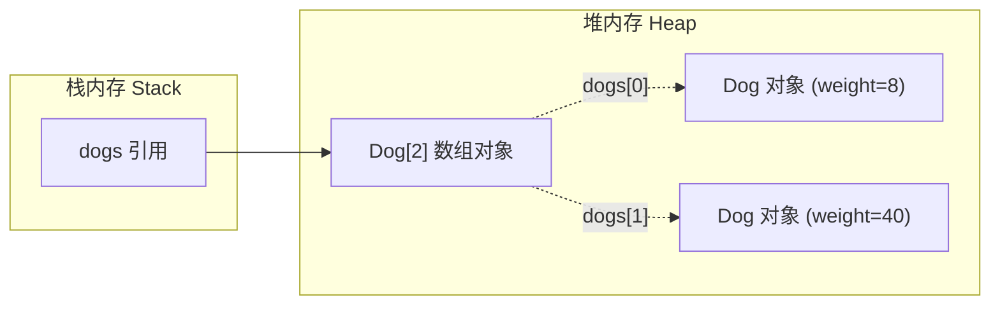

> **课程体系**：UC Berkeley CS61B: Data Structures (Spring 2024)  
> **所属模块**：Module 1: Java 语言基石与链表结构 (Java Fundamentals & Lists)  
> **主讲教师**：Prof. Justin Yokota & Prof. Peyrin Kao (UC Berkeley)  
> **视频时长**：51:18 ｜ **官方原版**：Lecture 2 - Defining and Using Classes  
> **视频直达**：[📺 在 B 站观看本讲原视频 (P2)](https://www.bilibili.com/video/BV1hJ4m1M7ZA/?p=2) ｜ [📑 官方课件 Slides (Google Presentation)](https://docs.google.com/presentation/d/1zt0yh_gzmfjCdB1y7DzTdwNSfTtepnQAtORH7PqebQM) ｜ [📖 官方教材章节](https://cs61b-2.gitbook.io/cs61b-textbook/2.-defining-and-using-classes)  
> **快速导航**：[← 上一讲 (P01 课程导论与 Java 初探)](/notes/cs61b/lecture-01) ｜ [📚 返回全书目录](/notes/topics/CS61B) ｜ [下一讲 (P03 链表 I：引用传递、递归与列表) →](/notes/cs61b/lecture-03)

---

## 1. 类的双重身份：模块与自定义类型

*(参考时间：00:02:20 · [视频跳转 (P02 00:02:20)](https://www.bilibili.com/video/BV1hJ4m1M7ZA/?p=2&t=140))*

在上一讲中，我们将类（Class）作为组织静态工具函数的容器（类似数学工具库 `Math`）。但在真正的面向对象编程（OOP）中，**类更核心的角色是作为自定义数据类型（Type）的蓝图（Blueprint）**。

当把类用作类型蓝图时，它不仅包含方法，更封装了状态（State）。通过类，我们可以把现实世界或算法场景中的概念建模为自洽的对象实体。

## 2. 实例变量与实例化：以 Dog 类为例

*(参考时间：00:10:45 · [视频跳转 (P02 00:10:45)](https://www.bilibili.com/video/BV1hJ4m1M7ZA/?p=2&t=645))*

考虑设计一个表示狗的类 `Dog`。每只狗有自己的体重属性（weightInPounds），并且能根据自身体重发出不同响度的叫声：

```java
public class Dog {
    // 实例变量（Instance Variable）：每个对象独享一份
    public int weightInPounds;

    // 构造函数（Constructor）：初始化对象状态
    public Dog(int w) {
        weightInPounds = w;
    }

    // 实例方法（Instance Method）：通过具体对象调用
    public void makeNoise() {
        if (weightInPounds < 10) {
            System.out.println("yipyipyip!");
        } else if (weightInPounds < 30) {
            System.out.println("bark. bark.");
        } else {
            System.out.println("woof!");
        }
    }
}
```

### 使用 `new` 关键字进行实例化
在测试启动类中创建并操作具体的对象实例：

```java
public class DogLauncher {
    public static void main(String[] args) {
        Dog d = new Dog(51); // 实例化一个 51 磅的狗对象
        d.makeNoise();        // 输出 "woof!"

        Dog smallDog = new Dog(8);
        smallDog.makeNoise(); // 输出 "yipyipyip!"
    }
}
```

## 3. 静态（Static）vs 非静态（Non-Static）深度辨析

*(参考时间：00:23:15 · [视频跳转 (P02 00:23:15)](https://www.bilibili.com/video/BV1hJ4m1M7ZA/?p=2&t=1395))*

这是初学 Java 面向对象最容易混淆的核心边界。

### 静态变量与静态方法（Static）
- **从属性**：直接从属于**类本身**，整个 JVM 生命周期内该类只有一份共享内存。
- **调用方式**：通过类名直接调用，如 `Math.sqrt(...)`、`Dog.maxDog(...)`。
- **限制**：静态方法内部**不能**直接访问实例变量，因为静态上下文中并不存在特定的 `this` 实例。

### 实例变量与实例方法（Non-Static）
- **从属性**：从属于**具体的对象实例**，每次 `new` 创建对象都会在堆内存中开辟独立的变量槽。
- **调用方式**：必须通过特定实例引用触发，如 `d.makeNoise()`。
- **上下文**：方法体内隐式持有当前对象的引用 `this`。

```java
// 静态比较方法：接收两个独立的狗对象进行比较
public static Dog maxDog(Dog d1, Dog d2) {
    if (d1.weightInPounds > d2.weightInPounds) {
        return d1;
    }
    return d2;
}

// 实例比较方法：当前狗对象与传入的另一只狗对象比较
public Dog maxDog(Dog otherDog) {
    if (this.weightInPounds > otherDog.weightInPounds) {
        return this;
    }
    return otherDog;
}
```

## 4. 引用与对象数组（Array of Objects）

*(参考时间：00:34:50 · [视频跳转 (P02 00:34:50)](https://www.bilibili.com/video/BV1hJ4m1M7ZA/?p=2&t=2090))*

Java 中的数组同样是对象。声明一个对象数组时，分配的实际上是**引用（指针）数组**，而不是对象本身。

```java
public class DogArrayDemo {
    public static void main(String[] args) {
        // 创建一个长度为 2 的 Dog 引用数组，初值全部为 null！
        Dog[] dogs = new Dog[2];

        // 必须为每一个槽位分别实例化具体的 Dog 对象
        dogs[0] = new Dog(8);
        dogs[1] = new Dog(40);

        dogs[0].makeNoise(); // yipyipyip!
        dogs[1].makeNoise(); // woof!
    }
}
```



> **编者说明**：如果没有执行 `dogs[0] = new Dog(...)`，直接调用 `dogs[0].makeNoise()` 将会立即触发臭名昭著的 `NullPointerException`。

## 5. 本讲小结与核心法则

*(参考时间：00:46:10 · [视频跳转 (P02 00:46:10)](https://www.bilibili.com/video/BV1hJ4m1M7ZA/?p=2&t=2770))*

| 维度 | 静态修饰 (static) | 非静态 (实例) |
| :--- | :--- | :--- |
| **所属主体** | 类（Class）本身 | 对象实例（Instance） |
| **内存分配** | 方法区 / 元空间，全局仅一份 | 堆内存（Heap），每次 new 分配一份 |
| **调用习惯** | `ClassName.method()` | `instanceReference.method()` |
| **设计场景** | 纯工具函数、无状态逻辑、常量 | 具有独立生命周期与状态的模型实体 |

---

## 课程导航与跳转

| 上一讲 | 目录 | 下一讲 | 原视频 |
| :--- | :---: | :--- | :--- |
| [← 上一讲：课程导论与 Java 初探](/notes/cs61b/lecture-01) | [📚 返回 CS61B 全书目录](/notes/topics/CS61B) | [下一讲：链表 I：引用传递、递归与列表 →](/notes/cs61b/lecture-03) | [🎬 在 B 站观看本讲 (P02)](https://www.bilibili.com/video/BV1hJ4m1M7ZA/?p=2) |
