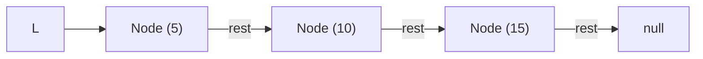

> **课程体系**：UC Berkeley CS61B: Data Structures (Spring 2024)  
> **所属模块**：Module 1: Java 语言基石与链表结构 (Java Fundamentals & Lists)  
> **主讲教师**：Prof. Justin Yokota & Prof. Peyrin Kao (UC Berkeley)  
> **视频时长**：46:59 ｜ **官方原版**：Lecture 3 - Lists I References Recursion and Lists  
> **视频直达**：[📺 在 B 站观看本讲原视频 (P3)](https://www.bilibili.com/video/BV1hJ4m1M7ZA/?p=3) ｜ [📑 官方课件 Slides (Google Presentation)](https://docs.google.com/presentation/d/1G5k4HcjJ7C2fT_9xQdvpfWjKC4xQa--5FnwXPGf0nwg) ｜ [📖 官方教材章节](https://cs61b-2.gitbook.io/cs61b-textbook/3.-references-recursion-and-lists)  
> **快速导航**：[← 上一讲 (P02 类与对象的定义与使用)](/notes/cs61b/lecture-02) ｜ [📚 返回全书目录](/notes/topics/CS61B) ｜ [下一讲 (P04 链表 II：SLList 封装与哨兵节点) →](/notes/cs61b/lecture-04)

---

## 1. 内存模型与黄金赋值法则 (The Golden Rule of Equals)

*(参考时间：00:02:10 · [视频跳转 (P03 00:02:10)](https://www.bilibili.com/video/BV1hJ4m1M7ZA/?p=3&t=130))*

深入理解数据结构的前提是彻底搞清楚计算机内存中的**变量与指针机制**。

在 Java 中，无论变量是什么类型，**赋值操作符 `=` 永远遵循同一条纯粹的法则**：
> **黄金赋值法则（The Golden Rule of Equals）**：  
> `y = x` 永远是将变量 `x` 内存盒子里存储的**位模式（Bits）原样复制**一份，存入变量 `y` 的内存盒子里。

### 原始类型（Primitive Types）
Java 拥有 8 种原始基本类型：`byte`, `short`, `int`, `long`, `float`, `double`, `boolean`, `char`。  
对于原始类型，变量的盒子里直接存放**实际的数据值**：
```java
int x = 5;
int y = x; // 将 5 复制给 y
y = 10;    // x 的值依然是 5，彼此独立
```

### 引用类型（Reference Types）
除原始类型之外的所有类型（包括所有自定义类、接口和数组）均为引用类型。  
对于引用类型，变量的盒子里存放的**不是对象本身，而是该对象在堆内存中的内存地址（引用/指针）**！

```java
Walrus a = new Walrus(1000, 8.3);
Walrus b = a; // 黄金法则：把 a 盒子里的“地址”复制给 b
b.weight = 500; // a.weight 也变成了 500！因为两者指向同一只海象
```

## 2. 裸露的链表：IntList 的定义

*(参考时间：00:13:30 · [视频跳转 (P03 00:13:30)](https://www.bilibili.com/video/BV1hJ4m1M7ZA/?p=3&t=810))*

利用自引用的类定义，我们可以构建最基础的链式存储结构——单向整数链表 `IntList`：

```java
public class IntList {
    public int first;      // 存储当前节点的值
    public IntList rest;   // 指向链表剩余部分的引用（递归自引用）

    public IntList(int f, IntList r) {
        first = f;
        rest = r;
    }
}
```

手动拼接一个包含 `[5, 10, 15]` 的链表结构：
```java
IntList L = new IntList(15, null);
L = new IntList(10, L);
L = new IntList(5, L);
```



## 3. 递归与迭代：计算链表长度 size()

*(参考时间：00:24:45 · [视频跳转 (P03 00:24:45)](https://www.bilibili.com/video/BV1hJ4m1M7ZA/?p=3&t=1485))*

因为 `IntList` 天然具备递归结构（链表 = 头节点 + 剩余的子链表），我们既可以用优美的递归实现算法，也可以使用指针游标通过循环迭代完成。

### 递归实现 `size()`
```java
public int size() {
    if (this.rest == null) {
        return 1;
    }
    return 1 + this.rest.size();
}
```

### 迭代实现 `iterativeSize()`
```java
public int iterativeSize() {
    int totalSize = 0;
    IntList p = this; // 声明指针游标
    while (p != null) {
        totalSize++;
        p = p.rest;
    }
    return totalSize;
}
```

> **编者说明**：迭代版本利用游标指针 `p` 沿着 `rest` 链条前进，避免了深层递归可能引发的调用栈溢出（`StackOverflowError`），且空间复杂度为 $O(1)$。

## 4. 链表索引访问：获取第 i 个元素 get(i)

*(参考时间：00:35:20 · [视频跳转 (P03 00:35:20)](https://www.bilibili.com/video/BV1hJ4m1M7ZA/?p=3&t=2120))*

链表不像数组那样支持 $O(1)$ 随机访问。要访问第 $i$ 个元素，必须从头指针开始依序逐级向后遍历：

```java
/** 返回链表中第 i 个元素的值（0-indexed） */
public int get(int i) {
    if (i == 0) {
        return this.first;
    }
    return this.rest.get(i - 1);
}
```

**时间复杂度分析**：
- 访问第 0 个元素：$\Theta(1)$
- 访问第 $i$ 个元素：$\Theta(i)$
- 访问末尾元素（长度为 $N$）：$\Theta(N)$

## 5. 本讲小结与指针思考

*(参考时间：00:44:10 · [视频跳转 (P03 00:44:10)](https://www.bilibili.com/video/BV1hJ4m1M7ZA/?p=3&t=2650))*

| 概念 | 核心机制 |
| :--- | :--- |
| **黄金赋值法则** | `=` 始终复制位模式。原始类型拷值，引用类型拷内存地址指针 |
| **参数传递** | Java 只有**值传递（Pass by Value）**。传递对象时复制的是指针位模式 |
| **IntList 缺陷** | 暴露裸露的指针节点、必须反向构建、处理空链表（`null`）容易崩溃 |

---

## 课程导航与跳转

| 上一讲 | 目录 | 下一讲 | 原视频 |
| :--- | :---: | :--- | :--- |
| [← 上一讲：类与对象的定义与使用](/notes/cs61b/lecture-02) | [📚 返回 CS61B 全书目录](/notes/topics/CS61B) | [下一讲：链表 II：SLList 封装与哨兵节点 →](/notes/cs61b/lecture-04) | [🎬 在 B 站观看本讲 (P03)](https://www.bilibili.com/video/BV1hJ4m1M7ZA/?p=3) |
