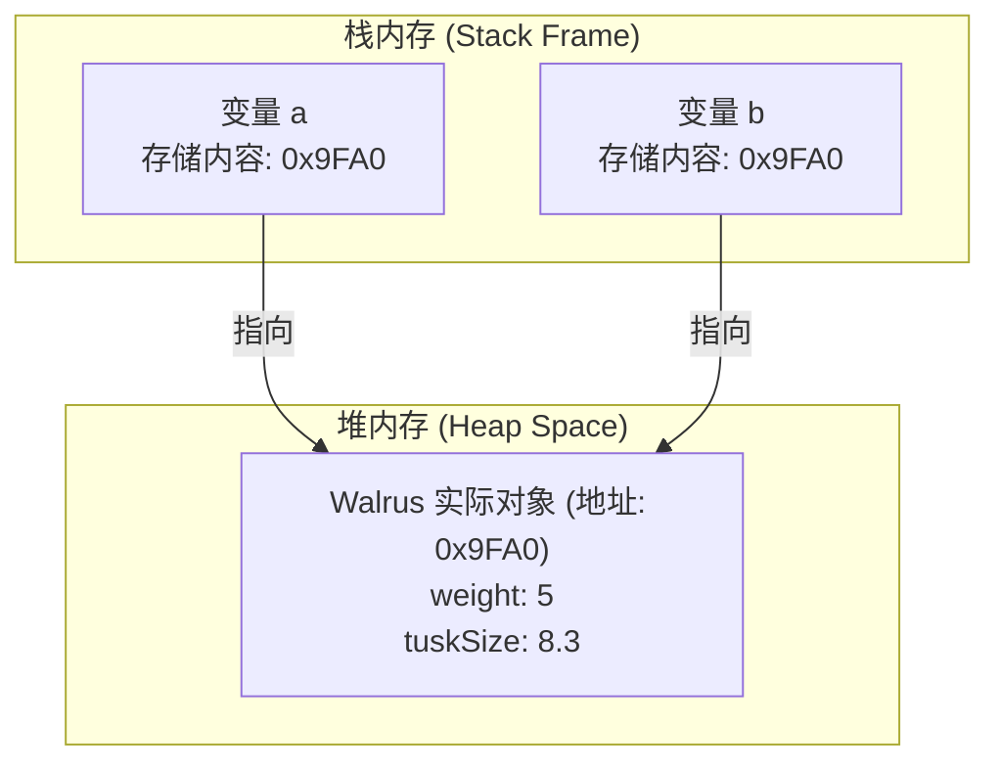
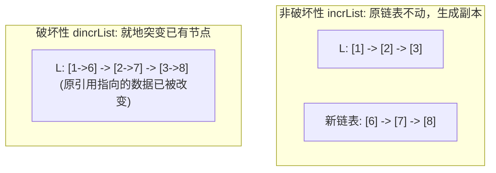

> **课程体系**：UC Berkeley CS61B: Data Structures (Spring 2024)  
> **所属模块**：Module 1: Java 语言基石与链表结构 (Java Fundamentals & Lists)  
> **主讲教师**：Prof. Justin Yokota & Prof. Peyrin Kao (UC Berkeley)  
> **视频时长**：46:59 ｜ **官方原版**：Lecture 3 - Lists I References Recursion and Lists  
> **视频直达**：[📺 在 B 站观看本讲原视频 (P3)](https://www.bilibili.com/video/BV1hJ4m1M7ZA/?p=3) ｜ [📑 官方课件 Slides (Google Presentation)](https://docs.google.com/presentation/d/1G5k4HcjJ7C2fT_9xQdvpfWjKC4xQa--5FnwXPGf0nwg) ｜ [📖 官方教材章节](https://cs61b-2.gitbook.io/cs61b-textbook/3.-references-recursion-and-lists)  
> **快速导航**：[← 上一讲 (P02 类与对象的定义与使用)](/notes/cs61b/lecture-02) ｜ [📚 返回全书目录](/notes/topics/CS61B) ｜ [下一讲 (P04 链表 II：单向链表、封装与哨兵节点) →](/notes/cs61b/lecture-04)

---

## 1. 变量与物理内存的本质：比特盒模型（Bits in Memory）

*(参考时间：00:01:20 · [视频跳转 (P03 00:01:20)](https://www.bilibili.com/video/BV1hJ4m1M7ZA/?p=3&t=80))*

要真正掌握数据结构与算法，必须穿透高级语言的语法表象，深入计算机物理内存的最底层。

在现代计算机体系架构中，所有信息最终都是存放在物理内存（RAM）中的二进制电信号——即 0 和 1 组成的**比特序列（Bits）**。每个内存字节（Byte）由 8 个比特组成，并在硬件层面拥有唯一的物理内存地址。

### 声明变量的物理含义：申请固定位宽的盒子
当我们在 Java 中声明一个变量时，Java 编译器与 JVM 会在当前栈帧中预留一个固定大小的内存空间，我们可以将其形象地比喻为一个**“比特盒子（Box of Bits）”**：

```java
int x = 42;
```
这一行代码在底层触发了三件事：
1. 在栈中开辟一个长度恰好为 **32 位（4 字节）** 的内存槽位；
2. 将该内存槽位的标识符命名为 `x`；
3. 将数值 42 的 32 位二进制补码表示（`00000000 00000000 00000000 00101010`）写入该盒子中。

### Java 的 8 种基本数据类型（Primitive Types）
Java 语言严格规定了 8 种基本原始数据类型，它们的内存位宽在任何操作系统平台和 CPU 架构下都是完全绝对恒定的：

| 基本类型 | 占用位宽 (Bits) | 占用字节 (Bytes) | 取值范围与特征 |
| :--- | :--- | :--- | :--- |
| `byte` | 8 | 1 | $-128 \sim 127$ |
| `short` | 16 | 2 | $-32,768 \sim 32,767$ |
| `int` | 32 | 4 | 约 $-2.14 \times 10^9 \sim 2.14 \times 10^9$ (整型默认) |
| `long` | 64 | 8 | 约 $-9.22 \times 10^{18} \sim 9.22 \times 10^{18}$ (后缀 `L`) |
| `float` | 32 | 4 | IEEE 754 单精度浮点数 (后缀 `f`) |
| `double` | 64 | 8 | IEEE 754 双精度浮点数 (浮点默认) |
| `boolean` | 1 (或 JVM 决定) | 1 | 仅能取 `true` 或 `false` |
| `char` | 16 | 2 | 16 位 Unicode 字符 ($0 \sim 65,535$) |

> **关键认知**：对于基本类型变量，**变量盒子里存放的就是具体的数据数值本身**！

## 2. 引用类型与海象之谜（The Mystery of the Walrus）

*(参考时间：00:08:40 · [视频跳转 (P03 00:08:40)](https://www.bilibili.com/video/BV1hJ4m1M7ZA/?p=3&t=520))*

除了上述 8 种基本类型，Java 中的**其余所有类型全部属于引用类型（Reference Types）**！包括所有的类（如 `String`, `Dog`, `IntList`）以及所有类型的数组。

为了揭开引用类型的本质，Josh Hug 教授在课件中提出了著名的**“海象之谜（The Mystery of the Walrus）”**。

### 实验一：海象之谜代码实验
考虑一个简单的海象类 `Walrus`：
```java
public class Walrus {
    public int weight;
    public double tuskSize;

    public Walrus(int w, double ts) {
        weight = w;
        tuskSize = ts;
    }
}
```

观察下列代码执行后，修改 `b` 是否会影响 `a`？
```java
Walrus a = new Walrus(1000, 8.3);
Walrus b;
b = a;
b.weight = 5;
System.out.println("a.weight is: " + a.weight);
System.out.println("b.weight is: " + b.weight);
```

### 实验二：基本类型整数对比实验
观察下列基本类型的执行：
```java
int x = 5;
int y;
y = x;
x = 2;
System.out.println("x is: " + x);
System.out.println("y is: " + y);
```

### 运行结果与强烈对比
- 实验一输出：`a.weight is: 5`, `b.weight is: 5`！（修改 `b` 竟然改变了 `a` 的状态！）
- 实验二输出：`x is: 2`, `y is: 5`！（修改 `x` 完全不影响 `y`！）

为什么看似相同的等号赋值，行为却大相径庭？

## 3. 等号黄金法则（Golden Rule of Equals）与引用内存模型

*(参考时间：00:15:50 · [视频跳转 (P03 00:15:50)](https://www.bilibili.com/video/BV1hJ4m1M7ZA/?p=3&t=950))*

为了消除所有困惑，CS 61B 提炼出了统摄 Java 所有赋值行为的核心铁律——**等号黄金法则（The Golden Rule of Equals）**：

> **等号黄金法则**：  
> 当执行赋值语句 `y = x;` 时，Java **永远且仅做一件事**：  
> **把变量 `x` 内存盒子里存储的所有比特位（Bits），原封不动地精确复制一份，写入变量 `y` 的内存盒子里！**

在 Java 中，从来不存在所谓“有时传指针，有时传对象，有时浅拷贝”的模棱两可规则。规则永远只有这唯一的一条！

### 用黄金法则统一解释两类实验

#### 解密实验二（基本类型）：
1. `int x = 5;`：在 `x` 的 32 位盒子里写入数字 5 的二进制编码；
2. `int y;`：在栈中开辟一个名为 `y` 的 32 位盒子；
3. `y = x;`：依据黄金法则，将 `x` 盒子里保存的 32 位比特（即数字 5）复制一份填入 `y` 盒子中。此时 `x` 和 `y` 各自保存独立的 5；
4. `x = 2;`：将数字 2 写入 `x` 盒子里。`y` 盒子根本未被触碰，依然是 5。

#### 解密实验一（引用类型）：
1. `Walrus a = new Walrus(1000, 8.3);`：
   - `new Walrus(...)` 在堆内存中开辟了一大块空间，存放海象的具体属性（`weight` 为 1000，`tuskSize` 为 8.3），假设该对象在堆内存的物理地址是 `0x9FA0`；
   - 变量 `a` 是一个引用变量！在栈中，`a` 仅仅是一个 **64 位的地址指针盒子**。`a` 盒子里存放的比特不是海象的肉体，而是**这只海象在堆中的内存地址 `0x9FA0`**！
2. `Walrus b;`：在栈中开辟一个名为 `b` 的 64 位地址盒子；
3. `b = a;`：**严格执行黄金法则**！JVM 将 `a` 盒子里的比特（即地址 `0x9FA0`）复制一份写入 `b` 盒子里！
4. **别名现象（Aliasing）诞生**：此时 `a` 和 `b` 盒子里装着一模一样的内存地址，它们都指向堆中那只唯一的实际海象！
5. `b.weight = 5;`：点运算符 `.` 的物理含义是**“解引用（Dereference）——根据盒子里保存的内存地址，顺藤摸瓜跳到堆中的具体对象”**。由于 `b` 顺着 `0x9FA0` 跳过去并把体重改成了 5，随后通过 `a` 顺着相同的 `0x9FA0` 跳过去读取时，看到的自然是 5！



## 4. 方法调用的参数传递：按值传递（Pass by Value）的终极真相

*(参考时间：00:23:10 · [视频跳转 (P03 00:23:10)](https://www.bilibili.com/video/BV1hJ4m1M7ZA/?p=3&t=1390))*

关于“Java 是传值还是传引用”的争论在编程社区中经久不衰。通过 61B 的比特盒视角，这一争论可以画上完美的句号：

> **终极结论**：**Java 永远是纯粹的按值传递（Strictly Pass-By-Value）！**  
> 因为向方法传递实参，其本质就是对形参进行一次**等号赋值**。而等号赋值永远遵循黄金法则——**复制盒子里面的比特位**！

### 案例诊断：为什么试图在方法内交换引用的尝试必然失败？
```java
public class PassByValueMystery {
    public static void swap(Walrus x, Walrus y) {
        Walrus temp = x;
        x = y;
        y = temp;
    }

    public static void main(String[] args) {
        Walrus w1 = new Walrus(100, 1.0);
        Walrus w2 = new Walrus(200, 2.0);
        swap(w1, w2);
        System.out.println("w1 weight: " + w1.weight); // 依然是 100！
        System.out.println("w2 weight: " + w2.weight); // 依然是 200！
    }
}
```

### 追踪栈帧生灭过程：
1. `main` 方法拥有自己的栈帧，里面保存变量 `w1`（存地址 1）和 `w2`（存地址 2）；
2. 当调用 `swap(w1, w2)` 时，JVM 为 `swap` 方法创建**全新的独立栈帧**，并分配局部形参变量盒子 `x` 和 `y`；
3. 执行黄金法则：`x` 复制了 `w1` 盒子里的地址 1，`y` 复制了 `w2` 盒子里的地址 2；
4. 在 `swap` 内部，`temp = x; x = y; y = temp;` 确实交换了 `swap` 栈帧内局部变量 `x` 和 `y` 盒子里的地址；
5. **方法返回与栈帧销毁**：`swap` 方法执行完毕，其整个栈帧被 JVM 瞬间弹出并销毁！`main` 栈帧里的 `w1` 和 `w2` 从未被触碰，它们保存的地址岿然不动。

> **思考**：如果在 `swap` 内部执行 `x.weight = 999;` 会怎样？  
> 此时会真正修改堆中的海象！因为 `x` 顺着地址 1 找到了实际对象。但这改变的是对象的状态，而非改变了变量引用本身的绑定！

## 5. 递归数据结构初探：IntList 的极简构建

*(参考时间：00:30:15 · [视频跳转 (P03 00:30:15)](https://www.bilibili.com/video/BV1hJ4m1M7ZA/?p=3&t=1815))*

现在，我们利用刚刚建立的“引用与堆内存模型”，从零开始构建计算机科学中最基础也是最重要的动态数据结构——**链表（Linked List）**。

在 CS 61A 中，我们学过 Scheme 和 Python 的递归链表（`Link(1, Link(2, Link(3)))`）。在 Java 中，我们可以用一个极致精简的类 `IntList` 来表达这种自相似的拓扑结构：

```java
public class IntList {
    public int first;      // 存储当前节点的数据载荷
    public IntList rest;   // 存储指向链表其余部分的引用

    public IntList(int f, IntList r) {
        first = f;
        rest = r;
    }
}
```

### 手工装配链表与内存拓扑图解
如果我们想构建一个包含数字 `5 -> 10 -> 15` 的链表，代码应该如何编写？

```java
IntList L = new IntList(15, null);
L = new IntList(10, L);
L = new IntList(5, L);
```

或者使用嵌套构造：
```java
IntList L = new IntList(5, new IntList(10, new IntList(15, null)));
```

在内存中，这三个节点在堆中的物理排布完全是分散的，依靠 `rest` 引用中保存的内存地址像珍珠项链一样串联在一起：

```text
栈变量 L (0x100)
    |
    v
[堆节点 1 (0x100)] --> [堆节点 2 (0x200)] --> [堆节点 3 (0x300)] --> null
| first: 5        |   | first: 10       |   | first: 15       |
| rest:  0x200    |   | rest:  0x300    |   | rest:  null     |
```

每个节点由两部分组成：一个存储整数数值的盒子（`first`），以及一个存储下一个节点内存地址的引用盒子（`rest`）。最后一个节点的 `rest` 为 `null`，标志着链表的终结。

## 6. 算法演练：递归实现 vs 迭代实现 `size()` 与 `get(i)`

*(参考时间：00:37:40 · [视频跳转 (P03 00:37:40)](https://www.bilibili.com/video/BV1hJ4m1M7ZA/?p=3&t=2260))*

由于 `IntList` 是天然的递归数据结构，操作它的算法通常存在两种截然不同的思维路径：**递归范式（Recursive Paradigm）** 与 **迭代范式（Iterative Paradigm）**。

### 1. 计算链表长度：`size()`
- **递归视角**：若当前节点的 `rest` 是 `null`，则长度为 1（基线条件）；否则总长度等于 $1 + rest.size()$。
- **迭代视角**：使用一个指针变量 `p` 从头向后遍历，计数器累加，直到 `p == null`。

```java
public class IntList {
    public int first;
    public IntList rest;

    public IntList(int f, IntList r) {
        first = f;
        rest = r;
    }

    /** 递归方式求解链表长度 */
    public int size() {
        if (this.rest == null) {
            return 1;
        }
        return 1 + this.rest.size();
    }

    /** 迭代方式求解链表长度 */
    public int iterativeSize() {
        IntList p = this;
        int totalSize = 0;
        while (p != null) {
            totalSize++;
            p = p.rest; // 步进到下一个节点
        }
        return totalSize;
    }
}
```

### 2. 获取第 $i$ 个元素：`get(int i)`
约定第 0 个元素就是当前节点的 `first`：

```java
    /** 递归实现获取第 i 个元素 (0-indexed) */
    public int get(int i) {
        if (i == 0) {
            return this.first;
        }
        return this.rest.get(i - 1);
    }

    /** 迭代实现获取第 i 个元素 */
    public int iterativeGet(int i) {
        IntList p = this;
        while (i > 0) {
            p = p.rest;
            i--;
        }
        return p.first;
    }
```

> **复杂度分析**：无论递归还是迭代，获取第 $i$ 个元素或计算长度都需要按指针顺序逐个跳跃，时间复杂度均为 $\Theta(N)$。由于递归会占用系统调用栈，当链表深度超过数万时，递归版本的 `size()` 会引发 `StackOverflowError`！

## 7. 破坏性操作 vs 非破坏性操作：`dincrList` 与 `incrList` 深度演练

*(参考时间：00:44:00 · [视频跳转 (P03 00:44:00)](https://www.bilibili.com/video/BV1hJ4m1M7ZA/?p=3&t=2640))*

数据结构算法中最关键的一道分水岭，是区分**破坏性操作（Destructive Operations）**与**非破坏性操作（Non-Destructive Operations）**。

Josh Hug 教授在课件中给出了经典命题：**实现一个方法，将传入的 `IntList` 中所有整数元素都加上常数 `x`**。

### 模式一：非破坏性增值（Non-Destructive `incrList`）
**原则**：原链表必须保持分毫不变！方法必须分配全新的内存节点，返回一条全新的链表。

```java
public static IntList incrList(IntList L, int x) {
    if (L == null) {
        return null;
    }
    // 创建全新节点，递归处理后续部分
    return new IntList(L.first + x, incrList(L.rest, x));
}
```
- **内存影响**：若原链表有 $N$ 个节点，堆内存中会额外新创建 $N$ 个全新的 `IntList` 节点。原链表完好如初。

### 模式二：破坏性增值（Destructive `dincrList`）
**原则**：严禁使用 `new` 关键字开辟任何新节点！就地直接修改已有节点的 `first` 字段。

```java
public static IntList dincrList(IntList L, int x) {
    IntList p = L;
    while (p != null) {
        p.first = p.first + x; // 致命就地突变！
        p = p.rest;
    }
    return L;
}
```



> **工程警告（Software Engineering Warning）**：  
> 破坏性方法虽然极度节省内存空间（空间复杂度 $O(1)$ vs 非破坏性的 $O(N)$），但它会给调用方带来巨大的心理负担和隐蔽的 Bug。如果系统的其他模块同时持有该链表的引用，破坏性操作会神不知鬼不觉地篡改其他模块的数据！因此，在 61B 中命名破坏性方法时，通常严格加上前缀 `d`（如 `dincrList`）。

## 8. 裸递归结构（Naked Recursion）的工程缺陷与面向对象重构动机

*(参考时间：00:48:30 · [视频跳转 (P03 00:48:30)](https://www.bilibili.com/video/BV1hJ4m1M7ZA/?p=3&t=2910))*

尽管 `IntList` 功能强大且结构纯粹，但在实际工业级软件工程中，**几乎没有任何库会直接将这种“裸递归结构（Naked Linked List）”暴露给外部使用者**。

### 裸递归结构的四大致命软肋
1. **使用体验极其晦涩**：  
   用户想要创建一个空链表都做不到！只能写 `IntList L = null;`。如果是一个空链表，调用 `L.size()` 会直接遭遇 `NullPointerException` 崩溃。
2. **操作别扭不合直觉**：  
   在链表头部插入一个元素，用户必须写：`L = new IntList(0, L);`。用户必须时刻关心指针重连的繁琐细节。
3. **缺乏封装保护（No Encapsulation）**：  
   `first` 和 `rest` 必须被声明为 `public`，任何外部代码都可以随意执行 `L.rest.rest = null;` 将链表腰斩，导致数据永久丢失。
4. **无法安全维护类级别的不变量**：  
   我们无法在 `IntList` 中安全缓存 `size` 变量，因为外部随时可能绕过类的方法直接修改节点指针，导致缓存的 `size` 与实际节点数脱节。

为了彻底解决裸递归链表的这些缺陷，我们必须进入 Lecture 4 的核心课题——引入**外层包装类 `SLList`**，完成面向对象的封装蜕变！

## 9. 本讲知识图谱总结与进阶自测题

*(参考时间：00:52:00 · [视频跳转 (P03 00:52:00)](https://www.bilibili.com/video/BV1hJ4m1M7ZA/?p=3&t=3120))*

### 核心概念总结对照

| 概念 | 核心技术要点 | 严防认知偏差 |
| :--- | :--- | :--- |
| **比特盒模型** | 变量是栈帧中具有固定位宽的存储空间 | 误以为变量名字会存入底层物理内存中 |
| **等号黄金法则** | `b = a` 仅复制盒子里的二进制位 | 引用赋值不是复制对象本体，只复制 64 位内存地址 |
| **按值传递** | 方法调用的本质就是形参赋值，严格传值 | 混淆“修改对象内部状态”与“修改参数引用本身” |
| **破坏性 vs 非破坏性** | 破坏性重用旧内存就地修改，非破坏性开辟新对象保护旧数据 | 未经文档说明擅自编写破坏性代码破坏客户端数据 |

---

### 课后综合自测题

#### 题目 1（内存追踪与破坏性修改）
观察下列代码片段，画出内存图，并给出输出结果：
```java
IntList A = new IntList(10, null);
IntList B = new IntList(20, A);
IntList C = B;
C.rest.first = 99;
System.out.println(A.first);
System.out.println(B.first);
System.out.println(B.rest.first);
```
**答案与详细解析**：  
- **输出结果**：
  ```text
  99
  20
  99
  ```
- **逐行内存分析**：
  1. `A` 指向节点 `[10, null]`；
  2. `B` 指向新节点 `[20, ->A]`；
  3. `C = B;` 复制引用，`C` 和 `B` 指向完全相同的节点 `[20, ->A]`；
  4. `C.rest` 就是 `A` 所指向的节点！`C.rest.first = 99` 直接修改了该节点的数值为 99；
  5. 此时通过 `A.first` 或 `B.rest.first` 访问的都是这个被改写的节点，因此输出均为 99。

#### 题目 2（算法编程：非破坏性链表拼接）
编写一个非破坏性的静态方法 `public static IntList catenate(IntList A, IntList B)`，将两个链表 `A` 和 `B` 连接起来。要求原链表 `A` 和 `B` 保持绝对不受影响，返回全新的拼接链表。
**参考实现代码**：
```java
public static IntList catenate(IntList A, IntList B) {
    if (A == null) {
        // 如果 A 为空，非破坏性要求：我们需要深拷贝 B 吗？
        // 按照严格非破坏性规范，若 A 为空，也应当深拷贝 B 或返回 B 的安全拷贝
        return copy(B);
    }
    return new IntList(A.first, catenate(A.rest, B));
}

private static IntList copy(IntList L) {
    if (L == null) return null;
    return new IntList(L.first, copy(L.rest));
}
```

---

## 附录：UC Berkeley 官方教材深度研读 (Official Textbook In-Depth Chapters)

> **导读说明**：本节内容整合自 UC Berkeley CS61B 官方教材库（GitBook Textbook），针对本讲的核心数据结构与算法提供原汁原味的英文理论推导、形式化代码范例与配套章节习题，与前文视频精讲相互补充印证。

## 3. References, Recursion, and Lists

#### Lists 

You've no doubt used a list data structure at some point in the past. For example, in Python:

```python

L = [3, 5, 6]

L.append(7)

```

While Java does have a built-in List type, we're going to eschew using it for now. In this chapter, we'll build our own list from scratch, along the way learning some key features of Java.

##### The Mystery of the Walrus 

To begin our journey, we will first ponder the profound Mystery of the Walrus.

Try to predict what happens when we run the code below. Does the change to b affect a? Hint: If you're coming from Python, Java has the same behavior.

```java

Walrus a = new Walrus(1000, 8.3);

Walrus b;

b = a;

b.weight = 5;

System.out.println(a);

System.out.println(b);

```

Now try to predict what happens when we run the code below. Does the change to x affect y?

```java

int x = 5;

int y;

y = x;

x = 2;

System.out.println("x is: " + x);

System.out.println("y is: " + y);

```

The answer can be found [here](http://cscircles.cemc.uwaterloo.ca/java_visualize/#code=public+class+PollQuestions+%7B%0A+++public+static+void+main%28String%5B%5D+args%29+%7B%0A++++++Walrus+a+%3D+new+Walrus%281000,+8.3%29%3B%0A++++++Walrus+b%3B%0A++++++b+%3D+a%3B%0A++++++b.weight+%3D+5%3B%0A++++++System.out.println%28a%29%3B%0A++++++System.out.println%28b%29%3B++++++%0A%0A++++++int+x+%3D+5%3B%0A++++++int+y%3B%0A++++++y+%3D+x%3B%0A++++++x+%3D+2%3B%0A++++++System.out.println%28%22x+is%3A+%22+%2B+x%29%3B%0A++++++System.out.println%28%22y+is%3A+%22+%2B+y%29%3B++++++%0A+++%7D%0A+++%0A+++public+static+class+Walrus+%7B%0A++++++public+int+weight%3B%0A++++++public+double+tuskSize%3B%0A++++++%0A++++++public+Walrus%28int+w,+double+ts%29+%7B%0A+++++++++weight+%3D+w%3B%0A+++++++++tuskSize+%3D+ts%3B%0A++++++%7D%0A%0A++++++public+String+toString%28%29+%7B%0A+++++++++return+String.format%28%22weight%3A+%25d,+tusk+size%3A+%25.2f%22,+weight,+tuskSize%29%3B%0A++++++%7D%0A+++%7D%0A%7D\&mode=edit).

While subtle, the key ideas that underlie the Mystery of the Walrus will be incredibly important to the efficiency of the data structures that we'll implement in this course, and a deep understanding of this problem will also lead to safer, more reliable code.

##### Bits 

All information in your computer is stored in *memory* as a sequence of ones and zeros. Some examples:

* 72 is often stored as 01001000

* 205.75 is often stored as 01000011 01001101 11000000 00000000

* The letter H is often stored as 01001000 (same as 72)

* The true value is often stored as 00000001

In this course, we won't spend much time talking about specific binary representations, e.g. why on earth 205.75 is stored as the seemingly random string of 32 bits above. Understanding specific representations is a topic of [CS61C](http://www-inst.eecs.berkeley.edu/~cs61c/), the followup course to 61B.

Though we won't learn the language of binary, it's good to know that this is what is going on under the hood.

One interesting observation is that both 72 and H are stored as 01001000. This raises the question: how does a piece of Java code know how to interpret 01001000?

The answer is through types! For example, consider the code below:

```java

char c = 'H';

int x = c;

System.out.println(c);

System.out.println(x);

```

If we run this code, we get:

```

H

72

```

In this case, both the x and c variables contain the same bits (well, almost...), but the Java interpreter treats them differently when printed.

In Java, there are 8 primitive types: byte, short, int, long, float, double, boolean, and char. Each has different properties that we'll discuss throughout the course, with the exception of short and float, which you'll likely never use.

##### Declaring a Variable (Simplified) 

You can think of your computer as containing a vast number of memory bits for storing information, each of which has a unique address. Many billions of such bits are available to the modern computer.

When you declare a variable of a certain type, Java finds a contiguous block with exactly enough bits to hold a thing of that type. For example, if you declare an int, you get a block of 32 bits. If you declare a byte, you get a block of 8 bits. Each data type in Java holds a different number of bits. The exact number is not terribly important to us in this class.

For the sake of having a convenient metaphor, we'll call one of these blocks a "box" of bits.

In addition to setting aside memory, the Java interpreter also creates an entry in an internal table that maps each variable name to the location of the first bit in the box.

For example, if you declared `int x` and `double y`, then Java might decide to use bits 352 through 384 of your computer's memory to store x, and bits 20800 through 20864 to store y. The interpreter will then record that int x starts at bit 352 and y starts at bit 20800. For example, after executing the code:

```java

int x;

double y;

```

We'd end up with boxes of size 32 and 64 respectively, as shown in the figure below:


The Java language provides no way for you to know the location of the box, e.g. you can't somehow find out that x is in position 352. In other words, the exact memory address is below the level of abstraction accessible to us in Java. This is unlike languages like C where you can ask the language for the exact address of a piece of data. For this reason, I have omitted the addresses from the figure above.

This feature of Java is a tradeoff! Hiding memory locations from the programmer gives you less control, which prevents you from doing certain [types of optimizations](http://www.informit.com/articles/article.aspx?p=2246428\&seqNum=5). However, it also avoids a [large class of very tricky programming errors](http://www.informit.com/articles/article.aspx?p=2246428\&seqNum=1). In the modern era of very low cost computing, this tradeoff is usually well worth it. As the wise Donald Knuth once said: "We should forget about small efficiencies, say about 97% of the time: premature optimization is the root of all evil".

As an analogy, you do not have direct control over your heartbeat. While this restricts your ability to optimize for certain situations, it also avoids the possibility of making stupid errors like accidentally turning it off.

Java does not write anything into the reserved box when a variable is declared. In other words, there are no default values. As a result, the Java compiler prevents you from using a variable until after the box has been filled with bits using the `=` operator. For this reason, I have avoided showing any bits in the boxes in the figure above.

When you assign values to a memory box, it is filled with the bits you specify. For example, if we execute the lines:

```java

x = -1431195969;

y = 567213.112;

```

Then the memory boxes from above are filled as shown below, in what I call **box notation**.


The top bits represent -1431195969, and the bottom bits represent 567213.112. Why these specific sequences of bits represent these two numbers is not important, and is a topic covered in CS61C. However, if you're curious, see [integer representations](https://en.wikipedia.org/wiki/Two%27s_complement) and [double representations](https://en.wikipedia.org/wiki/IEEE_floating_point) on wikipedia.

Note: Memory allocation is actually somewhat more complicated than described here, and is a topic of CS 61C. However, this model is close enough to reality for our purposes in 61B.

**Simplified Box Notation**

While the box notation we used in the previous section is great for understanding approximately what's going on under the hood, it's not useful for practical purposes since we don't know how to interpret the binary bits.

Thus, instead of writing memory box contents in binary, we'll write them in human readable symbols. We will do this throughout the rest of the course. For example, after executing:

```java

int x;

double y;

x = -1431195969;

y = 567213.112;

```

We can represent the program environment using what I call **simplified box notation**, shown below:


##### The Golden Rule of Equals (GRoE) 

Now armed with simplified box notation, we can finally start to resolve the Mystery of the Walrus.

It turns out our Mystery has a simple solution: When you write `y = x`, you are telling the Java interpreter to copy the bits from x into y. This Golden Rule of Equals (GRoE) is the root of all truth when it comes to understanding our Walrus Mystery.

```java

int x = 5;

int y;

y = x;

x = 2;

System.out.println("x is: " + x);

System.out.println("y is: " + y);

```

This simple idea of copying the bits is true for ANY assignment using `=` in Java. To see this in action, click [this link](http://cscircles.cemc.uwaterloo.ca/java_visualize/#code=public+class+PollQuestions+%7B%0A+++public+static+void+main\(String%5B%5D+args%29+%7B%0A++++++int+x+%3D+5%3B%0A++++++int+y%3B%0A++++++y+%3D+x%3B%0A++++++x+%3D+2%3B%0A++++++System.out.println\(%22x+is%3A+%22+%2B+x%29%3B%0A++++++System.out.println\(%22y+is%3A+%22+%2B+y%29%3B++++++%0A+++%7D%0A%7D\&mode=display\&curInstr=0).

##### Reference Types 

Above, we said that there are 8 primitive types: byte, short, int, long, float, double, boolean, char. Everything else, including arrays, is not a primitive type but rather a `reference type`.

**Object Instantiation**

When we *instantiate* an Object using `new` (e.g. Dog, Walrus, Planet), Java first allocates a box for each instance variable of the class, and fills them with a default value. The constructor then usually (but not always) fills every box with some other value.

For example, if our Walrus class is:

```java

public static class Walrus {

    public int weight;

    public double tuskSize;

    public Walrus(int w, double ts) {

          weight = w;

          tuskSize = ts;

    }

}

```

And we create a Walrus using `new Walrus(1000, 8.3);`, then we end up with a Walrus consisting of two boxes of 32 and 64 bits respectively:


In real implementations of the Java programming language, there is actually some additional overhead for any object, so a Walrus takes somewhat more than 96 bits. However, for our purposes, we will ignore such overhead, since we will never interact with it directly.

The Walrus we've created is anonymous, in the sense that it has been created, but it is not stored in any variable. Let's now turn to variables that store objects.

**Reference Variable Declaration**

When we *declare* a variable of any reference type (Walrus, Dog, Planet, array, etc.), Java allocates a box of 64 bits, no matter what type of object.

At first glance, this might seem to lead to a Walrus Paradox. Our Walrus from the previous section required more than 64 bits to store. Furthermore, it may seem bizarre that no matter the type of object, we only get 64 bits to store it.

However, this problem is easily resolved with the following piece of information: the 64 bit box contains not the data about the walrus, but instead the address of the Walrus in memory.

As an example, suppose we call:

```java

Walrus someWalrus;

someWalrus = new Walrus(1000, 8.3);

```

The first line creates a box of 64 bits. The second line creates a new Walrus, and the address is returned by the `new` operator. These bits are then copied into the `someWalrus` box according to the GRoE.

If we imagine our Walrus weight is stored starting at bit `5051956592385990207` of memory, and tuskSize starts at bit `5051956592385990239`, we might store `5051956592385990207` in the Walrus variable. In binary, `5051956592385990207` is represented by the 64 bits `0100011000011100001001111100000100011101110111000001111000111111`, giving us in box notation:


We can also assign the special value `null` to a reference variable, corresponding to all zeros.


**Box and Pointer Notation**

Just as before, it's hard to interpret a bunch of bits inside a reference variable, so we'll create a simplified box notation for reference variable as follows:

* If an address is all zeros, we will represent it with null.

* A non-zero address will be represented by an **arrow** pointing at an object instantiation.

This is also sometimes called "box and pointer" notation.

For the examples from the previous section, we'd have:


**Resolving the Mystery of the Walrus**

We're now finally ready to resolve, fully and completely, the Mystery of the Walrus.

```java

Walrus a = new Walrus(1000, 8.3);

Walrus b;

b = a;

```

After the first line is executed, we have:


After the second line is executed, we have:


Note that above, b is undefined, not null.

According to the GRoE, the final line simply copies the bits in the `a` box into the `b` box. Or in terms of our visual metaphor, this means that b will copy exactly the arrow in a and now show an arrow pointing at the same object.


And that's it. There's no more complexity than this.

##### Parameter Passing 

When you pass parameters to a function, you are also simply copying the bits. In other words, the GRoE also applies to parameter passing. Copying the bits is usually called "pass by value". In Java, we **always** pass by value.

For example, consider the function below:

```java

public static double average(double a, double b) {

    return (a + b) / 2;

}

```

Suppose we invoke this function as shown below:

```java

public static void main(String[] args) {

    double x = 5.5;

    double y = 10.5;

    double avg = average(x, y);

}

```

After executing the first two lines of this function, the main method will have two boxes labeled `x` and `y` containing the values shown below:


When the function is invoked, the `average` function has its **own** scope with two new boxes labeled as `a` and `b`, and the bits are simply *copied* in. This copying of bits is what we refer to when we say "pass by value".


If the `average` function were to change `a`, then `x` in main would be unchanged, since the GRoE tells us that we'd simply be filling in the box labeled `a` with new bits.

**Test Your Understanding**

**Exercise 2.1.1**: Suppose we have the code below:

```java

public class PassByValueFigure {

    public static void main(String[] args) {

           Walrus walrus = new Walrus(3500, 10.5);

           int x = 9;

           doStuff(walrus, x);

           System.out.println(walrus);

           System.out.println(x);

    }

    public static void doStuff(Walrus W, int x) {

           W.weight = W.weight - 100;

           x = x - 5;

    }

}

```

Does the call to `doStuff` have an effect on walrus and/or x? Hint: We only need to know the GRoE to solve this problem.

##### Instantiation of Arrays 

As mentioned above, variables that store arrays are reference variables just like any other. As an example, consider the declarations below:

```java

int[] x;

Planet[] planets;

```

Both of these declarations create memory boxes of 64 bits. `x` can only hold the address of an `int` array, and `planets` can only hold the address of a `Planet` array.

Instantiating an array is very similar to instantiating an object. For example, if we create an integer array of size 5 as shown below:

```

x = new int[]{0, 1, 2, 95, 4};

```

Then the `new` keyword creates 5 boxes of 32 bits each and returns the address of the overall object for assignment to x.

Objects can be lost if you lose the bits corresponding to the address. For example if the only copy of the address of a particular Walrus is stored in `x`, then `x = null` will cause you to permanently lose this Walrus. This isn't necessarily a bad thing, since you'll often decide you're done with an object, and thus it's safe to simply throw away the reference. We'll see this when we build lists later in this chapter.

**The Law of the Broken Futon**

You might ask yourself why we spent so much time and space covering what seems like a triviality. This is probably especially true if you have prior Java experience. The reason is that it is very easy for a student to have a half-cocked understanding of this issue, allowing them to write code, but without true comprehension of what's going on.

While this might be fine in the short term, in the long term, doing problems without full understanding may doom you to failure later down the line. There's a blog post about this so-called [Law of the Broken Futon](https://mathwithbaddrawings.com/2015/04/08/the-math-ceiling-wheres-your-cognitive-breaking-point/) that you might find interesting.

##### == vs. Arrays.equals 

Similar to =, we can think of the == operator in terms of bits. Whenever we write `x==y` we are asking Jafa to compare the literal bits in memory boxes  `x` and `y`.

For example, suppose we have the code:

```java

int[] x = new int[]{0, 1, 2, 95, 4};

int[] y = new int[]{0, 1, 2, 95, 4};

System.out.println(x == y); #false

```

This code will print false, since `x` and `y` each contain the 64 bit address of two different arrays in memory, albeit two arrays which happen to contain the same information. If we want to compare the two content of the two arrays, we can use Arrays.equals instead, e.g.

```java

int[] x = new int[]{0, 1, 2, 95, 4};

int[] y = new int[]{0, 1, 2, 95, 4};

System.out.println(Arrays.equals(x, y)); #true

```

##### IntLists 

Now that we've truly understood the Mystery of the Walrus, we're ready to build our own list class.

It turns out that a very basic list is trivial to implement, as shown below:

```java

public class IntList {

    public int first;

    public IntList rest;        

    public IntList(int f, IntList r) {

        first = f;

        rest = r;

    }

}

```

You may remember something like this from 61a called a "Linked List".

Such a list is ugly to use. For example, if we want to make a list of the numbers 5, 10, and 15, we can either do:

```java

IntList L = new IntList(5, null);

L.rest = new IntList(10, null);

L.rest.rest = new IntList(15, null);

```

Alternately, we could build our list backwards, yielding slightly nicer but harder to understand code:

```java

IntList L = new IntList(15, null);

L = new IntList(10, L);

L = new IntList(5, L);

```

While you could in principle use the IntList to store any list of integers, the resulting code would be rather ugly and prone to errors. We'll adopt the usual object oriented programming strategy of adding helper methods to our class to perform basic tasks.

**size and iterativeSize**

We'd like to add a method `size` to the `IntList` class so that if you call `L.size()`, you get back the number of items in `L`.

Consider writing a `size` and `iterativeSize` method before reading the rest of this chapter. `size` should use recursion, and `iterativeSize` should not. You'll probably learn more by trying on your own before seeing how I do it. The two videos provide a live demonstration of how one might implement these methods.

My `size` method is as shown below:

```java

/** Return the size of the list using... recursion! */

public int size() {

    if (rest == null) {

        return 1;

    }

    return 1 + this.rest.size();

}

```

The key thing to remember about recursive code is that you need a base case. In this situation, the most reasonable base case is that rest is `null`, which results in a size 1 list.

Exercise: You might wonder why we don't do something like `if (this == null) return 0;`. Why wouldn't this work?

Answer: Think about what happens when you call size. You are calling it on an object, for example L.size(). If L were null, then you would get a NullPointer error!

My `iterativeSize` method is as shown below. I recommend that when you write iterative data structure code that you use the name `p` to remind yourself that the variable is holding a pointer. You need that pointer because you can't reassign "this" in Java. The followups in [this Stack Overflow Post](https://stackoverflow.com/questions/23021377/reassign-this-in-java-class) offer a brief explanation as to why.

```java

/** Return the size of the list using no recursion! */

public int iterativeSize() {

    IntList p = this;

    int totalSize = 0;

    while (p != null) {

        totalSize += 1;

        p = p.rest;

    }

    return totalSize;

}

```

**get**

While the `size` method lets us get the size of a list, we have no easy way of getting the ith element of the list.

Exercise: Write a method `get(int i)` that returns the ith item of the list. For example, if `L` is 5 -> 10 -> 15, then `L.get(0)` should return 5, `L.get(1)` should return 10, and `L.get(2)` should return 15. It doesn't matter how your code behaves for invalid `i`, either too big or too small.

For a solution, see the lecture video above or the lectureCode repository.

Note that the method we've written takes linear time! That is, if you have a list that is 1,000,000 items long, then getting the last item is going to take much longer than it would if we had a small list. We'll see an alternate way to implement a list that will avoid this problem in a future lecture.


---

## 课程导航与跳转

| 上一讲 | 目录 | 下一讲 | 原视频 |
| :--- | :---: | :--- | :--- |
| [← 上一讲：类与对象的定义与使用](/notes/cs61b/lecture-02) | [📚 返回 CS61B 全书目录](/notes/topics/CS61B) | [下一讲：链表 II：单向链表、封装与哨兵节点 →](/notes/cs61b/lecture-04) | [🎬 在 B 站观看本讲 (P03)](https://www.bilibili.com/video/BV1hJ4m1M7ZA/?p=3) |
