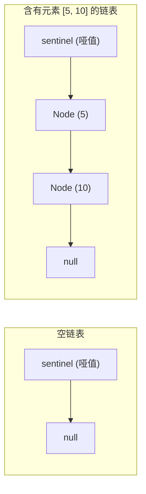

> **课程体系**：UC Berkeley CS61B: Data Structures (Spring 2024)  
> **所属模块**：Module 1: Java 语言基石与链表结构 (Java Fundamentals & Lists)  
> **主讲教师**：Prof. Justin Yokota & Prof. Peyrin Kao (UC Berkeley)  
> **视频时长**：49:11 ｜ **官方原版**：Lecture 4 - Lists II SLLists  
> **视频直达**：[📺 在 B 站观看本讲原视频 (P4)](https://www.bilibili.com/video/BV1hJ4m1M7ZA/?p=4) ｜ [📑 官方课件 Slides (Google Presentation)](https://docs.google.com/presentation/d/1Uty7XFuhRuCg3SoaSaViXzJhPTZDoYUV878L2I_pe_k) ｜ [📖 官方教材章节](https://cs61b-2.gitbook.io/cs61b-textbook/4.-sllists)  
> **快速导航**：[← 上一讲 (P03 链表 I：引用传递、递归与列表)](/notes/cs61b/lecture-03) ｜ [📚 返回全书目录](/notes/topics/CS61B) ｜ [下一讲 (P05 链表 III：双向链表 DLList 与数组基础) →](/notes/cs61b/lecture-05)

---

## 1. 为什么 IntList 难以使用：裸露结构的危机

*(参考时间：00:02:15 · [视频跳转 (P04 00:02:15)](https://www.bilibili.com/video/BV1hJ4m1M7ZA/?p=4&t=135))*

在上一讲中，`IntList` 暴露了诸多严重的技术痛点：
1. **反向思维构建反人类**：要创建 `[5, 10, 15]`，必须先建 `15`，再包裹 `10`，最后套上 `5`；
2. **缺乏状态封装**：用户可以直接访问并篡改 `L.first` 和 `L.rest`，破坏链表结构；
3. **空链表无法安全表示**：空的 `IntList` 只能用 `null` 表示，但对 `null` 调用 `size()` 或添加元素会直接触发崩溃。

为了解决这些问题，我们引入**抽象屏障与面向对象封装**，构建更优雅的单向链表容器：**SLList（Singly-Linked List）**。

## 2. SLList 架构：包装类与私有静态嵌套类

*(参考时间：00:11:30 · [视频跳转 (P04 00:11:30)](https://www.bilibili.com/video/BV1hJ4m1M7ZA/?p=4&t=690))*

我们将底层的递归节点重命名为 `IntNode`，并将其完全封装在外部容器类 `SLList` 内部，对外只提供干净的操作接口：

```java
public class SLList {
    // 私有静态嵌套类：外部用户完全感知不到 IntNode 的存在
    private static class IntNode {
        public int item;
        public IntNode next;

        public IntNode(int i, IntNode n) {
            item = i;
            next = n;
        }
    }

    // 真正的私有头指针
    private IntNode first;

    public SLList(int x) {
        first = new IntNode(x, null);
    }

    public void addFirst(int x) {
        first = new IntNode(x, first);
    }

    public int getFirst() {
        return first.item;
    }
}
```

> **设计模式：私有静态嵌套类（Private Static Nested Class）**：  
> `IntNode` 不需要访问外部 `SLList` 的任何实例变量，因此声明为 `static`。这可以节省内部类持有外部类引用所消耗的额外内存指针开销。

## 3. 尾部追加与空列表特判难题

*(参考时间：00:22:40 · [视频跳转 (P04 00:22:40)](https://www.bilibili.com/video/BV1hJ4m1M7ZA/?p=4&t=1360))*

实现在链表末尾追加元素的 `addLast(int x)` 方法：

```java
public void addLast(int x) {
    if (first == null) {
        first = new IntNode(x, null);
        return;
    }
    IntNode p = first;
    while (p.next != null) {
        p = p.next;
    }
    p.next = new IntNode(x, null);
}
```

注意上面的 `if (first == null)` 特判分支！  
当链表允许为空时，几乎所有方法（`addFirst`, `addLast`, `getFirst`, `remove`）都要充斥着对 `first == null` 的防御性判断。这种边界特判极易诱发遗漏与逻辑 Bug。

## 4. 哨兵节点模式（Sentinel Node）：消除特判的银弹

*(参考时间：00:32:15 · [视频跳转 (P04 00:32:15)](https://www.bilibili.com/video/BV1hJ4m1M7ZA/?p=4&t=1935))*

为了消除空链表的特殊情况，我们引入计算机科学中最著名的设计范式之一：**哨兵节点（Sentinel Node）**。

**哨兵节点的核心思想**：
> 链表里**永远存在一个特殊的哑节点（Dummy Node）**，它不存放真实的用户有效数据。  
> 真实的第一个元素永远存放在 `sentinel.next` 中！一个空链表并不是 `null`，而是包含一个哨兵节点的链表！



引入哨兵后的 `SLList` 源码蜕变：
```java
public class SLList {
    private static class IntNode {
        public int item;
        public IntNode next;
        public IntNode(int i, IntNode n) { item = i; next = n; }
    }

    private IntNode sentinel;
    private int size; // 缓存长度，保证 size() 是 O(1)

    /** 创建空链表 */
    public SLList() {
        sentinel = new IntNode(63, null); // 哑节点存放任意占位数值
        size = 0;
    }

    public SLList(int x) {
        sentinel = new IntNode(63, null);
        sentinel.next = new IntNode(x, null);
        size = 1;
    }

    public void addFirst(int x) {
        sentinel.next = new IntNode(x, sentinel.next);
        size++;
    }

    public void addLast(int x) {
        IntNode p = sentinel;
        // 即使链表无有效元素，p 指向 sentinel，p.next 也可以安全判断，永不抛空指针！
        while (p.next != null) {
            p = p.next;
        }
        p.next = new IntNode(x, null);
        size++;
    }

    public int size() {
        return size;
    }
}
```

## 5. 本讲小结与架构启示

*(参考时间：00:46:00 · [视频跳转 (P04 00:46:00)](https://www.bilibili.com/video/BV1hJ4m1M7ZA/?p=4&t=2760))*

| 优化点 | 原始 IntList | 改进后 SLList |
| :--- | :--- | :--- |
| **封装性** | 裸露节点指针，直接暴露给用户 | 严格 private 封装，对外提供高层操作接口 |
| **空链表处理** | 只能用 `null` 表示，操作极易抛异常 | 具备健全的空链表构造器 `new SLList()` |
| **边界特判** | 频繁判断 `first == null` | 引入 Sentinel Node，所有操作逻辑完全一致 |
| **长度查询** | $\Theta(N)$ 逐个遍历 | 维护 `size` 计数器，时间复杂度优化至 $\Theta(1)$ |

---

## 课程导航与跳转

| 上一讲 | 目录 | 下一讲 | 原视频 |
| :--- | :---: | :--- | :--- |
| [← 上一讲：链表 I：引用传递、递归与列表](/notes/cs61b/lecture-03) | [📚 返回 CS61B 全书目录](/notes/topics/CS61B) | [下一讲：链表 III：双向链表 DLList 与数组基础 →](/notes/cs61b/lecture-05) | [🎬 在 B 站观看本讲 (P04)](https://www.bilibili.com/video/BV1hJ4m1M7ZA/?p=4) |
