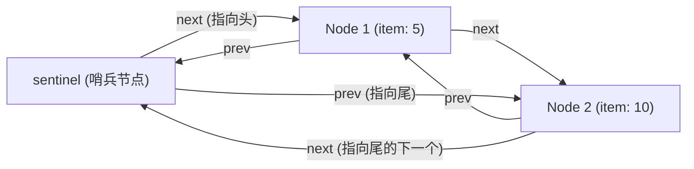

> **课程体系**：UC Berkeley CS61B: Data Structures (Spring 2024)  
> **所属模块**：Module 1: Java 语言基石与链表结构 (Java Fundamentals & Lists)  
> **主讲教师**：Prof. Justin Yokota & Prof. Peyrin Kao (UC Berkeley)  
> **视频时长**：50:49 ｜ **官方原版**：Lecture 5 - Lists 3 DLLists and Arrays  
> **视频直达**：[📺 在 B 站观看本讲原视频 (P5)](https://www.bilibili.com/video/BV1hJ4m1M7ZA/?p=5) ｜ [📑 官方课件 Slides (Google Presentation)](https://docs.google.com/presentation/d/1jjivjdvD4mx6qb4bd4rUKB6FDZbYtveJ5NKeyVeA1lk) ｜ [📖 官方教材章节](https://cs61b-2.gitbook.io/cs61b-textbook/5.-dllists)  
> **快速导航**：[← 上一讲 (P04 链表 II：单向链表、封装与哨兵节点)](/notes/cs61b/lecture-04) ｜ [📚 返回全书目录](/notes/topics/CS61B) ｜ [下一讲 (P06 软件工程基石：单元测试与测试驱动开发) →](/notes/cs61b/lecture-06)

---

## 1. SLList 的尾部性能瓶颈：为什么末尾操作无法达到 O(1)？

*(参考时间：00:01:30 · [视频跳转 (P05 00:01:30)](https://www.bilibili.com/video/BV1hJ4m1M7ZA/?p=5&t=90))*

在上一讲中，我们通过引入带有哨兵节点的 `SLList`，优雅地实现了链表数据结构的封装与统一操作。

然而，对 `SLList` 的运行时间进行渐进分析，我们会发现一个严重的结构性不对称：
- **头部操作**：`addFirst(x)` 和 `getFirst()` 只需要直接操作 `sentinel.next`，耗时始终为严格的 **$\Theta(1)$ 常数时间**；
- **尾部操作**：在执行 `addLast(x)` 或尝试获取末尾元素时，即便我们有缓存 `size`，由于单向指针只能从前往后单向流动，程序必须从 `sentinel` 开始顺着 `next` 指针一步一步向后跳跃 $N$ 次才能到达最后一个节点，耗时是 **$\Theta(N)$ 线性时间**！

当链表中有一百万个元素时，每次在末尾追加元素都要遍历一百万步，这在实际工程中是完全不可接受的。

### 能否通过增加一个 `last` 尾指针解决？
一个自然的直觉是：在 `SLList` 中增加一个私有成员变量 `IntNode last;` 指向最后一个节点。
- 这样，`getLast()` 确实变成了 $\Theta(1)$；
- `addLast(x)` 也可以通过 `last.next = new IntNode(x, null); last = last.next;` 在 $\Theta(1)$ 内搞定；
- **但是：如果我们要实现 `removeLast()`（删除最后一个节点）呢？**
  - 要删除最后一个节点，我们必须让倒数第二个节点的 `next` 指向 `null`，并将 `last` 前移到倒数第二个节点；
  - 但在单向链表中，**指针无法回头**！为了找到倒数第二个节点，我们依然必须从头遍历 $N-1$ 步！
  - 因此，单靠一个尾指针无法让 `removeLast()` 达到常数时间。

## 2. 双向链表（DLList）的核心架构设计：引入 `prev` 与 `next` 对称指针

*(参考时间：00:09:15 · [视频跳转 (P05 00:09:15)](https://www.bilibili.com/video/BV1hJ4m1M7ZA/?p=5&t=555))*

为了从根本上消除单向指针无法逆向回溯的物理局限，我们必须在每个节点中引入第二个指针引用——**向前指针 `prev`**。

这就是**双向链表（DLList, Doubly Linked List）**的核心架构：

```java
public class DLList {
    private static class Node {
        public Node prev; // 指向前驱节点
        public int item;  // 数据载荷
        public Node next; // 指向后继节点

        public Node(Node p, int i, Node n) {
            prev = p;
            item = i;
            next = n;
        }
    }
    ...
```

每个节点现在同时记录了其前驱节点与后继节点的物理内存地址。此时，任何一个节点都可以在 $\Theta(1)$ 的时间内双向移动。

## 3. 哨兵架构的演化：双哨兵结构 vs 单循环哨兵（Circular Sentinel）

*(参考时间：00:16:40 · [视频跳转 (P05 00:16:40)](https://www.bilibili.com/video/BV1hJ4m1M7ZA/?p=5&t=1000))*

引入双向指针后，如何处理头尾两端的边界哨兵？有两种经典架构设计：

### 方案 A：双哨兵模式（Two Sentinels: `sentinelFront` & `sentinelBack`）
在链表头部放置 `sentinelFront`，在链表尾部放置 `sentinelBack`：
```text
sentinelFront <--> [Node 1] <--> [Node 2] <--> sentinelBack
```
- **优点**：逻辑直观，前后界限分明；
- **缺点**：每次插入或删除操作，都需要维护两个哨兵节点的指针，代码冗长，占用多余的内存对象。

### 方案 B：神来之笔——单循环哨兵（Circular Sentinel Pattern）
Josh Hug 教授在 61B 中推崇的极致设计是**单循环哨兵**：整个链表无论多长，**只存在唯一一个哨兵节点 `sentinel`**！

我们将整个链表首尾相连成一个环形：
- `sentinel.next` 永远指向链表的**第一个真实数据节点**（Front）；
- `sentinel.prev` 永远指向链表的**最后一个真实数据节点**（Back）！



### 空链表的循环闭环状态
当链表为空（包含 0 个真实元素）时：
- `sentinel.next` 直接指回 `sentinel` 本身！
- `sentinel.prev` 也直接指回 `sentinel` 本身！

```java
public class DLList {
    private Node sentinel;
    private int size;

    public DLList() {
        sentinel = new Node(null, 63, null);
        sentinel.prev = sentinel; // 循环闭环
        sentinel.next = sentinel; // 循环闭环
        size = 0;
    }

    public void addFirst(int x) {
        Node newNode = new Node(sentinel, x, sentinel.next);
        sentinel.next.prev = newNode;
        sentinel.next = newNode;
        size += 1;
    }

    public void addLast(int x) {
        Node newNode = new Node(sentinel.prev, x, sentinel);
        sentinel.prev.next = newNode;
        sentinel.prev = newNode;
        size += 1;
    }

    public int removeLast() {
        if (size == 0) return -1;
        Node lastNode = sentinel.prev;
        sentinel.prev = lastNode.prev;
        lastNode.prev.next = sentinel;
        size -= 1;
        return lastNode.item;
    }
}
```

通过这一绝妙的拓扑闭环，`addFirst`、`addLast`、`removeFirst`、`removeLast` 全部在严格的 **$\Theta(1)$ 常数时间** 内完成，且代码中**完全没有任何 `if` 边界特判分支**！

## 4. 泛型链表（Generic Lists）：从特定类型到通用容器

*(参考时间：00:25:20 · [视频跳转 (P05 00:25:20)](https://www.bilibili.com/video/BV1hJ4m1M7ZA/?p=5&t=1520))*

迄今为止，我们的链表只能存储整数 `int`。如果我们想用链表存放字符串 `String`、海象 `Walrus` 或其他任意对象，难道要复制粘贴代码写一套 `StringDLList` 和 `WalrusDLList` 吗？

面向对象语言提供了**泛型（Generics）**机制，允许在定义类时将数据类型本身作为参数进行抽象。

### 泛型语法与类型参数占位符
在类名后面加上尖括号 `<Item>`（名字可以自定义，Josh 喜欢在课件中戏称为 `<BleepBlorp>`）：

```java
public class DLList<Item> {
    private class Node {
        public Node prev;
        public Item item; // 类型参数占位
        public Node next;

        public Node(Node p, Item i, Node n) {
            prev = p;
            item = i;
            next = n;
        }
    }

    private Node sentinel;
    private int size;

    public DLList() {
        sentinel = new Node(null, null, null);
        sentinel.prev = sentinel;
        sentinel.next = sentinel;
        size = 0;
    }

    public void addFirst(Item x) {
        Node newNode = new Node(sentinel, x, sentinel.next);
        sentinel.next.prev = newNode;
        sentinel.next = newNode;
        size += 1;
    }

    public Item getFirst() {
        return sentinel.next.item;
    }
}
```

### 客户端实例化泛型容器
```java
// 存储字符串的链表
DLList<String> words = new DLList<>();
words.addFirst("Berkeley");
words.addFirst("Cal");
String s = words.getFirst(); // 自动类型检查，无需强制转型！

// 存储海象对象的链表
DLList<Walrus> pod = new DLList<>();
pod.addFirst(new Walrus(500, 2.5));
```

## 5. 基本类型包装类与自动装箱（Autoboxing）的性能代价

*(参考时间：00:33:10 · [视频跳转 (P05 00:33:10)](https://www.bilibili.com/video/BV1hJ4m1M7ZA/?p=5&t=1990))*

当你想创建一个存放整数的泛型链表时，如果写 `DLList<int> L = new DLList<>();`，编译器会当场无情报错：
`error: unexpected type, found: int, required: reference`。

### 核心铁律：Java 泛型实参必须是引用类型！
8 种基本原始数据类型（`int`, `double`, `boolean` 等）由于其内存盒子不是指针地址，无法直接作为泛型参数传递给 JVM。

为了弥合这一鸿沟，Java 为每一种基本类型都设计了对应的**对象包装类（Wrapper Classes）**：
- `int` $\to$ `java.lang.Integer`
- `double` $\to$ `java.lang.Double`
- `boolean` $\to$ `java.lang.Boolean`
- `char` $\to$ `java.lang.Character`

### 自动装箱（Autoboxing）与自动拆箱（Unboxing）
Java 编译器在语法层面提供了自动转换便利：
```java
DLList<Integer> L = new DLList<>();
L.addFirst(42);       // 自动装箱：编译器自动转化为 L.addFirst(Integer.valueOf(42));
int x = L.getFirst(); // 自动拆箱：编译器自动转化为 L.getFirst().intValue();
```

### 隐藏的工程性能陷阱
虽然自动装箱写起来方便，但底层代价沉重：
- 原始基本类型 `int` 仅仅占用栈上的 **4 个字节**；
- 而一个 `Integer` 对象在堆中分配时，包含 8 字节的对象标记头、4 字节的类元数据指针、4 字节的数据值，再加上 64 位 JVM 的 8 字节内存对齐填充，**单个 Integer 对象至少占用 16 到 24 字节**！
- 如果存储一千万个整数，使用 `Integer` 会导致内存膨胀 4 到 6 倍，并产生大量垃圾回收碎片。

## 6. 深入 Java 原生数组（Arrays）：连续内存与物理寻址

*(参考时间：00:40:00 · [视频跳转 (P05 00:40:00)](https://www.bilibili.com/video/BV1hJ4m1M7ZA/?p=5&t=2400))*

链表通过零散指针将数据串联，虽然增删灵活，但在需要高频随机访问（如根据下标访问第 $k$ 个元素）时表现拙劣。此时，计算机硬件架构最友好的结构——**数组（Array）**登场。

### 数组的核心物理特性
1. **长度固定（Fixed Size）**：数组一旦在内存中分配，其长度永远不可改变；
2. **同质性（Homogeneous）**：数组内的所有元素必须具有相同的确切数据类型；
3. **物理内存连续分配（Contiguous Memory Allocation）**：JVM 会在堆中一次性划定一段首尾相连的连续内存地址来存放数组元素。

### $O(1)$ 随机访问的数学原理
为什么数组访问 `a[i]` 的速度快如闪电？  
因为根据内存物理连续性，元素 `a[i]` 的内存起始地址可以通过纯硬件级乘加公式瞬间算出：
$$\text{Address}(a[i]) = \text{BaseAddress} + i \times \text{ElementSize}$$
CPU 不需要遍历任何中间节点，只需一条指令即可直接定位硬件内存槽位！

## 7. 多维数组解密：Java 实际上没有真正的二维数组！

*(参考时间：00:46:15 · [视频跳转 (P05 00:46:15)](https://www.bilibili.com/video/BV1hJ4m1M7ZA/?p=5&t=2775))*

在 C 或 Fortran 中，二维数组在内存中是真正按行优先平铺的大矩阵。但在 Java 中，必须建立清晰认知：**Java 根本没有多维数组，Java 的多维数组本质上是“数组的数组（Arrays of Arrays）”**！

### 内存模型透视
观察下列声明：
```java
int[][] matrix = new int[3][];
matrix[0] = new int[]{1, 2};
matrix[1] = new int[]{3, 4, 5, 6};
matrix[2] = new int[]{7};
```

此时在内存中：
- `matrix` 是一个引用变量，指向一个长度为 3 的数组容器；
- 但这个容器里存放的不是整数，而是**三个指向其他独立一维整型数组的引用指针**！
- 由于每个子数组都是独立在堆中分配的，它们的长度完全可以各不相同！这被称为**不规则数组（Ragged Arrays）**。

```text
matrix: 0x100
  |
  v
[0x100: int[][]]
| [0]: 0x200 | ------> [0x200: int[2]] {1, 2}
| [1]: 0x300 | ------> [0x300: int[4]] {3, 4, 5, 6}
| [2]: 0x400 | ------> [0x400: int[1]] {7}
```

## 8. 链表 vs 数组：空间开销、CPU 缓存局部性与架构权衡

*(参考时间：00:51:30 · [视频跳转 (P05 00:51:30)](https://www.bilibili.com/video/BV1hJ4m1M7ZA/?p=5&t=3090))*

### 核心性能对比矩阵

| 对比维度 | 双向链表 (DLList) | 原生数组 (Array) |
| :--- | :--- | :--- |
| **末尾/头部增删** | $\Theta(1)$ 常数时间 | 插入可能触发整组搬迁与重新分配 |
| **随机访问 `get(i)`** | $\Theta(N)$ 必须顺藤摸瓜遍历 | $\Theta(1)$ 硬件地址计算直达 |
| **内存额外开销** | **极高**（每个数据项需额外付出两个 64 位指针 + 对象头） | **极低**（仅数据本身的连续内存，紧凑无浪费） |
| **CPU 缓存命中率** | **极差**（节点在堆中随机分布，极易发生 Cache Miss） | **极致优秀**（物理地址连续，顺序读取时整行装入 L1/L2 缓存） |

> **现代计算机硬件启示**：在现代多核处理器架构下，内存跳转（Pointer Chasing）的开销远比 CPU 浮点运算昂贵。在许多工程场景中，连续存储的数组列表即便在插入时需要拷贝数据，其实际运行速度往往依然吊打理论复杂度优秀的链表！

## 9. 本讲架构总结与课后综合实战自测题

*(参考时间：00:55:00 · [视频跳转 (P05 00:55:00)](https://www.bilibili.com/video/BV1hJ4m1M7ZA/?p=5&t=3300))*

### 课后综合自测题

#### 题目 1（循环哨兵追踪）
在一个采用单循环哨兵实现的 `DLList` 中，当链表包含元素 `[A, B, C]` 时，表达式 `sentinel.next.prev.prev.item` 的求值结果是什么？  
**答案与解析**：  
- 追踪指针跳跃：
  1. `sentinel.next` $\to$ 节点 A；
  2. `(节点 A).prev` $\to$ 哨兵节点 `sentinel`；
  3. `sentinel.prev` $\to$ 节点 C（末尾节点）；
  4. 最终读取的是末尾节点 C 的 `item`，因此结果为 **C**！

#### 题目 2（代码实现：双向链表翻转）
请为 `DLList` 实现一个就地破坏性翻转方法 `public void reverse()`，反转链表中所有元素的顺序。要求时间复杂度为严格的 $\Theta(N)$，且不得使用 `new` 申请任何新节点。
**参考实现代码**：
```java
public void reverse() {
    if (size <= 1) return;
    Node curr = sentinel;
    // 遍历整个环形链表（共 size + 1 个节点包含哨兵）
    for (int i = 0; i <= size; i++) {
        // 交换当前节点的 prev 和 next 指针
        Node temp = curr.next;
        curr.next = curr.prev;
        curr.prev = temp;
        // 注意：由于 next 和 prev 已经对调，沿着原来的 next 走现在必须走 prev！
        curr = curr.prev;
    }
}
```

---

## 附录：UC Berkeley 官方教材深度研读 (Official Textbook In-Depth Chapters)

> **导读说明**：本节内容整合自 UC Berkeley CS61B 官方教材库（GitBook Textbook），针对本讲的核心数据结构与算法提供原汁原味的英文理论推导、形式化代码范例与配套章节习题，与前文视频精讲相互补充印证。

## 5. DLLists

In Chapter 2.2, we built the `SLList` class, which was better than our earlier naked recursive `IntList` data structure. In this section, we'll wrap up our discussion of linked lists, and also start learning the foundations of arrays that we'll need for an array based list we'll call an `AList`. Along the way, we'll also reveal the secret of why we used the awkward name `SLList` in the previous chapter.

##### addLast 

Consider the `addLast(int x)` method from the previous chapter.

```java

public void addLast(int x) {

    size += 1;

    IntNode p = sentinel;

    while (p.next != null) {

        p = p.next;

    }

    p.next = new IntNode(x, null);

}

```

The issue with this method is that it is slow. For a long list, the `addLast` method has to walk through the entire list, much like we saw with the `size` method in chapter 2.2. Similarly, we can attempt to speed things up by adding a `last` variable, to speed up our code, as shown below:

```java

public class SLList {

    private IntNode sentinel;

    private IntNode last;

    private int size;    

    public void addLast(int x) {

        last.next = new IntNode(x, null);

        last = last.next;

        size += 1;

    }

    ...

}

```

**Exercise 2.3.1:** Consider the box and pointer diagram representing the `SLList` implementation above, which includes the last pointer. Suppose that we'd like to support `addLast`, `getLast`, and `removeLast` operations. Will the structure shown support rapid `addLast`, `getLast`, and `removeLast` operations? If not, which operations are slow?


**Answer 2.3.1:** `addLast` and `getLast` will be fast, but `removeLast` will be slow. That's because we have no easy way to get the second-to-last node, to update the `last` pointer, after removing the last node.

##### SecondToLast 

The issue with the structure from exercise 2.3.1 is that a method that removes the last item in the list will be inherently slow. This is because we need to first find the second to last item, and then set its next pointer to be null. Adding a `secondToLast` pointer will not help either, because then we'd need to find the third to last item in the list in order to make sure that `secondToLast` and `last` obey the appropriate invariants after removing the last item.

**Exercise 2.3.2:** Try to devise a scheme for speeding up the `removeLast` operation so that it always runs in constant time, no matter how long the list. Don't worry about actually coding up a solution, we'll leave that to project 1. Just come up with an idea about how you'd modify the structure of the list (i.e. the instance variables).

We'll describe the solution in Improvement #7.

##### Improvement #7: Looking Back 

The most natural way to tackle this issue is to add a previous pointer to each `IntNode`, i.e.

```java

public class IntNode {

    public IntNode prev;

    public int item;

    public IntNode next;

}

```

In other words, our list now has two links for every node. One common term for such lists is the "Doubly Linked List", which we'll call a `DLList` for short. This is in contrast to a single linked list from chapter 2.2, a.k.a. an `SLList`.

The addition of these extra pointers will lead to extra code complexity. Rather than walk you through it, you'll build a doubly linked list on your own in project 1. The box and pointer diagram below shows more precisely what a doubly linked list looks like for lists of size 0 and size 2, respectively.


##### Improvement #8: Sentinel Upgrade 

Back pointers allow a list to support adding, getting, and removing the front and back of a list in constant time. There is a subtle issue with this design where the `last` pointer sometimes points at the sentinel node, and sometimes at a real node. Just like the non-sentinel version of the `SLList`, this results in code with special cases that is much uglier than what we'll get after our 8th and final improvement. (Can you think of what `DLList` methods would have these special cases?)

One fix is to add a second sentinel node to the back of the list. This results in the topology shown below as a box and pointer diagram.


An alternate approach is to implement the list so that it is circular, with the front and back pointers sharing the same sentinel node.


Both the two-sentinel and circular sentinel approaches work and result in code that is free of ugly special cases, though I personally find the circular approach to be cleaner and more aesthetically beautiful. We will not discuss the details of these implementations, as you'll have a chance to explore one or both in project 1.

##### Generic DLLists 

Our DLLists suffer from a major limitation: they can only hold integer values. For example, suppose we wanted to create a list of Strings:

```java

DLList d2 = new DLList("hello");

d2.addLast("world");

```

The code above would crash, since our `DLList` constructor and `addLast` methods only take an integer argument.

Luckily, in 2004, the creators of Java added **generics** to the language, which will allow you to, among other things, create data structures that hold any reference type.

The syntax is a little strange to grasp at first. The basic idea is that right after the name of the class in your class declaration, you use an arbitrary placeholder inside angle brackets: `<>`. Then anywhere you want to use the arbitrary type, you use that placeholder instead.

For example, our `DLList` declaration before was:

```java

public class DLList {

    private IntNode sentinel;

    private int size;

    public class IntNode {

        public IntNode prev;

        public int item;

        public IntNode next;

        ...

    }

    ...

}

```

A generic `DLList` that can hold any type would look as below:

```java

public class DLList<BleepBlorp> {

    private IntNode sentinel;

    private int size;

    public class IntNode {

        public IntNode prev;

        public BleepBlorp item;

        public IntNode next;

        ...

    }

    ...

}

```

Here, `BleepBlorp` is just a name I made up, and you could use most any other name you might care to use instead, like `GloopGlop`, `Horse`, `TelbudorphMulticulus` or whatever.

Now that we've defined a generic version of the `DLList` class, we must also use a special syntax to instantiate this class. To do so, we put the desired type inside of angle brackets during declaration, and also use empty angle brackets during instantiation. For example:

```java

DLList<String> d2 = new DLList<>("hello");

d2.addLast("world");

```

Since generics only work with reference types, we cannot put primitives like `int` or `double` inside of angle brackets, e.g. `<int>`. Instead, we use the reference version of the primitive type, which in the case of `int` case is `Integer`, e.g.

```java

DLList<Integer> d1 = new DLList<>(5);

d1.insertFront(10);

```

There are additional nuances about working with generic types, but we will defer them to a later chapter of this book, when you've had more of a chance to experiment with them on your own. For now, use the following rules of thumb:

* In the .java file **implementing** a data structure, specify your generic type name only once at the very top of the file after the class name.

* In other .java files, which use your data structure, specify the specific desired type during declaration, and use the empty diamond operator during instantiation.

* If you need to instantiate a generic over a primitive type, use `Integer`, `Double`, `Character`, `Boolean`, `Long`, `Short`, `Byte`, or `Float` instead of their primitive equivalents.

Minor detail: You may also declare the type inside of angle brackets when instantiating, though this is not necessary, so long as you are also declaring a variable on the same line. In other words, the following line of code is perfectly valid, even though the `Integer` on the right hand side is redundant.

```java

DLList<Integer> d1 = new DLList<Integer>(5);

```

At this point, you know everything you need to know to implement the `LinkedListDeque` project on project 1, where you'll refine all of the knowledge you've gained in chapters 2.1, 2.2, and 2.3.


---

## 课程导航与跳转

| 上一讲 | 目录 | 下一讲 | 原视频 |
| :--- | :---: | :--- | :--- |
| [← 上一讲：链表 II：单向链表、封装与哨兵节点](/notes/cs61b/lecture-04) | [📚 返回 CS61B 全书目录](/notes/topics/CS61B) | [下一讲：软件工程基石：单元测试与测试驱动开发 →](/notes/cs61b/lecture-06) | [🎬 在 B 站观看本讲 (P05)](https://www.bilibili.com/video/BV1hJ4m1M7ZA/?p=5) |
