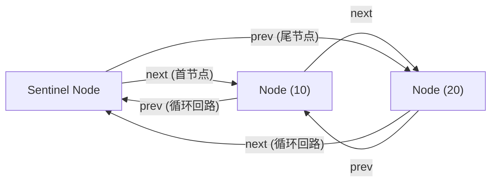

> **课程体系**：UC Berkeley CS61B: Data Structures (Spring 2024)  
> **所属模块**：Module 1: Java 语言基石与链表结构 (Java Fundamentals & Lists)  
> **主讲教师**：Prof. Justin Yokota & Prof. Peyrin Kao (UC Berkeley)  
> **视频时长**：50:49 ｜ **官方原版**：Lecture 5 - Lists 3 DLLists and Arrays  
> **视频直达**：[📺 在 B 站观看本讲原视频 (P5)](https://www.bilibili.com/video/BV1hJ4m1M7ZA/?p=5) ｜ [📑 官方课件 Slides (Google Presentation)](https://docs.google.com/presentation/d/1jjivjdvD4mx6qb4bd4rUKB6FDZbYtveJ5NKeyVeA1lk) ｜ [📖 官方教材章节](https://cs61b-2.gitbook.io/cs61b-textbook/5.-dllists)  
> **快速导航**：[← 上一讲 (P04 链表 II：SLList 封装与哨兵节点)](/notes/cs61b/lecture-04) ｜ [📚 返回全书目录](/notes/topics/CS61B) ｜ [下一讲 (P06 代码测试与测试驱动开发) →](/notes/cs61b/lecture-06)

---

## 1. 单向链表的性能瓶颈：addLast vs removeLast

*(参考时间：00:02:40 · [视频跳转 (P05 00:02:40)](https://www.bilibili.com/video/BV1hJ4m1M7ZA/?p=5&t=160))*

在上一讲实现的 `SLList` 中：
- `addFirst()`：直接在哨兵后面插入新节点，耗时为 $\Theta(1)$；
- `addLast()`：虽然需要从头遍历到尾，但即使增加一个 `last` 尾指针将其优化到 $\Theta(1)$，**`removeLast()` 依然是致命的性能瓶颈**！

为什么？因为要删除尾节点，必须将尾节点的前驱节点的 `next` 指针置为 `null`。在单向链表中，指针是单向流动的，**无法从尾节点逆向找到倒数第二个节点**，因此定位前驱必须从头遍历 $N$ 步，耗时始终为 $\Theta(N)$！

## 2. 双向链表 DLList（Doubly-Linked List）设计

*(参考时间：00:12:10 · [视频跳转 (P05 00:12:10)](https://www.bilibili.com/video/BV1hJ4m1M7ZA/?p=5&t=730))*

为了让删除末尾元素与任意反向遍历达到 $\Theta(1)$，每个节点必须同时维护两条指针链路：指向后继的 `next` 和指向前驱的 `prev`。

```java
public class DLList {
    private static class Node {
        public Node prev;
        public int item;
        public Node next;

        public Node(Node p, int i, Node n) {
            prev = p;
            item = i;
            next = n;
        }
    }
    // ...
}
```

## 3. 环形哨兵模式（Circular Sentinel Pattern）的极致优雅

*(参考时间：00:23:30 · [视频跳转 (P05 00:23:30)](https://www.bilibili.com/video/BV1hJ4m1M7ZA/?p=5&t=1410))*

如果直接采用普通的双向链表，通常需要两个独立的哨兵：`sentinelFront` 和 `sentinelBack`。  
但 Josh Hug 教授展示了一种极其精妙的工程架构：**单个环形哨兵（Circular Sentinel）**！

**环形哨兵的不变量（Invariants）**：
1. `sentinel.next` 永远指向链表的第一个有效数据节点；
2. `sentinel.prev` 永远指向链表的最后一个有效数据节点；
3. 对于空链表，`sentinel.next = sentinel`，`sentinel.prev = sentinel`！



这一精巧设计带来的巨大优势：
- 无论链表为空、单节点还是海量节点，代码执行逻辑完全一致，零分支！
- 头插 `addFirst`、尾插 `addLast`、头删 `removeFirst`、尾删 `removeLast` 全部在 $\Theta(1)$ 内极速完成！

## 4. Java 原生数组与内存布局剖析

*(参考时间：00:35:15 · [视频跳转 (P05 00:35:15)](https://www.bilibili.com/video/BV1hJ4m1M7ZA/?p=5&t=2115))*

链表的优势在于动态扩充，但劣势在于**节点分散在堆内存各处，缺乏连续性，且不支持快速随机索引访问**。计算机硬件层面的终极利器是**数组（Array）**。

### 数组的核心物理属性
1. **定长连续内存空间**：创建时必须指定长度，创建后长度不可变；
2. **$O(1)$ 时间随机索引**：通过公式 `基地址 + index * 元素字节大小` 直接硬件地址寻址：

```java
// 声明并分配包含 5 个整数的数组
int[] arr = new int[5];
arr[0] = 42;
arr[4] = 99;
```

### 原始数组 vs 引用数组
- **原始类型数组**（如 `int[]`）：数组连续内存槽里直接平铺存放数值（4 字节一段）；
- **引用类型数组**（如 `String[]` 或 `Dog[]`）：数组连续内存槽里存放的是 64 位（或压缩 32 位）的**对象指针地址**，实际对象仍分散在堆上。

## 5. 本讲小结：双向链表 vs 原生数组

*(参考时间：00:48:00 · [视频跳转 (P05 00:48:00)](https://www.bilibili.com/video/BV1hJ4m1M7ZA/?p=5&t=2880))*

| 维度 | 双向链表 (DLList) | 原生数组 (Array) |
| :--- | :--- | :--- |
| **内存布局** | 离散堆节点，通过指针串联 | 连续内存块 |
| **首尾增删** | $\Theta(1)$ 常数时间极速处理 | 尾部追加通常需要平摊扩容 |
| **索引访问 `get(i)`** | $\Theta(N)$ 必须从头或尾逐个遍历 | $\Theta(1)$ 瞬时计算偏移地址访问 |
| **内存额外开销** | 每个节点需额外维护 `prev`、`next` 指针 | 无额外指针开销，空间紧凑 |

---

## 课程导航与跳转

| 上一讲 | 目录 | 下一讲 | 原视频 |
| :--- | :---: | :--- | :--- |
| [← 上一讲：链表 II：SLList 封装与哨兵节点](/notes/cs61b/lecture-04) | [📚 返回 CS61B 全书目录](/notes/topics/CS61B) | [下一讲：代码测试与测试驱动开发 →](/notes/cs61b/lecture-06) | [🎬 在 B 站观看本讲 (P05)](https://www.bilibili.com/video/BV1hJ4m1M7ZA/?p=5) |
