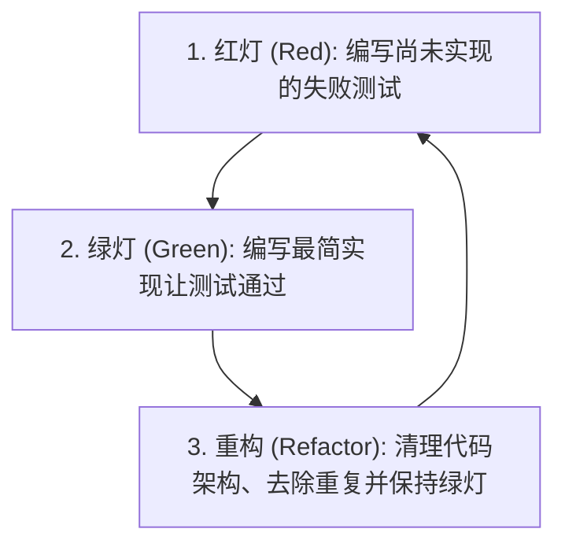

> **课程体系**：UC Berkeley CS61B: Data Structures (Spring 2024)  
> **所属模块**：Module 1: Java 语言基石与链表结构 (Java Fundamentals & Lists)  
> **主讲教师**：Prof. Justin Yokota & Prof. Peyrin Kao (UC Berkeley)  
> **视频时长**：47:57 ｜ **官方原版**：Lecture 6 - Testing  
> **视频直达**：[📺 在 B 站观看本讲原视频 (P6)](https://www.bilibili.com/video/BV1hJ4m1M7ZA/?p=6) ｜ [📑 官方课件 Slides (Google Presentation)](https://docs.google.com/presentation/d/1AxuxcFWc_9U-gmdBRPGcEqE-7Q0-48hEw5Iupbama74) ｜ [📖 官方教材章节](https://cs61b-2.gitbook.io/cs61b-textbook/7.-testing)  
> **快速导航**：[← 上一讲 (P05 链表 III：双向链表 DLList 与数组基础)](/notes/cs61b/lecture-05) ｜ [📚 返回全书目录](/notes/topics/CS61B) ｜ [下一讲 (P07 列表 IV：泛型支持与动态数组 AList) →](/notes/cs61b/lecture-07)

---

## 1. 软件工程视角：为什么自动化测试不可替代

*(参考时间：00:01:50 · [视频跳转 (P06 00:01:50)](https://www.bilibili.com/video/BV1hJ4m1M7ZA/?p=6&t=110))*

在初学编程时，大多数人习惯通过在 `main` 方法中写 `System.out.println()` 观察控制台输出，由肉眼比对结果。这种手工测试在工业级开发中存在致命弊端：
1. **极度低效与枯燥**：每次微小的代码改动都要人工重新核对数十行打印信息；
2. **不可重复**：手工测试无法集成进 CI/CD 自动化构建流水线；
3. **回归 Bug 盲区**：修改模块 A 的底层逻辑时，很难手动发现其对已测试过的模块 B 造成的隐蔽破坏。

因此，现代软件工程的核心基石之一是**自动化单元测试（Automated Unit Testing）**。

## 2. JUnit 单元测试框架与断言机制

*(参考时间：00:10:15 · [视频跳转 (P06 00:10:15)](https://www.bilibili.com/video/BV1hJ4m1M7ZA/?p=6&t=615))*

JUnit 是 Java 世界事实上的标准测试框架。它通过注解（Annotations）标识测试方法，并通过断言（Assertions）判断程序运行结果是否符合预期。

```java
import org.junit.Test;
import static org.junit.Assert.*;

public class SortTest {
    @Test
    public void testSort() {
        String[] input = {"i", "have", "an", "egg"};
        String[] expected = {"an", "egg", "have", "i"};

        Sort.sort(input);

        // 断言两个数组的内容完全相同
        assertArrayEquals(expected, input);
    }
}
```

> **核心原则**：
> - 测试方法必须用 `@Test` 修饰；
> - 测试方法没有参数，返回类型为 `void`；
> - 断言失败时 JUnit 会立即报错并精准打印 `expected` 与 `actual` 的差异行，测试全部通过时静默亮起“绿条（Green Bar）”。

## 3. 测试驱动开发（TDD）循环

*(参考时间：00:20:40 · [视频跳转 (P06 00:20:40)](https://www.bilibili.com/video/BV1hJ4m1M7ZA/?p=6&t=1240))*

测试驱动开发（Test-Driven Development, TDD）颠覆了“先写功能代码、后补测试”的传统流程，倡导**测试先行**：



TDD 强迫开发者在写代码前先站在使用者的角度明确函数接口、输入输出规范及边界条件，从源头杜绝模糊不清的需求理解。

## 4. 排序算法（Selection Sort）实战拆解

*(参考时间：00:30:20 · [视频跳转 (P06 00:30:20)](https://www.bilibili.com/video/BV1hJ4m1M7ZA/?p=6&t=1820))*

讲师演示了利用 TDD 思想开发选择排序算法（Selection Sort）的经典三步走：

1. **寻找最小值索引（Find Smallest）**：
   - 先写 `testFindSmallest()` 测试；
   - 实现并验证 `findSmallest(String[] a, int start)`。
2. **交换元素（Swap）**：
   - 先写 `testSwap()` 测试；
   - 实现并验证 `swap(String[] a, int i, int j)`。
3. **顶层递归/迭代调用（Sort）**：
   - 组合前两个验证通过的辅助函数，完成整体排序逻辑。

```java
public class Sort {
    public static void sort(String[] a) {
        sort(a, 0);
    }

    private static void sort(String[] a, int start) {
        if (start >= a.length) {
            return;
        }
        int smallestIndex = findSmallest(a, start);
        swap(a, start, smallestIndex);
        sort(a, start + 1);
    }

    public static int findSmallest(String[] a, int start) {
        int smallestIndex = start;
        for (int i = start; i < a.length; i++) {
            if (a[i].compareTo(a[smallestIndex]) < 0) {
                smallestIndex = i;
            }
        }
        return smallestIndex;
    }

    public static void swap(String[] a, int i, int j) {
        String temp = a[i];
        a[i] = a[j];
        a[j] = temp;
    }
}
```

## 5. 本讲小结与良好测试的法则

*(参考时间：00:44:30 · [视频跳转 (P06 00:44:30)](https://www.bilibili.com/video/BV1hJ4m1M7ZA/?p=6&t=2670))*

- **原子性（Atomic）**：每个测试方法只专注于验证一个具体功能点或边界分支；
- **自包含与隔离（Isolated）**：测试之间不得产生相互依赖或共享可变全局状态；
- **辅助方法先行测试**：在实现庞大算法前，先将核心逻辑拆解为子函数，并分别编写严密的微单元测试。

---

## 课程导航与跳转

| 上一讲 | 目录 | 下一讲 | 原视频 |
| :--- | :---: | :--- | :--- |
| [← 上一讲：链表 III：双向链表 DLList 与数组基础](/notes/cs61b/lecture-05) | [📚 返回 CS61B 全书目录](/notes/topics/CS61B) | [下一讲：列表 IV：泛型支持与动态数组 AList →](/notes/cs61b/lecture-07) | [🎬 在 B 站观看本讲 (P06)](https://www.bilibili.com/video/BV1hJ4m1M7ZA/?p=6) |
