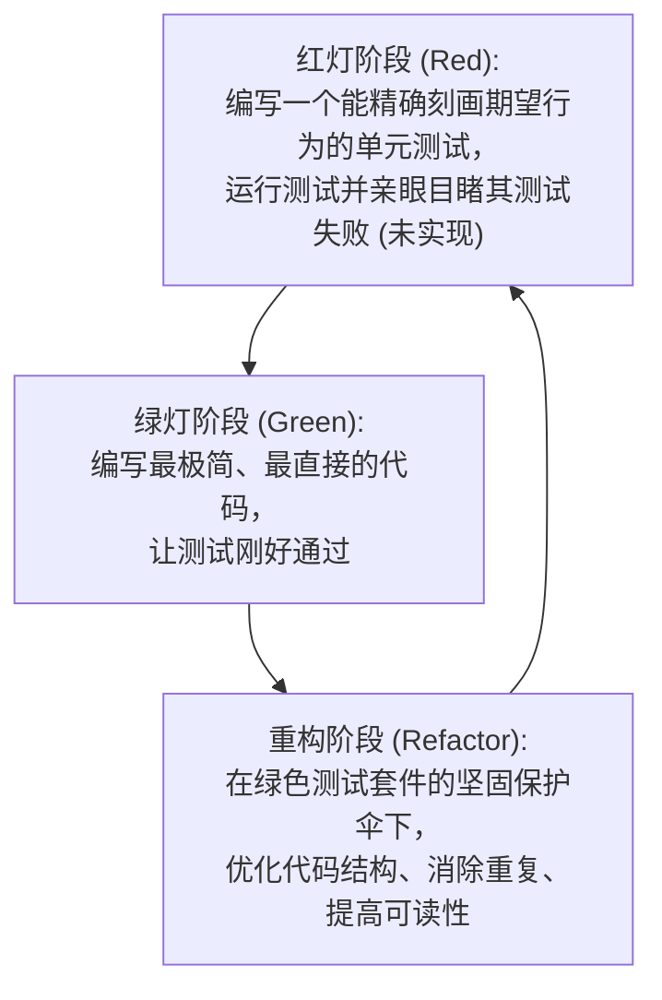

> **课程体系**：UC Berkeley CS61B: Data Structures (Spring 2024)  
> **所属模块**：Module 1: Java 语言基石与链表结构 (Java Fundamentals & Lists)  
> **主讲教师**：Prof. Justin Yokota & Prof. Peyrin Kao (UC Berkeley)  
> **视频时长**：47:57 ｜ **官方原版**：Lecture 6 - Testing  
> **视频直达**：[📺 在 B 站观看本讲原视频 (P6)](https://www.bilibili.com/video/BV1hJ4m1M7ZA/?p=6) ｜ [📑 官方课件 Slides (Google Presentation)](https://docs.google.com/presentation/d/1AxuxcFWc_9U-gmdBRPGcEqE-7Q0-48hEw5Iupbama74) ｜ [📖 官方教材章节](https://cs61b-2.gitbook.io/cs61b-textbook/7.-testing)  
> **快速导航**：[← 上一讲 (P05 链表 III：双向链表、泛型与原生数组)](/notes/cs61b/lecture-05) ｜ [📚 返回全书目录](/notes/topics/CS61B) ｜ [下一讲 (P07 链表 IV：数组列表、动态扩容与均摊分析) →](/notes/cs61b/lecture-07)

---

## 1. 软件工程第一支柱：为什么测试驱动开发（TDD）是顶尖工程师的护身符

*(参考时间：00:01:25 · [视频跳转 (P06 00:01:25)](https://www.bilibili.com/video/BV1hJ4m1M7ZA/?p=6&t=85))*

在初学编程时，大多数学生的开发模式是**“编写代码 $\to$ 运行 $\to$ 遇到 Bug $\to$ 肉眼看代码 $\to$ 随手加两句 print $\to$ 盲目修改”**。

当工程代码扩展到几千行（例如 CS 61B 的经典大作业 Gitlet 或 2D 游戏引擎 Project 2），这种原始的开发模式会导致毁灭性的灾难：
- 修改了 A 模块的代码，神不知鬼不觉地破坏了 B 模块的功能（软件退化/回归 Regression）；
- 每次修改后都需要耗费几分钟甚至几十分钟手动点击运行、输入测试参数；
- 随着项目截止日期临近，系统深处积压了数十个相互交织的隐蔽 Bug，彻底失控。

### 测试驱动开发（TDD, Test-Driven Development）
计算机大师与工业界顶尖工程师推崇的开发哲学是 **TDD（测试驱动开发）**：
> **核心法则**：**在动手编写任何业务实现代码之前，先编写用于验证该功能的自动化测试代码！**



## 2. 案例实战拆解：Selection Sort（选择排序）的三步算法分解

*(参考时间：00:08:40 · [视频跳转 (P06 00:08:40)](https://www.bilibili.com/video/BV1hJ4m1M7ZA/?p=6&t=520))*

为了全流程演示 TDD 的威力，Josh Hug 教授在课件中挑选了一个经典的算法任务：**对一个字符串数组进行升序排序（Sort an array of Strings）**。

### 算法分治哲学（Problem Decomposition）
面对一个看似复杂的大任务，平庸的程序员会试图在一个几十行的大循环里把所有逻辑揉在一起。而优秀的软件工程师会将其解构为清晰独立的原子子任务：

选择排序（Selection Sort）的核心逻辑可以完美分解为三个子步骤：
1. **寻找最小值**：在数组当前未排序的有效区间内，找到最小的字符串；
2. **交换位置**：将找到的最小元素与当前区间的起始元素进行交换；
3. **递归处理余项**：对剩余的子数组重复执行上述两步，直到整个数组有序。

```java
public class Sort {
    /** 对字符串数组 a 进行升序排序 */
    public static void sort(String[] a) {
        // 核心解构骨架
    }
}
```

## 3. 手工打印测试的困境与自动化测试哲学

*(参考时间：00:15:30 · [视频跳转 (P06 00:15:30)](https://www.bilibili.com/video/BV1hJ4m1M7ZA/?p=6&t=930))*

让我们看看传统的“手工打印测试”是如何进行的：

```java
public class TestSortManual {
    public static void main(String[] args) {
        String[] input = {"i", "have", "an", "egg"};
        Sort.sort(input);
        for (String s : input) {
            System.out.print(s + " ");
        }
        System.out.println();
    }
}
```

### 为什么说这种测试方式是劣质的？
1. **依赖人眼辨别**：测试是否成功，需要程序员盯着屏幕输出一个词一个词比对。人眼极其容易疲劳和忽略微小笔误；
2. **无法自动化集成**：如果有 500 个这样的测试，难道程序员每次提交代码都要用肉眼看 500 行终端打印吗？
3. **静默失败**：如果输出错误，程序并不会自动报警中断，缺乏确定性的断言。

我们必须引入**自动化测试断言（Automated Assertions）**：让计算机程序去验证计算机程序！

## 4. 工业级测试工具：JUnit 5 核心注解与断言体系

*(参考时间：00:22:10 · [视频跳转 (P06 00:22:10)](https://www.bilibili.com/video/BV1hJ4m1M7ZA/?p=6&t=1330))*

在现代 Java 生态中，**JUnit** 是绝对统治地位的自动化测试框架。

### JUnit 的核心运转机制
1. **测试方法标记**：在测试方法上方添加 `@Test` 注解（Annotation），告诉 JUnit 运行时这是一个自动化测试用例；
2. **无需 `main` 方法**：JUnit 测试运行器会自动反射扫描带有 `@Test` 的所有方法并逐一执行；
3. **强大的断言库**：通过静态导入 `org.junit.jupiter.api.Assertions.*`，提供极其丰富的比较断言：
   - `assertEquals(expected, actual)`：断言两个对象或基本类型值等价；
   - `assertArrayEquals(expectedArray, actualArray)`：断言两个数组对应位置上的元素全部一致；
   - `assertTrue(booleanCondition)`：断言布尔条件为真；
   - `assertNull(obj)` / `assertNotNull(obj)`。

```java
import org.junit.jupiter.api.Test;
import static org.junit.jupiter.api.Assertions.*;

public class SortTest {
    @Test
    public void testSort() {
        String[] input = {"i", "have", "an", "egg"};
        String[] expected = {"an", "egg", "have", "i"};

        Sort.sort(input);

        // 如果不一致，测试直接爆红中断，并精准输出差异对比！
        assertArrayEquals(expected, input);
    }
}
```

## 5. 步步为营：测试先行（TDD）实现 Selection Sort 辅助方法

*(参考时间：00:30:00 · [视频跳转 (P06 00:30:00)](https://www.bilibili.com/video/BV1hJ4m1M7ZA/?p=6&t=1800))*

现在我们贯彻 TDD 的法则，先写子步骤的单元测试，再写子步骤的实现代码！

### 子步骤 1：寻找最小元素的索引 `findSmallest`
**先写测试**：
```java
@Test
public void testFindSmallest() {
    String[] input = {"i", "have", "an", "egg"};
    int expected = 2; // "an" 是字母序最小的，索引为 2

    int actual = Sort.findSmallest(input, 0);
    assertEquals(expected, actual);

    // 测试带起始偏移区间的情况
    int actualOffset = Sort.findSmallest(input, 2);
    assertEquals(2, actualOffset); // 从索引 2 开始，"an" 依然是最小的
}
```

**再写实现**：
```java
public class Sort {
    /** 寻找从起始索引 start 开始的最小字符串的索引 */
    public static int findSmallest(String[] a, int start) {
        int smallestIndex = start;
        for (int i = start; i < a.length; i++) {
            // String 的 compareTo 方法：若 a[i] 字典序小于当前最小值，返回负数
            int cmp = a[i].compareTo(a[smallestIndex]);
            if (cmp < 0) {
                smallestIndex = i;
            }
        }
        return smallestIndex;
    }
```

### 子步骤 2：元素交换 `swap`
**先写测试**：
```java
@Test
public void testSwap() {
    String[] input = {"i", "have", "an", "egg"};
    String[] expected = {"an", "have", "i", "egg"};

    Sort.swap(input, 0, 2); // 交换 0 和 2 号元素
    assertArrayEquals(expected, input);
}
```

**再写实现**：
```java
    /** 交换数组中索引 i 和 j 处的元素 */
    public static void swap(String[] a, int i, int j) {
        String temp = a[i];
        a[i] = a[j];
        a[j] = temp;
    }
```

### 子步骤 3：组合装配主方法 `sort`
有了经过完备单元测试验证的两个基石辅助方法，主排序方法的水到渠成：
```java
    public static void sort(String[] a) {
        sort(a, 0);
    }

    /** 递归实现选择排序 */
    private static void sort(String[] a, int start) {
        if (start >= a.length - 1) {
            return; // 基线条件：剩余元素不足 2 个，天然有序
        }
        int smallest = findSmallest(a, start);
        swap(a, start, smallest);
        sort(a, start + 1); // 递归处理后续区间
    }
}
```
运行之前的 `testSort()`，绿色通过（Green）！整套模块一气呵成。

## 6. 重构的勇气（Refactoring with Confidence）

*(参考时间：00:39:15 · [视频跳转 (P06 00:39:15)](https://www.bilibili.com/video/BV1hJ4m1M7ZA/?p=6&t=2355))*

很多程序员在代码跑通后不敢动任何结构，因为害怕“改坏了”。

然而，上面的 `sort` 方法使用的是递归。如果传入的数组有一百万个元素，递归深度过深会导致 `StackOverflowError`。我们希望将其重构为纯**迭代循环（Iterative）**。

### 在测试套件保护下进行无畏重构
因为我们拥有一整套绿色的 JUnit 测试用例，我们可以大胆对 `sort` 方法进行底层重写：

```java
    /** 重构为迭代版本 */
    public static void sort(String[] a) {
        for (int i = 0; i < a.length - 1; i++) {
            int smallest = findSmallest(a, i);
            swap(a, i, smallest);
        }
    }
```

重构完成后，点击运行测试套件——0.1 秒内全部绿色亮起！测试套件赋予了工程师在面对复杂架构时从容重构、精益求精的巨大勇气。

## 7. 经典测试陷阱：对象等价性 vs 引用同一性（`equals` vs `==`）

*(参考时间：00:45:00 · [视频跳转 (P06 00:45:00)](https://www.bilibili.com/video/BV1hJ4m1M7ZA/?p=6&t=2700))*

在编写测试断言时，必须警惕一个灾难级的误区：使用 `==` 代替 `.equals()`。

### 核心语义差异
- `a == b`：比较的是变量盒子里面的**物理内存地址比特**！只有当两个变量指向堆中完全相同的同一个物理对象时才为真；
- `a.equals(b)`：比较的是两个对象在**逻辑语义上的内容是否等价**。

```java
String s1 = new String("berkeley");
String s2 = new String("berkeley");

System.out.println(s1 == s2);      // false！这是堆中两个不同的字符串对象！
System.out.println(s1.equals(s2)); // true！它们的内容字符完全一致！
```

在测试中：
- 比较数组必须使用 `assertArrayEquals(expected, actual)`（它会逐项比对内容）；
- 如果错写成 `assertEquals(expectedArray, actualArray)`，JUnit 可能会退化为比较两个数组的内存地址，导致原本内容完全正确的测试用例无端报错！

## 8. 课后实战：编写工业级 JUnit 单元测试用例集

*(参考时间：00:50:00 · [视频跳转 (P06 00:50:00)](https://www.bilibili.com/video/BV1hJ4m1M7ZA/?p=6&t=3000))*

### 课后综合自测题

#### 题目 1（测试覆盖率分析）
对于选择排序算法，只测试一个常规无序数组 `{"i", "have", "an", "egg"}` 是否足够？优秀的测试套件还应当包含哪些极端边界用例（Edge Cases）？  
**答案与解析**：  
远远不够！一个工业级的测试套件必须覆盖以下极端用例：
1. **空数组（Empty Array）**：`new String[]{}`，测试算法是否会抛出越界异常；
2. **单元素数组（Single Element）**：`new String[]{"cat"}`，验证基线条件；
3. **已有序数组（Already Sorted）**：`new String[]{"a", "b", "c"}`，验证原地稳定性；
4. **逆序数组（Reversed Array）**：`new String[]{"z", "y", "x"}`，验证最差情况；
5. **包含重复元素（Duplicates）**：`new String[]{"b", "a", "b", "a"}`，验证等值比较逻辑；
6. **包含大写与特殊字符**：ASCII 字典序中大写字母排在小写字母前面（如 `"Apple"` 小于 `"apple"`）。

#### 题目 2（测试诊断）
某位同学编写了如下测试用例，请指出其设计上的坏味道（Bad Smell）：
```java
@Test
public void testEverything() {
    testA();
    testB();
    testC();
}
```
**答案与解析**：  
- **违背单一职责原则**：单元测试的核心原则是“一个测试方法只验证一个独立的逻辑行为（Unit of Behavior）”。
- **掩盖失败现场**：如果 `testA()` 断言失败并抛出异常，整个方法会立即终止，后面的 `testB()` 和 `testC()` 将完全无法执行，工程师无法得知后续模块的健康状态。每个测试方法必须独立添加 `@Test` 注解。

---

## 附录：UC Berkeley 官方教材深度研读 (Official Textbook In-Depth Chapters)

> **导读说明**：本节内容整合自 UC Berkeley CS61B 官方教材库（GitBook Textbook），针对本讲的核心数据结构与算法提供原汁原味的英文理论推导、形式化代码范例与配套章节习题，与前文视频精讲相互补充印证。

## 7. Testing

#### Testing and Selection Sort 

One of the most important skills an intermediate to advanced programmer can have is the ability to tell when your code is correct. In this chapter, we'll discuss how you can write tests to evaluate code correctness. Along the way, we'll also discuss an algorithm for sorting called Selection Sort.

##### A New Way 

When you write a program, it may have errors. In a classroom setting, you gain confidence in your code's correctness through some combination of user interaction, code analysis, and autograder testing, with this last item being of the greatest importance in many cases, particularly as it is how you earn points.

Autograders, of course, are not magic. They are code that the instructors write that is fundamentally not all that different from the code that you are writing. In the real world, these tests are written by the programmers themselves, rather than some benevolent Josh-Hug-like third party.

In this chapter, we'll explore how we can write our own tests. Our goal will be to create a class called `Sort` that provides a method `sort(String[] x)` that destructively sorts the strings in the array `x`.

As a totally new way of thinking, we'll start by writing `testSort()` first, and only after we've finished the test, we'll move on to writing the actual sorting code.

##### Ad Hoc Testing 

Writing a test for `Sort.sort` is relatively straightforward, albeit tedious. We simply need to create an input, call `sort`, and check that the output of the method is correct. If the output is not correct, we print out the first mismatch and terminate the test. For example, we might create a test class as follows:

```java

public class TestSort {

    /** Tests the sort method of the Sort class. */

    public static void testSort() {

        String[] input = {"i", "have", "an", "egg"};

        String[] expected = {"an", "egg", "have", "i"};

        Sort.sort(input);

        for (int i = 0; i < input.length; i += 1) {

            if (!input[i].equals(expected[i])) {

                System.out.println("Mismatch in position " + i + ", expected: " + expected + ", but got: " + input[i] + ".");

                break;

            }

        }

    }

    public static void main(String[] args) {

        testSort();

    }

}

```

We can test out our test by creating a blank `Sort.sort` method as shown below:

```java

public class Sort {

    /** Sorts strings destructively. */

    public static void sort(String[] x) {        

    }

}

```

If we run the `testSort()` method with this blank `Sort.sort` method, we'd get:

```sh

Mismatch in position 0, expected: an, but got: i.

```

The fact that we're getting an error message is a good thing! This means our test is working. What's very interesting about this is that we've now created a little game for ourselves to play, where the goal is to modify the code for `Sort.sort` so that this error message no longer occurs. It's a bit of a psychological trick, but many programmers find the creation of these little mini-puzzles for themselves to be almost addictive.

In fact, this is a lot like the situation where you have an autograder for a class, and you find yourself hooked on the idea of getting the autograder to give you its love and approval. You now have the ability to create a judge for your code, whose esteem you can only win by completing the code correctly.

**Important note:** You may be asking "Why are you looping through the entire array? Why don't you just check if the arrays are equal using `==`? ". The reason is, when we test for equality of two objects, we cannot simply use the `==` operator. The `==` operator compares the literal bits in the memory boxes, e.g. `input == expected` would test whether or not the addresses of `input` and `expected` are the same, not whether the values in the arrays are the same. Instead, we used a loop in `testSort`, and print out the first mismatch. You could also use the built-in method `java.util.Arrays.equals` instead of a loop.

While the single test above wasn't a ton of work, writing a suite of such *ad hoc* tests would be very tedious, as it would entail writing a bunch of different loops and print statements. In the next section, we'll see how the `org.junit` library saves us a lot of work.

##### JUnit Testing 

The Google Truth library provides a number of helpful methods and useful capabilities for simplifying the writing of tests. For example, we can replace our simple *ad hoc* test from above with:

```java

import static com.google.common.truth.Truth.assertThat;

public class TestSort {

   /** Tests the sort method of the Sort class. */

   public static void testSort() {

       String[] input = {"cows", "dwell", "above", "clouds"};

       String[] expected = {"above", "clouds", "cows", "dwell"};

       Sort.sort(input);

       assertThat(input).isEqualTo(expected);

   }

   public static void main(String[] args) {

       testSort();

   }

}

```

**This code is much simpler**, and does more or less the exact same thing, i.e. if the arrays are not equal, it will tell us the first mismatch. For example, if we run `testSort()` on a `Sort.sort` method that does nothing, we'd get:

```sh

Exception in thread "main" arrays first differed at element [0]; expected:<[an]> but was:<[i]>

    at org.junit.internal.ComparisonCriteria.arrayEquals(ComparisonCriteria.java:55)

    at org.junit.Assert.internalArrayEquals(Assert.java:532)

    ...

```

While this output is a little uglier than our *ad hoc* test, we'll see at the very end of this chapter how to make it nicer.

##### Selection Sort 

Before we can write a `Sort.sort` method, we need some algorithm for sorting. Perhaps the simplest sorting algorithm around is "selection sort." Selection sort consists of three steps:

* Find the smallest item.

* Move it to the front.

* Selection sort the remaining N-1 items (without touching the front item).

For example, suppose we have the array `{6, 3, 7, 2, 8, 1}`. The smallest item in this array is `1`, so we'd move the `1` to the front. There are two natural ways to do this: One is to stick the `1` at the front and slide all the numbers over, i.e. `{1, 6, 3, 7, 2, 8}`. However, the much more efficient way is to simply swap the `1` with the old front (in this case `6`), yielding `{1, 3, 7, 2, 8, 6}`.

We'd simply repeat the same process for the remaining digits, i.e. the smallest item in `... 3, 7, 2, 8, 6}` is `2`. Swapping to the front, we get `{1, 2, 7, 3, 8, 6}`. Repeating until we've got a sorted array, we'd get `{1, 2, 3, 7, 8, 6}`, then `{1, 2, 3, 6, 8, 7}`, then finally `{1, 2, 3, 6, 7, 8}`.

We could mathematically prove the correctness of this sorting algorithm on any arrays by using the concept of invariants that was originally introduced in chapter 2.4, though we will not do so in this textbook. Before proceeding, try writing out your own short array of numbers and perform selection sort on it, so that you can make sure you get the idea.

Now that we know how selection sort works, we can write in a few short comments in our blank `Sort.sort` method to guide our thinking:

```java

public class Sort {

    /** Sorts strings destructively. */

    public static void sort(String[] x) { 

           // find the smallest item

           // move it to the front

           // selection sort the rest (using recursion?)

    }

}

```

In the following sections, I will attempt to complete an implementation of selection sort. I'll do so in a way that resembles how a student might approach the problem, so **I'll be making a few intentional errors along the way**. These intentional errors are a good thing, as they'll help demonstrate the usefulness of testing. If you spot any of the errors while reading, don't worry, we'll eventually come around and correct them.

##### findSmallest 

The most natural place to start is to write a method for finding the smallest item in a list. As with `Sort.sort`, we'll start by writing a test before we even complete the method. First, we'll create a dummy `findSmallest` method that simply returns some arbitrary value:

```java

public class Sort {

    /** Sorts strings destructively. */

    public static void sort(String[] x) { 

           // find the smallest item

           // move it to the front

           // selection sort the rest (using recursion?)

    }

    /** Returns the smallest string in x. */

    public static String findSmallest(String[] x) {

        return x[2];

    }

}

```

Obviously this is not a correct implementation, but we've chosen to defer actually thinking about how `findSmallest` works until after we've written a test. Using the `org.junit` library, adding such a test to our `TestSort` class is very easy, as shown below:

```java

public class TestSort {

   @Test

   public void testFindSmallest() {

       String[] input = {"rawr", "a", "zaza", "newway"};

       String expected = "zaza";

       String actual = Sort.findSmallest(input);

       assertThat(actual).isEqualTo(expected);

   }

}

```

As with `TestSort.testsort`, we then run our `TestSort.testFindSmallest` method to make sure that it fails. When we run this test, we'll see that it actually passes, i.e. no message appears. This is because we just happened to hard code the correct return value `x[2]`. Let's modify our `findSmallest` method so that it returns something that is definitely incorrect:

```java

/** Returns the smallest string in x. */

public static String findSmallest(String[] x) {

    return x[3];

}

```

After making this change, when we run `TestSort.testFindSmallest`, we'll get an error, which is a good thing:

```sh

Exception in thread "main" java.lang.AssertionError: expected:<[an]> but was:<[null]>

    at org.junit.Assert.failNotEquals(Assert.juava:834)

    at TestSort.testFindSmallest(TestSort.java:9)

    at TestSort.main(TestSort.java:24)

```

As before, we've set up for ourselves a little game to play, where our goal is now to modify the code for `Sort.findSmallest` so that this error no longer appears. This is a smaller goal than getting `Sort.sort` to work, which might be even more addictive.

Side note: It might have seem rather contrived that I just happened to return the right value `x[2]`. However, when I was recording this lecture video, I actually did make this exact mistake without intending to do so!

Next we turn to actually writing `findSmallest`. This seems like it should be relatively straightforward. If you're a Java novice, you might end up writing code that looks something like this:

```java

/**  Returns the smallest string in x. */

public static String findSmallest(String[] x) {

    String smallest = x[0];

    for (int i = 0; i < x.length; i += 1) {

        if (x[i] < smallest) {

            smallest = x[i];

        }

    }

    return smallest;

}

```

However, this will yield the compilation error "< cannot be applied to 'java.lang.String'". The issue is that Java does not allow comparisons between Strings using the < operator.

When you're programming and get stuck on an issue like this that is easily describable, it's probably best to turn to a search engine. For example, we might search "less than strings Java" with Google. Such a search might yield a Stack Overflow post like [this one](https://stackoverflow.com/questions/5153496/how-can-i-compare-two-strings-in-java-and-define-which-of-them-is-smaller-than-t).

One of the popular answers for this post explains that the `str1.compareTo(str2)` method will return a negative number if `str1 < str2`, 0 if they are equal, and a positive number if `str1 > str2`.

Incorporating this into our code, we might end up with:

```java

/** Returns the smallest string in x. 

  * @source Got help with string compares from https://goo.gl/a7yBU5. */

public static String findSmallest(String[] x) {

    String smallest = x[0];

    for (int i = 0; i < x.length; i += 1) {

        int cmp = x[i].compareTo(smallest);

        if (cmp < 0) {

            smallest = x[i];

        }

    }

    return smallest;

}

```

Note that we've used a `@source` tag in order to cite our sources. I'm showing this by example for those of you who are taking 61B as a formal course. This is not a typical real world practice.

Since we are using syntax features that are totally new to us, we might lack confidence in the correctness of our `findSmallest` method. Luckily, we just wrote that test a little while ago. If we try running it, we'll see that nothing gets printed, which means our code is probably correct.

We can augment our test to increase our confidence by adding more test cases. For example, we might change `testFindSmallest` so that it reads as shown below:

```java

public static void testFindSmallest() {

    String[] input = {"i", "have", "an", "egg"};

    String expected = "an";

    String actual = Sort.findSmallest(input);

    assertThat(actual).isEqualTo(expected);     

    String[] input2 = {"there", "are", "many", "pigs"};

    String expected2 = "are";

    String actual2 = Sort.findSmallest(input2);

    assertThat(actual2).isEqualTo(expected2);  

}

```

Rerunning the test, we see that it still passes. We are not absolutely certain that it works, but we are much more certain that we would have been without any tests.

##### Swap 

Looking at our `sort` method below, the next helper method we need to write is something to move an item to the front, which we'll call `swap`.

```java

/** Sorts strings destructively. */

public static void sort(String[] x) { 

       // find the smallest item

       // move it to the front

       // selection sort the rest (using recursion?)

}

```

Writing a `swap` method is very straightforward, and you've probably done so before. A correct implementation might look like:

```java

public static void swap(String[] x, int a, int b) {

    String temp = x[a];

    x[a] = x[b];

    x[b] = temp;

}

```

However, for the moment, let's introduce an intentional error so that we can demonstrate the utility of testing. A more naive programmer might have done something like:

```java

public static void swap(String[] x, int a, int b) {    

    x[a] = x[b];

    x[b] = x[a];

}

```

Writing a test for this method is quite easy with the help of JUnit. An example test is shown below. Note that we have also edited the main method so that it calls `testSwap` instead of `testFindSmallest` or `testSort`.

```java

public class TestSort {

    ...    

    /** Test the Sort.swap method. */

    public static void testSwap() {

        String[] input = {"i", "have", "an", "egg"};

        int a = 0;

        int b = 2;

        String[] expected = {"an", "have", "i", "egg"};

        Sort.swap(input, a, b);

        assertThat(expected).isEqualTo(input);

    }

    public static void main(String[] args) {

        testSwap();

    }

}

```

Running this test on our buggy `swap` yields an error, as we'd expect.

```sh

Exception in thread "main" arrays first differed in element [2]; expected:<[i]> but was:<[an]>

    at TestSort.testSwap(TestSort.java:36)

```

It's worth briefly noting that it is important that we call only `testSwap` and not `testSort` as well. For example, if our `main` method was as below, the entire `main` method will terminate execution as soon as `testSort` fails, and `testSwap` will never run:

```java

public static void main(String[] args) {

    testSort();

    testFindSmallest();

    testSwap();

}

```

We will learn a more elegant way to deal with multiple tests at the end of this chapter that will avoid the need to manually specify which tests to run.

Now that we have a failing test, we can use it to help us debug. One way to do this is to set a breakpoint inside the `swap` method and use the visual debugging feature in IntelliJ. If you would like more information about and practice on debugging, check out [Lab3](https://sp19.datastructur.es/materials/lab/lab3/lab3). Stepping through the code line-by-line makes it immediately clear what is wrong (see video or try it yourself), and we can fix it by updating our code to include a temporary variable as that the beginning of this section:

```java

public static void swap(String[] x, int a, int b) {

    String temp = x[a];

    x[a] = x[b];

    x[b] = temp;

}

```

Rerunning the test, we see that it now passes.

##### Revising findSmallest 

Now that we have multiple pieces of our method done, we can start trying to connect them up together to create a `Sort` method.

```java

/** Sorts strings destructively. */

public static void sort(String[] x) { 

       // find the smallest item

       // move it to the front

       // selection sort the rest (using recursion?)

}

```

It's clear how to use our `findSmallest` and `swap` methods, but when we do so, we immediately realize there is a bit of a mismatch: `findSmallest` returns a `String`, and `swap` expects two indices.

```java

/** Sorts strings destructively. */

public static void sort(String[] x) { 

       // find the smallest item

       String smallest = findSmallest(x);

       // move it to the front

       swap(x, 0, smallest);

       // selection sort the rest (using recursion?)

}

```

In other words, what `findSmallest` should have been returning is the index of the smallest String, not the String itself. Making silly errors like this is normal and really easy to do, so don't sweat it if you find yourself doing something similar. Iterating on a design is part of the process of writing code.

Luckily, this new design can be easily changed. We simply need to adjust `findSmallest` to return an `int`, as shown below:

```java

public static int findSmallest(String[] x) {

    int smallestIndex = 0;

    for (int i = 0; i < x.length; i += 1) {

        int cmp = x[i].compareTo(x[smallestIndex]);

        if (cmp < 0) {

            smallestIndex = i;

        }

    }

    return smallestIndex;

}

```

Since this is a non-trivial change, we should also update `testFindSmallest` and make sure that `findSmallest` still works.

```java

public static void testFindSmallest() {

    String[] input = {"i", "have", "an", "egg"};

    int expected = 2;

    int actual = Sort.findSmallest(input);

    assertThat(actual).isEqualTo(expected); 

    String[] input2 = {"there", "are", "many", "pigs"};

    int expected2 = 1;

    int actual2 = Sort.findSmallest(input);

    assertThat(actual2).isEqualTo(expected2); 

}

```

After modifying `TestSort` so that this test is run, and running `TestSort.main`, we see that our code passes the tests. Now, revising sort, we can fill in the first two steps of our sorting algorithm.

```java

/** Sorts strings destructively. */

public static void sort(String[] x) { 

   // find the smallest item

   // move it to the front

   // selection sort the rest (using recursion?)

   int smallestIndex = findSmallest(x);

   swap(x, 0, smallestIndex);

}

```

All that's left is to somehow selection sort the remaining items, perhaps using recursion. We'll tackle this in the next section.

Reflecting on what we've accomplished, it's worth noting how we created tests first, and used these to build confidence that the actual methods work before we ever tried to use them for anything. This is an incredibly important idea, and one that will serve you well if you decide to adopt it.

##### Recursive Helper Methods 

To begin this section, consider how you might make the recursive call needed to complete `sort`:

```java

/** Sorts strings destructively. */

public static void sort(String[] x) { 

   int smallestIndex = findSmallest(x);

   swap(x, 0, smallestIndex);

   // recursive call??

}

```

For those of you who are used to a language like Python, it might be tempting to try and use something like slice notation, e.g.

```java

/** Sorts strings destructively. */

public static void sort(String[] x) { 

   int smallestIndex = findSmallest(x);

   swap(x, 0, smallestIndex);

   sort(x[1:])

}

```

However, there is no such thing in Java as a reference to a sub-array, i.e. we can't just pass the address of the next item in the array.

This problem of needing to consider only a subset of a larger array is very common. A typical solution is to create a private helper method that has an additional parameter (or parameters) that delineate which part of the array to consider. For example, we might write a private helper method also called `sort` that consider only the items starting with item `start`.

```java

/** Sorts strings destructively starting from item start. */

private static void sort(String[] x, int start) { 

    // TODO

}

```

Unlike our public sort method, it's relatively straightforward to use recursion now that we have the additional parameter `start`, as shown below. We'll test this method in the next section.

```java

/** Sorts strings destructively starting from item start. */

private static void sort(String[] x, int start) { 

   int smallestIndex = findSmallest(x);

   swap(x, start, smallestIndex);

   sort(x, start + 1);

}

```

Now that we have a helper method, we need to set up the correct original call. If we set the start to 0, we effectively sort the entire array.

```java

/** Sorts strings destructively. */

public static void sort(String[] x) { 

   sort(x, 0);

}

```

This approach is quite common when trying to use recursion on a data structure that is not inherently recursive, e.g. arrays.

##### Debugging and Completing Sort 

Running our `testSort` method, we immediately run into a problem:

```sh

Exception in thread "main" java.lang.ArrayIndexOutOfBoundsException: 4

    at Sort.swap(Sort.java:16)

```

Using the Java debugger, we see that the problem is that somehow `start` is reaching the value 4. Stepping through the code carefully (see video above), we find that the issue is that we forgot to include a base case in our recursive `sort` method. Fixing this is straightforward:

```java

/** Sorts strings destructively starting from item start. */

private static void sort(String[] x, int start) { 

   if (start == x.length) {

       return;

   }

   int smallestIndex = findSmallest(x);

   swap(x, start, smallestIndex);

   sort(x, start + 1);

}

```

Rerunning this test again, we get another error:

```sh

Exception in thread "main" arrays first differed at element [0]; 

   expected<[an]> bit was:<[have]>

```

Again, with judicious use of the IntelliJ debugger (see video), we can identify a line of code whose result does not match our expectations. Of note is the fact that I debugged the code at a higher level of abstraction than you might have otherwise, which I achieve by using `Step Over` more than `Step Into`. As discussed in lab 3, debugging at a higher level of abstraction saves you a lot of time and energy, by allowing you to compare the results of entire function calls with your expectation.

Specifically, we find that when sorting the last 3 (out of 4) items, the `findSmallest` method is giving as the 0th item (`"an"`) rather than the 3rd item (`"egg"`) when called on the input `{"an", "have", "i", "egg"}`. Looking carefully at the definition of `findSmallest`, this behavior is not a surprise, since `findSmallest` looks at the entire array, not just the items starting from position `start`. This sort of design flaw is very common, and writing tests and using the debugger is a great way to go about fixing them.

To fix our code, we revise `findSmallest` so that it takes a second parameter `start`, i.e. `findSmallest(String[] x, int start)`. In this way, we ensure that we're finding the smallest item only out of the last however many are still unsorted. The revision is as shown below:

```java

public static int findSmallest(String[] x, int start) {

    int smallestIndex = start;

    for (int i = start; i < x.length; i += 1) {

        int cmp = x[i].compareTo(x[smallestIndex]);

        if (cmp < 0) {

            smallestIndex = i;

        }

    }

    return smallestIndex;

}

```

Given that we've made a significant change to one of our building blocks, i.e. `findSmallest`, we should ensure that our changes are correct.

We first modify `testFindSmallest` so that it uses our new parameter, as shown below:

```java

public static void testFindSmallest() {

    String[] input = {"i", "have", "an", "egg"};

    int expected = 2;

    int actual = Sort.findSmallest(input, 0);

    assertThat(actual).isEqualTo(expected);        

    String[] input2 = {"there", "are", "many", "pigs"};

    int expected2 = 2;

    int actual2 = Sort.findSmallest(input2, 2);

    assertThat(actual2).isEqualTo(expected2); 

}

```

We then modify `TestSort.main` so that it runs `testFindSmallest`. This test passes, strongly suggesting that our revisions to `findSmallest` were correct.

We next modify `Sort.sort` so that it uses the new `start` parameter in `findSmallest`:

```java

/** Sorts strings destructively starting from item start. */

private static void sort(String[] x, int start) { 

   if (start == x.length) {

       return;

   }

   int smallestIndex = findSmallest(x, start);

   swap(x, start, smallestIndex);

   sort(x, start + 1);

}

```

We then modify `TestSort` so that it runs `TestSort.sort` and voila, the method works. We are done! You have now seen the "new way" from the beginning of this lecture, which we'll reflect on for the remainder of this chapter.

##### Reflections on the Development Process 

When you're writing and debugging a program, you'll often find yourself switching between different contexts. Trying to hold too much in your brain at once is a recipe for disaster at worst, and slow progress at best.

Having a set of automated tests helps reduce this cognitive load. For example, we were in the middle of writing `sort` when we realized there was a bug in `findSmallest`. We were able to switch contexts to consider `findSmallest` and establish that it was correct using our `testFindSmallest` method, and then switch back to `sort`. This is in sharp contrast to a more naive approach where you would simply be calling `sort` over and over and trying to figure out if the behavior of the overall algorithm suggests that the `findSmallest` method is correct.

As an analogy, you could test that a parachute's ripcord works by getting in an airplane, taking off, jumping out, and pulling the ripcord and seeing if the parachute comes out. However, you could also just pull it on the ground and see what happens. So, too, is it unnecessary to use `sort` to try out `findSmallest`.

As mentioned earlier in this chapter, tests also allow you to gain confidence in the basic pieces of your program, so that if something goes wrong, you have a better idea of where to start looking.

Lastly, tests make it easier to refactor your code. Suppose you decide to rewrite `findSmallest` so that it is faster or more readable. We can safely do so by making our desired changes and seeing if the tests still work.

##### More Testing Features

If we add `@Test` before a method AND make the function non-static, green arrows appear.

* The single green arrow by testSort means “run this function”.

* The double green arrow means run all tests in this class.


The reason why the function has to be non-static is unclear, though this probably has to do with things happening behind the scene.

One added benefit of doing this is that IntelliJ will now gamify bug fixing and design. You have concrete mini-goals and your progress is summarized in bottom left. You win when you get green checks for every test.


##### Testing Philosophy 

**Correctness Tool #1: Autograder**

Let's go back to ground zero. The autograder was likely the first correctness tool you were exposed to. Our autograder is in fact based on JUnit plus some extra custom libraries.

There are some great benefits to autograders. Perhaps most importantly, it verifies correctness for you, saving you from the tedious and non-instructive task of writing all of your own tests. It also gamifies the assessment process by providing juicy points as an incentive to acheiving correctness. This can also backfire if students spend undue amounts of time chasing final points that won't actually affect their grade or learning.

However, autograders don't exist in the real world and relying on autograders can build bad habits. One's workflow is hindered by sporadically uploading your code and waiting for the autograder to run. *Autograder Driven Development* is an extreme version of this in which students write all their code, fix their compiler errors, and then submit to the autograder. After getting back errors, students may try to make some changes, sprinkle in print statements, and submit again. And repeat. Ultimately, you are not in control of either your workflow or your code if you rely on an autograder.

**Correctness Tool #2: JUnit Tests**

JUnit testing, as we have seen, unlocks a new world for you. Rather than relying on an autograder written by someone else, you write tests for each piece of your program. We refer to each of these pieces as a unit. This allows you to have confidence in each unit of your code - you can depend on them. This also helps decrease debugging time as you can isolate attention to one unit of code at a time (often a single method). Unit testing also forces you to clarify what each unit of code should be accomplishing.

There are some downsides to unit tests, however. First, writing thorough tests takes time. It's easy to write incomplete unit tests which give a false confidence to your code. It's also difficult to write tests for units that depend on other units (consider the `addFirst` method in your `LinkedListDeque`).

***Test-Driven Development (TDD)***

TDD is a development process in which we write tests for code before writing the code itself. The steps are as follows:

1. Identify a new feature.

2. Write a unit test for that feature.

3. Run the test. It should fail.

4. Write code that passes the test. Yay!

5. Optional: refactor code to make it faster, cleaner, etc. Except now we have a reference to tests that should pass.

Test-Driven Development is not required in this class and may not be your style but unit testing in general is most definitely a good idea.

**Correctness Tool #3: Integration Testing**

Unit tests are great but we should also make sure these units work properly together ([unlike this meme](https://media.giphy.com/media/3o7rbPDRHIHwbmcOBy/giphy.gif)). Integration testing verifies that components interact properly together. JUnit can in fact be used for this. You can imagine unit testing as the most nitty gritty, with integration testing a level of abstraction above this.

The challenge with integration testing is that it is tedious to do manually yet challenging to automate. And at a high level of abstraction, it's easy to miss subtle or rare errors.

As a summary, you should **definitely write tests but only when they might be useful!** Taking inspiration from TDD, writing your tests before writing code can also be very helpful in some cases.


---

## 课程导航与跳转

| 上一讲 | 目录 | 下一讲 | 原视频 |
| :--- | :---: | :--- | :--- |
| [← 上一讲：链表 III：双向链表、泛型与原生数组](/notes/cs61b/lecture-05) | [📚 返回 CS61B 全书目录](/notes/topics/CS61B) | [下一讲：链表 IV：数组列表、动态扩容与均摊分析 →](/notes/cs61b/lecture-07) | [🎬 在 B 站观看本讲 (P06)](https://www.bilibili.com/video/BV1hJ4m1M7ZA/?p=6) |
