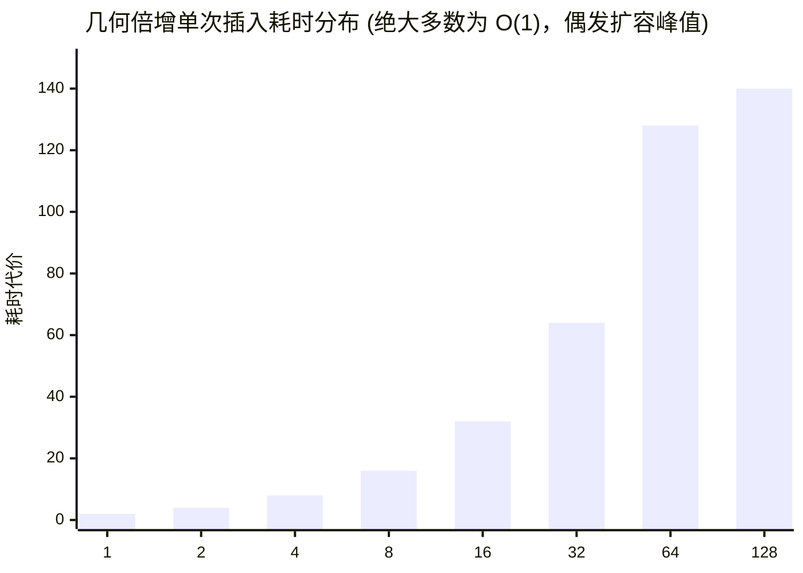

> **课程体系**：UC Berkeley CS61B: Data Structures (Spring 2024)  
> **所属模块**：Module 1: Java 语言基石与链表结构 (Java Fundamentals & Lists)  
> **主讲教师**：Prof. Justin Yokota & Prof. Peyrin Kao (UC Berkeley)  
> **视频时长**：48:53 ｜ **官方原版**：Lecture 7 - Lists IV Arrays and Lists  
> **视频直达**：[📺 在 B 站观看本讲原视频 (P7)](https://www.bilibili.com/video/BV1hJ4m1M7ZA/?p=7) ｜ [📑 官方课件 Slides (Google Presentation)](https://docs.google.com/presentation/d/1RJuwap1NZDYFUS7eiPy_SZu7oWHJladwuhKQpQcTjt8) ｜ [📖 官方教材章节](https://cs61b-2.gitbook.io/cs61b-textbook/8.-arraylist)  
> **快速导航**：[← 上一讲 (P06 代码测试与测试驱动开发)](/notes/cs61b/lecture-06) ｜ [📚 返回全书目录](/notes/topics/CS61B) ｜ [下一讲 (P08 继承 I：接口继承与默认方法) →](/notes/cs61b/lecture-08)

---

## 1. 动态数组容器 AList 的设计动因

*(参考时间：00:02:10 · [视频跳转 (P07 00:02:10)](https://www.bilibili.com/video/BV1hJ4m1M7ZA/?p=7&t=130))*

尽管双向链表 `DLList` 在首尾插入删除上极其高效，但在随机读取 `get(i)` 时必须花费 $O(N)$ 时间逐个跳跃节点。在很多实际应用场景中，**$O(1)$ 的快速随机查找是不可妥协的硬性需求**。

因此，我们需要一种全新的容器类型：**动态数组 AList（Array List）**。它在内部基于固定长度的 Java 原生数组实现，对外却表现为可以无限追加元素的弹性列表。

## 2. 泛型系统引入：AList<Item> 与类型擦除

*(参考时间：00:11:45 · [视频跳转 (P07 00:11:45)](https://www.bilibili.com/video/BV1hJ4m1M7ZA/?p=7&t=705))*

之前我们实现的列表只能存放整数 `int`。通过引入 Java **泛型（Generics）**，列表可以容纳任意引用类型的元素。

### 泛型数组创建的语法陷阱
在 Java 中，由于历史兼容性与类型擦除（Type Erasure）机制，**直接创建泛型数组是非法的**：
```java
// Item[] items = new Item[8]; // 编译直接报错：Generic Array Creation!
```

标准工程解决之道：先创建 `Object` 数组，再进行类型强制转换：
```java
public class AList<Item> {
    private Item[] items;
    private int size;

    @SuppressWarnings("unchecked")
    public AList() {
        // 创建 Object 数组并安全强转为泛型数组 Item[]
        items = (Item[]) new Object[8];
        size = 0;
    }

    public void addLast(Item x) {
        if (size == items.length) {
            resize(size * 2); // 数组已满，触发动态扩容
        }
        items[size] = x;
        size++;
    }

    public Item get(int i) {
        return items[i];
    }
}
```

## 3. 扩容策略大对决：几何倍增 vs 算术递增

*(参考时间：00:23:50 · [视频跳转 (P07 00:23:50)](https://www.bilibili.com/video/BV1hJ4m1M7ZA/?p=7&t=1430))*

当底层数组空间耗尽时，如何决定新数组的容量？这里存在两种根本不同的设计路线：

### 路线 A：算术递增（Additive Resizing，每次 +1）
```java
resize(items.length + 1);
```
每次追加元素都需要开辟新数组并完整拷贝旧数据。连续插入 $N$ 个元素总共发生的数组拷贝次数为：
$$1 + 2 + 3 + \dots + N = \frac{N(N+1)}{2} = \Theta(N^2)$$
**每次插入的平均耗时为 $O(N)$，性能发生灾难性退化！**

### 路线 B：几何倍增（Multiplicative Resizing，每次 ×2）
```java
resize(items.length * 2);
```
随着数组规模翻倍，触发扩容的频率呈指数级下降。连续插入 $N$ 个元素总共发生的拷贝次数为：
$$1 + 2 + 4 + 8 + \dots + N < 2N = \Theta(N)$$
**分摊到每一次插入操作，其时间开销仅为常数级别！**

## 4. 摊还运行时间分析（Amortized Analysis）

*(参考时间：00:35:10 · [视频跳转 (P07 00:35:10)](https://www.bilibili.com/video/BV1hJ4m1M7ZA/?p=7&t=2110))*

虽然极少数触发扩容的单次 `addLast` 操作耗时为 $O(N)$，但绝大多数普通追加操作耗时仅为 $O(1)$。

在算法理论中，我们使用**摊还分析（Amortized Runtime）**来严谨刻画这种现象：
> 连续执行 $N$ 次操作的总代价上界为 $C \cdot N$，则**单次操作的摊还时间复杂度为 $O(1)$**。



## 5. 缩容策略与内存防泄漏（Memory Loitering）

*(参考时间：00:44:20 · [视频跳转 (P07 00:44:20)](https://www.bilibili.com/video/BV1hJ4m1M7ZA/?p=7&t=2660))*

当列表频繁执行 `removeLast()` 后，底层数组可能占用海量闲置内存。

### 缩容利用率（Usage Ratio R）
当实际元素数量 `size` 跌破底层数组容量的四分之一（$R < 0.25$）时，将底层数组容量减半：
```java
public Item removeLast() {
    Item returnItem = items[size - 1];
    items[size - 1] = null; // 关键：断开对象引用，允许垃圾回收（防止内存游荡）
    size--;
    if (items.length >= 16 && size < items.length / 4) {
        resize(items.length / 2);
    }
    return returnItem;
}
```

> **编者说明（内存游荡 Memory Loitering）**：  
> `items[size - 1] = null;` 是极度重要的工程细节。若不手动置 `null`，即便逻辑上 `size` 减小了，底层数组依然持有该对象的强引用，Java 垃圾回收器（GC）将永远无法回收该对象所占用的堆内存！

---

## 课程导航与跳转

| 上一讲 | 目录 | 下一讲 | 原视频 |
| :--- | :---: | :--- | :--- |
| [← 上一讲：代码测试与测试驱动开发](/notes/cs61b/lecture-06) | [📚 返回 CS61B 全书目录](/notes/topics/CS61B) | [下一讲：继承 I：接口继承与默认方法 →](/notes/cs61b/lecture-08) | [🎬 在 B 站观看本讲 (P07)](https://www.bilibili.com/video/BV1hJ4m1M7ZA/?p=7) |
