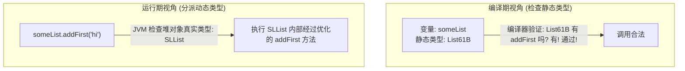

> **课程体系**：UC Berkeley CS61B: Data Structures (Spring 2024)  
> **所属模块**：Module 2: 继承与面向对象体系 (Inheritance, Interfaces & Subtyping)  
> **主讲教师**：Prof. Justin Yokota & Prof. Peyrin Kao (UC Berkeley)  
> **视频时长**：49:47 ｜ **官方原版**：Lecture 8 - Inheritance I  Interface and Implementation Inheritance  
> **视频直达**：[📺 在 B 站观看本讲原视频 (P8)](https://www.bilibili.com/video/BV1hJ4m1M7ZA/?p=8) ｜ [📑 官方课件 Slides (Google Presentation)](https://docs.google.com/presentation/d/1LxnOVy_k13llkePdQIdBrZ5jEpgRmbrvMilD-ppRjlc) ｜ [📖 官方教材章节](https://cs61b-2.gitbook.io/cs61b-textbook/9.-inheritance-i-interface-and-implementation-inheritance)  
> **快速导航**：[← 上一讲 (P07 链表 IV：数组列表、动态扩容与均摊分析)](/notes/cs61b/lecture-07) ｜ [📚 返回全书目录](/notes/topics/CS61B) ｜ [下一讲 (P09 继承 II：Extends、类型转换与高阶函数) →](/notes/cs61b/lecture-09)

---

## 1. 抽象层级危机：重复代码与方法重载的扩展性陷阱

*(参考时间：00:02:15 · [视频跳转 (P08 00:02:15)](https://www.bilibili.com/video/BV1hJ4m1M7ZA/?p=8&t=135))*

在前面的课程中，我们独立实现了两种不同底层拓扑结构的线性容器：
- `SLList<Item>`：基于指针的单向链表，在头部增删具有极速的 $\Theta(1)$ 性能；
- `AList<Item>`：基于连续内存的动态数组，具有硬件级的 $\Theta(1)$ 随机访问性能。

现在，假设我们正在开发一个自然语言处理模块 `WordUtils`，其中需要一个工具方法 `longest(List list)`，用于返回列表中长度最长的单词。

### 朴素方案：方法重载（Method Overloading）
由于 `SLList` 和 `AList` 是两个完全独立的类，初学者会写出如下重载代码：

```java
public class WordUtils {
    /** 处理链表的最长词检索 */
    public static String longest(SLList<String> list) {
        int maxDex = 0;
        for (int i = 0; i < list.size(); i++) {
            String longestString = list.get(maxDex);
            String thisString = list.get(i);
            if (thisString.length() > longestString.length()) {
                maxDex = i;
            }
        }
        return list.get(maxDex);
    }

    /** 处理数组列表的最长词检索 */
    public static String longest(AList<String> list) {
        int maxDex = 0;
        for (int i = 0; i < list.size(); i++) {
            String longestString = list.get(maxDex);
            String thisString = list.get(i);
            if (thisString.length() > longestString.length()) {
                maxDex = i;
            }
        }
        return list.get(maxDex);
    }
}
```

### 为什么说这是灾难级的劣质工程实践？
1. **纯粹的代码冗余（Code Duplication）**：观察两个方法的方法体，**内部的循环、比较、索引逻辑分毫不差，完全一模一样**！
2. **极其脆弱的维护成本**：如果发现算法中有一个边界 bug，必须在两个地方同时修改；一旦遗漏其中一个，就会导致系统行为不一致。
3. **彻底丧失可扩展性**：未来如果我们新增了 `DLList`（双向链表）、`CircularList`（循环链表）或者 `SortedList`，就必须不断复制粘贴全新的重载版本！

根本原因在于：**代码缺乏高层的类型抽象，无法表达“不管底层是链表还是数组，它们在概念上都是一个具有长度和按索引访问能力的列表”这一本质共性！**

## 2. 接口契约定义：`List61B<Item>` 抽象数据类型

*(参考时间：00:11:40 · [视频跳转 (P08 00:11:40)](https://www.bilibili.com/video/BV1hJ4m1M7ZA/?p=8&t=700))*

为了解决上述危机，Java 引入了**接口（Interface）**机制。

### 什么是接口？
接口是一种纯粹的**行为规范契约（Contract of Behaviors）**：
- 接口只定义**“能做什么（What to do）”**，即方法的名称、形参列表和返回值类型；
- 接口**绝对不关心“怎么做（How to do it）”**，它不包含底层的数据存储字段，也不关心具体的物理内存排布。

让我们定义所有 61B 线性列表必须遵守的最高宪章——`List61B<Item>`：

```java
public interface List61B<Item> {
    public void addFirst(Item x);
    public void addLast(Item x);
    public Item getFirst();
    public Item getLast();
    public Item get(int i);
    public int size();
    public Item removeLast();
    public void insert(Item x, int position);
}
```

在接口中：
- 所有方法默认都是 `public abstract` 的（即公开且抽象的，不需要写实现体，以分号 `;` 结尾）；
- 接口本身不能被 `new` 实例化（写 `new List61B<>()` 会导致编译报错）。

## 3. 接口实现（`implements`）与编译器契约强制检查

*(参考时间：00:19:10 · [视频跳转 (P08 00:19:10)](https://www.bilibili.com/video/BV1hJ4m1M7ZA/?p=8&t=1150))*

一旦接口确立，具体的容器类就可以使用 `implements` 关键字声明自己签署了该契约：

```java
public class AList<Item> implements List61B<Item> {
    // 必须实现 List61B 接口中声明的所有方法！
    ...
}

public class SLList<Item> implements List61B<Item> {
    // 同样必须实现 List61B 接口中的全部方法！
    ...
}
```

### 编译器的铁血契约守护
如果一个类声称自己 `implements List61B<Item>`，但在类体中遗漏了哪怕任何一个方法的实现（例如忘记写 `removeLast()`）：
Java 编译器 `javac` 将在编译期直接报错并拒绝生成 `.class`：
`error: AList is not abstract and does not override abstract method removeLast() in List61B`。

这种强制机制确保了：**任何外部系统只要拿到一个 `List61B` 类型的引用，就可以百分之百确信该对象绝对具备接口中承诺的全部功能**！

## 4. 静态类型（Static Type）vs 动态类型（Dynamic Type）与方法分派规则

*(参考时间：00:27:00 · [视频跳转 (P08 00:27:00)](https://www.bilibili.com/video/BV1hJ4m1M7ZA/?p=8&t=1620))*

在引入接口之后，我们迎来面向对象最核心的威力——**子类型多态（Subtype Polymorphism）**。

现在，我们可以把 `WordUtils.longest` 方法彻底重构为一个统一的高层方法：

```java
public class WordUtils {
    /** 接收任何实现了 List61B 接口的实例对象！ */
    public static String longest(List61B<String> list) {
        int maxDex = 0;
        for (int i = 0; i < list.size(); i++) {
            String longestString = list.get(maxDex);
            String thisString = list.get(i);
            if (thisString.length() > longestString.length()) {
                maxDex = i;
            }
        }
        return list.get(maxDex);
    }
}
```

### 静态类型 vs 动态类型
观察下列实例化赋值代码：
```java
List61B<String> someList = new SLList<>();
```

| 类型维度 | 静态类型 (Static Type / Compile-Time Type) | 动态类型 (Dynamic Type / Runtime Type) |
| :--- | :--- | :--- |
| **定义** | 变量声明时左侧指定的类型（此处为 `List61B<String>`） | 等号右侧 `new` 实际创建在堆中的对象类型（此处为 `SLList<String>`） |
| **生灭时机** | 编译期确定，在源码阅读与 `javac` 语法检查时生效 | 运行期确定，由堆中对象的实际内存标记头决定 |
| **编译器法则** | 编译器**只检查静态类型**是否具备调用的合法方法 | 运行时 JVM **根据动态类型**决定实际执行哪个版本的方法实现 |



## 5. 实现继承与默认方法（Default Methods）：在接口中提供算法模板

*(参考时间：00:35:10 · [视频跳转 (P08 00:35:10)](https://www.bilibili.com/video/BV1hJ4m1M7ZA/?p=8&t=2110))*

在 Java 8 之前，接口只能定义纯抽象方法，不能包含任何实现代码。这导致一个问题：如果我们想为所有列表提供一个通用的 `print()` 方法，难道要在 `AList` 和 `SLList` 里各写一遍吗？

从 Java 8 开始，引入了**默认方法（Default Methods）**机制：允许在接口中使用 `default` 关键字编写具体的实现代码！

```java
public interface List61B<Item> {
    ...
    /** 默认实现的打印方法：所有子类自动免费继承！ */
    default public void print() {
        for (int i = 0; i < size(); i++) {
            System.out.print(get(i) + " ");
        }
        System.out.println();
    }
}
```

### 继承的双重形态
- **接口继承（Interface Inheritance）**：子类继承了方法的签名契约（What），承诺“我有这个能力”；
- **实现继承（Implementation Inheritance）**：子类直接继承了接口或父类编写好的通用实现代码（How），实现“代码零冗余复用”。

### 默认方法的效率陷阱与重写
虽然上述 `default void print()` 能够在所有子类上跑通，但观察其实现：它在循环中调用了 `get(i)`。
- 对于 `AList`，`get(i)` 是 $\Theta(1)$，因此 `print()` 总体耗时是高效的 $\Theta(N)$；
- **对于 `SLList`，`get(i)` 是 $\Theta(N)$！** 在循环中反复调用 `get(i)` 导致 `print()` 的总时间退化为灾难级的：
  $$\sum_{i=0}^{N-1} i = \Theta(N^2)$$
- 因此，子类拥有**方法重写（Method Overriding）**的权利：`SLList` 可以重写 `print()`，使用内部高效的指针遍历来替代低效的默认实现，保持 $\Theta(N)$ 性能。

## 6. 方法重写（Overriding）vs 方法重载（Overloading）与 `@Override` 注解防线

*(参考时间：00:43:00 · [视频跳转 (P08 00:43:00)](https://www.bilibili.com/video/BV1hJ4m1M7ZA/?p=8&t=2580))*

这是 Java 面向对象面试中最高频考点之一，必须精确区分：

### 核心定义区别
1. **方法重载（Overloading）**：
   - 发生在同一个类中（或继承体系中）；
   - **方法名相同，但形参列表（参数个数、类型或顺序）完全不同**；
   - 与返回类型无关；
   - 属于编译期静态绑定。
2. **方法重写（Overriding）**：
   - 发生在父子类或接口实现体系中；
   - **方法名相同、形参列表完全相同、返回值类型兼容（协变）**；
   - 属于运行期动态方法选择（Dynamic Method Selection）。

### 致命笔误与 `@Override` 的绝对防御力
考虑以下代码：我们在 `SLList` 中打算重写 `addLast`，但手滑写错了参数类型：
```java
public class SLList<Item> implements List61B<Item> {
    // 手滑将 Item 写成了 Object！
    public void addLast(Object x) { ... }
}
```
此时，编译器不会报错！它会认为你没有重写接口的 `addLast(Item)`，而是定义了一个全新的**重载方法**！而真正的接口方法仍然未被实现，导致隐蔽的逻辑崩溃。

### 工业级最佳实践
**在任何时候重写父类或接口方法，必须无条件添加 `@Override` 注解**：
```java
@Override
public void addLast(Item x) {
    ...
}
```
`@Override` 是给编译器的直接指令：“请替我严格核查，如果父类或接口中没有与此签名分毫不差的方法，立即报错给我！”这在编译期筑起了防手滑的第一道钢铁防线。

## 7. 官方课件互动讨论题：接口多态赋值与类型检查追踪

*(参考时间：00:49:15 · [视频跳转 (P08 00:49:15)](https://www.bilibili.com/video/BV1hJ4m1M7ZA/?p=8&t=2955))*

Josh Hug 教授在课件中给出了经典的多态类型推断挑战题：

```java
public class MysteryInheritance {
    public static void main(String[] args) {
        List61B<String> lst = new SLList<>();
        lst.addFirst("front");
        
        // 假设 SLList 额外自定义了一个特有的方法：public void specialMethod()
        // 下面这行代码能否通过编译？
        // lst.specialMethod(); 
    }
}
```

### 深入分析
- **无法通过编译！**
- **核心逻辑**：编译器在检查 `lst.specialMethod()` 时，**只依据变量 `lst` 的静态类型（Static Type）即 `List61B` 进行审查**。
- 编译器会检索 `List61B` 接口中有没有声明 `specialMethod()`。检索结果为“没有”，因此编译器判定此调用非法，直接报错：`cannot find symbol: method specialMethod()`！
- 编译器不会也不可能去揣测运行时堆里面实际装的是不是 `SLList`。如果你确信它是 `SLList`，必须显式使用类型转换（Casting，下一讲详解）。

## 8. 本讲小结与课后深化自测

*(参考时间：00:53:00 · [视频跳转 (P08 00:53:00)](https://www.bilibili.com/video/BV1hJ4m1M7ZA/?p=8&t=3180))*

### 核心概念全景回顾

| 概念 | 核心机制 | 关键价值 |
| :--- | :--- | :--- |
| **接口 (Interface)** | `public interface Foo` 定义纯抽象方法契约 | 隔离 What 与 How，提供高层多态抽象 |
| **静态类型** | 变量声明时的类型，编译期决定哪些方法合法 | 编译期强类型安全拦截 |
| **动态类型** | 运行时堆中对象的真实类型，决定执行哪个实现版本 | 实现运行期灵活的子类型多态行为 |
| **默认方法** | `default` 关键字在接口中编写通用实现模板 | 实现代码复用，减少子类重复逻辑 |
| **`@Override`** | 编译期强制校验重写签名的正确性 | 防范拼写笔误导致的意外方法重载 |

---

### 课后综合自测题

#### 题目 1（多态与方法调用）
假设类 `Dog` 实现了接口 `Animal`，两者均包含 `makeNoise()` 方法，但 `Dog` 额外定义了 `fetch()` 方法。
观察下列三行代码，指出哪一行会在编译时报错？哪一行会在运行时报错？
```java
Animal a = new Dog(); // 行 1
a.makeNoise();        // 行 2
a.fetch();            // 行 3
```
**答案与解析**：  
- 行 1 和行 2 均完全合法；  
- **行 3 会在编译时报错**（`cannot find symbol method fetch() in Animal`）。因为 `a` 的静态类型是 `Animal`，而 `Animal` 接口并未定义 `fetch()` 行为。

#### 题目 2（架构设计思考）
为什么 Java 允许一个类实现多个接口（如 `class Foo implements A, B, C`），但在类继承上只允许单继承（`extends`）？这种设计避免了什么经典计算机难题？  
**答案与解析**：  
这是为了彻底避免 C++ 等语言中著名的**“死亡多重菱形继承（Diamond Problem）”**！如果一个类可以同时继承两个拥有相同方法实现的父类，当子类调用该方法时，编译器无法确定到底应该继承哪一个父类的实现。而接口早期只有抽象声明，哪怕两个接口有同名方法，子类也只需提供一份实现，不会产生歧义。

---

## 附录：UC Berkeley 官方教材深度研读 (Official Textbook In-Depth Chapters)

> **导读说明**：本节内容整合自 UC Berkeley CS61B 官方教材库（GitBook Textbook），针对本讲的核心数据结构与算法提供原汁原味的英文理论推导、形式化代码范例与配套章节习题，与前文视频精讲相互补充印证。

## 9. Inheritance I: Interface and Implementation Inheritance

#### The Problem 

Recall the two list classes we created last week: SLList and AList. If you take a look at their documentation, you'll notice that they are very similar. In fact, all of their supporting methods are the same!

Suppose we want to write a class `WordUtils`that includes functions we can run on lists of words, including a method that calculates the longest string in an SLList.

**Exercise 4.1.1.** Try writing this method by yourself. The method should take in an SLList of strings and return the longest string in the list.

Here is the method that we came up with.

```java

public static String longest(SLList<String> list) {

    int maxDex = 0;

    for (int i = 0; i < list.size(); i += 1) {

        String longestString = list.get(maxDex);

        String thisString = list.get(i);

        if (thisString.length() > longestString.length()) {

            maxDex = i;

        }

    }

    return list.get(maxDex);

}

```

How do we make this method work for AList as well?

All we really have to do is change the method's signature: the parameter

```java

SLList<String> list

```

should be changed to

```java

AList<String> list

```

Now we have two methods in our `WordUtils` class with exactly the same method name.

```java

public static String longest(SLList<String> list)

```

and

```java

public static String longest(AList<String> list)

```

This is actually allowed in Java! It's something called *method overloading*. When you call WordUtils.longest, Java knows which one to run according to what kind of parameter you supply it. If you supply it with an AList, it will call the AList method. Same with an SLList.

It's nice that Java is smart enough to know how to deal with two of the same methods for different types, but overloading has several downsides:

* It's super repetitive and ugly, because you now have two virtually identical blocks of code.

* It's more code to maintain, meaning if you want to make a small change to the `longest` method such as correcting a bug, you need to change it in the method for each type of list.

* If we want to make more list types, we would have to copy the method for every new list class.

#### Hypernyms, Hyponyms, and Interface Inheritance 

In the English language and life in general, there exist logical hierarchies to words and objects.

Dog is what is called a *hypernym of* poodle, malamute, husky, etc. In the reverse direction, poodle, malamute, and husky, are *hyponyms* of dog.

These words form a hierarchy of "is-a" relationships:

* a poodle "is-a" dog

* a dog "is-a" canine

* a canine "is-a" carnivore

* a carnivore "is-an" animal


The same hierarchy goes for SLLists and ALists! SLList and AList are both hyponyms of a more general list.

We will formalize this relationship in Java: if a SLList is a hyponym of List61B, then the SLList class is a **subclass** of the List61B class and the List61B class is a **superclass** of the SLList class.

**Figure 4.1.1** 

In Java, in order to *express* this hierarchy, we need to do **two things**:

* Step 1: Define a type for the general list hypernym -- we will choose the name List61B.

* Step 2: Specify that SLList and AList are hyponyms of that type.

The new List61B is what Java calls an **interface**. It is essentially a contract that specifies what a list must be able to do, but it doesn't provide any implementation for those behaviors. Can you think of why?

Here is our List61B interface. At this point, we have satisfied the first step in establishing the relationship hierarchy: creating a hypernym.

```java

public interface List61B<Item> {

    public void addFirst(Item x);

    public void add Last(Item y);

    public Item getFirst();

    public Item getLast();

    public Item removeLast();

    public Item get(int i);

    public void insert(Item x, int position);

    public int size();

}

```

Now, to complete step 2, we need to specify that AList and SLList are hyponyms of the List61B class. In Java, we define this relationship in the class definition.

We will add to

`public class AList<Item> {...}`

a relationship-defining word: implements.

`public class AList<Item> implements List61B<Item>{...}`

`implements List61B<Item>` is essentially a promise. AList is saying "I promise I will have and define all the attributes and behaviors specified in the List61B interface"

Now we can edit our `longest` method in `WordUtils` to take in a List61B. Because AList and SLList share an "is-a" relationship.

#### Overriding 

We promised we would implement the methods specified in List61B in the AList and SLList classes, so let's go ahead and do that.

When implementing the required functions in the subclass, it's useful (and actually required in 61B) to include the `@Override` tag right on top of the method signature. Here, we have done that for just one method.

```java

@Override

public void addFirst(Item x) {

    insert(x, 0);

}

```

It is good to note that even if you don’t include this tag, you *are* still overriding the method. So technically, you don't *have* to include it. However, including the tag acts as a safeguard for you as the programmer by alerting the compiler that you intend to override this method. Why would this be helpful you ask? Well, it's kind of like having a proofreader! The compiler will tell you if something goes wrong in the process.

Say you want to override the `addLast` method. What if you make a typo and accidentally write `addLsat`? If you don't include the @Override tag, then you might not catch the mistake, which could make debugging a more difficult and painful process. Whereas if you include @Override, the compiler will stop and prompt you to fix your mistakes before your program even runs.

#### Interface Inheritance 

Interface Inheritance refers to a relationship in which a subclass inherits all the methods/behaviors of the superclass. As in the List61B class we defined in the **Hyponyms and Hypernyms** section, the interface includes all the method signatures, but not implementations. It's up to the subclass to actually provide those implementations.

This inheritance is also multi-generational. This means if we have a long lineage of superclass/subclass relationships like in **Figure 4.1.1**, AList not only inherits the methods from List61B but also every other class above it all the way to the highest superclass AKA AList inherits from Collection.

### GRoE 

Recall the Golden Rule of Equals we introduced in the first chapter. This means whenever we make an assignment `a = b` , we copy the bits from b into a, with the requirement that b is the same type as a. You can't assign `Dog b = 1` or `Dog b = new Cat()` because 1 is not a Dog and neither is Cat.

Let's try to apply this rule to the `longest` method we wrote previously in this chapter.

`public static String longest(List61B<String> list)` takes in a List61B. We said that this could take in AList and SLList as well, but how is that possible since AList and List61B are different classes? Well, recall that AList shares an "is-a" relationship with List61B, Which means an AList should be able to fit into a List61B box!

**Exercise 4.1.2** Do you think the code below will compile? If so, what happens when it runs?

```java

public static void main(String[] args) {

    List61B<String> someList = new SLList<String>();

    someList.addFirst("elk");

}

```

Here are possible answers:

* Will not compile.

* Will compile, but will cause an error on the **new** line

* When it runs, an SLList is created and its address is stored in the someList variable, but it crashes on someList.addFirst() since the List class doesn't implement addFirst;

* When it runs, and SLList is created and its address is stored in the someList variable. Then the string "elk" is inserted into the SLList referred to by addFirst.

#### Implementation Inheritance 

Previously, we had an interface List61B that only had method headers identifying **what** List61B's should do. But, now we will see that we can write methods in List61B that already have their implementation filled out. These methods identify **how** hypernyms of List61B should behave.

In order to do this, you must include the `default` keyword in the method signature.

If we define this method in List61B

```java

default public void print() {

    for (int i = 0; i < size(); i += 1) {

        System.out.print(get(i) + " ");

    }

    System.out.println();

}

```

Then everything that implements the List61B class can use the method!

However, there is one small inefficiency in this method. Can you catch it?

For an SLList, the `get` method needs to jump through the entirety of the list. during each call. It's much better to just print while jumping through!

We want SLList to print a different way than the way specified in its interface. To do this, we need to override it. In SLList, we implement this method;

```java

@Override

public void print() {

    for (Node p = sentinel.next; p != null; p = p.next) {

        System.out.print(p.item + " ");

    }

}

```

Now, whenever we call print() on an SLList, it will call this method instead of the one in List61B.

You may be wondering, how does Java know which print() to call? Good question. Java is able to do this due to something called **dynamic method selection**.

We know that variables in java have a type.

`List61B<String> lst = new SLList<String>();`

In the above declaration and instantiation, lst is of type "List61B". This is called the "static type"

However, the objects themselves have types as well. the object that lst points to is of type SLList. Although this object is intrinsically an SLList (since it was declared as such), it is also a List61B, because of the “is-a” relationship we explored earlier. But, because the object itself was instantiated using the SLList constructor, We call this its "dynamic type".

Aside: the name “dynamic type” is actually quite semantic in its origin! Should lst be reassigned to point to an object of another type, say a AList object, lst’s dynamic type would now be AList and not SLList! It’s dynamic because it changes based on the type of the object it’s currently referring to.

When Java runs a method that is overriden, it searches for the appropriate method signature in it's **dynamic type** and runs it.

**IMPORTANT: This does not work for overloaded methods!**

Say there are two methods in the same class

```java

public static void peek(List61B<String> list) {

    System.out.println(list.getLast());

}

public static void peek(SLList<String> list) {

    System.out.println(list.getFirst());

}

```

and you run this code

```java

SLList<String> SP = new SLList<String>();

List61B<String> LP = SP;

SP.addLast("elk");

SP.addLast("are");

SP.addLast("cool");

peek(SP);

peek(LP);

```

The first call to peek() will use the second peek method that takes in an SLList. The second call to peek() will use the first peek method which takes in a List61B. This is because the only distinction between two overloaded methods is the types of the parameters. When Java checks to see which method to call, it checks the **static type** and calls the method with the parameter of the same type.

#### Interface Inheritance vs Implementation Inheritance 

How do we differentiate between "interface inheritance" and "implementation inheritance"? Well, you can use this simple distinction:

* Interface inheritance (what): Simply tells what the subclasses should be able to do.

  * EX) all lists should be able to print themselves, how they do it is up to them.

* Implementation inheritance (how): Tells the subclasses how they should behave.

  * EX) Lists should print themselves exactly this way: by getting each element in order and then printing them.

When you are creating these hierarchies, remember that the relationship between a subclass and a superclass should be an "is-a" relationship. AKA Cat should only implement Animal Cat **is an** Animal. You should not be defining them using a "has-a" relationship. Cat **has-a** Claw, but Cat definitely should not be implementing Claw.

Finally, Implementation inheritance may sound nice and all but there are some drawbacks:

* We are fallible humans, and we can't keep track of everything, so it's possible that you overrode a method but forgot you did.

* It may be hard to resolve conflicts in case two interfaces give conflicting default methods.

* It encourages overly complex code.


---

## 课程导航与跳转

| 上一讲 | 目录 | 下一讲 | 原视频 |
| :--- | :---: | :--- | :--- |
| [← 上一讲：链表 IV：数组列表、动态扩容与均摊分析](/notes/cs61b/lecture-07) | [📚 返回 CS61B 全书目录](/notes/topics/CS61B) | [下一讲：继承 II：Extends、类型转换与高阶函数 →](/notes/cs61b/lecture-09) | [🎬 在 B 站观看本讲 (P08)](https://www.bilibili.com/video/BV1hJ4m1M7ZA/?p=8) |
