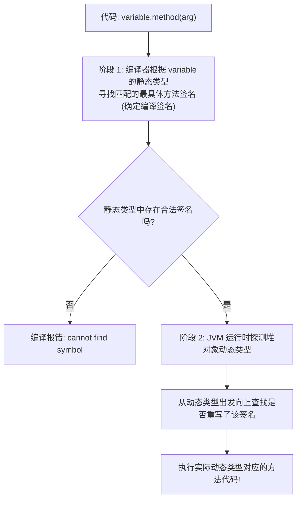

> **课程体系**：UC Berkeley CS61B: Data Structures (Spring 2024)  
> **所属模块**：Module 2: 继承与面向对象体系 (Inheritance, Interfaces & Subtyping)  
> **主讲教师**：Prof. Justin Yokota & Prof. Peyrin Kao (UC Berkeley)  
> **视频时长**：50:35 ｜ **官方原版**：Lecture 9 - Inheritance II Extends Casting Higher Order Functions  
> **视频直达**：[📺 在 B 站观看本讲原视频 (P9)](https://www.bilibili.com/video/BV1hJ4m1M7ZA/?p=9) ｜ [📑 官方课件 Slides (Google Presentation)](https://docs.google.com/presentation/d/1jVqC44HVViVtajnF18KsZ6MdIfseTfOSerfvxH4pzP0) ｜ [📖 官方教材章节](https://cs61b-2.gitbook.io/cs61b-textbook/10.-inheritance-ii-extends-casting-higher-order-functions)  
> **快速导航**：[← 上一讲 (P08 继承 I：接口继承与默认方法)](/notes/cs61b/lecture-08) ｜ [📚 返回全书目录](/notes/topics/CS61B) ｜ [下一讲 (P10 继承 III：子类型多态、Comparable 与 Comparator) →](/notes/cs61b/lecture-10)

---

## 1. 类继承（`extends`）机制：代码复用与子类化哲学

*(参考时间：00:01:30 · [视频跳转 (P09 00:01:30)](https://www.bilibili.com/video/BV1hJ4m1M7ZA/?p=9&t=90))*

在上一讲中，我们学习了通过接口实现“行为契约”的继承。但在实际工程中，我们常常希望子类不仅继承接口，还直接继承父类的**实例变量和现成的实现逻辑**。

Java 提供了 `extends` 关键字来实现**类继承（Class Inheritance / Subclassing）**。

### 核心法则：IS-A 关系的严格检验
在设计继承体系时，必须遵循面向对象的 **Liskov 替换原则（LSP）** 与 **IS-A 检验（Is-A Test）**：
- 只有当**“子类确实是父类的一种特殊形态（Subclass IS A Superclass）”**时，才被允许使用继承！
  - `Dog IS-A Animal`（狗是一种动物 $\to$ 合理继承）；
  - `SLList IS-A List61B`（单向链表是一种列表 $\to$ 合理实现）。
- 如果两个类之间仅仅是“拥有/从属关系（HAS-A）”，必须使用**组合（Composition）**而非继承！
  - 例如 `Car HAS-A Engine`（汽车有一个发动机），严禁写 `class Car extends Engine`！应该在 `Car` 内部包含一个 `private Engine engine;` 字段。

## 2. 构造器链条（Constructor Chaining）与 `super` 关键字

*(参考时间：00:09:40 · [视频跳转 (P09 00:09:40)](https://www.bilibili.com/video/BV1hJ4m1M7ZA/?p=9&t=580))*

当子类继承父类时，子类对象在堆中诞生时，**不仅包含子类自己的实例变量，还必须容纳父类的所有实例变量**。因此，父类的状态必须先被正确初始化！

### 构造器调用铁律
> **铁律**：**子类的任何构造器在执行自己的代码之前，必须首先调用父类的构造器！**

如果不显式指定，Java 编译器会在子类构造器的第一行，**自动隐式插入 `super();`** 去调用父类的无参构造器：

```java
public class Animal {
    public String name;
    public Animal(String n) {
        name = n;
    }
}

public class Dog extends Animal {
    public int weight;

    public Dog(String n, int w) {
        super(n); // 显式调用父类带参构造器！必须放在构造器的第一行！
        weight = w;
    }
}
```

### 编译踩坑现场
如果父类 `Animal` 只定义了带参构造器 `Animal(String n)`，而没有无参构造器；且子类 `Dog` 构造器中没有写 `super(n)`：  
编译器将无情报错：`error: constructor Animal in class Animal cannot be applied to given types; required: String; found: no arguments`。  
因为编译器自动插入的 `super()` 试图寻找父类不存在的无参构造器！

## 3. 强制类型转换（Casting）的本质与类型安全边界

*(参考时间：00:17:15 · [视频跳转 (P09 00:17:15)](https://www.bilibili.com/video/BV1hJ4m1M7ZA/?p=9&t=1035))*

回顾上一讲的挑战题：
```java
List61B<String> lst = new SLList<>();
// lst.specialMethod(); // 编译报错！因为静态类型是 List61B
```

如果我们作为程序员，以人类的绝对确信知道此时 `lst` 变量在运行时的动态类型确实是一只 `SLList`，我们如何告诉编译器放行？  
答案是：**强制类型转换（Casting）**。

### 类型转换语法
```java
SLList<String> realSLList = (SLList<String>) lst;
realSLList.specialMethod(); // 完美通过编译并运行！
```

### 类型转换背后的编译器逻辑
- 强制转型 `(TargetType)` 并不是去修改堆中的对象本身，而是**为该对象临时套上一个新的“静态类型眼镜”**；
- 编译器看到强转语法后，会妥协并按照目标类型进行语法检查；
- **运行时的反噬：ClassCastException**：  
  如果程序员自作聪明骗了编译器（例如堆中实际是 `AList`，却强转成 `SLList`）：
  ```java
  List61B<String> lst = new AList<>();
  SLList<String> bad = (SLList<String>) lst; // 运行时瞬间抛出 ClassCastException 崩溃！
  ```

### 安全防御：`instanceof` 运算符
在执行向下转型（Downcasting）之前，工业级标准做法是先使用 `instanceof` 进行动态类型探测：
```java
if (lst instanceof SLList) {
    SLList<String> safe = (SLList<String>) lst;
    safe.specialMethod();
}
```

## 4. 动态方法分派（Dynamic Method Selection）的完整执行算法

*(参考时间：00:26:00 · [视频跳转 (P09 00:26:00)](https://www.bilibili.com/video/BV1hJ4m1M7ZA/?p=9&t=1560))*

当程序执行一条形如 `variable.method(param)` 的调用时，JVM 究竟是如何决定到底执行哪一段机器指令的？  
请牢记这一套严密的**两阶段分派算法（Two-Stage Dispatch Algorithm）**：

### 阶段一：编译期静态匹配（Compile-Time Resolution）
1. 编译器审查 `variable` 的**静态类型（Static Type）**；
2. 检索该静态类型及其所有父类中，名称匹配且参数列表兼容的方法；
3. 选择其中**最具体（Most Specific）**的方法签名，作为本次调用的“候选签名”；
4. 如果找不到任何匹配签名，直接报编译错误！

### 阶段二：运行期动态选择（Runtime Dynamic Selection）
1. 只有非静态（Non-Static）方法才会进入动态分派；
2. JVM 查看 `variable` 指向的堆对象的**真实动态类型（Dynamic Type）**；
3. 从该动态类型开始，沿着继承树向上查找，寻找与阶段一确定的“候选签名”**完全精确重写（Override）**的方法实现；
4. 找到的第一个实现，即为最终执行的代码！



## 5. 封装破坏之谜：脆弱基类问题（Fragile Base Class Problem）

*(参考时间：00:34:20 · [视频跳转 (P09 00:34:20)](https://www.bilibili.com/video/BV1hJ4m1M7ZA/?p=9&t=2060))*

虽然 `extends` 提供了强大的代码复用，但在现代软件工程中，有一条被奉为经典的准则：**“组合优于继承（Favor Composition over Inheritance）”**。

滥用类继承会引发臭名昭著的**脆弱基类问题（Fragile Base Class Problem）**。

### 经典反面案例：计数的计数器集合
假设父类有一个列表 `List`，包含两个方法：
```java
public class BaseList {
    public void add(int x) { ... }
    public void addAll(int[] items) {
        for (int x : items) {
            add(x); // 父类内部调用了自己的 add
        }
    }
}
```

某位程序员为了统计向列表中插入元素的总次数，通过 `extends` 创建了一个子类：
```java
public class CountingList extends BaseList {
    private int count = 0;

    @Override
    public void add(int x) {
        count++;
        super.add(x);
    }

    @Override
    public void addAll(int[] items) {
        count += items.length; // 统计加入总数
        super.addAll(items);
    }
}
```

### 灾难发生：双重计数（Double Counting）
客户端执行：
```java
CountingList list = new CountingList();
list.addAll(new int[]{1, 2, 3});
System.out.println(list.getCount()); // 期望是 3，实际输出竟然是 6！
```

**为什么会变成 6？**
1. 子类的 `addAll` 执行，`count += 3`（此时 count = 3）；
2. 子类调用 `super.addAll(items)`；
3. 父类的 `addAll` 内部循环调用 `add(x)`；
4. 由于动态方法选择，父类调用的 `add(x)` 会分派给**子类的 `add(x)`**！
5. 子类的 `add(x)` 再次把 `count` 累加了 3 次！导致总数暴增为 6！

子类的逻辑完全依赖于父类未公开的内部实现细节，一旦父类重构（例如优化 `addAll` 不再调用 `add`），子类就会当场崩溃。这就是继承带来的高耦合风险。

## 6. 高阶函数（Higher Order Functions）在 Java 中的实现：接口函数对象

*(参考时间：00:42:00 · [视频跳转 (P09 00:42:00)](https://www.bilibili.com/video/BV1hJ4m1M7ZA/?p=9&t=2520))*

在 CS 61A 中，Python 将函数视为**一等公民（First-Class Citizens）**：函数可以像普通整数一样作为参数传给另一个函数，或者作为返回值返回：

```python
def do_twice(f, x):
    return f(f(x))
```

在 Java 的历史早期，方法并不是对象，不能直接作为参数传递。那么如何在 Java 中实现高阶函数？  
**答案是：利用接口和对象多态来模拟高阶函数（Function Objects）！**

### 定义函数接口契约
```java
public interface IntUnaryFunction {
    int apply(int x);
}
```

### 编写具体的函数对象类
```java
/** 一个实现平方操作的函数对象 */
public class Square implements IntUnaryFunction {
    @Override
    public int apply(int x) {
        return x * x;
    }
}
```

### 编写高阶方法
```java
public class HigherOrderDemo {
    public static int doTwice(IntUnaryFunction f, int x) {
        return f.apply(f.apply(x));
    }

    public static void main(String[] args) {
        IntUnaryFunction sq = new Square();
        System.out.println(doTwice(sq, 2)); // (2^2)^2 = 16
    }
}
```

现代 Java（Java 8+）在此基础上进一步引入了 **Lambda 表达式**，上述调用可以极简为一行：
`doTwice(x -> x * x, 2);`，其底层依旧是在动态构造该函数接口的匿名实例。

## 7. 官方课件经典陷阱题：多态调用与覆盖迷局

*(参考时间：00:49:00 · [视频跳转 (P09 00:49:00)](https://www.bilibili.com/video/BV1hJ4m1M7ZA/?p=9&t=2940))*

Josh Hug 在 Lecture 9 课件中呈现了一道令全班大呼精妙的多态选择题：

```java
class Dog {
    public void bark(Dog d) { System.out.println("Dog barks at Dog"); }
}

class ShowDog extends Dog {
    // 注意形参类型！
    public void bark(ShowDog sd) { System.out.println("ShowDog barks at ShowDog"); }
    @Override
    public void bark(Dog d) { System.out.println("ShowDog barks at Dog"); }
}

public class TestMystery {
    public static void main(String[] args) {
        Dog d = new ShowDog();
        ShowDog sd = new ShowDog();
        d.bark(sd);
    }
}
```

### 逐阶段严密推演 `d.bark(sd)` 的执行结果：
1. **编译期（阶段一）**：
   - 查看调用者 `d` 的**静态类型**：是 `Dog`；
   - 审查实参 `sd` 的静态类型：是 `ShowDog`；
   - 在 `Dog` 类中寻找能够接受 `ShowDog` 的最佳匹配方法：
     - `Dog` 类中唯一的方法是 `bark(Dog d)`（由于 ShowDog 是 Dog 的子类，完全兼容）；
   - **编译器锁定调用的方法签名是：`bark(Dog)`**！
2. **运行期（阶段二）**：
   - JVM 查看 `d` 的**动态类型**：在堆中实际是 `ShowDog`；
   - JVM 检查 `ShowDog` 类中是否重写了签名 `bark(Dog)`；
   - 找到了！`ShowDog` 明确包含了 `@Override public void bark(Dog d)`；
   - **最终执行 `ShowDog` 的 `bark(Dog d)` 版本！**
3. **输出结果**：`ShowDog barks at Dog`！

> **复盘反思**：很多同学误以为会打印 `ShowDog barks at ShowDog`，但他们忽略了编译期第一阶段：在编译期，变量 `d` 的静态类型是 `Dog`，而 `Dog` 类中根本没有 `bark(ShowDog)` 这个签名，因此编译器绝不可能绑定到该方法！

## 8. 本讲架构小结与进阶自测题

*(参考时间：00:54:10 · [视频跳转 (P09 00:54:10)](https://www.bilibili.com/video/BV1hJ4m1M7ZA/?p=9&t=3250))*

### 课后综合自测题

#### 题目 1（类型转换风险判断）
假设有类继承关系 `class C extends B` 且 `class B extends A`。
观察下列代码，哪一行能够通过编译？哪一行会在运行时抛出异常？
```java
A a = new B();
B b = (B) a;       // 操作 1
C c = (C) a;       // 操作 2
```
**答案与解析**：  
- 操作 1 和操作 2 **均能通过编译**！因为静态类型 `A` 都有可能在运行时是 `B` 或 `C` 的实例，编译器允许合法的向下转型。  
- **操作 2 会在运行时抛出 `ClassCastException`**！因为 `a` 指向的堆对象的真实类型是 `B`。一个 `B` 对象并不是 `C`（子类）的实例，强转必然失败。

#### 题目 2（工程架构抉择）
某游戏需要设计各类怪物（Goblin, Dragon, Skeleton），所有怪物都有生命值（hp），受到伤害时扣除生命值，但不同怪物的攻击方式完全不同。  
请给出最佳架构模式建议：应该使用抽象类还是纯接口？  
**答案与解析**：  
推荐使用**抽象类（Abstract Class）**：
- 抽取公共状态：将 `int hp` 与 `takeDamage(int dmg)` 通用逻辑放在抽象基类 `Monster` 中；
- 抽象未定行为：将 `abstract void attack(Player p);` 声明为纯抽象方法，强制各个具体怪物子类实现自己特有的攻击特效。

---

## 附录：UC Berkeley 官方教材深度研读 (Official Textbook In-Depth Chapters)

> **导读说明**：本节内容整合自 UC Berkeley CS61B 官方教材库（GitBook Textbook），针对本讲的核心数据结构与算法提供原汁原味的英文理论推导、形式化代码范例与配套章节习题，与前文视频精讲相互补充印证。

## 10. Inheritance II: Extends, Casting, Higher Order Functions

By Vanessa Teo

This section covers inheritance through extends, along with encapsulation, casting, and higher order functions. Its contents correspond to Lecture 9.

#### Video Playlist

---

## 10.1 Implementation Inheritance: Extends

#### **Getting Started**

#### **The Extends Keyword**

Up to now we have been writing classes and interfaces, and you may have noticed places where we have to write redundant code for different or similar classes. So, we have the idea of **inheritance**: the idea that a class/object does not need to redefine all its methods, and instead can use properties of a parent class.

When a class is a hyponym of an interface, we used implements. **Example below:**

```java

SLList<Blorp> implements List61B<Blorp>

```

If you want one class to be a hyponym of another class (instead of an interface), you use extends. 

#### Rotating SLList

We’d like to build RotatingSLList that can perform any SLList operation as well as: rotateRight(): Moves back item to the front. 

```java

public class RotatingSLList<Blorp> extends SLList<Blorp>{

       public void rotateRight() {

              Blorp oldBack = removeLast();

              addFirst(oldBack);

	}

}

```

Because of extends, RotatingSLList inherits all members of SLList:

* All instance and static variables.

* All methods.

* All nested classes.

* Constructors are **not** inherited!

**Example:** Suppose we have \[5, 9, 15, 22]. After rotateRight: \[22, 5, 9, 15].

#### Video Example

#### Another Example: VengefulSLList

Suppose we want to build an SLList that:

* Remembers all Items that have been destroyed by removeLast.

* Has an additional method printLostItems(), which prints all deleted items.

```java

public class VengefulSLList<Item> extends SLList<Item> {

	private SLList<Item> deletedItems;

	public VengefulSLList() {

       deletedItems = new SLList<Item>();

	}

	@Override

	public Item removeLast() {

    		Item oldBack = super.removeLast(); /*calls Superclass’s 

version of removeLast() */

    		deletedItems.addLast(oldBack);

    		return oldBack;

	}

	public void printLostItems() {

    		deletedItems.print();

	}

}

public static void main(String[] args) {

    	VengefulSLList<Integer> vs1 = new VengefulSLList<Integer>();

    	vs1.addLast(1);

    	vs1.addLast(5);

    	vs1.addLast(10);

    	vs1.addLast(13);      /* [1, 5, 10, 13] */

    	vs1.removeLast();     /* 13 gets deleted. */

    	vs1.removeLast();     /* 10 gets deleted. */

    	System.out.print("The fallen are: ");

    	vs1.printLostItems(); /* Should print 10 and 13. */

}

```

#### Constructor Behavior

Constructors are **not** inherited. However, the rules of Java say that all constructors must start with a call to one of the super class’s constructors \[[Link](https://docs.oracle.com/javase/tutorial/java/IandI/super.html)].

* Idea: If every VengefulSLList is-an SLList, every VengefulSLList must be set up like an SLList.

  * If you didn’t call SLList constructor, sentinel would be null. Very bad.

* You can explicitly call the constructor with the keyword super (no dot).

If you don’t explicitly call the constructor, Java will automatically do it for you.

These constructors below are exactly equivalent:

```java

public VengefulSLList() {

   deletedItems = new SLList<Item>();

}

public VengefulSLList() {

   super();

   deletedItems = new SLList<Item>();

}

```

On the other hand, if you want to use a super constructor other than the no-argument constructor, can give parameters to super.

These constructors below are **not** equivalent! The code to below makes implicit call to super(), not super(x). This is because only the empty argument super() is called.

```java

public VengefulSLList(Item x) {

   super(x);

   deletedItems = new SLList<Item>();

}

public VengefulSLList(Item x) {

   deletedItems = new SLList<Item>();

}

```

#### Is-a vs Has-a

Important Note: **extends** should only be used for **is-a** (hypernymic) relationships!

Common mistake is to use it for “has-a” relationships. (a.k.a. meronymic).

* Possible to subclass SLList to build a Set, but conceptually weird, e.g. get(i) doesn’t make sense, because sets are not ordered.

#### The Object Class

As it happens, every type in Java is a descendant of the Object class.

* VengefulSLList extends SLList.

* SLList extends Object (implicitly).

Documentation for Object class: [Object (Java SE 9 & JDK 9 )](https://docs.oracle.com/javase/9/docs/api/java/lang/Object.html)

**Abstraction:** As you’ll learn later in this class, programs can get a tad confusing when they are really large. A way to make programs easier to handle is to use abstraction. Abstraction is hiding components of programs that people do not need to see. The user of the hidden methods should be able to use them without knowing how they work.<br>

---

## 10.2 Encapsulation

#### Complexity

When building large programs, our enemy is complexity.

Some tools for managing complexity:

* Hierarchical abstraction.

  * Create layers of abstraction, with clear abstraction barriers!

* “Design for change” (D. Parnas)

  * Organize program around objects.

  * Let objects decide how things are done.

  * Hide information others don’t need.

Managing complexity is super important for large projects!

#### Modules and Encapsulation

**Module:** A set of methods that work together as a whole to perform some task or set of related tasks. A module is said to be **encapsulated** if its implementation is completely hidden, and it can be accessed only through a documented interface.

---

## 10.3 Casting

#### Dynamic Method Selection and Type Checking Puzzle

**Static vs. Dynamic Type Reminder:** Every variable in Java has a static type. This is the type specified when the variable is declared, and is checked at compile time. Every variable also has a dynamic type; this type is specified when the variable is instantiated, and is checked at runtime.

#### Compile-Time Type Checking and Expressions

Compiler allows method calls based on compile-time type of variable. The compiler also allows assignments based on compile-time types.

Expressions have compile-time types:

* An expression using the new keyword has the specified compile-time type. Example:

```java

SLList<Integer> sl = new VengefulSLList<Integer>();

```

* Compile-time type of right hand side (RHS) expression is VengefulSLList.

* A VengefulSLList is-an SLList, so assignment is allowed.

```java

VengefulSLList<Integer> vsl = new SLList<Integer>();

```

* Compile-time type of RHS expression is SLList. 

* An SLList is not necessarily a VengefulSLList, so compilation error results.

Expressions have compile-time types:

* Method calls have compile-time type equal to their declared type.

```java

public static Dog maxDog(Dog d1, Dog d2) { … }

```

* Any call to maxDog will have compile-time type Dog!

Example:

```java

Poodle frank  = new Poodle("Frank", 5);

Poodle frankJr = new Poodle("Frank Jr.", 15);

Dog largerDog = maxDog(frank, frankJr);

Poodle largerPoodle = maxDog(frank, frankJr);

```

* Compilation error! RHS has compile-time type Dog

### Casting

Java has a special syntax for specifying the compile-time type of any expression.

* Put desired type in parenthesis before the expression.

* Tells compiler to pretend it sees a particular type.

Casting is a powerful but dangerous tool.

* Tells Java to treat an expression as having a different compile-time type.

* In example below, effectively tells the compiler to ignore its type checking duties.

* Does not actually change anything: sunglasses don’t make the world dark.

---

## 10.4 Higher Order Functions in Java

**Higher Order Function:** A function that treats another function as data.

* e.g. takes a function as input.

* Example in Python: 

```python

def tenX(x):

   return 10*x

def do_twice(f, x):

   return f(f(x))

print(do_twice(tenX, 2))

```

#### Higher Order Functions in Java 7

Old School (Java 7 and earlier)

* Fundamental issue: Memory boxes (variables) cannot contain pointers to functions.

  * use an interface instead:

```java

public interface IntUnaryFunction {

	int apply(int x);

}

public class TenX implements IntUnaryFunction {

	public int apply(int x) {

   		return 10 * x;

	}

}

```

This code above is the same as the Python code:

```python

def tenX(x):

    return 10*x

```

Now, to finish the rest of the Python code in Java:

<pre class="language-java"><code class="lang-java">public interface IntUnaryFunction {

	int apply(int x);

}

public class TenX implements IntUnaryFunction {

	public int apply(int x) {

   		return 10 * x;

	}

}

<strong>public class HoFDemo {

</strong>	public static int do_twice(IntUnaryFunction f, int x) {

   		return f.apply(f.apply(x));

	}

	public static void main(String[] args) {

   		System.out.println(do_twice(new TenX(), 2));

	}

}

</code></pre>

This code above is equivalent to the Python code provided earlier.

---

## 10.5 Exercises

### Factual

Recall that the `maxDog` method has the following signature: 

```java

public static Dog maxDog(Dog d1, Dog d2) { … }

```

1. What is the static type of `Dog.maxDog(dogC, dogD)`?

```java

ShowDog dogC = new ShowDog("Franklin", "Malamute", 180, 6);

ShowDog dogD = new ShowDog("Gargamel", "Corgi", 44, 12);

Dog.maxDog(dogC, dogD);

```

2. Which (if any), will compile: 

```java

Dog md = Dog.maxDog(dogC, dogD);

ShowDog msd = Dog.maxDog(dogC, dogD);

```

3. In the code below, what are the dynamic types of `o`, `d`, `stuff[0]`, and `stuff[1]`?

```java

Object o = new Dog("Hammy", "Beagle", 15);

Dog d = new ShowDog("Ammo", "Labrador", 54);

Object stuff[] = new Object[5];

stuff[0] = o;

stuff[1] = d;

studd[2] = null;

```

<details>

<summary>Problem 1</summary>

The static type is `Dog`, the declared return type of the `maxDog` method.

</details>

<details>

<summary>Problem 2</summary>

Only the first line compiles. The static return type of `maxDog` is `Dog`, a superclass of `ShowDog`, so the compiler assumes that this method call return value is too broad for our declared variable `msd`. 

```java

Dog md = Dog.maxDog(dogC, dogD);

// ShowDog msd = Dog.maxDog(dogC, dogD);

```

</details>

<details>

<summary>Problem 3</summary>

* `o`: `Dog`, since it is instantiated as a `Dog`.

* `d`: `ShowDog`, since it is instantiated as a `ShowDog`.

* `stuff[0]`: `Dog`, since it points to the same object as `o`, which has dynamic type `Dog`. 

* `stuff[1]`: `ShowDog`, since it points to the same object as `d`, which has dynamic type `ShowDog`.

</details>

### Conceptual

1. Is it possible for an interface to extend a class? Provide an argument as to why or why not.

2. What are the differences between `extends` and `implements` inheritance? Is there a particular time when you would want to use one over the other?

<details>

<summary>Problem 1</summary>

This is not possible in Java. Conceptually, the reasoning is that classes have implementation details for each method, whereas interfaces do not implement methods. Thus, there is no way for an interface to "inherit" implementations from a superclass.

</details>

<details>

<summary>Problem 2</summary>

The primary difference is that `extends` inherits implementations, allowing a subclass to reuse code from the superclass, while `implements` only serves as a "contract" that a class will implement certain methods.

Use `extends` when you want a subclass to have the same behavior as a superclass in certain methods. Use `implements` when subclasses have different implementations of the same conceptual methods, or when you need to inherit from multiple supertypes.

</details>

### Procedural

1. Say there is a class `Poodle` that inherits from `Dog`. The Dog class looks like this:

```java

public class Dog {

  int weight;

  public Dog(int weight_in_pounds) {

    weight = weight_in_pounds;

  }

}

```

And the Poodle class looks like this:

```java

public class Poodle extends Dog {

 public Poodle() {}

}

```

Is this valid? If so, explain why. If it is not valid, then explain how we can make it valid.

2. The `Monkey` class is a subclass of the `Animal` class and the `Dog` class is a subclass of the `Animal` class. However, a Dog is not a Monkey nor is a Monkey a Dog. What will happen for the following code? Assume that the constructors are all formatted properly.

```java

Monkey jimmy = new Monkey("Jimmy");

Dog limmy = (Dog) jimmy;

```

3. How about for this code? Provide brief explanation as to why you believe your answers to be correct.

```java

Monkey orangutan = new Monkey("fruitful");

Dog mangotan = ((Dog) ((Animal) orangutan));

```

<details>

<summary>Problem 1</summary>

This will not compile because the `Poodle` constructor implicitly calls the `Dog` constructor (through `super`), but the `Dog` class has no zero-argument constructor. 

To make this valid, we could add a zero-argument `Dog` constructor, or make the `Poodle` constructor take in an `int` argument and call `super(weight_in_pounds)`.

</details>

<details>

<summary>Problem 2</summary>

This will not compile, since casting to a "sibling" class (same parent class, but unrelated), will error during compile.

</details>

<details>

<summary>Problem 3</summary>

This compiles, since the static types match up: `mangotan` is declared as a `Dog` and cast to a `Dog` on the right-hand side. However, the dynamic type of `orangutan` is a monkey, and we will run into a casting error since the `Monkey` class is unrelated to the `Dog` class.

</details>

### Metacognitive

1. [Problem 1](https://drive.google.com/file/d/14yQDPQVcsWAG-QBPxlrX3N-YDRyR2c_C/view) from the Spring 2018 Midterm 1

2. [Problem 1](https://drive.google.com/file/d/12KqULT9XIb3KHQqOdGQprsKELYTrAXN5/view?usp=sharing) from the Spring 2017 Midterm 1

<details>

<summary>Problem 1</summary>

[Solutions](https://drive.google.com/file/d/1hnRfUh2ImLGqwOSS28hFUxnpZ_cjMaQT/view) and [walkthrough](https://www.youtube.com/playlist?list=PLnp31xXvnfRqAfvA4R9Oh09PstFymwCif) are linked here and on the course website.

</details>

<details>

<summary>Problem 2</summary>

[Solutions](https://drive.google.com/file/d/15Vnd9z34Wlp-D9boc4ZezgpyH_ul65qZ/view?usp=sharing) and [walkthrough](https://www.youtube.com/playlist?list=PLnp31xXvnfRr58vXF7T9I2HZ1LrVlxCtG) are linked here and on the course website.

</details>


---

## 课程导航与跳转

| 上一讲 | 目录 | 下一讲 | 原视频 |
| :--- | :---: | :--- | :--- |
| [← 上一讲：继承 I：接口继承与默认方法](/notes/cs61b/lecture-08) | [📚 返回 CS61B 全书目录](/notes/topics/CS61B) | [下一讲：继承 III：子类型多态、Comparable 与 Comparator →](/notes/cs61b/lecture-10) | [🎬 在 B 站观看本讲 (P09)](https://www.bilibili.com/video/BV1hJ4m1M7ZA/?p=9) |
