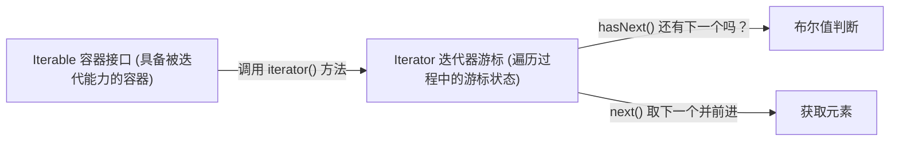

> **课程体系**：UC Berkeley CS61B: Data Structures (Spring 2024)  
> **所属模块**：Module 2: 继承与面向对象体系 (Inheritance, Interfaces & Subtyping)  
> **主讲教师**：Prof. Justin Yokota & Prof. Peyrin Kao (UC Berkeley)  
> **视频时长**：59:15 ｜ **官方原版**：Lecture 11 - Inheritance IV Iterators Object Methods  
> **视频直达**：[📺 在 B 站观看本讲原视频 (P11)](https://www.bilibili.com/video/BV1hJ4m1M7ZA/?p=11) ｜ [📑 官方课件 Slides (Google Presentation)](https://docs.google.com/presentation/d/1bahvjVtbMcc2kuyzYQfQtD8EJyIiIkWnSALVSMuyQhI) ｜ [📖 官方教材章节](https://cs61b-2.gitbook.io/cs61b-textbook/12.-exceptions-iterators-object-methods)  
> **快速导航**：[← 上一讲 (P10 继承 III：子类型多态、Comparable 与 Comparator)](/notes/cs61b/lecture-10) ｜ [📚 返回全书目录](/notes/topics/CS61B) ｜ [下一讲 (P12 渐进复杂度 I：算法性能与渐进分析) →](/notes/cs61b/lecture-12)

---

## 1. 增强型 for 循环与 Iterable 接口

*(参考时间：00:02:25 · [视频跳转 (P11 00:02:25)](https://www.bilibili.com/video/BV1hJ4m1M7ZA/?p=11&t=145))*

在 Java 中，对于数组和集合类，我们极其推崇使用简洁优美的增强型 for 循环（Enhanced For-Loop / For-Each）：

```java
for (String item : myList) {
    System.out.println(item);
}
```

但是，如果我们对自己编写的 `SLList` 或 `AList` 使用此语法，编译器会直接报错：
`foreach not applicable to type 'SLList'`！

为什么？因为编译器必须确信该容器遵循统一的迭代协议。只有实现了 **`java.lang.Iterable<T>` 接口**的对象，才能享受这个语法糖！

## 2. Iterable 与 Iterator 接口双子星设计

*(参考时间：00:12:15 · [视频跳转 (P11 00:12:15)](https://www.bilibili.com/video/BV1hJ4m1M7ZA/?p=11&t=735))*

许多初学者容易混淆 `Iterable` 与 `Iterator` 的职责分工：



### 为自定义链表实现迭代支持
```java
import java.util.Iterator;

public class SLList<Item> implements Iterable<Item> {
    // ...

    @Override
    public Iterator<Item> iterator() {
        return new SLListIterator();
    }

    private class SLListIterator implements Iterator<Item> {
        private Node curr = sentinel.next; // 维护遍历游标

        @Override
        public boolean hasNext() {
            return curr != null;
        }

        @Override
        public Item next() {
            Item item = curr.item;
            curr = curr.next;
            return item;
        }
    }
}
```

## 3. 宇宙根基：Object 类的 toString 方法

*(参考时间：00:23:40 · [视频跳转 (P11 00:23:40)](https://www.bilibili.com/video/BV1hJ4m1M7ZA/?p=11&t=1420))*

在 Java 中，所有类都隐式继承自 `java.lang.Object`。如果不显式覆写 `toString()`，默认输出的是无意义的类名加内存散列码（如 `SLList@45ee12a7`）。

```java
@Override
public String toString() {
    StringBuilder sb = new StringBuilder("{");
    for (Item x : this) { // 巧妙复用前面实现的 Iterable 语法糖！
        sb.append(x).append(", ");
    }
    if (size() > 0) {
        sb.delete(sb.length() - 2, sb.length());
    }
    sb.append("}");
    return sb.toString();
}
```

> **性能忠告**：在循环中拼接字符串务必使用 `StringBuilder`，如果用 `String + String` 会导致每次循环都重新开辟不可变字符串对象，性能急剧退化为 $O(N^2)$。

## 4. equals 方法的标准五步判等模式

*(参考时间：00:34:10 · [视频跳转 (P11 00:34:10)](https://www.bilibili.com/video/BV1hJ4m1M7ZA/?p=11&t=2050))*

Java 的 `==` 运算符永远只比较变量盒子里的位模式（对于对象即内存地址）。要比较两个容器是否**内容逻辑相等**，必须覆写 `equals(Object o)`。

实现 `equals` 必须严格遵守 Java 官方规范五大约束：
1. **自反性（Reflexive）**：`x.equals(x)` 必为 `true`；
2. **对称性（Symmetric）**：`x.equals(y)` 与 `y.equals(x)` 结果相同；
3. **传递性（Transitive）**：`x.equals(y)` 且 `y.equals(z)` 则 `x.equals(z)`；
4. **一致性（Consistent）**：对象未修改时多次调用结果不变；
5. **非空性（Non-nullity）**：`x.equals(null)` 必须返回 `false`。

### 工业级标准模板实现
```java
@Override
public boolean equals(Object other) {
    if (this == other) return true;            // 1. 同一引用直接放行
    if (other == null) return false;           // 2. 空对象直接拒绝
    if (this.getClass() != other.getClass())   // 3. 严格类型匹配
        return false;
    
    SLList<?> o = (SLList<?>) other;           // 4. 安全类型转换
    if (this.size() != o.size()) return false; // 5. 快速长度检查

    // 6. 逐项比较元素
    Iterator<Item> it1 = this.iterator();
    Iterator<?> it2 = o.iterator();
    while (it1.hasNext()) {
        Item item1 = it1.next();
        Object item2 = it2.next();
        if (!Objects.equals(item1, item2)) {
            return false;
        }
    }
    return true;
}
```

## 5. hashCode 黄金契约与小结

*(参考时间：00:46:30 · [视频跳转 (P11 00:46:30)](https://www.bilibili.com/video/BV1hJ4m1M7ZA/?p=11&t=2790))*

**铁律：只要覆写了 `equals`，就必须同时覆写 `hashCode`！**
> **契约**：如果根据 `equals` 方法判定两个对象相等，那么这两个对象调用 `hashCode()` 返回的整数值必须完全一致！  
> （如果违反此规则，该对象放入 `HashSet` 或 `HashMap` 时将会彻底失效丢失）。

本讲彻底打通了 Java 面向对象核心体系，为后续深入数据结构内部算法铺平了全部语法基石！

---

## 课程导航与跳转

| 上一讲 | 目录 | 下一讲 | 原视频 |
| :--- | :---: | :--- | :--- |
| [← 上一讲：继承 III：子类型多态、Comparable 与 Comparator](/notes/cs61b/lecture-10) | [📚 返回 CS61B 全书目录](/notes/topics/CS61B) | [下一讲：渐进复杂度 I：算法性能与渐进分析 →](/notes/cs61b/lecture-12) | [🎬 在 B 站观看本讲 (P11)](https://www.bilibili.com/video/BV1hJ4m1M7ZA/?p=11) |
