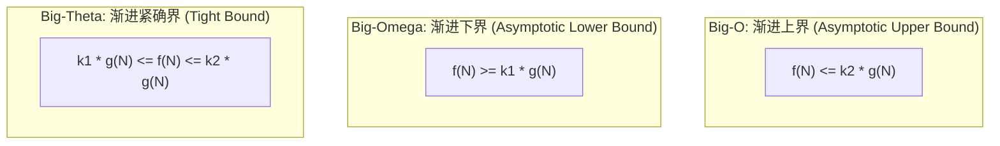

> **课程体系**：UC Berkeley CS61B: Data Structures (Spring 2024)  
> **所属模块**：Module 3: 算法渐进复杂度与不相交集 (Asymptotics & Disjoint Sets)  
> **主讲教师**：Prof. Justin Yokota & Prof. Peyrin Kao (UC Berkeley)  
> **视频时长**：51:12 ｜ **官方原版**：Lecture 12 - Asymptotics I  
> **视频直达**：[📺 在 B 站观看本讲原视频 (P12)](https://www.bilibili.com/video/BV1hJ4m1M7ZA/?p=12) ｜ [📑 官方课件 Slides (Google Presentation)](https://docs.google.com/presentation/d/1CH4rsIIvu5pbmoWUNl9QdkPQYYkJc-ptX85CBhytlzM) ｜ [📖 官方教材章节](https://cs61b-2.gitbook.io/cs61b-textbook/13.-asymptotics-i)  
> **快速导航**：[← 上一讲 (P11 继承 IV：迭代器与 Object 根基方法)](/notes/cs61b/lecture-11) ｜ [📚 返回全书目录](/notes/topics/CS61B) ｜ [下一讲 (P13 期中复习：Midterm 1 核心考点沙盘与大题剖析) →](/notes/cs61b/lecture-13)

---

## 1. 算法效率度量哲学：为什么不能用物理秒表计时？

*(参考时间：00:01:25 · [视频跳转 (P12 00:01:25)](https://www.bilibili.com/video/BV1hJ4m1M7ZA/?p=12&t=85))*

在设计数据结构与算法时，我们如何客观地评判程序 A 是否比程序 B 更加优秀？

初学者的第一直觉往往是：**写一个测试脚本，用物理秒表测量代码运行消耗了多少毫秒**（即基准测试 Benchmark）：
```java
long start = System.currentTimeMillis();
// 执行算法
long end = System.currentTimeMillis();
System.out.println("Elapsed: " + (end - start) + " ms");
```

### 为什么物理秒表在算法理论中彻底失效？
1. **硬件环境高度异构**：在顶级服务器 CPU（如 AMD EPYC 或 Apple M3 Max）上运行的代码，必然比在老旧树莓派上快上百倍。物理耗时反映的是机器算力，而非算法本身的优劣；
2. **系统并发负载波动**：操作系统的后台调度、垃圾回收（GC）暂停、CPU 动态降频与缓存竞争都会导致同一段代码两次运行的毫秒数相差甚远；
3. **输入规模（Scale of Input）的敏感度**：某些算法在处理 $N = 10$ 时极为迅速，但当数据规模膨胀到 $N = 10,000,000$ 时却需要运行上万年！

计算机科学先驱（如 Knuth 和 Tarjan）确立了渐进分析的基石哲学：
> **核心原则**：**脱离具体的物理硬件与时钟，将算法效率抽象为“基本计算操作的执行次数关于输入规模 $N$ 的数学增长函数 $f(N)$”！**

## 2. 计算基本操作次数：输入规模 $N$ 与机器操作分解

*(参考时间：00:09:10 · [视频跳转 (P12 00:09:10)](https://www.bilibili.com/video/BV1hJ4m1M7ZA/?p=12&t=550))*

考虑一个简单的数组查找算法：
```java
public static boolean dup1(int[] A) {
    for (int i = 0; i < A.length; i += 1) {
        for (int j = i + 1; j < A.length; j += 1) {
            if (A[i] == A[j]) {
                return true;
            }
        }
    }
    return false;
}
```

为了衡量其执行成本，我们统计其最耗时的核心基本操作——**比较操作 `A[i] == A[j]` 的总执行次数**。

假设数组长度为 $N$：
- 当 $i = 0$ 时，内层循环执行 $N - 1$ 次；
- 当 $i = 1$ 时，内层循环执行 $N - 2$ 次；
- ...
- 当 $i = N - 2$ 时，内层循环执行 1 次；
- 当 $i = N - 1$ 时，内层循环执行 0 次。

在最坏情况下（数组中没有重复元素），比较操作的总次数为经典的等差数列求和：
$$C(N) = (N - 1) + (N - 2) + \dots + 2 + 1 + 0 = \frac{N(N - 1)}{2} = \frac{1}{2}N^2 - \frac{1}{2}N$$

当 $N$ 增长到天文数字（如十亿）时：
- 常数系数 $\frac{1}{2}$ 和低阶项 $-\frac{1}{2}N$ 相比于主导项 $N^2$ 变得微不足道；
- 决定该算法耗时爆炸速度的，**纯粹是 $N^2$ 的二次方增长形态**！

## 3. 渐进符号三剑客：Big-Theta、Big-O、Big-Omega 形式化数学定义

*(参考时间：00:18:00 · [视频跳转 (P12 00:18:00)](https://www.bilibili.com/video/BV1hJ4m1M7ZA/?p=12&t=1080))*

为了严谨表述函数增长的阶数，计算机科学建立了三套形式化的数学渐进符号体系：



### 1. $\operatorname{Big-Theta} (\Theta)$：紧确界（Tight Bound）
- **数学定义**：$f(N) \in \Theta(g(N))$ 当且仅当存在正常数 $k_1, k_2$ 和 $N_0$，使得对所有 $N > N_0$，都有：
  $$k_1 \cdot g(N) \le f(N) \le k_2 \cdot g(N)$$
- **直观理解**：$f(N)$ 的增长速度与 $g(N)$ **完全处于同一个量级（同阶）**。
- **示例**：$\frac{1}{2}N^2 - 3N \in \Theta(N^2)$。

### 2. $\operatorname{Big-O} (O)$：渐进上界（Upper Bound）
- **数学定义**：$f(N) \in O(g(N))$ 当且仅当存在正常数 $k_2$ 和 $N_0$，使得对所有 $N > N_0$，都有：
  $$f(N) \le k_2 \cdot g(N)$$
- **直观理解**：$f(N)$ 的增长速度**不超过** $g(N)$（类似于数学上的 $\le$）。
- **示例**：$N \in O(N^2)$ 是完全成立的！$N^2 \in O(N^2)$ 同样成立。

### 3. $\operatorname{Big-Omega} (\Omega)$：渐进下界（Lower Bound）
- **数学定义**：$f(N) \in \Omega(g(N))$ 当且仅当存在正常数 $k_1$ 和 $N_0$，使得对所有 $N > N_0$，都有：
  $$f(N) \ge k_1 \cdot g(N)$$
- **直观理解**：$f(N)$ 的增长速度**不低于** $g(N)$（类似于数学上的 $\ge$）。

> **三者黄金关系公理**：  
> $$f(N) \in \Theta(g(N)) \iff f(N) \in O(g(N)) \text{ 且 } f(N) \in \Omega(g(N))$$

## 4. 常见时间复杂度阶梯与大 O 增长爆炸直观对比

*(参考时间：00:27:30 · [视频跳转 (P12 00:27:30)](https://www.bilibili.com/video/BV1hJ4m1M7ZA/?p=12&t=1650))*

在算法设计中，不同增长阶数之间存在着鸿沟般的性能差距：

$$\Theta(1) < \Theta(\log N) < \Theta(N) < \Theta(N \log N) < \Theta(N^2) < \Theta(N^3) < \Theta(2^N) < \Theta(N!)$$

### 当 $N = 1,000,000$ 时的宇宙级对比
假设 CPU 每秒可执行 $10^9$（10 亿）次基本操作：

| 复杂度阶数 | 常见代表算法 | $N = 10^6$ 时的操作次数 | 物理耗时估算 |
| :--- | :--- | :--- | :--- |
| **$\Theta(1)$** | 数组随机访问、哈希查找 | 1 次 | 1 纳秒 (瞬时) |
| **$\Theta(\log N)$** | 二分查找、平衡树检索 | $\approx 20$ 次 | 20 纳秒 (瞬时) |
| **$\Theta(N)$** | 线性扫描、无序链表遍历 | $10^6$ 次 | 1 毫秒 |
| **$\Theta(N \log N)$** | 归并排序、快速排序 | $\approx 2 \times 10^7$ 次 | 20 毫秒 |
| **$\Theta(N^2)$** | 双重嵌套循环、选择排序 | $10^{12}$ 次 | **约 16.7 分钟** |
| **$\Theta(2^N)$** | 暴力穷举所有子集 | $2^{1000000}$ 次 | **超过宇宙寿命的数亿倍！** |

从 $\Theta(N^2)$ 优化到 $\Theta(N \log N)$，是将一个需要跑十几分钟的程序直接压缩到人眼无法察觉的 20 毫秒！这就是算法的终极魅力。

## 5. 嵌套循环的数学求和推导：几何级数与对数循环

*(参考时间：00:36:00 · [视频跳转 (P12 00:36:00)](https://www.bilibili.com/video/BV1hJ4m1M7ZA/?p=12&t=2160))*

分析循环时间复杂度时，绝不能凭感觉数嵌套了几层循环，必须建立严密的**数学级数求和模型**。

### 案例一：二分除法/倍增循环（对数阶 $\Theta(\log N)$）
```java
for (int i = 1; i <= N; i = i * 2) {
    System.out.println("hello");
}
```
- 循环变量 $i$ 的取值序列为：$1, 2, 4, 8, 16, \dots, 2^k$；
- 循环终止条件：$2^k > N \implies k > \log_2 N$；
- 打印操作的执行总次数为：$k \approx \lfloor\log_2 N\rfloor + 1 = \Theta(\log N)$。

### 案例二：嵌套外层步加、内层倍增循环（$\Theta(N \log N)$）
```java
for (int i = 0; i < N; i++) {
    for (int j = 1; j <= N; j *= 2) {
        System.out.println("hi");
    }
}
```
- 外层循环独立执行 $N$ 次；
- 无论 $i$ 是多少，内层循环始终独立执行 $\log_2 N$ 次；
- 总操作次数为：$\sum_{i=0}^{N-1} \Theta(\log N) = N \times \Theta(\log N) = \Theta(N \log N)$。

## 6. 最坏情况（Worst Case）vs 最好情况（Best Case）辨析

*(参考时间：00:44:00 · [视频跳转 (P12 00:44:00)](https://www.bilibili.com/video/BV1hJ4m1M7ZA/?p=12&t=2640))*

很多初学者经常将 $O$ 与“最坏情况”划等号，将 $\Omega$ 与“最好情况”划等号。  
**这是极其严重的学术概念混淆！**

### 概念正名
- **最好情况（Best Case）与最坏情况（Worst Case）**：描述的是**输入数据的形态（Input Distribution）**！
  - 最好情况输入：在所有规模为 $N$ 的合法输入中，让算法执行步数最少的那一种输入形态；
  - 最坏情况输入：在所有规模为 $N$ 的合法输入中，让算法执行步数最多的那一种输入形态。
- **$O, \Theta, \Omega$**：描述的是**数学函数本身的上下界（Bounding Curves）**！

### 经典实战剖析：数组去重 `dup1`
- **最好情况输入**：重复元素刚好位于数组最开始的前两位（`A[0] == A[1]`）。  
  算法在进入内层循环第 1 次时立即 `return true`，耗时为 $\Theta(1)$！
- **最坏情况输入**：数组中没有任何重复元素。  
  算法必须遍历完全部两层循环，比较操作次数为 $\frac{N(N-1)}{2}$，耗时为 $\Theta(N^2)$！

> **正确的大 O 描述方式**：  
> - `dup1` 的**最好情况运行时间**是 $\Theta(1)$；  
> - `dup1` 的**最坏情况运行时间**是 $\Theta(N^2)$；  
> - 对于任何未知输入，`dup1` 的运行时间始终在 $O(N^2)$ 范围内，也在 $\Omega(1)$ 范围内！

## 7. 官方课件互动研讨题：常见渐进误区深度排坑

*(参考时间：00:50:20 · [视频跳转 (P12 00:50:20)](https://www.bilibili.com/video/BV1hJ4m1M7ZA/?p=12&t=3020))*

Josh Hug 在 Lecture 12 呈现了精选的判断题：

### 判断题：如果算法 A 的最坏情况运行时间是 $O(N^2)$，算法 B 的最坏情况是 $O(N)$，那么对于任意大小为 $N$ 的输入，算法 B 一定比算法 A 快吗？

**深入反思与答案**：  
- **不一定！**
- **理由一：输入形态的不确定性**。算法 A 的最坏情况是 $O(N^2)$，但在最好情况下它可能只需要 $\Theta(1)$ 就退出了，而算法 B 可能无论什么输入都要老老实实跑 $N$ 步；
- **理由二：隐藏的常数项因子（Hidden Constants）**。渐进分析忽略了常数项。如果算法 A 的精确耗时是 $0.0001 N^2$ 秒，而算法 B 的精确耗时是 $1,000,000 N$ 秒；当 $N < 10,000,000$ 时，算法 A 反而远快于算法 B！
- 渐进分析的意义在于预测当 $N \to \infty$ 时增长趋势的必然主导，而非对微小规模下的微基准测算。

## 8. 本讲小结与课后深化自测

*(参考时间：00:54:00 · [视频跳转 (P12 00:54:00)](https://www.bilibili.com/video/BV1hJ4m1M7ZA/?p=12&t=3240))*

### 课后综合自测题

#### 题目 1（循环求和推导）
分析下列方法的渐进时间复杂度（以 Big-Theta 表示）：
```java
public static void mystery(int N) {
    for (int i = 1; i <= N; i = i * 2) {
        for (int j = 0; j < i; j++) {
            System.out.println("cal");
        }
    }
}
```
**答案与详细数学证明**：  
- **答案**：$\Theta(N)$！
- **证明推演**：  
  外层循环变量 $i$ 的取值为 $1, 2, 4, 8, \dots, 2^k$（其中 $2^k \le N$）。  
  内层循环执行的次数恰好等于当前 $i$ 的大小。  
  因此，总执行次数为几何级数：
  $$\text{Total} = 1 + 2 + 4 + 8 + \dots + 2^k = 2 \times 2^k - 1$$
  由于 $2^k$ 是不超过 $N$ 的最大 2 的幂次，满足 $\frac{N}{2} < 2^k \le N$。  
  因此 $2 \times 2^k - 1 = \Theta(N)$！很多初学者误以为是 $\Theta(N \log N)$，忽略了内层步数随着外层呈指数暴涨的求和特性。

---

## 附录：UC Berkeley 官方教材深度研读 (Official Textbook In-Depth Chapters)

> **导读说明**：本节内容整合自 UC Berkeley CS61B 官方教材库（GitBook Textbook），针对本讲的核心数据结构与算法提供原汁原味的英文理论推导、形式化代码范例与配套章节习题，与前文视频精讲相互补充印证。

## 13. Asymptotics I

By: Thomas Lee

---

## 13.1 An Introduction to Asymptotic Analysis

We always have to start somewhere.

Previously, we have focused on how to save time *writing* the program. Now, we will learn how to make the best use of our computer's time and memory. 

We can consider the process of writing efficient programs from two different perspectives:

1. Programming Cost *(everything in the course up to this date)*

   1. How long does it take for you to develop your programs?

   2. How easy is it to read or modify your code?

   3. How maintainable is your code? (very important — much of the cost comes from maintenance and scalability, not development!)

2. Execution Cost *(everything in the course from this point on)*

   1. **Time complexity**: How much time does it take for your program to execute?

   2. **Space complexity**: How much memory does your program require?

To give a sense of what is coming up, consider a **sorted** array. Our goal is to determine if there is a duplicate element in the list.

```java

List<Integer> example = [-3, -1, 2, 4, 4, 8, 10, 12];

```

A **naïve algorithm** would be to compare every pair of elements. In the above example, we would compare -3 with every element in the list, then -1, then 2, etc. 

A **better algorithm** would be to take advantage of the sorted nature of the list! Instead of comparing every pair of elements, we can compare each element with just the element next to it.

We can see that the **naïve algorithm** seems like it’s doing a lot more unnecessary, redundant work than the **better algorithm**. But how much more work is it doing? How do we quantify how efficient a program is? This chapter will provide you the formal techniques and tools to compare the efficiency of various algorithms!

---

## 13.10 Exercises

### Factual

1. Analyze the runtime of the following code in terms of `N`:

```java

for (int i = 0; i < N; i++) {

    int j = 0;

    while (j < N) {

        j = N;

    }

}

```

2. Let $$f(N) = 2N$$. Which of the following statements is true?

   * [ ] $$f(N) \in \Theta(1)$$

   * [ ] $$f(N) \in \Theta(N)$$

   * [ ] $$f(N) \in \Theta(N^2)$$

   * [ ] $$f(N) \in O(1)$$

   * [ ] $$f(N) \in O(N)$$

   * [ ] $$f(N) \in O(N^2)$$

<details>

<summary>Problem 1</summary>

Note that the inner loop only runs once, since it immediately sets `j = N` in the first iteration. As such, the runtime is just the runtime of the outer loop, which iterates `N` times. The overall runtime, then, is linear.

</details>

<details>

<summary>Problem 2</summary>

Remember that $$\Theta$$ means the same order of growth (linear), while $$O$$ can be roughly thought of as "less than or equal to" some order of growth.

* [ ] $$f(N) \in \Theta(1)$$

* [x] $$f(N) \in \Theta(N)$$

* [ ] $$f(N) \in \Theta(N^2)$$

* [ ] $$f(N) \in O(1)$$

* [x] $$f(N) \in O(N)$$

* [x] $$f(N) \in O(N^2)$$

</details>

### Procedural

1. **True or false.** Suppose we have a function $$f$$, and we are told $$f(N) \in \Theta(N^2)$$. If we run $$f$$on an input of size $$N$$, then an input of size $$2N$$, it will take roughly 4 times as long.

2. **True or false.** Suppose we have a function $$f$$, and we are told $$f(N) \in \Theta(N^2)$$. If we run $$f$$on an input of size 100, then an input of size 200, it will take roughly 4 times as long.

<details>

<summary>Problem 1</summary>

**True**. This is the definition of asymptotics.

</details>

<details>

<summary>Problem 2</summary>

**False**. 100 may be too small of an input for asymptotic behavior to start displaying. Remember that asymptotics only apply to very large inputs!

</details>

### Metacognitive

1. Why do use asymptotics instead of empirical timing (for example, like the `Stopwatch` class from Lab 3)?

<details>

<summary>Problem 1</summary>

There are several advantages to using asymptotics over empirical timing. See if you can come up with more beyond the list below!

* Different computers run at different speeds. Depending on architecture, hardware components, even room temperature, the same code can execute with vastly different empirical times.

* It may not be feasible to test code on extremely large inputs. 

* Asymptotics are language-agnostic. The same algorithm may have different empirical runtime depending on which language it's written in (for example, C is usually around 10-400x faster than Python), but will have the same asymptotic runtime.

* The worst-case runtime may only occur in certain cases that are hard to measure empirically. 

</details>

---

## 13.2 Runtime Characterization

Techniques for Measuring Computational Cost.

We want to be able to *characterize* the runtime of the two algorithms we previously saw. In other words, we want to come up with some proxy that communicates the overall performance of each algorithm. 

When characterizing runtimes, we have two goals in mind:

* They should be simple but mathematically rigorous.

* They should clearly demonstrate the superiority of one algorithm over another if one algorithm is better than the other. 

We have converted both the naïve algorithm and the better algorithm into Java code. The function dup1 corresponds to the naïve algorithm and dup2 corresponds to the better algorithm.

```java

// Naïve algorithm: compare everything

public static boolean dup1(int[] A) {  

  for (int i = 0; i < A.length; i += 1) {

    for (int j = i + 1; j < A.length; j += 1) {

      if (A[i] == A[j]) {

         return true;

      }

    }

  }

  return false;

}

```

```java

// Better algorithm: compare only neighbors

public static boolean dup2(int[] A) {

  for (int i = 0; i < A.length - 1; i += 1) {

    if (A[i] == A[i + 1]) { 

      return true; 

    }

  }

  return false;

}

```

#### Technique 1

The first technique we will consider using for runtime characterization is directly measuring execution time in seconds using a client program. 

There are a few ways we could do this:

* Use a physical stopwatch (not recommended).

* Use Unix's built in `time` command.

* Use the Princeton Standard library which has a `stopwatch` class.

Using any of these methods will show (with varying levels of accuracy, depending on whether the physical stopwatch path was chosen) that as input size increases, `dup1` takes a longer time to complete, whereas `dup2` completes at relatively around the same rate.

It seems like technique 1 works perfectly fine for characterizing our runtimes! It is very easy to understand the results of the experiment, and it is easy to implement. However, there are some serious cons associated it that dissuades us from using it for everything:

* It could take a *long* time to finish running. 

* Running times can vary by machine, compiler, input data, etc. 

For these reasons, technique 1 does not meet our goals in characterizing runtimes. It's simple, but it's not mathematically rigorous. Moreover, the differences based on machine, compiler, input, etc. mean that the results may not clearly demonstrate the relationship between `dup1` and `dup2`.

#### Technique 2A

Rather than physically timing the amount of time it takes for the algorithm to run, we can instead count the total number of operations completed by each algorithm! Intuitively, the algorithm that runs the fewer number of operations would be superior to the other. We can fix the input size `N` to be the same for both algorithms and compare the number of operations run. 

Let us apply this to the `dup1` algorithm with an input size of `N=10000`:

```java

for (int i = 0; i < A.length; i += 1) {

  for (int j = i+1; j < A.length; j += 1) {

    if (A[i] == A[j]) {

       return true;

    }

  }

}

return false;

```

| Operation      | Count (for N=10000)                               |

| -------------- | ------------------------------------------------- |

| i = 0          | 1                                                 |

| j = i+1        | 1 (in the best case) to 10000 (in the worst case) |

| <              | 2 to 50,015,001                                   |

| += 1           | 0 to 50,005,000                                   |

| ==             | 1 to 49,995,000                                   |

| array accesses | 2 to 99,990,000                                   |

The operation `i = 0` is only run a single time at the very start of the function call. `j = i+1` is more complicated--in the best case when `A[0] == A[1]`, it only runs a single time (convince yourself of this fact!). In the worst case, `j` is initialized once for each value that `i` takes on in the outer loop, so it is initialized a total of 10000 times. 

As we dive further into the loop, it gets progressively less feasible to calculate the exact counts. We will show later on that the exact numbers do not matter that much. 

To summarize technique 2A, we have solved the issue of *machine independence*. Differences in machines do not affect the total of operations run (usually). However, it is tedious to compute all the counts for each operation. In addition, our chosen input size is arbitrary, and we do not know how much time it actually takes to run. 

#### Technique 2B

We can resolve the issue of choosing input size by calculating the *symbolic count* instead, which means that we calculate our counts in terms of the input `N`. Using this technique, we can update our table to include the symbolic counts:

| Operation      | Symbolic Count       | Count (for N=10000)                               |

| -------------- | -------------------- | ------------------------------------------------- |

| i = 0          | 1                    | 1                                                 |

| j = i+1        | 1 to N               | 1 (in the best case) to 10000 (in the worst case) |

| <              | 2 to (N² + 3N + 2)/2 | 2 to 50,015,001                                   |

| += 1           | 0 to (N² + N)/2      | 0 to 50,005,000                                   |

| ==             | 1 to (N² - N)/2      | 1 to 49,995,000                                   |

| array accesses | 2 to N²-N            | 2 to 99,990,000                                   |

Using symbolic counts allows us to see how the algorithms *scales* with input size. However, it is now even more tedious to calculate! It also still does not tell the actual time.

---

## 13.3 Checkpoint: An Exercise

Some much needed practice.

Exercise: Apply techniques 2A and 2B to `dup2`.

* Calculate the counts of each operation for the following code with respect to N.

* Predict the ***rough*** magnitudes of each one.

```java

for (int i = 0; i < A.length - 1; i += 1){

  if (A[i] == A[i + 1]) { 

    return true; 

  }

}

return false;

```

##### Solution:

Note: It's okay if you were slightly off—as mentioned earlier, you want ***rough*** estimates.

| Operation      | Symbolic Count | Count (for N=10000) |

| -------------- | -------------- | ------------------- |

| i = 0          | 1              | 1                   |

| j = i+1        | 0 to $$N$$     | 0 to 10,000         |

| <              | 0 to $$N-1$$   | 0 to 9,999          |

| ==             | 1 to $$N-1$$   | 1 to 9,999          |

| array accesses | 2 to $$2N-2$$  | 2 to 19998          |

"I have another problem for you to solve ( ͡° ͜ʖ ͡°)..." - Josh Hug


Let us compare the `dup1` table with the `dup2` table:

`dup1` table:

| Operation      | Symbolic Count           | Count (for N=10000)                               |

| -------------- | ------------------------ | ------------------------------------------------- |

| i = 0          | 1                        | 1                                                 |

| j = i+1        | 1 to $$N$$               | 1 (in the best case) to 10000 (in the worst case) |

| <              | 2 to $$(N² + 3N + 2)/2$$ | 2 to 50,015,001                                   |

| += 1           | 0 to $$(N² + N)/2$$      | 0 to 50,005,000                                   |

| ==             | 1 to $$(N² - N)/2$$      | 1 to 49,995,000                                   |

| array accesses | 2 to $$N²-N$$            | 2 to 99,990,000                                   |

`dup2` table:

| Operation      | Symbolic Count | Count (for N=10000) |

| -------------- | -------------- | ------------------- |

| i = 0          | 1              | 1                   |

| j = i+1        | 0 to $$N$$     | 0 to 10,000         |

| <              | 0 to $$N-1$$   | 0 to 9,999          |

| ==             | 1 to $$N-1$$   | 1 to 9,999          |

| array accesses | 2 to $$2N-2$$  | 2 to 19998          |

We can see that `dup2` performs significantly better than `dup1` in the worst case! 

One way to rationalize this is that it takes fewer operations for `dup2` to accomplish the same goal as `dup1`. 

A better realization is that the algorithm for `dup2` scales much better in the worst case (e.g. ($$N² + 3N + 2)/2$$ vs $$N$$)

An even **better** realization is that parabolas ($$N²$$) always grow faster than lines ($$N$$).

---

## 13.4 Asymptotic Behavior

Be on your best behavior!

In most applications, we are most concerned about what happens for very large values of $$N$$.  This is known as the *asymptotic behavior*. We want to learn what types of algorithms are able to handle large amounts of data. Some examples of applications that require highly efficient algorithms are:

* Simulating the interactions of billions of particles

* Maintaining a social network with billions of users

* Encoding billions of bytes of video data

Algorithms that scale well have better *asymptotic* runtime behavior than algorithms that scale poorly.

Let us return to the original problem of characterizing the runtimes of our `dup` functions. Recall that we desire characterizations that have the following features:

* Simple and mathematically rigorous.

* Clearly demonstrate the superiority of dup2 over dup1.

We’ve accomplished the second task! We are able to clearly see that `dup2` performed better than `dup1`. However, we didn’t do it in a very simple or mathematically rigorous way. Luckily, we can apply a series of simplifications to solve these issues.

#### Simplification 1: Consider Only the Worst Case

When comparing algorithms, we often only care about the worst case. The worst case is often where we see the most interesting effects, so we can usually ignore all other cases but the worst case. 

##### Example:

Consider the operation counts of some algorithm below. What do you expect will be the order of growth of the runtime for the algorithm?

* $$N$$ (linear)

* $$N^2$$ (quadratic)

* $$N^3$$ (cubic)

* $$N^6$$ (sextic)

| Operation        | Count           |

| ---------------- | --------------- |

| less than (<)    | $$100N^2 + 3N$$ |

| greater than (>) | $$N^3+1$$       |

| and (&&)         | $$5000$$        |

**Answer:** $$N^3$$ (cubic)

Intuitively, $$N^3$$ grows faster than $$N^2$$, so it would "dominate." To help further convince you that this is the case, consider the following argument:

* Suppose the < operator takes $$\alpha$$ nanoseconds, the > operator takes $$\beta$$ nanoseconds, and the && takes $$\gamma$$ nanoseconds.

* The total time is $$\alpha (100N^2 + 3)+\beta (2N^3+1)+5000\gamma$$ nanoseconds.

* For very large $$N$$, the $$2\beta N^3$$ term is much larger than others.

* It can help to think of it in terms of calculus. What happens as $$N$$ approaches infinity? Which term ends up dominating?

#### Simplification 2: Restrict Attention to One Operation

Pick some representative operation to act as a proxy for overall runtime. From our `dup` example:

* Good choice: `increment`, or **less than** or **equals** or **array accesses.**

* Bad choice: **assignment of** `j = i + 1`, or `i = 0.`

The operation we choose is called the “**cost model**.”

#### Simplification 3: Eliminate Low Order Terms

Ignore lower order terms.

**Sanity check**: Why does this make sense? (Related to the checkpoint above!)

#### **Simplification 4: Eliminate Multiplicative Constants**

Ignore multiplicative constants.

* Why? No real meaning!

* By choosing a single representative operation, we already “threw away” some information.

* Some operations had counts of $$3N^2$$, ​​$$N^2/2$$, etc. In general, they are all in the family/shape of $$N^2$$.

#### Checkpoint Exercise:

Apply our four simplification rules to the `dup2` table. 

| Operation      | Symbolic Count |

| -------------- | -------------- |

| i = 0          | 1              |

| j = i+1        | 0 to $$N$$     |

| <              | 0 to $$N-1$$   |

| ==             | 1 to $$N-1$$   |

| array accesses | 2 to $$2N-2$$  |

**Example answer**: array accesses with order of growth $$N$$.

<, ==, and j=i+1 would be fine answers as well.

#### Simplification Summary

* Only consider the worst case.

* Pick a representative operation (aka: cost model)

* Ignore lower order terms

* Ignore multiplicative constants.

---

## 13.6 Simplified Analysis Process

It's not that simple.

**Summary of our (Painful) Analysis Process**

* Construct a table of exact counts of all possible operations (takes lots of effort!)

* Convert table into worst case order of growth using 4 simplifications.

We will now propose an alternative method that avoids building a table altogether!

Our simplified analysis process will consist of:

* Choosing our cost model, which is the representative operation we want to count.

* Figuring out the order of growth for the count of our representative operation by either:

  * Making an exact count and discarding unnecessary pieces or...

  * Using intuition/inspection to determine orders of growth. This is something that comes with practice.

##### Example: Analysis of Nested For Loops - Exact Counts

Find the order of growth of the worst case runtime of `dup1`.

```java

int N = A.length;

for (int i = 0; i < N; i += 1)

   for (int j = i + 1; j < N; j += 1)

      if (A[i] == A[j])

         return true;

return false;

```

We will choose our cost model to be the *number of == operations*. 

Looking at the structure of the loops, the inner loop first gets run j=N-1 times. At the second iteration, i=1, so the inner loop runs an additional j=N-2 times. At the third iteration, i=2, so the inner loop runs an additional j=N-3 times. The total number of times the loop is run is thus:

$$\text{cost} = 1 + 2 + 3 + \ldots + (N-2) + (N-1)$$

This cost can be simplified to $$\frac{N(N-1)}{2}$$ ([how?](https://en.wikipedia.org/wiki/1_%2B_2_%2B_3_%2B_4_%2B_%E2%8B%AF)). We can use simplification to throw away all lower order terms and constants to get the worst case order of growth $$N^2$$.

##### Example: Analysis of Nested For Loops - Geometric Argument

* We can see that the number of equals can be given by the area of a right triangle, which has a side length of $$N- 1$$.

* Therefore, the order of growth of area is $$N^2$$.​​

* This is definitely not something that is immediately obvious. It takes time and practice to see these patterns!

---

## 13.7 Big-Theta

Not to be confused with Big-O.

#### Formalizing Order of Growth

Given some function $$Q(N)$$, we can apply our last two simplifications to get the order of growth of $$Q(N)$$. 

For example, if $$Q(N)=3N^3+N^2$$, the order of growth is $$N^3$$.

From now onward, we will refer to order of growth as $$\Theta$$ (pronounced "big theta"). 

#### Order of Growth Examples

The following functions have these corresponding order of growths:

| Function          | Order of Growth |

| ----------------- | --------------- |

| $$N^3+3N^4$$      | $$N^4$$         |

| $$1/N + N^3$$     | $$N^3$$         |

| $$1/N + 5$$       | $$1$$           |

| $$Ne^N+N$$        | $$Ne^N$$        |

| $$40sin(N)+4N^2$$ | $$N^2$$         |

Instead of saying a function has *order of growth* \_\_\_, we say that the function *belongs to* $$\Theta (\text{\_\_})$$. In other words, it belongs to the family of functions that have that same order of growth.

#### Formal Definition

For some function $$R(N)$$ with order of growth $$f(N)$$, we write that:

$$R(N) \in \Theta(f(N))$$ and there exists some positive constants $$k\_1$$, $$k\_2$$ such that...

$$k\_1 \cdot f(N) \leq R(N) \leq k\_2\cdot f(N)$$ for all values $$N$$ greater than some $$N\_0$$ (a very large $$N$$).

---

## 13.8 Big-O

Not to be confused with Big-Theta.

O (pronounced "Big-Oh") is similar to $$\Theta$$. Instead of being an "equality" on the order of growth, it can be though of as "less than or equal."

For example, the following statements are all true:

* $$N^3  + 3N^4 \in \Theta (N^4)$$

* $$N^3 + 3N^4 \in \text{O}(N^4)$$

* $$N^3 + 3N^4 \in \text{O}(N^6)$$

* $$N^3 + 3N^4 \in \text{O}(N^{N!})$$

#### **Formal Definition**

$$R(N) \in \text{O}(f(N))$$ means that there exists positive constant $$k\_2$$ such that:\

$$R(N) \leq k\_2 \cdot f(N)$$ for all values of $$N$$ greater than some $$N\_0$$ (a very large $$N$$).

Observe that this is a looser condition than $$\Theta$$ since O does not care about the lower bound. 

---

## 13.9 Summary

To summarize this chapter:

* Given a piece of code, we can express its runtime as a function $$R(N)$$

  * $$N$$ is a **property** of the input of the function often representing the **size** of the input

* Rather than finding the exact value of $$R(N)$$, we only worry about finding the **order of growth** of $$R(N)$$.

* One approach (not universal):

  * Choose a representative operation

  * Let $$C(N)$$ be the count of how many times that operation occurs as a function of $$N$$.

  * Determine order of growth $$f(N)$$ for $$C(N)$$, i.e. $$C(N)\in \Theta(f(N))$$

  * Often (but not always) we consider the worst case count.

  * If operation takes constant time, then $$R(N)\in \Theta(f(N))$$.


---

## 课程导航与跳转

| 上一讲 | 目录 | 下一讲 | 原视频 |
| :--- | :---: | :--- | :--- |
| [← 上一讲：继承 IV：迭代器与 Object 根基方法](/notes/cs61b/lecture-11) | [📚 返回 CS61B 全书目录](/notes/topics/CS61B) | [下一讲：期中复习：Midterm 1 核心考点沙盘与大题剖析 →](/notes/cs61b/lecture-13) | [🎬 在 B 站观看本讲 (P12)](https://www.bilibili.com/video/BV1hJ4m1M7ZA/?p=12) |
