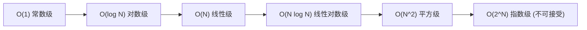

> **课程体系**：UC Berkeley CS61B: Data Structures (Spring 2024)  
> **所属模块**：Module 3: 算法渐进复杂度与不相交集 (Asymptotics & Disjoint Sets)  
> **主讲教师**：Prof. Justin Yokota & Prof. Peyrin Kao (UC Berkeley)  
> **视频时长**：51:12 ｜ **官方原版**：Lecture 12 - Asymptotics I  
> **视频直达**：[📺 在 B 站观看本讲原视频 (P12)](https://www.bilibili.com/video/BV1hJ4m1M7ZA/?p=12) ｜ [📑 官方课件 Slides (Google Presentation)](https://docs.google.com/presentation/d/1CH4rsIIvu5pbmoWUNl9QdkPQYYkJc-ptX85CBhytlzM) ｜ [📖 官方教材章节](https://cs61b-2.gitbook.io/cs61b-textbook/13.-asymptotics-i)  
> **快速导航**：[← 上一讲 (P11 继承 IV：迭代器模式与 Object 核心规范)](/notes/cs61b/lecture-11) ｜ [📚 返回全书目录](/notes/topics/CS61B) ｜ [下一讲 (P13 期中核心串讲与复习实战) →](/notes/cs61b/lecture-13)

---

## 1. 为什么不能只用计时器测量运行时间

*(参考时间：00:02:10 · [视频跳转 (P12 00:02:10)](https://www.bilibili.com/video/BV1hJ4m1M7ZA/?p=12&t=130))*

在评价两个算法的优劣时，最直观的想法是用系统秒表测量实际运行时间（Wall-clock Time）。但这种物理计时存在根本性的缺陷：
1. **硬件异构性**：相同的算法在超级计算机和树莓派上的运行时间完全没有可比性；
2. **环境干扰**：后台进程调度、CPU 频率波动、JVM 垃圾回收暂停都会严重污染测量结果；
3. **输入尺度盲区**：在 $N=10$ 时更快的算法，在 $N=10^8$ 时可能慢如蜗牛。

为了摆脱硬件与环境的偶然性，计算机科学家引入了纯粹的数学工具：**渐进分析（Asymptotic Analysis）**。

## 2. 操作计数与增长阶（Order of Growth）

*(参考时间：00:11:40 · [视频跳转 (P12 00:11:40)](https://www.bilibili.com/video/BV1hJ4m1M7ZA/?p=12&t=700))*

渐进分析的核心思想是：**统计关键操作（如比较、赋值、算术运算）的执行次数，并观察当输入规模 $N \to \infty$ 时，操作次数随 $N$ 增长的数学函数形态**。

考虑以下嵌套循环代码：
```java
int count = 0;
for (int i = 0; i < N; i++) {
    for (int j = 0; j < i; j++) {
        count++;
    }
}
```
内层循环执行次数为等差数列求和：
$$0 + 1 + 2 + \dots + (N-1) = \frac{N(N-1)}{2} = \frac{1}{2}N^2 - \frac{1}{2}N$$

当 $N$ 极大时（例如 $N=10^6$），$N^2$ 项是决定总次数量级的绝对主导项，低阶项 $-\frac{1}{2}N$ 和系数 $\frac{1}{2}$ 在量级层面都可以忽略不计。其**增长阶为 $N^2$**。

## 3. 渐进符号三大天王：Big-O, Big-Theta, Big-Omega

*(参考时间：00:23:15 · [视频跳转 (P12 00:23:15)](https://www.bilibili.com/video/BV1hJ4m1M7ZA/?p=12&t=1395))*

许多程序员日常混淆这些符号。以下给出严密的数学定义与工程直觉：

### 1. 大 Theta 符号（$\Theta$）：紧确界（Tight Bound）
> 若存在正常数 $k_1, k_2$ 和 $n_0$，使得对于所有 $N \ge n_0$，恒有 $k_1 \cdot f(N) \le R(N) \le k_2 \cdot f(N)$，则称 $R(N) \in \Theta(f(N))$。
- **直觉**：算法的真实耗时与 $f(N)$ 的增长速度“同频共振”（既是天花板，又是地板）。

### 2. 大 O 符号（$O$）：渐进上界（Upper Bound）
> 若存在正常数 $k_2$ 和 $n_0$，使得对于所有 $N \ge n_0$，恒有 $R(N) \le k_2 \cdot f(N)$，则称 $R(N) \in O(f(N))$。
- **直觉**：算法的耗时“不超过（$\le$）”某种速度。例如，一小时内能跑完的程序，说它在一年内能跑完（$O(N^3)$）在数学上完全成立！

### 3. 大 Omega 符号（$\Omega$）：渐进下界（Lower Bound）
> 若存在正常数 $k_1$ 和 $n_0$，使得对于所有 $N \ge n_0$，恒有 $R(N) \ge k_1 \cdot f(N)$，则称 $R(N) \in \Omega(f(N))$。
- **直觉**：算法的耗时“至少需要（$\ge$）”某种代价，通常用来证明一个问题的本质理论困难度。

## 4. 经典复杂度等级谱系

*(参考时间：00:35:50 · [视频跳转 (P12 00:35:50)](https://www.bilibili.com/video/BV1hJ4m1M7ZA/?p=12&t=2150))*

不同增长阶的算法在工业级规模下的命运天差地别：



| 复杂度 | $N = 10$ | $N = 10^6$ (百万) | 典型代表算法 |
| :--- | :--- | :--- | :--- |
| **$O(1)$** | 1 次 | 1 次 | 数组直接寻址、哈希表查找 |
| **$O(\log N)$** | ~3 次 | ~20 次 | 二分查找、平衡二叉树查找 |
| **$O(N)$** | 10 次 | $10^6$ 次 (毫秒) | 线性扫描、单向链表遍历 |
| **$O(N \log N)$** | ~33 次 | $\approx 2 \times 10^7$ 次 (0.02秒) | 归并排序、快速排序 |
| **$O(N^2)$** | 100 次 | $10^{12}$ 次 (约 16 分钟) | 选择排序、冒泡排序 |
| **$O(2^N)$** | 1024 次 | 宇宙毁灭亦算不完 | 暴力旅行商问题、子集穷举 |

## 5. 本讲小结与循环分析避坑

*(参考时间：00:46:10 · [视频跳转 (P12 00:46:10)](https://www.bilibili.com/video/BV1hJ4m1M7ZA/?p=12&t=2770))*

- **双重循环不一定等于 $O(N^2)$**：必须仔细检查循环变量的变化规律！例如外层 `i++`，内层 `j *= 2`，则总时间为 $O(N \log N)$ 而非 $O(N^2)$；
- **几何级数是常客**：$1 + 2 + 4 + 8 + \dots + N = 2N - 1 = \Theta(N)$，切勿盲目当作高阶多项式处理；
- **区分最坏、最好与平均情况**：同一个算法（如线性查找）的最好情况是 $\Theta(1)$，最坏情况是 $\Theta(N)$。

---

## 课程导航与跳转

| 上一讲 | 目录 | 下一讲 | 原视频 |
| :--- | :---: | :--- | :--- |
| [← 上一讲：继承 IV：迭代器模式与 Object 核心规范](/notes/cs61b/lecture-11) | [📚 返回 CS61B 全书目录](/notes/topics/CS61B) | [下一讲：期中核心串讲与复习实战 →](/notes/cs61b/lecture-13) | [🎬 在 B 站观看本讲 (P12)](https://www.bilibili.com/video/BV1hJ4m1M7ZA/?p=12) |
