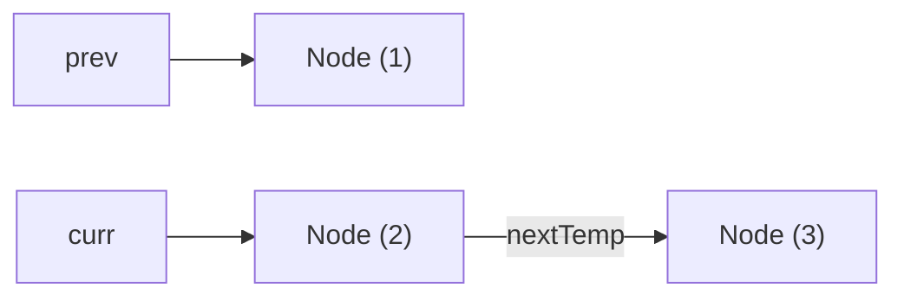

> **课程体系**：UC Berkeley CS61B: Data Structures (Spring 2024)  
> **所属模块**：Module 3: 算法渐进复杂度与不相交集 (Asymptotics & Disjoint Sets)  
> **主讲教师**：Prof. Justin Yokota & Prof. Peyrin Kao (UC Berkeley)  
> **视频时长**：52:35 ｜ **官方原版**：Lecture 13 - Midterm Review  
> **视频直达**：[📺 在 B 站观看本讲原视频 (P13)](https://www.bilibili.com/video/BV1hJ4m1M7ZA/?p=13) ｜ [📑 官方课件 Slides (Google Presentation)](https://docs.google.com/presentation/d/1XfRFqI5g6sM6LW2tWShnX-V2kVhBg6NJbIG6gvPtBn0)  
> **快速导航**：[← 上一讲 (P12 渐进复杂度 I：算法性能与渐进分析)](/notes/cs61b/lecture-12) ｜ [📚 返回全书目录](/notes/topics/CS61B) ｜ [下一讲 (P14 不相交集：动态连通性与 Quick-Union) →](/notes/cs61b/lecture-14)

---

## 1. 链表指针追踪与拓扑重组

*(参考时间：00:02:15 · [视频跳转 (P13 00:02:15)](https://www.bilibili.com/video/BV1hJ4m1M7ZA/?p=13&t=135))*

期中考试中最经典的考题之一是在不分配新堆内存的前提下，原地修改链表节点的指针链路。

### 经典考题：链表反转（Reverse a Linked List）
```java
/** 原地反转单向链表，返回新的头指针 */
public static IntNode reverse(IntNode head) {
    IntNode prev = null;
    IntNode curr = head;
    while (curr != null) {
        IntNode nextTemp = curr.next; // 1. 暂存后继节点，防止断链
        curr.next = prev;             // 2. 指针掉头
        prev = curr;                  // 3. 前驱指针前进一步
        curr = nextTemp;              // 4. 当前指针前进一步
    }
    return prev;
}
```



## 2. 多态分派与类型强转判断法则

*(参考时间：00:14:30 · [视频跳转 (P13 00:14:30)](https://www.bilibili.com/video/BV1hJ4m1M7ZA/?p=13&t=870))*

期中考试中失分率最高的选择题：判断一行语句是**通过编译、编译报错还是运行期抛 ClassCastException**。

牢记两步黄金检验法：
1. **编译期规则**：编译器拿着变量的**静态类型（Static Type）**去类图里找。只有该静态类型或其祖先声明了此方法，编译才放行！
2. **运行期规则**：一旦通过编译，JVM 从变量指向的**实际运行期类型（Dynamic Type）**自底向上寻找覆写的方法实现并执行！

```java
class Animal { void speak() { ... } }
class Dog extends Animal { void bark() { ... } }

Animal a = new Dog(); // 合法
a.speak();            // 编译通过，运行执行 Dog 的实现
// a.bark();          // 编译直接报错！Animal 静态类型没有 bark()！
((Dog) a).bark();     // 强转告知编译器，编译通过并正常运行
```

## 3. 复杂递归的追踪技巧与堆栈图

*(参考时间：00:27:50 · [视频跳转 (P13 00:27:50)](https://www.bilibili.com/video/BV1hJ4m1M7ZA/?p=13&t=1670))*

面对深层树状递归题，不要在大脑中并发追踪所有分支。在草稿纸上画出**调用树（Call Tree）**，清晰标记每层的返回值与合并逻辑：
- 确定 Base Case 的精确返回值；
- 假定子递归（Recursive Leap of Faith）能够正确返回子问题结果；
- 专注验证当前层如何使用子结果拼装出自己的结果。

## 4. 渐进分析易错考点复盘

*(参考时间：00:39:10 · [视频跳转 (P13 00:39:10)](https://www.bilibili.com/video/BV1hJ4m1M7ZA/?p=13&t=2350))*

考点：判断以下代码的运行时间：
```java
for (int i = 1; i <= N; i *= 2) {
    for (int j = 0; j < i; j++) {
        System.out.println("hello");
    }
}
```
很多同学看到两层循环直接写 $O(N \log N)$，**大错特错！**  
内层循环执行的次数依次是：$1, 2, 4, 8, \dots, N$。  
其总和为几何级数：$1 + 2 + 4 + \dots + N = 2N - 1 = \Theta(N)$！**其真实复杂度是优雅的线性时间 $\Theta(N)$！**

## 5. 本讲小结与考前锦囊

*(参考时间：00:48:00 · [视频跳转 (P13 00:48:00)](https://www.bilibili.com/video/BV1hJ4m1M7ZA/?p=13&t=2880))*

- 遇到指针题，一定要在草稿纸上画盒子与箭头（Box-and-Pointer）；
- 涉及数组与链表，务必在脑海中主动扫描 $N=0$（空集合）与 $N=1$（单元素）极端边界；
- 警惕不可变对象的陷阱，确认修改是否真正作用在了堆对象内部。

---

## 课程导航与跳转

| 上一讲 | 目录 | 下一讲 | 原视频 |
| :--- | :---: | :--- | :--- |
| [← 上一讲：渐进复杂度 I：算法性能与渐进分析](/notes/cs61b/lecture-12) | [📚 返回 CS61B 全书目录](/notes/topics/CS61B) | [下一讲：不相交集：动态连通性与 Quick-Union →](/notes/cs61b/lecture-14) | [🎬 在 B 站观看本讲 (P13)](https://www.bilibili.com/video/BV1hJ4m1M7ZA/?p=13) |
